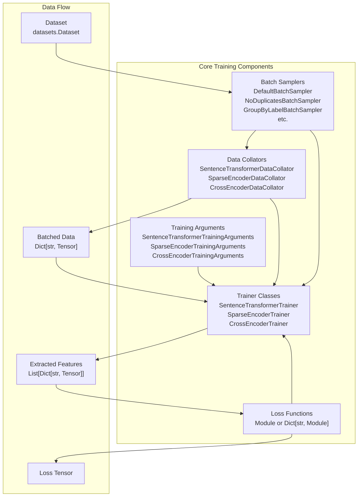
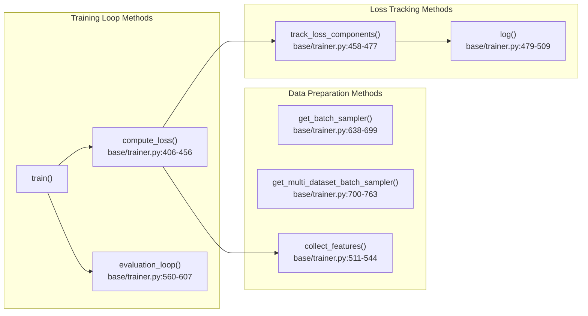
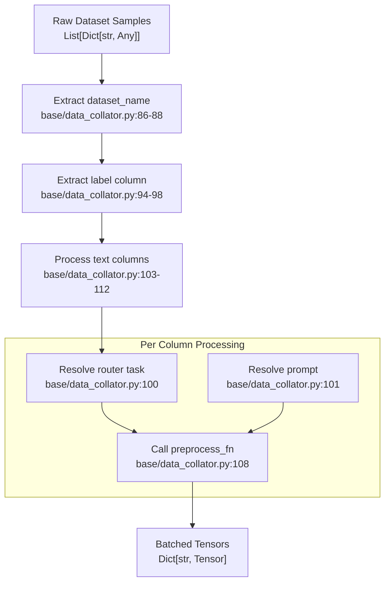
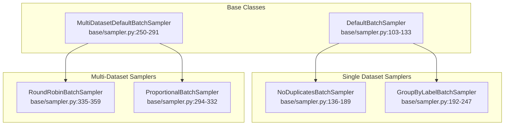

<!-- source: DeepWiki mcp.deepwiki.com · repo huggingface/sentence-transformers · page 9.2 Training Components · fetched 2026-10-26 -->

# Training Components

<details>
<summary>Relevant source files</summary>

The following files were used as context for generating this wiki page:

- [sentence_transformers/base/data_collator.py](sentence_transformers/base/data_collator.py)
- [sentence_transformers/base/peft_mixin.py](sentence_transformers/base/peft_mixin.py)
- [sentence_transformers/base/trainer.py](sentence_transformers/base/trainer.py)
- [sentence_transformers/base/training_args.py](sentence_transformers/base/training_args.py)
- [sentence_transformers/cross_encoder/data_collator.py](sentence_transformers/cross_encoder/data_collator.py)
- [sentence_transformers/cross_encoder/trainer.py](sentence_transformers/cross_encoder/trainer.py)
- [sentence_transformers/sentence_transformer/trainer.py](sentence_transformers/sentence_transformer/trainer.py)
- [sentence_transformers/sparse_encoder/trainer.py](sentence_transformers/sparse_encoder/trainer.py)
- [sentence_transformers/util/similarity.py](sentence_transformers/util/similarity.py)
- [tests/cross_encoder/test_trainer.py](tests/cross_encoder/test_trainer.py)
- [tests/sentence_transformer/test_trainer.py](tests/sentence_transformer/test_trainer.py)
- [tests/sparse_encoder/test_trainer.py](tests/sparse_encoder/test_trainer.py)

</details>


This page provides API reference documentation for the training components in the sentence-transformers library. These components orchestrate the training loop, data preparation, and loss computation for `SentenceTransformer`, `SparseEncoder`, and `CrossEncoder` models.

For conceptual information about training models, see [Training Models](#5). For detailed information about specific loss functions, see [Loss Functions](#5.3). For evaluation components, see [Evaluation Components](#9.3).

## Overview of Training Components

The training system consists of several interconnected components that work together to train sentence transformer models:



**Diagram: Training Component Architecture**

Sources: `[sentence_transformers/base/trainer.py:76-130]()`, `[sentence_transformers/base/data_collator.py:14-112]()`, `[sentence_transformers/base/training_args.py:25-122]()`

## Trainer Classes

### SentenceTransformerTrainer

The `SentenceTransformerTrainer` class extends the Hugging Face `transformers.Trainer` with Sentence Transformer-specific functionality.

**Class Definition**: `[sentence_transformers/sentence_transformer/trainer.py:36-115]()`

**Key Initialization Parameters**:

| Parameter | Type | Description |
|-----------|------|-------------|
| `model` | `SentenceTransformer \| None` | The model to train. Required unless `model_init` is provided. |
| `args` | `SentenceTransformerTrainingArguments \| None` | Training configuration. Defaults to basic instance with `output_dir="tmp_trainer"`. |
| `train_dataset` | `Dataset \| DatasetDict \| dict[str, Dataset] \| None` | Training dataset. Can be a single dataset or dictionary of datasets for multi-dataset training. |
| `eval_dataset` | `Dataset \| DatasetDict \| dict[str, Dataset] \| None` | Evaluation dataset. Optional. |
| `loss` | `nn.Module \| dict[str, nn.Module] \| Callable \| None` | Loss function(s). Can be a single loss, dict of losses for multi-dataset training, or callable that returns a loss. |
| `evaluator` | `BaseEvaluator \| list[BaseEvaluator] \| None` | Evaluator(s) for computing metrics during training. |
| `data_collator` | `DataCollator \| None` | Custom data collator. Defaults to `SentenceTransformerDataCollator`. |

**Key Methods (BaseTrainer)**:



**Diagram: BaseTrainer Method Flow**

**`compute_loss` Method**: Computes the loss for a batch of inputs. This method handles both single-loss and multi-dataset training scenarios. `[sentence_transformers/base/trainer.py:406-456]()`.

The method:
1. Extracts the dataset name if present (for multi-dataset training).
2. Collects features from the input batch using `collect_features`.
3. Selects the appropriate loss function (from dict if multi-dataset).
4. Computes the loss and tracks components if the loss returns a dict.

**`collect_features` Method**: Transforms collated batch data into separate feature dictionaries for each text column. `[sentence_transformers/base/trainer.py:511-544]()`.

Input batch structure:
```
{
    'sentence_0_input_ids': Tensor,
    'sentence_0_attention_mask': Tensor,
    'sentence_1_input_ids': Tensor,
    'sentence_1_attention_mask': Tensor,
    'label': Tensor
}
```

Output structure:
```python
features = [
    {'input_ids': Tensor, 'attention_mask': Tensor},  # sentence_0
    {'input_ids': Tensor, 'attention_mask': Tensor}   # sentence_1
]
labels = Tensor
```

Sources: `[sentence_transformers/base/trainer.py:76-1000]()`, `[sentence_transformers/sentence_transformer/trainer.py:36-115]()`

### SparseEncoderTrainer

The `SparseEncoderTrainer` extends `BaseTrainer` with sparse encoder-specific functionality.

**Class Definition**: `[sentence_transformers/sparse_encoder/trainer.py:35-419]()`

**Key Differences**:

1. **Default Loss**: Uses `SpladeLoss` with `SparseMultipleNegativesRankingLoss` if no loss is provided. `[sentence_transformers/sparse_encoder/trainer.py:271-282]()`.
2. **Regularizer Scheduler**: Automatically integrates `SpladeRegularizerWeightSchedulerCallback` to manage document and query regularizer weights during training. `[sentence_transformers/sparse_encoder/trainer.py:355-377]()`.
3. **Model Card Callback**: Uses `SparseEncoderModelCardCallback` for generating model cards specific to sparse models. `[sentence_transformers/sparse_encoder/trainer.py:328-330]()`.

Sources: `[sentence_transformers/sparse_encoder/trainer.py:35-419]()`

### CrossEncoderTrainer

The `CrossEncoderTrainer` handles training for `CrossEncoder` models which jointly encode text pairs.

**Class Definition**: `[sentence_transformers/cross_encoder/trainer.py:34-367]()`

**Key Differences**:
1. **Default Loss**: Defaults to `BinaryCrossEntropyLoss`. `[sentence_transformers/cross_encoder/trainer.py:246-248]()`.
2. **Data Collator**: Defaults to `CrossEncoderDataCollator`. `[sentence_transformers/cross_encoder/trainer.py:171-172]()`.
3. **Joint Encoding**: Unlike bi-encoders, it does not use `collect_features` to split columns, as `CrossEncoder` models process pairs as a single sequence.

Sources: `[sentence_transformers/cross_encoder/trainer.py:34-367]()`

## Training Arguments

Training arguments configure all aspects of the training loop, including optimization, evaluation, logging, and data sampling strategies.

### BaseTrainingArguments

Extends Hugging Face `TrainingArguments` with Sentence Transformer-specific options.

**Class Definition**: `[sentence_transformers/base/training_args.py:25-122]()`

**Key Additional Parameters**:

| Parameter | Type | Default | Description |
|-----------|------|---------|-------------|
| `batch_sampler` | `BatchSamplers \| Type[DefaultBatchSampler] \| Callable` | `BatchSamplers.BATCH_SAMPLER` | Strategy for creating batches. |
| `multi_dataset_batch_sampler` | `MultiDatasetBatchSamplers \| Type[MultiDatasetDefaultBatchSampler] \| Callable` | `MultiDatasetBatchSamplers.PROPORTIONAL` | Strategy for multi-dataset training. |
| `prompts` | `str \| dict[str, str] \| dict[str, dict[str, str]] \| None` | `None` | Prompts to prepend to inputs. |
| `router_mapping` | `dict[str, str] \| dict[str, dict[str, str]] \| None` | `{}` | Maps columns to Router task types ("query", "document"). |
| `learning_rate_mapping` | `dict[str, float] \| None` | `{}` | Maps parameter regex to specific learning rates. |

**BatchSamplers Enum Values**: `[sentence_transformers/base/sampler.py:34-38]()`

- `BATCH_SAMPLER`: Standard random sampling.
- `NO_DUPLICATES`: Ensures no duplicate texts in a single batch.
- `GROUP_BY_LABEL`: Groups samples with the same label into a batch.

Sources: `[sentence_transformers/base/training_args.py:25-122]()`, `[sentence_transformers/base/sampler.py:34-38]()`

## Data Collators

Data collators transform raw dataset samples into batched, tokenized inputs.

### BaseDataCollator

**Class Definition**: `[sentence_transformers/base/data_collator.py:14-152]()`

**Processing Flow**:



**Diagram: BaseDataCollator Processing Flow**

Sources: `[sentence_transformers/base/data_collator.py:14-152]()`

### CrossEncoderDataCollator

Unlike the base collator, this collator returns raw text columns because `CrossEncoder` loss functions handle tokenization (preprocessing) internally. `[sentence_transformers/cross_encoder/data_collator.py:13-91]()`.

- **Column Order Warning**: It warns if common column names (like "anchor", "positive") are in unexpected positions, as some losses rely on index-based access. `[sentence_transformers/base/data_collator.py:114-151]()`.
- **Prompt Resolution**: Only supports a single prompt or per-dataset mapping, as multiple columns are combined into pairs. `[sentence_transformers/cross_encoder/data_collator.py:29-37]()`.

Sources: `[sentence_transformers/cross_encoder/data_collator.py:13-91]()`

## Batch Samplers

Batch samplers control how training samples are grouped into batches.

### Sampler Hierarchy



**Diagram: Batch Sampler Hierarchy**

**NoDuplicatesBatchSampler**: Used to prevent identical sentences in a batch, which is critical for losses like `MultipleNegativesRankingLoss` where duplicates would act as false negatives. `[sentence_transformers/base/sampler.py:136-189]()`.

**ProportionalBatchSampler**: When training on multiple datasets, this sampler draws batches from datasets with a probability proportional to the dataset size. `[sentence_transformers/base/sampler.py:294-332]()`.

Sources: `[sentence_transformers/base/sampler.py:103-359]()`

## PEFT Integration

The `PeftAdapterMixin` allows training components to interact with Parameter-Efficient Fine-Tuning (PEFT) adapters.

- **Methods**: `load_adapter`, `add_adapter`, `set_adapter`, `disable_adapters`, `enable_adapters`. `[sentence_transformers/base/peft_mixin.py:26-144]()`.
- **Wrapper**: Uses `peft_wrapper` to ensure the underlying transformer model is compatible before calling adapter methods. `[sentence_transformers/base/peft_mixin.py:8-23]()`.

Sources: `[sentence_transformers/base/peft_mixin.py:1-144]()`

## Similarity Functions

Utility functions used within training losses and evaluation components to compute scores between embeddings.

| Function | Description | Implementation |
|----------|-------------|----------------|
| `cos_sim` | Cosine similarity between two tensors. | `[sentence_transformers/util/similarity.py:33-49]()` |
| `dot_score` | Dot product between all pairs. | `[sentence_transformers/util/similarity.py:75-89]()` |
| `euclidean_sim` | Negative Euclidean distance. | `[sentence_transformers/util/similarity.py:153-181]()` |
| `manhattan_sim` | Negative Manhattan distance. | `[sentence_transformers/util/similarity.py:109-133]()` |

Sources: `[sentence_transformers/util/similarity.py:1-215]()`

---

