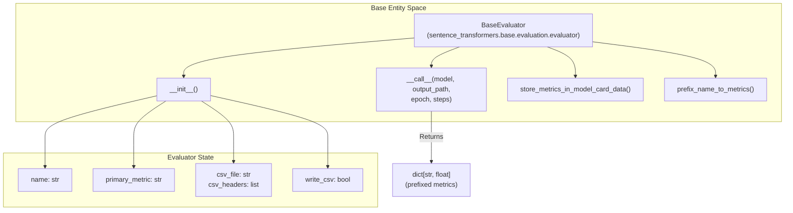
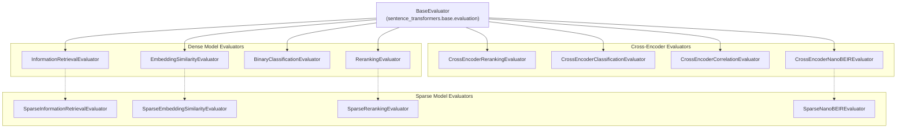

<!-- source: DeepWiki mcp.deepwiki.com · repo huggingface/sentence-transformers · page 9.3 Evaluation Components · fetched 2026-10-26 -->

# Evaluation Components

Relevant source files

The following files were used as context for generating this wiki page:

- [examples/sparse_encoder/evaluation/sparse_classification_evaluator.py](examples/sparse_encoder/evaluation/sparse_classification_evaluator.py)
- [examples/sparse_encoder/evaluation/sparse_mse_evaluator.py](examples/sparse_encoder/evaluation/sparse_mse_evaluator.py)
- [examples/sparse_encoder/evaluation/sparse_nanobeir_advanced_evaluator.py](examples/sparse_encoder/evaluation/sparse_nanobeir_advanced_evaluator.py)
- [examples/sparse_encoder/evaluation/sparse_nanobeir_evaluator.py](examples/sparse_encoder/evaluation/sparse_nanobeir_evaluator.py)
- [examples/sparse_encoder/evaluation/sparse_reranking_evaluator.py](examples/sparse_encoder/evaluation/sparse_reranking_evaluator.py)
- [examples/sparse_encoder/evaluation/sparse_retrieval_evaluator.py](examples/sparse_encoder/evaluation/sparse_retrieval_evaluator.py)
- [examples/sparse_encoder/evaluation/sparse_translation_evaluator.py](examples/sparse_encoder/evaluation/sparse_translation_evaluator.py)
- [examples/sparse_encoder/evaluation/sparse_triplet_evaluator.py](examples/sparse_encoder/evaluation/sparse_triplet_evaluator.py)
- [sentence_transformers/cross_encoder/evaluation/classification.py](sentence_transformers/cross_encoder/evaluation/classification.py)
- [sentence_transformers/cross_encoder/evaluation/correlation.py](sentence_transformers/cross_encoder/evaluation/correlation.py)
- [sentence_transformers/cross_encoder/evaluation/nano_beir.py](sentence_transformers/cross_encoder/evaluation/nano_beir.py)
- [sentence_transformers/cross_encoder/evaluation/reranking.py](sentence_transformers/cross_encoder/evaluation/reranking.py)

This page documents the evaluation components in the sentence-transformers library. These components provide metrics for assessing model performance on various tasks including information retrieval, semantic similarity, classification, and translation across Dense, Sparse, and Cross-Encoder architectures.

## Overview

The evaluation system provides a unified interface through the `BaseEvaluator` abstract base class (aliased as `SentenceEvaluator` for dense models), with specialized implementations for different tasks. Evaluators can be used standalone or integrated into the training loop for monitoring performance during fine-tuning.

**Key Features:**
- Consistent `__call__` interface across all evaluators.
- Automatic metric storage in model cards via `ModelCardData`.
- CSV logging for tracking metrics over time during training.
- Support for dense, sparse, and cross-encoder models.
- Specialized evaluators for sparsity-aware metrics and FLOPS calculation.

Sources: [sentence_transformers/base/evaluation/evaluator.py:12-21](), [sentence_transformers/cross_encoder/evaluation/reranking.py:19-25]()

## Base Evaluator Architecture

**Abstract Base Class: `BaseEvaluator`**

All evaluators inherit from `BaseEvaluator` which provides:
- **`__call__(model, output_path, epoch, steps)`**: Main evaluation method that computes metrics. It returns a dictionary of metrics [sentence_transformers/base/evaluation/evaluator.py:64-75]().
- **`store_metrics_in_model_card_data(model, metrics, epoch, steps)`**: Saves metrics to the model card metadata [sentence_transformers/base/evaluation/evaluator.py:107-122]().
- **`prefix_name_to_metrics(metrics, name)`**: Adds the evaluator name prefix to metric keys to avoid collisions when using multiple evaluators [sentence_transformers/base/evaluation/evaluator.py:94-105]().

Sources: [sentence_transformers/base/evaluation/evaluator.py:12-122]()

## Evaluator Class Hierarchy

Sources: [sentence_transformers/cross_encoder/evaluation/reranking.py:19-38](), [sentence_transformers/cross_encoder/evaluation/classification.py:20-26](), [sentence_transformers/cross_encoder/evaluation/correlation.py:19-24](), [sentence_transformers/sparse_encoder/evaluation/SparseInformationRetrievalEvaluator.py:23-40]()

## Cross-Encoder Evaluators

Cross-encoders differ from bi-encoders as they process sentence pairs simultaneously, making them highly accurate but computationally expensive for large-scale retrieval.

### CrossEncoderRerankingEvaluator

Evaluates a CrossEncoder for the task of re-ranking a set of documents for a given query.

**Key Features:**
- Computes scores for `[query, doc_i]` pairs [sentence_transformers/cross_encoder/evaluation/reranking.py:23-25]().
- Metrics: `MRR@k`, `NDCG@k`, and `MAP` [sentence_transformers/cross_encoder/evaluation/reranking.py:24-25]().
- Supports "Base -> Reranked" comparison if a pre-ranked `documents` list is provided [sentence_transformers/cross_encoder/evaluation/reranking.py:28-32]().

Sources: [sentence_transformers/cross_encoder/evaluation/reranking.py:19-103]()

### CrossEncoderClassificationEvaluator

Evaluates based on the accuracy of predicted classes vs. gold labels.

**Behavior:**
- **Binary (1 output)**: Calculates Accuracy, F1, Precision, Recall, and Average Precision [sentence_transformers/cross_encoder/evaluation/classification.py:122-135]().
- **Multi-class (>1 output)**: Calculates Macro F1, Micro F1, and Weighted F1 using `np.argmax` on predicted scores [sentence_transformers/cross_encoder/evaluation/classification.py:158-167]().

Sources: [sentence_transformers/cross_encoder/evaluation/classification.py:20-170]()

### CrossEncoderCorrelationEvaluator

Computes the Pearson and Spearman correlation between predicted scores and gold continuous scores (e.g., for STS tasks) [sentence_transformers/cross_encoder/evaluation/correlation.py:21-24]().

Sources: [sentence_transformers/cross_encoder/evaluation/correlation.py:19-64]()

## Sparse Model Evaluators

Sparse evaluators extend standard metrics with sparsity-specific statistics crucial for SPLADE or CSR models.

### Common Sparsity Metrics
Sparse evaluators track:
- **Active Dimensions**: The average number of non-zero elements in the sparse embedding [examples/sparse_encoder/evaluation/sparse_nanobeir_evaluator.py:44-45]().
- **Sparsity Ratio**: Proportion of zero dimensions (e.g., 0.998) [examples/sparse_encoder/evaluation/sparse_nanobeir_evaluator.py:44-45]().
- **FLOPS**: Estimated computational cost for dot product similarity between sparse vectors [examples/sparse_encoder/evaluation/sparse_retrieval_evaluator.py:67]().

### Sparse Evaluator Variants
| Evaluator | Purpose | Additional Metrics |
|-----------|---------|-------------------|
| `SparseInformationRetrievalEvaluator` | IR performance | Query/Corpus Sparsity, Average FLOPS |
| `SparseRerankingEvaluator` | Reranking | Query/Corpus Sparsity |
| `SparseBinaryClassificationEvaluator` | Pairwise classification | Model Sparsity |
| `SparseTripletEvaluator` | Triplet accuracy | Anchor/Positive/Negative Sparsity |
| `SparseMSEEvaluator` | Distillation loss | Student Model Sparsity |

Sources: [examples/sparse_encoder/evaluation/sparse_retrieval_evaluator.py:6-41](), [examples/sparse_encoder/evaluation/sparse_triplet_evaluator.py:6-26](), [examples/sparse_encoder/evaluation/sparse_mse_evaluator.py:6-25]()

## NanoBEIR Benchmark Evaluators

NanoBEIR is a collection of 13 datasets (ClimateFEVER, MSMARCO, etc.) downsampled for rapid evaluation [sentence_transformers/cross_encoder/evaluation/nano_beir.py:57-59]().

### CrossEncoderNanoBEIREvaluator
- Reranks the top `rerank_k` documents retrieved by a BM25 engine [sentence_transformers/cross_encoder/evaluation/nano_beir.py:63-64]().
- Aggregates results (usually `mean`) across selected datasets [sentence_transformers/cross_encoder/evaluation/nano_beir.py:112-113]().
- Excludes `arguana` and `touche2020` by default as their tasks differ from standard IR [sentence_transformers/cross_encoder/evaluation/nano_beir.py:85-91]().

Sources: [sentence_transformers/cross_encoder/evaluation/nano_beir.py:53-120]()

### SparseNanoBEIREvaluator
- Evaluates `SparseEncoder` models on the NanoBEIR collection [examples/sparse_encoder/evaluation/sparse_nanobeir_evaluator.py:4]().
- Reports aggregated IR metrics alongside global sparsity and FLOPS statistics [examples/sparse_encoder/evaluation/sparse_nanobeir_evaluator.py:74-92]().

Sources: [examples/sparse_encoder/evaluation/sparse_nanobeir_evaluator.py:14-93]()

## Implementation Patterns

### CSV Logging and Primary Metrics
Evaluators typically define a `primary_metric` used by the `SentenceTransformerTrainer` to determine the "best" model [sentence_transformers/cross_encoder/evaluation/reranking.py:137](). Results are written to a CSV file named after the evaluator and task [sentence_transformers/cross_encoder/evaluation/reranking.py:134-135]().

### Similarity Functions
Evaluators like `SparseBinaryClassificationEvaluator` allow testing multiple similarity functions simultaneously (e.g., `cosine`, `dot`, `euclidean`, `manhattan`) to find the best fit for the model's embedding space [examples/sparse_encoder/evaluation/sparse_classification_evaluator.py:24-25]().

### Prompting in Evaluation
Evaluators support `prompt_name` to apply specific instructions during the evaluation's encoding/prediction phase [sentence_transformers/cross_encoder/evaluation/reranking.py:53-54](). This is critical for instruction-tuned models like INSTRUCTOR or BGE.

Sources: [sentence_transformers/cross_encoder/evaluation/reranking.py:127-138](), [examples/sparse_encoder/evaluation/sparse_classification_evaluator.py:18-25]()

---

