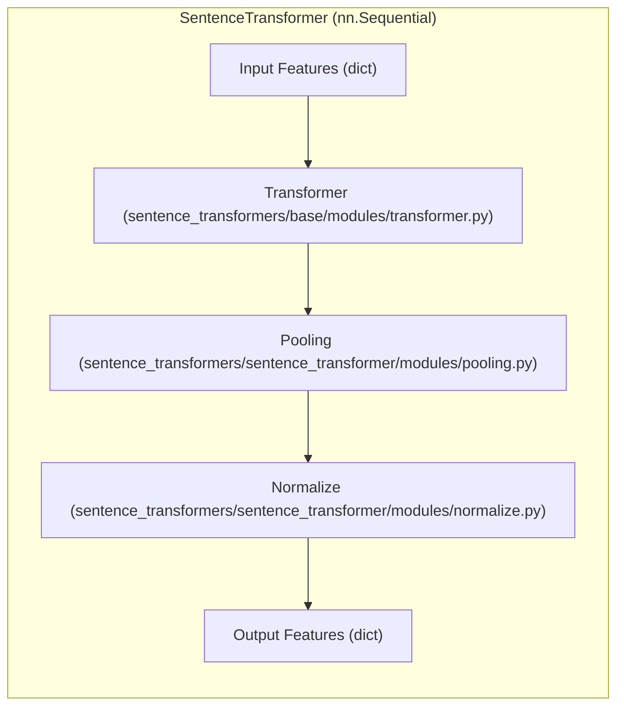
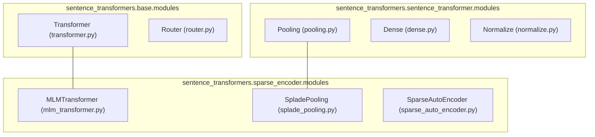
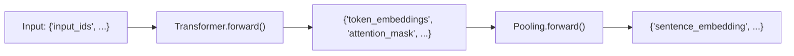

<!-- source: DeepWiki mcp.deepwiki.com · repo huggingface/sentence-transformers · page 9.4 Model Modules · fetched 2026-10-26 -->

# Model Modules

<details>
<summary>Relevant source files</summary>

The following files were used as context for generating this wiki page:

- [docs/migration_guide.md](docs/migration_guide.md)
- [docs/package_reference/sentence_transformer/modules.md](docs/package_reference/sentence_transformer/modules.md)
- [docs/sentence_transformer/usage/custom_models.rst](docs/sentence_transformer/usage/custom_models.rst)
- [sentence_transformers/base/model.py](sentence_transformers/base/model.py)
- [sentence_transformers/base/modules/transformer.py](sentence_transformers/base/modules/transformer.py)
- [sentence_transformers/cross_encoder/model.py](sentence_transformers/cross_encoder/model.py)
- [sentence_transformers/sentence_transformer/model.py](sentence_transformers/sentence_transformer/model.py)
- [sentence_transformers/sentence_transformer/modules/clip_model.py](sentence_transformers/sentence_transformer/modules/clip_model.py)
- [sentence_transformers/sentence_transformer/modules/pooling.py](sentence_transformers/sentence_transformer/modules/pooling.py)
- [sentence_transformers/sparse_encoder/model.py](sentence_transformers/sparse_encoder/model.py)
- [sentence_transformers/sparse_encoder/modules/mlm_transformer.py](sentence_transformers/sparse_encoder/modules/mlm_transformer.py)
- [sentence_transformers/util/decorators.py](sentence_transformers/util/decorators.py)
- [tests/base/test_model.py](tests/base/test_model.py)
- [tests/sentence_transformer/modules/test_pooling.py](tests/sentence_transformer/modules/test_pooling.py)
- [tests/util/test_decorators.py](tests/util/test_decorators.py)

</details>


This page documents the **model modules** used in the [sentence-transformers](https://github.com/huggingface/sentence-transformers) library. Following the v5.4 restructuring, modules are the building blocks that compose the architectures for `SentenceTransformer`, `CrossEncoder`, and `SparseEncoder` models [docs/migration_guide.md:3-10]().

**Scope:**  
- This page describes the API and implementation of module components such as `Transformer`, `Pooling`, `Dense`, `Normalize`, `Router`, and specialized modules for sparse models (e.g., `MLMTransformer`, `SpladePooling`, `SparseAutoEncoder`).
- All model types (`SentenceTransformer`, `SparseEncoder`, `CrossEncoder`) inherit from `BaseModel`, which itself inherits from `nn.Sequential` to execute these modules in order [sentence_transformers/base/model.py:50-65]().

---

## Purpose of Model Modules

Model modules are PyTorch `nn.Module` subclasses that are composed sequentially. Each module performs a specific transformation on the input dictionary `features`. This modular design allows for flexible model construction, such as combining a Transformer with specific Pooling strategies or adding projection layers.

**Key roles of model modules:**
- Encapsulate a single transformation (e.g., text to token embeddings, pooling, normalization).
- Support multi-modal inputs through the `Transformer` module's modality configuration [sentence_transformers/base/modules/transformer.py:166-187]().
- Enable automatic saving and loading via `modules.json` [docs/sentence_transformer/usage/custom_models.rst:30-43]().

**Diagram: Model Module Composition in SentenceTransformer**


*Sources: [sentence_transformers/base/model.py:50-65](), [sentence_transformers/sentence_transformer/model.py:41-43](), [docs/sentence_transformer/usage/custom_models.rst:4-13]().*

---

## Core Module Types

### 1. Transformer

The backbone of most models, responsible for processing text, images, or audio into contextualized embeddings using `transformers` AutoModels [sentence_transformers/base/modules/transformer.py:147-161]().

- **Class:** `Transformer`
- **File:** [sentence_transformers/base/modules/transformer.py]()
- **Key Functions:**
    - `forward(features)`: Executes the underlying Hugging Face model and maps outputs to keys like `token_embeddings` or `logits` based on the `transformer_task` [sentence_transformers/base/modules/transformer.py:166-187]().
    - `get_embedding_dimension()`: Returns the hidden size of the transformer [docs/migration_guide.md:87-88]().
- **Tasks:** Supports `feature-extraction`, `sequence-classification`, `text-generation`, and `fill-mask` [sentence_transformers/base/modules/transformer.py:124-126]().

*Sources: [sentence_transformers/base/modules/transformer.py:124-187](), [docs/migration_guide.md:81-97]().*

---

### 2. Pooling

Reduces variable-length token embeddings into a fixed-size sentence embedding [sentence_transformers/sentence_transformer/modules/pooling.py:71-74]().

- **Class:** `Pooling`
- **File:** [sentence_transformers/sentence_transformer/modules/pooling.py]()
- **Pooling Modes:** `cls`, `max`, `mean`, `mean_sqrt_len_tokens`, `weightedmean`, `lasttoken` [sentence_transformers/sentence_transformer/modules/pooling.py:13]().
- **Feature: `include_prompt`**: If `False`, prompt tokens (identified by `prompt_length` in features) are excluded from the pooling calculation. This is critical for instruction-tuned models like INSTRUCTOR [sentence_transformers/sentence_transformer/modules/pooling.py:121-131]().

*Sources: [sentence_transformers/sentence_transformer/modules/pooling.py:13-23](), [sentence_transformers/sentence_transformer/modules/pooling.py:121-131]().*

---

### 3. Dense and Normalize

- **Dense:** A linear layer (with optional activation) used for dimensionality reduction or projection [docs/sentence_transformer/usage/custom_models.rst:11]().
- **Normalize:** Performs L2 normalization on the embedding, typically as the final step in a pipeline to ensure cosine similarity can be computed via dot product [docs/sentence_transformer/usage/custom_models.rst:12]().

*Sources: [docs/sentence_transformer/usage/custom_models.rst:11-13](), [sentence_transformers/base/model.py:33]().*

---

### 4. Router

Enables asymmetric encoding by routing inputs through different module paths based on the input modality or task [sentence_transformers/base/model.py:33](). It is primarily used for models where queries and documents require different processing steps.

---

## Specialized Modules for SparseEncoder

### 1. MLMTransformer

- **Purpose:** A legacy wrapper for `Transformer` with `transformer_task="fill-mask"`. It converts text into vocabulary-sized logits [sentence_transformers/sparse_encoder/modules/mlm_transformer.py:15-23]().
- **Status:** Deprecated in v5.4 in favor of the base `Transformer` class [sentence_transformers/sparse_encoder/modules/mlm_transformer.py:21-22]().

### 2. SpladePooling

- **Purpose:** Implements SPLADE (Sparse Lexical and Expansion) pooling, applying a log-transformation (typically `log(1 + ReLU(x))`) to MLM logits to produce sparse representations [sentence_transformers/sparse_encoder/model.py:26]().

### 3. SparseAutoEncoder

- **Purpose:** Used for mapping dense embeddings to sparse representations via an autoencoder architecture [sentence_transformers/sparse_encoder/model.py:26]().

*Sources: [sentence_transformers/sparse_encoder/modules/mlm_transformer.py:15-32](), [sentence_transformers/sparse_encoder/model.py:21-27]().*

---

## Diagram: Mapping Model Module Types to Code Entities

This diagram associates conceptual module roles with their specific class implementations and file locations within the restructured v5.4+ codebase.


*Sources: [docs/migration_guide.md:28-33](), [sentence_transformers/base/model.py:33](), [sentence_transformers/sentence_transformer/model.py:24-26](), [sentence_transformers/sparse_encoder/model.py:21-26]().*

---

## Module Serialization

When a model is saved via `save_pretrained`, it generates a `modules.json` file. This file acts as a manifest for reconstructing the `nn.Sequential` pipeline [docs/sentence_transformer/usage/custom_models.rst:30-33]().

**Example `modules.json` Structure:**
```json
[
  {
    "idx": 0,
    "name": "0",
    "path": "",
    "type": "sentence_transformers.base.modules.transformer.Transformer"
  },
  {
    "idx": 1,
    "name": "1",
    "path": "1_Pooling",
    "type": "sentence_transformers.sentence_transformer.modules.pooling.Pooling"
  }
]
```
Each module is saved in its own subfolder (e.g., `1_Pooling/`) containing a `config.json` with its specific parameters (like `pooling_mode` or `embedding_dimension`) [docs/sentence_transformer/usage/custom_models.rst:34-43]().

---

## Diagram: Data Flow Through Module Features

Modules communicate by modifying a shared `features` dictionary.


*Sources: [sentence_transformers/base/modules/transformer.py:166-187](), [sentence_transformers/sentence_transformer/modules/pooling.py:121-148]().*

---

## Summary Table: Module API Reference

| Module | Class | Path | Output Key |
| :--- | :--- | :--- | :--- |
| **Transformer** | `Transformer` | `base.modules` | `token_embeddings` (or `logits`) |
| **Pooling** | `Pooling` | `sentence_transformer.modules` | `sentence_embedding` |
| **Dense** | `Dense` | `base.modules` | `sentence_embedding` (transformed) |
| **Normalize** | `Normalize` | `sentence_transformer.modules` | `sentence_embedding` (L2 normalized) |
| **Splade** | `SpladePooling` | `sparse_encoder.modules` | `sentence_embedding` (sparse) |

*Sources: [sentence_transformers/base/modules/transformer.py:166-187](), [sentence_transformers/sentence_transformer/modules/pooling.py:147-148](), [docs/sentence_transformer/usage/custom_models.rst:4-13]().*

---

