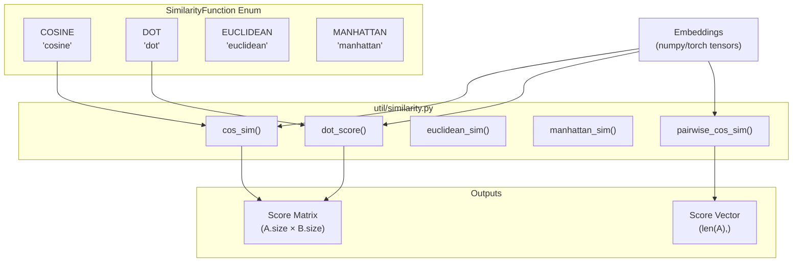
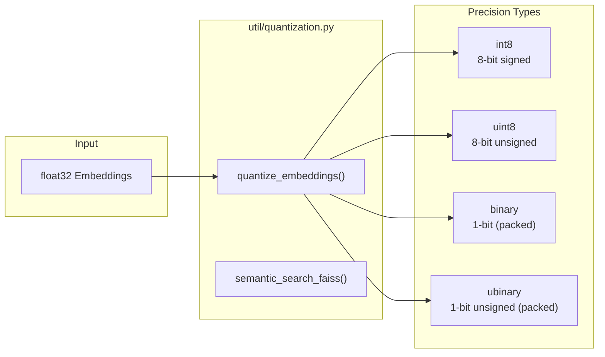
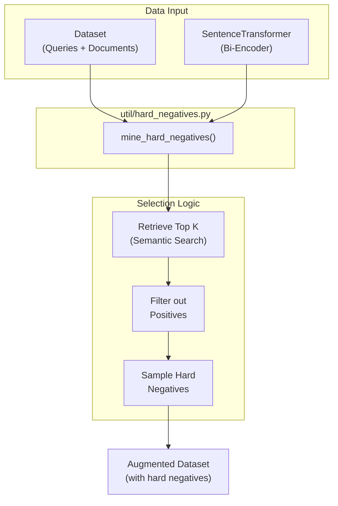

<!-- source: DeepWiki mcp.deepwiki.com · repo huggingface/sentence-transformers · page 9.5 Utility Functions · fetched 2026-10-26 -->

# Utility Functions

Relevant source files

The following files were used as context for generating this wiki page:

- [.github/workflows/min-versions.yml](.github/workflows/min-versions.yml)
- [.github/workflows/quality.yml](.github/workflows/quality.yml)
- [.github/workflows/sync-skills.yml](.github/workflows/sync-skills.yml)
- [.github/workflows/tests.yml](.github/workflows/tests.yml)
- [examples/sentence_transformer/training/quora_duplicate_questions/create_splits.py](examples/sentence_transformer/training/quora_duplicate_questions/create_splits.py)
- [sentence_transformers/util/__init__.py](sentence_transformers/util/__init__.py)
- [sentence_transformers/util/distributed.py](sentence_transformers/util/distributed.py)
- [sentence_transformers/util/environment.py](sentence_transformers/util/environment.py)
- [sentence_transformers/util/quantization.py](sentence_transformers/util/quantization.py)
- [tests/__init__.py](tests/__init__.py)
- [tests/util/test_environment.py](tests/util/test_environment.py)
- [tests/util/test_quantization.py](tests/util/test_quantization.py)
- [tests/util/test_similarity.py](tests/util/test_similarity.py)

This page documents the utility functions provided by the Sentence Transformers library that enhance model usage, optimize performance, and support advanced workflows. These functions cover similarity computation, embedding quantization, environment detection, and data mining.

## Overview

The library provides several categories of utility functions:

1.  **Similarity Functions** - Computing similarity between embeddings using various metrics.
2.  **Quantization** - Reducing embedding precision for storage and speed.
3.  **Retrieval Utilities** - Functions for semantic search, paraphrase mining, and community detection.
4.  **Environment & Hardware** - Utilities for device detection and dependency checking.
5.  **Hard Negative Mining** - Finding challenging examples for training.

These utilities are designed to be used after model inference or during post-processing workflows.

## Similarity Functions

**Similarity Computation**

The library provides multiple similarity metrics through the `SimilarityFunction` enum [sentence_transformers/util/similarity.py:34](). These functions are optimized for both PyTorch tensors and NumPy arrays, and they support sparse tensors for certain operations [tests/util/test_similarity.py:145-155]().

**Available Metrics:**

| Metric | Function | Description | Use Case |
| :--- | :--- | :--- | :--- |
| Cosine | `cos_sim` | Measures angular similarity (-1 to 1) | Most common for semantic similarity |
| Dot Product | `dot_score` | Inner product of vectors | Fast when embeddings are normalized |
| Euclidean | `euclidean_sim` | Negative L2 distance (smaller = more similar) | Distance-based clustering |
| Manhattan | `manhattan_sim` | Negative L1 distance (smaller = more similar) | Robust to outliers |

**Pairwise vs. Cross-Similarity:**
- `cos_sim(a, b)`: Computes a similarity matrix between all vectors in `a` and all vectors in `b` [sentence_transformers/util/similarity.py:35]().
- `pairwise_cos_sim(a, b)`: Computes element-wise similarity between `a[i]` and `b[i]` [sentence_transformers/util/similarity.py:40]().

**Sources:** [sentence_transformers/util/similarity.py:33-45](), [sentence_transformers/util/__init__.py:33-45](), [tests/util/test_similarity.py:9-20]()

## Quantization

**Embedding Quantization**

The `quantize_embeddings` function reduces the precision of embeddings to save memory and increase retrieval speed. This is particularly useful when storing large embedding corpora for semantic search [sentence_transformers/util/quantization.py:25]().

**Binary Quantization Details:**
For `binary` and `ubinary` precision, the function uses `np.packbits` along the last axis. This ensures that the resulting shape is `(n_samples, ceil(dim / 8))`, correctly handling embedding dimensions that are not multiples of 8 [tests/util/test_quantization.py:27-37]().

**Semantic Search with Quantization:**
The library provides `semantic_search_faiss`, which supports searching over quantized indices. It includes a rescoring mechanism: if the query is in `float32` but the corpus is quantized, it retrieves `top_k * rescore_multiplier` results and rescores them using the original query embeddings for higher accuracy [sentence_transformers/util/quantization.py:18-30]().

**Sources:** [sentence_transformers/util/quantization.py:1-162](), [sentence_transformers/util/__init__.py:25](), [tests/util/test_quantization.py:1-85]()

## Environment and Hardware

The `util.environment` module provides utilities to detect the execution environment and available hardware accelerators.

**Device Detection:**
The `get_device_name()` function automatically selects the best available device in the following order:
1.  **CUDA**: If a local rank is provided in the environment or via `torch.distributed`, it assigns specific GPUs [sentence_transformers/util/environment.py:61-68]().
2.  **MPS**: For Apple Silicon [sentence_transformers/util/environment.py:69-70]().
3.  **NPU**: For Huawei Ascend hardware [sentence_transformers/util/environment.py:71-72]().
4.  **XPU/HPU**: For Intel and Habana accelerators [sentence_transformers/util/environment.py:73-79]().
5.  **CPU**: Default fallback [sentence_transformers/util/environment.py:80]().

**Dependency Management:**
The `suggest_extra_on_exception` context manager provides helpful installation hints when multimodal dependencies (like `pillow`, `torchvision`, or `soundfile`) are missing [sentence_transformers/util/environment.py:28-37]().

**Sources:** [sentence_transformers/util/environment.py:1-115](), [sentence_transformers/util/__init__.py:5-12](), [tests/util/test_environment.py:1-103]()

## Hard Negative Mining

**Hard Negative Mining**

The `mine_hard_negatives` function identifies challenging negative examples for training [sentence_transformers/util/hard_negatives.py:14](). Hard negatives are documents that are semantically similar to a query but are not labeled as relevant. Including these in training (e.g., with `MultipleNegativesRankingLoss`) significantly improves the model's ability to distinguish between subtle differences.

**Workflow:**
1.  The model encodes all documents in the corpus.
2.  For each query, a semantic search is performed to find the most similar documents.
3.  Documents that are known positives are removed from the results.
4.  The remaining top-scoring documents are returned as hard negatives.

**Sources:** [sentence_transformers/util/hard_negatives.py:14](), [sentence_transformers/util/__init__.py:14](), [sentence_transformers/util/__init__.py:119]()

## Distributed Training Utilities

The `util.distributed` module contains helpers for multi-GPU training.

- **`all_gather`**: Gathers tensors from all distributed ranks. It is designed to retain gradients for the local rank's portion of the gathered tensor, which is critical for contrastive losses like `MultipleNegativesRankingLoss` [sentence_transformers/util/distributed.py:13-40]().
- **`all_gather_with_grad`**: A convenience wrapper for `all_gather` with `with_grad=True` [sentence_transformers/util/distributed.py:52-63]().

**Sources:** [sentence_transformers/util/distributed.py:1-64](), [sentence_transformers/util/__init__.py:4]()

## Miscellaneous Utilities

| Function | Module | Description |
| :--- | :--- | :--- |
| `normalize_embeddings` | `tensor` | Normalizes vectors to unit length (L2 norm) [sentence_transformers/util/tensor.py:52](). |
| `truncate_embeddings` | `tensor` | Truncates embeddings to a smaller dimension (for Matryoshka models) [sentence_transformers/util/tensor.py:55](). |
| `batch_to_device` | `tensor` | Recursively moves all tensors in a batch (dict/list/tensor) to a device [sentence_transformers/util/tensor.py:50](). |
| `community_detection` | `retrieval` | Implements the Fast Clustering algorithm for finding groups of similar embeddings [sentence_transformers/util/retrieval.py:27](). |
| `paraphrase_mining` | `retrieval` | Finds duplicate or highly similar sentences in a large corpus [sentence_transformers/util/retrieval.py:29](). |
| `http_get` | `file_io` | Downloads a file from a URL with a progress bar [sentence_transformers/util/file_io.py:13](). |

**Sources:** [sentence_transformers/util/tensor.py:46-56](), [sentence_transformers/util/retrieval.py:26-32](), [sentence_transformers/util/file_io.py:13](), [sentence_transformers/util/__init__.py:1-121]()

---

