# Page: Overview

# Overview

<details>
<summary>Relevant source files</summary>

The following files were used as context for generating this wiki page:

- [.gitignore](.gitignore)
- [.pre-commit-config.yaml](.pre-commit-config.yaml)
- [Makefile](Makefile)
- [README.md](README.md)
- [docs/img/BiEncoder.png](docs/img/BiEncoder.png)
- [docs/img/CrossEncoder.png](docs/img/CrossEncoder.png)
- [docs/installation.md](docs/installation.md)
- [docs/publications.md](docs/publications.md)
- [index.rst](index.rst)
- [pyproject.toml](pyproject.toml)
- [sentence_transformers/__init__.py](sentence_transformers/__init__.py)

</details>


The Sentence Transformers library is a Python framework designed for computing embeddings, performing semantic search, and reranking text efficiently. It supports three primary model architectures optimized for distinct natural language processing tasks:

- `SentenceTransformer`: Produces fixed-dimensional dense sentence embeddings.
- `CrossEncoder`: Outputs relevance scores by jointly encoding input sentence pairs.
- `SparseEncoder`: Generates sparse embeddings suited for efficient retrieval.

This page introduces the library's architecture, underlying components, and their interaction patterns.

For installation instructions, see [Installation and Setup](#2.1). For training details, see [Training Models](#5). For comprehensive API documentation, refer to [API Reference](#9).

---

## Library Purpose and Scope

Sentence Transformers supports the full machine learning lifecycle in embedding-based NLP:

1. **Model Discovery** — Browse 15,000+ pre-trained models on Hugging Face Hub.
2. **Inference** — Load models and compute embeddings or similarity scores quickly.
3. **Training** — Fine-tune or train models from scratch, with support for 40+ loss functions.
4. **Evaluation** — Assess model performance across tasks with specialized evaluators.
5. **Deployment** — Export to ONNX/OpenVINO backends, perform quantization, and share models on the Hub.

This comprehensive approach enables applications such as semantic search, paraphrase mining, and reranking.

**Sources:** [README.md:1-19](), [index.rst:9-17]()

---

## Three Model Architectures

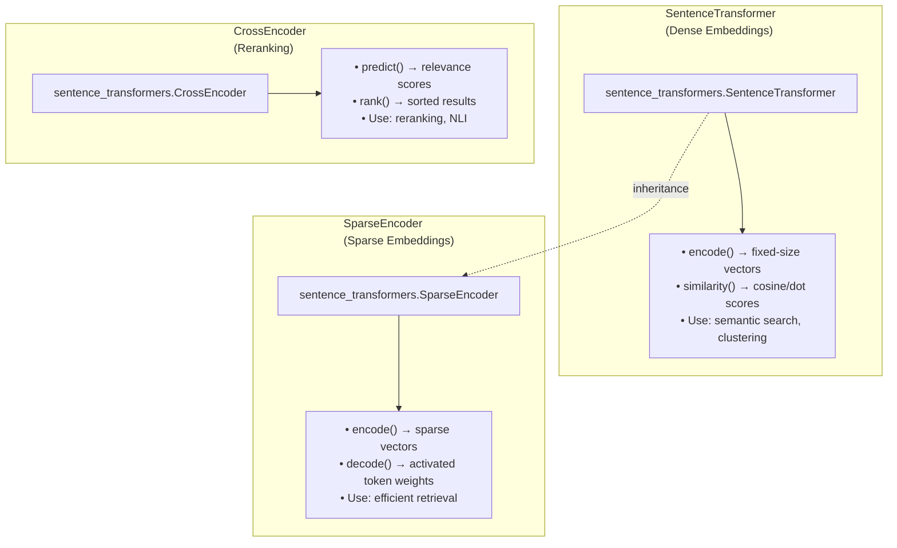

### SentenceTransformer

The `SentenceTransformer` class generates dense, fixed-size vector embeddings from variable-length textual inputs. Architecturally, it is implemented as an `nn.Sequential` module chain consisting of:

- **Transformer**: Provides token embeddings from pretrained models (e.g., BERT, RoBERTa).
- **Pooling**: Aggregates token embeddings into a single sentence vector (mean, max, CLS pooling).
- **Dense** (optional): Projects embeddings to a different dimension.
- **Normalize** (optional): Applies L2 normalization.

Key functions:
- `encode(sentences)`: Converts sentences into dense embeddings.
- `encode_query(sentences)`: Encodes queries (used with Router modules for asymmetric processing).
- `encode_document(sentences)`: Encodes documents (used with Router).
- `similarity(embeddings1, embeddings2)`: Computes cosine or dot product similarity between embeddings.

**Sources:** [sentence_transformers/sentence_transformer/model.py:61-163](), [README.md:54-86]()

### CrossEncoder

`CrossEncoder` models jointly encode pairs of sentences or inputs to produce similarity or relevance scores. Unlike bi-encoders (`SentenceTransformer`), CrossEncoder concatenates inputs and passes through a sequence classification model, improving accuracy at the expense of inference speed.

Implemented using Hugging Face's `AutoModelForSequenceClassification`, key methods include:

- `predict(pairs)`: Scores input pairs individually.
- `rank(query, documents)`: Reranks multiple documents by relevance to a query.

Supports both regression output (`num_labels=1`) and classification.

**Sources:** [sentence_transformers/cross_encoder/CrossEncoder.py:48-116](), [README.md:87-130]()

### SparseEncoder

The `SparseEncoder` extends the bi-encoder paradigm to output high-dimensional sparse vectors, where only a small subset of vocabulary dimensions have non-zero activations. It uses specialized modules including:

- **MLMTransformer**: Transformer backbone pretrained for masked language modeling.
- **SpladePooling**: Activation-based pooling producing sparse token representations.
- **SparseAutoEncoder**: Compresses high-dimensional sparse vectors efficiently.

Key methods:
- `encode(sentences, convert_to_sparse_tensor=True)`: Produces sparse embeddings.
- `decode(embedding, top_k=None)`: Retrieves active token-weight pairs from sparse vectors.
- `sparsity(embeddings)`: Computes sparsity statistics on outputs.

Sparse vectors enable efficient indexing and retrieval for very large corpora.

**Sources:** [sentence_transformers/sparse_encoder/SparseEncoder.py:27-129](), [README.md:132-166]()

---

## Core System Architecture

```mermaid
graph TB
    subgraph User["User Interface"]
        API["Public API<br/>sentence_transformers/__init__.py"]
    end
    
    subgraph Models["Model Classes"]
        ST["SentenceTransformer<br/>sentence_transformer/model.py"]
        CE["CrossEncoder<br/>cross_encoder/CrossEncoder.py"]
        SE["SparseEncoder<br/>sparse_encoder/SparseEncoder.py"]
    end
    
    subgraph Modules["Model Modules"]
        Trans["Transformer<br/>models/Transformer.py"]
        Pool["Pooling<br/>models/Pooling.py"]
        Router["Router<br/>models/Router.py"]
        MLM["MLMTransformer<br/>sparse_encoder/models/MLMTransformer.py"]
        Splade["SpladePooling<br/>sparse_encoder/models/SpladePooling.py"]
    end
    
    subgraph Training["Training System"]
        STTrainer["SentenceTransformerTrainer<br/>sentence_transformer/trainer.py"]
        CETrainer["CrossEncoderTrainer<br/>cross_encoder/trainer.py"]
        SETrainer["SparseEncoderTrainer<br/>sparse_encoder/trainer.py"]
        Args["TrainingArguments<br/>training_args.py"]
        Loss["Loss Functions<br/>losses/, cross_encoder/losses/,<br/>sparse_encoder/losses/"]
    end
    
    subgraph Evaluation["Evaluation System"]
        Eval["SentenceEvaluator<br/>evaluation/SentenceEvaluator.py"]
        CEEval["CrossEncoder Evaluators<br/>cross_encoder/evaluation/"]
        SEEval["Sparse Evaluators<br/>sparse_encoder/evaluation/"]
    end
    
    subgraph Hub["Hugging Face Ecosystem"]
        HFHub["🤗 Hugging Face Hub<br/>15,000+ models"]
        ModelCard["Model Cards<br/>model_card.py"]
        Backend["Export Backends<br/>backend/"]
    end
    
    API --> ST
    API --> CE
    API --> SE
    
    ST --> Trans
    ST --> Pool
    ST --> Router
    SE --> MLM
    SE --> Splade
    CE -.uses.-> Trans
    
    ST --> STTrainer
    CE --> CETrainer
    SE --> SETrainer
    STTrainer --> Loss
    CETrainer --> Loss
    SETrainer --> Loss
    STTrainer --> Args
    
    STTrainer --> Eval
    CETrainer --> CEEval
    SETrainer --> SEEval
    
    ST --> HFHub
    CE --> HFHub
    SE --> HFHub
    ST --> ModelCard
    CE --> ModelCard
    SE --> ModelCard
    ST --> Backend
    CE --> Backend
    SE --> Backend
```

This architecture shows clear modular separation with:

- **User Level API** in `sentence_transformers/__init__.py`.
- **Model Classes** implementing core inference logic.
- **Modules** implementing reusable neural components.
- **Training subsystem** handling datasets, losses, trainers, and arguments.
- **Evaluation modules** integrating benchmarking and metrics.
- **Hub integration** for loading, saving, and sharing models.
- **Export backends** enabling ONNX and OpenVINO inference.

**Sources:** [sentence_transformers/__init__.py:1-73](), [README.md:1-296]()

---

## Model Lifecycle

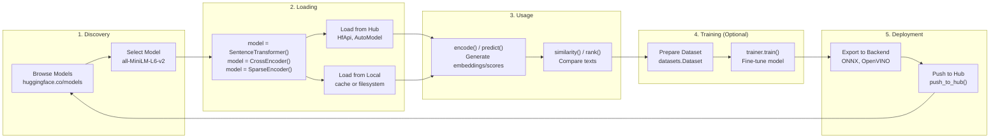

Users find pre-trained models on Hugging Face Hub, load them locally or via API, get embeddings or rerank results, optionally fine-tune models on custom datasets, and finally export or share trained models. This lifecycle supports research and production use cases seamlessly.

**Sources:** [sentence_transformers/SentenceTransformer.py:226-350](), [sentence_transformers/cross_encoder/CrossEncoder.py:119-227]()

---

## Package Structure

The library organizes its codebase by functionality:

| Directory / Module          | Purpose                                            |
|----------------------------|--------------------------------------------------|
| `sentence_transformer/`    | Main SentenceTransformer dense embedding module  |
| `cross_encoder/`           | CrossEncoder models, trainers, losses, evaluators|
| `sparse_encoder/`          | SparseEncoder models, trainers, losses, evaluators|
| `models/`                  | Modular components: Transformer, Pooling, Router, Dense, Normalize |
| `losses/`                  | Task-specific loss functions (>20) for training  |
| `evaluation/`              | Evaluators for IR, similarity, classification tasks |
| `trainer.py`               | `SentenceTransformerTrainer` implementation       |
| `training_args.py`         | Training configuration class                       |
| `model_card.py`            | Automatic model card generation                    |
| `backend/`                 | ONNX and OpenVINO export and inference helpers    |
| `sampler/`                 | Batch sampling strategies                          |
| `util.py`                  | Utilities: similarity metrics, mining, quantization|

The codebase ensures modularity, scalability, and extensibility.

**Sources:** [sentence_transformers/__init__.py:1-73](), [pyproject.toml:62-64]()

---

## Module Composition (SentenceTransformer)

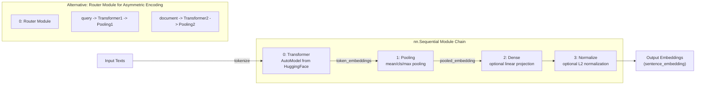

Details:

- `SentenceTransformer` subclasses `nn.Sequential`, chaining modules that operate on a `features` dict.
- Each module implements a `forward(features: dict) -> dict` method, progressively augmenting or modifying features.
- `Transformer` loads pretrained HF models to generate token-level embeddings.
- `Pooling` aggregates token embeddings into sentence-level representations.
- Optional `Dense` and `Normalize` modules apply affine and normalization transforms.
- The `Router` module supports asymmetric pipelines, useful in retrieval scenarios (different query/document encoders).

This modular design facilitates easy extension and customization.

**Sources:** [sentence_transformers/sentence_transformer/model.py:61-163](), [sentence_transformers/models/Transformer.py:37-59](), [sentence_transformers/models/Pooling.py:9-41]()

---

## Training System Components

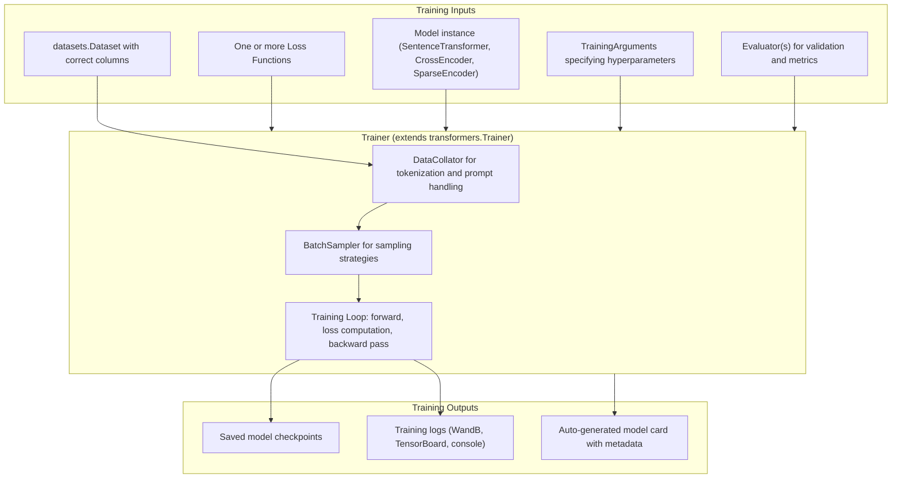

The training framework supports:

- Models of all three types.
- Different dataset formats, managed with Hugging Face `datasets`.
- Numerous task-specific loss functions.
- TrainingArguments allowing configurable epochs, learning rate, batch size.
- Evaluators to integrate validation and metrics during training.
- Trainer classes that extend Hugging Face `Trainer` to orchestrate the entire process.

**Sources:** [sentence_transformers/sentence_transformer/trainer.py:1-50](), [sentence_transformers/sentence_transformer/training_args.py:1-50]()

---

## Integration with Hugging Face Hub

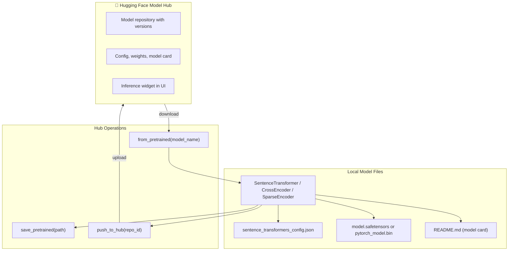

Key points:

- All model types have `from_pretrained()` and `save_pretrained()` methods for loading/saving.
- Models automatically cache downloaded weights/configs locally.
- `push_to_hub()` uploads models and associated files (config, model card) to the Hub.
- Fully supports model versioning with branches and commits.
- Model cards are auto-generated including usage, metrics, training info, and carbon footprint metadata.

**Sources:** [sentence_transformers/sentence_transformer/model.py:226-315](), [sentence_transformers/util.py:47-56]()

---

## Backend Support

The library supports three major backends for inference:

| Backend      | Usage                      | Advantages                       |
|--------------|----------------------------|--------------------------------|
| **PyTorch**  | `backend='torch'` (default) | Full feature support, training enabled |
| **ONNX**     | `backend='onnx'`            | Faster inference, quantization support |
| **OpenVINO** | `backend='openvino'`        | Optimized for Intel CPUs, fastest CPU inference |

Example usage:

```python
# PyTorch (default, full functionality)
model = SentenceTransformer("model-name")

# ONNX backend for optimized inference
model = SentenceTransformer("model-name", backend="onnx")

# OpenVINO for Intel CPU acceleration
model = SentenceTransformer("model-name", backend="openvino")
```

The library includes export helpers such as `export_optimized_onnx_model()` and `export_static_quantized_openvino_model()` to convert models for backend use.

**Sources:** [sentence_transformers/__init__.py:10-14]()

---

## Model Configuration

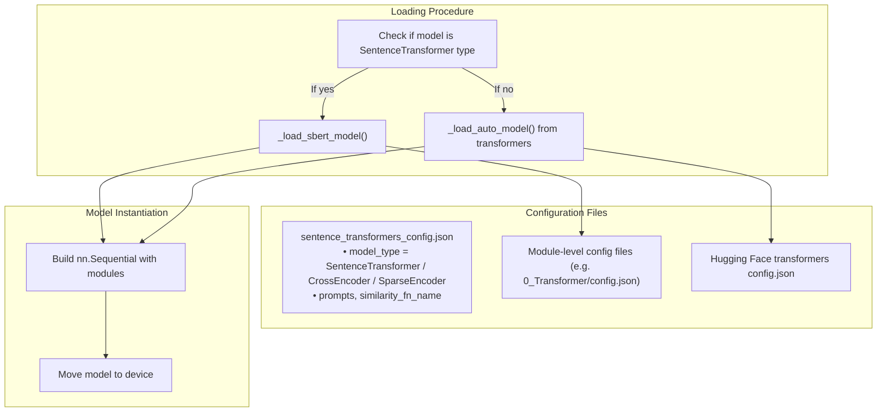

Configuration hierarchy:

- Top-level `sentence_transformers_config.json` defines model type, task prompts, similarity function.
- Each module (Transformer, Pooling, etc.) has its own config directory and JSON file.
- Standard Hugging Face Transformer configs are also used.

This layered configuration enables flexible model assembly.

**Sources:** [sentence_transformers/sentence_transformer/model.py:226-350](), [sentence_transformers/util.py:47-56]()

---

## Model Card Generation

The library automatically creates comprehensive model cards including:

- Model architecture metadata (type, base model, language, license)
- Training configuration (datasets, loss functions, hyperparameters)
- Evaluation metrics and benchmarks
- Usage examples demonstrating typical API patterns
- Carbon footprint tracking using codecarbon integration

This is achieved via:

- `SentenceTransformerModelCardData` and related classes capturing metadata during training.
- Jinja2 template rendering of README.md files.
- Callbacks updating metadata after each training step.

This ensures rich, informative model documentation is consistently produced.

**Sources:** [sentence_transformers/model_card.py:1-100](), [README.md:249-279]()

---

## Key Classes Reference

| Class                | Location                                          | Description                          |
|----------------------|--------------------------------------------------|------------------------------------|
| `SentenceTransformer`| `sentence_transformer/model.py:61`               | Dense embedding model implementation |
| `CrossEncoder`       | `cross_encoder/CrossEncoder.py:48`                | Reranking model                     |
| `SparseEncoder`      | `sparse_encoder/SparseEncoder.py:27`              | Sparse embedding model              |
| `Transformer`        | `models/Transformer.py:37`                         | Token embedding module              |
| `Pooling`            | `models/Pooling.py:9`                              | Pooling strategies module           |
| `Router`             | `models/Router.py:1`                               | Task-based routing module           |
| `SentenceTransformerTrainer` | `sentence_transformer/trainer.py:1`          | Training orchestration              |
| `SentenceEvaluator`  | `evaluation/SentenceEvaluator.py:1`                | Base evaluation class               |

**Sources:** [sentence_transformers/__init__.py:1-73]()

---

This overview provides the fundamental understanding of the sentence-transformers library's purpose, architecture, model types, and system design to onboard technical users effectively. Further pages detail installation, usage, model internals, and development.

---

# Page: Getting Started

# Getting Started

<details>
<summary>Relevant source files</summary>

The following files were used as context for generating this wiki page:

- [README.md](README.md)
- [docs/cross_encoder/pretrained_models.md](docs/cross_encoder/pretrained_models.md)
- [docs/cross_encoder/usage/custom_models.rst](docs/cross_encoder/usage/custom_models.rst)
- [docs/cross_encoder/usage/usage.rst](docs/cross_encoder/usage/usage.rst)
- [docs/installation.md](docs/installation.md)
- [docs/publications.md](docs/publications.md)
- [docs/quickstart.rst](docs/quickstart.rst)
- [docs/sentence_transformer/dataset_overview.md](docs/sentence_transformer/dataset_overview.md)
- [docs/sentence_transformer/pretrained_models.md](docs/sentence_transformer/pretrained_models.md)
- [docs/sentence_transformer/usage/usage.rst](docs/sentence_transformer/usage/usage.rst)
- [examples/sentence_transformer/training/multimodal/README.md](examples/sentence_transformer/training/multimodal/README.md)
- [examples/sentence_transformer/training/multimodal/training_visual_document_retrieval.py](examples/sentence_transformer/training/multimodal/training_visual_document_retrieval.py)
- [index.rst](index.rst)

</details>


This page provides an introduction to Sentence Transformers and guides you through installation and basic usage. For detailed installation instructions, see [Installation and Setup](#2.1). For more comprehensive examples, see [Quick Start Guide](#2.2).

## Overview

Sentence Transformers is a library for computing embeddings, performing reranking, and generating sparse representations for text. The library provides three main model types, each designed for different use cases:

**Model Type Summary:**

| Model Class | Purpose | Output | Typical Use Cases |
|------------|---------|--------|-------------------|
| `SentenceTransformer` | Dense embeddings | Fixed-size vectors (e.g., 384, 768 dimensions) | Semantic search, clustering, similarity comparison |
| `CrossEncoder` | Reranking | Similarity scores for text pairs | Reranking search results, pair classification |
| `SparseEncoder` | Sparse embeddings | High-dimensional sparse vectors (vocabulary size) | Efficient retrieval, interpretable search, lexical+semantic search |

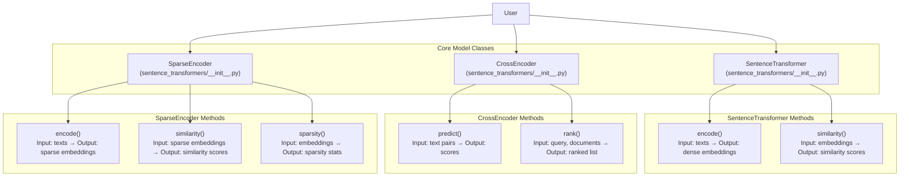

Sources: [sentence_transformers/__init__.py:1-73](), [README.md:54-166]()

## Installation

The library requires **Python 3.10+**, **PyTorch 1.11.0+**, and **transformers v4.41.0+**.

**Basic Installation:**

```bash
pip install -U sentence-transformers
```

**Installation with Training Support:**

```bash
pip install -U "sentence-transformers[train]"
```

**Installation with Backend Optimization:**

```bash
# ONNX backend
pip install -U "sentence-transformers[onnx-gpu]"

# OpenVINO backend
pip install -U "sentence-transformers[openvino]"
```

For complete installation instructions including conda installation and source installation, see [Installation and Setup](#2.1).

Sources: [README.md:21-48](), [docs/installation.md:1-180](), [pyproject.toml:35-56]()

## Basic Usage Workflow

The typical workflow for using Sentence Transformers follows this pattern:

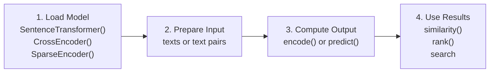

Sources: [README.md:54-166](), [index.rst:25-132]()

## Quick Examples

### SentenceTransformer: Dense Embeddings

`SentenceTransformer` models encode text into fixed-size dense vectors. These embeddings can be compared using cosine similarity, dot product, or euclidean distance.

```python
from sentence_transformers import SentenceTransformer

# 1. Load a pretrained model
model = SentenceTransformer("sentence-transformers/all-MiniLM-L6-v2")

# 2. Encode sentences
sentences = [
    "The weather is lovely today.",
    "It's so sunny outside!",
    "He drove to the stadium.",
]
embeddings = model.encode(sentences)
print(embeddings.shape)
# => (3, 384)

# 3. Calculate similarities
similarities = model.similarity(embeddings, embeddings)
print(similarities)
# => tensor([[1.0000, 0.6660, 0.1046],
#            [0.6660, 1.0000, 0.1411],
#            [0.1046, 0.1411, 1.0000]])
```

**Key Methods:**
- `encode(sentences)`: Converts text to embeddings
- `similarity(embeddings1, embeddings2)`: Computes similarity scores between embeddings

Sources: [README.md:56-85](), [index.rst:37-63]()

### CrossEncoder: Reranking

`CrossEncoder` models score text pairs directly, making them ideal for reranking candidate documents or classifying relationships between texts.

```python
from sentence_transformers import CrossEncoder

# 1. Load a pretrained CrossEncoder
model = CrossEncoder("cross-encoder/ms-marco-MiniLM-L6-v2")

# 2. Define query and passages
query = "How many people live in Berlin?"
passages = [
    "Berlin had a population of 3,520,031 registered inhabitants in an area of 891.82 square kilometers.",
    "Berlin has a yearly total of about 135 million day visitors, making it one of the most-visited cities in the European Union.",
    "In 2013 around 600,000 Berliners were registered in one of the more than 2,300 sport and fitness clubs.",
]

# 3a. Predict scores for pairs
scores = model.predict([(query, passage) for passage in passages])
print(scores)
# => [8.607139 5.506266 6.352977]

# 3b. Or rank passages directly
ranks = model.rank(query, passages, return_documents=True)
print("Query:", query)
for rank in ranks:
    print(f"- #{rank['corpus_id']} ({rank['score']:.2f}): {rank['text']}")
```

**Key Methods:**
- `predict(text_pairs)`: Scores pairs of texts
- `rank(query, documents)`: Ranks documents by relevance to query

Sources: [README.md:87-130](), [index.rst:65-98]()

### SparseEncoder: Sparse Embeddings

`SparseEncoder` models generate high-dimensional sparse vectors, combining lexical and semantic information for efficient and interpretable retrieval.

```python
from sentence_transformers import SparseEncoder

# 1. Load a pretrained SparseEncoder
model = SparseEncoder("naver/splade-cocondenser-ensembledistil")

# 2. Encode sentences
sentences = [
    "The weather is lovely today.",
    "It's so sunny outside!",
    "He drove to the stadium.",
]
embeddings = model.encode(sentences)
print(embeddings.shape)
# => [3, 30522] - sparse representation with vocabulary size dimensions

# 3. Calculate similarities
similarities = model.similarity(embeddings, embeddings)
print(similarities)
# => tensor([[   35.629,     9.154,     0.098],
#            [    9.154,    27.478,     0.019],
#            [    0.098,     0.019,    29.553]])

# 4. Check sparsity statistics
stats = SparseEncoder.sparsity(embeddings)
print(f"Sparsity: {stats['sparsity_ratio']:.2%}")
# => Sparsity: 99.84%
```

**Key Methods:**
- `encode(sentences)`: Converts text to sparse embeddings
- `similarity(embeddings1, embeddings2)`: Computes similarity scores
- `sparsity(embeddings)`: Returns sparsity statistics (ratio, active dimensions, FLOPS)

Sources: [README.md:132-166](), [index.rst:100-131]()

## Model Discovery and Selection

Over **15,000 pre-trained models** are available on the Hugging Face Hub. The library automatically downloads models when you provide a model name or path.

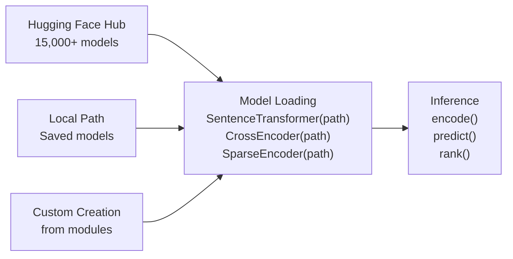

**Loading Models:**

```python
from sentence_transformers import SentenceTransformer

# From Hugging Face Hub
model = SentenceTransformer("sentence-transformers/all-mpnet-base-v2")

# Short form for sentence-transformers organization
model = SentenceTransformer("all-mpnet-base-v2")

# From local path
model = SentenceTransformer("/path/to/saved/model")

# From custom path on Hub
model = SentenceTransformer("username/model-name")
```

For recommended models and performance benchmarks, see:
- [Model Catalog](#4.2) for model catalog
- [Model Architecture](#3) for understanding model types

Sources: [README.md:168-175](), [index.rst:4-7](), [docs/sentence_transformer/pretrained_models.md:1-218]()

## Library Structure

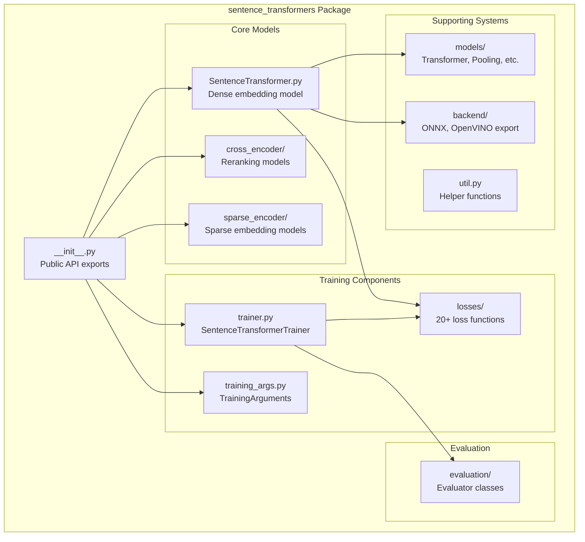

**Key Files and Their Purposes:**

| File/Directory | Purpose | Key Exports |
|---------------|---------|-------------|
| `__init__.py` | Main entry point | `SentenceTransformer`, `CrossEncoder`, `SparseEncoder`, `*Trainer`, `*TrainingArguments` |
| `SentenceTransformer.py` | Dense embedding model | `SentenceTransformer` class |
| `cross_encoder/` | Reranking subsystem | `CrossEncoder`, `CrossEncoderTrainer` |
| `sparse_encoder/` | Sparse embedding subsystem | `SparseEncoder`, `SparseEncoderTrainer` |
| `losses/` | Training loss functions | 20+ loss classes for different training scenarios |
| `evaluation/` | Evaluation metrics | Evaluator classes for different tasks |
| `models/` | Model components | `Transformer`, `Pooling`, `Dense`, `Normalize`, `Router` modules |
| `backend/` | Export utilities | ONNX and OpenVINO export functions |

Sources: [sentence_transformers/__init__.py:1-73]()

## Next Steps

After installation and basic usage, explore these topics:

**For Using Pre-trained Models:**
- [Model Catalog](#4.2) - Browse and select pre-trained models
- [Loading and Inference](#4.1) - Advanced inference techniques and prompts
- [Backend Optimization](#8.3) - Speed up inference with ONNX/OpenVINO

**For Training Models:**
- [Training Overview](#5.1) - Understand the training pipeline
- [Dataset Preparation](#5.2) - Format your training data
- [Loss Functions](#5.3) - Select appropriate loss functions
- [Training Configuration](#5.4) - Configure hyperparameters

**For Understanding Architecture:**
- [SentenceTransformer Architecture](#3.1) - Modular design and components
- [CrossEncoder Architecture](#3.2) - Sequence classification approach
- [SparseEncoder Architecture](#3.3) - Sparsity mechanisms

**For Advanced Features:**
- [Router Module for Asymmetric Models](#8.1) - Separate query/document encoders
- [Multi-Dataset Training](#8.2) - Train on multiple datasets simultaneously
- [Prompt Engineering](#8.5) - Use prompts with instruction-tuned models

Sources: [index.rst:133-153](), [README.md:176-231]()

---

# Page: Installation and Setup

# Installation and Setup

<details>
<summary>Relevant source files</summary>

The following files were used as context for generating this wiki page:

- [.gitignore](.gitignore)
- [.pre-commit-config.yaml](.pre-commit-config.yaml)
- [Makefile](Makefile)
- [README.md](README.md)
- [docs/installation.md](docs/installation.md)
- [docs/publications.md](docs/publications.md)
- [index.rst](index.rst)
- [pyproject.toml](pyproject.toml)
- [sentence_transformers/__init__.py](sentence_transformers/__init__.py)

</details>


This page provides detailed installation instructions for the Sentence Transformers library. It covers system requirements, installation methods, and setup for different use cases including inference, training, and optimized backends. For information on using pre-trained models after installation, see [Loading and Inference](#4.1). For training setup and configuration, see [Training Configuration](#5.4).

## Purpose and Scope

This document covers:
- System requirements and dependencies
- Installation via pip, conda, and from source
- Optional feature installation (training, ONNX, OpenVINO)
- GPU/CUDA setup
- Development environment configuration
- Installation verification

## System Requirements

The library has the following minimum requirements as specified in [pyproject.toml:1-44]():

| Requirement      | Minimum Version | Notes                        |
|------------------|-----------------|------------------------------|
| Python           | 3.9+            | Supported up to 3.13         |
| PyTorch          | 1.11.0+         | Required for all functionality|
| transformers     | 4.41.0+         | Core Hugging Face integration |
| huggingface-hub  | 0.20.0+         | Model loading and sharing     |

**Core Dependencies:**
- `transformers` (>=4.41.0, <5.0.0) – Base transformer models
- `torch` (>=1.11.0) – Deep learning framework
- `scikit-learn` – Machine learning utilities
- `scipy` – Scientific computing
- `tqdm` – Progress bars
- `Pillow` – Image processing
- `typing_extensions` (>=4.5.0) – Type hints

Sources: [pyproject.toml:1-44](), [README.md:23](), [docs/installation.md:3]()

## Installation Profiles

The library offers several installation profiles to support different use cases. Each profile installs the core package plus additional optional dependencies.

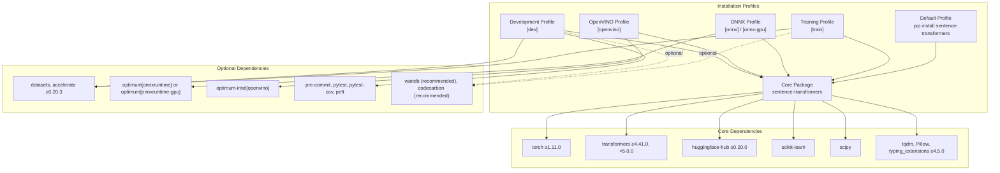

**Profile Descriptions:**

| Profile      | Command                                | Use Case                    | Key Additions                         |
|--------------|--------------------------------------|-----------------------------|-------------------------------------|
| **Default**  | `pip install sentence-transformers`  | Loading, saving, inference   | Core dependencies only               |
| **Training** | `pip install "sentence-transformers[train]"` | Model training and fine-tuning | `datasets`, `accelerate`             |
| **ONNX**     | `pip install "sentence-transformers[onnx]"`  | CPU-optimized inference       | `optimum[onnxruntime]`               |
| **ONNX-GPU** | `pip install "sentence-transformers[onnx-gpu]"` | GPU-optimized ONNX inference  | `optimum[onnxruntime-gpu]`           |
| **OpenVINO** | `pip install "sentence-transformers[openvino]"` | Intel hardware optimization  | `optimum-intel[openvino]`            |
| **Development** | `pip install "sentence-transformers[dev]"` | Contributing to the library  | All above plus testing and formatting tools|

Profiles can also be combined via comma-separated extras, e.g., `pip install "sentence-transformers[train,onnx-gpu]"`.

Sources: [pyproject.toml:51-56](), [docs/installation.md:1-10](), [README.md:21-48]()

## Installation Methods

### Installation via pip

The recommended installation method is using pip from the Python Package Index (PyPI).

**Default Installation:**
```bash
pip install -U sentence-transformers
```

**Training Setup:**
```bash
pip install -U "sentence-transformers[train]"

# Recommended additions for training monitoring
pip install wandb        # For training experiment tracking
pip install codecarbon   # For carbon emissions tracking
```

**ONNX Backend:**
```bash
# GPU and CPU support
pip install -U "sentence-transformers[onnx-gpu]"

# CPU only
pip install -U "sentence-transformers[onnx]"
```

**OpenVINO Backend:**
```bash
pip install -U "sentence-transformers[openvino]"
```

**Development Setup:**
```bash
pip install -U "sentence-transformers[dev]"
```

The `-U` flag upgrades to the latest version if already installed.

Sources: [README.md:25-29](), [docs/installation.md:13-60]()

### Installation via Conda

Conda installation is available via the `conda-forge` channel for the base package and some extras. Note that extras like ONNX and OpenVINO should be installed via pip after conda install.

**Default Installation:**
```bash
conda install -c conda-forge sentence-transformers
```

**Training Setup:**
```bash
conda install -c conda-forge sentence-transformers accelerate datasets

# Recommended additions for monitoring
pip install wandb
pip install codecarbon
```

**Backend Extras (after conda install):**
```bash
pip install -U "sentence-transformers[onnx-gpu]"
pip install -U "sentence-transformers[openvino]"
```

**Development Setup:**
```bash
conda install -c conda-forge sentence-transformers accelerate datasets pre-commit pytest ruff
```

Sources: [README.md:31-35](), [docs/installation.md:63-111]()

### Installation from Source

Installing from source provides access to the bleeding-edge development branch.

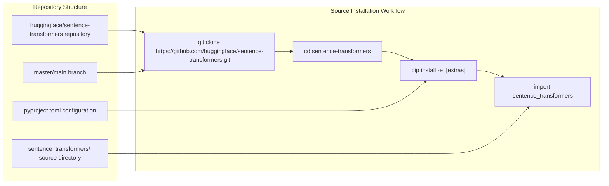

**Direct GitHub Installation Examples:**
```bash
# Default install from GitHub
pip install git+https://github.com/huggingface/sentence-transformers.git

# With training extras
pip install "sentence-transformers[train] @ git+https://github.com/huggingface/sentence-transformers.git"

# With ONNX GPU extras
pip install "sentence-transformers[onnx-gpu] @ git+https://github.com/huggingface/sentence-transformers.git"
```

**Editable Installation for Development:**

```bash
git clone https://github.com/huggingface/sentence-transformers
cd sentence-transformers
pip install -e ".[train,dev]"
```

This creates an editable install where changes in the source affect the installed package immediately.

**Development Workflow Setup:**

```bash
pre-commit install  # Setup git hooks for code quality checks
pytest              # Run tests to verify installation
ruff check .        # Lint and check code formatting
```

Sources: [README.md:37-43](), [README.md:233-247](), [docs/installation.md:113-176](), [pyproject.toml:56-64]()

## GPU and CUDA Configuration

To use GPU acceleration, PyTorch must be installed with compatible CUDA support. Sentence Transformers leverage PyTorch's CUDA capabilities but do not require additional setup.

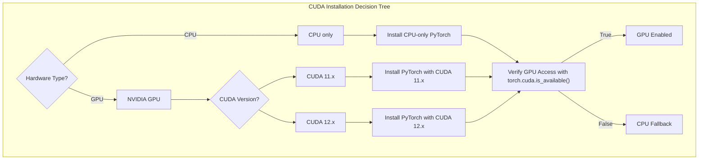

**Steps:**

1. Check your installed CUDA version:
```bash
nvidia-smi
```
2. Install PyTorch with the corresponding CUDA version from [PyTorch Get Started](https://pytorch.org/get-started/locally/):
```bash
# Example for CUDA 11.8
pip install torch torchvision torchaudio --index-url https://download.pytorch.org/whl/cu118
```
3. Verify GPU availability in Python:
```python
import torch
print(torch.cuda.is_available())
```

Sentence Transformers models (`SentenceTransformer`, `CrossEncoder`, `SparseEncoder`) automatically use GPU if available.

Sources: [README.md:45-48](), [docs/installation.md:177-180]()

## Installation Verification

After installation, verify that the library was installed correctly, imports without errors, and basic functionality works.

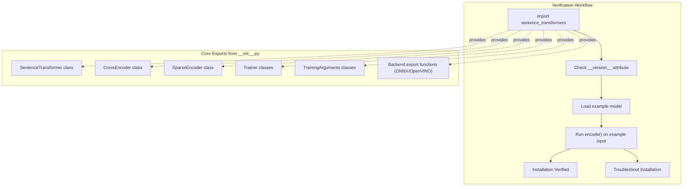

**Basic Import Test:**
```python
import sentence_transformers

print(f"Version: {sentence_transformers.__version__}")

from sentence_transformers import SentenceTransformer, CrossEncoder, SparseEncoder

print("Core classes imported successfully")
```

**Functional Test:**
```python
from sentence_transformers import SentenceTransformer

model = SentenceTransformer("all-MiniLM-L6-v2")
embeddings = model.encode("This is a test sentence.")

print(f"Embedding shape: {embeddings.shape}")
print(f"Device: {model.device}")
```

**Training Installation Test:**
```python
from sentence_transformers import SentenceTransformerTrainer, SentenceTransformerTrainingArguments
from sentence_transformers.losses import MultipleNegativesRankingLoss

print("Training components imported successfully")
```

**Backend Export Test:**
```python
from sentence_transformers.backend import export_optimized_onnx_model, export_static_quantized_openvino_model

print("Backend export utilities available")
```

The `__init__.py` file defines all public APIs as listed in [sentence_transformers/__init__.py:10-73]().

Sources: [sentence_transformers/__init__.py:1-73](), [README.md:50-166](), [index.rst:19-132]()

## Package Structure and Imports

Understanding what core modules are exposed by the package helps with verifying installation and development.

```mermaid
graph TB
    subgraph "Top-Level Imports from __init__.py"
        Init["sentence_transformers/__init__.py<br/>Version: 5.7.0.dev0"]
    end
    
    subgraph "Core Model Classes"
        ST["SentenceTransformer<br/>(sentence_transformers.sentence_transformer.model)"]
        CE["CrossEncoder<br/>(sentence_transformers.cross_encoder)"]
        SE["SparseEncoder<br/>(sentence_transformers.sparse_encoder)"]
    end
    
    subgraph "Training Components"
        STTrainer["SentenceTransformerTrainer<br/>(sentence_transformers.sentence_transformer.trainer)"]
        STArgs["SentenceTransformerTrainingArguments<br/>(sentence_transformers.sentence_transformer.training_args)"]
        CETrainer["CrossEncoderTrainer<br/>(sentence_transformers.cross_encoder)"]
        CEArgs["CrossEncoderTrainingArguments<br/>(sentence_transformers.cross_encoder)"]
        SETrainer["SparseEncoderTrainer<br/>(sentence_transformers.sparse_encoder)"]
        SEArgs["SparseEncoderTrainingArguments<br/>(sentence_transformers.sparse_encoder)"]
    end
    
    subgraph "Backend Utilities"
        ONNX["export_optimized_onnx_model<br/>export_dynamic_quantized_onnx_model<br/>(sentence_transformers.backend)"]
        OpenVINO["export_static_quantized_openvino_model<br/>(sentence_transformers.backend)"]
    end
    
    subgraph "Utilities"
        Quantize["quantize_embeddings<br/>(sentence_transformers.util.quantization)"]
        Similarity["SimilarityFunction<br/>(sentence_transformers.util.similarity)"]
        Mining["mine_hard_negatives<br/>(sentence_transformers.util)"]
        Samplers["DefaultBatchSampler<br/>MultiDatasetDefaultBatchSampler"]
    end
    
    Init --> ST
    Init --> CE
    Init --> SE
    Init --> STTrainer
    Init --> STArgs
    Init --> CETrainer
    Init --> CEArgs
    Init --> SETrainer
    Init --> SEArgs
    Init --> ONNX
    Init --> OpenVINO
    Init --> Quantize
    Init --> Similarity
    Init --> Mining
    Init --> Samplers
```

These modules are imported and exposed in [sentence_transformers/__init__.py:10-37]() and designated public in the `__all__` list at [sentence_transformers/__init__.py:47-72](). The package version is defined at [sentence_transformers/__init__.py:3]().

Sources: [sentence_transformers/__init__.py:1-73]()

## Common Installation Issues

| Issue                  | Symptom                                    | Resolution                                                |
|------------------------|--------------------------------------------|-----------------------------------------------------------|
| CUDA Not Available     | `torch.cuda.is_available()` returns False  | Install PyTorch with CUDA support for your GPU and CUDA version. |
| Missing training deps   | `ModuleNotFoundError: No module named 'datasets'` | Install training extra: `pip install "sentence-transformers[train]"` |
| Missing ONNX deps       | `ModuleNotFoundError: No module named 'optimum'` | Install ONNX extra: `pip install "sentence-transformers[onnx]"` |
| Version conflicts      | Dependency resolution or runtime errors     | Use isolated virtual environment; use compatible package versions per pyproject.toml |
| Wrong Transformers version | Model load errors or incompatibility       | Ensure `transformers>=4.41.0,<5.0.0` installed              |
| Python unsupported     | Installation fails or syntax errors          | Upgrade to Python 3.9 or above                             |

**Debugging Tips:**

1. Check Python version:
```bash
python --version  # Should be 3.9+
```

2. Confirm `sentence-transformers` installation path:
```python
import sentence_transformers
print(sentence_transformers.__file__)
```

3. Verify dependencies installed:
```bash
pip list | grep -E "(sentence-transformers|torch|transformers|huggingface-hub)"
```

4. Test in clean virtual environment:
```bash
python -m venv test_env
source test_env/bin/activate  # or test_env\Scripts\activate on Windows
pip install sentence-transformers
python -c "import sentence_transformers; print(sentence_transformers.__version__)"
```

Sources: [pyproject.toml:14-44](), [README.md:45-48](), [docs/installation.md:177-180]()

## Development Setup

For developers or contributors, a full editable installation with additional tools is recommended.

**Steps:**

```bash
# 1. Clone the repository
git clone https://github.com/huggingface/sentence-transformers
cd sentence-transformers

# 2. Create and activate a virtual environment (recommended)
python -m venv venv
source venv/bin/activate  # Windows: venv\Scripts\activate

# 3. Install in editable mode with dev extras
pip install -e ".[dev]"

# 4. Set up pre-commit git hooks for code quality
pre-commit install

# 5. Run tests to verify setup
pytest tests/

# 6. Check code style and lint
ruff check .
```

**Development Extras Include:**
- `datasets` – For dataset loading/testing
- `accelerate` – For training acceleration tests
- `pre-commit` – For Git hooks
- `pytest` and `pytest-cov` – For running and reporting tests
- `peft` – For parameter-efficient fine-tuning tests
- `transformers[vision,audio,video]` – For multimodal tests

These are defined in the `[project.optional-dependencies]` section of [pyproject.toml:56-68]().

**Environment Variables:**

The package automatically configures:
- `CODECARBON_LOG_LEVEL=error` if `codecarbon` is installed and not set
- Suppresses PyTorch sparse CSR warning messages

Sources: [README.md:233-247](), [pyproject.toml:56-105](), [sentence_transformers/__init__.py:39-45]()

---

This completes the detailed installation and setup documentation for the Sentence Transformers library.

Sources:  
- [README.md:21-67](), [README.md:70-147](), [sentence_transformers/__init__.py:1-73](), [docs/installation.md:1-180](), [pyproject.toml:1-68]()

---

# Page: Quick Start Guide

# Quick Start Guide

<details>
<summary>Relevant source files</summary>

The following files were used as context for generating this wiki page:

- [README.md](README.md)
- [docs/cross_encoder/pretrained_models.md](docs/cross_encoder/pretrained_models.md)
- [docs/cross_encoder/usage/custom_models.rst](docs/cross_encoder/usage/custom_models.rst)
- [docs/cross_encoder/usage/usage.rst](docs/cross_encoder/usage/usage.rst)
- [docs/installation.md](docs/installation.md)
- [docs/publications.md](docs/publications.md)
- [docs/quickstart.rst](docs/quickstart.rst)
- [docs/sentence_transformer/dataset_overview.md](docs/sentence_transformer/dataset_overview.md)
- [docs/sentence_transformer/pretrained_models.md](docs/sentence_transformer/pretrained_models.md)
- [docs/sentence_transformer/usage/usage.rst](docs/sentence_transformer/usage/usage.rst)
- [examples/sentence_transformer/training/multimodal/README.md](examples/sentence_transformer/training/multimodal/README.md)
- [examples/sentence_transformer/training/multimodal/training_visual_document_retrieval.py](examples/sentence_transformer/training/multimodal/training_visual_document_retrieval.py)
- [index.rst](index.rst)

</details>


This guide offers simple, practical examples for loading models, encoding text, computing similarity scores, and using each of the three core model types in the Sentence Transformers library: `SentenceTransformer` (embedding models), `CrossEncoder` (reranker models), and `SparseEncoder` (sparse embedding models). It includes explanations on key classes and methods as well as their data flow and output shapes.

For installation instructions, see the [Installation and Setup](#2.1) section. For detailed usage and advanced features, refer to the respective architecture and usage sections for each model type.

---

## Working with Embedding Models (`SentenceTransformer`)

The `SentenceTransformer` class generates dense fixed-size vector embeddings given input texts (or other modalities in multimodal models). These embeddings enable efficient similarity computations and are widely used for semantic search, clustering, paraphrase mining, and classification.

### Loading a Model

```python
from sentence_transformers import SentenceTransformer

# Load a pretrained Sentence Transformer model from Hugging Face Hub
model = SentenceTransformer("all-MiniLM-L6-v2")
```

- The `SentenceTransformer` constructor downloads and loads a model given a model name or local path.
- Models from the "sentence-transformers" organization require no prefix when loading.
- The loaded `model` is an instance of the `SentenceTransformer` class, internally defined as a subclass of `torch.nn.Sequential` combining modules such as Transformer and Pooling.
- This modular design allows for flexible configuration and extension.

### Encoding Sentences

```python
sentences = [
    "The weather is lovely today.",
    "It's so sunny outside!",
    "He drove to the stadium.",
]
embeddings = model.encode(sentences)
print(embeddings.shape)
# Output: (3, 384)
```

- The `encode()` method tokenizes input texts, processes them through the model, and returns fixed-size embeddings.
- By default, embeddings are returned as numpy `ndarray` of shape `[num_sentences, embedding_dim]`.
- Supports batch processing, normalization, device specification, and progress bars.
- For multimodal models, `encode()` accepts diverse inputs like images or videos in addition to text.

### Computing Similarities

```python
similarities = model.similarity(embeddings, embeddings)
print(similarities)
# Output (tensor):
# [[1.0000, 0.6660, 0.1046],
#  [0.6660, 1.0000, 0.1411],
#  [0.1046, 0.1411, 1.0000]]
```

- The `similarity()` method computes cosine similarity between embedding vectors by default.
- Accepts two embedding matrices and returns a similarity matrix.
- Useful for clustering or ranking based on semantic similarity.

---

### SentenceTransformer Workflow Diagram

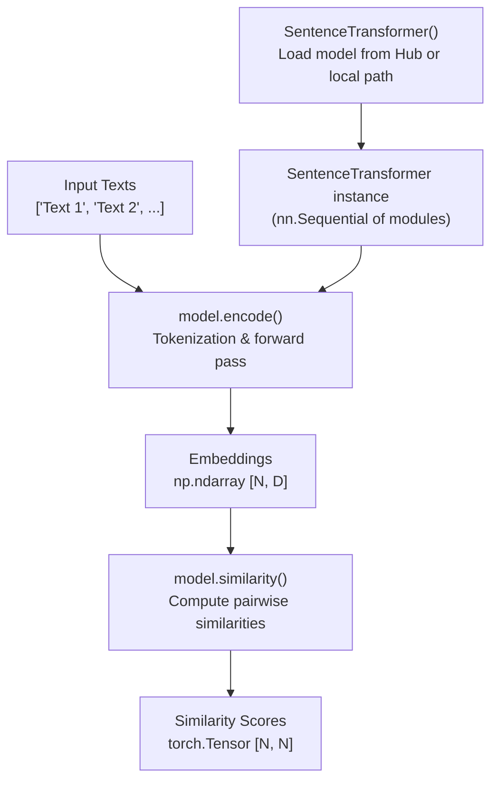

---

## Working with Reranker Models (`CrossEncoder`)

The `CrossEncoder` class encodes pairs of texts jointly, producing scores that reflect their similarity or relevance. These models are often used to rerank search results retrieved by other methods.

### Loading a Model

```python
from sentence_transformers import CrossEncoder

# Load a pretrained CrossEncoder reranker model
model = CrossEncoder("cross-encoder/ms-marco-MiniLM-L6-v2")
```

- `CrossEncoder` class is implemented as a subclass of `torch.nn.Sequential`.
- Typically loads models using `transformers.AutoModelForSequenceClassification`.
- Can be configured with activation functions like `Sigmoid` to get output between 0 and 1.

### Predicting Scores for Text Pairs

```python
query = "How many people live in Berlin?"
passages = [
    "Berlin had a population of 3,520,031 registered inhabitants in 891.82 km².",
    "Berlin has about 135 million yearly day visitors.",
    "Around 600,000 Berliners are registered in fitness clubs.",
]

# Predict similarity/relevance scores
scores = model.predict([(query, p) for p in passages])
print(scores)
# Output: [8.607139, 5.506266, 6.352977]
```

- The `predict()` method accepts a list of text pairs `(text1, text2)` and outputs float scores.
- Scores indicate how well the pair matches semantically or in a retrieval context.

### Ranking Documents for a Query

```python
ranks = model.rank(query, passages, return_documents=True)

print("Query:", query)
for rank in ranks:
    print(f"- #{rank['corpus_id']} ({rank['score']:.2f}): {rank['text']}")
# query and ranked documents output
```

- The `rank()` method scores documents for a query and returns them sorted by descending score.
- Each ranked result contains:
  - `corpus_id`: Original index of the document
  - `score`: Relevance score
  - `text`: Document text (if `return_documents=True`)

---

### CrossEncoder Workflow Diagram

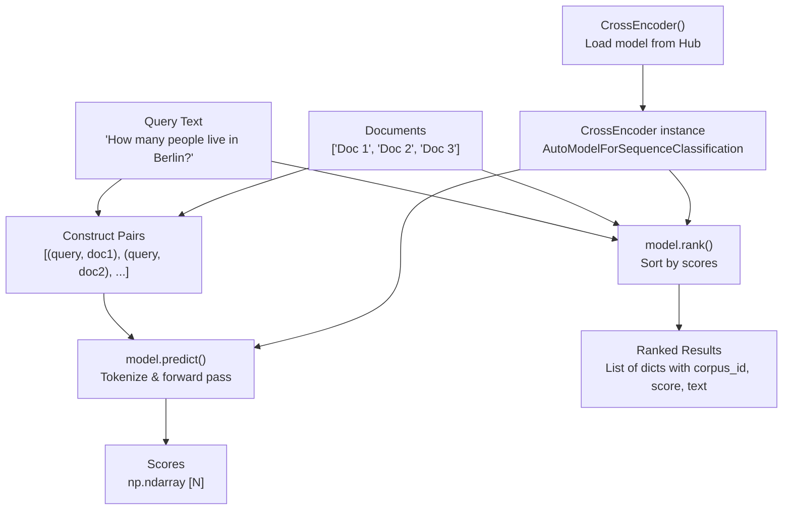

---

## Working with Sparse Embedding Models (`SparseEncoder`)

The `SparseEncoder` class produces high-dimensional sparse embeddings where most elements are zero, leveraging vocabulary-sized representations. These are useful for efficient retrieval with inverted indices and interpretable importance weights.

### Loading a Model

```python
from sentence_transformers import SparseEncoder

# Load a pretrained SparseEncoder model (e.g., SPLADE)
model = SparseEncoder("naver/splade-cocondenser-ensembledistil")
```

- `SparseEncoder` extends `SentenceTransformer`, adding modules like `MLMTransformer` and `SpladePooling` to generate sparse vectors.
- Output vectors have dimensions equal to the vocabulary size (e.g., 30,000+).

### Encoding Sentences

```python
sentences = [
    "The weather is lovely today.",
    "It's so sunny outside!",
    "He drove to the stadium.",
]
embeddings = model.encode(sentences)
print(embeddings.shape)
# Output: [3, 30522] (sparse vector size)
```

- Sparse embeddings are typically returned as sparse tensors (e.g., `torch.sparse_coo_tensor`) for memory efficiency.
- Most vector entries are zero; only a small subset are active.

### Computing Similarities

```python
similarities = model.similarity(embeddings, embeddings)
print(similarities)
# tensor([[35.629, 9.154, 0.098],
#         [ 9.154, 27.478, 0.019],
#         [ 0.098, 0.019, 29.553]])
```

- For sparse embeddings, similarity is computed as dot product rather than cosine similarity.
- Values represent the weighted overlap of active features, serving as relevance signals.

### Checking Sparsity Stats

```python
stats = SparseEncoder.sparsity(embeddings)
print(f"Sparsity: {stats['sparsity_ratio']:.2%}")
# Example Output: Sparsity: 99.84%
```

- `sparsity()` computes statistics such as sparsity ratio, count of active dimensions per embedding, and float operations estimates.
- Useful for diagnostics and optimization.

---

### SparseEncoder Workflow Diagram

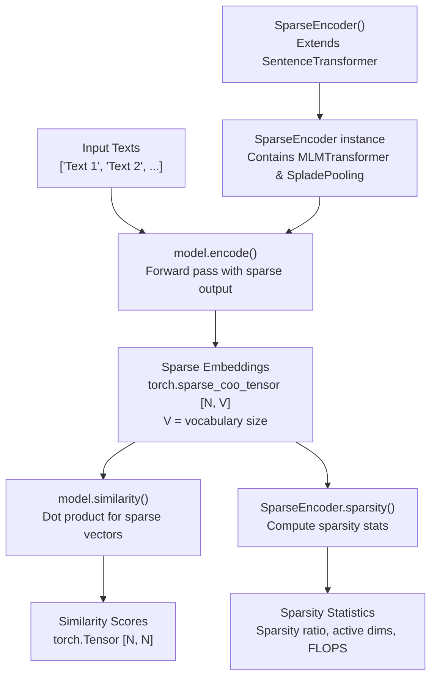

---

## Key Methods Summary

| Model Type             | Load Model                        | Generate Embeddings                  | Compare Texts                         | Special Methods             |
|-----------------------|---------------------------------|------------------------------------|-------------------------------------|-----------------------------|
| **SentenceTransformer** | `SentenceTransformer(model_name)` | `model.encode(texts)`               | `model.similarity(emb1, emb2)`       | `encode_query()`, `encode_document()` |
| **CrossEncoder**        | `CrossEncoder(model_name)`       | _no embeddings_                    | `model.predict(pairs)`                | `rank(query, docs)`          |
| **SparseEncoder**       | `SparseEncoder(model_name)`      | `model.encode(texts)`              | `model.similarity(emb1, emb2)`       | `sparsity(embeddings)`, `decode(embeddings)` |

---

## encode() Method Parameters (for SentenceTransformer and SparseEncoder)

Key parameters include:

- `batch_size` (int, default=32): Number of inputs processed per batch.
- `show_progress_bar` (bool): Whether to display progress bars.
- `convert_to_numpy` (bool, default=True): Return numpy arrays instead of PyTorch tensors.
- `convert_to_tensor` (bool, default=False): Return PyTorch tensors instead of numpy arrays.
- `normalize_embeddings` (bool, default=False): L2-normalize embeddings to unit length.
- `device` (str, optional): Device for computation (`"cpu"`, `"cuda"`, etc.).

Example usage with parameters:

```python
embeddings = model.encode(
    sentences,
    batch_size=64,
    show_progress_bar=True,
    normalize_embeddings=True,
    device="cuda"
)
```

---

## predict() Method Parameters (for CrossEncoder)

Key parameters:

- `batch_size` (int, default=32): Number of pairs processed in one batch.
- `show_progress_bar` (bool): Show progress bar during prediction.
- `activation_fn` (callable, optional): Activation function applied to raw model outputs (often `torch.nn.Sigmoid()`).
- `convert_to_numpy` (bool, default=True): Return numpy arrays instead of tensors.
- `apply_softmax` (bool, default=False): For multi-class models, apply softmax to produce probabilities.

Example:

```python
scores = model.predict(
    pairs,
    batch_size=64,
    show_progress_bar=True,
    convert_to_numpy=True
)
```

---

## Output Shapes Reference

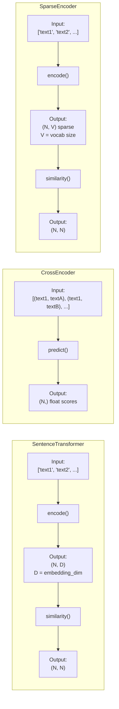

---

## Next Steps

- For training and fine-tuning models on your datasets, see the [Training Models](#5).
- Choose models from the pretrained catalogs for each model type: [Model Catalog](#4.2), [Model Catalog](#4.2), and [Model Catalog](#4.2).
- Explore advanced usage and optimization in the model-specific usage and architecture guides.
- Use the [Evaluation System Overview](#6.1) to evaluate model performance with various metrics.

---

# Sources

- README.md:1-166, 115-147
- sentence_transformers/SentenceTransformer.py:61-407, 683-1010, 1223-1350
- sentence_transformers/cross_encoder/CrossEncoder.py:48-227, 118-343, 392-585
- sentence_transformers/sparse_encoder/SparseEncoder.py:27-180, 412-710
- docs/sentence_transformer/usage/usage.rst:3-144
- docs/cross_encoder/usage/usage.rst:1-137
- docs/quickstart.rst:1-120

---

# Page: Model Architecture

# Model Architecture

<details>
<summary>Relevant source files</summary>

The following files were used as context for generating this wiki page:

- [.gitignore](.gitignore)
- [.pre-commit-config.yaml](.pre-commit-config.yaml)
- [Makefile](Makefile)
- [pyproject.toml](pyproject.toml)
- [sentence_transformers/__init__.py](sentence_transformers/__init__.py)
- [sentence_transformers/base/model.py](sentence_transformers/base/model.py)
- [sentence_transformers/base/modules/transformer.py](sentence_transformers/base/modules/transformer.py)
- [sentence_transformers/cross_encoder/model.py](sentence_transformers/cross_encoder/model.py)
- [sentence_transformers/sentence_transformer/model.py](sentence_transformers/sentence_transformer/model.py)
- [sentence_transformers/sparse_encoder/model.py](sentence_transformers/sparse_encoder/model.py)
- [tests/base/test_model.py](tests/base/test_model.py)

</details>


This document provides an overview of the three main model architectures in the Sentence Transformers library: `SentenceTransformer`, `CrossEncoder`, and `SparseEncoder`. Each architecture is optimized for different use cases, balancing accuracy, efficiency, and output format differences.

For comprehensive technical details, model internals, and advanced usage, refer to the child pages:
- [SentenceTransformer Architecture](#3.1)
- [CrossEncoder Architecture](#3.2)
- [SparseEncoder Architecture](#3.3)

## Architecture Comparison

The three model types address distinct tasks and have unique structural and output differences:

| Feature                   | SentenceTransformer                                | CrossEncoder                                   | SparseEncoder                            |
|---------------------------|--------------------------------------------------|-----------------------------------------------|-----------------------------------------|
| **Use Cases**             | Semantic search, clustering, similarity search  | Reranking, pairwise classification            | Efficient lexical+semantic retrieval    |
| **Input**                 | Single text or list of texts                      | Pairs of texts (sentence pairs)                | Single text or list of texts             |
| **Output**                | Dense embeddings (typ. 384–1024 dimensions)      | Scores or classification labels (regression or classification output) | Sparse embeddings (vocab-sized, e.g. 30k dimensions) |
| **Embedding Independence** | Embeddings of individual sentences are independent and cacheable | No; pairs are jointly encoded                  | Embeddings are independent and cacheable |
| **Inference Speed**       | Fast, single forward pass per text                | Slower; needs a forward pass per pair          | Fast, single forward pass per text      |
| **Accuracy**              | Good general semantic accuracy                     | Best pair scoring accuracy due to joint encoding | Good; interpretable token-level sparsity |
| **Base Class**            | `nn.Sequential` modular design                     | Based on `AutoModelForSequenceClassification` | Inherits from `SentenceTransformer`    |
| **Modularity**            | Fully modular (`Transformer` + `Pooling` + optional modules) | Less modular, monolithic model                  | Modular, specialized for sparse encodings |

Sources: [sentence_transformers/sentence_transformer/model.py:41-163](), [sentence_transformers/cross_encoder/model.py:35-116](), [sentence_transformers/sparse_encoder/model.py:35-129]()

---

## High-Level Architecture Overview

```mermaid
graph TB
    %% SentenceTransformer (Dense Embeddings)
    subgraph SentenceTransformer["SentenceTransformer (Dense Embeddings)"]
        ST_Input["Input Text(s)"]
        ST_Trans["Transformer (AutoModel)"]
        ST_Pool["Pooling Module (mean/cls/max)"]
        ST_Extras["Optional Dense / Normalize / Router"]
        ST_Output["Dense Embeddings<br/>[batch, 384-1024]"]
        
        ST_Input --> ST_Trans
        ST_Trans --> ST_Pool
        ST_Pool --> ST_Extras
        ST_Extras --> ST_Output
    end

    %% CrossEncoder (Joint Pair Encoding)
    subgraph CrossEncoder["CrossEncoder (Reranking / Classification)"]
        CE_Input["Input Text Pairs<br/>[(text1, text2), ...]"]
        CE_Model["AutoModelForSequenceClassification"]
        CE_Activation["Activation (Sigmoid/Softmax/Identity)"]
        CE_Output["Pair Scores or Class Labels"]
        
        CE_Input --> CE_Model
        CE_Model --> CE_Activation
        CE_Activation --> CE_Output
    end

    %% SparseEncoder (Sparse Embeddings)
    subgraph SparseEncoder["SparseEncoder (Sparse Embeddings)"]
        SE_Input["Input Text(s)"]
        SE_Choice{"Architecture Style?"}
        SE_SPLADE["MLMTransformer + SpladePooling<br/>(Query expansion activations)"]
        SE_SAE["SparseAutoEncoder (k-sparse CSR)"]
        SE_Select["Sparsity control (max_active_dims)"]
        SE_Output["Sparse Embeddings<br/>[batch, vocab_size]<br/>~99%+ sparsity"]
        
        SE_Input --> SE_Choice
        SE_Choice -->|"SPLADE Style"| SE_SPLADE
        SE_Choice -->|"SparseAutoEncoder Style"| SE_SAE
        SE_SPLADE --> SE_Select
        SE_SAE --> SE_Select
        SE_Select --> SE_Output
    end

    %% Usage Arrows
    ST_Output -.->|Semantic Search, Clustering, Similarity| App1["Use Case"]
    CE_Output -.->|Reranking, Pairwise Tasks, Classification| App2["Use Case"]
    SE_Output -.->|Efficient Retrieval, Interpretability, Hybrid Search| App3["Use Case"]
```

Sources: [sentence_transformers/sentence_transformer/model.py:41-163](), [sentence_transformers/cross_encoder/model.py:35-116](), [sentence_transformers/sparse_encoder/model.py:35-129](), [sentence_transformers/base/modules/transformer.py:37-59](), [sentence_transformers/sentence_transformer/modules/pooling.py:9-42]()

---

## Common Loading and Initialization Patterns

All three model types share similar APIs for loading models from either local paths or the Hugging Face Hub:

```python
from sentence_transformers import SentenceTransformer, CrossEncoder, SparseEncoder

# Load pre-trained models
model_st = SentenceTransformer("all-MiniLM-L6-v2")
model_ce = CrossEncoder("cross-encoder/ms-marco-MiniLM-L6-v2")
model_se = SparseEncoder("naver/splade-cocondenser-ensembledistil")

# Or load local saved models
model_local = SentenceTransformer("/path/to/my/model")
```

Shared initialization parameters include:

| Parameter            | Description                                            | Applies To           |
|----------------------|--------------------------------------------------------|---------------------|
| `device`             | Computation device: `"cuda"`, `"cpu"`, `"mps"`, `"npu"` | All                 |
| `cache_folder`       | Folder for caching models                              | All                 |
| `trust_remote_code`  | Allow executing Hub custom modeling code              | All                 |
| `revision`           | Specific Hub model version (branch, tag, or commit)   | All                 |
| `model_kwargs`       | Extra kwargs for Hugging Face transformer model loading | All               |
| `processor_kwargs`   | Extra kwargs for tokenizer/processor                   | All                 |
| `backend`            | Inference backend: `"torch"` (default), `"onnx"`, or `"openvino"` | All       |

Sources: [sentence_transformers/sentence_transformer/model.py:167-223](), [sentence_transformers/cross_encoder/model.py:119-136](), [sentence_transformers/sparse_encoder/model.py:133-152]()

---

## SentenceTransformer: Modular Dense Embeddings

`SentenceTransformer` is designed as a modular pipeline built from a list of PyTorch modules called sequentially. Its base architecture most commonly includes:

1. **Transformer Module**: A Hugging Face `AutoModel` that produces contextual token embeddings.
2. **Pooling Module**: Aggregates token embeddings to produce a fixed-size sentence embedding (e.g., mean, CLS token, or max pooling).
3. **Optional Modules**: Such as a dense feed-forward layer, normalization, and a Router module for asymmetric encoding scenarios.

```mermaid
graph LR
    Input["Input Text(s)"]
    Tokenizer["Transformer.tokenize()"]
    Transformer["Transformer.forward()"]
    Pooling["Pooling.forward()"]
    Output["sentence_embedding"]
    
    Input --> Tokenizer
    Tokenizer --> Transformer
    Transformer --> Pooling
    Pooling --> Output
```

This modular design enables easy customization. You can build custom models from any combination of modules:

```python
from sentence_transformers import SentenceTransformer
from sentence_transformers.models import Transformer, Pooling

transformer = Transformer("bert-base-uncased")
pooling = Pooling(transformer.get_word_embedding_dimension(), pooling_mode="mean")
model = SentenceTransformer(modules=[transformer, pooling])
```

Key encoding methods include:
- `encode()`: General embedding of texts
- `encode_query()`: Optimized for encoding queries (e.g., for asymmetric retrieval)
- `encode_document()`: Optimized for encoding documents

For an in-depth technical explanation, see the child page [SentenceTransformer Architecture](#3.1).

Sources: [sentence_transformers/sentence_transformer/model.py:41-163](), [sentence_transformers/sentence_transformer/model.py:352-355](), [sentence_transformers/base/modules/transformer.py:37-59](), [sentence_transformers/sentence_transformer/modules/pooling.py:9-42]()

---

## CrossEncoder: Joint Pair Encoding for Reranking and Classification

`CrossEncoder` jointly encodes pairs of sentences through an `AutoModelForSequenceClassification` architecture, producing a scalar similarity score or probability distribution for classification tasks.

```mermaid
graph LR
    Input["Input Text Pairs<br/>[(query, doc1), (query, doc2), ...]"]
    Tokenizer["Tokenizer.forward()"]
    Model["AutoModelForSequenceClassification"]
    Activation["Activation (Sigmoid/Softmax/Identity)"]
    Output["Similarity Scores or Class Labels"]
    
    Input --> Tokenizer
    Tokenizer --> Model
    Model --> Activation
    Activation --> Output
```

Modes supported:
- **Reranking Mode**: With `num_labels=1`, outputs a real-valued similarity score per pair. Used for reranking candidate results.
- **Classification Mode**: With `num_labels>1`, outputs classification logits for tasks like entailment or semantic textual similarity classification.

Key decoding methods:
- `predict()`: Compute score or classification probabilities for sentence pairs
- `rank()`: Rank documents by relevance using pairwise scoring (works only with reranking mode)

For detailed guidance, see [CrossEncoder Architecture](#3.2).

Sources: [sentence_transformers/cross_encoder/model.py:35-116](), [sentence_transformers/cross_encoder/model.py:229-257](), [sentence_transformers/cross_encoder/model.py:392-439]()

---

## SparseEncoder: Sparse Embeddings with Interpretability and Efficiency

`SparseEncoder` produces high-dimensional sparse vector representations aligned with vocabulary tokens, enabling efficient and interpretable retrieval. It extends the `SentenceTransformer` but produces sparse embeddings rather than dense ones.

Two main architectural styles are supported:

1. **SPLADE-style**: Uses a masked language modeling transformer (`MLMTransformer`) combined with `SpladePooling` that applies activations and log transforms to get sparse vectors emphasizing query expansion.
2. **Sparse AutoEncoder (SAE) style**: Uses a `SparseAutoEncoder` module that learns sparse codes under sparsity constraints (k-sparse CSR format).

```mermaid
graph TB
    Input["Input Text(s)"]
    Router["Optional Router Module"]
    
    subgraph SPLADE["SPLADE-style"]
        MLMTransformer["MLMTransformer<br/>(Masked LM head)"]
        SpladePooling["SpladePooling<br/>(ReLU + log(1+x) + max)"]
    end
    
    subgraph SAE["Sparse AutoEncoder-style"]
        SAE_Module["SparseAutoEncoder<br/>(k-sparse CSR)"]
    end
    
    SparsityControl["select_max_active_dims<br/>(Optional dimension pruning)"]
    Output["Sparse Embeddings<br/>[batch, vocab_size]<br/>~99% sparsity"]
    
    Input --> Router
    Router -->|query/document| MLMTransformer
    Router -->|query/document| SAE_Module
    MLMTransformer --> SpladePooling
    SpladePooling --> SparsityControl
    SAE_Module --> SparsityControl
    SparsityControl --> Output
```

Notable features:
- **Sparsity Control** via `max_active_dims`, allowing runtime control of non-zero components.
- High interpretability: embedding dimensions correspond to vocabulary tokens.
- Efficient storage and fast retrieval in large-scale systems.

Main encoding methods:
- `encode()`: Encodes input text to sparse embeddings
- `encode_query()`: Query-optimized encoding
- `encode_document()`: Document encoding
- `decode()`: Converts sparse embeddings back to tokens for interpretation

For technical details, see [SparseEncoder Architecture](#3.3).

Sources: [sentence_transformers/sparse_encoder/model.py:35-129](), [sentence_transformers/sparse_encoder/modules/__init__.py:1-3](), [sentence_transformers/sparse_encoder/model.py:171-179]()

---

## Backend and Inference Optimization

All three architectures support multiple inference backends to optimize runtime performance:

```mermaid
graph TB
    Models["SentenceTransformer<br/>CrossEncoder<br/>SparseEncoder"]
    
    subgraph Backends["Inference Backends"]
        TorchBackend["PyTorch Backend (default) - Full features"]
        ONNXBackend["ONNX Backend - Optimized, quantization support"]
        OpenVINOBackend["OpenVINO Backend - CPU optimized for Intel HW"]
    end
    
    Models -->|backend='torch'| TorchBackend
    Models -->|backend='onnx'| ONNXBackend
    Models -->|backend='openvino'| OpenVINOBackend
```

Usage example specifying backend:

```python
# Using default PyTorch backend
model = SentenceTransformer("model-name", backend="torch")

# Using ONNX backend (for faster inference & quantization)
model = CrossEncoder("cross-encoder-model", backend="onnx")

# Using OpenVINO backend (optimized CPU inference on Intel)
model = SparseEncoder("sparse-encoder-model", backend="openvino")
```

Sources: [sentence_transformers/sentence_transformer/model.py:186-202](), [sentence_transformers/cross_encoder/model.py:135-136](), [sentence_transformers/base/modules/transformer.py:65-76]()

---

## Architecture Selection Guide

```mermaid
graph TD
    Start["Choose Model Architecture"]
    
    Q1{"Need to pre-compute embeddings?"}
    Q2{"Require highest accuracy for pairs?"}
    Q3{"Need sparse, interpretable embeddings?"}
    Q4{"Require efficient storage and retrieval?"}
    
    ST["SentenceTransformer<br/>(Dense Embeddings)"]
    CE["CrossEncoder<br/>(Joint Pair Encoding)"]
    SE["SparseEncoder<br/>(Sparse Embeddings)"]
    Hybrid["Hybrid Approach<br/>(e.g. ST/SE initial + CE ranking)"]
    
    Start --> Q1
    Q1 -->|Yes| Q3
    Q1 -->|No| Q2
    
    Q2 -->|Yes| CE
    Q2 -->|No| ST
    
    Q3 -->|Yes| Q4
    Q3 -->|No| ST
    
    Q4 -->|Yes| SE
    Q4 -->|No| ST
    
    CE -.->|"Rerank after initial retrieval"| Hybrid
    ST -.->|"Retrieve + cluster"| Hybrid
    SE -.->|"Lexical + semantic retrieval"| Hybrid
```

**When to use each:**

| Architecture         | Use Cases                                               | Scenarios to Avoid                          |
|----------------------|---------------------------------------------------------|---------------------------------------------|
| **SentenceTransformer** | Semantic search, clustering, similarity tasks, large-scale fast inference with precomputable embeddings | When only exact pairwise accuracy matters, or embedding interpretability is required |
| **CrossEncoder**       | Reranking, semantic textual similarity classification, entailment, situations that require maximum accuracy per pair | Large scale inference due to lower speed; precomputing embeddings not supported |
| **SparseEncoder**      | Efficient large-scale lexical-semantic retrieval, hybrid search, interpretable sparse vectors | Tasks requiring dense semantic representations or very short queries |

Common practical pattern is a two-stage retrieval: first use `SentenceTransformer` or `SparseEncoder` for quick initial retrieval, then apply `CrossEncoder` for fast reranking of top-k candidates.

Sources: [README.md], [index.rst]

---

## Model Configuration and Persistence

Each architecture maintains configuration data for reproducible loading and saving:

| Class                 | Config Storage Location                                    | Key Config Fields                                      |
|-----------------------|------------------------------------------------------------|-------------------------------------------------------|
| `SentenceTransformer` | Internal config dictionary (`self._model_config`)          | `model_type`, `prompts`, `default_prompt_name`, `similarity_fn_name` |
| `CrossEncoder`         | Underlying transformer's `config.sentence_transformers`    | `activation_fn`, `version`                             |
| `SparseEncoder`        | Inherits SentenceTransformer config + sparsity parameters  | Same as SentenceTransformer + `max_active_dims`       |

Models support `save_pretrained()` and `from_pretrained()` with config persistence:

```python
# Save model and config
model.save_pretrained("/path/to/save")

# Reload model with saved config
model = SentenceTransformer("/path/to/save")
```

Sources: [sentence_transformers/sentence_transformer/model.py:196-201](), [sentence_transformers/cross_encoder/model.py:302-316](), [sentence_transformers/sparse_encoder/model.py:171-179]()

---

# Summary

The Sentence Transformers library provides three core model architectures designed to optimize for diverse tasks:

- `SentenceTransformer` for fast, precomputable dense embeddings suitable for semantic search and clustering.
- `CrossEncoder` for maximum accuracy in pairwise scoring and classification at reranking stage.
- `SparseEncoder` for sparse, interpretable, and efficient lexical-semantic retrieval at large scale.

Selecting the appropriate architecture depends on your application requirements for speed, accuracy, interpretability, and the size of the data.

For detailed architectural design, decoder methods, and training strategies, please consult the child pages dedicated to each model type.

---

**Sources:**

- [sentence_transformers/__init__.py:16-33]()
- [sentence_transformers/sentence_transformer/model.py:41-163,167-223,352-355,186-202]()
- [sentence_transformers/cross_encoder/model.py:35-116,119-136,229-257,302-316,392-439]()
- [sentence_transformers/sparse_encoder/model.py:35-129,133-152,171-179]()
- [sentence_transformers/base/modules/transformer.py:37-59,65-76]()
- [sentence_transformers/sentence_transformer/modules/pooling.py:9-42]()

---

# Page: SentenceTransformer Architecture

# SentenceTransformer Architecture

<details>
<summary>Relevant source files</summary>

The following files were used as context for generating this wiki page:

- [docs/migration_guide.md](docs/migration_guide.md)
- [docs/sentence_transformer/usage/custom_models.rst](docs/sentence_transformer/usage/custom_models.rst)
- [sentence_transformers/base/evaluation/evaluator.py](sentence_transformers/base/evaluation/evaluator.py)
- [sentence_transformers/base/evaluation/sequential.py](sentence_transformers/base/evaluation/sequential.py)
- [sentence_transformers/base/model.py](sentence_transformers/base/model.py)
- [sentence_transformers/base/modules/router.py](sentence_transformers/base/modules/router.py)
- [sentence_transformers/base/modules/transformer.py](sentence_transformers/base/modules/transformer.py)
- [sentence_transformers/cross_encoder/model.py](sentence_transformers/cross_encoder/model.py)
- [sentence_transformers/sentence_transformer/model.py](sentence_transformers/sentence_transformer/model.py)
- [sentence_transformers/sentence_transformer/modules/pooling.py](sentence_transformers/sentence_transformer/modules/pooling.py)
- [sentence_transformers/sparse_encoder/losses/flops.py](sentence_transformers/sparse_encoder/losses/flops.py)
- [sentence_transformers/sparse_encoder/model.py](sentence_transformers/sparse_encoder/model.py)
- [sentence_transformers/util/decorators.py](sentence_transformers/util/decorators.py)
- [sentence_transformers/util/misc.py](sentence_transformers/util/misc.py)
- [tests/base/modules/test_router.py](tests/base/modules/test_router.py)
- [tests/base/test_model.py](tests/base/test_model.py)
- [tests/sentence_transformer/modules/test_pooling.py](tests/sentence_transformer/modules/test_pooling.py)
- [tests/util/test_decorators.py](tests/util/test_decorators.py)
- [tests/util/test_misc.py](tests/util/test_misc.py)

</details>


## Purpose and Scope

This document provides a comprehensive deep dive into the `SentenceTransformer` class architecture — the core model type for generating dense sentence embeddings. It explores its modular design philosophy, the integration of Transformer and Pooling modules, the role of the Router module for asymmetric architectures, and the encoding methods supported. This detailed exposition aids in understanding the internal workings, data flow, and modifiability of SentenceTransformer models.

For complementary architecture details, refer to:
- [CrossEncoder Architecture (3.2)](3.2)
- [SparseEncoder Architecture (3.3)](3.3)

---

## Overview: Modular Sequential Design

The `SentenceTransformer` class inherits from `BaseModel`, which itself extends `nn.Sequential`. This fundamental design means the model operates as a sequence of modules, each receiving and returning a dictionary of features that progressively enrich or transform the data.

The typical pipeline includes a Transformer module producing token embeddings, followed by a Pooling module generating sentence embeddings, and optionally, additional modules for embedding transformations (Dense, Normalize, etc.).

```mermaid
graph LR
    Input["Input Text"] --> Transformer["Transformer Module<br/>(token embeddings)"]
    Transformer --> Pooling["Pooling Module<br/>(sentence embedding)"]
    Pooling --> Optional["Optional Modules<br/>(Dense, Normalize, etc.)"]
    Optional --> Output["Output Embeddings<br/>(fixed dimension)"]
```

Each module implements a callable `forward(features: dict) -> dict` interface, enabling flexible chaining and feature propagation.

**Sources:** [sentence_transformers/sentence_transformer/model.py:41-171]() [sentence_transformers/base/model.py:50-120]() [sentence_transformers/base/modules/transformer.py:20-300]() [sentence_transformers/sentence_transformer/modules/pooling.py:60-150]()

---

## Core Components

### Transformer Module

The `Transformer` module is the foundational building block that encapsulates a Hugging Face transformers model (e.g., `BertModel`, `RobertaModel`, `T5EncoderModel`). It transforms tokenized input text into a contextualized embedding sequence.

```mermaid
graph TB
    subgraph Transformer["Transformer Module"]
        AutoTokenizer["AutoTokenizer (tokenizes input)"]
        AutoModel["AutoModel / EncoderModel (generates token embeddings)"]
        Config["Config (max_seq_length, transformer_task, etc.)"]
    end

    InputText["Input Text"] --> AutoTokenizer
    AutoTokenizer --> TokenIDs["input_ids, attention_mask"]
    TokenIDs --> AutoModel
    AutoModel --> TokenEmbeddings["token_embeddings (batch_size, seq_len, hidden_dim)"]
    TokenEmbeddings --> FeaturesDict["features dict with key 'token_embeddings'"]
```

Key features and properties:

- **`auto_model`**: The encapsulated pretrained transformer instance loaded via Hugging Face `AutoModel`.
- **`tokenizer`**: Tokenizer for preprocessing input into IDs.
- **`max_seq_length`**: Inputs truncated/padded to this maximum length.
- **`backend`**: Supports `"torch"`, `"onnx"`, and `"openvino"` backends for inference.
- **Forward behavior**: Processes features dictionary, returns updated features with outputs such as `token_embeddings`, and possibly `all_layer_embeddings`.

**Sources:** [sentence_transformers/base/modules/transformer.py:10-350]()

### Pooling Module

The `Pooling` module aggregates variable-length token embeddings into fixed-size sentence embeddings, supporting multiple pooling strategies.

Supported pooling modes:

| Mode                | Description                                  |
|---------------------|----------------------------------------------|
| `"cls"`             | Use the embedding of the first token (CLS). |
| `"mean"` (default)  | Mean pooling over all tokens.                 |
| `"max"`             | Max pooling over all tokens.                  |
| `"lasttoken"`       | Use last non-padding token embedding.        |
| `"mean_sqrt_len_tokens"` | Mean pooling scaled by sqrt of token length.   |
| `"weightedmean"`    | Weighted mean pooling by position weights.   |

```mermaid
graph TB
    TokenEmbeddings["Token Embeddings<br/>(batch, seq_len, hidden_dim)"] --> PoolingLogic["Pooling Strategy"]
    AttentionMask["Attention Mask"] --> PoolingLogic
    PromptLength["Prompt Length (optional)"] --> PoolingLogic
    
    PoolingLogic --> SentenceEmbeddings["Sentence Embeddings<br/>(batch, embedding_dim)"]

    subgraph PoolingConfig["Pooling Module Config"]
        PoolingMode["pooling_mode"]
        IncludePrompt["include_prompt"]
        EmbedDim["embedding_dimension"]
    end
```

**Notable Configuration:**

- `pooling_mode`: Can be a single or multiple pooling modes (tuple) concatenated.
- `include_prompt`: If `False`, excludes prompt tokens from pooling by masking prompt token positions.
- `embedding_dimension`: Input token embedding size.

This pooling mechanism allows both simple and composite representations by concatenating the results of multiple pooling strategies.

**Sources:** [sentence_transformers/sentence_transformer/modules/pooling.py:68-163]()

---

## Optional Components

### Dense and Normalize Modules

After pooling, the following modules may be optionally appended:

- **Dense Module**: A linear layer that applies a transformation (e.g., to reduce embedding dimension or add nonlinearity).
- **Normalize Module**: L2-normalizes embeddings, enforcing unit norm for similarity operations.
- **LayerNorm, WeightedLayerPooling, etc.**: Additional embedding normalization or pooling variations.

These modules form a pipeline for richer or more specialized embedding spaces and are typically appended after pooling.

**Sources:** [sentence_transformers/sentence_transformer/model.py:340-365]()

### The Router Module: Enabling Asymmetric Architectures

The `Router` module enables flexible, task- and modality-dependent routing of input through different module sub-chains. It is essential for asymmetric encoders used in efficient retrieval architectures where queries and documents are encoded differently.

```mermaid
graph TB
    Input["Input + task (e.g., 'query', 'document')"] --> Router["Router Module"]
    
    Router --> QueryRoute["Route: 'query' modules<br/>(e.g. SparseStaticEmbedding)"]
    Router --> DocumentRoute["Route: 'document' modules<br/>(e.g. Transformer + Pooling)"]
    
    QueryRoute --> QueryEmbedding["Query Embedding"]
    DocumentRoute --> DocumentEmbedding["Document Embedding"]
    
    subgraph RouterConfig["Router Configuration"]
        SubModules["sub_modules: dict[str, list[Module]]"]
        DefaultRoute["default_route (optional)"]
        AllowEmptyKey["allow_empty_key (bool)"]
        RouteMappings["route_mappings (tuple keys → route)"]
    end
```

**Design:**

- The Router maintains a dictionary of routes, each represented by a list of modules bundled into an `nn.Sequential`.
- At inference/training, the `task` (route key) dictates which chained modules process the input.
- Allows efficient asymmetric encoders, where query and document inputs follow different pipelines.

**Example training argument for Router mapping:**
```python
router_mapping={
    "question": "query",
    "positive": "document",
    "negative": "document",
}
```

This explicit dataset-to-route mapping instructs the trainer how to route different input columns accordingly.

**Sources:** [sentence_transformers/base/modules/router.py:24-323]() [sentence_transformers/sentence_transformer/model.py:370-410]() [tests/base/modules/test_router.py:80-190]()

---

## The Forward Pass in SentenceTransformer

The forward pass integrates tokenization, prompt application, modular processing, and embedding extraction in multiple batch-processing methods.

```mermaid
graph TB
    encode_call["`encode()` called"] --> Tokenize["Tokenize inputs with first module's tokenizer"]
    Tokenize --> ApplyPrompt["Apply prompt prefix if specified"]
    ApplyPrompt --> FeaturesDict["Format features dict with tokenized inputs"]
    
    FeaturesDict --> ForwardModules["Pass features through nn.Sequential modules"]
    ForwardModules --> ExtractEmbedding["Extract 'sentence_embedding' from features"]
    ExtractEmbedding --> PostProcess["Optional: truncate_dim, normalize, quantize"]
    PostProcess --> OutputEmbeddings["Return final sentence embeddings"]

    subgraph BatchModes["Batch processing modes"]
      direction LR
      EncodeBatch["_encode_batch"]
      EncodeIterable["encode with IterableDataset"]
      EncodeSingle["encode_single"]
    end
```

Detailed steps:

- **Tokenization**: Uses the tokenizer from the first module (usually Transformer) to convert text into IDs and attention masks.
- **Prompt Handling**: Prepends configurable prompt strings if provided, allowing prompt tuning or instruction tuning.
- **Module Execution**: Inputs flow through each module sequentially; `forward` receives and returns a feature dict.
- **Embedding extraction**: The key `sentence_embedding` in the feature dict is the final dense embedding output.
- **Post-processing**: Optional operations like truncation of embedding dimension, L2 normalization, or INT8 quantization for efficient storage and similarity calculation.

**Sources:** [sentence_transformers/sentence_transformer/model.py:980-1200]() [sentence_transformers/base/model.py:50-85]() [sentence_transformers/base/modules/router.py:75-130]()

---

## Encoding Methods and Task-Aware Routing

`SentenceTransformer` offers three main encoding entry points that differ primarily by how they handle prompts and routing for asymmetric models:

| Method             | Purpose           | Sets `task` | Uses Prompt Named      |
|--------------------|-------------------|-------------|-----------------------|
| `encode()`         | General encoding  | No          | None or default       |
| `encode_query()`   | Encode queries    | `"query"`   | `"query"` prompt      |
| `encode_document()`| Encode documents  | `"document"`| `"document"` prompt   |

```mermaid
graph TB
    User["User"] --> encode_query["encode_query()"]
    User --> encode_document["encode_document()"]
    User --> encode_generic["encode()"]

    encode_query --> SetTaskQuery["Set `task='query'`"]
    encode_document --> SetTaskDocument["Set `task='document'`"]
    encode_generic --> NoTask["No `task` set"]

    SetTaskQuery --> CoreEncode["Invoke core encode()"]
    SetTaskDocument --> CoreEncode
    NoTask --> CoreEncode

    CoreEncode --> RouterCheck{"Router module present?"}
    RouterCheck -->|Yes| RouteSelect["Select route by `task`"]
    RouterCheck -->|No| AllModules["Pass through all modules sequentially"]

    RouteSelect --> FinalOutput["Output embedding"]
    AllModules --> FinalOutput
```

When:

- No prompts are configured (empty or missing),
- and no Router module is present,

all three methods behave identically.

This layered API allows specialized model usage (e.g., asymmetric encoders) with minimal code changes.

**Sources:** [sentence_transformers/sentence_transformer/model.py:440-675]()

---

## Model Configuration and Initialization

### Loading and Creating SentenceTransformer Models

Common initialization patterns include:

- **Load pretrained by name or local path**:
```python
from sentence_transformers import SentenceTransformer
model = SentenceTransformer("sentence-transformers/all-MiniLM-L6-v2")
```

- **Load pretrained with custom configuration (prompts, truncation, device, etc.)**:
```python
model = SentenceTransformer(
    "sentence-transformers/all-MiniLM-L6-v2",
    prompts={"query": "query: ", "document": "passage: "},
    default_prompt_name="query",
    truncate_dim=256,
    model_kwargs={"torch_dtype": "float16"},
)
```

- **Build from custom modules**:
```python
from sentence_transformers.sentence_transformer.modules import Transformer, Pooling

transformer = Transformer("bert-base-uncased", max_seq_length=256)
pooling = Pooling(transformer.get_embedding_dimension(), pooling_mode="mean")

model = SentenceTransformer(modules=[transformer, pooling])
```

### Model Files and Configuration

A saved SentenceTransformer model folder includes:

```
model_name_or_path/
├── config_sentence_transformers.json    # Model-level configuration (prompts, similarity etc.)
├── modules.json                         # List of modules, order and type
├── 0_Transformer/                      # First module files and config
│   ├── config.json
│   ├── model.safetensors
│   ├── tokenizer_config.json
│   └── sentence_bert_config.json        # Transformer-specific config (e.g., task, modality)
└── 1_Pooling/
    └── config.json                      # Pooling configuration (embedding_dimension, pooling_mode, etc.)
```

**Example `modules.json`:**

```json
[
  {
    "idx": 0,
    "name": "0",
    "path": "0_Transformer",
    "type": "sentence_transformers.base.modules.transformer.Transformer"
  },
  {
    "idx": 1,
    "name": "1",
    "path": "1_Pooling",
    "type": "sentence_transformers.sentence_transformer.modules.pooling.Pooling"
  }
]
```

### Prompts and Similarity Configuration

- Prompts allows prepending text to inputs for specialized tasks or instruction tuning.
- The similarity function (default `"cosine"`) is configurable via `config_sentence_transformers.json`.

**Sources:** [sentence_transformers/sentence_transformer/model.py:150-400]() [sentence_transformers/sentence_transformer/model.py:1545-1670]() [sentence_transformers/base/modules/transformer.py:160-220]()

---

## Architecture Variants

### 1. Standard Dense Embedding Model

Typical pipeline for semantic textual similarity and general embeddings:

```mermaid
graph LR
    T["Transformer"] --> P["Pooling (mean)"] --> N["Normalize"] --> Out["Sentence Embedding (unit norm)"]
```

- Transformer produces token-level embeddings.
- Pooling converts them to fixed-size sentence embeddings.
- Normalize enforces unit length for cosine similarity.

---

### 2. Asymmetric Retrieval Model Using Router

Combines lightweight encoders for queries and heavy encoders for documents to optimize retrieval speed and quality.

```mermaid
graph TB
    Input["Input + Task"] --> Router["Router Module"]

    Router --> QEncoder["Query Encoder (e.g. SparseStaticEmbedding)"]
    Router --> DEncoder["Document Encoder (Transformer)"]

    DEncoder --> DPooling["Pooling"]
    QEncoder --> QEmbedding["Query Embedding"]
    DPooling --> DEmbedding["Document Embedding"]
```

Enables:

- Efficient query encoding (fast, small).
- Full transformer encoding for documents (more expressive).
- Task-based routing for encode_query vs encode_document.

---

### 3. Multi-stage Sentence Embedding Model

Models embedding dimension transitions and normalization for storage-optimized embeddings:

```mermaid
graph LR
    T["Transformer"] --> P["Pooling"] --> D["Dense (768→256)"] --> N["Normalize"] --> Out["Compact Embedding (256D)"]
```

- Dense layer reduces dimension.
- Normalize ensures embedding stability and similarity fidelity.

---

## Natural Language Space to Code Entity Space Mapping Diagrams

### SentenceTransformer Model and Modules

```mermaid
graph TD
    NLInput["Natural Language Input (text)"]

    subgraph SentenceTransformer["SentenceTransformer (sentence_transformer/model.py:41)"]
        TransformerModule["Transformer(nn.Module) (base/modules/transformer.py)"]
        PoolingModule["Pooling(nn.Module) (sentence_transformer/modules/pooling.py)"]
        OptionalModules["Optional Dense, Normalize, etc. (various)"]
    end

    NLInput --> TransformerModule
    TransformerModule --> PoolingModule
    PoolingModule --> OptionalModules
```

### Router Module for Asymmetric Encoding with Tasks

```mermaid
graph TD
    NLInput["Natural Language Input with task='query' or 'document'"]

    RouterModule["Router Module (base/modules/router.py:24)"]

    subgraph Routes
        QueryRoute["'query' route<br/>sequence of Modules (list[nn.Modules])"]
        DocumentRoute["'document' route<br/>sequence of Modules (list[nn.Modules])"]
    end

    NLInput --> RouterModule
    RouterModule -->|if task='query'| QueryRoute
    RouterModule -->|if task='document'| DocumentRoute
```

---

# Summary

The `SentenceTransformer` class leverages a modular, sequential architecture typical of PyTorch’s `nn.Sequential`, composed primarily of Transformer and Pooling modules to generate fixed-size embeddings. Optional modules like Dense and Normalize enrich embedding representations. The Router module enables complex asymmetric encoders by routing inputs dynamically based on tasks or modalities, facilitating efficient retrieval architectures.

Encoding methods (`encode()`, `encode_query()`, `encode_document()`) leverage this routing and prompt system, providing flexible inference APIs aligned with task-specific needs. Model initialization supports loading from pretrained models, building from custom module lists, and configurable prompts and similarity.

This layered design balances customization, efficiency, and ease of use, forming a core part of the Sentence Transformers ecosystem.

---

**Sources:**  
- [sentence_transformers/sentence_transformer/model.py:40-670, 980-1200, 150-420, 1540-1670]()  
- [sentence_transformers/base/modules/transformer.py:10-350]()  
- [sentence_transformers/sentence_transformer/modules/pooling.py:60-165]()  
- [sentence_transformers/base/modules/router.py:20-320]()  
- [tests/base/modules/test_router.py:20-190]()

---

# Page: CrossEncoder Architecture

# CrossEncoder Architecture

<details>
<summary>Relevant source files</summary>

The following files were used as context for generating this wiki page:

- [docs/package_reference/cross_encoder/modules.md](docs/package_reference/cross_encoder/modules.md)
- [examples/cross_encoder/training/multimodal/training_doodles_any_to_any.py](examples/cross_encoder/training/multimodal/training_doodles_any_to_any.py)
- [examples/cross_encoder/training/multimodal/training_doodles_feature_extraction.py](examples/cross_encoder/training/multimodal/training_doodles_feature_extraction.py)
- [sentence_transformers/base/model.py](sentence_transformers/base/model.py)
- [sentence_transformers/base/modules/transformer.py](sentence_transformers/base/modules/transformer.py)
- [sentence_transformers/cross_encoder/model.py](sentence_transformers/cross_encoder/model.py)
- [sentence_transformers/cross_encoder/modules/__init__.py](sentence_transformers/cross_encoder/modules/__init__.py)
- [sentence_transformers/cross_encoder/modules/logit_score.py](sentence_transformers/cross_encoder/modules/logit_score.py)
- [sentence_transformers/sentence_transformer/model.py](sentence_transformers/sentence_transformer/model.py)
- [sentence_transformers/sparse_encoder/model.py](sentence_transformers/sparse_encoder/model.py)
- [tests/base/test_model.py](tests/base/test_model.py)

</details>


## Purpose and Scope

This page documents the `CrossEncoder` architecture, a core model type in the Sentence Transformers library designed for **joint encoding** of text pairs to produce similarity scores or classification labels. Unlike `SentenceTransformer` models that encode sentences independently (bi-encoder), `CrossEncoder` processes both sentences together allowing finer-grained interactions between sentence tokens. This results in higher accuracy for pairwise tasks such as reranking, semantic textual similarity (STS), and natural language inference (NLI).

This page explains the internal implementation, data flow, modes of operation (reranking vs classification), and key methods (`predict` and `rank`). For training details, refer to the training docs; for usage patterns, see the usage docs.

---

## Architecture Overview

The `CrossEncoder` architecture jointly encodes two input texts and applies a classification or regression head over the combined representation. The model consists of:

- **Input:** Text pair (e.g., query and document)
- **Tokenizer:** Hugging Face `AutoTokenizer` tokenizes both texts together as a single input sequence
- **Transformer:** Hugging Face `AutoModelForSequenceClassification` processes tokenized input jointly
- **Head:** Final classification/regression head producing one or more output values
- **Activation:** Applied activation function (typically Sigmoid for regression or Identity for classification)

The key characteristic is that the input is encoded jointly, enabling cross-attention between the two sentences in the transformer layers.

```mermaid
graph TB
    subgraph "CrossEncoder Architecture"
        Input["Text Pair<br/>(Query, Document)"]
        Tokenizer["AutoTokenizer<br/>tokenize both texts together"]
        Model["AutoModelForSequenceClassification<br/>Joint encoding"]
        Classifier["Classification Head<br/>(num_labels outputs)"]
        Activation["Activation Function<br/>(Sigmoid/Identity/Custom)"]
        Output["Score(s)<br/>Single value or label distribution"]
    end
    
    Input --> Tokenizer
    Tokenizer --> Model
    Model --> Classifier
    Classifier --> Activation
    Activation --> Output
    
    Note1["No separate embeddings<br/>Direct pair-to-score"]
    Note1 -.-> Model
```

### Comparison with SentenceTransformer

| Aspect                         | SentenceTransformer (Bi-Encoder)             | CrossEncoder                             |
| ------------------------------|----------------------------------------------|----------------------------------------|
| Encoding                      | Independently encode each sentence            | Jointly encode sentence pairs          |
| Output                       | Dense embeddings (e.g., 768-dim vectors)      | Scores or classification logits        |
| Comparison                   | Post-hoc with similarity function             | Computed internally via classification |
| Inference Speed              | Fast (precompute embeddings)                   | Slower (process each pair)              |
| Typical Use Case             | Retrieval, clustering                           | Reranking, pairwise classification     |
| Accuracy                    | Moderate                                        | High (cross-attention across pairs)    |

```mermaid
graph TB
    subgraph "SentenceTransformer (Bi-Encoder)"
        ST_Input1["Text 1"]
        ST_Input2["Text 2"]
        ST_Encode1["encode()"]
        ST_Encode2["encode()"]
        ST_Emb1["Embedding 1<br/>[768-dim vector]"]
        ST_Emb2["Embedding 2<br/>[768-dim vector]"]
        ST_Sim["Similarity Function<br/>(cosine, dot, etc.)"]
        ST_Score["Similarity Score"]
        
        ST_Input1 --> ST_Encode1
        ST_Input2 --> ST_Encode2
        ST_Encode1 --> ST_Emb1
        ST_Encode2 --> ST_Emb2
        ST_Emb1 --> ST_Sim
        ST_Emb2 --> ST_Sim
        ST_Sim --> ST_Score
        
        Note1["✓ Pre-compute embeddings<br/>✓ Fast similarity search<br/>✓ Scalable to millions<br/>✗ Less accurate"]
        Note1 -.-> ST_Emb1
    end
    
    subgraph "CrossEncoder"
        CE_Input1["Text 1"]
        CE_Input2["Text 2"]
        CE_Joint["Joint Encoding<br/>(process together)"]
        CE_Score["Direct Score"]
        
        CE_Input1 --> CE_Joint
        CE_Input2 --> CE_Joint
        CE_Joint --> CE_Score
        
        Note2["✓ Highest accuracy<br/>✓ Rich cross-attention<br/>✗ Slow (no pre-compute)<br/>✗ Must process all pairs"]
        Note2 -.-> CE_Joint
    end
```

**Typical retrieval pipeline:** Retrieve with bi-encoder, rerank top candidates with CrossEncoder for best accuracy.

```mermaid
graph LR
    Corpus["Document Corpus<br/>(millions of docs)"]
    Index["Pre-compute Embeddings<br/>SentenceTransformer"]
    Query["User Query"]
    Retrieve["Vector Search<br/>Top 100 candidates"]
    Rerank["Rerank with CrossEncoder<br/>Top 10 results"]
    Results["Final Results"]
    
    Corpus --> Index
    Query --> Retrieve
    Index --> Retrieve
    Retrieve --> Rerank
    Query --> Rerank
    Rerank --> Results
```

Sources: [sentence_transformers/cross_encoder/model.py:35-116](), [README.md]()

---

## Core Components

### 1. `CrossEncoder` Class Overview

The main class is `CrossEncoder` that inherits from the base model and fit mixin to support training. It wraps a Hugging Face transformer model for sequence classification.

```mermaid
graph LR
    subgraph "CrossEncoder Class Composition"
        CE["CrossEncoder"]
        BaseModel["BaseModel (from sentence_transformers.base.model)"]
        FitMixin["FitMixin (training mixin)"]
        nnModule["torch.nn.Module"]
        
        CE --> BaseModel
        CE --> FitMixin
        BaseModel --> nnModule
    end
    
    subgraph "Key Attributes on CrossEncoder instance"
        model["self.model<br/>AutoModelForSequenceClassification"]
        tokenizer["self.tokenizer<br/>AutoTokenizer"]
        config["self.config<br/>Model Config"]
        activation_fn["self.activation_fn<br/>Activation function"]
    end
    CE --> model
    CE --> tokenizer
    CE --> config
    CE --> activation_fn
```

Sources: [sentence_transformers/cross_encoder/model.py:35-116]()

---

### 2. Model Initialization and Loading

When creating a `CrossEncoder`, the constructor loads or initializes these components:

- **Configuration (`AutoConfig`):** Loaded from model name or path, with optional `config_kwargs` applied. It preserves `sentence_transformers` metadata including versions and custom config. If `num_labels` is not specified and the classifier head is untrained, defaults to regression (`num_labels=1`).

- **Transformer Model:** Loaded either as standard PyTorch model (`AutoModelForSequenceClassification`) or using accelerated backends (ONNX or OpenVINO) if specified by `backend` argument.

- **Tokenizer:** `AutoTokenizer.from_pretrained` used to tokenize input pairs together, respecting max length and tokenizer arguments.

- **Activation Function:** Set automatically based on `num_labels` (Sigmoid for single-label regression, Identity otherwise) or overridden by user.

The initialization logic includes setting default values for parameters such as `classifier_dropout` in config and optionally trusting remote code.

Key snippet illustrating backend-dependent model loading:

```python
if backend == "torch":
    self.model = AutoModelForSequenceClassification.from_pretrained(
        model_name_or_path, config=config, **model_kwargs
    )
elif backend == "onnx":
    self.model = load_onnx_model(
        model_name_or_path=model_name_or_path,
        config=config,
        task_name="sequence-classification",
        **model_kwargs,
    )
elif backend == "openvino":
    self.model = load_openvino_model(
        model_name_or_path=model_name_or_path,
        config=config,
        task_name="sequence-classification",
        **model_kwargs,
    )
```

Sources: [sentence_transformers/cross_encoder/model.py:119-258]()

---

### 3. Number of Labels (`num_labels`) and Model Mode

`num_labels` controls model behavior:

- If `num_labels=1`, model runs in **regression mode**, outputting a single scalar score (typical for reranking).
- If `num_labels > 1`, model outputs classification logits for multiple classes (e.g., NLI with 3 labels).
- If unspecified and the classifier head is randomly initialized (no trained weights), `num_labels` is set to 1.

Simplified decision flow:

```mermaid
graph TD
    Init["__init__()"]
    NumLabelsSpecified{"num_labels specified?"}
    PretrainedClassifier{"Model has pretrained classifier head?"}
    SetOne["num_labels = 1"]
    UseConfigLabels["Use config.num_labels"]
    UpdateConfig["Update config.num_labels = num_labels"]
    
    Init --> NumLabelsSpecified
    NumLabelsSpecified -- No --> PretrainedClassifier
    NumLabelsSpecified -- Yes --> UpdateConfig
    PretrainedClassifier -- No --> SetOne --> UpdateConfig
    PretrainedClassifier -- Yes --> UseConfigLabels --> UpdateConfig
```

This setting affects both the classifier head and downstream activation.

Sources: [sentence_transformers/cross_encoder/model.py:167-176]()

---

### 4. Activation Function Semantics

CrossEncoder applies an activation function to output logits before returning scores:

- For **single-label regression (`num_labels=1`)**, default is `nn.Sigmoid()` producing scores between 0 and 1.
- For **multi-label classification (`num_labels>1`)**, default is identity `(lambda x: x)` returning raw logits; optionally apply softmax externally.
- Can override activation function explicitly in constructor or during prediction.

Activation logic overview:

```mermaid
graph TD
    SetActivation["set_activation_fn()"]
    HasUserActivation{"activation_fn provided?"}
    UseUserActivation["Use provided activation_fn"]
    PlayDefault["Use default activation"]
    CheckConfigActivation{"Config has activation_fn?"}
    LoadConfigActivation["Load activation from config (if trust_remote_code)"]
    NumLabelsOne{"num_labels == 1?"}
    UseSigmoid["Use nn.Sigmoid()"]
    UseIdentity["Use nn.Identity()"]
    StoreActivation["Store activation_fn and config key"]
    
    SetActivation --> HasUserActivation
    HasUserActivation -- Yes --> UseUserActivation --> StoreActivation
    HasUserActivation -- No --> PlayDefault
    PlayDefault --> CheckConfigActivation
    CheckConfigActivation -- Yes --> LoadConfigActivation --> StoreActivation
    CheckConfigActivation -- No --> NumLabelsOne
    NumLabelsOne -- Yes --> UseSigmoid --> StoreActivation
    NumLabelsOne -- No --> UseIdentity --> StoreActivation
```

Sources: [sentence_transformers/cross_encoder/model.py:267-301]()

---

### 5. Tokenization and Input Processing

For prediction and ranking, input consists of pairs of sentences `(query, document)`:

- The tokenizer jointly encodes these pairs, adding special tokens and attention masks.
- Truncation and padding are applied to conform inputs into fixed length tensors.
- The tokenizer call looks like:

```python
features = self.tokenizer(
    batch,  # List of (text1, text2) pairs
    padding=True,
    truncation=True,
    return_tensors="pt",
)
```

This enables the transformer to apply cross-attention between the tokenized texts.

```mermaid
graph LR
    Query["Query: 'What is AI?'"]
    Doc["Document: 'AI is artificial intelligence'"]
    Tokenizer["AutoTokenizer"]
    Tokens["[CLS] What is AI? [SEP] AI is artificial ... [SEP]"]
    InputIDs["input_ids tensor"]
    AttentionMask["attention_mask tensor"]
    Model["Transformer Model Forward"]
    
    Query --> Tokenizer
    Doc --> Tokenizer
    Tokenizer --> Tokens
    Tokens --> InputIDs
    Tokens --> AttentionMask
    InputIDs --> Model
    AttentionMask --> Model
```

Sources: [sentence_transformers/cross_encoder/model.py:458-463]()

---

## Operating Modes

### Regression Mode (`num_labels=1`): Reranking & Similarity Scoring

- Produces a single scalar score per pair indicating relevance or similarity.
- The final activation is a sigmoid mapping logits to a [0, 1] range.
- Common in reranking tasks like MS MARCO passage ranking.

```mermaid
graph LR
    Input["Input: (query, document)"]
    Model["CrossEncoder with num_labels=1"]
    Logit["Single scalar logit"]
    Sigmoid["Sigmoid activation"]
    Score["Score ∈ [0,1]"]
    
    Input --> Model
    Model --> Logit
    Logit --> Sigmoid
    Sigmoid --> Score
```

Sources: [sentence_transformers/cross_encoder/model.py:298-300]()

---

### Classification Mode (`num_labels > 1`): Label Prediction

- Produces logits per class (e.g., contradiction, neutral, entailment in NLI).
- Default activation is identity (raw logits), user can apply softmax downstream.
- Useful for natural language inference or multi-class classification.

```mermaid
graph LR
    Input["Input: (premise, hypothesis)"]
    Model["CrossEncoder with num_labels>1"]
    Logits["Logits per class"]
    Identity["Identity activation (no change)"]
    Scores["Class scores"]
    
    Input --> Model
    Model --> Logits
    Logits --> Identity
    Identity --> Scores
```

Sources: [sentence_transformers/cross_encoder/model.py:300]()

---

## Key Methods

### 1. `predict()` Method: Batch Inference on Text Pairs

The `predict` method computes scores for pairs of sentences in batches.

Signature:

```python
def predict(
    sentences: list[tuple[str, str]] | tuple[str, str],
    batch_size: int = 32,
    show_progress_bar: bool | None = None,
    activation_fn: Callable | None = None,
    apply_softmax: bool = False,
    convert_to_numpy: bool = True,
    convert_to_tensor: bool = False,
) -> list[torch.Tensor] | np.ndarray | torch.Tensor
```

**Workflow:**

1. Inputs normalized to a list if single pair given.
2. Tokenize batch of pairs jointly.
3. Forward through transformer model.
4. Apply activation function.
5. Optionally apply softmax (if `apply_softmax=True` and logits have >1 dimension).
6. Extract scalar if single-label regression mode.
7. Convert to tensor or numpy or return as list as requested.
8. Optionally display progress bar.

```mermaid
graph TD
    Input["sentences: List or single pair"]
    Normalize["Normalize to list"]
    BatchIter["Batch iteration (batch_size)"]
    Tokenize["Tokenizer(batch)"]
    ForwardPass["Model.forward(features)"]
    Activate["Apply activation_fn"]
    SoftmaxCheck["apply_softmax & num_labels > 1?"]
    Softmax["torch.nn.functional.softmax"]
    Extract["If num_labels=1, extract scalar"]
    FormatOutput["Convert to requested format (numpy/tensor/list)"]
    Return["Return results"]
    
    Input --> Normalize --> BatchIter --> Tokenize --> ForwardPass --> Activate --> SoftmaxCheck
    SoftmaxCheck -- Yes --> Softmax --> Extract
    SoftmaxCheck -- No --> Extract
    Extract --> FormatOutput --> Return
```

- If `sentences` is a single pair, a single scalar or array is returned.
- If `num_labels=1`, returns flat scores, else 2D arrays with one row per pair and column per class.

Sources: [sentence_transformers/cross_encoder/model.py:392-486]()

---

### 2. `rank()` Method: Efficient Reranking of Documents for a Query

`rank()` ranks a list of documents by relevance to a single query using the model.

Signature:

```python
def rank(
    query: str,
    documents: list[str],
    top_k: int | None = None,
    return_documents: bool = True,
    batch_size: int = 32,
    show_progress_bar: bool | None = None,
    activation_fn: Callable | None = None,
    apply_softmax: bool = False,
    convert_to_tensor: bool = True,
) -> list[dict[str, int | float | str]]
```

**Key steps:**

- Checks the model runs in regression mode (`num_labels == 1`), else raises error.
- Constructs all pairs `(query, doc_i)` for documents.
- Runs `predict()` on all pairs.
- Sorts pairs by descending score.
- Returns a list of dictionaries containing `corpus_id`, `score`, and optionally `text`.
- Supports limiting to top-K results.

```mermaid
graph TD
    Input["query: str, documents: list[str]"]
    CheckNumLabels["Assert num_labels == 1"]
    BuildPairs["Create pairs [(query, doc1), (query, doc2), ...]"]
    Predict["Predict scores for all pairs"]
    SortScores["Sort by descending score"]
    Annotate["Add corpus_id and optionally text"]
    Return["Return sorted list of dicts"]
    
    Input --> CheckNumLabels --> BuildPairs --> Predict --> SortScores --> Annotate --> Return
```

Typical output list format:

```python
[
    {"corpus_id": 0, "score": 8.61, "text": "Most relevant document"},
    {"corpus_id": 5, "score": 6.35, "text": "Second most relevant"},
    {"corpus_id": 2, "score": 5.51, "text": "Third most relevant"},
    ...
]
```

Sources: [sentence_transformers/cross_encoder/model.py:488-627]()

---

## Backend Support

`CrossEncoder` supports multiple backends for inference to optimize speed on different hardware:

| Backend   | Description                                      | Use Case                             |
|-----------|------------------------------------------------|------------------------------------|
| `torch`   | Standard PyTorch inference                       | Default, full compatibility         |
| `onnx`    | ONNX Runtime inference and quantization support | Faster inference on CPU/GPU         |
| `openvino`| OpenVINO optimization for Intel CPUs            | Performance on Intel hardware       |

Backend is controlled by the constructor `backend` argument; model loading differs by backend but all expose the same API.

```python
if backend == "torch":
    self.model = AutoModelForSequenceClassification.from_pretrained(...)
elif backend == "onnx":
    self.model = load_onnx_model(...)
elif backend == "openvino":
    self.model = load_openvino_model(...)
```

Sources: [sentence_transformers/cross_encoder/model.py:229-258]()

---

## Model Card Integration and Configuration Management

`CrossEncoder` integrates with the model card system via `CrossEncoderModelCardData`. This captures:

- Training metadata
- Evaluation metrics
- Library versions
- Model hyperparameters

When saving or pushing models, this information is included to generate rich model cards for sharing.

Configuration values specific to `CrossEncoder` are stored under the `config.sentence_transformers` namespace, including:

- Activation function path string
- Version of `sentence-transformers` used for training
- Other custom parameters

This config persistence facilitates correct model reconstruction later.

Example config setting method:

```python
def set_config_value(self, key: str, value) -> None:
    if not hasattr(self.config, "sentence_transformers"):
        self.config.sentence_transformers = {}
    self.config.sentence_transformers[key] = value
```

Sources: [sentence_transformers/cross_encoder/model.py:144-147](), [sentence_transformers/cross_encoder/model.py:302-315]()

---

# Summary Mermaid Diagrams Connecting Natural Language Concepts to Code Entities

```mermaid
flowchart LR
    NL_Namespace["Natural Language Space"]
    CE_Model["CrossEncoder (sentence_transformers.cross_encoder.model.CrossEncoder)"]
    HF_Autoconfig["HuggingFace AutoConfig (transformers.AutoConfig)"]
    HF_AutoModel["AutoModelForSequenceClassification (transformers)"]
    HF_AutoTokenizer["AutoTokenizer (transformers)"]
    FitMixin["FitMixin (cross_encoder.fit_mixin.FitMixin)"]
    LogitScoreModule["LogitScore (cross_encoder.modules.LogitScore)"]
    ActivationFn["Activation Function (nn.Sigmoid / nn.Identity or custom)"]
    PredictMethod["predict() Method"]
    RankMethod["rank() Method"]
    
    NL_Namespace -->|implements| CE_Model
    CE_Model --> HF_Autoconfig
    CE_Model --> HF_AutoModel
    CE_Model --> HF_AutoTokenizer
    CE_Model --> FitMixin
    CE_Model --> ActivationFn
    CE_Model --> PredictMethod
    CE_Model --> RankMethod
    CE_Model --> LogitScoreModule
```

```mermaid
flowchart LR
    Tokens["Input Tokens (tokenized pair)"]
    FeatureDict["Features Dict to Model"]
    ForwardCall["Forward Pass (CrossEncoder.model)"]
    OutputDict["Output Dict with logits"]
    Activation["Activation Function"]
    Scores["Final Scores / Predictions"]
    PredictFlow["CrossEncoder.predict()"]
    RankFlow["CrossEncoder.rank()"]
    
    Tokens --> FeatureDict
    FeatureDict --> ForwardCall
    ForwardCall --> OutputDict
    OutputDict --> Activation
    Activation --> Scores
    PredictFlow --> Tokens
    PredictFlow --> Scores
    RankFlow --> PredictFlow
    RankFlow --> Scores
```

---

# References and Sources

- `sentence_transformers/cross_encoder/model.py` [35-116](), [119-258](), [267-301](), [392-627]()
- `sentence_transformers/cross_encoder/modules/logit_score.py` [8-54]()
- Relevant README and example scripts in `examples/cross_encoder/`
- `sentence_transformers/base/model.py` for base class and infrastructure

This concludes the detailed technical documentation of the CrossEncoder architecture in the Sentence Transformers codebase.

---

# Page: SparseEncoder Architecture

# SparseEncoder Architecture

<details>
<summary>Relevant source files</summary>

The following files were used as context for generating this wiki page:

- [docs/package_reference/sentence_transformer/modules.md](docs/package_reference/sentence_transformer/modules.md)
- [docs/package_reference/sparse_encoder/losses.md](docs/package_reference/sparse_encoder/losses.md)
- [docs/sparse_encoder/loss_overview.md](docs/sparse_encoder/loss_overview.md)
- [sentence_transformers/base/model.py](sentence_transformers/base/model.py)
- [sentence_transformers/base/modules/transformer.py](sentence_transformers/base/modules/transformer.py)
- [sentence_transformers/cross_encoder/__init__.py](sentence_transformers/cross_encoder/__init__.py)
- [sentence_transformers/cross_encoder/evaluation/__init__.py](sentence_transformers/cross_encoder/evaluation/__init__.py)
- [sentence_transformers/cross_encoder/model.py](sentence_transformers/cross_encoder/model.py)
- [sentence_transformers/sentence_transformer/__init__.py](sentence_transformers/sentence_transformer/__init__.py)
- [sentence_transformers/sentence_transformer/model.py](sentence_transformers/sentence_transformer/model.py)
- [sentence_transformers/sentence_transformer/modules/clip_model.py](sentence_transformers/sentence_transformer/modules/clip_model.py)
- [sentence_transformers/sparse_encoder/__init__.py](sentence_transformers/sparse_encoder/__init__.py)
- [sentence_transformers/sparse_encoder/losses/__init__.py](sentence_transformers/sparse_encoder/losses/__init__.py)
- [sentence_transformers/sparse_encoder/model.py](sentence_transformers/sparse_encoder/model.py)
- [sentence_transformers/sparse_encoder/modules/mlm_transformer.py](sentence_transformers/sparse_encoder/modules/mlm_transformer.py)
- [tests/base/test_model.py](tests/base/test_model.py)

</details>


## Purpose and Scope

This page provides an in-depth technical overview of the `SparseEncoder` model architecture within the sentence-transformers library. SparseEncoder models produce sparse, high-dimensional embeddings designed to combine the interpretability and efficiency of traditional lexical search with the semantic understanding of modern neural models. This architecture is especially suited for retrieval tasks requiring large vocabularies but efficient sparse vector representations.

The contents here explain:
- The core building modules: `MLMTransformer`, `SpladePooling`, and `SparseAutoEncoder`.
- How sparsity is controlled, including the `max_active_dims` parameter.
- Forward pass data flow and encoding methods with task routing.
- Utility methods relevant to sparse embeddings.

For usage instructions, training, and loss considerations, consult other parts of the documentation.

---

## Inheritance and Relationship to SentenceTransformer

`SparseEncoder` inherits from `SentenceTransformer`, leveraging its modular sequential design but specializing in sparse encoding structures.

```mermaid
graph TB
    ST["SentenceTransformer<br/>(nn.Sequential + Mixins)"]
    SE["SparseEncoder<br/>sentence_transformers/sparse_encoder/model.py"]

    ST -->|"inherits"| SE

    ST_features["• Modular nn.Sequential<br/>• encode/encode_query/encode_document<br/>• router support<br/>• prompts support"]
    SE_features["• max_active_dims support<br/>• Sparse COO tensor output<br/>• Specialized model card<br/>• decode() method for sparse vectors"]

    ST_features -.-> SE
    SE_features -.-> SE
```

Key differences include:
- Output dimension: SparseEncoder outputs vectors of vocabulary size (e.g., 30,522), typically very sparse; SentenceTransformer outputs dense, lower-dimensional vectors (e.g., 384-1024).
- Modules: SparseEncoder replaces the usual transformer+pooling with `MLMTransformer` and `SpladePooling`, or optionally uses `SparseAutoEncoder`.
- Output type: Sparse COO tensors by default.
- Supports explicit sparsity control via `max_active_dims`.

Sources: [sentence_transformers/sparse_encoder/model.py:35-130](), [sentence_transformers/sentence_transformer/model.py:41-107]()

---

## Architecture Components

### MLMTransformer

The `MLMTransformer` module is a specialized `Transformer` that uses a Masked Language Modeling head (MLM head) instead of standard outputs, producing logits over the entire vocabulary for each token in the input sequence.

```mermaid
graph LR
    InputTokens["Input Tokens<br/>[batch, seq_len]"]
    MLMTransform["MLMTransformer<br/>MaskedLM Model"]
    MLMLogits["MLM logits<br/>[batch, seq_len, vocab_size]"]
    
    InputTokens --> MLMTransform --> MLMLogits
```

Key points:
- Instantiated from `AutoModelForMaskedLM` loading a pretrained MLM model.
- Outputs masked language model prediction logits rather than pooled token embeddings.
- The output feature dimension corresponds to `vocab_size`, returned as `token_embeddings`.
- `get_sentence_embedding_dimension()` returns vocabulary size instead of hidden layer size.
- Supports inference on backends such as ONNX and OpenVINO using the `"fill-mask"` task setting.

This module is deprecated as a standalone and replaced by the more general `Transformer` with `transformer_task="fill-mask"`, but retained for backward compatibility.

Sources: [sentence_transformers/sparse_encoder/modules/mlm_transformer.py:15-49](), [sentence_transformers/sparse_encoder/modules/mlm_transformer.py:25-54]()

---

### SpladePooling

The `SpladePooling` module converts the MLM logits for each token into sparse sentence embeddings by applying activation functions and pooling across the sequence dimension.

```mermaid
graph TB
    MLMLogits["MLM logits<br/>[batch, seq_len, vocab_size]"]
    AttentionMask["Attention mask<br/>[batch, seq_len]"]
    _expandMask["Expand mask for broadcasting"]

    ApplyMask["Mask padded tokens"]
    Activate["Activation function<br/>ReLU or log1p(ReLU)"]
    Pool["Pooling<br/>Max or Sum"]
    SparseEmbeddings["Sparse embeddings<br/>[batch, vocab_size]"]

    MLMLogits --> ApplyMask
    AttentionMask --> _expandMask --> ApplyMask

    ApplyMask --> Activate --> Pool --> SparseEmbeddings
```

Implementation aspects:
- Two supported pooling strategies:
  - `"max"` (default, SPLADEv2+)
  - `"sum"` (original SPLADE paper)
- Activation functions:
  - `"relu"` (standard)
  - `"log1p_relu"`: Modified activation used by OpenSearch SPLADE variant where a `log(1+x)` transformation is applied.
- To reduce memory footprint, pooling can be performed on chunks of tokens controlled by parameter `chunk_size`.
- The forward pass:
  - Attention mask is expanded to broadcast over vocabulary dimension.
  - MLM logits masked to ignore padding tokens.
  - Activation applied (ReLU followed optionally by log1p).
  - Pooling aggregations over tokens to produce final sparse embedding.
  
Sources: [sentence_transformers/sparse_encoder/modules/splade_pooling.py:10-142]()

---

### SparseAutoEncoder

`SparseAutoEncoder` is an alternative module for sparse embeddings using an encoder-decoder architecture that learns a lower-dimensional sparse latent space.

Features:
- Maps dense inputs from the Transformer to sparse representations with dimension `k` (typically much smaller than vocab size).
- Learns a sparse latent code that can be reconstructed to dense embeddings.
- Outputs are in Compressed Sparse Row (CSR) format for efficient storage and computation.
- Requires different training loss such as `CSRLoss` to optimize reconstruction quality.

In `SparseEncoder`, if the module list contains a `SparseAutoEncoder`, `max_active_dims` is assigned to `k` automatically.

Sources: [sentence_transformers/sparse_encoder/model.py:170-179](), [sentence_transformers/sparse_encoder/modules/sparse_auto_encoder.py] (conceptual info)

---

## Module Composition Patterns

`SparseEncoder` supports several architectural patterns composed as sequential modules in the `nn.Sequential` model:

```mermaid
graph TB
    subgraph SPLADE Model
        TextInputS["Text Input"]
        MLMTransformerS["MLMTransformer"]
        SpladePoolingS["SpladePooling"]
        SparseEmbeddingS["Sparse Embedding<br/>Size = vocab_size"]
        
        TextInputS --> MLMTransformerS --> SpladePoolingS --> SparseEmbeddingS
    end

    subgraph SAE Model
        TextInputA["Text Input"]
        TransformerA["Transformer (Dense)"]
        SparseAutoEncoderA["SparseAutoEncoder"]
        SparseEmbeddingA["Sparse Embedding<br/>Size = k (latent dim)"]
        
        TextInputA --> TransformerA --> SparseAutoEncoderA --> SparseEmbeddingA
    end

    subgraph Asymmetric Model with Router
        TextInputR["Text Input"]
        Router["Router Module"]
        QueryMLM["MLMTransformer (query)"]
        QueryPool["SpladePooling (query)"]
        DocumentMLM["MLMTransformer (document)"]
        DocumentPool["SpladePooling (document)"]
        QueryEmb["Query Sparse Embedding"]
        DocumentEmb["Document Sparse Embedding"]

        TextInputR --> Router
        Router -->|query| QueryMLM --> QueryPool --> QueryEmb
        Router -->|document| DocumentMLM --> DocumentPool --> DocumentEmb
    end
```

Explanations:
- **SPLADE Model:** The most common configuration; vocab-sized output with heavy sparsity (~99.8%). Implements expansions of tokens into sparse vectors using MLM + SpladePooling.
- **SAE Model:** Learns a compressed sparse space using an encoder-decoder on dense transformer outputs.
- **Asymmetric Model:** Uses task-specific encoders selectable via a `Router` module to encode queries and documents differently, improving retrieval efficiency and accuracy.

Sources: [sentence_transformers/sparse_encoder/model.py:170-179](), [tests/sparse_encoder/test_sparse_encoder.py:172-197]()

---

## Forward Pass and Sparsity Control

### Data Flow in Forward Pass

```mermaid
flowchart TB
    Input["encode() called with sentences"]
    Prepare["Preprocess input<br/>Tokenize, apply prompts"]
    Forward["Forward pass through modules"]
    MLM["Module 0: MLMTransformer or Router"]
    Pooling["Module 1: SpladePooling or SparseAutoEncoder"]
    SparseEmb["Sparse embeddings<br/>[batch, vocab_size or k]"]

    maxActiveDims{"max_active_dims set?"}
    SelectTopK["select_max_active_dims()"]
    ConvertSparse{"convert_to_sparse_tensor?"}
    OutputSparse["Sparse COO Tensor output"]
    OutputDense["Dense Tensor output"]

    Input --> Prepare --> Forward
    Forward --> MLM --> Pooling --> SparseEmb
    SparseEmb --> maxActiveDims
    maxActiveDims -- Yes --> SelectTopK --> ConvertSparse
    maxActiveDims -- No --> ConvertSparse
    ConvertSparse -- True --> OutputSparse
    ConvertSparse -- False --> OutputDense
```

Details:
- Input text is preprocessed and tokenized, potentially with prompts applied.
- Forward pass sends tokens through the MLMTransformer; if routing is used, Router chooses the path.
- MLM logits or dense embeddings are passed to SpladePooling or SparseAutoEncoder for final sparse vector.
- `max_active_dims`, if specified, limits the number of non-zero dimensions by retaining the top-k largest values.
- Final output is a sparse COO tensor by default, or dense if `convert_to_sparse_tensor=False`.

### max_active_dims Parameter

Control sparsity by limiting dimensions with non-zero values:
- If set, top-k largest embedding dimensions per example are retained; others zeroed out.
- Helps reduce storage and compute cost dramatically in retrieval systems.
- Initialized during model construction from:
  1. The explicit `max_active_dims` parameter if provided.
  2. If a `SparseAutoEncoder` module is present, assigns `k` (latent dim) automatically.
  3. Otherwise `None` (no pruning).
- Can be overridden per call in encode methods.

Sources: [sentence_transformers/sparse_encoder/model.py:130-179](), [sentence_transformers/sparse_encoder/model.py:410-479]()

---

## Encode Methods and Task Routing

The `SparseEncoder` class overrides `encode`, `encode_query`, and `encode_document` from `SentenceTransformer` to support sparse outputs and better routing for asymmetric models.

### Encoding Signatures and Differences

```python
# Generic encoding method:
encode(
    sentences,
    prompt_name=None,
    prompt=None,
    batch_size=32,
    convert_to_tensor=True,          # Defaults True unlike SentenceTransformer
    convert_to_sparse_tensor=True,   # Sparse tensor output enabled by default
    save_to_cpu=False,
    max_active_dims=None,            # Override default sparsity limit per call
    **kwargs,
)

# Query-specific encoding (auto sets task="query"):
encode_query(sentences, task="query", ...)

# Document-specific encoding (auto sets task="document"):
encode_document(sentences, task="document", ...)
```

| Parameter | SentenceTransformer Default | SparseEncoder Default |
|-----------|-----------------------------|----------------------|
| convert_to_tensor | False | True |
| convert_to_sparse_tensor | N/A | True |
| save_to_cpu | N/A | False |

SparseEncoder results are typically sparse COO tensors by default.

### Task Parameter and Router Support

For asymmetric SparseEncoder models, a special `Router` module can route inputs depending on the `task` argument:
- `task="query"` triggers encoding through a query-specific encoder.
- `task="document"` triggers encoding through a document-specific encoder.

Router enables separate representation spaces optimized for queries versus documents.

### Prompt Selection

Prompt names handled by SparseEncoder:
- `encode_query()` uses prompt name `"query"` by default.
- `encode_document()` tries prompts in order `"document"`, `"passage"`, and `"corpus"` until found.

Sources: [sentence_transformers/sparse_encoder/model.py:180-410]()

---

## Utility Methods

### decode() Method

The `decode()` method converts sparse embeddings back to human-readable token-weight pairs. It handles both sparse tensors and dense tensor formats.

Usage example:

```python
model = SparseEncoder("naver/splade-cocondenser-ensembledistil")
embeddings = model.encode(["Hello world"])
decoded = model.decode(embeddings, top_k=10)
# Returns a list of (token, value) sorted by value descending.
```

This is useful for inspecting which tokens contributed to the sparse representation.

### sparsity() Static Method

Provides statistics on the sparsity of given embeddings:

- Fraction of zero values (`sparsity_ratio`).
- Average number of active (non-zero) dimensions (`active_dims`).
- Total dimension count.

This helps monitor sparsity during training or inference.

Sources: [tests/sparse_encoder/test_sparse_encoder.py:30-170](), [README.md:163-165]()

---

## Backend Support

SparseEncoder supports multiple runtime backends for inference similar to SentenceTransformer:

| Backend   | Model Format | Description           | Key Arguments           |
|-----------|--------------|-----------------------|------------------------|
| `torch`   | PyTorch      | Default, used for training and inference | Default                  |
| `onnx`    | ONNX Runtime | Faster inference (2-3x speedup)         | `provider="CPUExecutionProvider"` |
| `openvino`| OpenVINO     | Intel CPU optimized inference            |                            |

At initialization, specify the backend with:

```python
model = SparseEncoder("model-name", backend="onnx")
```

The `MLMTransformer` internally sets `task_name="fill-mask"` for ONNX/OpenVINO compatibility.

Sources: [sentence_transformers/sparse_encoder/model.py:95-103](), [sentence_transformers/sparse_encoder/modules/mlm_transformer.py:25-55]()

---

# Summary

`SparseEncoder` is a powerful model type in the sentence-transformers library focused on generating interpretable and efficient sparse embeddings. It combines a specialized MLM transformer backbone with SPLADE-style pooling or sparse autoencoding to represent text as sparse high-dimensional vectors. Sparsity control through `max_active_dims` and flexible routing supports a variety of deployment and retrieval use cases with significant memory and speed advantages.

---

# Mermaid Diagrams Summary

### Diagram 1: Class Inheritance and Feature Comparison

```mermaid
graph TB
    ST["SentenceTransformer<br/>(nn.Sequential + Mixins)"]
    SE["SparseEncoder<br/>sentence_transformers/sparse_encoder/model.py"]

    ST -->|"inherits"| SE

    ST_features["• Modular nn.Sequential<br/>• encode/encode_query/encode_document<br/>• Router support<br/>• prompts support"]
    SE_features["• max_active_dims support<br/>• Sparse COO tensor output<br/>• Specialized model card<br/>• decode() method for sparse vectors"]

    ST_features -.-> SE
    SE_features -.-> SE
```

---

### Diagram 2: SparseEncoder Component Modules and Data Flow

```mermaid
graph LR
    InputTokens["Input Tokens"]
    MLMTransformer["MLMTransformer<br/>AutoModelForMaskedLM"]
    MLMLogits["MLM logits<br/>[batch, seq_len, vocab_size]"]
    SpladePooling["SpladePooling"]
    SparseEmbedding["Sparse Embedding<br/>[batch, vocab_size]"]

    InputTokens --> MLMTransformer --> MLMLogits --> SpladePooling --> SparseEmbedding
```

---

### Diagram 3: Architecture Patterns Supported

```mermaid
graph TB
    subgraph SPLADE
        TextInS["Text Input"]
        MLMTransS["MLMTransformer"]
        PoolingS["SpladePooling"]
        OutS["Sparse Embedding (vocab size)"]
        TextInS --> MLMTransS --> PoolingS --> OutS
    end
    subgraph SAE
        TextInA["Text Input"]
        DenseTransA["Transformer (Dense)"]
        SAEAutoEncoder["SparseAutoEncoder"]
        OutA["Sparse Embedding (latent dim k)"]
        TextInA --> DenseTransA --> SAEAutoEncoder --> OutA
    end
    subgraph AsymmetricRouter
        TextInR["Text Input"]
        Router["Router"]
        QueryMLM["MLMTransformer (query)"]
        QueryPool["SpladePooling"]
        DocMLM["MLMTransformer (document)"]
        DocPool["SpladePooling"]
        QueryEmb["Query Sparse Embeddings"]
        DocEmb["Document Sparse Embeddings"]
        TextInR --> Router
        Router -->|query| QueryMLM --> QueryPool --> QueryEmb
        Router -->|document| DocMLM --> DocPool --> DocEmb
    end
```

---

### Diagram 4: Forward Pass and max_active_dims Filtering

```mermaid
flowchart TB
    UInput["User calls encode()"]
    Preprocess["Preprocess input tokens, apply prompts"]
    ForwardPass["Forward pass through modules"]
    MLM["MLMTransformer / Router"]
    Pooling["SpladePooling / SparseAutoEncoder"]
    SparseEmb["Sparse embedding vector"]

    maxActive{"max_active_dims configured?"}
    SelectTopK["Select top-k active dims"]
    ConvertSparse{"convert_to_sparse_tensor?"}
    SparseOutput["Output Sparse COO Tensor"]
    DenseOutput["Output Dense Tensor"]

    UInput --> Preprocess --> ForwardPass --> MLM --> Pooling --> SparseEmb
    SparseEmb --> maxActive
    maxActive -- Yes --> SelectTopK --> ConvertSparse
    maxActive -- No --> ConvertSparse
    ConvertSparse -- True --> SparseOutput
    ConvertSparse -- False --> DenseOutput
```

---

### Diagram 5: Encoding with Router and Task Routing

```mermaid
graph LR
    EncodeQuery["encode_query(), task='query'"]
    EncodeDoc["encode_document(), task='document'"]
    Router["Router Module"]

    QueryEncoder["Query encoder: MLMTransformer + SpladePooling"]
    DocEncoder["Doc encoder: MLMTransformer + SpladePooling"]
    QueryEmb["Query Embeddings (Sparse)"]
    DocEmb["Doc Embeddings (Sparse)"]

    EncodeQuery --> Router
    EncodeDoc --> Router

    Router -->|task='query'| QueryEncoder --> QueryEmb
    Router -->|task='document'| DocEncoder --> DocEmb
```

---

# References

- [sentence_transformers/sparse_encoder/model.py:35-479]()
- [sentence_transformers/sparse_encoder/modules/mlm_transformer.py:15-49]()
- [sentence_transformers/sparse_encoder/modules/splade_pooling.py:10-142]()
- [tests/sparse_encoder/test_sparse_encoder.py:30-170]()
- [README.md:132-166,163-165]()

---

# Page: Using Pre-trained Models

# Using Pre-trained Models

<details>
<summary>Relevant source files</summary>

The following files were used as context for generating this wiki page:

- [docs/_static/html/models_en_sentence_embeddings.html](docs/_static/html/models_en_sentence_embeddings.html)
- [docs/cross_encoder/pretrained_models.md](docs/cross_encoder/pretrained_models.md)
- [docs/cross_encoder/usage/custom_models.rst](docs/cross_encoder/usage/custom_models.rst)
- [docs/cross_encoder/usage/usage.rst](docs/cross_encoder/usage/usage.rst)
- [docs/pretrained-models/ce-msmarco.md](docs/pretrained-models/ce-msmarco.md)
- [docs/pretrained-models/msmarco-v1.md](docs/pretrained-models/msmarco-v1.md)
- [docs/pretrained-models/msmarco-v2.md](docs/pretrained-models/msmarco-v2.md)
- [docs/pretrained-models/msmarco-v3.md](docs/pretrained-models/msmarco-v3.md)
- [docs/pretrained-models/msmarco-v5.md](docs/pretrained-models/msmarco-v5.md)
- [docs/pretrained-models/nq-v1.md](docs/pretrained-models/nq-v1.md)
- [docs/quickstart.rst](docs/quickstart.rst)
- [docs/sentence_transformer/dataset_overview.md](docs/sentence_transformer/dataset_overview.md)
- [docs/sentence_transformer/pretrained_models.md](docs/sentence_transformer/pretrained_models.md)
- [docs/sentence_transformer/usage/usage.rst](docs/sentence_transformer/usage/usage.rst)
- [examples/sentence_transformer/training/multimodal/README.md](examples/sentence_transformer/training/multimodal/README.md)
- [examples/sentence_transformer/training/multimodal/training_visual_document_retrieval.py](examples/sentence_transformer/training/multimodal/training_visual_document_retrieval.py)

</details>


This page provides an overview of discovering, loading, and using pre-trained models from the Hugging Face Hub. The Sentence Transformers library includes three primary model types—**SentenceTransformer** for dense embeddings, **CrossEncoder** for pairwise reranking, and **SparseEncoder** for sparse lexical embeddings—each with thousands of pre-trained models publicly available.

For in-depth technical details on loading models and performing inference, see [Loading and Inference](#4.1). For an extensive overview of available pre-trained models with benchmarks and selection advice, refer to [Model Catalog](#4.2). To explore how to train or fine-tune models, consult [Training Models](#5).

---

## Model Types and Use Cases

The library provides three distinct and optimally designed model architectures for a variety of NLP tasks:

```mermaid
graph TB
    subgraph "Model Types"
        ST["SentenceTransformer<br/>Dense Embeddings"]
        CE["CrossEncoder<br/>Reranking"]
        SE["SparseEncoder<br/>Sparse Embeddings"]
    end
    
    subgraph "Common Use Cases"
        Search["Semantic Search"]
        Cluster["Clustering"]
        Similarity["Similarity Comparison"]
        Rerank["Reranking Results"]
        Mining["Paraphrase Mining"]
        Hybrid["Hybrid Search"]
    end
    
    ST --> Search
    ST --> Cluster
    ST --> Similarity
    ST --> Mining
    CE --> Rerank
    SE --> Search
    SE --> Hybrid
    
    Search --> Example1["query: 'machine learning'<br/>→ find relevant documents"]
    Rerank --> Example2["query + top-k docs<br/>→ rerank most relevant"]
    Hybrid --> Example3["combine dense + sparse embeddings<br/>→ improved retrieval"]
```

| Model Type       | Core Class           | Output Format                      | Best For                                | Typical Speed                     |
|------------------|---------------------|----------------------------------|---------------------------------------|----------------------------------|
| Dense Embeddings | `SentenceTransformer` | Fixed-size dense vectors (e.g., 384, 768, 1024 dims) | General semantic tasks, clustering, similarity comparisons, retrieval first stage | Very fast (up to ~18,000 sentences/sec on GPU for small models) |
| Reranker         | `CrossEncoder`        | Single scalar score per input pair | High-precision reranking of candidate pairs (second stage in retrieval pipelines) | Slower due to pairwise computations |
| Sparse Embeddings| `SparseEncoder`       | High-dimensional sparse vectors (thousands of dims, >99% sparse) | Lexical or hybrid retrieval, explainable retrieval features | Fast with sparsity optimizations |

**Sources:** [sentence_transformers/SentenceTransformer.py:61-163](), [sentence_transformers/cross_encoder/CrossEncoder.py:48-116](), [sentence_transformers/sparse_encoder/SparseEncoder.py:27-129](), [docs/_static/html/models_en_sentence_embeddings.html:1-228]()

---

## Discovering Pre-trained Models

### Hugging Face Hub

There are over 15,000 pre-trained Sentence Transformers models uploaded on the Hugging Face Hub. The main places for discovery are:

- **Official models:** https://huggingface.co/sentence-transformers
- **Community models:** https://huggingface.co/models?library=sentence-transformers

These provide broad coverage of model architectures, sizes, languages, and training data.

```mermaid
graph LR
    User["User/Bioinformatics Engineer"]

    subgraph "Model Discovery Resources"
        HFHub["Hugging Face Hub<br/>huggingface.co/models"]
        MTEB["MTEB Leaderboard<br/>huggingface.co/spaces/mteb/leaderboard"]
        Docs["Official Documentation<br/>sbert.net/docs"]
    end

    subgraph "Model Selection Criteria"
        Task["Task Type<br/>semantic search, clustering, retrieval"]
        Perf["Performance Metrics<br/>accuracy, MRR, NDCG"]
        Speed["Encoding Speed<br/>inference throughput"]
        Size["Model Size<br/>parameters, disk space"]
        Lang["Language Support<br/>multilingual, domain"]
    end

    User --> HFHub
    User --> MTEB
    User --> Docs

    HFHub --> Task
    MTEB --> Perf
    Docs --> Task

    Task --> Model["Selected Model"]
    Perf --> Model
    Speed --> Model
    Size --> Model
    Lang --> Model
```

### MTEB Leaderboard

The [Massive Text Embeddings Benchmark (MTEB)](https://huggingface.co/spaces/mteb/leaderboard) provides a comprehensive leaderboard ranking models on 56+ tasks. While a useful reference, keep in mind:

- Top models may require significant compute resources.
- Leaderboard results do not guarantee optimal performance on your custom tasks.
- Experimentation with multiple models is essential.

### Model Naming Conventions

Official Sentence Transformers models often follow naming patterns that reflect training data or usage:

- **all-***: General-purpose models trained on billion+ training pairs, e.g., `all-mpnet-base-v2`
- **msmarco-***: Trained on MS MARCO large-scale retrieval dataset, e.g., `msmarco-distilbert-dot-v5`
- **multi-qa-***: Trained on multi-domain question answering data, e.g., `multi-qa-mpnet-base-cos-v1`
- **nq-***: Based on Natural Questions dataset settings

Suffixes denote properties:

- `-v2`, `-v5`: Version numbers indicating different releases
- `-cos`: Tuned for cosine similarity
- `-dot`: Tuned for dot-product similarity (often for retrieval efficiency)

**Sources:** [docs/sentence_transformer/pretrained_models.md:4-9, 45-47](), [docs/pretrained-models/msmarco-v5.md:1-48](), [docs/pretrained-models/nq-v1.md:1-31]()

---

## Loading Models

All three model types are loaded similarly by specifying the model identifier (name or path) from Hugging Face Hub. The loader handles caching, device placement, and configuration.

```mermaid
flowchart TB
    ModelID["Model Identifier: model_name_or_path"]
    
    subgraph "Loading Decision"
        IsST["is_sentence_transformer_model(model_name_or_path)"]
        
        subgraph "SentenceTransformer Load Path"
            LoadConfig["Load sentence_transformers_config.json"]
            LoadModules["Load modules/ (e.g., 0_Transformer, 1_Pooling)"]
            STInstance["Create SentenceTransformer Instance"]
        end
        
        subgraph "Fallback Load Path"
            LoadAuto["Load AutoModel from HuggingFace"]
            Pooling["Create default Pooling module"]
            AutoModelInstance["Wrap in SentenceTransformer"]
        end
    end
    
    ModelID --> IsST
    IsST -->|True| LoadConfig
    LoadConfig --> LoadModules
    LoadModules --> STInstance
    
    IsST -->|False| LoadAuto
    LoadAuto --> Pooling
    Pooling --> AutoModelInstance
```

### SentenceTransformer Models

Example usage:

```python
from sentence_transformers import SentenceTransformer

# Load a SentenceTransformer model (organization prefix optional for official models)
model = SentenceTransformer("all-mpnet-base-v2")

# Encode texts
embeddings = model.encode([
    "The weather is lovely today.",
    "It's so sunny outside!",
])
print(embeddings.shape)  # e.g., (2, 768)
```

The class encapsulates loading transformer layers, pooling, normalization, and handles device allocation and caching automatically.

### CrossEncoder Models

Used for pairwise scoring:

```python
from sentence_transformers import CrossEncoder

model = CrossEncoder("cross-encoder/ms-marco-MiniLM-L6-v2")

query = "How many people live in Berlin?"
passages = [
    "Berlin had a population of 3,520,031 registered inhabitants.",
    "Berlin is the capital of Germany.",
]

scores = model.predict([(query, passage) for passage in passages])
print(scores)  # e.g., array([8.6, 5.5])
```

CrossEncoder models require input pairs and output scalar relevance or similarity scores.

### SparseEncoder Models

Generate sparse lexical embeddings:

```python
from sentence_transformers import SparseEncoder

model = SparseEncoder("naver/splade-cocondenser-ensembledistil")

embeddings = model.encode([
    "The weather is lovely today.",
    "It's so sunny outside!",
])
print(embeddings.shape)  # e.g., (2, 30522) vocabulary size

# Check sparsity level
stats = SparseEncoder.sparsity(embeddings)
print(f"Sparsity ratio: {stats['sparsity_ratio']:.2%}")  # Typically >99%
```

SparseEncoder models produce very high-dimensional but extremely sparse representations suitable for lexical search and hybrid models.

**Sources:** [sentence_transformers/SentenceTransformer.py:61-163, 226-350](), [sentence_transformers/cross_encoder/CrossEncoder.py:48-116](), [sentence_transformers/sparse_encoder/SparseEncoder.py:27-152]()

---

## Basic Configuration Options

When loading models, several configuration options can be specified to customize behavior:

```mermaid
graph TB
    ModelPath["model_name_or_path"]
    
    subgraph "Common Parameters"
        Device["device: 'cuda', 'cpu', 'mps', 'npu'"]
        CacheFolder["cache_folder: path for local cache"]
        TrustCode["trust_remote_code: boolean (allow custom code)"]
        Revision["revision: model version (branch/tag/commit)"]
        LocalOnly["local_files_only: boolean (disable downloads)"]
        Token["token: Hugging Face access token"]
    end
    
    subgraph "Advanced Parameters"
        ModelKwargs["model_kwargs: torch_dtype, attn_implementation"]
        TokenizerKwargs["tokenizer_kwargs: max_length, truncation"]
        ConfigKwargs["config_kwargs: e.g., dropout rates"]
        Backend["backend: 'torch', 'onnx', 'openvino'"]
    end
    
    ModelPath --> Device
    ModelPath --> CacheFolder
    ModelPath --> TrustCode
    ModelPath --> Revision
    ModelPath --> LocalOnly
    ModelPath --> Token
    
    ModelKwargs --> Backend
    TokenizerKwargs --> Backend
    ConfigKwargs --> Backend
    
    Device --> Model["Loaded Model Instance"]
    Backend --> Model
```

### Common Parameters Overview

| Parameter           | Description                                     | Example                |
|---------------------|------------------------------------------------|------------------------|
| `device`            | Device to run model on (GPU, CPU, etc.)       | `"cuda"` or `"cpu"`    |
| `cache_folder`      | Where to store cached models locally           | `"/my/cache/path"`      |
| `trust_remote_code` | Allow execution of remote custom modules       | `True` (use cautiously) |
| `revision`          | Specific model version to load                  | `"main"`, `"v1.0"`, commit SHA |
| `local_files_only`  | Use local cached files only, no downloads      | `True`                 |
| `token`             | Authentication token for private models        | `"hf_xxx"`             |

**Sources:** [sentence_transformers/SentenceTransformer.py:167-213]()

### Advanced Parameters Sample

```python
model = SentenceTransformer(
    "all-mpnet-base-v2",
    device="cuda",
    model_kwargs={
        "torch_dtype": "auto",  # or torch.float16, torch.bfloat16
        "attn_implementation": "flash_attention_2"
    },
    backend="onnx",  # Use ONNX optimized backend
)
```

These options enable users to optimize performance or specify particular model loading details.

**Sources:** [sentence_transformers/SentenceTransformer.py:92-137](), [sentence_transformers/models/Transformer.py:65-121]()

---

## Model Organization and Files

Downloaded models are stored locally with a consistent directory and file structure facilitating module-based loading and efficient caching.

```mermaid
graph TB
    CacheDir["~/.cache/torch/sentence_transformers/"]

    subgraph "SentenceTransformer Model Directory"
        STDir["sentence-transformers_all-mpnet-base-v2/"]
        STConfig["config.json<br/>sentence_transformers_config.json<br/>modules.json"]
        STModule0["0_Transformer/ (model weights, tokenizer files)"]
        STModule1["1_Pooling/ (config)"]
        STModelFile["pytorch_model.bin or model.safetensors"]
    end

    subgraph "CrossEncoder Model Directory"
        CEDir["cross-encoder_ms-marco-MiniLM-L6-v2/"]
        CEFiles["config.json<br/>pytorch_model.bin<br/>tokenizer files"]
    end

    CacheDir --> STDir
    STDir --> STConfig
    STDir --> STModule0
    STDir --> STModule1
    STDir --> STModelFile

    CacheDir --> CEDir
    CEDir --> CEFiles
```

### Module Chain Overview (Sentence Transformer)

```mermaid
graph LR
    Input["Input Text/Multimodal Inputs"]
    Transformer["0_Transformer<br/>(Tokenization + Encoding)"]
    Pooling["1_Pooling<br/>(Mean, CLS, Max, or Advanced)"]
    OptionalModules["Optional: 2_Dense, 3_Normalize"]
    Output["Output Embedding Vector"]

    Input --> Transformer --> Pooling --> OptionalModules --> Output
```

Models are composed of modular blocks, enabling flexible architecture customization.

**Sources:** [sentence_transformers/SentenceTransformer.py:214-216, 352-355](), [sentence_transformers/models/Transformer.py:37-59](), [sentence_transformers/models/Pooling.py:9-62]()

---

## Model File Formats and Backward Compatibility

The library supports multiple model storage formats:

| Format            | File Extension           | Description                          | Usage                                  |
|-------------------|-------------------------|------------------------------------|---------------------------------------|
| PyTorch           | `.bin`, `.pt`            | Standard checkpoint files           | Used by all backends (converted as needed) |
| SafeTensors       | `.safetensors`           | Fast, secure serialization          | Preferred for PyTorch backend          |
| ONNX              | `.onnx`                  | Optimized runtime models            | Used with ONNX backend                  |
| OpenVINO          | `.xml` + `.bin`          | CPU optimized inference             | Used with OpenVINO backend              |

By default, SafeTensors are preferred if available:

```python
model = SentenceTransformer("all-mpnet-base-v2")  # uses .safetensors if found

model_pt = SentenceTransformer(
    "all-mpnet-base-v2",
    model_kwargs={"use_safetensors": False}  # force PyTorch format
)
```

Backward compatibility mechanisms detect and convert older model formats automatically:

```mermaid
flowchart TB
    InputModel["model_name_or_path"]
    CheckST["is_sentence_transformer_model()"]
    CheckModules["modules/ directory present?"]
    
    CheckST -->|Yes| CheckModules
    CheckModules -->|Yes| DetectType["_get_model_type()"]
    DetectType -->|SentenceTransformer| LoadST["Load as SentenceTransformer"]
    DetectType -->|CrossEncoder| LoadCE["Load as CrossEncoder"]
    DetectType -->|SparseEncoder| LoadSE["Load as SparseEncoder"]
    CheckModules -->|No| AutoLoad["Load via AutoModel + Pooling"]
    InputModel --> CheckST
```

Legacy model loading works transparently. For example, loading `"bert-base-uncased"` will load as a SentenceTransformer if compatible, and the library autocompletes known model prefixes.

**Sources:** [sentence_transformers/SentenceTransformer.py:309-350](), [sentence_transformers/util.py:464-495](), [tests/test_sentence_transformer.py:44-77]()

---

## Next Steps

- For hands-on instructions and API details on loading models and running inference with the encode, predict, and rank methods, see [Loading and Inference](#4.1).

- Explore currently available models, see performance metrics across tasks, and get guidance on which model to select at [Model Catalog](#4.2).

- To master training and fine-tuning your own models, see the [Training Models](#5) section.

**Sources:** [README.md:1-296](), [docs/sentence_transformer/pretrained_models.md:1-150](), [docs/cross_encoder/pretrained_models.md:1-110](), [docs/sentence_transformer/usage/usage.rst:1-150](), [docs/cross_encoder/usage/usage.rst:1-130]()

---

# Page: Loading and Inference

# Loading and Inference

<details>
<summary>Relevant source files</summary>

The following files were used as context for generating this wiki page:

- [docs/cross_encoder/pretrained_models.md](docs/cross_encoder/pretrained_models.md)
- [docs/cross_encoder/usage/custom_models.rst](docs/cross_encoder/usage/custom_models.rst)
- [docs/cross_encoder/usage/efficiency.rst](docs/cross_encoder/usage/efficiency.rst)
- [docs/cross_encoder/usage/usage.rst](docs/cross_encoder/usage/usage.rst)
- [docs/img/benchmark_fa2_unpadding.png](docs/img/benchmark_fa2_unpadding.png)
- [docs/quickstart.rst](docs/quickstart.rst)
- [docs/sentence_transformer/dataset_overview.md](docs/sentence_transformer/dataset_overview.md)
- [docs/sentence_transformer/pretrained_models.md](docs/sentence_transformer/pretrained_models.md)
- [docs/sentence_transformer/usage/efficiency.rst](docs/sentence_transformer/usage/efficiency.rst)
- [docs/sentence_transformer/usage/usage.rst](docs/sentence_transformer/usage/usage.rst)
- [docs/sparse_encoder/usage/efficiency.rst](docs/sparse_encoder/usage/efficiency.rst)
- [examples/sentence_transformer/training/multimodal/README.md](examples/sentence_transformer/training/multimodal/README.md)
- [examples/sentence_transformer/training/multimodal/training_visual_document_retrieval.py](examples/sentence_transformer/training/multimodal/training_visual_document_retrieval.py)
- [sentence_transformers/backend/utils.py](sentence_transformers/backend/utils.py)
- [sentence_transformers/base/modality.py](sentence_transformers/base/modality.py)
- [sentence_transformers/base/modality_types.py](sentence_transformers/base/modality_types.py)
- [sentence_transformers/sparse_encoder/losses/cached_splade.py](sentence_transformers/sparse_encoder/losses/cached_splade.py)
- [tests/base/test_modality.py](tests/base/test_modality.py)

</details>


This page details how to load pre-trained models and perform inference using the Sentence Transformers library. It covers the three primary model types — SentenceTransformer, CrossEncoder, and SparseEncoder — their loading mechanisms, inference APIs, prompt handling, backend options, and advanced inference features such as quantization and dimension truncation.

For training guidance, see [Training Overview](#5.1). For model selection, see [Model Catalog](#4.2).

---

## Model Loading Overview

The library supports flexible model loading patterns:

- Load models from the Hugging Face Hub by specifying a model identifier.
- Load models from a local directory.
- Create models from custom module chains.

The loading workflow automatically detects the model type and configures the backend.

```mermaid
graph TB
    User["User Code"]
    
    subgraph "Loading Patterns"
        FromHub["From Hub<br/>model_name_or_path='org/model'"]
        FromLocal["From Local<br/>model_name_or_path='./path'"]
        FromModules["From Modules<br/>modules=[Transformer, Pooling, ...]"]
    end
    
    subgraph "Model Type Detection"
        CheckPath["is_sentence_transformer_model()"]
        CheckType["_get_model_type()"]
        LoadSBERT["_load_sbert_model()"]
        LoadAuto["_load_auto_model()"]
    end
    
    subgraph "Model Types"
        ST["SentenceTransformer"]
        CE["CrossEncoder"]
        SE["SparseEncoder"]
    end
    
    subgraph "Backend Selection"
        Torch["torch backend<br/>AutoModel.from_pretrained()"]
        ONNX["onnx backend<br/>load_onnx_model()"]
        OpenVINO["openvino backend<br/>load_openvino_model()"]
    end
    
    User --> FromHub
    User --> FromLocal
    User --> FromModules
    
    FromHub --> CheckPath
    FromLocal --> CheckPath
    CheckPath --> CheckType
    CheckType --> LoadSBERT
    CheckType --> LoadAuto
    FromModules --> LoadSBERT
    
    LoadSBERT --> ST
    LoadSBERT --> SE
    LoadAuto --> ST
    LoadAuto --> CE
    
    ST --> Torch
    ST --> ONNX
    ST --> OpenVINO
    CE --> Torch
    CE --> ONNX
    CE --> OpenVINO
    SE --> Torch
```

**Sources:** [sentence_transformers/SentenceTransformer.py:226-350](), [sentence_transformers/cross_encoder/CrossEncoder.py:119-227](), [sentence_transformers/sparse_encoder/SparseEncoder.py:133-180]()

---

### Loading from Hugging Face Hub

To load a pretrained model from the Hub, specify the model ID:

```python
from sentence_transformers import SentenceTransformer, CrossEncoder, SparseEncoder

model = SentenceTransformer("sentence-transformers/all-mpnet-base-v2")
cross_encoder = CrossEncoder("cross-encoder/ms-marco-MiniLM-L6-v2")
sparse_model = SparseEncoder("naver/splade-cocondenser-ensembledistil")
```

For models under the official organizations, the organization prefix can be omitted and is added automatically.

**Sources:** [sentence_transformers/SentenceTransformer.py:301-308]()

---

### Loading from Local Directory

Models saved locally can be loaded by specifying the directory path:

```python
model = SentenceTransformer("./my_saved_model")
```

The loader reads the configuration and weights from the directory.

**Sources:** [sentence_transformers/SentenceTransformer.py:301-304]()

---

### Creating Models from Modules

You can construct custom models by composing modules like `Transformer` and `Pooling`:

```python
from sentence_transformers import SentenceTransformer
from sentence_transformers.models import Transformer, Pooling

transformer = Transformer("bert-base-uncased")
pooling = Pooling(transformer.get_word_embedding_dimension())
model = SentenceTransformer(modules=[transformer, pooling])
```

**Sources:** [sentence_transformers/SentenceTransformer.py:352-355]()

---

## Loading Configuration

Loading supports a rich parameter set enabling fine control. The main loading arguments influence model initialization, tokenizer setup, prompts, and backend configuration:

```mermaid
graph LR
    subgraph "Loading Arguments"
        ModelPath["model_name_or_path"]
        Device["device"]
        CacheFolder["cache_folder"]
        Trust["trust_remote_code"]
        Revision["revision"]
        Token["token"]
        LocalOnly["local_files_only"]
    end
    
    subgraph "Model-Specific Arguments"
        ModelKwargs["model_kwargs<br/>(torch_dtype, attn_implementation,<br/>provider, file_name, export)"]
        TokenizerKwargs["tokenizer_kwargs<br/>(model_max_length)"]
        ConfigKwargs["config_kwargs"]
    end
    
    subgraph "SentenceTransformer-Specific"
        Prompts["prompts"]
        DefaultPrompt["default_prompt_name"]
        SimFn["similarity_fn_name"]
        TruncateDim["truncate_dim"]
        Backend["backend"]
    end
    
    subgraph "CrossEncoder-Specific"
        NumLabels["num_labels"]
        MaxLength["max_length"]
        ActivationFn["activation_fn"]
    end
    
    subgraph "SparseEncoder-Specific"
        MaxActiveDims["max_active_dims"]
    end
    
    ModelPath --> ModelKwargs
    ModelPath --> TokenizerKwargs
    ModelPath --> ConfigKwargs
    
    Device -.-> Prompts
    Backend -.-> NumLabels
    Backend -.-> MaxActiveDims
```

**Sources:** [sentence_transformers/SentenceTransformer.py:65-137](), [sentence_transformers/cross_encoder/CrossEncoder.py:56-115](), [sentence_transformers/sparse_encoder/SparseEncoder.py:133-151]()

---

### Key Loading Parameters Summary

| Parameter           | Applies To          | Description                                                                                   |
|---------------------|--------------------|-----------------------------------------------------------------------------------------------|
| `device`            | All                | Compute device (e.g., `"cuda"`, `"cpu"`, `"mps"`, `"npu"`)                                   |
| `cache_folder`      | All                | Directory for caching downloaded models                                                      |
| `trust_remote_code` | All                | Whether to trust and run custom code from Hugging Face Hub                                   |
| `revision`          | All                | Model checkpoint version from the Hub (branch, tag, commit)                                  |
| `token`             | All                | HF token for authentication with private models                                             |
| `backend`           | ST, CE             | Inference backend: `"torch"` (default), `"onnx"`, `"openvino"`                               |
| `model_kwargs`      | All                | Additional kwargs passed to the underlying transformer model (e.g., dtype, provider)         |
| `prompts`           | ST, SE             | Dictionary of prompt strings keyed by prompt names                                           |
| `default_prompt_name` | ST, SE           | Default prompt name to use if none specified at encode time                                  |
| `num_labels`        | CE                 | Number of output labels (1 for regression, >1 for multi-label classification)                |
| `max_active_dims`   | SE                 | Maximum non-zero dimensions in sparse embeddings output                                      |

---

## Inference Backends

The library supports three inference backends enabling optimized processing and compatibility:

```mermaid
graph TB
    subgraph "Backend Loading Flow"
        Init["Model.__init__(backend=...)"]
        
        CheckBackend{"backend?"}
        
        TorchPath["backend='torch'"]
        ONNXPath["backend='onnx'"]
        OpenVINOPath["backend='openvino'"]
        
        LoadTorch["AutoModel.from_pretrained()"]
        LoadONNX["load_onnx_model()<br/>ORTModelForFeatureExtraction"]
        LoadOpenVINO["load_openvino_model()<br/>OVModelForFeatureExtraction"]
        
        CheckExport{"Export needed?"}
        Export["Export model<br/>to backend format"]
        
        Model["Model instance<br/>with backend"]
    end
    
    Init --> CheckBackend
    CheckBackend -->|torch| TorchPath
    CheckBackend -->|onnx| ONNXPath
    CheckBackend -->|openvino| OpenVINOPath
    
    TorchPath --> LoadTorch
    ONNXPath --> CheckExport
    OpenVINOPath --> CheckExport
    
    CheckExport -->|Yes| Export
    CheckExport -->|No| LoadONNX
    Export --> LoadONNX
    Export --> LoadOpenVINO
    
    LoadTorch --> Model
    LoadONNX --> Model
    LoadOpenVINO --> Model
```

### PyTorch Backend (Default)

- Uses native PyTorch and Hugging Face transformers.
- Supports PEFT adapters, mixed precision, and custom attention implementations.
- Automatically uses best available device.

Example:

```python
model = SentenceTransformer("all-MiniLM-L6-v2", backend="torch")
```

**Sources:** [sentence_transformers/models/Transformer.py:184-198]()

---

### ONNX Backend

- Uses ONNX Runtime for optimized inference.
- Supports exporting models to ONNX, quantization, and multiple execution providers (CPU, CUDA).
- Export occurs on first load or if forced.

Example:

```python
model = SentenceTransformer(
    "all-MiniLM-L6-v2",
    backend="onnx",
    model_kwargs={"provider": "CUDAExecutionProvider", "file_name": "model_quantized.onnx", "export": True}
)
```

**Sources:** [sentence_transformers/models/Transformer.py:199-205](), [sentence_transformers/backend/__init__.py]()

---

### OpenVINO Backend

- Optimized for Intel hardware.
- Exports models to OpenVINO IR format.
- Supports CPU and integrated GPU acceleration.

Example:

```python
model = SentenceTransformer(
    "all-MiniLM-L6-v2",
    backend="openvino",
    model_kwargs={"file_name": "openvino_model.xml", "export": True}
)
```

**Sources:** [sentence_transformers/models/Transformer.py:206-212]()

---

## SentenceTransformer Inference

### Overview of Encoding Methods

SentenceTransformer provides three related encoding methods:

```mermaid
graph TB
    subgraph "Encoding Methods"
        Encode["encode()<br/>General multi-purpose"]
        EncodeQuery["encode_query()<br/>Uses 'query' prompt, task='query'"]
        EncodeDoc["encode_document()<br/>Uses 'document' prompt, task='document'"]
    end
    
    subgraph "Prompt Selection & Tasks"
        Encode --> DefaultPrompt["Uses default_prompt_name if set"]
        EncodeQuery --> QueryPrompt["'query' prompt"]
        EncodeDoc --> DocPrompt["'document', 'passage', or 'corpus' prompt"]
        
        Encode --> DefaultTask["Optional task parameter"]
        EncodeQuery --> QueryTask["task='query'"]
        EncodeDoc --> DocTask["task='document'"]
    end
    
    subgraph "Router Module"
        QueryTask --> QueryRoute["Routes to query-specific submodules"]
        DocTask --> DocRoute["Routes to document-specific submodules"]
    end
    
    subgraph "Processing Pipeline"
        Tokenize["Tokenization (Transformer.tokenize())"]
        ApplyPrompt["Prepend prompt text"]
        Forward["Forward through model modules"]
        Pool["Pooling layer"]
        PostProcess["Normalize, truncate, quantize outputs"]
    end
    
    QueryRoute --> Tokenize
    DocRoute --> Tokenize
    DefaultTask --> Tokenize
    Tokenize --> ApplyPrompt
    ApplyPrompt --> Forward
    Forward --> Pool
    Pool --> PostProcess
```

**Sources:** [sentence_transformers/SentenceTransformer.py:446-681]()

---

### Basic Encoding (`encode()`)

Encodes a list of texts or multimodal inputs and returns dense embeddings.

```python
sentences = ["The weather is lovely today.", "It's so sunny outside!"]
embeddings = model.encode(sentences)  # numpy array of shape (2, embedding_dim)
```

Supports many arguments like batch size, output format, and device management.

| Parameter          | Type         | Description                                       |
|--------------------|--------------|-------------------------------------------------|
| `batch_size`       | int          | Number of inputs per batch (default: 32)        |
| `show_progress_bar`| bool         | Display progress bar during encoding             |
| `output_value`     | str          | `"sentence_embedding"`, `"token_embeddings"`, or `None` for full output dicts |
| `convert_to_numpy` | bool         | Return NumPy array (default: True)                |
| `convert_to_tensor`| bool         | Return PyTorch tensor instead                      |
| `device`           | str or list  | Compute device(s), e.g., `"cuda:0"`, or list for multi-GPU |
| `normalize_embeddings` | bool     | L2 normalize output embeddings                    |
| `precision`        | str          | Output precision for quantization, e.g. `"float32"`, `"int8"` |
| `truncate_dim`     | int          | Truncate embedding dimension for Matryoshka models |

**Sources:** [sentence_transformers/SentenceTransformer.py:682-1100]()

---

### Query and Document Encoding

For retrieval tasks, encode queries and documents separately:

```python
query_embeddings = model.encode_query([
    "What is the capital of France?",
    "How to bake a cake?"
])

doc_embeddings = model.encode_document([
    "Paris is the capital of France.",
    "To bake a cake, preheat the oven to 350°F."
])
```

Differences from `encode()`:

- Use task-specific prompts if available.
- Set task parameters (`"query"` or `"document"`) to route through asymmetric submodels when applicable.

**Sources:** [sentence_transformers/SentenceTransformer.py:446-573]()

---

### Multi-Process Encoding

For large datasets, encoding can be parallelized over multiple devices or processes to maximize throughput:

```python
# Option 1: Provide a list of devices:
embeddings = model.encode(sentences, device=["cuda:0", "cuda:1", "cuda:2", "cuda:3"])

# Option 2: Use multiprocessing pool interface:
pool = model.start_multi_process_pool(["cuda:0", "cuda:1"])
embeddings = model.encode_multi_process(sentences, pool)
model.stop_multi_process_pool(pool)
```

**Sources:** [sentence_transformers/SentenceTransformer.py:1102-1249]()

---

## CrossEncoder Inference

CrossEncoder jointly encodes input pairs and outputs similarity or classification scores.

```mermaid
graph TB
    subgraph "CrossEncoder Methods"
        Predict["predict()<br/>Scores sentence pairs"]
        Rank["rank()<br/>Ranks documents for a query"]
    end
    
    subgraph "predict() Flow"
        InputPairs["Input: List of pairs<br/>[['query', 'doc1'], ['query', 'doc2']]"]
        Tokenize1["Tokenize pairs<br/>tokenizer(pairs, padding=True)"]
        Forward1["Forward pass<br/>model(**features)"]
        Activation1["Apply activation_fn<br/>Sigmoid or Identity"]
        Softmax["Optional: apply_softmax<br/>For multi-label models"]
        Output1["Output: Scores array"]
    end
    
    subgraph "rank() Flow"
        InputRank["Input: query + documents"]
        CreatePairs["Create input pairs<br/>[(query, doc1), (query, doc2), ...]"]
        CallPredict["Call predict()"]
        Sort["Sort scores descending"]
        TopK["Return top_k results"]
        OutputRank["Output: Ranked list with scores"]
    end
    
    Predict --> InputPairs
    InputPairs --> Tokenize1
    Tokenize1 --> Forward1
    Forward1 --> Activation1
    Activation1 --> Softmax
    Softmax --> Output1
    
    Rank --> InputRank
    InputRank --> CreatePairs
    CreatePairs --> CallPredict
    CallPredict --> Sort
    Sort --> TopK
    TopK --> OutputRank
```

**Sources:** [sentence_transformers/cross_encoder/CrossEncoder.py:344-571]()

---

### Scoring Sentence Pairs (`predict()`)

Scores a single or batch of input pairs (e.g., question and document):

```python
# Single input pair
score = model.predict(["I love cats", "Cats are amazing"])

# Multiple pairs
scores = model.predict([
    ["I love cats", "Cats are amazing"],
    ["I prefer dogs", "Dogs are loyal"]
])
```

Parameters include options to override activation functions and to convert outputs as numpy arrays or tensors.

**Sources:** [sentence_transformers/cross_encoder/CrossEncoder.py:392-486]()

---

### Ranking Documents (`rank()`)

Ranks a set of documents for a given query by predicting scores for each pair and sorting results:

```python
query = "What is the capital of France?"
documents = [
    "Berlin is the capital of Germany.",
    "Paris is the capital of France.",
    "London is the capital of England.",
]

results = model.rank(query, documents, top_k=2, return_documents=True)
# Output:
# [
#   {'corpus_id': 1, 'score': 0.95, 'text': 'Paris is the capital of France.'},
#   {'corpus_id': 0, 'score': 0.32, 'text': 'Berlin is the capital of Germany.'}
# ]
```

**Sources:** [sentence_transformers/cross_encoder/CrossEncoder.py:488-571]()

---

## SparseEncoder Inference

SparseEncoder produces sparse embeddings suitable for efficient retrieval. The output is typically a sparse COO tensor or dense tensor with many zero values.

```mermaid
graph TB
    subgraph "SparseEncoder Encoding"
        EncodeMethod["encode(), encode_query(), encode_document()"]
        
        TokenizePrompt["Tokenize input with prompt"]
        ForwardMLM["Forward through MLMTransformer"]
        SpladePool["SpladePooling.forward() or SparseAutoEncoder"]
        Sparsify["Apply max_active_dims to sparsify embeddings"]
        
        TensorFormat{"convert_to_sparse_tensor?"}
        SparseCOO["Convert to torch.sparse_coo_tensor"]
        DenseTensor["Return dense tensor"]
        
        OutputSparse["Sparse embedding output"]
    end
    
    subgraph "Decoding Sparse Embeddings"
        DecodeMethod["decode()"]
        CheckSparse{"Check if input is sparse"}
        ToDense["Convert sparse to dense"]
        ExtractTopK["Extract top-k highest activations"]
        MapTokens["Map token ids to tokens"]
        OutputDecoded["List of (token, weight) pairs"]
    end
    
    EncodeMethod --> TokenizePrompt
    TokenizePrompt --> ForwardMLM
    ForwardMLM --> SpladePool
    SpladePool --> Sparsify
    Sparsify --> TensorFormat
    TensorFormat -->|True| SparseCOO
    TensorFormat -->|False| DenseTensor
    SparseCOO --> OutputSparse
    DenseTensor --> OutputSparse
    
    OutputSparse --> DecodeMethod
    DecodeMethod --> CheckSparse
    CheckSparse -->|Yes| ToDense
    CheckSparse -->|No| ExtractTopK
    ToDense --> ExtractTopK
    ExtractTopK --> MapTokens
    MapTokens --> OutputDecoded
```

**Sources:** [sentence_transformers/sparse_encoder/SparseEncoder.py:412-581]()

---

### Encoding with SparseEncoder

```python
model = SparseEncoder("naver/splade-cocondenser-ensembledistil")

# Encode queries (sparse tensor output)
query_embeddings = model.encode_query("How to bake a cake?")

# Encode documents
doc_embeddings = model.encode_document([
    "To bake a cake, preheat oven to 350°F.",
    "Mix flour, sugar, and eggs together."
])
```

Parameters:

| Parameter                | Description                                                |
|--------------------------|------------------------------------------------------------|
| `convert_to_sparse_tensor` | Return sparse COO tensor (default `True`)                |
| `save_to_cpu`            | Move output to CPU                                          |
| `max_active_dims`        | Limit number of non-zero dimensions                         |

**Sources:** [sentence_transformers/sparse_encoder/SparseEncoder.py:181-410]()

---

### Decoding Sparse Embeddings

The `decode()` method maps sparse embeddings back to tokens with weights for interpretability:

```python
embeddings = model.encode("How to bake a cake?")
decoded = model.decode(embeddings, top_k=10)
# Output: [('bake', 0.95), ('cake', 0.89), ('how', 0.67), ...]
```

**Sources:** [sentence_transformers/sparse_encoder/SparseEncoder.py:583-695]()

---

## Prompt Handling

Prompting enables models, particularly instruction-tuned or asymmetric, to optimize encoding behavior for different tasks.

```mermaid
graph TB
    subgraph "Prompt Configuration"
        PromptsDict["prompts = {<br/>'query': 'query: ',<br/>'document': 'passage: ',<br/>'clustering': 'Identify topic: '<br/>}"]
        DefaultPrompt["default_prompt_name = 'query'"]
    end
    
    subgraph "Prompt Application"
        EncodeCall["encode(sentences, prompt_name=..., prompt=...)"]
        
        CheckPrompt{"Explicit prompt set?"}
        CheckPromptName{"prompt_name set?"}
        CheckDefault{"default_prompt_name set?"}
        
        UsePrompt["Use `prompt` parameter"]
        LookupPrompt["Lookup `prompts[prompt_name]`"]
        UseDefault["Use `prompts[default_prompt_name]`"]
        NoPrompt["No prompt applied"]
        
        PrependText["Prepend prompt to input text"]
        TokenizeWithPrompt["Tokenize combined input"]
        StorePromptLen["Store prompt_length in tokenized features"]
    end
    
    subgraph "Pooling Integration"
        PoolingCheck{"Pooling include_prompt?"}
        MaskPrompt["Mask prompt tokens (attention_mask[:, :prompt_length] = 0)"]
        IncludePrompt["Include prompt tokens in pooling"]
        PoolingOp["Apply pooling operation"]
    end
    
    PromptsDict --> EncodeCall
    DefaultPrompt --> EncodeCall
    
    EncodeCall --> CheckPrompt
    CheckPrompt -->|Yes| UsePrompt
    CheckPrompt -->|No| CheckPromptName
    CheckPromptName -->|Yes| LookupPrompt
    CheckPromptName -->|No| CheckDefault
    CheckDefault -->|Yes| UseDefault
    CheckDefault -->|No| NoPrompt
    
    UsePrompt --> PrependText
    LookupPrompt --> PrependText
    UseDefault --> PrependText
    NoPrompt --> TokenizeWithPrompt
    
    PrependText --> TokenizeWithPrompt
    TokenizeWithPrompt --> StorePromptLen
    StorePromptLen --> PoolingCheck
    
    PoolingCheck -->|False| MaskPrompt
    PoolingCheck -->|True| IncludePrompt
    MaskPrompt --> PoolingOp
    IncludePrompt --> PoolingOp
```

**Sources:** [sentence_transformers/SentenceTransformer.py:189-192](), [sentence_transformers/SentenceTransformer.py:1376-1481](), [sentence_transformers/models/Pooling.py:142-152]()

---

### Setting and Using Prompts

Prompts can be configured during model initialization or dynamically modified:

```python
# At initialization
model = SentenceTransformer(
    "intfloat/e5-base-v2",
    prompts={
        "query": "query: ",
        "passage": "passage: "
    },
    default_prompt_name="query"
)

# Later modification
model.prompts["custom"] = "Classify the sentiment: "
```

During encoding, prompts are applied in this priority:

1. Explicit `prompt` parameter
2. `prompt_name` lookup in `prompts`
3. `default_prompt_name` if set
4. No prompt applied otherwise

```python
embeddings = model.encode(sentences, prompt_name="query")
embeddings = model.encode(sentences, prompt="Retrieve: ")
```

**Sources:** [sentence_transformers/SentenceTransformer.py:189-192](), [sentence_transformers/SentenceTransformer.py:1376-1427]()

---

### INSTRUCTOR Models Special Handling

INSTRUCTOR models require pooling layers to exclude prompt tokens from pooling by default:

```python
# Auto-detected for known instructor models
model = SentenceTransformer("hkunlp/instructor-base")

# For custom instructor models
model.set_pooling_include_prompt(False)
```

**Sources:** [sentence_transformers/SentenceTransformer.py:388-403]()

---

## Advanced Inference Options

### Quantization

Supported to reduce embedding size and accelerate similarity search, albeit with some quality trade-offs:

```python
embeddings = model.encode(sentences, precision="int8")
```

| Precision | Description               | Usage                                                         |
|-----------|---------------------------|---------------------------------------------------------------|
| float32   | Default full precision    | Maximum accuracy                                               |
| int8      | Signed 8-bit integer      | 4x compression, slight quality degradation                     |
| uint8     | Unsigned 8-bit integer    | 4x compression                                                |
| binary    | 1-bit binary              | 32x compression, larger quality loss                           |
| ubinary   | Unsigned 1-bit            | 32x compression                                               |

**Sources:** [sentence_transformers/SentenceTransformer.py:1212-1227](), [sentence_transformers/quantization.py]()

---

### Dimension Truncation (Matryoshka Models)

For models trained with nested dimensionality (Matryoshka), embeddings can be truncated to smaller dimensions:

```python
model = SentenceTransformer("nomic-ai/nomic-embed-text-v1.5", truncate_dim=256)
embeddings = model.encode(sentences, truncate_dim=128)
```

This accelerates downstream retrieval while retaining reasonable performance.

**Sources:** [sentence_transformers/SentenceTransformer.py:181](), [sentence_transformers/util.py:truncate_embeddings]()

---

### Output Control

- Output token embeddings instead of sentence embeddings:

```python
token_embeddings = model.encode(sentences, output_value="token_embeddings")
```

- Return all outputs (e.g., inputs, token embeddings, sentence embeddings) for debugging:

```python
outputs = model.encode(sentences, output_value=None)
# List of dicts with keys like "input_ids", "attention_mask", "token_embeddings", "sentence_embedding"
```

**Sources:** [sentence_transformers/SentenceTransformer.py:854-903]()

---

### Device Management

- The library automatically detects and uses available hardware devices.
- Users can explicitly specify devices or provide a list for multi-device parallelism.

```python
model = SentenceTransformer("all-MiniLM-L6-v2")           # Auto device selection (GPU > MPS > CPU)
model = SentenceTransformer("all-MiniLM-L6-v2", device="cpu")

embeddings = model.encode(sentences, device=["cuda:0", "cuda:1"])  # Multi-GPU encoding
```

- Models can be moved between devices with `.to(device)`.

**Sources:** [sentence_transformers/SentenceTransformer.py:217-219](), [sentence_transformers/util.py:get_device_name]()

---

### Batch Size Optimization

Batch size influences memory footprint and throughput. Small batches reduce memory use; large batches improve speed.

```python
embeddings = model.encode(sentences, batch_size=8)
embeddings = model.encode(sentences, batch_size=128)
```

**Sources:** [sentence_transformers/SentenceTransformer.py:1024-1096]()

---

## Model-Specific Utilities

### Metadata Access

```python
dim = model.get_sentence_embedding_dimension()
max_len = model.max_seq_length
tokenizer = model.tokenizer
backend = model.get_backend()
model_kwargs = model.get_model_kwargs()  # e.g., ['task', 'truncate_dim']
```

**Sources:** [sentence_transformers/SentenceTransformer.py:408-414](), [sentence_transformers/SentenceTransformer.py:416-444]()

---

### Similarity Computation

The SentenceTransformer's built-in methods compute similarities efficiently:

```python
# Compute similarity matrix between two embedding sets
similarities = model.similarity(embeddings1, embeddings2)

# Pairwise similarities
similarities = model.similarity_pairwise(embeddings1, embeddings2)
```

Uses the configured similarity function, such as cosine, dot, euclidean, or manhattan.

**Sources:** [sentence_transformers/SentenceTransformer.py:1669-1811]()

---

### Saving and Configuration Persistence

When saving models, various files are exported:

- `config_sentence_transformers.json` with prompts, similarity function, and special config.
- `modules.json` for module composition.
- Transformer configs and weights.

Example:

```python
model.save("./my_model")
```

**Sources:** [sentence_transformers/SentenceTransformer.py:1967-2181]()

---

# Summary

This page has covered the full lifecycle of loading Sentence Transformers models, performing inference via encode/predict/rank APIs, handling multimodal and prompt-based inputs, utilizing optimized backends (Torch, ONNX, OpenVINO), and employing advanced inference features like quantization and multi-device encoding.

These mechanisms provide a rich and flexible interface for applying Sentence Transformers models in production and research.

---

**Sources:**

- [sentence_transformers/SentenceTransformer.py:65-355, 408-1100, 1210-1481, 1669-1811, 1900-2181]()
- [sentence_transformers/cross_encoder/CrossEncoder.py:56-227, 344-571]()
- [sentence_transformers/sparse_encoder/SparseEncoder.py:133-695]()
- [sentence_transformers/models/Transformer.py:164-214]()
- [sentence_transformers/backend/__init__.py]()
- [sentence_transformers/util.py]()
- [sentence_transformers/quantization.py]()

---

# Page: Model Catalog

# Model Catalog

<details>
<summary>Relevant source files</summary>

The following files were used as context for generating this wiki page:

- [docs/_static/css/custom.css](docs/_static/css/custom.css)
- [docs/_static/html/models_en_sentence_embeddings.html](docs/_static/html/models_en_sentence_embeddings.html)
- [docs/_static/js/custom.js](docs/_static/js/custom.js)
- [docs/cross_encoder/pretrained_models.md](docs/cross_encoder/pretrained_models.md)
- [docs/cross_encoder/usage/custom_models.rst](docs/cross_encoder/usage/custom_models.rst)
- [docs/cross_encoder/usage/usage.rst](docs/cross_encoder/usage/usage.rst)
- [docs/pretrained-models/ce-msmarco.md](docs/pretrained-models/ce-msmarco.md)
- [docs/pretrained-models/msmarco-v1.md](docs/pretrained-models/msmarco-v1.md)
- [docs/pretrained-models/msmarco-v2.md](docs/pretrained-models/msmarco-v2.md)
- [docs/pretrained-models/msmarco-v3.md](docs/pretrained-models/msmarco-v3.md)
- [docs/pretrained-models/msmarco-v5.md](docs/pretrained-models/msmarco-v5.md)
- [docs/pretrained-models/nli-models.md](docs/pretrained-models/nli-models.md)
- [docs/pretrained-models/nq-v1.md](docs/pretrained-models/nq-v1.md)
- [docs/pretrained-models/sts-models.md](docs/pretrained-models/sts-models.md)
- [docs/pretrained-models/wikipedia-sections-models.md](docs/pretrained-models/wikipedia-sections-models.md)
- [docs/quickstart.rst](docs/quickstart.rst)
- [docs/sentence_transformer/dataset_overview.md](docs/sentence_transformer/dataset_overview.md)
- [docs/sentence_transformer/pretrained_models.md](docs/sentence_transformer/pretrained_models.md)
- [docs/sentence_transformer/usage/usage.rst](docs/sentence_transformer/usage/usage.rst)
- [docs/sparse_encoder/pretrained_models.md](docs/sparse_encoder/pretrained_models.md)
- [examples/sentence_transformer/applications/clustering/README.md](examples/sentence_transformer/applications/clustering/README.md)
- [examples/sentence_transformer/domain_adaptation/README.md](examples/sentence_transformer/domain_adaptation/README.md)
- [examples/sentence_transformer/training/multimodal/README.md](examples/sentence_transformer/training/multimodal/README.md)
- [examples/sentence_transformer/training/multimodal/training_visual_document_retrieval.py](examples/sentence_transformer/training/multimodal/training_visual_document_retrieval.py)
- [examples/sparse_encoder/applications/semantic_search/semantic_search_splade_index.py](examples/sparse_encoder/applications/semantic_search/semantic_search_splade_index.py)

</details>


This page provides a comprehensive overview of the available pre-trained models within the `sentence-transformers` ecosystem, encompassing the three primary model types:

- **SentenceTransformer** (dense embedding models)
- **CrossEncoder** (reranking models)
- **SparseEncoder** (sparse embedding models)

We cover model discovery sources, performance benchmarks, model architectures, selection guidance, and usage patterns. This is aimed at helping you identify the right model for your specific tasks such as semantic similarity, semantic search, reranking, cross-lingual applications, or multimodal embeddings.

For details on loading and using these models programmatically, please see [Loading and Inference (4.1)](./4.1.md). For fine-tuning and training guidance, see [Training Models (5)](./5.md).

---

## Model Discovery and Sources

The `sentence-transformers` ecosystem hosts more than 15,000 pre-trained models accessible via the Hugging Face Hub. These models are organized primarily into:

### Official Models

- Hosted under the **sentence-transformers** organization on Hugging Face.
- Extensively evaluated and maintained by the core developers.
- Loadable with simplified names (organization prefix can be omitted):

```python
from sentence_transformers import SentenceTransformer

# Direct load from sentence-transformers org
model = SentenceTransformer("all-mpnet-base-v2")
```

### Community Models

- Developed and uploaded by the broader community.
- Filterable by the `sentence-transformers` library tag on Hugging Face.
- Requires full model path specification:

```python
model = SentenceTransformer("username/custom-model")
```

### MTEB Leaderboard

The **Massive Text Embedding Benchmark (MTEB)** leaderboard aggregates evaluation results across more than 56 diverse tasks to help identify strong performing models:

- Link: https://huggingface.co/spaces/mteb/leaderboard
- Note: leaderboard results provide guidance but **may not perfectly predict** performance on your specific downstream task.

#### Model Discovery Flow Diagram

```mermaid
graph TB
    User["User"]
    
    HFHub["Hugging Face Hub<br/>huggingface.co/models?library=sentence-transformers"]
    STOrg["sentence-transformers Organization<br/>Official Models"]
    Community["Community Models<br/>6000+ models"]
    MTEB["MTEB Leaderboard<br/>mteb/leaderboard"]
    
    ModelCard["Model Card<br/>README.md"]
    Metadata["Model Metadata<br/>config.json, modules.json"]
    
    LocalLoad["SentenceTransformer.from_pretrained"]
    CrossLoad["CrossEncoder constructor"]
    SparseLoad["SparseEncoder.from_pretrained"]
    
    UseCase{{"Use Case?"}}
    
    General["General Purpose<br/>all-* series"]
    Search["Semantic Search<br/>multi-qa-*, msmarco-*"]
    MultiLang["Multilingual<br/>paraphrase-multilingual-*"]
    Rerank["Reranking<br/>cross-encoder/*"]
    Sparse["Sparse Embeddings<br/>splade-*"]
    
    User --> HFHub
    User --> MTEB
    
    HFHub --> STOrg
    HFHub --> Community
    
    STOrg --> ModelCard
    Community --> ModelCard
    MTEB --> ModelCard
    
    ModelCard --> Metadata
    
    Metadata --> UseCase
    
    UseCase --> General
    UseCase --> Search
    UseCase --> MultiLang
    UseCase --> Rerank
    UseCase --> Sparse
    
    General --> LocalLoad
    Search --> LocalLoad
    MultiLang --> LocalLoad
    Rerank --> CrossLoad
    Sparse --> SparseLoad
```

Sources: [docs/sentence_transformer/pretrained_models.md:4-7](), [README.md:17]()

---

## Model Categories and Representative Models

### General Purpose Dense Models (`all-*` series)

These models are trained on over one billion text pairs from diverse datasets to provide high-quality, general-purpose sentence embeddings. They produce normalized embeddings, usually with mean pooling over transformers such as MPNet or MiniLM.

| Model                   | Embedding Dim | Max Seq Length | Speed (sent/sec GPU) | Size (MB) | Avg. Performance (Sentence/ Search %) |
|------------------------|---------------|----------------|----------------------|-----------|---------------------------------------|
| all-mpnet-base-v2      | 768           | 384            | 2,800                | 420       | 69.57 / 57.02                         |
| all-MiniLM-L12-v2      | 384           | 256            | 7,500                | 120       | 68.70 / 50.82                         |
| all-MiniLM-L6-v2       | 384           | 256            | 14,200               | 80        | 68.06 / 49.54                         |
| all-distilroberta-v1   | 768           | 512            | 4,000                | 290       | 68.73 / 50.94                         |

Usage example:

```python
from sentence_transformers import SentenceTransformer

model = SentenceTransformer("all-mpnet-base-v2")
embeddings = model.encode(["Text 1", "Text 2"])
# embeddings are unit normalized, usable with dot, cosine, or Euclidean similarity
```

Sources: [docs/sentence_transformer/pretrained_models.md:41-48](), [docs/_static/html/models_en_sentence_embeddings.html:520-551]()

---

### Semantic Search Models

Specifically fine-tuned for retrieval tasks where queries are matched to relevant passages.

#### Multi-QA Models

Trained on a diverse 215M question-answer pairs corpus spanning various domains.

- **Dot-product similarity models**:

| Model                               | MRR@10 | Queries / sec (GPU) |
|------------------------------------|--------|---------------------|
| multi-qa-mpnet-base-dot-v1          | 57.60  | 4,000               |
| multi-qa-distilbert-dot-v1          | 52.51  | 7,000               |
| multi-qa-MiniLM-L6-dot-v1           | 49.19  | 18,000              |

- **Cosine-normalized embeddings models** (unit vectors):

| Model                               | MRR@10 | Queries / sec (GPU) |
|------------------------------------|--------|---------------------|
| multi-qa-mpnet-base-cos-v1          | 57.46  | 4,000               |
| multi-qa-distilbert-cos-v1          | 52.83  | 7,000               |
| multi-qa-MiniLM-L6-cos-v1           | 51.83  | 18,000              |

Sources: [docs/sentence_transformer/pretrained_models.md:52-103]()

---

#### MSMARCO Passage Models

Trained on over 500k real web query-passage pairs from Bing search.

| Model                                    | MRR@10 (MSMARCO) | NDCG@10 (TREC DL19) | Speed (sent/sec GPU) |
|-----------------------------------------|------------------|---------------------|----------------------|
| msmarco-bert-base-dot-v5                 | 38.08            | 70.51               | 4,000                |
| msmarco-distilbert-dot-v5                | 37.25            | 70.14               | 7,000                |
| msmarco-distilbert-base-tas-b            | 34.43            | 70.24               | 7,000                |
| msmarco-MiniLM-L6-cos-v5                 | 32.27            | 67.46               | 18,000               |

**Notes:**

- Models labeled `-dot-` produce unnormalized embeddings optimal for dot product similarity; avoid cosine similarity.
- Models labeled `-cos-` or `all-*` produce normalized embeddings modulating results with cosine or Euclidean metrics.
- Dot-product models prefer longer passages; normalized models slightly favor shorter passages.

Sources: [docs/pretrained-models/msmarco-v5.md:1-51](), [docs/sentence_transformer/pretrained_models.md:104-124]()

---

### Multilingual Models

Produce aligned embeddings across many languages (50+ to 109 languages), useful for cross-lingual similarity and retrieval.

| Model                                    | Languages Supported | Embedding Dim | Speed (sent/sec GPU) | Use Case            |
|------------------------------------------|---------------------|---------------|----------------------|---------------------|
| paraphrase-multilingual-mpnet-base-v2    | 50+                 | 768           | 2,500                | High-quality general |
| paraphrase-multilingual-MiniLM-L12-v2    | 50+                 | 384           | 7,500                | Fast, decent quality |
| distiluse-base-multilingual-cased-v2     | 50+                 | 512           | 4,000                | Balanced performance |
| distiluse-base-multilingual-cased-v1     | 15                  | 512           | 4,000                | High quality 15 langs|
| LaBSE (bitext mining)                     | 109                 | 768           | Moderate             | Parallel sentence mining |

Sources: [docs/sentence_transformer/pretrained_models.md:128-145]()

---

### CrossEncoder Models (Reranking)

CrossEncoders encode query and passage pairs together (input concatenation), scoring pairs for ranking. They are more accurate than bi-encoders but slower as each pair is processed separately.

**Popular MSMARCO CrossEncoders:**

| Model                                | MRR@10 (MS MARCO Dev) | Architecture     | Use Case           |
|-------------------------------------|-----------------------|------------------|--------------------|
| cross-encoder/ms-marco-MiniLM-L6-v2 | ~39                   | MiniLM-L6        | Fast reranker       |
| cross-encoder/ms-marco-electra-base  | ~41                   | ELECTRA-base     | High quality rerank |

Usage example:

```python
from sentence_transformers import CrossEncoder

model = CrossEncoder("cross-encoder/ms-marco-MiniLM-L6-v2", activation_fn=torch.nn.Sigmoid())
scores = model.predict([
    ("Query text", "Passage 1"),
    ("Query text", "Passage 2"),
])
```

Sources: [docs/pretrained-models/ce-msmarco.md](), [docs/cross_encoder/pretrained_models.md:1-120]()

---

### SparseEncoder Models

Sparse Encoders create highly sparse (99%+) embeddings modeled to be compatible with inverted index search engines, efficiently combining lexical matching with neural signals.

**Core SPLADE Models:**

| Model                                                                 | MS MARCO MRR@10 | BEIR average nDCG@10 | Parameters |
|-----------------------------------------------------------------------|-----------------|---------------------|------------|
| naver/splade-v3                                                      | 40.2            | 51.7                | 109M       |
| opensearch-project/opensearch-neural-sparse-encoding-v2-distill     | NA              | **52.8**            | 67M        |
| naver/splade-cocondenser-selfdistil                                  | 37.6            | 50.7                | 109M       |

**Key features:**

- Use modules like `MLMTransformer`, `SpladePooling`, and `SparseAutoEncoder`.
- Return sparse matrices for efficient similarity/nearest neighbor search.
- Well suited for large-scale information retrieval.

Example usage:

```python
from sentence_transformers import SparseEncoder

model = SparseEncoder("naver/splade-v3")
query_emb = model.encode_query(["example query"])
doc_emb = model.encode_document(["document text here"])
```

Sources: [docs/sparse_encoder/pretrained_models.md:1-70](), [README.md:132-166]()

---

### Specialized Models

#### Vision-Language (CLIP) Models

For text-image and image-image similarity, zero-shot image classification:

| Model                          | ImageNet Top-1 Accuracy | Use Case            |
|--------------------------------|-------------------------|---------------------|
| clip-ViT-L-14                 | 75.4%                   | Highest quality     |
| clip-ViT-B-16                 | 68.1%                   | Balanced            |
| clip-ViT-B-32                 | 63.3%                   | Lightweight & fast  |
| clip-ViT-B-32-multilingual-v1 | -                       | 50+ languages       |

#### INSTRUCTOR Models

- Accept task-specific textual prompts to adapt embedding behavior on-the-fly.
- Examples: `hkunlp/instructor-base`, `hkunlp/instructor-large`, `hkunlp/instructor-xl`
- Unlike regular SentenceTransformer models, excluded prompts from pooling.

Example:

```python
model = SentenceTransformer("hkunlp/instructor-large")
embeddings = model.encode(
    ["Scientific paper 1", "Scientific paper 2"],
    prompt="Represent the scientific paper for retrieval: "
)
```

#### Scientific Similarity - SPECTER

- `allenai-specter`: trained on citation graphs to embed scientific papers for similarity and search.

Sources: [docs/sentence_transformer/pretrained_models.md:147-217]()

---

## Model Architecture and Configuration Flow

```mermaid
graph TB
    ModelID["Model Identifier<br/>(e.g., all-mpnet-base-v2)"]
    
    HFHub["Hugging Face Hub<br/>(Model Repository)"]
    
    ConfigFiles["Configuration Files"]
    ConfigJSON["config.json<br/>(Transformer config)"]
    ModulesJSON["modules.json<br/>(Module pipeline)"]
    STConfig["config_sentence_transformers.json<br/>(ST-specific config)"]
    
    Architecture["Model Architecture"]
    
    STArch["SentenceTransformer<br/>(Sequential modules pipeline)"]
    CEArch["CrossEncoder<br/>(AutoModelForSequenceClassification)"]
    SEArch["SparseEncoder<br/>(Extends SentenceTransformer)"]
    
    Components["Model Components"]
    
    STComponents["Transformer<br/>Pooling<br/>Dense<br/>Normalize<br/>Router"]
    CEComponents["Single classification head model"]
    SEComponents["MLMTransformer<br/>SpladePooling<br/>SparseAutoEncoder"]
    
    LoadFn["Loading Functions"]
    STLoad["SentenceTransformer(model_name)"]
    CELoad["CrossEncoder(model_name)"]
    SELoad["SparseEncoder(model_name)"]
    
    ModelID --> HFHub
    HFHub --> ConfigFiles
    
    ConfigFiles --> ConfigJSON
    ConfigFiles --> ModulesJSON
    ConfigFiles --> STConfig
    
    ModulesJSON --> Architecture
    
    Architecture --> STArch
    Architecture --> CEArch
    Architecture --> SEArch
    
    STArch --> STComponents
    CEArch --> CEComponents
    SEArch --> SEComponents
    
    STArch --> STLoad
    CEArch --> CELoad
    SEArch --> SELoad
    
    STLoad --> LoadFn
    CELoad --> LoadFn
    SELoad --> LoadFn
```

Sources: [docs/sentence_transformer/pretrained_models.md:16-27]()

---

## Performance Benchmarks and Evaluation

### Evaluation Datasets

Models are evaluated on a broad range of benchmark suites:

- **Sentence Embeddings (14 datasets total):**  
  STS tasks (e.g., STSb, SICK-R), classification, clustering, semantic similarity datasets  
- **Semantic Search (6 datasets total):**  
  TREC-COVID, NFCorpus, Natural Questions, HotpotQA, FiQA, ArguAna  
- **MSMARCO-specific:**  
  MS MARCO Passage Ranking (MRR@10), TREC Deep Learning 2019 & 2020 benchmarks (NDCG@10)

### Common Metrics

| Metric           | Description                          | Use Case                       |
|------------------|------------------------------------|--------------------------------|
| **MRR@10**       | Mean Reciprocal Rank at 10          | Effectiveness ranking the first relevant document |
| **NDCG@10**      | Normalized Discounted Cumulative Gain at 10 | Cumulative ranking quality considering rank positions |
| **MAP**          | Mean Average Precision               | Overall retrieval ranking quality |
| **Recall@k**     | Fraction of relevant docs in top k   | Retrieval coverage evaluation   |
| **Spearman/Pearson** | Correlation with human similarity judgments | Semantic textual similarity |

### Performance vs. Speed Tradeoff

```mermaid
graph LR
    Accuracy["Higher Accuracy"]
    Speed["Higher Speed"]
    Size["Smaller Model Size"]
    
    Large["Large Models<br/>mpnet-base, roberta-large<br/>768-1024 dim"]
    Medium["Medium Models<br/>distilbert, MiniLM-L12<br/>384-768 dim"]
    Small["Small Models<br/>MiniLM-L6<br/>384 dim"]
    
    Normalized["Normalized Embeddings<br/>(* -cos-* models)"]
    DotProduct["Dot-Product Models<br/>(* -dot-* models)"]
    
    LongPassages["Prefers Longer Passages"]
    ShortPassages["Prefers Shorter Passages"]
    
    Accuracy --> Large
    Large --> Medium
    Medium --> Small
    Small --> Speed
    Small --> Size
    
    Normalized --> ShortPassages
    DotProduct --> LongPassages
```

**Examples:**

- `all-mpnet-base-v2` — Highest accuracy but slower and larger (2,800 sent/sec GPU; 420MB)
- `all-MiniLM-L12-v2` — Balanced accuracy and speed (7,500 sent/sec; 120MB)
- `all-MiniLM-L6-v2` — Fastest and smallest (14,200 sent/sec; 80MB)

Sources: [docs/_static/html/models_en_sentence_embeddings.html:128-137](), [docs/pretrained-models/msmarco-v5.md:47-51]()

---

## Model Selection Guidance

### By Use Case

```mermaid
graph TB
    UseCase{{"Use Case"}}
    
    GeneralEmbed["General Purpose Embeddings"]
    Search["Semantic Search"]
    Rerank["Reranking"]
    MultiLang["Multilingual"]
    ImageText["Image + Text"]
    Scientific["Scientific Papers"]
    Sparse["Sparse/Efficient Retrieval"]
    
    GeneralRec["Recommendation:<br/>all-mpnet-base-v2<br/>all-MiniLM-L6-v2"]
    SearchRec["Initial Retrieval:<br/>multi-qa-mpnet-base-dot-v1<br/>msmarco-distilbert-dot-v5"]
    RerankRec["Reranking:<br/>cross-encoder/ms-marco-MiniLM-L6-v2<br/>cross-encoder/ms-marco-electra-base"]
    MultiRec["Multilingual:<br/>paraphrase-multilingual-mpnet-base-v2<br/>distiluse-base-multilingual-cased-v2"]
    ImageRec["Vision-Language:<br/>clip-ViT-B-32<br/>clip-ViT-L-14"]
    SciRec["Scientific Paper Similarity:<br/>allenai-specter"]
    SparseRec["Sparse Retrieval:<br/>naver/splade-cocondenser-ensembledistil"]
    
    UseCase --> GeneralEmbed
    UseCase --> Search
    UseCase --> Rerank
    UseCase --> MultiLang
    UseCase --> ImageText
    UseCase --> Scientific
    UseCase --> Sparse
    
    GeneralEmbed --> GeneralRec
    Search --> SearchRec
    Rerank --> RerankRec
    MultiLang --> MultiRec
    ImageText --> ImageRec
    Scientific --> SciRec
    Sparse --> SparseRec
```

### Selection Criteria

1. **Task Requirements:**

   - Use **general embeddings** (`all-*` series) for wide semantic similarity.
   - Use **semantic search models** (`multi-qa-*`, `msmarco-*`) for question-answer retrieval.
   - Use **CrossEncoders** (`cross-encoder/*`) to rerank candidate sets for highest accuracy.
   - Use **multilingual models** (`paraphrase-multilingual-*`) for cross-lingual tasks.
   - Use **SparseEncoder** models or small dense models when performance critical and sparse representations preferred.

2. **Performance-Specific Choices:**

   - Highest quality: `all-mpnet-base-v2`, `multi-qa-mpnet-base-*`
   - Balance quality and speed: `all-MiniLM-L12-v2`, `msmarco-distilbert-*`
   - Maximum speed: `all-MiniLM-L6-v2`, `multi-qa-MiniLM-L6-*`

3. **Infrastructure Constraints:**

   - For limited memory or low-resource devices, prefer MiniLM-L6 variants (~80-120 MB).
   - For CPU inference, balance model size/speed. ONNX / OpenVINO backends available.
   - For GPU inference, larger models become feasible.

4. **Document Characteristics:**

   - Short documents (<128 tokens): smaller max sequence lengths suffice.
   - Longer documents: models supporting max sequence lengths of 512 tokens or chunking strategies.

5. **Embedding Properties:**

   - Need **normalized embeddings**: use `*-cos-*` or `all-*` models.
   - Prefer **longer passages**: dot-product trained models (`*-dot-*`).
   - Combine dense with **BM25 or sparse** models for optimal recall.

Sources: [docs/sentence_transformer/pretrained_models.md:30-38]()

### Recommended Evaluation Strategy

When selecting a model:

1. Start from candidates listed on the MTEB leaderboard.
2. Filter candidates by size based on your hardware constraints.
3. Benchmark shortlisted models on a representative sample of your data.
4. Measure task-specific metrics (e.g., precision@k).
5. Profile inference speed on your actual deployment platform.
6. Consider ensemble strategies combining dense + sparse or bi-encoder + cross-encoder setups.

Sources: [docs/sentence_transformer/pretrained_models.md:30-38]()

---

## Model Properties and Compatibility

### Embedding Characteristics

| Property           | Models                | Recommended Similarity Functions            | Notes                          |
|--------------------|-----------------------|---------------------------------------------|--------------------------------|
| Normalized         | `all-*`, `*-cos-*`    | dot-product, cosine similarity, Euclidean   | All produce similar distances  |
| Unnormalized       | `*-dot-*`             | dot-product only                             | Embedding lengths vary         |
| Sparse             | `splade-*`, SAE       | dot-product on sparse CSR matrices          | Use sparse similarity search   |

### Pipeline Module Patterns (From `modules.json`)

| Model Category           | Pipeline Modules                              | Comments                                  |
|-------------------------|----------------------------------------------|-------------------------------------------|
| SentenceTransformer     | ["Transformer", "Pooling", "Normalize"]      | Typical dense embedding pipeline          |
| Router-based (Asymmetric) | ["Transformer", "Pooling", "Router"]        | For models with query/document prompt     |
| INSTRUCTOR models       | ["Transformer", "Pooling"]                    | Prompt excluded from pooling              |
| SparseEncoder (SPLADE)  | ["MLMTransformer", "SpladePooling"]           | Specialized sparse model architecture     |
| SparseEncoder (SAE)     | ["Transformer", "Pooling", "SparseAutoEncoder"] | Alternative sparse encoder architecture  |

### Compatibility Summary

| Model Type            | Supports `.encode()` | Supports `.predict()` | Supports `.rank()` | ONNX Export | OpenVINO Export |
|-----------------------|---------------------|---------------------|-------------------|-------------|-----------------|
| SentenceTransformer    | ✓                   | ✗                   | ✗                 | ✓           | ✓               |
| CrossEncoder          | ✗                   | ✓                   | ✓                 | ✓           | ✓               |
| SparseEncoder         | ✓                   | ✗                   | ✗                 | ✓           | ✓               |

Sources: [docs/sentence_transformer/pretrained_models.md:161-212](), [README.md:54-166]()

---

## Model Card Structure on Hugging Face Hub

Each model includes a **model card** containing:

- **Base model** and architecture details.
- **Maximum input sequence length**.
- **Embedding dimension and pooling method**.
- **Embedding normalization status**.
- **Training datasets used**.
- **Performance metrics and benchmarks**.
- **Recommended similarity metrics and usage instructions**.

Additional details vary by model type:

| Model Type          | Content Highlights in Model Card                                            |
|---------------------|-----------------------------------------------------------------------------|
| SentenceTransformer | Pipeline config (`modules.json`), `.encode()` examples, similarity examples, prompt usage, router config |
| CrossEncoder        | Number of labels or regression targets, `.predict()` and `.rank()` usage examples, reranking details       |
| SparseEncoder       | Sparsity stats, FLOPS estimates, vector database compatibility notes                                  |

Sources: [docs/_static/html/models_en_sentence_embeddings.html:153-220]()

---

## Model Families Reference

### Official Model Families

| Family                    | Description                                    | Models Examples                                 |
|---------------------------|------------------------------------------------|------------------------------------------------|
| General Purpose           | Large-scale trained models for many tasks      | `all-mpnet-base-v2`, `all-MiniLM-L6-v2`        |
| Semantic Search           | Trained for QA, search query matching          | `multi-qa-*`, `msmarco-*`, `nq-*`              |
| Multilingual              | Cross-lingual sentence embeddings               | `paraphrase-multilingual-mpnet-base-v2`, `LaBSE` |
| Specialized               | Image-Text, instruction-tuned, scientific docs | `clip-ViT-*`, `hkunlp/instructor-*`, `allenai-specter` |

### Common Community Model Patterns

- `{org}/sentence-t5-*`: T5-based encoder models
- `{org}/{domain}-*`: Domain or language specialized models
- `{org}/*-gte-*` or `*-e5-*`: General text embedding series

Sources: [docs/sentence_transformer/pretrained_models.md:41-217]()

---

## Loading Model Configurations and Customization Examples

You can customize model loading with device, backend, and trust settings:

```python
from sentence_transformers import SentenceTransformer

# Load with GPU device
model = SentenceTransformer("all-mpnet-base-v2", device="cuda")

# Load with remote code trusted (required for some community models)
model = SentenceTransformer("custom/model-path", trust_remote_code=True)

# Load model using ONNX backend
model = SentenceTransformer(
    "all-mpnet-base-v2",
    backend="onnx",
    model_kwargs={"file_name": "model.onnx"},
)
```

Accessing model attributes:

```python
# Transformer config parameters
max_seq_len = model.model_config.max_position_embeddings

# Embedding dimension
embed_dim = model.get_sentence_embedding_dimension()

# Maximum sequence length for this model
max_seq_len = model.max_seq_length

# Check normalization in pipeline
modules = model.modules()
has_normalize = any(mod.__class__.__name__ == "Normalize" for mod in modules)
```

Sources: [docs/sentence_transformer/pretrained_models.md:16-27](), [README.md:1-166]()

---

## Summary

The Sentence Transformers ecosystem offers a rich catalog of pre-trained models, tailored for diverse use cases from general sentence embeddings to multilingual, multimodal, reranking, sparse retrieval, and specialized scientific or instruction-following scenarios. Through detailed metadata, model cards, and performance benchmarks, practitioners can select and deploy models optimized for their tasks and infrastructure.

For the most current model listings and community contributions, visit:

- **Official models:** https://huggingface.co/sentence-transformers
- **All models with filter:** https://huggingface.co/models?library=sentence-transformers
- **MTEB leaderboard:** https://huggingface.co/spaces/mteb/leaderboard

---

Sources:  
- [docs/sentence_transformer/pretrained_models.md](docs/sentence_transformer/pretrained_models.md:1-217)  
- [docs/pretrained-models/msmarco-v5.md](docs/pretrained-models/msmarco-v5.md:1-60)  
- [docs/pretrained-models/ce-msmarco.md](docs/pretrained-models/ce-msmarco.md:1-63)  
- [docs/cross_encoder/pretrained_models.md](docs/cross_encoder/pretrained_models.md:1-105)  
- [docs/sparse_encoder/pretrained_models.md](docs/sparse_encoder/pretrained_models.md:1-70)  
- [docs/_static/html/models_en_sentence_embeddings.html](docs/_static/html/models_en_sentence_embeddings.html:100-600)  
- [docs/sentence_transformer/usage/usage.rst](docs/sentence_transformer/usage/usage.rst:1-150)

---

# Page: Training Models

# Training Models

<details>
<summary>Relevant source files</summary>

The following files were used as context for generating this wiki page:

- [docs/cross_encoder/training_overview.md](docs/cross_encoder/training_overview.md)
- [docs/sentence_transformer/training_overview.md](docs/sentence_transformer/training_overview.md)
- [docs/sparse_encoder/training_overview.md](docs/sparse_encoder/training_overview.md)
- [examples/sentence_transformer/training/matryoshka/README.md](examples/sentence_transformer/training/matryoshka/README.md)
- [sentence_transformers/base/training_args.py](sentence_transformers/base/training_args.py)
- [sentence_transformers/cross_encoder/trainer.py](sentence_transformers/cross_encoder/trainer.py)
- [sentence_transformers/sentence_transformer/trainer.py](sentence_transformers/sentence_transformer/trainer.py)
- [sentence_transformers/sparse_encoder/trainer.py](sentence_transformers/sparse_encoder/trainer.py)

</details>


This page provides a comprehensive overview of the training system in Sentence Transformers, covering the architecture, components, and workflow for fine-tuning models. The training framework supports three model types: `SentenceTransformer`, `CrossEncoder`, and `SparseEncoder`, each with specialized trainers and loss functions.

For detailed information about specific aspects of training:
- Dataset preparation and formatting: see [Training Overview](#5.1), [Dataset Preparation](#5.2)
- Loss function options and usage: see [Loss Functions](#5.3)
- Training arguments and hyperparameters: see [Training Configuration](#5.4)
- Trainer internals and multi-dataset training: see [The Trainer System](#5.5)

---

## Training Architecture

The Sentence Transformers training system builds on Hugging Face Transformers' `Trainer` class, enhancing it with embedding-specific features tailored for efficient fine-tuning of embedding models. Each training run involves orchestrating six core components, forming a modular and extensible pipeline.

```mermaid
graph TB
    subgraph "Training Pipeline"
        Model["Model<br/>(SentenceTransformer,<br/>CrossEncoder,<br/>SparseEncoder)"]
        Dataset["Dataset<br/>(datasets.Dataset or<br/>datasets.DatasetDict)"]
        Loss["Loss Function<br/>(torch.nn.Module)"]
        Args["Training Arguments<br/>(SentenceTransformerTrainingArguments)"]
        Evaluator["Evaluator<br/>(SentenceEvaluator)"]
        Trainer["Trainer<br/>(SentenceTransformerTrainer,<br/>SparseEncoderTrainer,<br/>CrossEncoderTrainer)"]
    end
    
    subgraph "Data Processing"
        DataCollator["Data Collator<br/>(SentenceTransformerDataCollator)"]
        BatchSampler["Batch Sampler<br/>(DefaultBatchSampler,<br/>NoDuplicatesBatchSampler,<br/>GroupByLabelBatchSampler)"]
        Tokenization["Tokenization<br/>(model.tokenize)"]
    end
    
    subgraph "Training Loop"
        Forward["Forward Pass<br/>(model forward)"]
        LossCalc["Loss Calculation<br/>(loss forward)"]
        Backward["Backward Pass<br/>(optimizer step)"]
        Evaluation["Evaluation<br/>(evaluator call)"]
    end
    
    Model --> Trainer
    Dataset --> Trainer
    Loss --> Trainer
    Args --> Trainer
    Evaluator --> Trainer
    
    Trainer --> DataCollator
    Trainer --> BatchSampler
    DataCollator --> Tokenization
    
    Trainer --> Forward
    Forward --> LossCalc
    LossCalc --> Backward
    Backward --> Evaluation
    Evaluation --> Forward
    
    style Trainer fill:#e1ffe1
    style Loss fill:#ffe1e1
    style Dataset fill:#e1f5ff
```

**Summary**: The trainer coordinates the interaction between the model, input datasets, loss function, training arguments, and evaluators, while handling data collation, batch sampling, tokenization, and the training loop's forward and backward passes.

Sources: [docs/sentence_transformer/training_overview.md:18-48](), [sentence_transformers/sentence_transformer/trainer.py:36-130]()

---

## The Six Training Components

Training Sentence Transformer models requires the following components, each playing a specific role:

### 1. Model (Required)

The primary model to fine-tune, which belongs to one of the three main classes:

- **`SentenceTransformer`**: Dense embedding models with transformer + pooling layers.
- **`CrossEncoder`**: Models that rerank or classify input pairs using a transformer-based sequence classifier.
- **`SparseEncoder`**: Sparse embedding models (SPLADE, CSR) that produce sparse high-dimensional embeddings.

Models can be loaded from pretrained checkpoints or built from modules programmatically.

```python
# Load pretrained SentenceTransformer
from sentence_transformers import SentenceTransformer
model = SentenceTransformer("sentence-transformers/all-MiniLM-L6-v2")

# Create from modules (transformer + pooling)
from sentence_transformers.models import Transformer, Pooling
transformer = Transformer("bert-base-uncased")
pooling = Pooling(transformer.get_word_embedding_dimension(), pooling_mode="mean")
model = SentenceTransformer(modules=[transformer, pooling])
```

Sources: [docs/sentence_transformer/training_overview.md:33-131](), [sentence_transformers/sentence_transformer/trainer.py:53-100](), [docs/sparse_encoder/training_overview.md:60-115](), [docs/cross_encoder/training_overview.md:50-100]()

### 2. Dataset (Required)

Input data for training, often provided as Hugging Face `datasets.Dataset` or `DatasetDict`. Data columns must match the requirements of the chosen loss function (e.g., text pairs, labels, scores).

```python
from datasets import load_dataset

# Single dataset example
train_dataset = load_dataset("sentence-transformers/all-nli", split="train")

# Multi-dataset example for joint training
train_dataset = {
    "nli": load_dataset("sentence-transformers/all-nli", split="train"),
    "stsb": load_dataset("sentence-transformers/stsb", split="train"),
}
```

Sources: [docs/sentence_transformer/training_overview.md:40-60](), [sentence_transformers/sentence_transformer/trainer.py:60-90]()

### 3. Loss Function (Required)

A `torch.nn.Module` implementing the training loss. The library includes many losses adapted to each model type:

- SentenceTransformer: 20+ losses like `CoSENTLoss`, `MultipleNegativesRankingLoss`, `MatryoshkaLoss`.
- CrossEncoder: Losses like `BinaryCrossEntropyLoss`, `CrossEntropyLoss`.
- SparseEncoder: Losses including `SpladeLoss`, `SparseMultipleNegativesRankingLoss`.

Losses can be a single instance or a dictionary mapping dataset names (for multi-dataset training). They can also be functions that instantiate loss modules from the model.

```python
from sentence_transformers.losses import CoSENTLoss, MultipleNegativesRankingLoss

# Single loss
loss = CoSENTLoss(model)

# Multi-dataset loss mapping
loss = {
    "nli": MultipleNegativesRankingLoss(model),
    "stsb": CoSENTLoss(model),
}
```

Sources: [sentence_transformers/sentence_transformer/trainer.py:66-95](), [sentence_transformers/sparse_encoder/trainer.py:62-74](), [sentence_transformers/cross_encoder/trainer.py:61-95](), [docs/sparse_encoder/training_overview.md:40-60]()

### 4. Training Arguments (Optional but Recommended)

`SentenceTransformerTrainingArguments`, `SparseEncoderTrainingArguments`, or `CrossEncoderTrainingArguments` control hyperparameters, batching, logging, evaluation frequency, precision, and routing.

They enable configuring:

- Number of epochs, learning rate, warmup
- Batch sampler type (`NO_DUPLICATES`, `GROUP_BY_LABEL`, etc.)
- Evaluation steps and strategy
- Mixed precision (fp16) usage
- Router mapping for asymmetric models

Example:

```python
from sentence_transformers.training_args import SentenceTransformerTrainingArguments, BatchSamplers

args = SentenceTransformerTrainingArguments(
    output_dir="output",
    num_train_epochs=1,
    per_device_train_batch_size=16,
    learning_rate=2e-5,
    warmup_ratio=0.1,
    fp16=True,
    batch_sampler=BatchSamplers.NO_DUPLICATES,
    eval_strategy="steps",
    eval_steps=100,
    save_strategy="steps",
    save_steps=100,
)
```

Sources: [sentence_transformers/base/training_args.py](), [sentence_transformers/sentence_transformer/trainer.py:120-180]()

### 5. Evaluator (Optional)

`SentenceEvaluator` instances provide metrics during training and evaluation phases. They often use validation datasets to compute similarity, accuracy, or ranking metrics.

Multiple evaluators can be combined via `SequentialEvaluator`.

```python
from sentence_transformers.evaluation import EmbeddingSimilarityEvaluator, SequentialEvaluator

evaluator = EmbeddingSimilarityEvaluator(
    sentences1=eval_dataset["sentence1"],
    sentences2=eval_dataset["sentence2"],
    scores=eval_dataset["score"],
    name="sts-dev",
)

# Combine multiple evaluators in sequence
evaluator = SequentialEvaluator([evaluator1, evaluator2])
```

Sources: [sentence_transformers/sentence_transformer/trainer.py:150-180](), [docs/sentence_transformer/training_overview.md:368-480]()

### 6. Trainer (Required)

The `Trainer` manages the training loop, evaluation, optimization, and checkpointing. There are three trainer classes specialized per model type:

| Model Type           | Trainer Class            | File                                      |
|----------------------|--------------------------|-------------------------------------------|
| SentenceTransformer   | `SentenceTransformerTrainer` | `sentence_transformers/sentence_transformer/trainer.py` |
| CrossEncoder         | `CrossEncoderTrainer`    | `sentence_transformers/cross_encoder/trainer.py`          |
| SparseEncoder        | `SparseEncoderTrainer`   | `sentence_transformers/sparse_encoder/trainer.py`         |

Example usage:

```python
from sentence_transformers import SentenceTransformerTrainer

trainer = SentenceTransformerTrainer(
    model=model,
    train_dataset=train_dataset,
    eval_dataset=eval_dataset,
    loss=loss,
    args=args,
    evaluator=evaluator,
)

trainer.train()
```

Sources: [sentence_transformers/sentence_transformer/trainer.py:30-130](), [sentence_transformers/cross_encoder/trainer.py:35-100](), [sentence_transformers/sparse_encoder/trainer.py:35-95]()

---

## Training Workflow

Training workflows are consistent across model types with minor variations in loss and evaluation. The high-level steps are:

```mermaid
graph TD
    Start["Start"] --> LoadModel["Initialize Model<br/>(from_pretrained or new)"]
    LoadModel --> PrepareData["Prepare Dataset<br/>(load_dataset or Dataset.from_dict)"]
    PrepareData --> SelectLoss["Select Loss Function<br/>(based on data format)"]
    SelectLoss --> ConfigArgs["Configure Training Arguments<br/>(SentenceTransformerTrainingArguments)"]
    ConfigArgs --> OptionalEval{"Need Evaluation?"}
    
    OptionalEval -->|Yes| SetupEval["Setup Evaluator<br/>(SentenceEvaluator)"]
    OptionalEval -->|No| InitTrainer["Initialize Trainer"]
    SetupEval --> InitTrainer
    
    InitTrainer --> TrainLoop["trainer.train()"]
    
    TrainLoop --> DataCollation["Data Collation<br/>(SentenceTransformerDataCollator)"]
    DataCollation --> BatchSampling["Batch Sampling<br/>(batch_sampler)"]
    BatchSampling --> Tokenize["Tokenization<br/>(model.tokenize)"]
    Tokenize --> Forward["Forward Pass<br/>(model forward)"]
    Forward --> ComputeLoss["Compute Loss<br/>(loss forward)"]
    ComputeLoss --> Backward["Backward Pass<br/>(optimizer.step)"]
    Backward --> CheckEval{"Eval Step?"}
    
    CheckEval -->|Yes| RunEval["Run Evaluator<br/>(evaluator call)"]
    CheckEval -->|No| CheckDone{"Training Done?"}
    RunEval --> CheckDone
    
    CheckDone -->|No| DataCollation
    CheckDone -->|Yes| LoadBest["Load Best Model<br/>(if load_best_model_at_end)"]
    LoadBest --> Save["Save Model<br/>(model.save_pretrained)"]
    Save --> End["End"]
    
    style TrainLoop fill:#e1ffe1
    style ComputeLoss fill:#ffe1e1
    style RunEval fill:#fff4e1
```

This sequence maintains clear separation of responsibilities and efficient training iteration.

Sources: [sentence_transformers/sentence_transformer/trainer.py:129-327]()

---

## Trainer Implementation Details

The trainers in Sentence Transformers specialize and extend the Hugging Face Transformers `Trainer` class. The three trainer classes follow a similar inheritance pattern and key methods:

```mermaid
graph TB
    subgraph "Trainer Hierarchy"
        HFTrainer["transformers.Trainer<br/>(base class)"]
        STTrainer["SentenceTransformerTrainer<br/>(sentence_transformers/sentence_transformer/trainer.py)"]
        SETrainer["SparseEncoderTrainer<br/>(sentence_transformers/sparse_encoder/trainer.py)"]
        CETrainer["CrossEncoderTrainer<br/>(sentence_transformers/cross_encoder/trainer.py)"]
    end
    
    subgraph "Key Methods"
        Init["__init__ (setup components)"]
        ComputeLoss["compute_loss (custom loss computation)"]
        EvalLoop["evaluation_loop (evaluator handling)"]
        GetBatchSampler["get_batch_sampler (custom sampling)"]
        CollectFeatures["collect_features (tokenized batch processing)"]
        TrackLoss["track_loss_components (multi-loss handling)"]
    end
    
    subgraph "Data Processing"
        DataCollator["SentenceTransformerDataCollator<br/>(data_collator.py)"]
        PreprocessDataset["preprocess_dataset (prompt + router mapping)"]
        ValidateColumns["validate_column_names (reserved names check)"]
    end
    
    HFTrainer --> STTrainer
    HFTrainer --> SETrainer
    HFTrainer --> CETrainer
    
    STTrainer --> Init
    STTrainer --> ComputeLoss
    STTrainer --> EvalLoop
    STTrainer --> GetBatchSampler
    STTrainer --> CollectFeatures
    STTrainer --> TrackLoss
    
    STTrainer --> DataCollator
    STTrainer --> PreprocessDataset
    STTrainer --> ValidateColumns
    
    SETrainer -.inherits.-> STTrainer
    
    style STTrainer fill:#e1ffe1
    style SETrainer fill:#fff4e1
```

Highlights:
- `compute_loss` supports regular losses and multi-component losses returning dict of loss terms (e.g. Sparsity regularizers).
- Batch samplers and data collation are customized to support various training scenarios.
- Integration with evaluation metrics and sequential evaluators.

Sources: [sentence_transformers/sentence_transformer/trainer.py:59-1242](), [sentence_transformers/sparse_encoder/trainer.py:31-415]()

---

## Specialized Training Features

### 1. SentenceTransformer Training

Supports:
- Various batch samplers (`NO_DUPLICATES`, `GROUP_BY_LABEL`).
- Multi-dataset training with separate loss functions per dataset.
- Cached losses for memory efficiency and speed.
- Matryoshka Losses for multi-resolution embedding training.

Sources: [docs/sentence_transformer/training_overview.md](), [sentence_transformers/sentence_transformer/trainer.py:600-695]()

### 2. SparseEncoder Training

Includes:
- `SpladeLoss` wrapping standard losses with FLOPS-based regularization for sparsity control.
- `CSRLoss` combining reconstruction and contrastive losses.
- Callbacks for scheduling regularization weights (`SpladeRegularizerWeightSchedulerCallback`).

```python
from sentence_transformers.sparse_encoder.losses import SpladeLoss, SparseMultipleNegativesRankingLoss

loss = SpladeLoss(
    model=model,
    loss=SparseMultipleNegativesRankingLoss(model),
    query_regularizer_weight=5e-5,
    document_regularizer_weight=3e-5,
)
```

Sources: [sentence_transformers/sparse_encoder/trainer.py:267-373](), [docs/sparse_encoder/training_overview.md]()

### 3. CrossEncoder Training

Usually trains reranker or pair classification models with associated loss functions like `BinaryCrossEntropyLoss` or `CrossEntropyLoss`.

Sources: [sentence_transformers/cross_encoder/trainer.py:34-95]()

### 4. Router Module Integration

Asymmetric models using the `Router` need mappings to determine which columns correspond to which routes (e.g., "query", "document"). The `router_mapping` argument in training arguments specifies this to the trainer; missing mappings raise an error.

Example:

```python
args = SentenceTransformerTrainingArguments(
    output_dir="output",
    router_mapping={
        "question": "query",
        "positive": "document",
        "negative": "document",
    },
    learning_rate_mapping={
        r"SparseStaticEmbedding\.*": 1e-3,  # Higher LR for sparse modules
    },
)
```

Sources: [sentence_transformers/base/training_args.py:90-115](), [sentence_transformers/sentence_transformer/trainer.py:200-215]()

---

## Multi-Dataset Training

Support for training on multiple datasets in a single run is built into the trainers.

- Input datasets can be provided as a `datasets.DatasetDict` or dictionary of datasets.
- Losses can be provided as a dictionary mapping dataset keys to loss instances.
- The trainer adds a `dataset_name` column to batches and switches losses dynamically.
- Different sampling strategies can balance dataset proportions with the `multi_dataset_batch_sampler` argument (`ROUND_ROBIN`, `PROPORTIONAL`).

```python
from datasets import DatasetDict
from sentence_transformers.losses import MultipleNegativesRankingLoss, CoSENTLoss

train_dataset = DatasetDict({
    "nli": load_dataset("sentence-transformers/all-nli", split="train"),
    "stsb": load_dataset("sentence-transformers/stsb", split="train"),
})

loss = {
    "nli": MultipleNegativesRankingLoss(model),
    "stsb": CoSENTLoss(model),
}

trainer = SentenceTransformerTrainer(model=model, train_dataset=train_dataset, loss=loss, args=args)
```

Sources: [sentence_transformers/sentence_transformer/trainer.py:231-310]()

---

## Model Card Generation

The trainers automatically generate detailed model cards capturing:

- Training hyperparameters (only those differing from defaults).
- Loss function configuration.
- Main training metrics.
- Dataset information and statistics.
- Best model checkpoints.

This is managed via callbacks such as `SentenceTransformerModelCardCallback` attached automatically during training initialization. Users can customize it as needed.

Sources: [sentence_transformers/sentence_transformer/trainer.py:329-347](), [sentence_transformers/sentence_transformer/model_card.py]()

---

## Evaluation Integration

Evaluation occurs during training if an `eval_dataset` and `Evaluator` are specified:

- Evaluation loss is computed on the evaluation dataset.
- Evaluator metrics supplement the loss.
- In distributed settings, evaluation runs only on the first process.
- For multi-dataset evaluation, evaluation typically runs on only the first dataset to avoid redundant computations.

This integration enables monitoring metrics like accuracy, similarity, ranking scores at configurable intervals.

Sources: [sentence_transformers/sentence_transformer/trainer.py:547-594]()

---

## Example: Complete Training Script

```python
from datasets import load_dataset
from sentence_transformers import SentenceTransformer, SentenceTransformerTrainer
from sentence_transformers.losses import CoSENTLoss
from sentence_transformers.training_args import SentenceTransformerTrainingArguments, BatchSamplers
from sentence_transformers.evaluation import EmbeddingSimilarityEvaluator

# 1. Load model
model = SentenceTransformer("microsoft/mpnet-base")

# 2. Prepare datasets
train_dataset = load_dataset("sentence-transformers/stsb", split="train")
eval_dataset = load_dataset("sentence-transformers/stsb", split="validation")

# 3. Select loss function
loss = CoSENTLoss(model)

# 4. Configure training arguments
args = SentenceTransformerTrainingArguments(
    output_dir="output/mpnet-stsb",
    num_train_epochs=1,
    per_device_train_batch_size=16,
    learning_rate=2e-5,
    warmup_ratio=0.1,
    fp16=True,
    batch_sampler=BatchSamplers.NO_DUPLICATES,
    eval_strategy="steps",
    eval_steps=100,
    save_strategy="steps",
    save_steps=100,
    load_best_model_at_end=True,
)

# 5. Setup evaluator
evaluator = EmbeddingSimilarityEvaluator(
    sentences1=eval_dataset["sentence1"],
    sentences2=eval_dataset["sentence2"],
    scores=eval_dataset["score"],
    name="sts-validation",
)

# 6. Create trainer and train
trainer = SentenceTransformerTrainer(
    model=model,
    train_dataset=train_dataset,
    eval_dataset=eval_dataset,
    loss=loss,
    args=args,
    evaluator=evaluator,
)

trainer.train()

# Save the final model
model.save_pretrained("output/mpnet-stsb/final")
```

Sources: [docs/sentence_transformer/training_overview.md:490-596]()

---

# Appendix: Bridging Natural Language Concepts to Code Entities

## Diagram 1: High-Level Training System Mapping

```mermaid
graph TB
    NLS_Training["Training Models (Natural Language Space)"]
    NLS_Model["Model Types: SentenceTransformer, CrossEncoder, SparseEncoder"]
    NLS_Dataset["Datasets: datasets.Dataset, DatasetDict"]
    NLS_Loss["Loss Functions (20+ varieties)"]
    NLS_Args["TrainingArguments (Hyperparameters, Batch Sampling)"]
    NLS_Eval["Evaluators: SentenceEvaluator"]
    NLS_Trainer["Trainer: SentenceTransformerTrainer, SparseEncoderTrainer, CrossEncoderTrainer"]

    Code_Model["sentence_transformers.sentence_transformer.model.SentenceTransformer"]
    Code_CrossModel["sentence_transformers.cross_encoder.model.CrossEncoder"]
    Code_SparseModel["sentence_transformers.sparse_encoder.model.SparseEncoder"]
    Code_Dataset["datasets (HF library)"]
    Code_Loss["sentence_transformers.*.losses (e.g., CoSENTLoss)"]
    Code_Args["sentence_transformers.*.training_args.*TrainingArguments"]
    Code_Eval["sentence_transformers.base.evaluation.BaseEvaluator"]
    Code_Trainer["sentence_transformers.*.trainer.*Trainer"]

    NLS_Training --> NLS_Model
    NLS_Training --> NLS_Dataset
    NLS_Training --> NLS_Loss
    NLS_Training --> NLS_Args
    NLS_Training --> NLS_Eval
    NLS_Training --> NLS_Trainer

    NLS_Model --> Code_Model
    NLS_Model --> Code_CrossModel
    NLS_Model --> Code_SparseModel
    NLS_Dataset --> Code_Dataset
    NLS_Loss --> Code_Loss
    NLS_Args --> Code_Args
    NLS_Eval --> Code_Eval
    NLS_Trainer --> Code_Trainer
    
    style NLS_Training fill:#f5f5f5, stroke:#333, stroke-width:1px
    style Code_Model fill:#e1ffe1, stroke:#888
    style Code_CrossModel fill:#e1ffe1, stroke:#888
    style Code_SparseModel fill:#e1ffe1, stroke:#888
    style Code_Dataset fill:#e1f5ff, stroke:#888
    style Code_Loss fill:#ffe1e1, stroke:#888
    style Code_Args fill:#fff4e1, stroke:#888
    style Code_Eval fill:#fff4e1, stroke:#888
    style Code_Trainer fill:#e1ffe1, stroke:#888
```

## Diagram 2: Trainer System Components and Flow

```mermaid
graph LR
    Model["Model<br/>(SentenceTransformer, CrossEncoder, SparseEncoder)"]
    Trainer["Trainer Class<br/>(SentenceTransformerTrainer,<br/>SparseEncoderTrainer,<br/>CrossEncoderTrainer)"]
    Dataset["Dataset (HF datasets)"]
    Loss["Loss Module<br/>(torch.nn.Module)"]
    Args["Training Arguments<br/>(*TrainingArguments)"]
    Evaluator["Evaluator<br/>(SentenceEvaluator)"]
    DataCollator["Data Collator<br/>(SentenceTransformerDataCollator)"]
    BatchSampler["Batch Sampler"]
    Tokenizer["tokenize() Method"]
    TrainingLoop["Training Loop"]
    Callbacks["Callbacks (Wandb, TensorBoard, Carbon)"]

    Dataset --> DataCollator
    DataCollator --> Tokenizer
    Tokenizer --> Trainer
    BatchSampler --> Trainer
    Trainer --> Model
    Trainer --> Loss
    Trainer --> Args
    Trainer --> Evaluator
    Trainer --> Callbacks
    Trainer --> TrainingLoop
    TrainingLoop --> Model
    TrainingLoop --> Loss
    TrainingLoop --> Evaluator
    TrainingLoop --> Callbacks
```

Sources: [sentence_transformers/sentence_transformer/trainer.py:30-130](), [sentence_transformers/sparse_encoder/trainer.py:35-95](), [sentence_transformers/cross_encoder/trainer.py:30-90]()

---

This concludes the high-level overview of the training models system in Sentence Transformers. For detailed instructions and technical specifications, please consult the child pages listed at the top of this section.

---

# Page: Training Overview

# Training Overview

<details>
<summary>Relevant source files</summary>

The following files were used as context for generating this wiki page:

- [docs/cross_encoder/training_overview.md](docs/cross_encoder/training_overview.md)
- [docs/sentence_transformer/training_overview.md](docs/sentence_transformer/training_overview.md)
- [docs/sparse_encoder/training_overview.md](docs/sparse_encoder/training_overview.md)
- [examples/sentence_transformer/training/matryoshka/README.md](examples/sentence_transformer/training/matryoshka/README.md)
- [sentence_transformers/base/training_args.py](sentence_transformers/base/training_args.py)
- [sentence_transformers/cross_encoder/trainer.py](sentence_transformers/cross_encoder/trainer.py)
- [sentence_transformers/sentence_transformer/trainer.py](sentence_transformers/sentence_transformer/trainer.py)
- [sentence_transformers/sparse_encoder/trainer.py](sentence_transformers/sparse_encoder/trainer.py)

</details>


This page explains the six core components required to train sentence transformer models and how they interact within the training system. For detailed information about specific components, see [Dataset Preparation](#5.2), [Loss Functions](#5.3), [Training Configuration](#5.4), and [The Trainer System](#5.5).

## Six-Component Architecture

Training any sentence transformer model (SentenceTransformer, CrossEncoder, or SparseEncoder) requires assembling six components:

```mermaid
graph TB
    subgraph "Required Components"
        Model["Model<br/>(SentenceTransformer,<br/>CrossEncoder,<br/>SparseEncoder)"]
        Dataset["Dataset<br/>(datasets.Dataset or<br/>datasets.DatasetDict)"]
        Loss["Loss Function<br/>(torch.nn.Module)"]
        Trainer["Trainer<br/>(SentenceTransformerTrainer,<br/>CrossEncoderTrainer,<br/>SparseEncoderTrainer)"]
    end
    
    subgraph "Optional Components"
        Args["Training Arguments<br/>(SentenceTransformerTrainingArguments,<br/>CrossEncoderTrainingArguments,<br/>SparseEncoderTrainingArguments)"]
        Evaluator["Evaluator<br/>(SentenceEvaluator<br/>subclasses)"]
    end
    
    Model --> Trainer
    Dataset --> Trainer
    Loss --> Trainer
    Args --> Trainer
    Evaluator --> Trainer
    
    Trainer -->|"train()"| TrainedModel["Trained Model"]
```

**Diagram: Six-Component Training Architecture**

The `Trainer` class orchestrates all components. It receives the model, dataset, loss function, and optional arguments/evaluator, then executes the training loop via the `train()` method.

---

## Component Details

### 1. Model

**Code Entities:**
- `SentenceTransformer` ([sentence_transformers/sentence_transformer/model.py:20-140]())
- `CrossEncoder` ([sentence_transformers/cross_encoder/model.py:18-110]())
- `SparseEncoder` ([sentence_transformers/sparse_encoder/model.py:15-110]())

The model must be instantiated before training.

- **SentenceTransformer:** Consists of a sequence of `Modules` such as `Transformer` and `Pooling` that encodes inputs into embeddings. You can load a pretrained model via:

  ```python
  from sentence_transformers import SentenceTransformer
  model = SentenceTransformer("sentence-transformers/all-MiniLM-L6-v2")
  ```

  Or build from modules:

  ```python
  from sentence_transformers import SentenceTransformer
  from sentence_transformers.sentence_transformer.modules import Transformer, Pooling

  transformer = Transformer("bert-base-uncased", model_kwargs={"torch_dtype": "float32"})
  pooling = Pooling(transformer.get_embedding_dimension(), pooling_mode="mean")
  model = SentenceTransformer(modules=[transformer, pooling])
  ```

- **CrossEncoder:** Wraps autoregressive or sequence classification Hugging Face transformers models, optionally with a classification or regression head for pairwise tasks. Usually instantiated with:

  ```python
  from sentence_transformers import CrossEncoder
  model = CrossEncoder("cross-encoder/ms-marco-MiniLM-L6-v2")
  ```

- **SparseEncoder:** Combines masked language modeling transformers with a specialized sparse pooling module (e.g., SPLADE) producing sparse token-level embeddings.

Models with `Router` modules need special mapping via `router_mapping` in training args to route dataset columns to submodules ("query" or "document") during training.

---

### 2. Dataset

**Code Entities:**
- `datasets.Dataset`, `datasets.DatasetDict`, `IterableDataset` ([datasets library API](https://huggingface.co/docs/datasets/))

The training dataset must be a `datasets.Dataset` for single datasets or a `DatasetDict` for multi-dataset training.

- **Format Requirements:**

  - Columns named `"label"`, `"labels"`, `"score"`, or `"scores"` are interpreted as targets (labels for the loss).
  - All other columns are treated as input texts or tokens.
  - Column order determines anchor, positive, negative relationships for some losses.
  - Reserved columns `"return_loss"` and `"dataset_name"` should not be used by datasets.
  
The trainer facilitates multi-dataset training by concatenating datasets internally and adding a `"dataset_name"` column for loss routing.

---

### 3. Loss Function

**Code Entities:** Various subclasses of `torch.nn.Module` in `sentence_transformers.sentence_transformer.losses`, `cross_encoder.losses`, and `sparse_encoder.losses`

Loss determines the training objective and interprets batch data.

- Can be a single loss instance, e.g.,

  ```python
  from sentence_transformers.sentence_transformer.losses import CoSENTLoss
  loss = CoSENTLoss(model=model)
  ```
  
- Can be a dictionary mapping dataset names to distinct losses (for multi-dataset training).

- Can be a callable returning a new loss instance given the model (useful in hyper-parameter search).

Default losses if not provided:
- `CoSENTLoss` (SentenceTransformer)
- `BinaryCrossEntropyLoss` (CrossEncoder)
- `SpladeLoss` and `SparseMultipleNegativesRankingLoss` composed for SparseEncoder

---

### 4. Training Arguments

**Code Entities:**
- `SentenceTransformerTrainingArguments` ([sentence_transformers/sentence_transformer/training_args.py:24-150]())
- `CrossEncoderTrainingArguments` ([sentence_transformers/cross_encoder/training_args.py:25-184]())
- `SparseEncoderTrainingArguments` ([sentence_transformers/sparse_encoder/training_args.py:25-180]())

These extend `transformers.TrainingArguments` with additional parameters specific to sentence transformer training, e.g.:

| Parameter              | Description                                                                                          |
|------------------------|--------------------------------------------------------------------------------------------------|
| `batch_sampler`        | Controls batch sampling strategies (e.g., `NO_DUPLICATES`, `GROUP_BY_LABEL`)                       |
| `multi_dataset_batch_sampler` | Controls multi-dataset sampling strategy (e.g., `ROUND_ROBIN`, `PROPORTIONAL`)                 |
| `prompts`              | Text or dict of text prompts prepended to dataset columns                                         |
| `router_mapping`       | Maps dataset columns to router routes (e.g., `"query"` or `"document"`) for asymmetric models    |
| `learning_rate_mapping`| Maps regex parameter names to learning rates for fine-grained tuning                              |

Usage example for router mapping:

```python
args = SentenceTransformerTrainingArguments(
    output_dir="output_dir",
    router_mapping={"query_text": "query", "doc_text": "document"}
)
```

---

### 5. Evaluator

**Code Entities:** `BaseEvaluator` ([sentence_transformers.base.evaluation.BaseEvaluator]()), various subclasses like `EmbeddingSimilarityEvaluator`, `InformationRetrievalEvaluator`, `NanoBEIREvaluator`

Evaluators measure task-relevant metrics during or after training.

- They run during training based on `eval_strategy` (`"steps"`, `"epoch"`, or `"no"`).
- Multiple evaluators can be combined with `SequentialEvaluator`.
- In distributed setups, evaluation runs only on the rank 0 device.
- After evaluation, metrics are logged and can be used to save the best checkpoint.

---

### 6. Trainer

**Code Entities:**
- `SentenceTransformerTrainer` ([sentence_transformers/sentence_transformer/trainer.py:35-135]())
- `CrossEncoderTrainer` ([sentence_transformers/cross_encoder/trainer.py:34-93]())
- `SparseEncoderTrainer` ([sentence_transformers/sparse_encoder/trainer.py:35-92]())

Each trainer extends `transformers.Trainer` and adapts it for each model type by:

- Applying the appropriate data collator (`SentenceTransformerDataCollator`, `CrossEncoderDataCollator`, or `SparseEncoderDataCollator`).
- Handling multi-dataset training by concatenating datasets with added `"dataset_name"` columns.
- Manages loss functions, routing to the correct loss if multiple defined.
- Supports callback integration for tracking (e.g., model card generation, logging).
- Overwrites the `compute_loss()` function to accept model outputs and batch data for correct loss invocation.
- Supports Router modules and loss dictionaries that return multiple components to track and log.

---

## Training Loop Data Flow

```mermaid
graph TB
    Dataset["Dataset<br/>datasets.Dataset"]
    
    subgraph "Data Processing"
        Sampler["BatchSampler<br/>(DefaultBatchSampler,<br/>NoDuplicatesBatchSampler, etc.)"]
        Collator["Data Collator<br/>(Tokens + Prompts + Router)"]
    end
    
    subgraph "Training Loop"
        Forward["Forward Pass<br/>Model Encoding"]
        ComputeLoss["compute_loss()<br/>trainer.py:393-443"]
        Backward["Backward Pass<br/>Compute gradients"]
        OptimizerStep["Optimizer Step<br/>Update parameters"]
    end
    
    subgraph "Evaluation"
        EvalDataset["Evaluation Dataset"]
        EvalLoop["evaluation_loop()<br/>trainer.py:547-594"]
        EvaluatorCall["Evaluator(model)<br/>SentenceEvaluator.__call__"]
    end
    
    Dataset --> Sampler
    Sampler --> Collator
    Collator --> Forward
    Forward --> ComputeLoss
    ComputeLoss --> Backward
    Backward --> OptimizerStep
    OptimizerStep -->|Eval step| EvalLoop
    
    EvalDataset --> EvalLoop
    EvalLoop --> EvaluatorCall
    EvaluatorCall --> OptimizerStep
    
    OptimizerStep --> Forward
```

**Diagram: Training Loop Data Flow**

This flow describes:

1. **Dataset Sampling:** Controlled by batch samplers.
2. **Data Collation:** Batches are tokenized, prompts added, and routed according to config.
3. **Forward Pass:** The model generates features or predictions.
4. **Loss Computation:** Loss is calculated using batch data and model output.
5. **Backward Pass and Optimization:** Gradients are computed and applied.
6. **Evaluation:** Runs periodically based on `eval_strategy`.

---

## Model Type Variants and Their Training Systems

```mermaid
graph LR
    subgraph "SentenceTransformer Training"
        STTrainer["SentenceTransformerTrainer"]
        STArgs["SentenceTransformerTrainingArguments"]
        STLosses["20+ Loss Functions<br/>MultipleNegativesRankingLoss,<br/>CoSENTLoss, TripletLoss, etc."]
        STCollator["SentenceTransformerDataCollator"]
    end
    
    subgraph "CrossEncoder Training"
        CETrainer["CrossEncoderTrainer"]
        CEArgs["CrossEncoderTrainingArguments"]
        CELosses["10+ Loss Functions<br/>BinaryCrossEntropyLoss,<br/>LambdaLoss, etc."]
        CECollator["CrossEncoderDataCollator"]
    end
    
    subgraph "SparseEncoder Training"
        SETrainer["SparseEncoderTrainer"]
        SEArgs["SparseEncoderTrainingArguments"]
        SELosses["Wrapper Losses<br/>SpladeLoss, CSRLoss<br/>+ Regularization"]
        SECollator["SparseEncoderDataCollator"]
    end
    
    STTrainer --> STArgs
    STTrainer --> STLosses
    STTrainer --> STCollator
    
    CETrainer --> CEArgs
    CETrainer --> CELosses
    CETrainer --> CECollator
    
    SETrainer --> SEArgs
    SETrainer --> SELosses
    SETrainer --> SECollator
```

### SentenceTransformer Training

- Uses backbones like BERT, RoBERTa with pooling modules.
- Supports batch samplers including no-duplicates samplers.
- Supports complex losses (contrastive, triplet, regression, etc.).
- Supports Router modules for asymmetric encoding.
- Has specialized training arguments to control prompts, learning rates, and sampling.

### CrossEncoder Training

- Models wrap Transformer sequence-classification heads or causal LM backbones.
- Supports regression or multi-class outputs (e.g., reranking or pair classification).
- Losses suited for classification and ranking (binary cross-entropy, lambda loss).
- Data collator combines input pairs before tokenization for efficiency.

### SparseEncoder Training

- Combines MLM Transformers and SpladePooling for sparse representations.
- Requires wrapper losses which combine ranking and sparsity regularizers.
- Adds regularization weight scheduler callbacks automatically.
- Supports asymmetric models with Router module.

---

## Multi-Dataset Training

When training on multiple datasets, the `train_dataset` and `eval_dataset` arguments accept `DatasetDict` objects keyed by dataset names.

```mermaid
graph TB
    subgraph "Inputs"
        TrainDict["DatasetDict<br/>{'dataset_A': Dataset,<br/>'dataset_B': Dataset}"]
        LossDict["Loss Dict<br/>{'dataset_A': Loss,<br/>'dataset_B': Loss}"]
    end
    
    subgraph "Data Preparation"
        AddName["add_dataset_name_column()<br/>trainer.py:1174-1188"]
        Concat["ConcatDataset<br/>torch.utils.data"]
        MultiSampler["MultiDatasetBatchSampler<br/>(RoundRobin,<br/>Proportional)"]
    end
    
    subgraph "Training"
        BatchSample["Batch Sample<br/with 'dataset_name'"]
        SelectLoss["Select Loss from dict<br/>using 'dataset_name'"]
        ComputeLoss["Compute Loss"]
    end
    
    TrainDict --> AddName
    AddName -->|"Add 'dataset_name' column"| Concat
    Concat --> MultiSampler
    
    LossDict --> SelectLoss
    MultiSampler --> BatchSample
    BatchSample --> SelectLoss
    SelectLoss --> ComputeLoss
```

**Diagram: Multi-Dataset Training Data Flow**

The trainer handles:
- Adding a `"dataset_name"` column
- Concatenating datasets for unified sampling
- Using multi-dataset batch samplers
- Routing batches to appropriate losses by dataset name

---

## Router Module Integration

The `Router` module enables asymmetric architectures (e.g., different handling of queries vs documents).

- **Training Argument:** `router_mapping` specifies dataset column to router route mapping:

  ```python
  router_mapping = {
    "query_column": "query",
    "document_column": "document"
  }
  ```

- **Data Collation:** Uses router mapping to pass routing info (`task` keyword) during tokenization.

- **Loss Functions:** Expect features routed by the router, e.g., separate query/document embeddings.

- **Evaluators:** Support encoding queries and documents separately (`encode_query()`, `encode_document()`).

Router mapping must be consistent across all components in training and evaluation.

---

## Loss Component Tracking

Loss functions may return a dictionary of multiple loss components:

```python
{
    "main_loss": tensor(0.5),
    "regularization_loss": tensor(0.1),
    "flops_loss": tensor(0.05)
}
```

Trainer behavior for such outputs:

1. Sum all components to form the total loss for backpropagation.
2. Accumulate each component's scalar value for logging and analysis.
3. Report each component separately in progress bars and logs.

This behavior is essential for training SparseEncoder models with sparsity regularization losses.

---

## Model Card Generation

The trainer automatically integrates model card generation via the `SentenceTransformerModelCardCallback`:

- Added automatically or can be manually inserted in the callback list.
- Gathers training metadata, loss configurations, datasets, and evaluation results.
- Generates a readable `README.md` model card when `save_pretrained()` is called.
- Supports custom templates and metadata, including environmental info like carbon emissions if `codecarbon` is installed.

---

# Summary

| Component          | Role                                                                                     | Code Entities / Locations                              |
|--------------------|------------------------------------------------------------------------------------------|-------------------------------------------------------|
| **Model**          | Defines the architecture and forward pass                                               | `SentenceTransformer` ([.sentence_transformer/model.py])<br>`CrossEncoder` ([.cross_encoder/model.py])<br>`SparseEncoder` ([.sparse_encoder/model.py]) |
| **Dataset**        | Source of training data, single or multi-dataset                                         | `datasets.Dataset` and `DatasetDict` (external lib)   |
| **Loss**           | Training objective, computing loss from model output and batch data                      | Various loss classes in `sentence_transformers.losses` modules |
| **Training Args**  | Configuration parameters extending Transformers' arguments for sampling, routing, prompts | `SentenceTransformerTrainingArguments` ([base/training_args.py]) |
| **Evaluator**      | Compute metrics during and after training                                               | `BaseEvaluator` subclasses                             |
| **Trainer**        | Coordinates training loop, batching, loss computation, evaluation, and callbacks         | `SentenceTransformerTrainer` and siblings              |

---

This layered, modular system enables flexible, scalable training of diverse sentence transformer model architectures tailored for specific use cases, datasets, and objectives.

---

**Sources:**
- [docs/sentence_transformer/training_overview.md:1-155]()
- [sentence_transformers/sentence_transformer/trainer.py:36-135]()
- [sentence_transformers/cross_encoder/trainer.py:34-93]()
- [sentence_transformers/sparse_encoder/trainer.py:35-92]()
- [sentence_transformers/base/training_args.py:24-144]()
- [sentence_transformers/trainer.py:59-128]()
- [sentence_transformers/trainer.py:293-348]()
- [sentence_transformers/trainer.py:394-496]()
- [sentence_transformers/trainer.py:547-594]()
- [sentence_transformers/data_collator.py:35-119]()
- [sentence_transformers/models/Router.py:20-54]()

---

# Page: Dataset Preparation

# Dataset Preparation

<details>
<summary>Relevant source files</summary>

The following files were used as context for generating this wiki page:

- [docs/cross_encoder/training_overview.md](docs/cross_encoder/training_overview.md)
- [docs/sentence_transformer/training_overview.md](docs/sentence_transformer/training_overview.md)
- [docs/sparse_encoder/training_overview.md](docs/sparse_encoder/training_overview.md)
- [examples/sentence_transformer/training/matryoshka/README.md](examples/sentence_transformer/training/matryoshka/README.md)
- [sentence_transformers/sentence_transformer/losses/cached_gist_embed.py](sentence_transformers/sentence_transformer/losses/cached_gist_embed.py)
- [sentence_transformers/sentence_transformer/losses/gist_embed.py](sentence_transformers/sentence_transformer/losses/gist_embed.py)
- [sentence_transformers/util/hard_negatives.py](sentence_transformers/util/hard_negatives.py)
- [skills/train-sentence-transformers/references/dataset_formats.md](skills/train-sentence-transformers/references/dataset_formats.md)
- [tests/sentence_transformer/losses/test_cached_gist_embed.py](tests/sentence_transformer/losses/test_cached_gist_embed.py)
- [tests/sentence_transformer/losses/test_gist_embed.py](tests/sentence_transformer/losses/test_gist_embed.py)
- [tests/util/test_hard_negatives.py](tests/util/test_hard_negatives.py)

</details>


## Overview

This page describes how to prepare datasets for training Sentence Transformer, Cross Encoder, and Sparse Encoder models. Dataset preparation involves loading data from various sources, ensuring the correct format and column structure, and configuring special settings like prompts and router mappings.

For information about the overall training workflow and how datasets fit into the training process, see [Training Overview](#5.1). For details on matching dataset formats to loss functions, see [Loss Functions](#5.3).

## Supported Dataset Types

The trainers (`SentenceTransformerTrainer`, `CrossEncoderTrainer`, `SparseEncoderTrainer`) accept datasets in the following formats:

| Type                  | Description                          | Use Case                          |
|-----------------------|------------------------------------|----------------------------------|
| `datasets.Dataset`     | Single dataset with named columns  | Standard training with one dataset|
| `datasets.DatasetDict` | Dict mapping names to datasets     | Multi-dataset training            |
| `datasets.IterableDataset` | Streaming dataset               | Training with very large datasets |
| `dict[str, Dataset]`  | Python dictionary of datasets      | Alternative to DatasetDict        |

All three trainer types share these dataset requirements. The trainer converts Python dicts into DatasetDict automatically.

---

## Loading Data from Different Sources

### From Hugging Face Hub

Load datasets directly with the `datasets` library:

```python
from datasets import load_dataset

train_dataset = load_dataset("sentence-transformers/all-nli", "pair-score", split="train")
eval_dataset = load_dataset("sentence-transformers/all-nli", "pair-score", split="dev")
```

Datasets with the `sentence-transformers` tag are designed for direct use:  
`https://huggingface.co/datasets?other=sentence-transformers`

### From Local Files

You may load CSV, JSON, Parquet, or Arrow files as datasets:

```python
dataset = load_dataset("csv", data_files="my_file.csv")
# or
dataset = load_dataset("json", data_files="my_file.json")
```

### From Custom Data with Preprocessing

You can build datasets manually by creating lists of texts and converting them:

```python
from datasets import Dataset

anchors = [...]
positives = [...]

dataset = Dataset.from_dict({
    "anchor": anchors,
    "positive": positives,
})
```

Keys become column names and the order of keys determines the input order.

---

## Dataset Format Requirements

Datasets must fit certain structural requirements for correct use with losses.

```mermaid
graph TB
    Dataset["Dataset Columns"]
    LabelCols["Label Columns<br/>(label, score, labels, scores)"]
    InputCols["Input Columns<br/>(all other columns)"]
    Reserved["Reserved Columns<br/>(return_loss, dataset_name)"]
    
    Dataset --> LabelCols
    Dataset --> InputCols
    Dataset --> Reserved
    
    LabelCols --> LabelUsage["Automatically extracted<br/>as labels for loss"]
    InputCols --> InputUsage["Order matters!<br/>Column names irrelevant<br/>Used as text inputs"]
    Reserved --> ReservedUsage["FORBIDDEN<br/>Internal use only<br/>Raises ValueError"]
    
    InputUsage --> FeatureMapping["Mapped to sentence_0, sentence_1, etc.<br/>in training loop"]
```

### Key Rules

- **Label Columns:** Columns named `"label"`, `"score"`, `"labels"`, or `"scores"` are detected automatically and treated as labels for training. Only one such column should exist.

- **Input Columns:** All other columns (excluding reserved names) are treated as textual inputs. The *order* of these columns matters to the model and loss; the *names* do not. For example, if columns are `["question", "answer", "label"]`, "question" is input 0 and "answer" input 1.

- **Reserved Columns:** The columns `"return_loss"` and `"dataset_name"` are reserved internally and must not be present in your input dataset; otherwise, a `ValueError` is raised.

- **Column Ordering:** If your dataset columns are not ordered correctly, use `dataset.select_columns()` to reorder them to match the loss expectations.

---

### Column Name Validation

The trainer validates the presence and correctness of column names during initialization, including both the training and evaluation datasets. If reserved names appear, the initialization fails immediately with recommendations.

Example error:

```python
# This will raise a ValueError due to the reserved column "return_loss"
invalid_dataset = dataset.rename_column("sentence1", "return_loss")
trainer = SentenceTransformerTrainer(model=model, train_dataset=invalid_dataset)
```

---

### IterableDataset and Features

If using `datasets.IterableDataset`, explicit `Features` must be provided with the expected column schema. Missing Features cause the trainer to raise a detailed error indicating the columns expected, inferred from the first sample.

```python
from datasets import Features, Value

features = Features({
    "text1": Value("string"),
    "text2": Value("string"),
    "label": Value("float32"),
})
iterable_dataset = IterableDataset(...).cast(features)
```

---

## Data Collation Process

The `SentenceTransformerDataCollator` converts batches of dataset rows into the tokenized format expected by models. The process is:

```mermaid
graph LR
    subgraph "Input: Dataset Batch"
        Row1["{'question': 'What is...', 'answer': 'Paris is...', 'label': 0.9}"]
        Row2["{'question': 'Where...', 'answer': 'London...', 'label': 0.8}"]
    end
    
    subgraph "Data Collator Processing"
        Extract["Extract label column<br/>Remove from inputs"]
        Prompts["Apply prompts if configured<br/>prompt + text"]
        Router["Apply router_mapping if configured<br/>column -> task"]
        Tokenize["Tokenize each column with model.tokenize()"]
    end
    
    subgraph "Output: Collated Batch"
        Label["label: tensor([0.9, 0.8])"]
        Question["question_input_ids: tensor(...)"]
        QuestionAttn["question_attention_mask: tensor(...)"]
        Answer["answer_input_ids: tensor(...)"]
        AnswerAttn["answer_attention_mask: tensor(...)"]
    end
    
    Row1 --> Extract
    Row2 --> Extract
    Extract --> Prompts
    Prompts --> Router
    Router --> Tokenize
    Tokenize --> Label
    Tokenize --> Question
    Tokenize --> QuestionAttn
    Tokenize --> Answer
    Tokenize --> AnswerAttn
```

**Detailed Steps:**

1. **Label Extraction:** Detects label columns by names in `valid_label_columns` (default `["label", "score"]`) and extracts them into a `"label"` tensor.

2. **Prompt Application:** If a prompt or prompts dictionary is configured, prefixes the prompt text to the original text entries.

3. **Router Mapping:** For models with a `Router` module, applies a mapping from input column names to task types (e.g., "query" or "document") to control routing per input.

4. **Tokenization:** Uses the model's `tokenize()` method to tokenize each input column into tensors with keys like `{column_name}_input_ids`, `{column_name}_attention_mask`, etc.

The final collated batch contains tokenized features for each input column plus a label tensor if labels are found.

---

### Column Order Warning System

The data collator checks if the input dataset columns appear out of the expected order (e.g., negatives before anchors) by matching column name patterns common in training data. If detected, it issues a user warning suggesting the user reorder the columns to prevent subtle training bugs.

---

## Router Mapping for Asymmetric Models

Models that use the `Router` module require configuration of how dataset columns map to task routes.

```mermaid
graph TB
    subgraph "Dataset Columns"
        Q["question"]
        P["positive"]
        N["negative"]
    end
    
    subgraph "router_mapping Configuration"
        Map["router_mapping = {<br/>'question': 'query',<br/>'positive': 'document',<br/>'negative': 'document'<br/>}"]
    end
    
    subgraph "Router Module Processing"
        QRoute["question -> query route"]
        PRoute["positive -> document route"]
        NRoute["negative -> document route"]
    end
    
    subgraph "Different Encoders"
        QEncoder["Query Encoder<br/>(e.g., SparseStaticEmbedding)"]
        DEncoder["Document Encoder<br/>(e.g., MLMTransformer)"]
    end
    
    Q --> Map
    P --> Map
    N --> Map
    Map --> QRoute
    Map --> PRoute
    Map --> NRoute
    QRoute --> QEncoder
    PRoute --> DEncoder
    NRoute --> DEncoder
```

### How to Configure

When your model contains a `Router` module, you must supply `router_mapping` in the `SentenceTransformerTrainingArguments`. For example:

```python
from sentence_transformers import SentenceTransformer, SentenceTransformerTrainingArguments
from sentence_transformers.models import Router

router = Router.for_query_document(
    query_modules=[...],      # modules handling queries
    document_modules=[...],   # modules handling documents
)
model = SentenceTransformer(modules=[router])

args = SentenceTransformerTrainingArguments(
    output_dir="output",
    router_mapping={
        "question": "query",
        "positive": "document",
        "negative": "document",
    },
)

trainer = SentenceTransformerTrainer(model=model, args=args, ...)
```

The trainer raises a `ValueError` if `router_mapping` is missing but the model requires it.

---

### Multi-Dataset Router Mappings

For multi-dataset training with different router mappings per dataset, configure:

```python
args = SentenceTransformerTrainingArguments(
    output_dir="output",
    router_mapping={
        "dataset_1": {
            "query": "query",
            "doc": "document",
        },
        "dataset_2": {
            "question": "query",
            "passage": "document",
        },
    }
)
```

The data collator automatically selects the appropriate mapping based on the `"dataset_name"` column.

---

## Prompts for Instruction-Tuned Models

You can augment the raw text inputs with instruction prompts before tokenization.

```mermaid
graph LR
    subgraph "Prompt Configuration"
        Simple["String prompt:<br/>'Instruct: Given a query...'"]
        ColumnMap["Column-specific:<br/>{'query': 'prompt1', 'doc': 'prompt2'}"]
        MultiDataset["Multi-dataset:<br/>{'ds1': {...}, 'ds2': {...}}"]
    end
    
    subgraph "Application"
        Text["Original text"]
        PromptText["prompt + original text"]
        Tokenize["Tokenize combined text"]
        Pooling["Pooling (may exclude prompt tokens)"]
    end
    
    Simple --> Text
    ColumnMap --> Text
    MultiDataset --> Text
    Text --> PromptText
    PromptText --> Tokenize
    Tokenize --> Pooling
```

### Basic Prompt Examples

```python
# Single prompt applied to all columns
args = SentenceTransformerTrainingArguments(
    output_dir="output",
    prompts="Instruct: Given a question, retrieve relevant passages.\nQuery: "
)

# Per-column prompts
args = SentenceTransformerTrainingArguments(
    output_dir="output",
    prompts={
        "query": "Instruct: Given a question, retrieve relevant passages.\nQuery: ",
        "document": "Document: ",
    }
)
```

### Multi-Dataset Prompts

For multi-dataset training:

```python
args = SentenceTransformerTrainingArguments(
    output_dir="output",
    prompts={
        "nli_dataset": {
            "premise": "Premise: ",
            "hypothesis": "Hypothesis: ",
        },
        "qa_dataset": {
            "question": "Question: ",
            "answer": "Answer: ",
        },
    }
)
```

The trainer enforces that nested dictionaries for prompts are only allowed with `DatasetDict` datasets.

---

### Prompt Length Tracking

Pooling modules that remove prompt tokens during pooling require prompt length information.

The data collator tracks prompt lengths automatically if enabled:

```python
# Enabled automatically by trainer when needed
data_collator.include_prompt_lengths = True
```

This adds additional tensor entries `{column}_prompt_length` to the batch, used later to exclude prompt tokens.

---

## Multi-Dataset Training

Multi-dataset training requires combining datasets and losses correctly.

```mermaid
graph TB
    subgraph "DatasetDict"
        DS1["'dataset_1': Dataset"]
        DS2["'dataset_2': Dataset"]
        DS3["'dataset_3': Dataset"]
    end
    
    subgraph "Loss Dict (Required)"
        L1["'dataset_1': Loss1"]
        L2["'dataset_2': Loss2"]
        L3["'dataset_3': Loss3"]
    end
    
    subgraph "Training Process"
        Concat["ConcatDataset"]
        Sampler["Multi-Dataset Batch Sampler<br/>(RoundRobin, Proportional)"]
        AddName["Add 'dataset_name' column"]
        Collate["Data Collation"]
        SelectLoss["Select loss based on dataset_name"]
    end
    
    DS1 --> Concat
    DS2 --> Concat
    DS3 --> Concat
    
    L1 --> SelectLoss
    L2 --> SelectLoss
    L3 --> SelectLoss
    
    Concat --> Sampler
    Sampler --> AddName
    AddName --> Collate
    Collate --> SelectLoss
```

### Setup

1. Provide a `DatasetDict` of datasets keyed by dataset name.
2. Provide a dictionary of losses with matching keys.
3. The trainer injects a `"dataset_name"` column to track data origin for routing and loss selection.

---

### Validation and Safety

- If the loss dictionary lacks keys present in the dataset dict, a `ValueError` is raised.
- If the loss dictionary is provided but `train_dataset` is not a `DatasetDict`, a `ValueError` is raised.
  
Example:

```python
losses_dict = {
    "nli": losses.MultipleNegativesRankingLoss(model),
    # Missing "stsb" key, will raise ValueError
}

trainer = SentenceTransformerTrainer(
    model=model,
    train_dataset=train_datasets,  # DatasetDict with keys "nli", "stsb"
    loss=losses_dict,
)
```

---

### Multi-Dataset Batch Sampling

Control sampling of batches from multiple datasets using `multi_dataset_batch_sampler`:

| Sampler                    | Behavior                                  |
|----------------------------|-------------------------------------------|
| `RoundRobinBatchSampler`    | Alternates evenly between datasets       |
| `ProportionalBatchSampler`  | Samples proportionally to dataset size    |

Configure with:

```python
from sentence_transformers.training_args import MultiDatasetBatchSamplers

args = SentenceTransformerTrainingArguments(
    output_dir="output",
    multi_dataset_batch_sampler=MultiDatasetBatchSamplers.ROUND_ROBIN,
)
```

For more information, see batch sampling details in [Batch Sampling Strategies](#8.4).

---

## Dataset Preprocessing in Trainer

The trainer performs automatic dataset preprocessing:

```mermaid
graph TB
    Input["Input Dataset"]
    ValidateCols["validate_column_names()<br/>Check for reserved names"]
    AddDatasetName["add_dataset_name_column()<br/>For multi-dataset training"]
    ApplyPrompts["apply_prompts()<br/>Add prompt columns if needed"]
    ApplyRouter["apply_router_mapping()<br/>Add task column if needed"]
    Output["Preprocessed Dataset"]
    
    Input --> ValidateCols
    ValidateCols --> AddDatasetName
    AddDatasetName --> ApplyPrompts
    ApplyPrompts --> ApplyRouter
    ApplyRouter --> Output
```

This pipeline is triggered automatically during trainer initialization for both training and evaluation datasets.

---

### `"dataset_name"` Column

When using multi-dataset training, the trainer adds a `"dataset_name"` column to all dataset splits to tag samples with their dataset key. This column is used for loss selection and router mapping.

Before preprocessing:

```python
DatasetDict({
    "nli": Dataset({"sentence1": [...], "sentence2": [...]}),
    "stsb": Dataset({"sentence1": [...], "sentence2": [...]}),
})
```

After preprocessing:

```python
DatasetDict({
    "nli": Dataset({"sentence1": [...], "sentence2": [...], "dataset_name": "nli"}),
    "stsb": Dataset({"sentence1": [...], "sentence2": [...], "dataset_name": "stsb"}),
})
```

---

# Summary

Successful dataset preparation for training in the sentence-transformers codebase requires:

- Using supported dataset types with well-structured named columns
- Ensuring column names and order conform to loss expectations
- Providing explicit features for iterable datasets
- Optionally using prompts to prefix text for instruction-tuned models
- Configuring `router_mapping` for asymmetric models that route inputs to different subnetworks
- Correctly handling multi-dataset training setup with matching dataset and loss dicts
- Allowing the trainer to preprocess datasets to add dataset names, validate columns, and apply prompts/router mappings

By following these guidelines, you ensure smooth integration with the training components and correct batching, loss computation, and evaluation.

---

Sources:  
- [docs/sentence_transformer/training_overview.md:136-247]()  
- [docs/cross_encoder/training_overview.md:83-192]()  
- [sentence_transformers/trainer.py:129-234, 200-280, 297-326, 613-623, 687-722]()  
- [sentence_transformers/sparse_encoder/trainer.py:100-211, 188-206]()  
- [sentence_transformers/data_collator.py:1-172]()  
- [sentence_transformers/models/Router.py:42-54]()  
- [tests/models/test_router.py:414-451]()  
- [tests/util/test_hard_negatives.py:10-190]()  
- [skills/train-sentence-transformers/references/dataset_formats.md]()

---

# Page: Loss Functions

# Loss Functions

<details>
<summary>Relevant source files</summary>

The following files were used as context for generating this wiki page:

- [docs/cross_encoder/loss_overview.md](docs/cross_encoder/loss_overview.md)
- [docs/package_reference/cross_encoder/losses.md](docs/package_reference/cross_encoder/losses.md)
- [docs/package_reference/sparse_encoder/losses.md](docs/package_reference/sparse_encoder/losses.md)
- [docs/sentence_transformer/loss_overview.md](docs/sentence_transformer/loss_overview.md)
- [docs/sparse_encoder/loss_overview.md](docs/sparse_encoder/loss_overview.md)
- [examples/cross_encoder/training/ms_marco/README.md](examples/cross_encoder/training/ms_marco/README.md)
- [examples/cross_encoder/training/ms_marco/training_ms_marco_adrmse.py](examples/cross_encoder/training/ms_marco/training_ms_marco_adrmse.py)
- [sentence_transformers/cross_encoder/__init__.py](sentence_transformers/cross_encoder/__init__.py)
- [sentence_transformers/cross_encoder/evaluation/__init__.py](sentence_transformers/cross_encoder/evaluation/__init__.py)
- [sentence_transformers/cross_encoder/losses/__init__.py](sentence_transformers/cross_encoder/losses/__init__.py)
- [sentence_transformers/sentence_transformer/__init__.py](sentence_transformers/sentence_transformer/__init__.py)
- [sentence_transformers/sparse_encoder/__init__.py](sentence_transformers/sparse_encoder/__init__.py)
- [sentence_transformers/sparse_encoder/losses/__init__.py](sentence_transformers/sparse_encoder/losses/__init__.py)

</details>


Loss functions quantify how well a model performs on a batch of training data by producing a scalar loss value that guides the optimizer to update model weights. This page provides a high-level overview of the loss function architecture, selection criteria, and available implementations for all three core model types in the sentence-transformers library: SentenceTransformer (dense), CrossEncoder, and SparseEncoder.

For detailed selection guidance tailored to your dataset format and model type, please refer to the child pages and related resources:

- [Dense Model Loss Functions](#5.3.1) — Detailed reference for SentenceTransformer loss functions (contrastive, triplet, regression, cached variants)
- [Sparse Model Loss Functions](#5.3.2) — Detailed reference for SparseEncoder loss functions (SpladeLoss, CSRLoss, regularizers, architecture)
- CrossEncoder losses are documented in the [Cross Encoder Training Overview](docs/cross_encoder/training_overview.md) and [Cross Encoder Loss Overview](docs/cross_encoder/loss_overview.md)

For dataset preparation requirements compatible with these losses, see [Dataset Preparation](#5.2).

---

## Loss Function Architecture

All loss functions in the library inherit from PyTorch's `nn.Module` and follow a consistent architectural pattern. During training, tokenized input features and optional labels are passed to the loss function, which computes model embeddings, calculates similarities or distances, and returns a scalar loss or a dict of loss components for multi-part losses.

```mermaid
graph TB
    subgraph "Loss Function Base Pattern"
        Input["sentence_features: Iterable[dict[str, Tensor]]<br/>labels: Tensor | None"]
        Init["__init__(model, ...params)"]
        Forward["forward(sentence_features, labels)"]
        
        subgraph "Common Steps in forward()"
            Embed["1. Encode inputs<br/>embeddings = [model(feature) for feature in sentence_features]"]
            Compute["2. Compute similarity/distance<br/>scores = similarity_fct(anchors, candidates)"]
            Loss["3. Calculate loss<br/>loss = criterion(scores, labels)"]
        end
        
        Config["get_config_dict() → dict"]
        Citation["citation property → str"]
    end
    
    Input --> Forward
    Init --> Forward
    Forward --> Embed
    Embed --> Compute
    Compute --> Loss
    Loss --> Output["Returns: Tensor or dict[str, Tensor]"]
    
    Init -.optional.-> Config
    Init -.optional.-> Citation
```

The `forward` method receives:
- `sentence_features`: A list of dictionaries representing tokenized batches, one per input column from the dataset excluding labels.
- `labels`: Optional tensor derived from dataset label columns such as "label", "labels", "score", or "scores".

Some losses return a single scalar tensor; others (e.g., multi-part losses like SpladeLoss) return a dict mapping loss component names to tensors for detailed logging and debugging.

Sources: [sentence_transformers/losses/MultipleNegativesRankingLoss.py:111-116](), [docs/sentence_transformer/loss_overview.md:55-70]()

---

## Loss Function Selection

The choice of loss function depends primarily on:

1. Your **dataset format** (number and type of input columns)
2. The **type of labels** available (none, binary, class, float similarity scores)
3. The **model architecture** you are training (SentenceTransformer, CrossEncoder, SparseEncoder)

```mermaid
graph LR
    Dataset["Dataset Format"] --> Match{Match to Loss?}
    Labels["Label Type"] --> Match
    ModelType["Model Type:<br/>ST, CE, SE"] --> Match
    
    Match -->|Check inputs| InputCount["Count non-label columns"]
    Match -->|Check labels| LabelFormat["Label format:<br/>none, class, score, binary"]
    Match -->|Check model| Architecture["Model architecture:<br/>outputs, modules"]
    
    InputCount --> Valid{Valid?}
    LabelFormat --> Valid
    Architecture --> Valid
    
    Valid -->|Yes| SelectLoss["Select Loss Function"]
    Valid -->|No| ConvertData["Convert dataset format<br/>or choose different loss"]
    
    ConvertData --> Match
```

### Dataset Format Matching Rules

- **Non-label columns** are treated as *inputs* to the model. The count and order should match the expected inputs of the loss function.
- **Label columns** named `"label"`, `"labels"`, `"score"`, or `"scores"` serve as supervision signals.
- To reorder or select dataset columns, use `Dataset.select_columns()`.

| Dataset Columns Example          | Inputs Count | Label Type                  | Typical Compatible Loss Functions                         |
|---------------------------------|--------------|-----------------------------|-----------------------------------------------------------|
| `[anchor, positive]`             | 2            | none                        | `MultipleNegativesRankingLoss`, `MultipleNegativesSymmetricRankingLoss` |
| `[text1, text2, score]`          | 2            | float similarity (0 to 1)   | `CoSENTLoss`, `AnglELoss`, `CosineSimilarityLoss`          |
| `[anchor, positive, negative]`  | 3            | none                        | `MultipleNegativesRankingLoss`, `TripletLoss`, `GISTEmbedLoss` |
| `[sentence1, sentence2, label]` | 2            | categorical class           | `SoftmaxLoss` (SentenceTransformer), `CrossEntropyLoss` (CrossEncoder) |
| `[text1, text2, binary]`         | 2            | binary (0 or 1)             | `ContrastiveLoss`, `BinaryCrossEntropyLoss` (CrossEncoder) |

Sources: [docs/sentence_transformer/training_overview.md:231-247](), [docs/cross_encoder/training_overview.md:174-192]()

---

## Families of Loss Functions

Loss functions grouped by typical objectives and input requirements.

### Contrastive Learning Family

Contrastive losses learn embeddings such that positive pairs are closer than negatives, often leveraging in-batch negatives for better training signal.

```mermaid
graph TB
    subgraph "Contrastive Loss Family"
        Base["Base: In-Batch Negatives<br/>InfoNCE / Cross-Entropy"]
        
        MNRL["MultipleNegativesRankingLoss<br/>sentence_transformers/losses/"]
        CachedMNRL["CachedMultipleNegativesRankingLoss<br/>Gradient cache for large batches"]
        SymMNRL["MultipleNegativesSymmetricRankingLoss<br/>Bidirectional loss"]
        CachedSymMNRL["CachedMultipleNegativesSymmetricRankingLoss<br/>Cached + symmetric"]
        
        GIST["GISTEmbedLoss<br/>Guided by external model"]
        CachedGIST["CachedGISTEmbedLoss<br/>Cached + guide model"]
        
        MegaBatch["MegaBatchMarginLoss<br/>Cross-batch negatives"]
        
        CTLoss["ContrastiveLoss<br/>Binary labels"]
        OnlineCT["OnlineContrastiveLoss<br/>Hard negative mining"]
        CTTension["ContrastiveTensionLoss<br/>Random sampling"]
        CTInBatch["ContrastiveTensionLossInBatchNegatives<br/>In-batch sampling"]
    end
    
    Base --> MNRL
    MNRL --> CachedMNRL
    MNRL --> SymMNRL
    SymMNRL --> CachedSymMNRL
    MNRL --> GIST
    GIST --> CachedGIST
    Base --> MegaBatch
    Base --> CTLoss
    CTLoss --> OnlineCT
    Base --> CTTension
    CTTension --> CTInBatch
```

- **MultipleNegativesRankingLoss (MNRL)**: Most common loss for training sentence embeddings. Uses `(anchor, positive)` pairs and treats other positives in batch as negatives.
    - Supports optional explicit negatives.
    - Parameters include similarity function, temperature scaling, and device synchronization.
    - Recommended with batch sampling strategies that avoid duplicates for best performance.

- **CachedMultipleNegativesRankingLoss**: Uses gradient caching (GradCache algorithm) to enable very large effective batch sizes with constant memory.
    - Slightly slower (~2-2.4x) than MNRL but yields better performance.
    - Accepts a `mini_batch_size` parameter controlling memory use.
    - Cannot be used with static embeddings.

- **GISTEmbedLoss**: Applies a guide model to filter false negatives, improving training signal quality at cost of extra compute.
    - Useful to train stronger candidates without explicit hard negative mining.

Sources: [sentence_transformers/losses/MultipleNegativesRankingLoss.py](), [sentence_transformers/losses/CachedMultipleNegativesRankingLoss.py](), [sentence_transformers/losses/GISTEmbedLoss.py](), [sentence_transformers/losses/MultipleNegativesSymmetricRankingLoss.py]()

---

### Triplet Loss Family

Triplet losses focus on relative distances, enforcing `d(anchor,positive) + margin < d(anchor,negative)`.

```mermaid
graph TB
    subgraph "Triplet Loss Variants"
        Base["TripletLoss<br/>Basic triplet with margin"]
        
        BatchAll["BatchAllTripletLoss<br/>Uses all valid triplets"]
        BatchHard["BatchHardTripletLoss<br/>Hardest positive & negative"]
        BatchSemiHard["BatchSemiHardTripletLoss<br/>Semi-hard negatives"]
        BatchSoftMargin["BatchHardSoftMarginTripletLoss<br/>Soft margin variant"]
    end
    
    Base --> BatchAll
    Base --> BatchHard
    Base --> BatchSemiHard
    Base --> BatchSoftMargin
    
    subgraph "Input Requirements"
        TripletInput["Input: (anchor, positive, negative) triplets"]
        LabelInput["Or: single sentences with class labels"]
    end
    
    Base -.uses.-> TripletInput
    BatchAll -.uses.-> LabelInput
    BatchHard -.uses.-> LabelInput
```

- Basic `TripletLoss` requires explicit triplet inputs.
- Batch variant triplet losses take single-sentence inputs with class labels and automatically form triplets inside batches.
- Variants differ in how they select the hardest or semi-hard negatives to focus the training signal.

Sources: [docs/sentence_transformer/loss_overview.md:14-15]()

---

### Regression Loss Family

Regression losses work with similarity scores (continuous values in [0,1]) to train the model to predict similarity accurately.

```mermaid
graph TB
    subgraph "Regression Losses"
        CoSENT["CoSENTLoss<br/>Circle loss for pairs<br/>State-of-art performance"]
        AnglE["AnglELoss<br/>Complex embeddings<br/>Angle optimization"]
        CosSim["CosineSimilarityLoss<br/>Traditional MSE on cosine"]
    end
    
    Input["Input: (sentence1, sentence2) pairs<br/>Labels: float scores [0, 1]"]
    
    Input --> CoSENT
    Input --> AnglE
    Input --> CosSim
    
    CoSENT -->|Superior to| CosSim
    AnglE -->|Superior to| CosSim
```

- `CoSENTLoss`: Recommended for regression-based training due to superior performance using circle loss.
- `AnglELoss`: Competitive and uses complex-valued embeddings to optimize angles.
- `CosineSimilarityLoss`: Classic MSE loss on cosine similarity, still used for simplicity.

Sources: [docs/sentence_transformer/loss_overview.md:22](), [docs/sentence_transformer/training_overview.md:239-243]()

---

### Distillation Loss Family

Distillation losses train a student model to mimic a teacher’s outputs, typically embeddings or similarity distributions.

```mermaid
graph TB
    subgraph "Distillation Losses"
        MSE["MSELoss<br/>Direct embedding-level distillation"]
        MarginMSE["MarginMSELoss<br/>Margin-based distillation"]
        DistillKL["DistillKLDivLoss<br/>KL divergence on score distributions"]
    end
    
    subgraph "Input Patterns"
        EmbedInput["Single sentences or N-tuples<br/>Labels: teacher embeddings"]
        MarginInput["(query, pos, neg, ...) tuples<br/>Labels: similarity margins"]
        KLInput["(query, pos, neg, ...) tuples<br/>Labels: teacher similarity scores"]
    end
    
    EmbedInput --> MSE
    MarginInput --> MarginMSE
    KLInput --> DistillKL
```

- `MSELoss`: Matches student embeddings directly to teacher embeddings.
- `MarginMSELoss`: Matches relative similarity margins, encouraging correct ordering.
- `DistillKLDivLoss`: Matches teacher similarity score distributions via KL divergence for richer supervision.

Sources: [docs/sentence_transformer/loss_overview.md:36-48]()

---

### Loss Modifiers

Loss modifiers wrap standard loss functions to produce models with special properties.

```mermaid
graph LR
    subgraph "Loss Modifiers"
        Base["Any Standard Loss"]
        
        Matryoshka["MatryoshkaLoss<br/>Truncatable embeddings<br/>Multiple embedding dimensions"]
        Matryoshka2D["Matryoshka2dLoss<br/>2D truncation: layers + dims"]
        Adaptive["AdaptiveLayerLoss<br/>Early exit models<br/>Layer pruning"]
    end
    
    Base -->|Wrap| Matryoshka
    Base -->|Wrap| Matryoshka2D
    Base -->|Wrap| Adaptive
    
    Matryoshka -->|Produces| TruncEmbed["Embeddings truncatable to smaller dims"]
    Matryoshka2D -->|Produces| TruncBoth["Embeddings truncatable across layers and dims"]
    Adaptive -->|Produces| EarlyExit["Models with early stopping capability"]
```

- `MatryoshkaLoss`: Enables trained models to output embeddings that can be truncated at different dimensions with minimal quality loss (useful for candidate retrieval speed trade-offs).
- `AdaptiveLayerLoss`: Enables models to cope with removal of transformer layers, facilitating adaptive inference latency.

Sources: [docs/sentence_transformer/loss_overview.md:26-35]()

---

## Sparse Encoder Loss Architecture

SparseEncoder losses require a special wrapper approach that combines a main loss with sparsity regularization.

```mermaid
graph TB
    subgraph "Sparse Loss Wrapper Architecture"
        Dataset["Dataset with anchor-positive pairs"]
        
        Wrapper{Wrapper Loss}
        
        SpladeLoss["SpladeLoss<br/>SPLADE architecture"]
        CSRLoss["CSRLoss<br/>SparseAutoEncoder architecture"]
        
        MainLoss["Main Loss<br/>(any sparse variant)"]
        Regularizer["Regularization"]
        
        subgraph "Main Losses"
            SparseMNRL["SparseMultipleNegativesRankingLoss"]
            SparseCoSENT["SparseCoSENTLoss"]
            SparseAnglE["SparseAnglELoss"]
            SparseTriplet["SparseTripletLoss"]
            SparseMarginMSE["SparseMarginMSELoss"]
            SparseDistillKL["SparseDistillKLDivLoss"]
        end
        
        subgraph "Regularizers"
            FlopsLoss["FlopsLoss<br/>Penalizes active dims"]
            RegLoss["L1 Loss<br/>Sparsity regularization"]
        end
        
        subgraph "CSR Specific"
            CSRReconstruction["CSRReconstructionLoss<br/>Embedding reconstruction"]
        end
        
        Exception["SparseMSELoss<br/>Standalone distillation"]
    end
    
    Dataset --> Wrapper
    Wrapper -->|SPLADE models| SpladeLoss
    Wrapper -->|SAE models| CSRLoss
    Dataset -.can use directly.-> Exception
    
    SpladeLoss --> MainLoss
    SpladeLoss --> Regularizer
    
    CSRLoss --> MainLoss
    CSRLoss --> CSRReconstruction
    
    MainLoss --> SparseMNRL
    MainLoss --> SparseCoSENT
    MainLoss --> SparseAnglE
    MainLoss --> SparseTriplet
    MainLoss --> SparseMarginMSE
    MainLoss --> SparseDistillKL
    
    Regularizer --> FlopsLoss
    Regularizer --> RegLoss
```

- `SpladeLoss`: Wraps main sparse loss and adds regularization (via `FlopsLoss` or custom regularizers) to enforce sparsity differently on queries and documents.
- `CSRLoss`: Required when using `SparseAutoEncoder` modules, adds reconstruction loss on top of contrastive main loss.
- `SparseMSELoss`: Standalone distillation loss used without wrappers to train sparse encoders by copying sparse teacher embeddings.

Sources: [docs/sparse_encoder/loss_overview.md:1-27](), [docs/sparse_encoder/loss_overview.md:43-70]()

---

## Cached Loss Variants with Gradient Caching

Certain loss functions (e.g., cached multiple negatives variants) use gradient caching (based on GradCache) to support much larger batch sizes without increasing GPU memory.

```mermaid
graph TB
    subgraph "Gradient Caching Algorithm"
        Phase1["Phase 1: Embedding forward<br/>No gradients, store embeddings"]
        Phase2["Phase 2: Loss computation<br/>Backward wrt embeddings, cache grads"]
        Phase3["Phase 3: Forward with gradients<br/>Connect cached grads via hook"]
        
        Phase1 --> Phase2
        Phase2 --> Phase3
        
        subgraph "Mini-Batching Control"
            MiniBatch["mini_batch_size param<br/>Controls memory usage"]
            EmbedMB["Embed in mini-batches"]
            LossMB["Calculate loss in mini-batches"]
        end
        
        Phase1 --> EmbedMB
        Phase2 --> LossMB
        Phase3 --> EmbedMB
        
        EmbedMB -.controlled by.-> MiniBatch
        LossMB -.controlled by.-> MiniBatch
    end
    
    subgraph "Cached Variants"
        CachedMNRL["CachedMultipleNegativesRankingLoss"]
        CachedSym["CachedMultipleNegativesSymmetricRankingLoss"]
        CachedGIST["CachedGISTEmbedLoss"]
    end
    
    Phase3 --> CachedMNRL
    Phase3 --> CachedSym
    Phase3 --> CachedGIST
    
    RandContext["RandContext<br/>Backs up/restores RNG state for reproducibility"]
    Phase1 -.uses.-> RandContext
    Phase3 -.uses.-> RandContext
```

- The forward pass is split into two phases: 
  1. A no-gradient mini-batch forward producing embeddings
  2. A full loss computation with cached gradients w.r.t. embeddings
  3. A second forward pass with gradients connected via backward hook to cached gradients.

- This allows training with batch sizes up to thousands while keeping memory constant.

- The trade-off is training speed (~2-2.4x slower due to double forward passes) but with improved convergence and performance from very large batches.

Sources: [sentence_transformers/losses/CachedMultipleNegativesRankingLoss.py:42-67](), [sentence_transformers/losses/CachedMultipleNegativesRankingLoss.py:85-97](), [sentence_transformers/losses/CachedGISTEmbedLoss.py:42-66]()

---

## CrossEncoder Losses

CrossEncoder losses operate on input pairs jointly encoded to produce a single scalar or classification per pair.

Key distinctions from SentenceTransformer losses:

- Inputs are concatenated text pairs fed jointly into the model.
- Output is a single prediction per pair (score or class).
- Forward method signature differs, accepting nested lists of texts rather than tokenized features.

| Loss Function                  | Use Case                  | Inputs                        | Labels                      |
|-------------------------------|---------------------------|-------------------------------|-----------------------------|
| `BinaryCrossEntropyLoss`       | Binary classification, reranking | `(text1, text2)` pairs         | Binary (0/1) or float scores|
| `MultipleNegativesRankingLoss` | Reranking                 | `(anchor, positive, ...)`     | none                        |
| `CrossEntropyLoss`             | Multi-class classification| `(text1, text2)` pairs         | Class labels                |
| `LambdaLoss`, `RankNetLoss`    | Learning-to-rank          | `(query, [doc1, ..., docN])`  | Relevance scores            |
| `MSELoss`, `MarginMSELoss`     | Distillation              | Various                      | Teacher scores              |

For full discussion, examples, and API, see the [Cross Encoder Training Overview](docs/cross_encoder/training_overview.md) and detailed loss documentation.

Sources: [docs/cross_encoder/loss_overview.md:1-68](), [docs/cross_encoder/training_overview.md:287-318]()

---

## Creating Custom Loss Functions

Custom loss functions can be implemented for specialized needs but must conform to the standard interface and conventions:

```mermaid
graph TB
    subgraph "Custom Loss Requirements"
        Inherit["1. Inherit from nn.Module"]
        Constructor["2. Constructor signature:<br/>__init__(model, ...custom_params)"]
        Forward["3. Implement forward():<br/>forward(sentence_features, labels)"]
        
        subgraph "Forward Method Details"
            Tokenized["sentence_features:<br/>List of tokenized batches"]
            OptionalLabels["labels:<br/>Optional tensor from dataset"]
            Compute["Compute embeddings:<br/>model(sentence_feature)"]
            Return["Return:<br/>Tensor or dict[str, Tensor]"]
        end
        
        Optional["4. Optional for model cards:<br/>get_config_dict()<br/>citation property"]
    end
    
    Inherit --> Constructor
    Constructor --> Forward
    Forward --> Tokenized
    Forward --> OptionalLabels
    Forward --> Compute
    Compute --> Return
    Constructor --> Optional
    
    subgraph "Return Value Options"
        Single["Single Tensor:<br/>scalar loss value"]
        Dict["Dictionary:<br/>component_name → loss_value<br/>(components auto-logged)"]
    end
    
    Return --> Single
    Return --> Dict
```

### Minimal Example Pattern

```python
from torch import nn, Tensor
from collections.abc import Iterable

class CustomLoss(nn.Module):
    def __init__(self, model: SentenceTransformer, custom_param: float = 1.0):
        super().__init__()
        self.model = model
        self.custom_param = custom_param
        self.criterion = nn.CrossEntropyLoss()
    
    def forward(self, sentence_features: Iterable[dict[str, Tensor]], labels: Tensor) -> Tensor:
        embeddings = [self.model(sf)["sentence_embedding"] for sf in sentence_features]
        # Custom loss calculation logic here
        loss = self.criterion(...)
        return loss
    
    def get_config_dict(self) -> dict[str, object]:
        return {"custom_param": self.custom_param}
    
    @property
    def citation(self) -> str:
        return "Publication details or URL"
```

- The forward method receives tokenized inputs and optional labels.
- It returns either a scalar loss or a dictionary of named loss components.
- `get_config_dict()` and `citation` properties enable downstream reproducibility and attribution.

### Notes on Input Parameters

- `sentence_features`: A list (length equals number of non-label input columns) of dictionaries containing tokenizer output tensors.
- `labels`: Optional tensor containing dataset labels (`None` if absent).

Sources: [docs/sentence_transformer/loss_overview.md:55-70](), [docs/cross_encoder/loss_overview.md:52-68](), [docs/sparse_encoder/loss_overview.md:71-86]()

---

## Summary Tables

### By Data Format and Model Type

| Data Format                  | Model Type       | Recommended Losses                             |
|-----------------------------|------------------|-----------------------------------------------|
| `(anchor, positive)` pairs   | SentenceTransformer | `MultipleNegativesRankingLoss`, `CachedMultipleNegativesRankingLoss` |
| `(anchor, positive)` pairs   | SparseEncoder    | `SpladeLoss(SparseMultipleNegativesRankingLoss)` |
| `(anchor, positive)` pairs   | CrossEncoder     | `MultipleNegativesRankingLoss`                  |
| `(text1, text2, float_score)`| SentenceTransformer | `CoSENTLoss`, `AnglELoss`                        |
| `(text1, text2, float_score)`| SparseEncoder    | `SpladeLoss(SparseCoSENTLoss)`                   |
| `(text1, text2, binary)`     | SentenceTransformer | `ContrastiveLoss`                                |
| `(text1, text2, binary)`     | CrossEncoder     | `BinaryCrossEntropyLoss`                          |
| `(anchor, positive, negative)`| SentenceTransformer | `MultipleNegativesRankingLoss`, `TripletLoss`, `GISTEmbedLoss` |
| `(anchor, positive, negative)`| SparseEncoder    | `SpladeLoss(SparseMultipleNegativesRankingLoss)` |
| Single sentences + class     | SentenceTransformer | `BatchHardTripletLoss`, `SoftmaxLoss`            |
| Sentence + teacher embeddings| ST / SE          | `MSELoss`, `SparseMSELoss`                        |

### By Use Case

| Use Case                | Recommended Losses                            | Notes                                   |
|-------------------------|----------------------------------------------|-----------------------------------------|
| Semantic search         | `MultipleNegativesRankingLoss`, `CachedMultipleNegativesRankingLoss` | Use cached variant for larger batches heps |
| Symmetric similarity tasks | `CoSENTLoss`, `AnglELoss`                    | Much better than classic cosine similarity loss |
| Sparse retrieval         | `SpladeLoss(SparseMultipleNegativesRankingLoss)` | Adds sparsity regularization             |
| Reranking                | `MultipleNegativesRankingLoss` (CE), `LambdaLoss` (CE) | CrossEncoder losses for pair scoring    |
| Distillation             | `MSELoss`, `MarginMSELoss`, `DistillKLDivLoss` | Teacher embedding supervision            |
| Hard negative mining     | `GISTEmbedLoss`, `CachedGISTEmbedLoss`       | Guide model filters false negatives     |
| Multi-dim embedding truncation | `MatryoshkaLoss` wrapper                      | Enables efficient dimensionality reduction |

Sources: [docs/sentence_transformer/loss_overview.md:49-54](), [docs/sparse_encoder/loss_overview.md:63-70](), [docs/cross_encoder/loss_overview.md:43-51]()

---

## Diagrams Bridging Natural Language Concepts to Code Entities

### Diagram 1: Dense Model Loss Functions & Core Components

```mermaid
graph TB
    InputData["NLP Training Data<br/>(e.g., (anchor, positive) pairs)"]
    Dataset["HF Dataset<br/>Dataset columns"]
    DataCollator["BatchSampler + DataCollator"]
    SentenceTransformer["SentenceTransformer Model<br/>(sentence_transformers.sentence_transformer.model.SentenceTransformer)"]
    LossFunction["Loss Function Base Class<br/>(sentence_transformers.losses.*)"]
    Trainer["Trainer<br/>(SentenceTransformerTrainer)"]

    InputData --> Dataset
    Dataset --> DataCollator
    DataCollator --> SentenceTransformer
    SentenceTransformer --> LossFunction
    LossFunction --> Trainer

    classDef cls fill:#fff,stroke:#000,stroke-width:1px
    class Dataset,DataCollator,SentenceTransformer,LossFunction,Trainer cls
```

This diagram associates typical training data (e.g., `(anchor, positive)` pairs) passing through HF Datasets and batched by custom samplers/data collators, then submitted to `SentenceTransformer` model, wrapped by a loss function, and orchestrated by the `SentenceTransformerTrainer`.

### Diagram 2: SparseEncoder Loss Architecture and Wrappers

```mermaid
graph TB
    SparseData["Sparse Training Data<br/>(anchor-positive pairs)"]
    SparseDataset["HF Dataset"]
    SparseTrainer["SparseEncoderTrainer<br/>(sentence_transformers.sparse_encoder.trainer)"]
    
    SparseEncoder["SparseEncoder Model<br/>(sentence_transformers.sparse_encoder.model.SparseEncoder)"]
    LossWrapper["Wrapper Loss<br/>(SpladeLoss or CSRLoss)"]
    MainSparseLoss["Main Sparse Loss<br/>(SparseMultipleNegativesRankingLoss, etc.)"]
    Regularizer["Sparsity Regularizer<br/>(FlopsLoss, L1 Loss)"]
    Reconstruction["CSRReconstructionLoss (optional)"]
    
    SparseData --> SparseDataset
    SparseDataset --> SparseTrainer
    SparseTrainer --> SparseEncoder
    SparseEncoder --> LossWrapper
    
    LossWrapper --> MainSparseLoss
    LossWrapper --> Regularizer
    LossWrapper --> Reconstruction
```

This diagram illustrates how SparseEncoder training data flows through specialized trainer and model, with loss functions wrapped by `SpladeLoss` or `CSRLoss` that incorporate both a main sparse loss and sparsity regularization terms.

---

End of overview. For the full implementation details, parameter descriptions, and examples, please consult the child pages:

- [Dense Model Loss Functions](#5.3.1)
- [Sparse Model Loss Functions](#5.3.2)

Sources:

- docs/sentence_transformer/loss_overview.md
- docs/sparse_encoder/loss_overview.md
- docs/cross_encoder/loss_overview.md
- sentence_transformers/losses/MultipleNegativesRankingLoss.py
- sentence_transformers/losses/CachedMultipleNegativesRankingLoss.py
- sentence_transformers/losses/GISTEmbedLoss.py
- sentence_transformers/sparse_encoder/losses/__init__.py
- sentence_transformers/cross_encoder/losses/__init__.py

---

# Page: Dense Model Loss Functions

# Dense Model Loss Functions

<details>
<summary>Relevant source files</summary>

The following files were used as context for generating this wiki page:

- [docs/conf.py](docs/conf.py)
- [docs/package_reference/base/modules.rst](docs/package_reference/base/modules.rst)
- [docs/package_reference/sentence_transformer/losses.md](docs/package_reference/sentence_transformer/losses.md)
- [docs/package_reference/sparse_encoder/index.rst](docs/package_reference/sparse_encoder/index.rst)
- [examples/sentence_transformer/training/distillation/README.md](examples/sentence_transformer/training/distillation/README.md)
- [examples/sentence_transformer/training/distillation/model_distillation.py](examples/sentence_transformer/training/distillation/model_distillation.py)
- [examples/sentence_transformer/training/distillation/model_distillation_layer_reduction.py](examples/sentence_transformer/training/distillation/model_distillation_layer_reduction.py)
- [sentence_transformers/sentence_transformer/losses/__init__.py](sentence_transformers/sentence_transformer/losses/__init__.py)
- [sentence_transformers/sentence_transformer/losses/adaptive_layer.py](sentence_transformers/sentence_transformer/losses/adaptive_layer.py)
- [sentence_transformers/sentence_transformer/losses/batch_all_triplet.py](sentence_transformers/sentence_transformer/losses/batch_all_triplet.py)
- [sentence_transformers/sentence_transformer/losses/batch_hard_soft_margin_triplet.py](sentence_transformers/sentence_transformer/losses/batch_hard_soft_margin_triplet.py)
- [sentence_transformers/sentence_transformer/losses/batch_hard_triplet.py](sentence_transformers/sentence_transformer/losses/batch_hard_triplet.py)
- [sentence_transformers/sentence_transformer/losses/batch_semi_hard_triplet.py](sentence_transformers/sentence_transformer/losses/batch_semi_hard_triplet.py)
- [sentence_transformers/sentence_transformer/losses/cached_gist_embed.py](sentence_transformers/sentence_transformer/losses/cached_gist_embed.py)
- [sentence_transformers/sentence_transformer/losses/cached_multiple_negatives_ranking.py](sentence_transformers/sentence_transformer/losses/cached_multiple_negatives_ranking.py)
- [sentence_transformers/sentence_transformer/losses/contrastive.py](sentence_transformers/sentence_transformer/losses/contrastive.py)
- [sentence_transformers/sentence_transformer/losses/contrastive_tension.py](sentence_transformers/sentence_transformer/losses/contrastive_tension.py)
- [sentence_transformers/sentence_transformer/losses/cosine_similarity.py](sentence_transformers/sentence_transformer/losses/cosine_similarity.py)
- [sentence_transformers/sentence_transformer/losses/distill_kl_div.py](sentence_transformers/sentence_transformer/losses/distill_kl_div.py)
- [sentence_transformers/sentence_transformer/losses/embed_distill.py](sentence_transformers/sentence_transformer/losses/embed_distill.py)
- [sentence_transformers/sentence_transformer/losses/gist_embed.py](sentence_transformers/sentence_transformer/losses/gist_embed.py)
- [sentence_transformers/sentence_transformer/losses/margin_mse.py](sentence_transformers/sentence_transformer/losses/margin_mse.py)
- [sentence_transformers/sentence_transformer/losses/mse.py](sentence_transformers/sentence_transformer/losses/mse.py)
- [sentence_transformers/sentence_transformer/losses/multiple_negatives_ranking.py](sentence_transformers/sentence_transformer/losses/multiple_negatives_ranking.py)
- [sentence_transformers/sentence_transformer/losses/triplet.py](sentence_transformers/sentence_transformer/losses/triplet.py)
- [sentence_transformers/util/hard_negatives.py](sentence_transformers/util/hard_negatives.py)
- [skills/train-sentence-transformers/references/dataset_formats.md](skills/train-sentence-transformers/references/dataset_formats.md)
- [tests/sentence_transformer/losses/test_adaptive_layer.py](tests/sentence_transformer/losses/test_adaptive_layer.py)
- [tests/sentence_transformer/losses/test_cached_gist_embed.py](tests/sentence_transformer/losses/test_cached_gist_embed.py)
- [tests/sentence_transformer/losses/test_embed_distill.py](tests/sentence_transformer/losses/test_embed_distill.py)
- [tests/sentence_transformer/losses/test_gist_embed.py](tests/sentence_transformer/losses/test_gist_embed.py)
- [tests/sentence_transformer/losses/test_triplet.py](tests/sentence_transformer/losses/test_triplet.py)
- [tests/util/test_hard_negatives.py](tests/util/test_hard_negatives.py)

</details>


This page provides a detailed reference for loss functions used to train `SentenceTransformer` (dense embedding) models. Dense models produce fixed-size dense vectors as embeddings, and the choice of loss function significantly impacts the model performance on your specific task.

For loss functions specific to other model types, see [Sparse Model Loss Functions](#5.3.2) for `SparseEncoder` models or the Cross Encoder training documentation for reranking models. For a high-level overview of loss selection across all model types, see [Loss Functions](#5.3).

---

## Loss Function Architecture

All SentenceTransformer loss functions are subclasses of `torch.nn.Module`. They accept the model being trained as a constructor argument and implement a `forward` method that consumes batches of tokenized inputs (sentence features) and optional labels. Inside `forward`:

1. The model encodes input batches to produce sentence embeddings.
2. The loss function computes pairwise similarities or distances between embeddings.
3. A scalar loss value is computed to optimize the model.

Below is a generic flow of a loss function’s forward pass:

```mermaid
graph LR
    Input["sentence_features<br/>(tokenized input batches)"]
    Encode["model(sentence_feature)<br/>['sentence_embedding']"]
    Embeddings["embeddings<br/>(batch_size, emb_dim)"]
    Compute["Compute similarity/distance"]
    Loss["Loss value<br/>(scalar)"]
    
    Input --> Encode --> Embeddings --> Compute --> Loss
```

Sources: [sentence_transformers/sentence_transformer/losses/multiple_negatives_ranking.py:111-156]()

---

## Loss Function Taxonomy

The dense model loss functions can be grouped broadly by their training paradigm and data input characteristics.

```mermaid
graph TB
    Root["SentenceTransformer<br/>Loss Functions"]

    Root --> Contrastive["Contrastive Losses<br/>(In-Batch Negatives)"]
    Root --> Triplet["Triplet Losses<br/>(Hard Negative Mining)"]
    Root --> Regression["Regression Losses<br/>(Similarity Scores)"]
    Root --> Classification["Classification Losses<br/>(Softmax)"]
    Root --> Distillation["Distillation Losses<br/>(Knowledge Transfer)"]
    Root --> Modifiers["Loss Modifier Wrappers<br/>(Embedding Properties)"]

    Contrastive --> MNRL["MultipleNegativesRankingLoss"]
    Contrastive --> CMNRL["CachedMultipleNegativesRankingLoss"]
    Contrastive --> MNSRL["MultipleNegativesSymmetricRankingLoss"]
    Contrastive --> CMSNSRL["CachedMultipleNegativesSymmetricRankingLoss"]
    Contrastive --> GIST["GISTEmbedLoss"]
    Contrastive --> CGIST["CachedGISTEmbedLoss"]
    Contrastive --> CL["ContrastiveLoss"]
    Contrastive --> OCL["OnlineContrastiveLoss"]
    Contrastive --> CTL["ContrastiveTensionLoss"]

    Triplet --> TL["TripletLoss"]
    Triplet --> BHTL["BatchHardTripletLoss"]
    Triplet --> BSHTL["BatchSemiHardTripletLoss"]
    Triplet --> BATL["BatchAllTripletLoss"]
    Triplet --> BHSMTL["BatchHardSoftMarginTripletLoss"]

    Regression --> CoSENT["CoSENTLoss"]
    Regression --> AnglE["AnglELoss"]
    Regression --> CSL["CosineSimilarityLoss"]

    Classification --> Softmax["SoftmaxLoss"]

    Distillation --> MSE["MSELoss"]
    Distillation --> MarginMSE["MarginMSELoss"]
    Distillation --> KL["DistillKLDivLoss"]

    Modifiers --> Matryoshka["MatryoshkaLoss"]
    Modifiers --> Adaptive["AdaptiveLayerLoss"]
    Modifiers --> Matryoshka2d["Matryoshka2dLoss"]
```

Sources: [docs/package_reference/sentence_transformer/losses.md](), [sentence_transformers/sentence_transformer/losses/]()

---

## Contrastive Loss Functions

Contrastive losses train models by maximizing similarity between positive pairs and minimizing similarity to negatives. They commonly utilize in-batch negatives (i.e., other samples in the batch serve as negatives), making training efficient with high batch sizes.

### MultipleNegativesRankingLoss (MNRL)

The standard and most popular contrastive loss, sometimes called InfoNCE loss or in-batch negatives loss.

- **Input:** `(anchor, positive)` pairs or `(anchor, positive, negative_1, ..., negative_n)` tuples.
- **Labels:** None required.
- **Mechanism:** Cross-entropy based loss comparing similarity of correct pairs vs. all negatives in batch.
- **Formula:** For anchor \(a_i\), positive \(p_i\), scale \(\alpha\):
  
  \[
  \mathcal{L} = -\sum_i \log \frac{\exp(\alpha \cdot \mathrm{sim}(a_i, p_i))}{\sum_j \exp(\alpha \cdot \mathrm{sim}(a_i, p_j))}
  \]

```python
from sentence_transformers import SentenceTransformer, losses

model = SentenceTransformer("microsoft/mpnet-base")
loss = losses.MultipleNegativesRankingLoss(model)
```

### CachedMultipleNegativesRankingLoss (Cached MNRL)

This is a memory-efficient variant of MNRL. It uses gradient caching to reduce the memory footprint, allowing much larger effective batch sizes.

**Architecture Comparison:**

```mermaid
graph TB
    subgraph "Standard MNRL"
        Input1["Input batch<br/>(e.g., 32 samples)"]
        Forward1["Forward pass<br/>with full graph"]
        Loss1["Compute loss"]
        Backward1["Backward pass"]

        Input1 --> Forward1 --> Loss1 --> Backward1
        Memory1["Memory: O(batch_size^2)"]
    end

    subgraph "Cached MNRL"
        Input2["Input batch<br/>(e.g., 1024 samples)"]
        Stage1["Embed mini-batches (no grad)<br/>(mini_batch_size=32)"]
        Stage2["Compute loss<br/>cache gradients"]
        Stage3["Re-embed mini-batches (with grad)<br/>apply cached gradients"]

        Input2 --> Stage1 --> Stage2 --> Stage3
        Memory2["Memory: O(mini_batch_size^2)"]
    end
```

- **Benefits:** Can use batch sizes an order of magnitude larger with constant memory.
- **Trade-off:** Slightly slower (~2x) due to extra forward passes.
- **Config:** `mini_batch_size` sets the effective memory batch size.

### MultipleNegativesSymmetricRankingLoss (MNSRL)

Extends MNRL by computing loss in **both** directions: anchor→positive and positive→anchor, useful for symmetric relationships.

```mermaid
graph LR
    subgraph "Forward Loss"
        Anchor1["Anchor embeddings"]
        Positive1["Positive embeddings"]
        ForwardSim["Similarity anchor→positive"]
    end

    subgraph "Backward Loss"
        Anchor2["Anchor embeddings"]
        Positive2["Positive embeddings"]
        BackwardSim["Similarity positive→anchor"]
    end

    ForwardSim --> TotalLoss["Loss = (forward + backward) / 2"]
    BackwardSim --> TotalLoss
```

- Suitable for semantic similarity tasks where the relation is symmetric.
- Input format is `(anchor, positive)` pairs only.

Sources:
- [sentence_transformers/sentence_transformer/losses/multiple_negatives_ranking.py:17-177]()
- [sentence_transformers/sentence_transformer/losses/cached_multiple_negatives_ranking.py:28-340]()
- [sentence_transformers/sentence_transformer/losses/MultipleNegativesSymmetricRankingLoss.py](), [sentence_transformers/sentence_transformer/losses/CachedMultipleNegativesSymmetricRankingLoss.py]()

---

### GISTEmbedLoss and CachedGISTEmbedLoss

GISTEmbedLoss uses a **guide model** to better select in-batch negatives by filtering false negatives—samples mistakenly treated as negatives because their embeddings are close to the positive.

The key idea is to:

1. Encode the batch with the training model.
2. Encode the same batch with a separate guide model (frozen).
3. Compute similarity matrix with the guide embeddings.
4. Mask out negatives with similarity scores exceeding a margin threshold compared to the positive similarity.

```mermaid
graph TB
    Input["Input: anchor-positive pairs"]
    subgraph "Dual Encoding"
        TrainModel["Training model: embed batch"]
        GuideModel["Guide model: embed batch (no grad)"]
    end

    EncodeGuideSim["Compute guide similarities"]
    Threshold["Apply margin-based threshold"]
    MaskOut["Mask false negatives"]

    TrainSims["Compute training model similarities (masked)"]
    CrossEntropyLoss["CrossEntropy loss computation"]

    Input --> TrainModel
    Input --> GuideModel
    GuideModel --> EncodeGuideSim --> Threshold --> MaskOut --> TrainSims
    TrainModel --> TrainSims --> CrossEntropyLoss
```

- **CachedGISTEmbedLoss** combines GIST with gradient caching to enable training with larger batches and less memory.
- Supports margin strategies `"absolute"` and `"relative"`.
- Parameters include guide model, temperature scaling, margin, and options to contrast anchors and positives.

Sources:
- [sentence_transformers/sentence_transformer/losses/gist_embed.py:15-280]()
- [sentence_transformers/sentence_transformer/losses/cached_gist_embed.py:31-350]()

---

### ContrastiveLoss and OnlineContrastiveLoss

These losses require explicit positive/negative labels per pair.

- **ContrastiveLoss:** Minimizes distance (e.g., Euclidean) for positive pairs and ensures a margin for negative pairs.
- **OnlineContrastiveLoss:** Selects hard positive/negative pairs online during training.

Input format is `(anchor, other)` pairs with binary labels (1=positive, 0=negative).

Sources:
- [docs/package_reference/sentence_transformer/losses.md]()

---

### ContrastiveTensionLoss

An unsupervised loss that uses two **independent encoders** to create positive pairs via duplicate sentences, and negative pairs via random other sentences.

- Maintains two models: `model1` and `model2`.
- No labels required.
- Variant `ContrastiveTensionLossInBatchNegatives` uses in-batch negatives for stronger signals.

Sources:
- [sentence_transformers/sentence_transformer/losses/contrastive_tension.py]()

---

## Triplet Loss Functions

Triplet losses optimize the relative distance margin between anchor, positive, and negative embeddings:

\[
d(a, p) + \text{margin} < d(a, n)
\]

where \(d\) is a distance metric (Euclidean, Cosine, Manhattan).

### TripletLoss

Standard triplet loss requiring explicit `(anchor, positive, negative)` triplets in input.

- No label needed.
- Margin is fixed.

### Batch Mining Variants

These losses automatically mine hard negatives from the batch, removing the need to provide hand-crafted triplets.

| Loss | Mining Strategy | Description |
|-------|-----------------|-------------|
| `BatchHardTripletLoss` | Hardest negative | For each anchor, pick the negative closest to anchor. |
| `BatchSemiHardTripletLoss` | Semi-hard negatives | Negatives farther than positive but within margin. |
| `BatchAllTripletLoss` | All valid triplets | Uses every valid triplet in batch satisfying margin. |
| `BatchHardSoftMarginTripletLoss` | Hard mining + soft margin | Learns soft margin with semi-hard mining. |

```mermaid
graph LR
    Data["Input: sentences with class labels"]
    BatchHard["BatchHardTripletLoss:<br/>hardest negative per anchor"]
    BatchSemiHard["BatchSemiHardTripletLoss:<br/>semi-hard negatives"]
    BatchAll["BatchAllTripletLoss:<br/>all valid triplets"]

    Data --> BatchHard & BatchSemiHard & BatchAll
```

- These losses require single sentence inputs with class labels for mining.

Sources:
- [docs/package_reference/sentence_transformer/losses.md]()

---

## Regression Loss Functions

Regression losses predict continuous similarity scores for sentence pairs, ideal when human-annotated similarity labels are available.

| Loss | Description |
|-------|-------------|
| `CoSENTLoss` | Uses circle loss with cosine similarity to optimize similarity scores with high performance. |
| `AnglELoss` | Angular loss optimizing spherical angles between embeddings. |
| `CosineSimilarityLoss` | Classic MSE loss between predicted and gold cosine similarities. |

- Input format: `(sentence_A, sentence_B)` pairs.
- Labels: Similarity scores (floats).

Sources:
- [docs/package_reference/sentence_transformer/losses.md]()

---

## Classification Loss Functions

### SoftmaxLoss

A classification loss for tasks like natural language inference (NLI) that predicts entailment labels.

- Input: `(sentence_A, sentence_B)` pairs.
- Labels: Class labels (e.g., entailment, contradiction).
- Mechanism: Concatenates embeddings `[u, v, |u-v|]` and applies softmax.

Sources:
- [docs/package_reference/sentence_transformer/losses.md]()

---

## Distillation Loss Functions

Distillation losses enable training a student model to mimic a larger teacher model’s embedding behavior.

### MSELoss

Minimizes the squared distance between student and teacher embeddings.

```mermaid
graph TB
    subgraph Teacher Model (Frozen)
        TInput["Input texts"]
        TModel["teacher_model.encode()"]
        TEmbed["Teacher embeddings (gold)"]
    end

    subgraph Student Model (Training)
        SInput["Same input texts"]
        SModel["student_model.encode()"]
        SEmbed["Student embeddings (predicted)"]
    end

    Loss["MSELoss: ||teacher - student||^2"]

    TInput --> TModel --> TEmbed --> Loss
    SInput --> SModel --> SEmbed --> Loss
```

### MarginMSELoss

Distills relative similarity margins between pairs rather than absolute embeddings.

- Input: triplets `(query, passage_one, passage_two)`
- Labels: difference in teacher similarity scores
- Advantage: More robust alignment of ranking behavior

### DistillKLDivLoss

Uses KL divergence to match the student's similarity score distribution to the teacher's.

- Input: tuples `(query, positive, negatives...)`
- Labels: teacher similarity scores for all pairs

Sources:
- [docs/package_reference/sentence_transformer/losses.md]()
- [examples/sentence_transformer/training/distillation/model_distillation.py]()

---

## Loss Modifier Functions

Modifiers wrap existing losses to add advanced properties without changing the core optimization objective.

### MatryoshkaLoss

Enables training a single model whose embeddings can be truncated dynamically to smaller dimensions during inference.

```mermaid
graph LR
    FullEmb["Full embedding (e.g., 768 dims)"]
    SubEmb1["Embedding[:256]"]
    SubEmb2["Embedding[:512]"]

    Loss256["Loss at 256 dims"]
    Loss512["Loss at 512 dims"]
    Loss768["Loss at full dims (768)"]

    FullEmb --> SubEmb1 --> Loss256
    FullEmb --> SubEmb2 --> Loss512
    FullEmb --> Loss768

    CombinedLoss["Combined loss (sum or weighted)"]

    Loss256 --> CombinedLoss
    Loss512 --> CombinedLoss
    Loss768 --> CombinedLoss

    Inference["At inference:<br/>use embedding[:desired_dim]"]
```

- Helps deploy models on devices with varying resource budgets.

### AdaptiveLayerLoss

Enables model training so that removing transformer layers at inference still yields good performance.

- Wraps any standard loss.
- Computes loss on embeddings from various transformer layers.

### Matryoshka2dLoss

Combines dimension truncation and layer removal flexibility for maximum deployment customization.

Sources:
- [docs/package_reference/sentence_transformer/losses.md]()

---

## Loss Function Selection Guide

Selecting a loss function depends on your data availability and target task.

```mermaid
graph TB
    Start["What data do you have?"]

    Start --> Q1{"Data Type"}
    Q1 -->|Unlabeled (anchor, positive) pairs| MNRL["MultipleNegativesRankingLoss or CachedMultipleNegativesRankingLoss (large batch)"]
    Q1 -->|Pairs with similarity scores| Reg["CoSENTLoss or AnglELoss"]
    Q1 -->|Pairs with binary labels| Cont["ContrastiveLoss"]
    Q1 -->|Single sentences with class labels| Trip["BatchHardTripletLoss"]
    Q1 -->|Triplets (anchor, pos, neg)| Trip2["TripletLoss or MultipleNegativesRankingLoss"]
    Q1 -->|Pairs with fine-grained class labels or entailment| Softmax["SoftmaxLoss"]
    Q1 -->|Distillation data from a teacher| Distill["MSELoss or MarginMSELoss"]

    MNRL & Reg & Cont & Trip & Trip2 & Softmax & Distill --> Enhancements["Need special embedding properties?"]
    Enhancements -->|Yes| Matryoshka["Use MatryoshkaLoss wrapper"]
    Enhancements -->|Yes| Adaptive["Use AdaptiveLayerLoss wrapper"]
    Enhancements -->|No| Done["Done"]
```

Common scenarios:

| Data Type                         | Recommended Loss                             | Notes                                        |
|----------------------------------|----------------------------------------------|----------------------------------------------|
| Anchor-positive pairs             | `CachedMultipleNegativesRankingLoss`         | Large batch size recommended; use no duplicates sampler |
| Sentence pairs with similarity   | `CoSENTLoss`                                  | State-of-the-art regression loss             |
| NLI triples (premise, hyp, label)| `SoftmaxLoss`                                 | Classifies entailment relations               |
| Images and captions              | `MultipleNegativesRankingLoss`                | Cross-modal retrieval                         |
| Sentences with class labels       | `BatchHardTripletLoss`                         | Automatic hard negative mining                 |
| Distilling large models           | `MarginMSELoss`                               | Preserves relative similarity rankings       |

Sources:
- [docs/package_reference/sentence_transformer/loss_overview.md]()
- [docs/package_reference/training_overview.md]()

---

## Implementation Guidelines

### Basic Usage

All losses follow the same instantiation pattern:

```python
from sentence_transformers import SentenceTransformer, SentenceTransformerTrainer, losses
from datasets import Dataset

# Initialize model
model = SentenceTransformer("microsoft/mpnet-base")

# Initialize loss with model
loss = losses.MultipleNegativesRankingLoss(model)

# Prepare dataset matching loss requirements
train_dataset = Dataset.from_dict({
    "anchor": ["query1", "query2"],
    "positive": ["answer1", "answer2"],
})

# Initialize trainer and train
trainer = SentenceTransformerTrainer(
    model=model,
    train_dataset=train_dataset,
    loss=loss,
)

trainer.train()
```

### Dataset Format Requirements

- Label columns: Named "label", "labels", "score", or "scores".
- Remaining columns treated as text inputs for respective parts required by the loss.
- Column names do not need to match any predefined scheme except for label columns.
- Number of input columns must match loss input expectations.

Example:  
`CoSENTLoss` expects 2 text columns and 1 label column (score).  
If your dataset columns are `["text1", "text2", "label"]`, it will work fine.

### Performance and Batch Sampling

| Loss Function                      | Recommended Batch Sampler       | Batch Size Range    | Tips                                                 |
|----------------------------------|---------------------------------|---------------------|-----------------------------------------------------|
| MultipleNegativesRankingLoss       | `NO_DUPLICATES`                 | As large as memory (32-128) | Larger batch = more negatives = better results      |
| CachedMultipleNegativesRankingLoss | `NO_DUPLICATES`                 | Very large (512-4096)        | Set `mini_batch_size` to fit GPU memory             |
| GISTEmbedLoss                     | `NO_DUPLICATES`                 | Large (128-512)              | Guide model needs separate powerful encoder         |
| CoSENTLoss                       | `DEFAULT`                      | Medium (16-64)               | No special sampler needed                            |
| BatchHardTripletLoss              | `GROUP_BY_LABEL`                | Large (64-256)               | More samples per class yield better mining          |

```python
from sentence_transformers.sentence_transformer.training_args import BatchSamplers
from sentence_transformers.sentence_transformer.training_args import SentenceTransformerTrainingArguments

args = SentenceTransformerTrainingArguments(
    output_dir="output",
    per_device_train_batch_size=128,
    batch_sampler=BatchSamplers.NO_DUPLICATES,
)
```

### Multi-GPU Training

Set `gather_across_devices=True` in contrastive losses like MNRL to gather embeddings from all GPUs and enhance effective batch size.

```python
loss = losses.MultipleNegativesRankingLoss(
    model, 
    gather_across_devices=True
)
```

Note: This introduces communication overhead but allows larger effective batches and better negative mining.

---

## Custom Loss Functions

Create custom loss functions by subclassing `torch.nn.Module` and implementing:

- `__init__(self, model: SentenceTransformer, ...)`
- `forward(self, sentence_features: list[dict[str, Tensor]], labels: Optional[Tensor] = None) -> Tensor`

It should:

- Encode inputs with `self.model`
- Compute similarity or distance matrices
- Return scalar loss

Optionally, implement `get_config_dict()` and a `citation` property for integration with model cards.

Example skeleton:

```python
import torch
from torch import nn, Tensor
from sentence_transformers import SentenceTransformer

class CustomLoss(nn.Module):
    def __init__(self, model: SentenceTransformer, param: float = 1.0):
        super().__init__()
        self.model = model
        self.param = param

    def forward(self, sentence_features: list[dict[str, Tensor]], labels: Tensor = None) -> Tensor:
        embeddings = [self.model(sf)["sentence_embedding"] for sf in sentence_features]
        # Custom loss logic here
        loss_value = ...
        return loss_value

    def get_config_dict(self):
        return {"param": self.param}

    @property
    def citation(self):
        return """@misc{author_year, ...}"""
```

---

## Loss Function Quick Reference Table

| Loss Name                          | File Location                                               | Use Case                                   |
|:---------------------------------|:-------------------------------------------------------------|:--------------------------------------------|
| `MultipleNegativesRankingLoss`     | `losses/multiple_negatives_ranking.py`                      | General contrastive learning                 |
| `CachedMultipleNegativesRankingLoss` | `losses/cached_multiple_negatives_ranking.py`             | Large batch contrastive learning             |
| `MultipleNegativesSymmetricRankingLoss` | `losses/MultipleNegativesSymmetricRankingLoss.py`        | Symmetric similarity tasks                    |
| `CachedMultipleNegativesSymmetricRankingLoss` | `losses/CachedMultipleNegativesSymmetricRankingLoss.py` | Large batch symmetric learning                |
| `GISTEmbedLoss`                   | `losses/gist_embed.py`                                       | Guided negative selection                      |
| `CachedGISTEmbedLoss`             | `losses/cached_gist_embed.py`                                | Large batch guided learning                    |
| `CoSENTLoss`                     | `losses/CoSENTLoss.py`                                        | Regression on similarity scores                |
| `AnglELoss`                     | `losses/AnglELoss.py`                                        | Angular regression on similarity                |
| `CosineSimilarityLoss`            | `losses/CosineSimilarityLoss.py`                             | Classic regression loss on cosine similarity  |
| `TripletLoss`                   | `losses/triplet.py`                                           | Margin-based triplet training                   |
| `BatchHardTripletLoss`          | `losses/batch_hard_triplet.py`                               | Hard negative mining from classes               |
| `SoftmaxLoss`                   | `losses/SoftmaxLoss.py`                                      | Classification for entailment tasks            |
| `ContrastiveLoss`               | `losses/contrastive.py`                                      | Binary pair classification                      |
| `ContrastiveTensionLoss`        | `losses/contrastive_tension.py`                              | Unsupervised leveraging duplicated sentences    |
| `MSELoss`                      | `losses/MSELoss.py`                                          | Embedding distillation                           |
| `MarginMSELoss`                | `losses/MarginMSELoss.py`                                    | Ranking distillation                             |
| `MatryoshkaLoss`                | `losses/MatryoshkaLoss.py`                                  | Training for variable embedding size             |
| `AdaptiveLayerLoss`             | `losses/AdaptiveLayerLoss.py`                               | Layer removal flexibility training               |

Sources: [docs/package_reference/sentence_transformer/losses.md](), [sentence_transformers/sentence_transformer/losses/]()

---

# Summary

Dense loss functions for SentenceTransformer models provide a wide range of options for different data formats and task requirements. Choice of loss should align with dataset structure (pairs, triplets, labels), model architecture, and desired embedding properties.

Key takeaways:

- Use `MultipleNegativesRankingLoss` or its cached variant for large-scale contrastive training with unlabeled pairs.
- Use triplet or batch triplet losses when class label mining is available.
- Use regression losses like `CoSENTLoss` for continuous similarity scores.
- Use distillation losses to compress or transfer knowledge from larger models.
- Wrap with modifier losses like `MatryoshkaLoss` to enable flexible embedding dimensions.

---

This leaf page does not have child pages. For related topics, see the main [Loss Functions](#5.3) page or the next topic [Sparse Model Loss Functions](#5.3.2).

---

**References**

- [sentence_transformers/sentence_transformer/losses/multiple_negatives_ranking.py]()
- [sentence_transformers/sentence_transformer/losses/cached_multiple_negatives_ranking.py]()
- [sentence_transformers/sentence_transformer/losses/MultipleNegativesSymmetricRankingLoss.py]()
- [sentence_transformers/sentence_transformer/losses/cached_gist_embed.py]()
- [sentence_transformers/sentence_transformer/losses/gist_embed.py]()
- [sentence_transformers/sentence_transformer/losses/contrastive_tension.py]()
- [examples/sentence_transformer/training/distillation/model_distillation.py]()
- [docs/package_reference/sentence_transformer/losses.md]()

---

# Page: Sparse Model Loss Functions

# Sparse Model Loss Functions

<details>
<summary>Relevant source files</summary>

The following files were used as context for generating this wiki page:

- [docs/package_reference/sparse_encoder/losses.md](docs/package_reference/sparse_encoder/losses.md)
- [docs/sparse_encoder/loss_overview.md](docs/sparse_encoder/loss_overview.md)
- [sentence_transformers/base/modality.py](sentence_transformers/base/modality.py)
- [sentence_transformers/base/modality_types.py](sentence_transformers/base/modality_types.py)
- [sentence_transformers/cross_encoder/__init__.py](sentence_transformers/cross_encoder/__init__.py)
- [sentence_transformers/cross_encoder/evaluation/__init__.py](sentence_transformers/cross_encoder/evaluation/__init__.py)
- [sentence_transformers/sentence_transformer/__init__.py](sentence_transformers/sentence_transformer/__init__.py)
- [sentence_transformers/sparse_encoder/__init__.py](sentence_transformers/sparse_encoder/__init__.py)
- [sentence_transformers/sparse_encoder/losses/__init__.py](sentence_transformers/sparse_encoder/losses/__init__.py)
- [sentence_transformers/sparse_encoder/losses/cached_splade.py](sentence_transformers/sparse_encoder/losses/cached_splade.py)
- [sentence_transformers/sparse_encoder/losses/sparse_angle.py](sentence_transformers/sparse_encoder/losses/sparse_angle.py)
- [sentence_transformers/sparse_encoder/losses/sparse_cosent.py](sentence_transformers/sparse_encoder/losses/sparse_cosent.py)
- [sentence_transformers/sparse_encoder/losses/sparse_cosine_similarity.py](sentence_transformers/sparse_encoder/losses/sparse_cosine_similarity.py)
- [sentence_transformers/sparse_encoder/losses/sparse_distill_kl_div.py](sentence_transformers/sparse_encoder/losses/sparse_distill_kl_div.py)
- [sentence_transformers/sparse_encoder/losses/sparse_margin_mse.py](sentence_transformers/sparse_encoder/losses/sparse_margin_mse.py)
- [sentence_transformers/sparse_encoder/losses/sparse_mse.py](sentence_transformers/sparse_encoder/losses/sparse_mse.py)
- [sentence_transformers/sparse_encoder/losses/sparse_multiple_negatives_ranking.py](sentence_transformers/sparse_encoder/losses/sparse_multiple_negatives_ranking.py)
- [tests/base/test_modality.py](tests/base/test_modality.py)

</details>


## Purpose and Scope

This page provides a comprehensive technical reference for the loss functions used to train `SparseEncoder` models within the sentence-transformers codebase. Sparse encoders require specialized loss functions that jointly optimize semantic learning objectives and sparsity-inducing regularizers to produce efficient sparse representations suitable for retrieval.

**Key architectural note:**  
Training a `SparseEncoder` generally requires *wrapper* loss functions that combine a main semantic loss with regularizers for sparsity control. The primary wrappers are `SpladeLoss` and `CSRLoss`.  
The only exception is the `SparseMSELoss`, which performs direct embedding-level distillation and can be utilized standalone.

Sources: [docs/sparse_encoder/loss_overview.md:1-86](), [sentence_transformers/sparse_encoder/losses/__init__.py:1-29]()

---

## Loss Architecture Overview

Sparse model loss functions are architected following a compositional design that cleanly separates the semantic learning objective from sparsity regularization. This layered design enhances modularity and supports flexible combinations of main losses and regularizers.

### Two-Layer Architecture Pattern

```mermaid
graph TB
    Input["Input: sentence_features + labels"]
    
    subgraph WrapperLoss["Layer 1: Wrapper Loss (SpladeLoss or CSRLoss)"]
        Wrapper["Wrapper Loss"]
        Wrapper_Purpose["Purpose: combine main loss and regularization"]
    end
    
    subgraph MainLoss["Layer 2: Main Loss"]
        BaseLoss["Main loss module<br/>(SparseMultipleNegativesRankingLoss, SparseMarginMSELoss, etc.)"]
        MainLoss_Purpose["Purpose: learn semantic similarity or ranking"]
    end
    
    subgraph Regularizers["Layer 3: Regularizers"]
        DocReg["Document Regularizer<br/>(default: FlopsLoss)"]
        QueryReg["Query Regularizer<br/>(default: FlopsLoss)"]
        Reg_Purpose["Purpose: enforce sparsity constraints"]
    end
    
    Output["Output: Dict of loss components {base_loss, doc_reg_loss, query_reg_loss}"]
    
    Input --> Wrapper
    Wrapper --> BaseLoss
    Wrapper --> DocReg
    Wrapper --> QueryReg
    BaseLoss --> Output
    DocReg --> Output
    QueryReg --> Output
    
    Wrapper_Purpose -.describes.-> Wrapper
    MainLoss_Purpose -.describes.-> BaseLoss
    Reg_Purpose -.describes.-> DocReg
    Reg_Purpose -.describes.-> QueryReg
```

**Note:**  
- The wrapper loss receives raw input batches and calls the model to produce sparse embeddings.  
- It then computes the main semantic loss from embeddings and labels.  
- Concurrently, it computes sparse regularization on query and document embeddings separately, weighted by hyperparameters.  
- Finally, it aggregates all components into a loss dictionary.  
- `SparseMSELoss` is a distinct loss that does not require wrapping and targets embedding-level distillation.

Sources: [sentence_transformers/sparse_encoder/losses/splade.py:15-163](), [sentence_transformers/sparse_encoder/losses/csr.py:129-229](), [docs/sparse_encoder/loss_overview.md:4-7]()

---

## Wrapper Losses

### SpladeLoss

`SpladeLoss` is the principal wrapper loss designed for SPLADE-style architectures, which leverage the `MLMTransformer` backbone with `SpladePooling` to produce sparse lexical-expansion embeddings.

#### Data Flow and Components

```mermaid
graph TB
    SF["Input: sentence_features (Iterable[dict])"]
    Model["self.model(sentence_feature) -> List[Tensor]"]
    
    subgraph Embeddings["Embeddings"]
        QueryEmb["embeddings[0] (query embedding)"]
        DocEmb["embeddings[1:] (document embeddings)"]
    end
    
    subgraph LossComputation["Loss Components"]
        BaseLoss["self.loss.compute_loss_from_embeddings(embeddings, labels)"]
        DocReg["self.document_regularizer.compute_loss_from_embeddings(concat(embeddings[1:]))"]
        QueryReg["self.query_regularizer.compute_loss_from_embeddings(embeddings[0])"]
    end
    
    subgraph OutputDict["Output Dictionary"]
        BL["base_loss"]
        DRL["document_regularizer_loss (weighted)"]
        QRL["query_regularizer_loss (weighted)"]
    end
    
    SF --> Model
    Model --> QueryEmb
    Model --> DocEmb
    QueryEmb --> BaseLoss
    DocEmb --> BaseLoss
    QueryEmb --> QueryReg
    DocEmb --> DocReg
    BaseLoss --> BL
    DocReg --> DRL
    QueryReg --> QRL
```

#### Important Parameters

| Parameter                        | Type                   | Purpose                                             |
|---------------------------------|------------------------|-----------------------------------------------------|
| `model`                         | `SparseEncoder`        | The underlying sparse model                          |
| `loss`                          | `nn.Module`            | Main semantic loss (e.g., `SparseMarginMSELoss`)    |
| `document_regularizer_weight`   | `float`                | Weight for document embedding sparsity regularizer  |
| `query_regularizer_weight`      | `float \| None`        | Weight for query embedding sparsity regularizer     |
| `document_regularizer`          | `nn.Module \| None`    | Custom doc regularizer, defaults to `FlopsLoss`     |
| `query_regularizer`             | `nn.Module \| None`    | Custom query regularizer, defaults to `FlopsLoss`   |
| `document_regularizer_threshold`| `int \| None`          | Min non-zero dims threshold for doc regularizer     |
| `query_regularizer_threshold`   | `int \| None`          | Min non-zero dims threshold for query regularizer   |
| `use_document_regularizer_only` | `bool`                 | Treat all inputs as documents, e.g., symmetric tasks|

#### Usage Example

```python
from sentence_transformers.sparse_encoder import SparseEncoder, losses

model = SparseEncoder("distilbert/distilbert-base-uncased")

loss = losses.SpladeLoss(
    model,
    loss=losses.SparseMarginMSELoss(model),
    document_regularizer_weight=3e-5,  # λ_d
    query_regularizer_weight=5e-5,     # λ_q
    document_regularizer_threshold=50, # ignore docs with fewer than 50 active dims
)
```

Sources: [sentence_transformers/sparse_encoder/losses/splade.py:15-204]()

---

### CSRLoss

`CSRLoss` is used with `SparseAutoEncoder` modules for training sparse encoders with Contrastive Sparse Representation learning objectives. It integrates reconstruction loss components that enforce faithful encoding-decoding of embeddings.

#### Data Flow and Components

```mermaid
graph TB
    SF["Input: sentence_features"]
    Model["self.model(sentence_feature) -> dict (embeddings and decoded)"]
    
    SE["sentence_embedding"]
    SEB["sentence_embedding_backbone"]
    DEK["decoded_embedding_k"]
    DE4K["decoded_embedding_4k"]
    DEA["decoded_embedding_aux"]
    DEKPB["decoded_embedding_k_pre_bias"]
    
    subgraph ReconstructionLosses["CSR Reconstruction Loss Components"]
        Lk["L_k = MSE(original, recons_k)"]
        L4k["L_4k = MSE(original, recons_4k) / 8"]
        LAux["L_aux = NMSE(recons_aux, residual) * beta"]
    end
    
    BaseLoss["self.loss.compute_loss_from_embeddings(sentence_embedding) * gamma"]
    
    Output["Loss dict: {reconstruction_loss_k, reconstruction_loss_4k, reconstruction_loss_aux, base_loss}"]
    
    SF --> Model
    Model --> SE
    Model --> SEB
    Model --> DEK
    Model --> DE4K
    Model --> DEA
    Model --> DEKPB
    
    SEB --> Lk
    DEK --> Lk
    
    SEB --> L4k
    DE4K --> L4k
    
    DEKPB --> LAux
    DEA --> LAux
    
    SE --> BaseLoss
    
    Lk --> Output
    L4k --> Output
    LAux --> Output
    BaseLoss --> Output
```

#### Hyperparameters

| Parameter | Type               | Default | Purpose                                           |
|-----------|--------------------|---------|---------------------------------------------------|
| `model`   | `SparseEncoder`    | \-      | SparseAutoEncoder model                            |
| `loss`    | `nn.Module \| None`| default: `SparseMultipleNegativesRankingLoss` | Main contrastive loss for semantic training |
| `beta`    | `float`            | 0.1     | Weight for auxiliary reconstruction loss (L_aux) |
| `gamma`   | `float`            | 1.0     | Weight for main contrastive loss                   |

#### Usage Example

```python
from sentence_transformers.sparse_encoder import SparseEncoder, losses

model = SparseEncoder("sentence-transformers/all-MiniLM-L6-v2")

loss = losses.CSRLoss(
    model,
    loss=losses.SparseMultipleNegativesRankingLoss(model),
    beta=0.1,   # auxiliary reconstruction weight
    gamma=1.0,  # main contrastive loss weight
)
```

Sources: [sentence_transformers/sparse_encoder/losses/csr.py:28-229]()

---

## Main Loss Functions

Main loss functions define the core semantic learning objective and are usually combined inside wrapper losses for sparse training. They implement a required interface method:

```python
def compute_loss_from_embeddings(
    self,
    embeddings: list[torch.Tensor],
    labels: torch.Tensor | None = None
) -> torch.Tensor | dict[str, torch.Tensor]:
    """
    Computes loss given model embeddings and optional labels.

    Args:
        embeddings: list of sparse tensor embeddings, one per input column.
        labels: optional ground truth labels/tensors.

    Returns:
        Single loss scalar or dictionary of loss components.
    """
```

### Main Losses Taxonomy & Data Formats

```mermaid
graph TB
    subgraph Contrastive ["Contrastive Family"]
        SMNRL["SparseMultipleNegativesRankingLoss"]
        SMNRL_Data["Data: (anchor, positive) pairs<br/>or (anchor, positive, negative) triplets"]
    end
    
    subgraph Triplet ["Triplet Family"]
        STL["SparseTripletLoss"]
        STL_Data["Data: (anchor, positive, negative) triplets"]
    end
    
    subgraph Regression ["Regression Family"]
        SCSL["SparseCoSENTLoss"]
        SAL["SparseAnglELoss"]
        SCSIM["SparseCosineSimilarityLoss"]
        REG_Data["Data: (sent_A, sent_B) pairs with float similarity scores [0,1]"]
    end
    
    subgraph Distillation ["Distillation Family"]
        SMSEL["SparseMSELoss (standalone)"]
        SMMSEL["SparseMarginMSELoss"]
        SDKLDL["SparseDistillKLDivLoss"]
        DIST_Data["Data: sentences + teacher embeddings"]
    end
    
    SMNRL_Data -.requires.-> SMNRL
    STL_Data -.requires.-> STL
    REG_Data -.requires.-> SCSL
    REG_Data -.requires.-> SAL
    REG_Data -.requires.-> SCSIM
    DIST_Data -.requires.-> SMSEL
    DIST_Data -.requires.-> SMMSEL
    DIST_Data -.requires.-> SDKLDL
```

---

### Contrastive Loss: SparseMultipleNegativesRankingLoss

- Implements InfoNCE loss using in-batch negatives.  
- Most commonly used for training sparse retrieval models.  
- Supports training on `(anchor, positive)` or `(anchor, positive, negative)` tuples.  

See: [sentence_transformers/sparse_encoder/losses/sparse_multiple_negatives_ranking.py]()

---

### Regression Losses

Train on pairs with continuous similarity scores in range [0,1].

- `SparseCoSENTLoss`: Circle loss variant specialized for sentence similarity.  
- `SparseAnglELoss`: Complex valued angle-based metric learning loss.  
- `SparseCosineSimilarityLoss`: Standard cosine similarity regression loss.

See: respective files in [sentence_transformers/sparse_encoder/losses/]()

---

### Triplet Loss: SparseTripletLoss

- Margin-based triplet loss enforcing `d(anchor, positive) + margin < d(anchor, negative)`.  
- Used when explicit triplet data with positives and negatives is available.

See: [sentence_transformers/sparse_encoder/losses/sparse_triplet.py]()

---

### Distillation Losses

Used for knowledge distillation from a teacher model.

- `SparseMSELoss`: Embedding-level MSE loss for directly copying sparse teacher embeddings. *Can be used standalone without wrapper.*  
- `SparseMarginMSELoss`: Uses margin differences for distillation of relative scores.  
- `SparseDistillKLDivLoss`: Distills the probability (softmax) distribution of teacher rankings.

See: [sentence_transformers/sparse_encoder/losses/sparse_mse.py](), [sparse_margin_mse.py](), [sparse_distill_kl_div.py]()

Sources: [sentence_transformers/sparse_encoder/losses/__init__.py:1-29](), [docs/sparse_encoder/loss_overview.md:43-62]()

---

## Regularizers

Regularizers enforce sparsity in sparse embeddings, promoting efficiency by penalizing embedding "density".

### FlopsLoss

- The default regularizer for `SpladeLoss` wrapper.  
- Implements squared L2 norm of mean embedding vector across batch, approximating the FLOPS cost of the sparse vectors.  
- Supports an optional `threshold` that masks out embeddings with fewer than `threshold` non-zero components.

#### Mathematical Expression

\[
\text{FlopsLoss} = \| \text{mean}(embeddings) \|_2^2
\]

With threshold mask \(m = \mathbf{1}[L_0(\text{embedding}) > \text{threshold}]\):

\[
embeddings = embeddings \times m
\]

#### Usage Illustration

```python
from sentence_transformers.sparse_encoder.losses import FlopsLoss

# Default usage inside SpladeLoss (no threshold)
loss = SpladeLoss(
    model,
    loss=SparseMultipleNegativesRankingLoss(model),
    document_regularizer_weight=3e-5,  # lambda_d
)

# Thresholded regularizer to ignore embeddings with <50 non-zero entries
loss = SpladeLoss(
    model,
    loss=SparseMultipleNegativesRankingLoss(model),
    document_regularizer_weight=3e-5,
    document_regularizer_threshold=50,
)

# Custom regularizer instance
custom_reg = FlopsLoss(model, threshold=100)
loss = SpladeLoss(
    model,
    loss=SparseMultipleNegativesRankingLoss(model),
    document_regularizer=custom_reg,
    document_regularizer_weight=3e-5,
)
```

**Note:**  
`FlopsLoss` is *not* used standalone as a primary loss but only as a sparsity regularizer inside wrappers.

Sources: [sentence_transformers/sparse_encoder/losses/flops.py:11-65]()

---

## Loss Selection Guide

### Decision Flowchart

```mermaid
graph TB
    Start{{"Model architecture?"}}
    
    SAE{{"Using SparseAutoEncoder module?"}}
    
    CSR["Use CSRLoss wrapper"]
    CSR_main["Main loss (default): SparseMultipleNegativesRankingLoss"]
    
    SPLADE["Use SpladeLoss wrapper"]
    
    DataFormat{{"Training data format?"}}
    
    Pairs["(anchor, positive) pairs"]
    Triplets["(anchor, pos, neg) triplets"]
    Scores["(sent_A, sent_B) with float similarity scores"]
    TeacherLabels["Teacher model embeddings / distillation labels"]
    
    SMNRL["SparseMultipleNegativesRankingLoss"]
    STL["SparseTripletLoss or SparseMultipleNegativesRankingLoss"]
    CoSENT["SparseCoSENTLoss or SparseAnglELoss or SparseCosineSimilarityLoss"]
    
    DistillType{{"Type of distillation?"}}
    
    EmbedLevel["Embedding-level distillation"]
    MarginDistill["Margin-based distillation"]
    ProbDistill["Probability distillation (KL-divergence)"]
    
    SMSE["SparseMSELoss (standalone)"]
    SMMSE["SparseMarginMSELoss (used with SpladeLoss)"]
    SDKLD["SparseDistillKLDivLoss (used with SpladeLoss)"]
    
    Start --> SAE
    SAE -->|Yes| CSR
    CSR --> CSR_main
    
    SAE -->|No| SPLADE
    SPLADE --> DataFormat
    
    DataFormat --> Pairs
    DataFormat --> Triplets
    DataFormat --> Scores
    DataFormat --> TeacherLabels
    
    Pairs --> SMNRL
    Triplets --> STL
    Scores --> CoSENT
    
    TeacherLabels --> DistillType
    DistillType --> EmbedLevel
    DistillType --> MarginDistill
    DistillType --> ProbDistill
    
    EmbedLevel --> SMSE
    MarginDistill --> SMMSE
    ProbDistill --> SDKLD
```

### Typical Training Scenarios

| Scenario                   | Data Format                            | Recommended Loss Setup                                          |
|----------------------------|--------------------------------------|----------------------------------------------------------------|
| General retrieval training  | `(anchor, positive)` pairs            | `SpladeLoss` + `SparseMultipleNegativesRankingLoss`            |
| Training with hard negatives| `(anchor, positive, negative_1, ...)`| `SpladeLoss` + `SparseMultipleNegativesRankingLoss`            |
| Semantic similarity scoring | `(sent_A, sent_B)` pairs + float scores| `SpladeLoss` + one of `SparseCoSENTLoss`, `SparseAnglELoss`, `SparseCosineSimilarityLoss` |
| Distillation simplified     | Sentences + teacher embeddings        | `SparseMSELoss` (standalone, no wrapper)                        |
| Distillation advanced       | Triplets + teacher margin or probabilities | `SpladeLoss` + `SparseMarginMSELoss` or `SparseDistillKLDivLoss`|
| Autoencoder-based training  | `(anchor, positive)` pairs             | `CSRLoss` (wraps main + reconstruction losses)                  |

### Hyperparameter Guidelines

- For `SpladeLoss`:  
  - `document_regularizer_weight`: typically 1e-5 to 5e-5 (default ~3e-5)  
  - `query_regularizer_weight`: typically slightly higher (3e-5 to 1e-4, default ~5e-5)  
  - Heuristic: queries get stronger sparsity regularization to encourage efficiency  
- For `CSRLoss`:  
  - `beta` (auxiliary reconstruction loss weight): 0.1  
  - `gamma` (contrastive loss weight): 1.0  

Sources: [docs/sparse_encoder/loss_overview.md:63-70](), [sentence_transformers/sparse_encoder/losses/splade.py:36-57]()

---

## Complete Training Example

### Example Using SpladeLoss and Distillation

```python
from datasets import Dataset
from sentence_transformers.sparse_encoder import SparseEncoder, SparseEncoderTrainer, losses

# Initialize models
student_model = SparseEncoder("distilbert/distilbert-base-uncased")
teacher_model = SparseEncoder("naver/splade-cocondenser-ensembledistil")

# Prepare dataset
train_dataset = Dataset.from_dict({
    "query": ["What is machine learning?", "How to train models?"],
    "passage1": ["ML is a branch of AI.", "Training involves optimization."],
    "passage2": ["ML uses algorithms.", "Models learn from data."],
})

# Compute teacher labels (margin)
def compute_labels(batch):
    emb_q = teacher_model.encode(batch["query"])
    emb_p1 = teacher_model.encode(batch["passage1"])
    emb_p2 = teacher_model.encode(batch["passage2"])
    # similarity function returns scalar
    return {
      "label": teacher_model.similarity_pairwise(emb_q, emb_p1) - teacher_model.similarity_pairwise(emb_q, emb_p2)
    }

train_dataset = train_dataset.map(compute_labels, batched=True)

# Loss config
loss = losses.SpladeLoss(
    student_model,
    loss=losses.SparseMarginMSELoss(student_model),
    document_regularizer_weight=3e-5,
    query_regularizer_weight=5e-5,
    document_regularizer_threshold=50,
)

# Trainer
trainer = SparseEncoderTrainer(
    model=student_model,
    train_dataset=train_dataset,
    loss=loss,
)
trainer.train()
```

### Example Using CSRLoss

```python
from datasets import Dataset
from sentence_transformers.sparse_encoder import SparseEncoder, SparseEncoderTrainer, losses

# Model with sparse autoencoder
model = SparseEncoder("sentence-transformers/all-MiniLM-L6-v2")

# Prepare dataset
train_dataset = Dataset.from_dict({
    "anchor": ["Machine learning is fascinating.", "I love programming."],
    "positive": ["AI is interesting.", "Coding is fun."],
    "negative": ["I don't like sports.", "Weather is bad today."],
})

# Setup CSRLoss with reconstruction + contrastive main loss
loss = losses.CSRLoss(
    model,
    loss=losses.SparseMultipleNegativesRankingLoss(model),
    beta=0.1,
    gamma=1.0,
)

trainer = SparseEncoderTrainer(
    model=model,
    train_dataset=train_dataset,
    loss=loss,
)
trainer.train()
```

Sources: [sentence_transformers/sparse_encoder/losses/splade.py:68-102](), [sentence_transformers/sparse_encoder/losses/csr.py:161-179]()

---

## Implementation Details

### Loss Return Format

Loss functions in the sparse encoder system return either:

1. A single scalar tensor (for backward compatibility and simplicity)  
2. A dictionary mapping names to scalar loss components

Wrapper losses that return dictionaries enable flexible monitoring and weighted aggregation during training.

**Example output from `SpladeLoss`:**

```python
{
    "base_loss": tensor(0.523),
    "document_regularizer_loss": tensor(0.042),   # = unscaled_loss * document_regularizer_weight
    "query_regularizer_loss": tensor(0.067),      # = unscaled_loss * query_regularizer_weight
}
# Final train loss = 0.523 + 0.042 + 0.067 = 0.632
```

### `compute_loss_from_embeddings` Method

Main losses define this method to compute their loss from embeddings and optional labels:

```python
def compute_loss_from_embeddings(
    self,
    embeddings: list[torch.Tensor],
    labels: torch.Tensor | None = None,
) -> torch.Tensor | dict[str, torch.Tensor]:
    """
    Args:
        embeddings: One tensor per input column (e.g., queries, docs).
        labels: Optional labels tensor.

    Returns:
        A scalar tensor or a dictionary of loss components.
    """
```

Wrapper losses call this method on their main loss and regularizers, allowing shared embedding computation and modular composition.

Sources: [sentence_transformers/sparse_encoder/losses/splade.py:137-162](), [sentence_transformers/sparse_encoder/losses/csr.py:189-206]()

---

## Summary Table of Loss Functions

| Loss Class                        | Wrapper Required | Input Data Format                                   | Labels                         | Primary Use Case                        |
|----------------------------------|------------------|----------------------------------------------------|--------------------------------|---------------------------------------|
| `SpladeLoss`                     | No (is a wrapper) | Any                                                | Any                            | General SPLADE sparse encoder training|
| `CSRLoss`                       | No (is a wrapper) | Any                                                | Any                            | SparseAutoEncoder models               |
| `SparseMultipleNegativesRankingLoss` | Yes (Splade/CSR) | `(anchor, positive)(+ negatives)` pairs/tuples    | None                           | Default contrastive retrieval loss    |
| `SparseCoSENTLoss`                | Yes (Splade/CSR) | `(sent_A, sent_B)` pairs                            | Float similarity in [0,1]      | Regression for semantic similarity    |
| `SparseAnglELoss`                 | Yes (Splade/CSR) | `(sent_A, sent_B)` pairs                            | Float similarity in [0,1]      | Advanced regression loss               |
| `SparseCosineSimilarityLoss`      | Yes (Splade/CSR) | `(sent_A, sent_B)` pairs                            | Float similarity in [0,1]      | Classic similarity regression         |
| `SparseTripletLoss`               | Yes (Splade/CSR) | `(anchor, positive, negative)` triplets            | None                           | Margin-based triplet learning          |
| `SparseMSELoss`                  | No (standalone)   | Sentences / teacher embeddings                      | Teacher sparse embeddings      | Embedding-level knowledge distillation|
| `SparseMarginMSELoss`             | Yes (Splade/CSR) | Triplets + margin scores                             | Teacher margin scores          | Margin distillation                    |
| `SparseDistillKLDivLoss`          | Yes (Splade/CSR) | Triplets + probability distributions                | Teacher softscores             | Probability distillation               |
| `FlopsLoss`                     | No (regularizer)  | N/A                                                | N/A                           | Sparsity regularization                |
| `CSRReconstructionLoss`           | No (internal)     | N/A                                                | N/A                           | Autoencoder reconstruction             |

Sources: [sentence_transformers/sparse_encoder/losses/__init__.py:1-29](), [docs/sparse_encoder/loss_overview.md:1-86]()

---

# Bridging Natural Language Concepts with Code Entities: Architecture and Loss Associations

```mermaid
graph LR
    subgraph Natural_Language_Space
      NL_SparseTraining["Sparse Model Training"]
      NL_SparsityControl["Sparsity Regularization"]
      NL_SemanticLearning["Semantic Representation Learning"]
      NL_Distillation["Knowledge Distillation"]
      NL_DataFormats["Training Data Formats"]
    end
    
    subgraph Code_Entity_Space
      SE_SparseEncoder["class SparseEncoder"]
      SE_SpladeLoss["class SpladeLoss"]
      SE_CSRLoss["class CSRLoss"]
      SE_FlopsLoss["class FlopsLoss"]
      SE_SparseMSELoss["class SparseMSELoss"]
      SE_SparseMarginMSELoss["class SparseMarginMSELoss"]
      SE_SparseMultipleNegatives["SparseMultipleNegativesRankingLoss"]
      SE_SparseDistillKLDivLoss["SparseDistillKLDivLoss"]
      SE_SparseCoSENTLoss["SparseCoSENTLoss"]
      SE_Trainer["class SparseEncoderTrainer"]
    end

    NL_SparseTraining -->|trained by| SE_Trainer
    NL_SparseTraining -->|uses wrapper| SE_SpladeLoss
    NL_SparseTraining -->|or wrapper| SE_CSRLoss

    NL_SparsityControl -->|implemented by| SE_FlopsLoss
    NL_SparsityControl -->|enforced by| SE_SpladeLoss
    NL_SparsityControl -->|enforced by| SE_CSRLoss

    NL_SemanticLearning -->|performed by| SE_SparseMultipleNegatives
    NL_SemanticLearning -->|performed by| SE_SparseMarginMSELoss
    NL_SemanticLearning -->|performed by| SE_SparseCoSENTLoss
    NL_SemanticLearning -->|performed by| SE_SparseDistillKLDivLoss

    NL_Distillation -->|loss| SE_SparseMSELoss
    NL_Distillation -->|loss| SE_SparseMarginMSELoss
    NL_Distillation -->|loss| SE_SparseDistillKLDivLoss

    NL_DataFormats -->|inputs for| SE_SpladeLoss
    NL_DataFormats -->|inputs for| SE_CSRLoss
```

# Bridging Natural Language Concepts with Code Entities: Loss Usage and Selection

```mermaid
graph TB
   DataFormat["User's Training Data Format"]
   
   AnchorPosPairs["(anchor, positive) pairs"]
   Triplets["(anchor, positive, negative) triplets"]
   SimilarityPairs["(sent_A, sent_B) with similarity scores"]
   TeacherEmbeddings["Teacher embeddings for distillation"]
   AutoEncoder["Using SparseAutoEncoder module?"]
   
   WrapperLossChoice["Select Wrapper Loss"]
   SpladeLossNode["SpladeLoss (MLMTransformer + SpladePooling)"]
   CSRLossNode["CSRLoss (SparseAutoEncoder)"]
   
   MainLossChoice["Select Main Loss"]
   SMNRLoss["SparseMultipleNegativesRankingLoss"]
   TripletLoss["SparseTripletLoss"]
   CoSENTLoss["SparseCoSENTLoss / SparseAnglELoss / SparseCosineSimilarityLoss"]
   SparseMSE["SparseMSELoss (standalone)"]
   MarginMSE["SparseMarginMSELoss"]
   KLDivLoss["SparseDistillKLDivLoss"]
   
   DataFormat --> AutoEncoder
   AutoEncoder -->|Yes| CSRLossNode
   AutoEncoder -->|No| WrapperLossChoice
   WrapperLossChoice --> SpladeLossNode
   
   DataFormat --> AnchorPosPairs
   DataFormat --> Triplets
   DataFormat --> SimilarityPairs
   DataFormat --> TeacherEmbeddings
   
   AnchorPosPairs --> MainLossChoice
   Triplets --> MainLossChoice
   SimilarityPairs --> MainLossChoice
   TeacherEmbeddings --> MainLossChoice
   
   MainLossChoice --> SMNRLoss
   MainLossChoice --> TripletLoss
   MainLossChoice --> CoSENTLoss
   
   TeacherEmbeddings -->|"Distillation Type?"| DistillType
   DistillType(("Distillation Type"))
   
   DistillType -->|Embedding-level| SparseMSE
   DistillType -->|Margin-based| MarginMSE
   DistillType -->|Probability-based| KLDivLoss
```

---

# Summary

This documentation outlined the sparse encoder loss function ecosystem:

- Wrapper losses (`SpladeLoss`, `CSRLoss`) combine main semantic losses and sparsity regularizers.  
- Main losses include contrastive, triplet, regression, and distillation variants tailored for sparse embeddings.  
- Regularizers such as `FlopsLoss` promote sparse and efficient vector representations.  
- The choice of loss depends on model architecture and available training data format.  
- Distillation losses provide advanced knowledge transfer mechanisms.

This modular design supports flexible, efficient training of sparse retrieval models aligned with recent research innovations.

---

Sources:  
- docs/sparse_encoder/loss_overview.md  
- sentence_transformers/sparse_encoder/losses/__init__.py  
- sentence_transformers/sparse_encoder/losses/splade.py  
- sentence_transformers/sparse_encoder/losses/csr.py  
- sentence_transformers/sparse_encoder/losses/flops.py  
- sentence_transformers/sparse_encoder/losses/sparse_mse.py  
- sentence_transformers/sparse_encoder/losses/sparse_margin_mse.py  
- sentence_transformers/sparse_encoder/losses/sparse_distill_kl_div.py

---

# Page: Training Configuration

# Training Configuration

<details>
<summary>Relevant source files</summary>

The following files were used as context for generating this wiki page:

- [sentence_transformers/base/data_collator.py](sentence_transformers/base/data_collator.py)
- [sentence_transformers/base/peft_mixin.py](sentence_transformers/base/peft_mixin.py)
- [sentence_transformers/base/trainer.py](sentence_transformers/base/trainer.py)
- [sentence_transformers/base/training_args.py](sentence_transformers/base/training_args.py)
- [sentence_transformers/cross_encoder/trainer.py](sentence_transformers/cross_encoder/trainer.py)
- [sentence_transformers/cross_encoder/training_args.py](sentence_transformers/cross_encoder/training_args.py)
- [sentence_transformers/sentence_transformer/trainer.py](sentence_transformers/sentence_transformer/trainer.py)
- [sentence_transformers/sparse_encoder/data_collator.py](sentence_transformers/sparse_encoder/data_collator.py)
- [sentence_transformers/sparse_encoder/evaluation/__init__.py](sentence_transformers/sparse_encoder/evaluation/__init__.py)
- [sentence_transformers/sparse_encoder/trainer.py](sentence_transformers/sparse_encoder/trainer.py)
- [sentence_transformers/sparse_encoder/training_args.py](sentence_transformers/sparse_encoder/training_args.py)
- [sentence_transformers/util/similarity.py](sentence_transformers/util/similarity.py)
- [tests/sentence_transformer/test_trainer.py](tests/sentence_transformer/test_trainer.py)
- [tests/sparse_encoder/test_trainer.py](tests/sparse_encoder/test_trainer.py)

</details>


This page documents the configuration options for training Sentence Transformer models, including training arguments, hyperparameters, batch sampling strategies, evaluation strategies, and advanced options like prompts and router mappings. For a high-level overview of training components, see [Training Overview](#5.1). For details about the Trainer class, see [The Trainer System](#5.5).

---

## Training Arguments Class

Training configuration is primarily specified via the `BaseTrainingArguments` class hierarchy derived from Hugging Face's `transformers.TrainingArguments`. The library provides specialized subclasses for each model type:

- `SentenceTransformerTrainingArguments` for SentenceTransformer models
- `CrossEncoderTrainingArguments` for CrossEncoder models
- `SparseEncoderTrainingArguments` for SparseEncoder models

Each extends `BaseTrainingArguments` which itself extends Hugging Face's `TrainingArguments`, adding Sentence Transformers-specific options like batch samplers, prompts, router mappings, and parameter-wise learning rates.

```mermaid
graph TB
    subgraph "Training Arguments Hierarchy"
        TFArgs["transformers.TrainingArguments<br/>(huggingface)"]
        BaseArgs["BaseTrainingArguments<br/>sentence_transformers/base/training_args.py"]
        STArgs["SentenceTransformerTrainingArguments<br/>sentence_transformers/sentence_transformer/training_args.py"]
        CEArgs["CrossEncoderTrainingArguments<br/>sentence_transformers/cross_encoder/training_args.py"]
        SEArgs["SparseEncoderTrainingArguments<br/>sentence_transformers/sparse_encoder/training_args.py"]
        
        TFArgs --> BaseArgs
        BaseArgs --> STArgs
        BaseArgs --> CEArgs
        BaseArgs --> SEArgs
    end
    
    subgraph "ST-Specific Parameters"
        BatchSampler["batch_sampler<br/>BatchSamplers enum"]
        MultiSampler["multi_dataset_batch_sampler<br/>MultiDatasetBatchSamplers enum"]
        Prompts["prompts<br/>Dict[str, str] or nested"]
        RouterMap["router_mapping<br/>Dict[str, str] or nested"]
        LRMap["learning_rate_mapping<br/>Dict[str, float]"]
    end
    
    BaseArgs --> BatchSampler
    BaseArgs --> MultiSampler
    BaseArgs --> Prompts
    BaseArgs --> RouterMap
    BaseArgs --> LRMap
```

**Initialization**

Example of constructing training arguments for SentenceTransformer training:

```python
from sentence_transformers.sentence_transformer.training_args import SentenceTransformerTrainingArguments
from sentence_transformers.training_args import BatchSamplers

args = SentenceTransformerTrainingArguments(
    output_dir="models/my-model",
    num_train_epochs=3,
    per_device_train_batch_size=16,
    learning_rate=2e-5,
    eval_strategy="steps",
    eval_steps=100,
    batch_sampler=BatchSamplers.NO_DUPLICATES,
)
```

Sources: [sentence_transformers/base/training_args.py:24-114](), [sentence_transformers/sentence_transformer/training_args.py:9-50](), [sentence_transformers/cross_encoder/training_args.py:8-44](), [sentence_transformers/sparse_encoder/training_args.py:8-50]()

---

## Core Hyperparameters

Most core hyperparameters mirror those in `transformers.TrainingArguments`, controlling optimization and training flow:

```mermaid
graph LR
    subgraph "Learning Rate Configuration"
        LR["learning_rate<br/>default: 5e-5"]
        Scheduler["lr_scheduler_type<br/>linear, cosine, constant, etc."]
        Warmup["warmup_ratio<br/>default: 0.0 (deprecated), use warmup_steps"]
        
        LR --> Scheduler
        Warmup --> Scheduler
    end
    
    subgraph "Training Duration"
        Epochs["num_train_epochs<br/>default: 3"]
        MaxSteps["max_steps<br/>default: -1 (use epochs)"]
        
        Epochs -.alternative.-> MaxSteps
    end
    
    subgraph "Batch Configuration"
        TrainBS["per_device_train_batch_size<br/>default: 8"]
        EvalBS["per_device_eval_batch_size<br/>default: 8"]
        GradAccum["gradient_accumulation_steps<br/>default: 1"]
        
        TrainBS --> EffectiveBS["Effective batch size:<br/>train_batch_size * devices * grad_accum_steps"]
        GradAccum --> EffectiveBS
    end
```

| Parameter | Default | Description | Typical Values |
|-----------|---------|-------------|----------------|
| `learning_rate` | `5e-5` | Base optimizer learning rate | `1e-6` to `5e-5` |
| `num_train_epochs` | `3` | Number of training epochs | `1` to `10` |
| `per_device_train_batch_size` | `8` | Batch size per GPU/CPU | `8` to `128` |
| `per_device_eval_batch_size` | `8` | Batch size for evaluation | `8` to `128` |
| `warmup_ratio`/`warmup_steps` | `0.0` / `0` | Learning rate warmup portion or steps | Typically `0.05` to `0.1` |
| `lr_scheduler_type` | `"linear"` | Scheduler type e.g. linear, cosine | See transformers docs |
| `gradient_accumulation_steps` | `1` | Steps to accumulate gradients | `1` to `16` |

Optimizers default to AdamW (`torch.optim.AdamW`) with optional alternatives like `adamw_hf`, `adafactor` controlled via the `optim` argument.

Sources: [sentence_transformers/base/trainer.py:700-712](), [sentence_transformers/base/training_args.py:24-114](), [docs/sentence_transformer/training_overview.md:294-318]()

---

## Batch Sampling Strategies

Batch samplers dictate how dataset samples are grouped into batches during training, impacting the effectiveness of losses that rely on in-batch negatives.

### Available Batch Samplers

```mermaid
graph TB
    subgraph "BatchSamplers Enum"
        BS["BatchSamplers (sentence_transformers.training_args)"]
        BATCH_SAMPLER["BATCH_SAMPLER<br/>Random sampling with duplicates allowed"]
        NO_DUPLICATES["NO_DUPLICATES<br/>Each batch has unique texts"]
        GROUP_BY_LABEL["GROUP_BY_LABEL<br/>Groups samples by label"]
        
        BS --> BATCH_SAMPLER
        BS --> NO_DUPLICATES
        BS --> GROUP_BY_LABEL
    end
    
    subgraph "Sampler Classes"
        DefaultClass["DefaultBatchSampler<br/>base/sampler/DefaultBatchSampler.py"]
        NoDuplicatesClass["NoDuplicatesBatchSampler<br/>base/sampler/NoDuplicatesBatchSampler.py"]
        GroupByLabelClass["GroupByLabelBatchSampler<br/>base/sampler/GroupByLabelBatchSampler.py"]
        
        BATCH_SAMPLER -.implements.-> DefaultClass
        NO_DUPLICATES -.implements.-> NoDuplicatesClass
        GROUP_BY_LABEL -.implements.-> GroupByLabelClass
    end
    
    subgraph "Integration"
        Trainer["SentenceTransformerTrainer.get_batch_sampler()"]
        DataLoader["torch.utils.data.DataLoader"]
        
        Trainer --> DataLoader
    end
```

### NoDuplicatesBatchSampler

- Ensures no duplicate sentences in the batch to maximize negatives diversity for contrastive losses.
- Implements by shuffling and rejecting duplicates within the batch.
- Useful for losses like `MultipleNegativesRankingLoss`.

### Custom Batch Samplers

You may also provide your own batch sampler or a callable that returns one. The default sampler (`DefaultBatchSampler`) is a wrapper around PyTorch samplers like `RandomSampler`.

```python
from sentence_transformers.base.sampler import DefaultBatchSampler

class MySampler(DefaultBatchSampler):
    def __init__(self, dataset, batch_size, drop_last, **kwargs):
        super().__init__(dataset, batch_size, drop_last, **kwargs)
        # Custom initialization
    
    def __iter__(self):
        # Custom batch building logic
        pass

args = SentenceTransformerTrainingArguments(
    output_dir="models/custom-sampler",
    batch_sampler=MySampler,
)
```

Sources: [sentence_transformers/base/trainer.py:604-690](), [sentence_transformers/base/training_args.py:15-19](), [tests/sentence_transformer/test_trainer.py:10-22]()

---

## Multi-Dataset Training Configuration

The library supports training on multiple datasets simultaneously with different losses and datasets combined via multi-dataset batch samplers.

```mermaid
graph TB
    subgraph "Multi-Dataset Samplers"
        MDBS["MultiDatasetBatchSamplers"]
        ROUND_ROBIN["ROUND_ROBIN<br/>Round-robin cycling across datasets"]
        PROPORTIONAL["PROPORTIONAL<br/>Sample proportionally to dataset sizes"]
        
        MDBS --> ROUND_ROBIN
        MDBS --> PROPORTIONAL
    end
    
    subgraph "Data Preparation"
        DatasetDict["DatasetDict {'datasetA': dsA, 'datasetB': dsB}"]
        ConcatDataset["ConcatDataset combines all datasets"]
        BatchSamplers["List[BatchSampler] one per dataset"]
        MultiSampler["MultiDatasetDefaultBatchSampler"]
        
        DatasetDict --> ConcatDataset
        DatasetDict --> BatchSamplers
        BatchSamplers --> MultiSampler
        ConcatDataset --> MultiSampler
    end
    
    subgraph "Loss Handling"
        LossDict["Dict[str, Loss] for each dataset"]
        DatasetName["dataset_name column injected"]
        ComputeLoss["Trainer.compute_loss() selects loss by dataset_name"]
        
        LossDict --> ComputeLoss
        DatasetName --> ComputeLoss
    end
```

### Behavior

- During training, the `dataset_name` field is automatically added to batches to identify which dataset each sample comes from.
- The trainer uses the dataset name to select the appropriate loss when `loss` is provided as a dictionary.
- The multi-dataset batch sampler mixes batches from multiple datasets according to the chosen strategy.
- Useful for training heterogeneous tasks like NLI and STS simultaneously.

### Example Setup

```python
from datasets import DatasetDict
from sentence_transformers.training_args import MultiDatasetBatchSamplers
from sentence_transformers import SentenceTransformerTrainingArguments

train_datasets = DatasetDict({
    "nli": nli_dataset,
    "sts": sts_dataset,
})

losses = {
    "nli": MultipleNegativesRankingLoss(model),
    "sts": CoSENTLoss(model),
}

args = SentenceTransformerTrainingArguments(
    output_dir="models/multi-dataset",
    multi_dataset_batch_sampler=MultiDatasetBatchSamplers.PROPORTIONAL,
    per_device_train_batch_size=16,
)
```

Sources: [sentence_transformers/base/trainer.py:690-718](), [sentence_transformers/training_args.py:93-97](), [tests/sentence_transformer/test_trainer.py:38-100]()

---

## Evaluation Strategies

Evaluation during training is controlled by parameters specifying when to evaluate, how often to save checkpoints, and selection criteria for the best model.

```mermaid
graph TB
    subgraph "Evaluation Timing"
        EvalStrategy["eval_strategy<br/>no, steps, epoch"]
        EvalSteps["eval_steps<br/>Number of steps between evals"]
        
        EvalStrategy --> EvalSteps
    end
    
    subgraph "Checkpoint Saving"
        SaveStrategy["save_strategy<br/>no, steps, epoch"]
        SaveSteps["save_steps<br/>Number of steps between saves"]
        SaveLimit["save_total_limit<br/>Max checkpoints to keep"]
        
        SaveStrategy --> SaveSteps
        SaveSteps --> SaveLimit
    end
    
    subgraph "Best Model Selection"
        LoadBest["load_best_model_at_end<br/>default: False"]
        MetricBest["metric_for_best_model<br/>Metric name (e.g., eval_pearson_cosine)"]
        GreaterBetter["greater_is_better<br/>Override metric maximizing/minizing"]
        
        LoadBest --> MetricBest
        MetricBest --> GreaterBetter
    end
    
    subgraph "Evaluation Components"
        EvalDataset["eval_dataset<br/>Calculates eval_loss"]
        Evaluator["evaluator<br/>Calculates detailed metrics"]
        
        EvalDataset -.both optional.-> Combine["Combined in evaluation_loop()"]
        Evaluator -.both optional.-> Combine
    end
```

| Parameter | Choices | Description |
|-----------|---------|-------------|
| `eval_strategy` | `"no" | "steps" | "epoch"` | Run evaluation |
| `eval_steps` | int | Frequency when `eval_strategy="steps"` |
| `save_strategy` | `"no" | "steps" | "epoch"` | When to save checkpoint |
| `save_steps` | int | Frequency when `save_strategy="steps"` |
| `save_total_limit` | int or `None` | Max checkpoints retained |
| `load_best_model_at_end` | bool | Load the best checkpoint at training end |
| `metric_for_best_model` | str | Metric to determine best checkpoint |
| `greater_is_better` | bool or None | Defines if metric is maximized |

### Evaluation Flow

- If `eval_dataset` is provided, the trainer computes the evaluation loss.
- If `evaluator` is provided (typically a `BaseEvaluator`), it computes richer metrics.
- If both are provided, their results are combined.
- Metrics are logged and optionally used to track the best model.

Sources: [sentence_transformers/base/trainer.py:530-611](), [docs/sentence_transformer/training_overview.md:320-337]()

---

## Advanced Training Options

### Prompts

The `prompts` parameter controls optional text prepended to dataset columns during preprocessing. This is especially helpful for instruction-tuned or prompt-based models.

Prompt formats:

1. Single string for all columns and datasets.
2. Mapping of column names to prompt strings.
3. Mapping of dataset names to prompt strings.
4. Nested dictionary mapping dataset names to column to prompt mapping.

Example of prompts for multi-dataset with multiple columns:

```python
prompts = {
    "nli": {
        "premise": "Premise: ",
        "hypothesis": "Hypothesis: ",
    },
    "sts": {
        "sentence1": "Sentence: ",
        "sentence2": "Sentence: ",
    },
}
```

The data collator automatically resolves and prepends these prompts before tokenization.

### Router Mapping

For routers used in asymmetric bi-encoders (e.g., Router module with query/document submodules), the `router_mapping` argument assigns dataset columns to router routes.

Example router mapping:

```python
router_mapping = {
    "question": "query",
    "answer": "document",
    "negative": "document",
}
```

This mapping ensures that during batching and preprocessing, columns are routed to the correct encoder submodule.

```mermaid
graph LR
    Router["Router (models/Router.py)"]
    QueryRoute["'query' route (fast encoder)"]
    DocumentRoute["'document' route (strong encoder)"]
    Question["question column"]
    Answer["answer column"]
    Negative["negative column"]
    
    Question -->|mapped to 'query'| QueryRoute
    Answer -->|mapped to 'document'| DocumentRoute
    Negative -->|mapped to 'document'| DocumentRoute
    
    Router --> QueryRoute
    Router --> DocumentRoute
```

### Parameter Learning Rate Mapping

You can override the learning rate for specific model parts using `learning_rate_mapping`. This takes a dictionary where keys are regex patterns matching parameter names, and values are learning rates.

Example:

```python
learning_rate_mapping = {
    r"SparseStaticEmbedding\.*": 1e-3,
    r"0\..*": 1e-5,
}
```

This allows fine-grained control during fine-tuning, for example focusing learning on sparse embedding layers.

Sources: [sentence_transformers/base/training_args.py:24-114](), [sentence_transformers/base/data_collator.py:68-118](), [sentence_transformers/models/Router.py:40-69](), [sentence_transformers/sentence_transformer/trainer.py:200-214]()

---

## Hardware and Memory Optimization

Several training arguments support optimization for hardware, memory, and distributed training.

```mermaid
graph TB
    subgraph "Precision"
        FP32["fp32 (default) - Full precision"]
        FP16["fp16 - Half precision float16"]
        BF16["bf16 - BFloat16, another half precision"]
    end
    
    subgraph "Memory"
        GradAccum["gradient_accumulation_steps - Accumulate gradients"]
        GradCheckpoint["gradient_checkpointing - Save memory at compute cost"]
        EvalAccum["eval_accumulation_steps - Memory safe evaluation"]
    end
    
    subgraph "Batch Size Auto Tuning"
        AutoBatch["auto_find_batch_size - Dynamically find largest batch"]
    end
    
    subgraph "Distribution"
        Strategy["Distributed training strategies: ddp, fsdp, deepspeed"]
        Devices["Number of GPUs/TPUs"]
    end
```

| Parameter | Default | Use Case |
|-----------|---------|----------|
| `fp16` | False | Half precision with supported GPUs for speedup |
| `bf16` | False | Alternative half precision on some hardware |
| `gradient_accumulation_steps` | 1 | Increase effective batch size with smaller batches |
| `gradient_checkpointing` | False | Save GPU memory with recomputation |
| `eval_accumulation_steps` | None | Reduce eval memory usage |
| `auto_find_batch_size` | False | Automatically adjust batch size to fit |

Example for memory-friendly training:

```python
args = SentenceTransformerTrainingArguments(
    output_dir="models/large",
    per_device_train_batch_size=4,
    gradient_accumulation_steps=8,
    gradient_checkpointing=True,
    fp16=True,
)
```

**Auto batch size finding:** Trainer iteratively tries batch sizes reducing on OOM errors until a maximum fitting size is found.

Sources: [sentence_transformers/base/trainer.py:700-718](), [docs/sentence_transformer/training_overview.md:304-311]()

---

## Logging and Experiment Tracking

Configure logging frequency, verbosity, and experiment tracking integration.

```mermaid
graph TB
    subgraph "Logging"
        LoggingSteps["logging_steps - log interval"]
        LogLevel["log_level - verbosity"]
        LogNanInf["logging_nan_inf_filter - filter NaN/Inf losses"]
    end
    
    subgraph "Experiment Tracking"
        ReportTo["report_to - platforms like wandb, tensorboard"]
        RunName["run_name - experiment identifier"]
    end
    
    subgraph "Hub Upload"
        PushToHub["push_to_hub - upload checkpoint to Hugging Face Hub"]
        HubModelID["hub_model_id - repo id"]
        HubStrategy["hub_strategy - when to push"]
        HubPrivate["hub_private_repo - public/private"]
    end
    
    subgraph "Model Card"
        ModelCardCB["BaseModelCardCallback"]
        ModelCardData["BaseModelCardData, tracks training metadata"]
    end
```

- Logging steps controls metric print frequency.
- The experiment tracking can leverage integrations to Weights & Biases (`wandb`), TensorBoard etc.
- Automatic model card callbacks collect metadata on training, loss, evaluation.
- Hub settings enable seamless model card and checkpoint uploads.

Example:

```python
args = SentenceTransformerTrainingArguments(
    output_dir="models/my-model",
    logging_steps=50,
    report_to=["wandb", "tensorboard"],
    run_name="experiment-1",
    push_to_hub=True,
    hub_model_id="user/model",
    hub_strategy="every_save",
    hub_private_repo=False,
)
```

Sources: [sentence_transformers/base/trainer.py:270-300](), [docs/sentence_transformer/training_overview.md:320-337]()

---

## Configuration Example: End-to-End Training Setup

A complete example combining all aspects:

```python
from datasets import load_dataset, DatasetDict
from sentence_transformers import (
    SentenceTransformer,
    SentenceTransformerTrainer,
    SentenceTransformerTrainingArguments,
    losses,
)
from sentence_transformers.training_args import BatchSamplers, MultiDatasetBatchSamplers
from sentence_transformers.evaluation import EmbeddingSimilarityEvaluator

# Load model
model = SentenceTransformer("microsoft/mpnet-base")

# Prepare datasets
train_dataset = DatasetDict({
    "nli": load_dataset("sentence-transformers/all-nli", "pair", split="train[:10000]"),
    "sts": load_dataset("sentence-transformers/stsb", split="train"),
})
eval_dataset = load_dataset("sentence-transformers/stsb", split="validation")

# Define losses for each dataset
loss = {
    "nli": losses.MultipleNegativesRankingLoss(model),
    "sts": losses.CoSENTLoss(model),
}

# Define evaluator
evaluator = EmbeddingSimilarityEvaluator(
    sentences1=eval_dataset["sentence1"],
    sentences2=eval_dataset["sentence2"],
    scores=eval_dataset["score"],
    name="sts-eval",
)

# Set training arguments
args = SentenceTransformerTrainingArguments(
    output_dir="models/complete",
    num_train_epochs=3,
    per_device_train_batch_size=32,
    per_device_eval_batch_size=32,
    learning_rate=2e-5,
    warmup_ratio=0.1,
    lr_scheduler_type="cosine",
    batch_sampler=BatchSamplers.NO_DUPLICATES,
    multi_dataset_batch_sampler=MultiDatasetBatchSamplers.PROPORTIONAL,
    eval_strategy="steps",
    eval_steps=100,
    save_strategy="steps",
    save_steps=100,
    save_total_limit=2,
    load_best_model_at_end=True,
    metric_for_best_model="eval_spearman_cosine",
    fp16=True,
    gradient_accumulation_steps=2,
    logging_steps=50,
    report_to=["wandb"],
    run_name="comprehensive-training-v1",
    push_to_hub=False,
)

# Initialize trainer
trainer = SentenceTransformerTrainer(
    model=model,
    args=args,
    train_dataset=train_dataset,
    eval_dataset=eval_dataset,
    loss=loss,
    evaluator=evaluator,
)

# Start training
trainer.train()
```

This setup offers:

- Multi-dataset training with dataset-specific losses
- Effective batch sampling strategies to maximize training quality
- Frequent detailed evaluation with best model checkpoint loading
- Hardware optimized training via FP16 and gradient accumulation
- Integrated experiment tracking for reproducibility

Sources: [sentence_transformers/sentence_transformer/trainer.py:130-320](), [docs/sentence_transformer/training_overview.md:490-564]()

---

# Summary

The training configuration in Sentence Transformers is mainly managed through extended Hugging Face training arguments, enabling flexible control over:

- **Core training hyperparameters** inherited from Hugging Face, dictating optimizer, training duration, batch sizes
- **Batch sampling strategies** customized for contrastive learning and multi-dataset settings
- **Evaluation scheduling and checkpointing** with metrics-driven best model selection
- **Advanced configuration** like prompts and router mappings for advanced asymmetric architectures
- **Hardware optimizations** including mixed precision, gradient checkpointing, and batch size tuning
- **Logging and experiment tracking** enriched with WandB and TensorBoard integrations and auto-generated model cards

The modular design facilitates easy switching between SentenceTransformer, CrossEncoder, and SparseEncoder training with tailored classes while sharing a common core API and capabilities.

---

# Diagrams Bridging Natural Language to Code Entities

### Overall Training Configuration Architecture

```mermaid
graph TD
    subgraph "Natural Language Concepts"
        NLTrainingArgs["Training Arguments (e.g. learning_rate, batch_sampler)"]
        NLBatchSampler["Batch Sampling Strategies (e.g. NoDuplicates)"]
        NLMultiDataset["Multi-Dataset Training Setup"]
        NLEval["Evaluation Config (eval_strategy, metrics)"]
        NLAdvanced["Advanced Options (prompts, router_mapping)"]
    end

    subgraph "Code Entities"
        BAT["BaseTrainingArguments<br/>sentence_transformers/base/training_args.py:25-124"]
        STArgs["SentenceTransformerTrainingArguments<br/>sentence_transformers/sentence_transformer/training_args.py:9-50"]
        BatchSamplersEnum["BatchSamplers Enum<br/>sentence_transformers/base/training_args.py:15-19"]
        MultiDatasetEnum["MultiDatasetBatchSamplers enum<br/>sentence_transformers/base/training_args.py:93-97"]
        DataCollator["BaseDataCollator<br/>sentence_transformers/base/data_collator.py:13-151"]
        RouterModule["Router Module<br/>sentence_transformers/base/modules/Router.py"]
        Trainer["SentenceTransformerTrainer<br/>sentence_transformers/sentence_transformer/trainer.py:36-170"]
        SamplerImpl["NoDuplicatesBatchSampler Impl<br/>sentence_transformers/base/sampler/NoDuplicatesBatchSampler.py"]
        EvalLoop["Evaluation Loop<br/>sentence_transformers/base/trainer.py:530-611"]
    end

    NLTrainingArgs --> BAT
    NLTrainingArgs --> STArgs
    NLBatchSampler --> BatchSamplersEnum
    NLBatchSampler --> SamplerImpl
    NLMultiDataset --> MultiDatasetEnum
    NLEval --> EvalLoop
    NLAdvanced --> DataCollator
    NLAdvanced --> RouterModule
    BAT --> Trainer
    STArgs --> Trainer
```

### Batch Sampling and Multi-Dataset Loss Selection

```mermaid
graph TB
    DatasetDict["DatasetDict (multiple named datasets)"]
    ConcatDS["ConcatDataset (combined datasets)"]
    PerDatasetSamplers["List of BatchSamplers (one per dataset)"]
    MultiDatasetSampler["MultiDatasetDefaultBatchSampler<br/>Combines per-dataset samplers"]

    Trainer["SentenceTransformerTrainer<br/>trainer.py:36-170"]
    ComputeLoss["compute_loss() method<br/>trainer.py:~"]

    LossDict["Loss dict for datasets<br/>{'nli': loss1, 'sts': loss2}"]
    DatasetNameField["dataset_name column added"]

    DatasetDict --> ConcatDS
    DatasetDict --> PerDatasetSamplers
    PerDatasetSamplers --> MultiDatasetSampler
    ConcatDS --> MultiDatasetSampler
    MultiDatasetSampler --> Trainer

    Trainer --> ComputeLoss
    DatasetNameField --> ComputeLoss
    LossDict --> ComputeLoss
```

---

# References

- [sentence_transformers/base/training_args.py:24-114]()
- [sentence_transformers/sentence_transformer/training_args.py:9-50]()
- [sentence_transformers/cross_encoder/training_args.py:8-44]()
- [sentence_transformers/sparse_encoder/training_args.py:8-50]()
- [sentence_transformers/base/trainer.py:530-720]()
- [sentence_transformers/sentence_transformer/trainer.py:36-320]()
- [sentence_transformers/base/data_collator.py:13-151]()
- [sentence_transformers/base/sampler/NoDuplicatesBatchSampler.py](not shown explicitly)
- [sentence_transformers/models/Router.py](not shown explicitly)
- [docs/sentence_transformer/training_overview.md]()

This concludes the detailed technical documentation of the training configuration in the Sentence Transformers codebase.

---

# Page: The Trainer System

# The Trainer System

<details>
<summary>Relevant source files</summary>

The following files were used as context for generating this wiki page:

- [docs/package_reference/sparse_encoder/callbacks.md](docs/package_reference/sparse_encoder/callbacks.md)
- [sentence_transformers/base/data_collator.py](sentence_transformers/base/data_collator.py)
- [sentence_transformers/base/modules/module.py](sentence_transformers/base/modules/module.py)
- [sentence_transformers/base/peft_mixin.py](sentence_transformers/base/peft_mixin.py)
- [sentence_transformers/base/trainer.py](sentence_transformers/base/trainer.py)
- [sentence_transformers/base/training_args.py](sentence_transformers/base/training_args.py)
- [sentence_transformers/cross_encoder/trainer.py](sentence_transformers/cross_encoder/trainer.py)
- [sentence_transformers/sentence_transformer/trainer.py](sentence_transformers/sentence_transformer/trainer.py)
- [sentence_transformers/sparse_encoder/callbacks/__init__.py](sentence_transformers/sparse_encoder/callbacks/__init__.py)
- [sentence_transformers/sparse_encoder/callbacks/splade_callbacks.py](sentence_transformers/sparse_encoder/callbacks/splade_callbacks.py)
- [sentence_transformers/sparse_encoder/losses/csr.py](sentence_transformers/sparse_encoder/losses/csr.py)
- [sentence_transformers/sparse_encoder/modules/sparse_auto_encoder.py](sentence_transformers/sparse_encoder/modules/sparse_auto_encoder.py)
- [sentence_transformers/sparse_encoder/trainer.py](sentence_transformers/sparse_encoder/trainer.py)
- [sentence_transformers/util/file_io.py](sentence_transformers/util/file_io.py)
- [sentence_transformers/util/similarity.py](sentence_transformers/util/similarity.py)
- [tests/sentence_transformer/test_trainer.py](tests/sentence_transformer/test_trainer.py)
- [tests/sparse_encoder/test_trainer.py](tests/sparse_encoder/test_trainer.py)
- [tests/util/test_file_io.py](tests/util/test_file_io.py)

</details>


## Purpose and Scope

This document describes the Trainer system in Sentence Transformers, which orchestrates the training loop for embedding models. The Trainer system provides three specialized trainer classes that extend the Hugging Face `transformers.Trainer` with embedding-model-specific features like loss component tracking, Router module support, multi-dataset training, and automatic model card generation.

For information about preparing datasets for training, see [Dataset Preparation](#5.2). For configuring training parameters, see [Training Configuration](#5.4). For details about loss functions, see [Loss Functions](#5.3).

## Trainer Architecture

The Trainer system consists of three main classes that share a common architecture:

```mermaid
graph TB
    TransformersTrainer["transformers.Trainer<br/>Base training loop from Hugging Face"]
    
    STTrainer["SentenceTransformerTrainer<br/>sentence_transformers/sentence_transformer/trainer.py<br/>Dense embedding models"]
    
    SETrainer["SparseEncoderTrainer<br/>sentence_transformers/sparse_encoder/trainer.py<br/>Sparse embedding models"]
    
    CETrainer["CrossEncoderTrainer<br/>sentence_transformers/cross_encoder/trainer.py<br/>Reranking models"]
    
    TransformersTrainer --> STTrainer
    STTrainer --> SETrainer
    TransformersTrainer --> CETrainer
    
    STTrainer -.inherits.-> Features["Common Features:<br/>• Loss component tracking<br/>• Router integration<br/>• Multi-dataset training<br/>• Model card generation<br/>• Evaluator support"]
    
    SETrainer -.adds.-> SparseFeatures["Sparse-specific:<br/>• SpladeLoss callback<br/>• Regularizer scheduling"]
```

**Sources:** [sentence_transformers/sentence_transformer/trainer.py:36-109](), [sentence_transformers/sparse_encoder/trainer.py:34-94](), [sentence_transformers/cross_encoder/trainer.py:33-98]()

### Key Responsibilities

| Trainer Class               | Model Type           | Primary Use Case                           | Key File Path                                   |
|-----------------------------|----------------------|--------------------------------------------|------------------------------------------------|
| `SentenceTransformerTrainer` | `SentenceTransformer` | Dense embeddings for semantic search, clustering, similarity | `sentence_transformers/sentence_transformer/trainer.py` |
| `SparseEncoderTrainer`       | `SparseEncoder`       | Sparse embeddings for large-scale retrieval | `sentence_transformers/sparse_encoder/trainer.py`          |
| `CrossEncoderTrainer`        | `CrossEncoder`        | Reranking and pair classification          | `sentence_transformers/cross_encoder/trainer.py`           |

All three trainers extend `transformers.Trainer` and override specific methods to support embedding-model-specific requirements.

**Sources:** [sentence_transformers/sentence_transformer/trainer.py:36-109](), [sentence_transformers/sparse_encoder/trainer.py:34-94](), [sentence_transformers/cross_encoder/trainer.py:33-98]()

## Initialization and Configuration

### Trainer Initialization Flow

The initialization of a trainer involves several steps to set up the model, datasets, losses, evaluators, and callbacks, including validation and dataset preprocessing. This process is pivotal for enabling Router module support and multi-dataset training.

```mermaid
graph TB
    Init["Trainer.__init__()"]
    
    CheckArgs["Validate `args` type<br/>(e.g., SentenceTransformerTrainingArguments)"]
    
    SetupModel["Setup model instance:<br/>• From `model` param<br/>• Or from `model_init()`"]
    
    SetupCollator["Create DataCollator:<br/>SentenceTransformerDataCollator"]
    
    DetectRouter["Scan model children for Router"]
    
    RouterCheck{"Router present?"}
    
    ValidateRouterMapping["Validate `router_mapping` provided,<br/>or raise error if missing"]
    
    DatasetFormat["Process datasets:<br/>• Cast to DatasetDict if needed<br/>• Validate column names<br/>• Add 'dataset_name' column if multi-dataset"]
    
    SetupLoss["Setup loss function(s):<br/>• Single loss or dict by dataset"]
    
    SetupEvaluator["Wrap evaluator list in<br/>SequentialEvaluator if needed"]
    
    AddCallbacks["Add default callbacks:<br/>e.g., ModelCardCallback"]
    
    Init --> CheckArgs
    CheckArgs --> SetupModel
    SetupModel --> SetupCollator
    SetupCollator --> DetectRouter
    DetectRouter --> RouterCheck
    RouterCheck -->|Yes| ValidateRouterMapping
    RouterCheck -->|No| DatasetFormat
    ValidateRouterMapping --> DatasetFormat
    DatasetFormat --> SetupLoss
    SetupLoss --> SetupEvaluator
    SetupEvaluator --> AddCallbacks
```

**Sources:** [sentence_transformers/sentence_transformer/trainer.py:120-340](), [sentence_transformers/sparse_encoder/trainer.py:270-315]()

### Required vs Optional Components

At minimum, initializing any trainer requires:

- **Model**: An instance of the respective model class (`SentenceTransformer`, `SparseEncoder`, or `CrossEncoder`), or a `model_init` function to create one.
- **Training dataset**: A `datasets.Dataset` or `DatasetDict` properly formatted for the loss.
- **Loss function**: Either a single loss object or a dictionary mapping dataset names to losses (defaults vary by trainer).

Optional but commonly used components include:

- **Training arguments**: Specialized training argument classes (e.g., `SentenceTransformerTrainingArguments`) configure hyperparameters.
- **Evaluation dataset**: Used for evaluation during training.
- **Evaluator**: An instance of `BaseEvaluator` or list of evaluators for problem-specific metrics.
- **Callbacks**: To customize training workflow and metrics logging.

**Sources:** [sentence_transformers/sentence_transformer/trainer.py:70-110](), [sentence_transformers/sparse_encoder/trainer.py:256-310]()

## The Training Loop

### Core Training Components and Data Flow

The Trainer system is built atop `transformers.Trainer`, with additional embedding-specific integrations like loss component tracking and Router-aware data collation.

```mermaid
graph LR
    subgraph "Trainer State & Components"
        Model["model<br/>(PyTorch nn.Module)"]
        ModelWrapped["model_wrapped<br/>(with DDP/DeepSpeed wrappers)"]
        Loss["loss_fn<br/>(single or dict for multi-dataset)"]
        AccumLoss["accum_loss_components<br/>{'train': {}, 'eval': {}}"]
    end
    
    subgraph "Data Pipeline"
        Dataset["train_dataset or eval_dataset"]
        BatchSampler["BatchSampler or MultiDatasetBatchSampler"]
        DataLoader["DataLoader"]
        DataCollator["SentenceTransformerDataCollator"]
        BatchFeatures["Batch features dict"]
    end
    
    subgraph "Training Step"
        ComputeLoss["compute_loss(model_wrapped, inputs)"]
        ExtractFeatures["collect_features(inputs)"]
        CallLoss["loss_fn(features, labels)"]
        TrackLossComps["track_loss_components(loss_dict)"]
    end
    
    Dataset --> BatchSampler
    BatchSampler --> DataLoader
    DataLoader --> DataCollator
    DataCollator --> BatchFeatures
    
    BatchFeatures --> ComputeLoss
    ModelWrapped --> ComputeLoss
    ComputeLoss --> ExtractFeatures
    ExtractFeatures --> CallLoss
    CallLoss --> TrackLossComps
    TrackLossComps --> AccumLoss
```

**Sources:** [sentence_transformers/sentence_transformer/trainer.py:380-530](), [sentence_transformers/sentence_transformer/trainer.py:540-594]()

### The compute_loss Method

This is the core method overridden from Hugging Face’s `Trainer`. During each training or evaluation batch:

- Extracts `dataset_name` if multi-dataset training is used.
- Converts the batch dictionary into a list of feature dictionaries and a labels tensor.
- Selects the correct loss function based on dataset.
- Replaces the inner model reference of the loss if the model is wrapped (e.g., by DDP).
- Calls the loss function with features and labels.
- If the loss returns a dictionary (e.g., `{ 'loss': ..., 'reg': ... }`) aggregates loss components:
  - Tracks components for logging and optionally logs averaged values.
  - Sums component values to produce the scalar loss for backward pass.

Sequence diagram of `compute_loss` flow:

```mermaid
sequenceDiagram
    participant Trainer
    participant compute_loss
    participant collect_features
    participant loss_fn
    participant track_loss_components
    
    Trainer->>compute_loss: Receive batch inputs dict
    compute_loss->>compute_loss: Extract dataset_name
    compute_loss->>collect_features: Convert inputs to features, labels
    collect_features-->>compute_loss: features list, labels tensor
    compute_loss->>compute_loss: Select loss_fn for dataset_name
    compute_loss->>loss_fn: Call loss_fn(features, labels)
    loss_fn-->>compute_loss: Loss scalar or dict of loss components
    
    alt Loss returns dict components
        compute_loss->>track_loss_components: Accumulate components
        track_loss_components->>compute_loss: All components summed to scalar
    end
    
    compute_loss-->>Trainer: Return scalar loss
```

**Sources:** [sentence_transformers/sentence_transformer/trainer.py:393-443](), [sentence_transformers/sentence_transformer/trainer.py:498-531]()

### Collecting Features

The method `_collect_features` converts the batch dictionary into per-column feature dicts expected by the loss. It identifies feature columns via suffixes `_input_ids`, `_sentence_embedding`, or `_pixel_values`.

Input batch example:

```python
{
    'sentence_0_input_ids': tensor([...]),
    'sentence_0_attention_mask': tensor([...]),
    'sentence_1_input_ids': tensor([...]),
    'sentence_1_attention_mask': tensor([...]),
    'label': tensor([...]),
    'dataset_name': 'multi_nli'  # optional
}
```

Output:

```python
features = [
    {'input_ids': tensor([...]), 'attention_mask': tensor([...])},  # sentence_0
    {'input_ids': tensor([...]), 'attention_mask': tensor([...])}   # sentence_1
]
labels = tensor([...])
```

**Sources:** [sentence_transformers/sentence_transformer/trainer.py:498-531]()

### Loss Component Tracking

Some loss functions return a dictionary of components (e.g., main loss, regularization terms). The trainer accumulates these components separately over steps and logs their averages regularly.

```mermaid
graph TB
    LossDict["Loss output dict:<br/>{'main': 0.5, 'reg_query': 0.01, 'reg_doc': 0.02}"]
    
    TrackComponents["track_loss_components()"]
    
    Accumulate["accum_loss_components['train']:<br/>{'main': tensor(2.0),<br/> 'reg_query': tensor(0.04),<br/> 'reg_doc': tensor(0.08),<br/> 'steps': 4}"]
    
    LogTrigger["Logging step reached"]
    
    Average["Compute averages:<br/> main / steps, reg_query / steps, reg_doc / steps"]
    
    LogResults["Log metrics to WandB/TensorBoard:<br/>{'train_main': 0.5, 'train_reg_query': 0.01}"]
    
    ResetAccum["Reset accumulators"]
    
    LossDict --> TrackComponents
    TrackComponents --> Accumulate
    Accumulate --> LogTrigger
    LogTrigger --> Average
    Average --> LogResults
    LogResults --> ResetAccum
```

This enables fine-grained tracking of losses during training for better debugging and tuning.

**Sources:** [sentence_transformers/sentence_transformer/trainer.py:445-496]()

## Router Integration

The Router module enables models to route inputs differently based on text field semantics (e.g., asymmetric encoding of queries and documents). The trainer fully integrates Router support.

### How Router Integration Works

```mermaid
graph TB
    Dataset["Input Dataset Columns:<br/>'question', 'answer'"]
    
    RouterMapping["router_mapping in TrainerArgs:<br/>{'question': 'query', 'answer': 'document'}"]
    
    DataCollator["SentenceTransformerDataCollator<br/>Receives router_mapping"]
    
    TaskMapping["Map column to task:<br/>'question' → 'query'<br/>'answer' → 'document'"]
    
    Tokenize["Tokenize each column with:`tokenize_fn(texts, task=...)`"]
    
    RouterForward["Router.forward() routes features based on 'task'"]
    
    QueryRoute["Route 'query' to query_modules"]
    DocumentRoute["Route 'document' to document_modules"]
    
    Dataset --> DataCollator
    RouterMapping --> DataCollator
    DataCollator --> TaskMapping
    TaskMapping --> Tokenize
    Tokenize --> RouterForward
    RouterForward --> QueryRoute
    RouterForward --> DocumentRoute
```

Each input column is assigned a routing task via `router_mapping`. The `DataCollator` tokenizes inputs with the appropriate task so the Router submodule routes inputs to correct encoders.

**Sources:** [sentence_transformers/sentence_transformer/trainer.py:200-214](), [sentence_transformers/base/data_collator.py:34-115](), [sentence_transformers/base/modules/module.py:200-250]()

### Validation of Router Arguments

During initialization, the trainer detects if the model contains a `Router` module and verifies that a proper `router_mapping` is provided:

```python
# Throws error if Router in model but no router_mapping argument
if has_router and not args.router_mapping:
    raise ValueError(
        "You are using a Router module in your model, but you did not provide "
        "a `router_mapping` in the training arguments. This means that the Router module "
        "will not be able to route the inputs to the correct submodules. Please provide "
        'a `router_mapping` that maps column names to routes, e.g.\n'
        '{"column_one": "query", "column_two": "document", "column_three": "document"}.'
    )
```

This helps avoid silent misrouting during training.

**Sources:** [sentence_transformers/sentence_transformer/trainer.py:208-214](), [sentence_transformers/sparse_encoder/trainer.py:180-186]()

### Router with Prompts

Prompts can be combined with Router settings for instruction tuning. The `router_mapping` and `prompts` arguments accept nested dicts keyed by dataset name and column:

```python
args = SentenceTransformerTrainingArguments(
    output_dir="output",
    router_mapping={
        "nli": {"premise": "document", "hypothesis": "document"},
        "qa": {"question": "query", "context": "document"},
    },
    prompts={
        "nli": {"premise": "Premise: ", "hypothesis": "Hypothesis: "},
        "qa": {"question": "Q: ", "context": "Context: "}
    }
)
```

The `DataCollator` uses these to prepend prompts before passing tokenized inputs with task info to Router.

**Sources:** [sentence_transformers/base/data_collator.py:35-88](), [sentence_transformers/base/modules/module.py:287-325]()

## Multi-Dataset Training

### Dataset and Loss Handling

Multi-dataset training allows running on several datasets simultaneously, each with its own loss, and sampling strategy.

```mermaid
graph TB
    subgraph Single Dataset Training
        Dataset["Dataset: {'sentence1', 'sentence2', 'label'}"]
        
        Loss["CoSENTLoss"]
        
        Dataset --> Loss
    end
    
    subgraph Multi-Dataset Training
        DatasetDict["DatasetDict:<br/>{'nli': Dataset, 'sts': Dataset, 'squad': Dataset}"]
        
        LossDict["Loss dict:<br/>{'nli': SoftmaxLoss,<br/>'sts': CoSENTLoss,<br/>'squad': MultipleNegativesRankingLoss}"]
        
        ConcatDataset["ConcatDataset with 'dataset_name' column"]
        
        MultiSampler["Multi-dataset BatchSampler"]
        
        DatasetDict --> ConcatDataset
        LossDict --> compute_loss["compute_loss() selects loss<br/>based on dataset_name"]
        ConcatDataset --> MultiSampler
        MultiSampler --> compute_loss
    end
```

Each dataset in the `DatasetDict` has an assigned loss. During training, samples are labeled with `dataset_name`, allowing the trainer to select the correct loss function for each batch.

**Sources:** [sentence_transformers/sentence_transformer/trainer.py:230-340]()

### Multi-Dataset Configuration Validation

The trainer validates multi-dataset training setup:

- If `loss` is a dict (multi-loss), then both `train_dataset` and `eval_dataset` must be `DatasetDict`.
- The keys of the `loss` dict must correspond exactly to the dataset names.
- Automatically adds a `dataset_name` column to samples for loss routing.

Validation errors are raised if these conditions fail, preventing silent misconfiguration.

**Sources:** [sentence_transformers/sentence_transformer/trainer.py:297-312]()

### Dataset Preprocessing to Add dataset_name

When multi-dataset training is detected, the datasets are concatenated into a single dataset, with a new column recording the originating dataset:

```python
# Original DatasetDict datasets:
{
    "nli": Dataset(...),
    "sts": Dataset(...)
}

# After preprocessing:
ConcatDataset with columns:
[ ... original columns ..., "dataset_name" ]
"dataset_name" = "nli" or "sts" to mark source dataset for each sample
```

This column is critical to select the appropriate loss and routing in training.

**Sources:** [sentence_transformers/sentence_transformer/trainer.py:418-423]()

## Batch Sampling

### Single Dataset Batch Samplers

The trainer supports a pluggable batch sampling mechanism with several out-of-the-box batch samplers:

```mermaid
graph TB
    SamplerSelect["get_batch_sampler() called"]
    
    IsStr["Is value a string enum?"]
    
    DefaultSampler["DefaultBatchSampler<br/>Random sampling"]
    NoDuplicateSampler["NoDuplicatesBatchSampler<br/>Avoid duplicates in batch"]
    GroupByLabelSampler["GroupByLabelBatchSampler<br/>Group by label"]
    CustomSampler["User-defined callable or class"]
    
    SamplerSelect --> IsStr
    IsStr -->|BATCH_SAMPLER| DefaultSampler
    IsStr -->|NO_DUPLICATES| NoDuplicateSampler
    IsStr -->|GROUP_BY_LABEL| GroupByLabelSampler
    IsStr -->|callable/class| CustomSampler
```

**Details on samplers:**

- `DefaultBatchSampler` (default) samples randomly from dataset.
- `NoDuplicatesBatchSampler` ensures no duplicate texts in the same batch, useful for in-batch negatives.
- `GroupByLabelBatchSampler` groups samples with the same label, suited for metric learning.
- Custom samplers can be passed as callable functions or subclasses.

**Sources:** [sentence_transformers/sentence_transformer/trainer.py:620-686]()

### Multi-Dataset Batch Samplers

For `DatasetDict` inputs, the trainer uses multi-dataset batch samplers which blend individual dataset samplers:

```mermaid
graph TB
    MultiSamplerSelect["get_multi_dataset_batch_sampler() called"]
    
    CreateIndividualSamplers["Create individual batch samplers for each dataset"]
    
    IsStr["Is value a string enum?"]
    
    RoundRobinSampler["RoundRobinBatchSampler<br/>Cycle through datasets alternating"]
    ProportionalSampler["ProportionalBatchSampler<br/>Sample proportional to dataset sizes"]
    CustomMultiSampler["User-defined callable or class"]
    
    MultiSamplerSelect --> CreateIndividualSamplers
    CreateIndividualSamplers --> IsStr
    IsStr -->|ROUND_ROBIN| RoundRobinSampler
    IsStr -->|PROPORTIONAL| ProportionalSampler
    IsStr -->|callable/class| CustomMultiSampler
```

Common use cases choose between round-robin sampling (balanced across datasets) or proportional sampling (according to dataset size).

**Sources:** [sentence_transformers/sentence_transformer/trainer.py:687-724](), [sentence_transformers/base/training_args.py:15-20]()

### Example Configuration

```python
from sentence_transformers.training_args import BatchSamplers, MultiDatasetBatchSamplers

args = SentenceTransformerTrainingArguments(
    output_dir="output",
    batch_sampler=BatchSamplers.NO_DUPLICATES,  # for single dataset training
    multi_dataset_batch_sampler=MultiDatasetBatchSamplers.ROUND_ROBIN  # for DatasetDict training
)
```

**Sources:** [sentence_transformers/base/training_args.py:15-20]()

## Evaluator Integration

### Evaluation Workflow

The trainer supports evaluation through the `evaluation_loop` method, combining `eval_dataset` and optional `evaluator` objects:

```mermaid
sequenceDiagram
    participant TrainerLoop
    participant Trainer
    participant EvalLoop
    participant Evaluator
    participant Model
    
    TrainerLoop->>Trainer: Evaluation triggered (by interval or at end)
    Trainer->>EvalLoop: Call evaluation_loop(eval_dataset)
    EvalLoop->>EvalLoop: Compute eval loss on eval_dataset
    
    alt Evaluator exists
        EvalLoop->>Evaluator: Run evaluator(model, output_dir, epoch, step)
        Evaluator->>Model: Perform encode/predict on eval dataset
        Model-->>Evaluator: Return embeddings/predictions
        Evaluator->>Evaluator: Compute metrics (MRR, NDCG, etc.)
        Evaluator-->>EvalLoop: Return metrics
        EvalLoop->>EvalLoop: Prefix metrics keys with 'eval_'
    end
    
    EvalLoop-->>Trainer: Return EvalLoopOutput containing metrics and loss
    Trainer->>Trainer: Log metrics and save checkpoint if improved
```

Only the first dataset in a multi-dataset eval is evaluated to reduce computational cost.

**Sources:** [sentence_transformers/sentence_transformer/trainer.py:547-594]()

### Evaluation Modes

| Mode                 | Configuration                        | Metrics returned           |
|----------------------|------------------------------------|---------------------------|
| No evaluation        | `eval_strategy="no"`                | None                      |
| Eval loss only       | `eval_dataset` given, no `evaluator` | `eval_loss` scalar        |
| Eval loss + metrics  | Both `eval_dataset` and `evaluator` | `eval_loss` + evaluator metrics |
| Metrics only         | `evaluator` provided, no `eval_dataset` | Evaluator metrics only   |

**Sources:** [sentence_transformers/sentence_transformer/trainer.py:259-264]()

### SequentialEvaluator Support

If multiple evaluators are provided as a list, they are automatically wrapped with a `SequentialEvaluator` that runs them serially, aggregating metrics.

```python
evaluators = [
    EmbeddingSimilarityEvaluator(...),
    TripletEvaluator(...),
    NanoBEIREvaluator(...),
]

trainer = SentenceTransformerTrainer(
    model=model,
    evaluator=evaluators,  # wrapped automatically to SequentialEvaluator
)
```

**Sources:** [sentence_transformers/sentence_transformer/trainer.py:314-317]()

## Callbacks and Model Cards

### Callback System Overview

The trainer inherits the standard Hugging Face `TrainerCallback` system and adds Sentence Transformers-specific callbacks.

```mermaid
graph TB
    subgraph "Transformers Callbacks"
        WandB["WandbCallback<br/>Log metrics to Weights & Biases"]
        TensorBoard["TensorBoardCallback<br/>Log metrics to TensorBoard"]
        CodeCarbon["CodeCarbonCallback<br/>Track carbon emissions"]
    end
    
    subgraph "Sentence Transformers Callbacks"
        ModelCard["SentenceTransformerModelCardCallback<br/>Track training metadata for README"]
        Splade["SpladeRegularizerWeightSchedulerCallback<br/>(SparseEncoderTrainer only)"]
    end
    
    Init["Trainer init"]
    
    Init --> WandB
    Init --> TensorBoard
    Init --> CodeCarbon
    Init --> ModelCard
    
    SparseInit["SparseEncoderTrainer init"]
    SparseInit --> ModelCard
    SparseInit --> Splade
```

**Sources:** [sentence_transformers/sentence_transformer/trainer.py:64-73](), [sentence_transformers/sentence_transformer/trainer.py:329-347](), [sentence_transformers/sparse_encoder/trainer.py:341-373]()

### Model Card Generation Callback

`SentenceTransformerModelCardCallback` automatically tracks training metadata during the lifecycle:

- Stores parameters and metrics that differ from defaults.
- Tracks individual loss components and evaluator metrics.
- Records training time, hardware, dataset info.
- Includes carbon emission data if `codecarbon` installed.
- Generates a model card README upon training completion or saving.

Callback lifecycle interactions:

```mermaid
sequenceDiagram
    participant Trainer
    participant ModelCardCallback
    participant ModelCardData
    
    Trainer->>ModelCardCallback: on_init_end - set training args, dataset info
    
    loop During training
        Trainer->>ModelCardCallback: on_log - update loss values
        Trainer->>ModelCardCallback: on_evaluate - record metrics
    end
    
    Trainer->>ModelCardCallback: on_train_end - save training time, best step
    
    Trainer->>Trainer: model.save_pretrained() or push_to_hub()
    Trainer->>ModelCardData: Create README.md from template
```

The model card integrates loss and evaluation metrics for transparency and documentation.

**Sources:** [sentence_transformers/sentence_transformer/trainer.py:329-347]()

### Automatic Project Naming for Logging Integrations

During initialization, if W&B or Trackio callbacks are detected, environment variables for project names are set automatically:

```python
os.environ.setdefault("WANDB_PROJECT", "sentence-transformers")
os.environ.setdefault("TRACKIO_PROJECT", "sentence-transformers")
```

This helps organize logs and metrics under consistent projects.

**Sources:** [sentence_transformers/sentence_transformer/trainer.py:280-291]()

## Data Collation

### Collation Workflow

The `SentenceTransformerDataCollator` prepares batches for the trainer with support for prompts and router tasks:

```mermaid
graph TB
    Features["Batch features from Dataset:<br/>List of dicts with string keys"]
    
    ExtractCols["Extract text and label columns"]
    
    DatasetNameCheck{"Is 'dataset_name' in batch?"}
    
    AddDatasetName["Add dataset_name info to batch dict"]
    
    LabelCheck{"Are label columns present?"}
    
    AddLabelTensor["Add tensor label for loss"]
    
    ForEachTextCol["Loop over each text column"]
    
    RouterMappingLookup["Get router task from router_mapping"]
    
    PromptLookup["Get prompt string from prompts"]
    
    ApplyPrompt["Prepend prompt to text"]
    
    Tokenize["tokenize_fn(texts, prompt=..., task=...)"]
    
    AddTokenizedToBatch["Add tokenized inputs (input_ids, attention_mask) to batch dictionary"]
    
    Features --> ExtractCols
    ExtractCols --> DatasetNameCheck
    DatasetNameCheck -->|Yes| AddDatasetName
    DatasetNameCheck -->|No| LabelCheck
    AddDatasetName --> LabelCheck
    LabelCheck -->|Yes| AddLabelTensor
    LabelCheck -->|No| ForEachTextCol
    AddLabelTensor --> ForEachTextCol
    ForEachTextCol --> RouterMappingLookup
    RouterMappingLookup --> PromptLookup
    PromptLookup --> ApplyPrompt
    ApplyPrompt --> Tokenize
    Tokenize --> AddTokenizedToBatch
```

**Sources:** [sentence_transformers/base/data_collator.py:77-122]()

### Collator Configuration Options

The collator can be configured with:

- `tokenize_fn`: Tokenizer function of the model.
- `valid_label_columns`: Columns considered labels, defaulting to `["label","score"]`.
- `router_mapping`: Dict mapping column names (or dataset+column) to Router routes.
- `prompts`: Dict or string prompts per column or dataset.
- `include_prompt_lengths`: Whether to record prompt token lengths.
- `all_special_ids`: IDs of special tokens to exclude from prompt length.

Example usage:

```python
collator = SentenceTransformerDataCollator(
    tokenize_fn=model.tokenize,
    router_mapping={"question": "query", "answer": "document"},
    prompts={"question": "Query: ", "answer": "Document: "},
    include_prompt_lengths=True,
    all_special_ids=set(tokenizer.all_special_ids),
)
```

**Sources:** [sentence_transformers/base/data_collator.py:30-60](), [sentence_transformers/sentence_transformer/trainer.py:200-214]()

### Multi-Dataset Collator Support

When using `DatasetDict`, `router_mapping` and `prompts` may be nested dicts keyed by dataset and column, allowing fine-grained control.

```python
router_mapping = {
    "nli": {"premise": "document", "hypothesis": "document"},
    "qa": {"question": "query", "context": "document"},
}

prompts = {
    "nli": {"premise": "Premise: ", "hypothesis": "Hypothesis: "},
    "qa": {"question": "Q: ", "context": "Context: "}
}
```

The collator resolves the correct mapping based on `dataset_name` in each batch.

**Sources:** [sentence_transformers/base/data_collator.py:35-90]()

### Column Name Validation and Warning

The collator warns users if dataset columns appear in unusual orders that could cause loss mismatches, e.g., if `"negative"` comes before `"positive"`.

Expected orders and common patterns are checked, with warnings advising on how to reorder or rename columns.

**Sources:** [sentence_transformers/base/data_collator.py:114-152]()

## SparseEncoderTrainer Specifics

The `SparseEncoderTrainer` extends `SentenceTransformerTrainer` with features specific to sparse encoder models.

### SpladeLoss Callback Integration

When using the `SpladeLoss` loss function, the trainer automatically adds a `SpladeRegularizerWeightSchedulerCallback` to schedule the gradual increase of regularization weights over training:

```mermaid
graph TB
    Init["SparseEncoderTrainer.__init__()"]
    
    PrepareLoss["prepare_loss() called"]
    
    IsSpladeLoss{"Is loss SpladeLoss?"}
    
    HasSchedulerCallback{"Is SpladeRegularizerWeightSchedulerCallback present?"}
    
    CreateSchedulerCallback["Create SpladeRegularizerWeightSchedulerCallback"]
    
    InsertCallback["Insert callback at position 1 (after default ModelCardCallback)"]
    
    Init --> PrepareLoss
    PrepareLoss --> IsSpladeLoss
    IsSpladeLoss -->|Yes| HasSchedulerCallback
    IsSpladeLoss -->|No| Done["Continue without callback"]
    HasSchedulerCallback -->|No| CreateSchedulerCallback
    HasSchedulerCallback -->|Yes| Done
    CreateSchedulerCallback --> InsertCallback
```

This callback linearly schedules the query and document regularizer weights from zero to their specified max values over the course of training warmup steps to improve training stability.

**Sources:** [sentence_transformers/sparse_encoder/trainer.py:340-375](), [sentence_transformers/sparse_encoder/callbacks/splade_callbacks.py:20-150]()

### Default Loss Function

Unlike `SentenceTransformerTrainer` which defaults to `CoSENTLoss`, the `SparseEncoderTrainer` defaults to `SpladeLoss` constructed as:

```python
SpladeLoss(
    model=model,
    loss=SparseMultipleNegativesRankingLoss(model=model),
    query_regularizer_weight=5e-5,
    document_regularizer_weight=3e-5,
)
```

**Sources:** [sentence_transformers/sparse_encoder/trainer.py:266-290]()

## Advanced Features

### Model Wrapping for Distributed Training

The trainer manages model wrapping used in distributed training (e.g., DDP, DeepSpeed).

During loss computation, the inner model used by the loss may be replaced temporarily with the wrapped model for correct forward passes.

```python
def compute_loss(self, model, inputs, ...):
    # model is self.model_wrapped (outermost wrapper)
    
    if (
        model == self.model_wrapped
        and hasattr(loss_fn, "model")
        and loss_fn.model != model
    ):
        loss_fn = self.override_model_in_loss(loss_fn, model)
```

The `override_model_in_loss` method recursively updates the loss's model reference and all child losses.

**Sources:** [sentence_transformers/sentence_transformer/trainer.py:374-385](), [sentence_transformers/sentence_transformer/trainer.py:427-432]()

### Optimizer Including Loss Parameters

If a loss function has learnable parameters (e.g., `SoftmaxLoss`), the trainer includes these parameters in the optimizer groups so they can be updated during training.

This is handled in `get_optimizer_cls_and_kwargs()` extending the standard `transformers.Trainer` behavior.

**Sources:** [sentence_transformers/sparse_encoder/trainer.py:400-420]()

### Best Model Loading Logic

If `load_best_model_at_end` is enabled, the trainer:

- Obtains best checkpoint path from `state.best_model_checkpoint`
- Extracts training step number from folder names via regex
- Updates model card info with best step
- Loads the checkpoint parameters into the model

This ensures consistent evaluation and saving of the best-performing model version.

**Sources:** [sentence_transformers/sentence_transformer/trainer.py:595-613]()

### IterableDataset Support and Validation

The trainer requires `IterableDataset` inputs to have Features defined so that column names can be inferred.

Invalid:

```python
datasets.IterableDataset.from_generator(lambda: ...)
```

Valid:

```python
from datasets import Features, Value

dataset = datasets.IterableDataset.from_generator(lambda: ...).cast(
    Features({"text": Value("string"), "label": Value("float32")})
)
```

This enables proper dataset column name access for batch collation and router mapping.

**Sources:** [sentence_transformers/sentence_transformer/trainer.py:215-231]()

## Summary

The Trainer system in Sentence Transformers is a comprehensive, flexible training loop built on Hugging Face Transformers. It provides:

- Extended training loops tailored for embedding models.
- Support for multiple model types: dense, sparse, and cross-encoders through dedicated trainer classes.
- Router module integration enabling task-based asymmetric encoding.
- Multi-dataset training with per-dataset loss and sampling strategies.
- Robust loss component tracking and logging.
- Integration with evaluators for rich metric evaluations.
- Automatic model card generation recording training metadata.
- Flexible batch samplers for advanced sampling needs.
- Support for distributed training with correct model wrapping.

This design enables diverse training scenarios from single dense embedding tasks to large multi-dataset sparse embedding training, while preserving ease of use and reproducibility.

**Sources:** [sentence_transformers/sentence_transformer/trainer.py](), [sentence_transformers/sparse_encoder/trainer.py](), [sentence_transformers/cross_encoder/trainer.py]()

---

# Page: Evaluation

# Evaluation

<details>
<summary>Relevant source files</summary>

The following files were used as context for generating this wiki page:

- [sentence_transformers/base/evaluation/evaluator.py](sentence_transformers/base/evaluation/evaluator.py)
- [sentence_transformers/base/evaluation/sequential.py](sentence_transformers/base/evaluation/sequential.py)
- [sentence_transformers/base/modules/router.py](sentence_transformers/base/modules/router.py)
- [sentence_transformers/cross_encoder/evaluation/classification.py](sentence_transformers/cross_encoder/evaluation/classification.py)
- [sentence_transformers/cross_encoder/evaluation/correlation.py](sentence_transformers/cross_encoder/evaluation/correlation.py)
- [sentence_transformers/cross_encoder/evaluation/nano_beir.py](sentence_transformers/cross_encoder/evaluation/nano_beir.py)
- [sentence_transformers/cross_encoder/evaluation/reranking.py](sentence_transformers/cross_encoder/evaluation/reranking.py)
- [sentence_transformers/sparse_encoder/losses/flops.py](sentence_transformers/sparse_encoder/losses/flops.py)
- [sentence_transformers/util/misc.py](sentence_transformers/util/misc.py)
- [tests/base/modules/test_router.py](tests/base/modules/test_router.py)
- [tests/util/test_misc.py](tests/util/test_misc.py)

</details>


## Purpose and Scope

The evaluation system in the Sentence Transformers library offers a unified and extensible framework for measuring model performance across various tasks, such as semantic search, classification, reranking, and sparsity analysis. Evaluators can be used both during training to monitor progress and after training for benchmarking or model comparison.

This page provides a high-level overview of the evaluation architecture, the types of evaluators available, and how these fit into the training and inference workflows. Deep technical details, concrete API references, and implementation specifics are covered in the linked child pages:

- **[Evaluation System Overview](#6.1)** — Describes the core `SentenceEvaluator` base class, its interface, and how it integrates with training or is used standalone.
- **[Dense Model Evaluators](#6.2)** — Comprehensive reference for evaluators tailored to dense embedding models (e.g., semantic similarity, information retrieval, classification, NanoBEIR benchmark).
- **[Sparse Model Evaluators](#6.3)** — Specialized evaluators for sparse models including sparsity statistics, FLOPS regularization metrics, and sparse-specific extensions.

---

## Evaluation System Architecture

Evaluation in the codebase is built around the abstract base class `BaseEvaluator` (alias `SentenceEvaluator` for backward compatibility). This class standardizes the evaluation interface:

- The main method is `__call__(model, output_path, epoch, steps)`, which runs the evaluation and returns metric results.
- The property `primary_metric` defines the key metric used for model selection and checkpointing.
- Optional CSV logging is supported with headers and file naming conventions.
- Metrics can be stored automatically in the model's metadata for later inclusion in model cards.

### Relationship of Evaluators and Code Entities

```mermaid
flowchart TB
    BaseEvaluator["BaseEvaluator (sentence_transformers/base/evaluation/evaluator.py:10-101)"]
    DenseEvaluator["Dense Evaluators (sentence_transformers/sentence_transformer/evaluation/*)"]
    CrossEncoderEvaluator["CrossEncoder Evaluators (sentence_transformers/cross_encoder/evaluation/*)"]
    SparseEvaluator["Sparse Evaluators (sentence_transformers/sparse_encoder/evaluation/*)"]

    BaseEvaluator --> DenseEvaluator
    BaseEvaluator --> CrossEncoderEvaluator
    BaseEvaluator --> SparseEvaluator
```

- All evaluators extend `BaseEvaluator` (`sentence_transformers/base/evaluation/evaluator.py`)
- Dense evaluators reside mostly under `sentence_transformers/sentence_transformer/evaluation`
- Cross-Encoder specific evaluators (e.g., classification, reranking) are under `sentence_transformers/cross_encoder/evaluation`
- Sparse evaluators (e.g., sparsity metrics, FLOPS) are under `sentence_transformers/sparse_encoder/evaluation`

**Sources:**  
- [sentence_transformers/base/evaluation/evaluator.py:1-101]()  
- [sentence_transformers/cross_encoder/evaluation/reranking.py:10-130]()  
- [sentence_transformers/cross_encoder/evaluation/classification.py:1-180]()  
- [sentence_transformers/cross_encoder/evaluation/nano_beir.py:20-180]()  

---

## Integration with Training and Use Cases

Evaluators can be used in two main contexts:

### During Training

When passed to trainers such as `SentenceTransformerTrainer` or `CrossEncoderTrainer`, evaluators are invoked automatically at configured intervals (`eval_steps`, `eval_strategy`). They compute evaluation metrics on validation datasets and return scores used for:

- Progress monitoring in logs (console, WandB, TensorBoard)
- Writing detailed results to CSV files
- Recording evaluation scores in `model_card_data` for documentation and Hub model cards
- Selecting and saving the best-performing checkpoint based on the `primary_metric`

```mermaid
flowchart LR
    Trainer["Trainer (SentenceTransformerTrainer / CrossEncoderTrainer)"]
    Trainer -->|calls| Evaluator["Evaluator(s) (BaseEvaluator subclasses)"]
    Evaluator -->|computes| Metrics["Metrics dict with primary_metric"]
    Metrics --> CSV["Write CSV results"]
    Metrics --> Logs["Log to tracking systems"]
    Metrics --> ModelCard["Store in model_card_data"]
```

### Standalone Usage

Evaluators can be used independently to evaluate models post-training or for experiments:

```python
from sentence_transformers import SentenceTransformer
from sentence_transformers.evaluation import InformationRetrievalEvaluator

model = SentenceTransformer("all-MiniLM-L6-v2")
evaluator = InformationRetrievalEvaluator(
    queries=queries,
    corpus=corpus,
    relevant_docs=relevant_docs,
    name="my_eval"
)

results = evaluator(model)
print(results[evaluator.primary_metric])
```

Standalone evaluation is useful for:

- Final validation/test evaluation after training completes
- Comparing multiple model checkpoints or architectures
- Rapid prototyping and benchmarking without retraining

**Sources:**  
- [sentence_transformers/base/evaluation/evaluator.py:10-101]()  
- [sentence_transformers/evaluation/InformationRetrievalEvaluator.py:50-120]()  
- [sentence_transformers/cross_encoder/evaluation/nano_beir.py:50-130]()  

---

## Evaluator Types and Main Metrics

The evaluation framework supports varied tasks and model types. Below is a high-level categorization of principal evaluators and the metrics they compute.

### Dense Model Evaluators (For SentenceTransformer)

| Evaluator                          | Required Input                                 | Primary Metrics                         | Use Cases                         |
|----------------------------------|------------------------------------------------|---------------------------------------|----------------------------------|
| `InformationRetrievalEvaluator`  | Queries, Corpus, Relevant doc lists             | MRR@k, NDCG@k, MAP@k, Recall@k        | Semantic search, retrieval       |
| `EmbeddingSimilarityEvaluator`   | Sentence pairs with continuous similarity scores| Pearson, Spearman correlation          | Semantic textual similarity (STS)|
| `BinaryClassificationEvaluator`  | Sentence pairs, binary labels                    | Accuracy, F1, Precision, Recall, AP   | Duplicate detection, binary tasks|
| `RerankingEvaluator`             | Query + positive/negative documents              | MAP, MRR@k, NDCG@k                    | Search reranking tasks           |
| `TripletEvaluator`               | Triplets of sentences                             | Accuracy based on embedding distance  | Triplet loss validation          |
| `ParaphraseMiningEvaluator`      | Sentences with paraphrase pairs                   | F1, Precision, Recall, Average Precision| Paraphrase mining              |
| `TranslationEvaluator`            | Parallel sentences across languages              | Accuracy src→trg and trg→src          | Cross-lingual embeddings         |
| `MSEEvaluator`                    | Source/target sets, teacher model scores         | Negative MSE                         | Knowledge distillation           |
| `NanoBEIREvaluator`               | Automated retrieval benchmark                     | Aggregated retrieval metrics          | Benchmarking on NanoBEIR datasets|

### Sparse Model Evaluators

Sparse evaluators extend dense metrics with sparsity and efficiency measures:

- Active feature counts, sparsity ratios
- FLOPS-based regularization measures
- Sparse-aware ranking and retrieval metrics

They include specialized classes like `SparseInformationRetrievalEvaluator`, `SparseNanoBEIREvaluator`, and `FlopsLoss` regularizer.

### Cross-Encoder Evaluators

Dedicated evaluators for CrossEncoder models, including:

- `CrossEncoderRerankingEvaluator` (reranking metrics like MAP, MRR, NDCG)
- `CrossEncoderClassificationEvaluator` (classification accuracy, F1, AP)
- `CrossEncoderCorrelationEvaluator` (Pearson and Spearman correlation)
- `CrossEncoderNanoBEIREvaluator` (benchmarking on NanoBEIR datasets)

---

## Bridging Natural Language Concepts to Code Entities in Evaluation

### Diagram 1: Evaluation Components for Dense Models and Their Code Entities

```mermaid
graph LR
    SentenceTransformer["SentenceTransformer Model"]
    IR_Eval["InformationRetrievalEvaluator<br/>(sentence_transformers/sentence_transformer/evaluation/info_retrieval.py)"]
    EmbedSim_Eval["EmbeddingSimilarityEvaluator<br/>(sentence_transformers/sentence_transformer/evaluation/embedding_similarity.py)"]
    BinaryClass_Eval["BinaryClassificationEvaluator<br/>(sentence_transformers/sentence_transformer/evaluation/binary_classification.py)"]

    SentenceTransformer --> IR_Eval
    SentenceTransformer --> EmbedSim_Eval
    SentenceTransformer --> BinaryClass_Eval
```

### Diagram 2: Cross-Encoder Evaluation Components and Code Entities

```mermaid
graph LR
    CrossEncoder["CrossEncoder Model"]
    Rerank_Eval["CrossEncoderRerankingEvaluator<br/>(sentence_transformers/cross_encoder/evaluation/reranking.py)"]
    Classification_Eval["CrossEncoderClassificationEvaluator<br/>(sentence_transformers/cross_encoder/evaluation/classification.py)"]
    Correlation_Eval["CrossEncoderCorrelationEvaluator<br/>(sentence_transformers/cross_encoder/evaluation/correlation.py)"]
    NanoBEIR_Eval["CrossEncoderNanoBEIREvaluator<br/>(sentence_transformers/cross_encoder/evaluation/nano_beir.py)"]

    CrossEncoder --> Rerank_Eval
    CrossEncoder --> Classification_Eval
    CrossEncoder --> Correlation_Eval
    CrossEncoder --> NanoBEIR_Eval
```

**Sources:**  
- [sentence_transformers/cross_encoder/evaluation/reranking.py:1-140]()  
- [sentence_transformers/cross_encoder/evaluation/classification.py:1-180]()  
- [sentence_transformers/cross_encoder/evaluation/correlation.py:1-150]()  
- [sentence_transformers/cross_encoder/evaluation/nano_beir.py:1-150]()  

---

## Common Evaluation System Features

### Encoding and Embedding Strategy

Most evaluators that compute metrics based on embeddings use a common strategy to obtain embeddings via the model’s encoding functions. For asymmetric or Router-based models, different encode functions may be selected:

```mermaid
flowchart LR
    InputText["Natural language input"]
    EncodeFn{"Encode function<br/>encode(),<br/>encode_query(),<br/>encode_document()"}
    RouterModule["Router Module (sentence_transformers/base/modules/router.py)"]
    Embeddings["Embeddings<br/>Tensor or numpy array"]

    InputText --> EncodeFn
    EncodeFn --> RouterModule
    RouterModule --> Embeddings
```

- `encode_query()` and `encode_document()` are used for asymmetric models routed via the `Router` module
- `encode()` is the default encoding method for symmetric models
- Optional prompts can be provided for instruction-tuned and promptable models
- Embedding truncation supports Matryoshka dimension evaluation

**Sources:**  
- [sentence_transformers/evaluation/InformationRetrievalEvaluator.py:410-440]()  
- [sentence_transformers/base/modules/router.py:24-112]()  

---

### Metric Prefixing and Naming

Evaluators prepend their identifying names to metric keys to provide transparent tracking across multiple datasets or evaluators:

```python
def prefix_name_to_metrics(self, metrics: dict[str, float], name: str) -> dict[str, float]:
    # Adds `name_` prefix to all metric keys
    ...
```

Example metric keys include `msmarco_ndcg@10` or `sts-dev_spearman`. This consistent naming is important for integration with training logging and automated model card generation.

### CSV Results and Logging

Evaluators support outputs to CSV files for persistent metric tracking with columns for epochs, steps, and each computed metric. They also integrate with tensorboard and WandB logging if enabled in training arguments.

---

## Advanced Evaluation Features

- **SequentialEvaluator**: Combines multiple evaluators running them sequentially and aggregating the metrics (e.g., combining retrieval and classification metrics).
- **Similarity Functions**: Many evaluators support multiple similarity functions (cosine, dot, euclidean, manhattan) and select the best performing one.
- **Dimension Truncation**: For Matryoshka models, evaluators support evaluating embeddings truncated to specified dimensions.
- **Prompt Configuration**: For instruction-tuned models, prompts can be configured and are passed through the evaluation encoding calls.

---

## See Also

- [Evaluation System Overview](#6.1) — Core evaluator interface, standalone and training use  
- [Dense Model Evaluators](#6.2) — Reference for all dense evaluators such as IR, similarity, classification  
- [Sparse Model Evaluators](#6.3) — Sparse model evaluators with sparsity metrics and FLOPS calculations  
- [Training Models](#5) — Understanding how evaluation fits in the training pipeline  
- [The Trainer System](#5.5) — Deep dive into trainer-evaluator interaction and callbacks  

---

# Summary

The evaluation framework in Sentence Transformers is a cornerstone for both model development and benchmarking, offering a consistent interface across diverse tasks and model architectures. Through the `BaseEvaluator` abstraction, it supports rich metric computations, CSV logging, metric prefixing, training integration, and extensibility for both dense and sparse models as well as CrossEncoders.

For detailed usage, code examples, and API references, refer to the dedicated child pages outlining subsystem designs and available evaluator classes.

---

**Sources:**  
- sentence_transformers/base/evaluation/evaluator.py:1-101  
- sentence_transformers/cross_encoder/evaluation/reranking.py:1-140  
- sentence_transformers/cross_encoder/evaluation/classification.py:1-180  
- sentence_transformers/cross_encoder/evaluation/nano_beir.py:1-150  
- sentence_transformers/evaluation/InformationRetrievalEvaluator.py:40-580  
- sentence_transformers/evaluation/EmbeddingSimilarityEvaluator.py:20-250  
- sentence_transformers/evaluation/BinaryClassificationEvaluator.py:20-280  
- sentence_transformers/base/modules/router.py:20-150  
- sentence_transformers/base/evaluation/sequential.py:1-60  
- sentence_transformers/sparse_encoder/losses/flops.py:1-70

---

# Page: Evaluation System Overview

# Evaluation System Overview

<details>
<summary>Relevant source files</summary>

The following files were used as context for generating this wiki page:

- [sentence_transformers/base/evaluation/evaluator.py](sentence_transformers/base/evaluation/evaluator.py)
- [sentence_transformers/base/evaluation/sequential.py](sentence_transformers/base/evaluation/sequential.py)
- [sentence_transformers/base/modules/router.py](sentence_transformers/base/modules/router.py)
- [sentence_transformers/sparse_encoder/losses/flops.py](sentence_transformers/sparse_encoder/losses/flops.py)
- [sentence_transformers/util/misc.py](sentence_transformers/util/misc.py)
- [tests/base/modules/test_router.py](tests/base/modules/test_router.py)
- [tests/cross_encoder/conftest.py](tests/cross_encoder/conftest.py)
- [tests/cross_encoder/test_model.py](tests/cross_encoder/test_model.py)
- [tests/cross_encoder/test_train_stsb.py](tests/cross_encoder/test_train_stsb.py)
- [tests/sentence_transformer/evaluation/test_information_retrieval_evaluator.py](tests/sentence_transformer/evaluation/test_information_retrieval_evaluator.py)
- [tests/sentence_transformer/test_pretrained_stsb.py](tests/sentence_transformer/test_pretrained_stsb.py)
- [tests/sentence_transformer/test_train_stsb.py](tests/sentence_transformer/test_train_stsb.py)
- [tests/sparse_encoder/test_train_stsb.py](tests/sparse_encoder/test_train_stsb.py)
- [tests/util/test_misc.py](tests/util/test_misc.py)

</details>


The evaluation system provides a comprehensive and flexible framework for measuring the performance of SentenceTransformer, CrossEncoder, and SparseEncoder models on diverse tasks. It supports seamless integration with the training loop (via `SentenceTransformerTrainer`) as well as standalone evaluation of pre-trained or fine-tuned models.

**Scope**:  
This page details the evaluation architecture centered on the base evaluator class `SentenceEvaluator` (the alias for `BaseEvaluator`), the data flow between models and evaluators, how evaluators integrate with training, and patterns for standalone usage. For concrete evaluators, see pages covering Dense Model and Sparse Model Evaluators. For training integration, see also the Trainer System overview.

---

## System Architecture

The core of the evaluation system is a class hierarchy where all evaluators inherit from the `SentenceEvaluator` base class. This provides a uniform interface to invoke evaluations and manage evaluation results. Multiple evaluators can be combined sequentially, and evaluators can operate with different metrics and data formats.

### Overview Diagram: Core Evaluation Architecture

```mermaid
graph TB
    subgraph "Evaluation Base"
        SE["SentenceEvaluator (BaseEvaluator)"]
        Call["__call__(model, output_path, epoch, steps) → Dict[str, float]"]
        Store["store_metrics_in_model_card_data()"]
        Prefix["prefix_name_to_metrics()"]
        Embed["embed_inputs(model, sentences, **kwargs)"]
        Primary["primary_metric: str (primary metric key)"]
        CSV["CSV output support"]
    end

    subgraph "Evaluators"
        IR["InformationRetrievalEvaluator"]
        EmbedSim["EmbeddingSimilarityEvaluator"]
        Binary["BinaryClassificationEvaluator"]
        Rerank["RerankingEvaluator"]
        Triplet["TripletEvaluator"]
        ParaMining["ParaphraseMiningEvaluator"]
        Translation["TranslationEvaluator"]
        MSE["MSEEvaluator"]
        LabelAcc["LabelAccuracyEvaluator"]
        NanoBEIR["NanoBEIREvaluator (extends IR)"]
    end

    subgraph "Integration"
        Trainer["SentenceTransformerTrainer (training loop)"]
        EvalLoop["evaluation_loop() (trigger during training)"]
        Standalone["Standalone eval: evaluator(model)"]
        Sequential["SequentialEvaluator (multi-evaluator)"]
    end

    SE --> Call
    SE --> Store
    SE --> Prefix
    SE --> Embed
    SE --> Primary
    SE --> CSV

    SE -.-> IR
    SE -.-> EmbedSim
    SE -.-> Binary
    SE -.-> Rerank
    SE -.-> Triplet
    SE -.-> ParaMining
    SE -.-> Translation
    SE -.-> MSE
    SE -.-> LabelAcc
    IR -.-> NanoBEIR

    Trainer --> EvalLoop
    EvalLoop --> Sequential
    Sequential --> IR
    Sequential --> EmbedSim
    Standalone --> IR
    Standalone --> Sequential
```

---

## SentenceEvaluator Base Class

The base class for all evaluation classes is `SentenceEvaluator` (actually an alias for `BaseEvaluator` defined in `sentence_transformers/base/evaluation/evaluator.py`). It defines the core interface and some shared utilities.

### Core Interface and Attributes

```mermaid
classDiagram
    class SentenceEvaluator {
        +primary_metric: str
        +greater_is_better: bool
        +__call__(model: BaseModel, output_path: str|None, epoch: int, steps: int) Dict~str,float~
        +embed_inputs(model: BaseModel, sentences: list[str], **kwargs) np.ndarray | Tensor
        +prefix_name_to_metrics(metrics: Dict[str,float], name: str) Dict[str,float]
        +store_metrics_in_model_card_data(model: BaseModel, metrics: Dict[str,float], epoch: int, steps: int) None
        +get_config_dict() Dict[str, Any]
        +description: str (property)
    }

    class InformationRetrievalEvaluator {
        +queries: Dict[str, str]
        +corpus: Dict[str, str]
        +relevant_docs: Dict[str, set[str]]
        +mrr_at_k: list[int]
        +ndcg_at_k: list[int]
        +similarity_function_name: str
    }

    class EmbeddingSimilarityEvaluator {
        +sentences1: list[str]
        +sentences2: list[str]
        +scores: list[float]
        +similarity_fn_names: list[str]
        +truncate_dim: int | None
    }

    class SequentialEvaluator {
        +evaluators: list[SentenceEvaluator]
        +main_score_function: function
    }

    SentenceEvaluator <|-- InformationRetrievalEvaluator
    SentenceEvaluator <|-- EmbeddingSimilarityEvaluator
    SentenceEvaluator <|-- SequentialEvaluator
```

### Explanation of Key Attributes and Methods

- **`primary_metric`**: Defines the main metric used for model selection and checkpoint loading (e.g., `"cosine_ndcg@10"`).
- **`greater_is_better`**: Boolean indicating if a higher metric value is better (important for checkpoint selection).
- **`__call__()`**: The primary evaluation method. Takes a model and returns metrics as a dictionary of metric names mapped to floats.
- **`embed_inputs()`**: Utility to encode a list of sentences with the model using the appropriate encoding function.
- **`prefix_name_to_metrics()`**: Prefix metric keys with evaluator name for disambiguation in multi-evaluator setups.
- **`store_metrics_in_model_card_data()`**: Integrates metrics with the model card for metadata storage.
- **`description`**: Human-readable name of the evaluator derived from the class name.

**Sources**: [sentence_transformers/base/evaluation/evaluator.py:10-102]()

---

## Integration with Training

The evaluation system integrates deeply with `SentenceTransformerTrainer` to enable automatic and periodic evaluation during model training.

### Training Evaluation Flow

```mermaid
sequenceDiagram
    participant User
    participant Trainer as SentenceTransformerTrainer
    participant EvalLoop as evaluation_loop()
    participant Evaluator as SentenceEvaluator
    participant Model as SentenceTransformer | CrossEncoder | SparseEncoder
    participant ModelCard as model_card_data

    User->>Trainer: __init__(model, evaluator, args)
    Note over Trainer: args.eval_strategy, args.eval_steps, args.load_best_model_at_end set

    User->>Trainer: train()
    loop Training Loop
        Trainer->>Trainer: Performs training step
        alt Evaluation Step
            Trainer->>EvalLoop: evaluation_loop(model, evaluator, epoch, step)
            EvalLoop->>Evaluator: __call__(model, output_path, epoch, step)
            Evaluator->>Model: encode() / encode_query() / encode_document()
            Model-->>Evaluator: embeddings
            Evaluator->>Evaluator: compute metrics
            Evaluator->>ModelCard: store_metrics_in_model_card_data()
            Evaluator-->>EvalLoop: metrics dict
            EvalLoop-->>Trainer: logs metrics
        end
    end
```

### Notes on Integration

- The trainer calls evaluators at configured intervals (`eval_strategy="steps"` or `"epoch"`).
- Multiple evaluators can be passed; they are wrapped automatically in a `SequentialEvaluator`.
- Evaluation metrics are logged and used for early stopping or loading best checkpoint.
- The evaluator uses model encoding methods; for models with `Router`, it may call `encode_query()` and `encode_document()` separately.
- Evaluators can write CSV files with results if configured.

**Sources**: [sentence_transformers/trainer.py:533-594](), [sentence_transformers/trainer.py:314-317]()

### Multi-Dataset Considerations

When training using a `DatasetDict` with multiple datasets, evaluation is invoked only once per checkpoint. The prefixing of metrics corresponds to the first dataset's key during training.

```mermaid
graph LR
    TrainingDatasets["DatasetDict { 'subset_1': Dataset, 'subset_2': Dataset }"]
    EvalLoop["evaluation_loop()"]
    Evaluator["SentenceEvaluator (single)"]
    Metrics["Evaluation Metrics"]

    TrainingDatasets --> EvalLoop
    EvalLoop -->|runs once with first dataset's prefix| Evaluator
    Evaluator --> Metrics
```

---

## Standalone Evaluation

Evaluators are not just for training. They can be used directly on pre-trained or fine-tuned models for offline evaluation.

### Typical Usage Pattern

```python
from sentence_transformers import SentenceTransformer
from sentence_transformers.evaluation import InformationRetrievalEvaluator

model = SentenceTransformer('all-MiniLM-L6-v2')

evaluator = InformationRetrievalEvaluator(
    queries=queries,
    corpus=corpus,
    relevant_docs=relevant_docs,
    name="example-eval"
)

results = evaluator(model)  # Dictionary of metric names to values
```

### Sequential Evaluation

For evaluating multiple metrics simultaneously, the `SequentialEvaluator` combines sub-evaluators in one call.

```mermaid
graph TB
    Model["SentenceTransformer"]
    SeqEval["SequentialEvaluator"]
    IR["InformationRetrievalEvaluator"]
    SimEval["EmbeddingSimilarityEvaluator"]
    TripEval["TripletEvaluator"]
    Metrics["Combined Metrics"]

    Model --> SeqEval
    SeqEval --> IR
    SeqEval --> SimEval
    SeqEval --> TripEval
    IR --> Metrics
    SimEval --> Metrics
    TripEval --> Metrics
```

---

## Evaluator Categories and Use Cases

| Category                 | Evaluators                             | Common Use Case                          |
|--------------------------|--------------------------------------|----------------------------------------|
| **Information Retrieval** | `InformationRetrievalEvaluator`, `NanoBEIREvaluator`  | Search and retrieval evaluation         |
| **Semantic Similarity**   | `EmbeddingSimilarityEvaluator`, `BinaryClassificationEvaluator` | Semantic textual similarity, classification  |
| **Ranking & Reranking**   | `RerankingEvaluator`, `TripletEvaluator` | Ranking tasks, metric learning          |
| **Paraphrase Detection**  | `ParaphraseMiningEvaluator`           | Paraphrase identification               |
| **Cross-lingual**         | `TranslationEvaluator`                 | Multilingual evaluation                  |
| **Knowledge Distillation**| `MSEEvaluator`, `MSEEvaluatorFromDataFrame` | Model compression, distillation         |
| **Classification**        | `LabelAccuracyEvaluator`               | Classification tasks                     |

**Sources**: [sentence_transformers/evaluation/InformationRetrievalEvaluator.py](), [sentence_transformers/evaluation/EmbeddingSimilarityEvaluator.py](), [sentence_transformers/evaluation/RerankingEvaluator.py]()

### Handling Asymmetric Models with Router

Evaluators support models with a Router module that handles different encoding for queries vs documents by calling `encode_query()` or `encode_document()` as appropriate.

```python
embeddings = evaluator.embed_inputs(
    model,
    sentences,
    encode_fn_name="query"  # or "document"
)
```

---

## Metrics and Output

### Metric Naming and Format

- Metrics returned are a dictionary with keys typically formatted as:

  ```
  {dataset_name}_{similarity_fn}_{metric_name}@{k}
  ```

  For example: `"mydataset_cosine_ndcg@10"`, `"stsb-dev_spearman_cosine"`, `"quora_cosine_accuracy"`

- The `primary_metric` attribute denotes which metric key is the main one for model selection.

### CSV Output Example

When enabled (`write_csv=True`), evaluation results are stored as CSV files with columns:

```
epoch,steps,{metric1},{metric2},...
-1,-1,0.856,0.923,...
0,100,0.862,0.928,...
```

---

## Model Card Integration

Evaluators automatically update model cards with evaluation metrics, enabling documentation of model performance in the Hugging Face Hub.

```mermaid
graph TB
    EvalCall["Evaluator.__call__()"]
    Compute["compute_metrics()"]
    Prefix["prefix_name_to_metrics()"]
    Store["store_metrics_in_model_card_data()"]
    ModelCard["model.model_card_data"]
    Template["Model Card Renderer"]
    Output["README.md with evaluation results"]

    EvalCall --> Compute
    Compute --> Prefix
    Prefix --> Store
    Store --> ModelCard
    ModelCard --> Template
    Template --> Output
```

---

## Common Usage Patterns

### Pattern 1: Training with Evaluation

Use an evaluator during training for periodic validation and checkpointing.

```python
from sentence_transformers import SentenceTransformer, SentenceTransformerTrainer
from sentence_transformers.training_args import SentenceTransformerTrainingArguments
from sentence_transformers.evaluation import InformationRetrievalEvaluator

model = SentenceTransformer('model_name')
evaluator = InformationRetrievalEvaluator(
    queries=queries,
    corpus=corpus,
    relevant_docs=relevant_docs,
    name="validation"
)

args = SentenceTransformerTrainingArguments(
    output_dir="output",
    eval_strategy="steps",
    eval_steps=100,
    load_best_model_at_end=True
)

trainer = SentenceTransformerTrainer(
    model=model,
    train_dataset=train_dataset,
    evaluator=evaluator,
    args=args
)

trainer.train()
```

### Pattern 2: Multi-Evaluator Sequential Evaluation

Wrap multiple evaluators for comprehensive evaluation.

```python
from sentence_transformers.evaluation import InformationRetrievalEvaluator, EmbeddingSimilarityEvaluator, TripletEvaluator

evaluators = [
    InformationRetrievalEvaluator(..., name="ir"),
    EmbeddingSimilarityEvaluator(..., name="sts"),
    TripletEvaluator(..., name="triplet")
]

trainer = SentenceTransformerTrainer(
    model=model,
    train_dataset=train_dataset,
    evaluator=evaluators,  # automatically wrapped in SequentialEvaluator
    args=args
)
```

### Pattern 3: Custom Encoding in Evaluator

Override `embed_inputs()` for custom embedding strategy.

```python
class CustomEvaluator(InformationRetrievalEvaluator):
    def embed_inputs(self, model, sentences, encode_fn_name=None, **kwargs):
        if encode_fn_name == "query":
            return model.encode_query(sentences, **kwargs)
        return model.encode(sentences, **kwargs)
```

### Pattern 4: Truncation for Matryoshka Representations

Evaluators support truncation of embeddings for dimension-wise evaluation.

```python
evaluator = EmbeddingSimilarityEvaluator(
    sentences1=sentences1,
    sentences2=sentences2,
    scores=scores,
    truncate_dim=256,  # Evaluate on embeddings truncated to 256 dims
)
results = evaluator(model)
```

---

## Summary

- The evaluation system centralizes evaluation logic in the `SentenceEvaluator` base class.
- Evaluators are easily integrated with the training loop and support standalone usage.
- They provide standardized metric outputs with configurable primary metrics.
- The system supports complex evaluation workflows via `SequentialEvaluator`.
- Metrics are logged, saved as CSV, and integrated into model cards for reproducibility.
- Evaluation gracefully supports asymmetric models via Router-based encoding.
- Users should pick appropriate evaluators for their task category and configure their training and evaluation strategies accordingly.

---

**Sources**:  
- [sentence_transformers/base/evaluation/evaluator.py:1-102]()  
- [sentence_transformers/evaluation/InformationRetrievalEvaluator.py:20-130]()  
- [sentence_transformers/trainer.py:533-594]()  
- [sentence_transformers/evaluation/sequential.py:1-65]()  
- [tests/sentence_transformer/evaluation/test_information_retrieval_evaluator.py:1-142]()

---

# Page: Dense Model Evaluators

# Dense Model Evaluators

<details>
<summary>Relevant source files</summary>

The following files were used as context for generating this wiki page:

- [docs/sentence_transformer/usage/mteb_evaluation.md](docs/sentence_transformer/usage/mteb_evaluation.md)
- [sentence_transformers/cross_encoder/evaluation/classification.py](sentence_transformers/cross_encoder/evaluation/classification.py)
- [sentence_transformers/cross_encoder/evaluation/correlation.py](sentence_transformers/cross_encoder/evaluation/correlation.py)
- [sentence_transformers/cross_encoder/evaluation/nano_beir.py](sentence_transformers/cross_encoder/evaluation/nano_beir.py)
- [sentence_transformers/cross_encoder/evaluation/reranking.py](sentence_transformers/cross_encoder/evaluation/reranking.py)
- [tests/cross_encoder/evaluation/__init__.py](tests/cross_encoder/evaluation/__init__.py)
- [tests/cross_encoder/evaluation/test_reranking.py](tests/cross_encoder/evaluation/test_reranking.py)
- [tests/sentence_transformer/evaluation/__init__.py](tests/sentence_transformer/evaluation/__init__.py)
- [tests/sentence_transformer/evaluation/test_binary_classification_evaluator.py](tests/sentence_transformer/evaluation/test_binary_classification_evaluator.py)
- [tests/sentence_transformer/evaluation/test_label_accuracy_evaluator.py](tests/sentence_transformer/evaluation/test_label_accuracy_evaluator.py)
- [tests/sentence_transformer/evaluation/test_nanobeir_evaluator.py](tests/sentence_transformer/evaluation/test_nanobeir_evaluator.py)
- [tests/sentence_transformer/evaluation/test_paraphrase_mining_evaluator.py](tests/sentence_transformer/evaluation/test_paraphrase_mining_evaluator.py)
- [tests/sentence_transformer/evaluation/test_triplet_evaluator.py](tests/sentence_transformer/evaluation/test_triplet_evaluator.py)

</details>


## Purpose and Scope

This page provides a comprehensive reference for evaluators designed to assess the performance of dense embedding models (`SentenceTransformer` and related cross-encoder models). These evaluators compute metrics for tasks including information retrieval, semantic similarity, classification, reranking, and benchmark collections like NanoBEIR.

Dense evaluators are specialized for models producing dense, fixed-size embeddings or cross-encoder scores, and can be integrated during training or used standalone. For sparse model evaluators, see [Sparse Model Evaluators](#6.3). For the evaluation system overview, see [Evaluation System Overview](#6.1).

---

## Evaluator Architecture and Data Flow

Dense evaluators typically inherit from `BaseEvaluator` or its specialized subclasses and follow a common evaluation pattern:

1. **Input Processing:** Receives input data structured per task (sentence pairs, queries + docs, triples, etc.).
2. **Embedding / Prediction:** Uses model API (`encode()`, `encode_query()`, `encode_document()`, or `predict()` for cross-encoders) to obtain embeddings or predictions.
3. **Similarity / Score Calculation:** Computes pairwise similarities or ranks with chosen similarity functions or model predictions.
4. **Metric Computation:** Computes task-specific metrics (e.g., MRR, NDCG, F1, correlation).
5. **Output and Logging:** Returns metrics dictionary, writes CSV and updates model card.

```mermaid
graph TB
    DataIn["Input Data<br/>(sentence pairs, queries+corpus, triples)"]
    ModelCall["Model Call<br/>(encode, encode_query/document, predict)"]
    ScoreComp["Similarity / Score Computation<br/>(cosine, dot, cross-encoder logits)"]
    MetricCalc["Compute Metrics<br/>(MRR, NDCG, AP, F1, Correlation)"]
    Output["Output Metrics<br/>Write CSV, Model Card Update"]

    DataIn --> ModelCall
    ModelCall --> ScoreComp
    ScoreComp --> MetricCalc
    MetricCalc --> Output
```

---

## Core Dense Evaluator Classes and Task Associations

Below is an association between high-level evaluator tasks (natural language evaluation contexts) and the core code classes implementing them.

```mermaid
graph TD
    subgraph "NaturalLanguageTasks"
        IR["Information Retrieval"]
        Similarity["Semantic Similarity"]
        Classification["Classification"]
        Reranking["Reranking"]
        NanoBEIR["NanoBEIR Benchmark"]
    end

    subgraph "CodeEntities"
        IREval["InformationRetrievalEvaluator<br/>sentence_transformers.evaluation.InformationRetrievalEvaluator"]
        EmbSimEval["EmbeddingSimilarityEvaluator<br/>sentence_transformers.evaluation.EmbeddingSimilarityEvaluator"]
        BinClassEval["BinaryClassificationEvaluator<br/>sentence_transformers.cross_encoder.evaluation.classification.CrossEncoderClassificationEvaluator"]
        CorrEval["CrossEncoderCorrelationEvaluator<br/>sentence_transformers.cross_encoder.evaluation.correlation.CrossEncoderCorrelationEvaluator"]
        RerankEval["CrossEncoderRerankingEvaluator<br/>sentence_transformers.cross_encoder.evaluation.reranking.CrossEncoderRerankingEvaluator"]
        NanoBEIREval["CrossEncoderNanoBEIREvaluator<br/>sentence_transformers.cross_encoder.evaluation.nano_beir.CrossEncoderNanoBEIREvaluator"]
    end

    IR --> IREval
    Similarity --> EmbSimEval
    Similarity --> CorrEval
    Classification --> BinClassEval
    Reranking --> RerankEval
    NanoBEIR --> NanoBEIREval
```

---

# Detailed Evaluator References

---

## InformationRetrievalEvaluator

**Purpose:** Evaluates SentenceTransformer-style dense bi-encoder models on large retrieval tasks measuring ranking performance of queries retrieving relevant documents from a corpus.

**Key metrics:**
- Mean Reciprocal Rank (MRR@k)
- Normalized Discounted Cumulative Gain (NDCG@k)
- Mean Average Precision (MAP@k)
- Accuracy@k, Precision@k, Recall@k

**Data flow and implementation:**

- Inputs: `queries` (qid → text), `corpus` (docid → text), `relevant_docs` (qid → set of relevant docids)
- Encodes queries and corpus, optionally chunking corpus for memory efficiency.
- Computes similarity matrix using specified similarity function (e.g., cosine).
- Ranks documents per query and evaluates metrics from ground truth relevance.
- Supports asymmetric prompts for query/document via `query_prompt` and `corpus_prompt`.
- Outputs metrics logged, CSV written, and model card data updated.

```mermaid
graph TB
    Inputs["Queries, Corpus, Relevant Docs"]
    EncodeQ["model.encode_query or encode (queries)"]
    EncodeC["model.encode_document or encode (corpus chunks)"]
    SimFunc["Similarity function<br/>(cosine, dot, euclidean, manhattan)"]
    RankTopK["Top-K document ranking per query"]
    MetricsComp["Metric Computation<br/>MRR, NDCG, MAP, Accuracy"]
    Output["Metrics Output & Logging"]

    Inputs --> EncodeQ
    Inputs --> EncodeC
    EncodeQ --> SimFunc
    EncodeC --> SimFunc
    SimFunc --> RankTopK
    RankTopK --> MetricsComp
    MetricsComp --> Output
```

**Constructor key parameters:**

- `queries`, `corpus`, `relevant_docs`
- `corpus_chunk_size`: Batched corpus encoding chunk size (default: 50000)
- `score_functions`: Dict specifying similarity metrics (default: model's similarity)
- Metrics `@k` parameters like `map_at_k`, `mrr_at_k`, `ndcg_at_k`
- `batch_size`, `show_progress_bar`, `truncate_dim` for embedding control
- Prompt parameters to support asymmetric encoding

**Example usage:**

```python
ir_evaluator = InformationRetrievalEvaluator(
    queries=queries_dict,
    corpus=corpus_dict,
    relevant_docs=relevant_docs_dict,
    name="BeIR-touche2020",
)
results = ir_evaluator(model)
print(results)
```

**Sources:** [sentence_transformers/evaluation/InformationRetrievalEvaluator.py:1-569]()

---

## EmbeddingSimilarityEvaluator

**Purpose:** Evaluates semantic similarity of SentenceTransformer models via correlation with human-annotated similarity scores on benchmark datasets.

**Metrics computed:**
- Pearson correlation coefficient
- Spearman rank correlation coefficient

For multiple similarity functions: cosine, euclidean, manhattan, dot product.

**Data flow:**

- Input: paired sentences and gold similarity scores.
- Deduplicates sentences for efficiency before encoding.
- Computes pairwise similarity between embedded sentence pairs.
- Calculates correlations of predicted similarity with gold labels.

```mermaid
graph TB
    SentencePairs["Sentence pairs + similarity scores"]
    Deduplicate["Deduplicate sentences"]
    Encode["Encode unique sentences"]
    PairSim["Compute similarity scores (cosine etc.)"]
    Correlation["Pearson & Spearman correlation"]
    Output["Return metric dict & log results"]

    SentencePairs --> Deduplicate
    Deduplicate --> Encode
    Encode --> PairSim
    PairSim --> Correlation
    Correlation --> Output
```

**Constructor highlights:**

- `sentences1`, `sentences2`, `scores`
- `main_similarity` to select primary metric
- Optionally control batch size, precision, truncation dimension.

**Usage:**

```python
evaluator = EmbeddingSimilarityEvaluator.from_input_examples(test_samples, name="sts-dev")
scores = model.evaluate(evaluator)
print(scores)
```

**Sources:** [sentence_transformers/evaluation/EmbeddingSimilarityEvaluator.py:1-273]()

---

## CrossEncoderClassificationEvaluator

**Purpose:** Evaluates CrossEncoder models for classification tasks based on labeled sentence pairs.

**Metrics:**
- For binary classification (single label output): accuracy, F1, precision, recall, average precision (AP).
- For multi-class (multi-output): macro, micro, weighted F1.

**Implementation outline:**

- Input: list of sentence pairs + gold labels.
- Calls cross-encoder's `predict()` to get logits or scores.
- For binary: finds best accuracy and F1 thresholds over predictions.
- For multi-class: predicts label argmax and computes F1 scores.
- Writes results and logs metrics.

```mermaid
graph TB
    Inputs["Sentence pairs + labels"]
    Predict["model.predict(sentence_pairs)"]
    MetricsBinary["Best threshold search if binary"]
    MetricsMulti["F1 calculation if multiclass"]
    Output["Metrics logging & CSV output"]

    Inputs --> Predict
    Predict --> MetricsBinary
    Predict --> MetricsMulti
    MetricsBinary --> Output
    MetricsMulti --> Output
```

**Constructor:

- `sentence_pairs`, `labels`
- `batch_size`, `show_progress_bar`, `write_csv`

**Example:**

```python
evaluator = CrossEncoderClassificationEvaluator(sentence_pairs, labels, name="dataset-dev")
results = evaluator(model)
print(results)
```

**Sources:** [sentence_transformers/cross_encoder/evaluation/classification.py:1-170]()

---

## CrossEncoderCorrelationEvaluator

**Purpose:** Measures Pearson and Spearman correlations between model predicted scores and continuous gold scores on sentence pairs.

**Data flow:**

- Inputs: sentence pairs + continuous scores.
- Predicts scores with CrossEncoder.
- Computes correlations.

**Example use:**

```python
evaluator = CrossEncoderCorrelationEvaluator(sentence_pairs, scores, name="sts-dev")
results = evaluator(model)
print(results)
```

**Sources:** [sentence_transformers/cross_encoder/evaluation/correlation.py:1-143]()

---

## CrossEncoderRerankingEvaluator

**Purpose:** Evaluates CrossEncoder models on reranking tasks, where a query and candidate documents (positives and negatives) are given.

**Metrics:** Mean Reciprocal Rank (MRR@k), NDCG@k, Mean Average Precision (MAP).

**Key features:**

- Accepts samples with keys: `query`, `positive`, and either `negative` or `documents`.
- Supports reranking either all documents or partial sets.
- Can consider whether positives are always reranked or only if present in the candidate docs.
- Uses CrossEncoder's `predict()` on query-document pairs to compute reranking scores.

**Encoding modes:**

- Batched encoding (default): encodes all queries and docs in batch.
- Individual per-sample encoding: memory efficient but slower.

```mermaid
graph TB
    Samples["Input samples (query, positive, negative/documents)"]
    ModelCall["CrossEncoder.predict() for query-doc pairs"]
    Rank["Compute rankings by scores"]
    Metrics["Compute MRR, NDCG, MAP"]
    Output["Log & save metrics"]

    Samples --> ModelCall
    ModelCall --> Rank
    Rank --> Metrics
    Metrics --> Output
```

**Constructor parameters:**

- `samples`: List of dict with query and positive/negative documents.
- `at_k`: cutoff for evaluation.
- `always_rerank_positives`
- `batch_size`, `show_progress_bar`, `write_csv`, etc.

**Example:**

```python
evaluator = CrossEncoderRerankingEvaluator(samples, at_k=10, name="ms-marco-dev")
results = evaluator(model)
print(results)
```

**Sources:** [sentence_transformers/cross_encoder/evaluation/reranking.py:1-200]()

---

## CrossEncoderNanoBEIREvaluator

**Purpose:** Provides fast evaluation of CrossEncoder models on a curated subset of BEIR IR datasets called NanoBEIR for quick retrieval performance assessment.

**Key aspects:**

- Evaluates on multiple datasets with BM25 initial ranking for reranking top documents.
- Supports reranking only `rerank_k` top documents from BM25.
- Reports metrics same as reranking evaluator (MRR, NDCG, MAP) per dataset and average.
- Allows configuration of dataset subsets, rerank cutoff, batch size, etc.

```mermaid
graph TB
    Datasets["Multiple NanoBEIR datasets"]
    BM25Rank["Use BM25 top 'rerank_k' documents"]
    CrossEncoder["CrossEncoderRerankingEvaluator on top documents"]
    Aggregate["Aggregate metrics across datasets"]
    Output["Log & CSV output"]

    Datasets --> BM25Rank --> CrossEncoder --> Aggregate --> Output
```

**Constructor highlights:**

- `dataset_names`: List of dataset shortnames.
- `dataset_id`: HF dataset that contains corpus, queries, qrels, bm25 rankings.
- `rerank_k`: Number of documents to rerank.
- Various batch and evaluation controls.

**Use case:** Rapid prototyping and evaluation on standard IR benchmarks without full BEIR cost.

**Example:**

```python
evaluator = CrossEncoderNanoBEIREvaluator(["msmarco", "nfcorpus", "nq"])
results = evaluator(model)
print(results)
```

**Sources:** [sentence_transformers/cross_encoder/evaluation/nano_beir.py:1-150]()

---

# Summary Table of Dense Model Evaluators

| Evaluator Class                           | Task                  | Model Type         | Input Data Format                                                     | Key Metrics                          | Source File and Lines                        |
|------------------------------------------|-----------------------|--------------------|----------------------------------------------------------------------|------------------------------------|----------------------------------------------|
| `InformationRetrievalEvaluator`          | Dense Bi-Encoder IR   | SentenceTransformer | Queries dict, Corpus dict, Relevant docs dict                        | MRR@k, NDCG@k, MAP@k, Recall, Precision | evaluation/InformationRetrievalEvaluator.py |
| `EmbeddingSimilarityEvaluator`           | STS & Similarity      | SentenceTransformer | Sentence pairs + similarity scores                                  | Pearson, Spearman correlations     | evaluation/EmbeddingSimilarityEvaluator.py   |
| `CrossEncoderClassificationEvaluator`   | Classification        | CrossEncoder       | Sentence pairs + class labels                                        | Accuracy, F1, AP, Precision, Recall| cross_encoder/evaluation/classification.py   |
| `CrossEncoderCorrelationEvaluator`       | Regression/STS        | CrossEncoder       | Sentence pairs + continuous scores                                  | Pearson, Spearman correlations     | cross_encoder/evaluation/correlation.py      |
| `CrossEncoderRerankingEvaluator`          | Reranking             | CrossEncoder       | Query + positives + negatives/documents                             | MRR@k, NDCG@k, MAP                 | cross_encoder/evaluation/reranking.py         |
| `CrossEncoderNanoBEIREvaluator`           | IR Benchmark (NanoBEIR)| CrossEncoder      | Supported NanoBEIR datasets with BM25 rankings                     | MRR@k, NDCG@k, MAP, aggregated     | cross_encoder/evaluation/nano_beir.py         |

---

# Integration with Training and Standalone Evaluation

Dense evaluators implement callables compatible with the training system. They can be passed to the `SentenceTransformerTrainer` or equivalent cross-encoder trainers and called per evaluation cycle, producing metrics and saving results automatically.

Example standalone usage pattern:

```python
from sentence_transformers import SentenceTransformer
from sentence_transformers.evaluation import InformationRetrievalEvaluator

model = SentenceTransformer("all-MiniLM-L6-v2")
evaluator = InformationRetrievalEvaluator(queries, corpus, relevant_docs, name="dev")
results = evaluator(model)
print(results)
```

---

# Additional Notes

- Many evaluators accept a `truncate_dim` parameter enabling dimension truncation of embeddings during evaluation (useful for studying lower-dimensional representations).
- Several evaluators support asymmetric encoding with different query/document prompts or separate encode methods.
- Evaluators write CSV files logging results per evaluation run if `write_csv=True`.
- Primary metrics are identified by each evaluator and used for model card data and best model selection during training.

---

# References and Sources

- [sentence_transformers/cross_encoder/evaluation/reranking.py:1-200]()
- [sentence_transformers/cross_encoder/evaluation/nano_beir.py:1-150]()
- [sentence_transformers/cross_encoder/evaluation/classification.py:1-170]()
- [sentence_transformers/cross_encoder/evaluation/correlation.py:1-143]()
- [sentence_transformers/evaluation/InformationRetrievalEvaluator.py:1-569]()
- [sentence_transformers/evaluation/EmbeddingSimilarityEvaluator.py:1-273]()

---

End of page.

---

# Page: Sparse Model Evaluators

# Sparse Model Evaluators

<details>
<summary>Relevant source files</summary>

The following files were used as context for generating this wiki page:

- [docs/package_reference/sparse_encoder/evaluation.md](docs/package_reference/sparse_encoder/evaluation.md)
- [examples/sentence_transformer/training/clip/training_clip_flickr8k_mlflow.py](examples/sentence_transformer/training/clip/training_clip_flickr8k_mlflow.py)
- [examples/sparse_encoder/applications/README.md](examples/sparse_encoder/applications/README.md)
- [examples/sparse_encoder/applications/retrieve_rerank/README.md](examples/sparse_encoder/applications/retrieve_rerank/README.md)
- [examples/sparse_encoder/applications/retrieve_rerank/hybrid_search.py](examples/sparse_encoder/applications/retrieve_rerank/hybrid_search.py)
- [examples/sparse_encoder/applications/retrieve_rerank/retrieve_rerank_simple_wikipedia.ipynb](examples/sparse_encoder/applications/retrieve_rerank/retrieve_rerank_simple_wikipedia.ipynb)
- [examples/sparse_encoder/evaluation/README.md](examples/sparse_encoder/evaluation/README.md)
- [examples/sparse_encoder/evaluation/sparse_classification_evaluator.py](examples/sparse_encoder/evaluation/sparse_classification_evaluator.py)
- [examples/sparse_encoder/evaluation/sparse_mse_evaluator.py](examples/sparse_encoder/evaluation/sparse_mse_evaluator.py)
- [examples/sparse_encoder/evaluation/sparse_nanobeir_advanced_evaluator.py](examples/sparse_encoder/evaluation/sparse_nanobeir_advanced_evaluator.py)
- [examples/sparse_encoder/evaluation/sparse_nanobeir_evaluator.py](examples/sparse_encoder/evaluation/sparse_nanobeir_evaluator.py)
- [examples/sparse_encoder/evaluation/sparse_reranking_evaluator.py](examples/sparse_encoder/evaluation/sparse_reranking_evaluator.py)
- [examples/sparse_encoder/evaluation/sparse_retrieval_evaluator.py](examples/sparse_encoder/evaluation/sparse_retrieval_evaluator.py)
- [examples/sparse_encoder/evaluation/sparse_similarity_evaluator.py](examples/sparse_encoder/evaluation/sparse_similarity_evaluator.py)
- [examples/sparse_encoder/evaluation/sparse_translation_evaluator.py](examples/sparse_encoder/evaluation/sparse_translation_evaluator.py)
- [examples/sparse_encoder/evaluation/sparse_triplet_evaluator.py](examples/sparse_encoder/evaluation/sparse_triplet_evaluator.py)

</details>


This page documents the evaluation system for **sparse encoder models** in the sentence-transformers library. Sparse model evaluators extend the capabilities of dense evaluators (covered in [Dense Model Evaluators](#6.2)) by introducing sparsity-specific metrics and computational efficiency measures designed to work with the `SparseEncoder` model class (see [SparseEncoder Architecture](#3.3)). These evaluators track metrics such as active embedding dimensions, sparsity ratios, and approximate floating point operations (FLOPS).

For general evaluation concepts and base classes, see [Evaluation System Overview](#6.1). For sparse model training and loss refer to [Sparse Model Loss Functions](#5.3.2).

---

## Architecture and Inheritance

Sparse evaluators follow a consistent design pattern by extending the corresponding dense evaluator classes while adding sparsity-specific functionality and metrics.

### Evaluator Class Hierarchy

```mermaid
graph TB
    SE["SentenceEvaluator<br/>(abstract base)"]
    
    subgraph Dense_Evals
        IRE["InformationRetrievalEvaluator"]
        NanoBEIR["NanoBEIREvaluator"]
        Rerank["RerankingEvaluator"]
        EmbedSim["EmbeddingSimilarityEvaluator"]
        BinaryClass["BinaryClassificationEvaluator"]
        MSE["MSEEvaluator"]
        Triplet["TripletEvaluator"]
        Translation["TranslationEvaluator"]
    end
    
    subgraph Sparse_Evals
        SparseIRE["SparseInformationRetrievalEvaluator"]
        SparseNano["SparseNanoBEIREvaluator"]
        SparseRerank["SparseRerankingEvaluator"]
        SparseEmbedSim["SparseEmbeddingSimilarityEvaluator"]
        SparseBinaryClass["SparseBinaryClassificationEvaluator"]
        SparseMSE["SparseMSEEvaluator"]
        SparseTriplet["SparseTripletEvaluator"]
        SparseTrans["SparseTranslationEvaluator"]
    end
    
    SE --> Dense_Evals
    IRE -.extends.-> SparseIRE
    NanoBEIR -.extends.-> SparseNano
    Rerank -.extends.-> SparseRerank
    EmbedSim -.extends.-> SparseEmbedSim
    BinaryClass -.extends.-> SparseBinaryClass
    MSE -.extends.-> SparseMSE
    Triplet -.extends.-> SparseTriplet
    Translation -.extends.-> SparseTrans
```

This hierarchy showcases that each sparse evaluator inherits from its corresponding dense sibling, retaining core evaluation capabilities but overriding key methods to handle sparse tensor inputs and include sparsity statistics.

**Sources:** [sentence_transformers/sparse_encoder/evaluation](#all) (multiple files)

---

## Common Features Across Sparse Evaluators

Sparse evaluators incorporate unique features that diverge from dense evaluators by design:

| Feature                     | Dense Evaluators                       | Sparse Evaluators                                           |
|-----------------------------|--------------------------------------|------------------------------------------------------------|
| **Embedding Format**         | Dense tensors (NumPy arrays or Torch tensors) | Sparse tensors (e.g., CSR format)                           |
| **Encoding Parameters**      | `convert_to_numpy=True` or `convert_to_tensor=True` | `convert_to_sparse_tensor=True`, `save_to_cpu=True`         |
| **Additional Metrics**       | Standard IR and similarity metrics only | + active_dims, sparsity_ratio, average FLOPS               |
| **Dimension Limiting Param** | `truncate_dim`                       | `max_active_dims` (controls sparsity level)                |
| **Model Class**              | `SentenceTransformer`                | `SparseEncoder`                                            |

### Implementation Pattern

Sparse evaluators commonly override three main lifecycle methods: `__init__()`, `embed_inputs()`, and `__call__()` to incorporate sparsity tracking and enhanced metric logging.

```mermaid
graph LR
    Init["__init__()<br/>Add max_active_dims,<br/>initialize sparsity_stats"]
    Call["__call__()<br/>Reset stats,<br/>call super to evaluate"]
    Embed["embed_inputs()<br/>Sparse encoding,<br/>collect sparsity stats"]
    Compute["Compute metrics<br/>(via inherited methods)"]
    Store["Store metrics,<br/>log sparsity data,<br/>append to CSV"]
    
    Init --> Call
    Call --> Embed
    Embed --> Compute
    Compute --> Store
```

This flow ensures that each evaluation cycle collects sparse embeddings, computes standard metrics and sparsity statistics, logs meaningful data, and persists it in CSV and model cards.

**Sources:**  
- `SparseInformationRetrievalEvaluator.__call__`, `embed_inputs` [SparseInformationRetrievalEvaluator:134-309]()  
- `SparseEmbeddingSimilarityEvaluator` [SparseEmbeddingSimilarityEvaluator:85-169]()  

---

## Sparsity Metrics

Sparse evaluators compute and report three primary sparsity-oriented metrics critical for understanding model efficiency and behavior.

### Active Dimensions (active_dims)

Measures the average number of non-zero elements per sample in sparse embeddings.

```mermaid
graph LR
    Embeddings["Sparse Embeddings<br/>(sparse COO/CSR format)"]
    NonZeroCount["Count non-zero elements<br/>per sample"]
    Average["Compute average across samples"]
    Metric["active_dims metric<br/>(mean active features)"]
    
    Embeddings --> NonZeroCount --> Average --> Metric
```

The count reflects the dimensional complexity the model uses to represent inputs. Lower active dimensions indicate higher sparsity and typically faster retrieval.

Obtained from `model.sparsity(embeddings)["active_dims"]`.

### Sparsity Ratio (sparsity_ratio)

Represents the fraction of zero (inactive) embedding dimensions:

```
sparsity_ratio = 1 - (active_dims / model.vocab_size)
```

For example, a sparsity ratio of 0.998 means 99.8% of embedding features are zero.

### Average FLOPS (avg_flops)

Estimates computational cost for dot-product similarity in retrieval by counting FLOPS:

```
avg_flops = dot(avg_query_count_vector, avg_corpus_count_vector)
```

This uses average counts of active features in query and corpus embeddings (sparse count vectors). Because FLOPS can only be approximated when both query and corpus embeddings are available, it's calculated only in retrieval evaluators.

---

## Individual Sparse Evaluators

### SparseInformationRetrievalEvaluator

Extends the dense `InformationRetrievalEvaluator` to add sparse-specific metrics tracked separately for queries and corpus.

- Accepts standard IR parameters plus `max_active_dims` (to limit active feature counts).
- Collects sparsity statistics for both query and corpus embeddings.
- Computes average FLOPS as a proxy for evaluation cost.

**Example usage:**

```python
from sentence_transformers import SparseEncoder
from sentence_transformers.sparse_encoder.evaluation import SparseInformationRetrievalEvaluator

model = SparseEncoder("naver/splade-cocondenser-ensembledistil")

evaluator = SparseInformationRetrievalEvaluator(
    queries=queries_dict,
    corpus=corpus_dict,
    relevant_docs=relevant_docs_dict,
    max_active_dims=256,  # Optional limit for active dims
    name="test-dataset"
)

results = evaluator(model)
# results include MRR@k, NDCG@k, MAP@k, plus sparsity metrics
```

**Implementation:**

- Overrides `embed_inputs()` to encode queries and corpus separately with sparsity statistics collection.
- Tracks weighted averages of active dimensions and sparsity ratios.
- Estimates average FLOPS from count vectors.

**Sources:** `SparseInformationRetrievalEvaluator` [SparseInformationRetrievalEvaluator.py:134-309]()

---

### SparseNanoBEIREvaluator

Evaluates across multiple NanoBEIR datasets aggregating both performance and sparsity statistics.

- Inherits from `NanoBEIREvaluator` but specifies `information_retrieval_class = SparseInformationRetrievalEvaluator`.
- When running per dataset, collects individual sparsity and count vector stats.
- Aggregates weighted averages across datasets by query count.
- Computes a final averaged FLOPS across all datasets.

**Aggregation flow:**

```mermaid
graph TB
    Datasets["Multiple NanoBEIR Datasets"]
    Eval1["SparseIR Eval 1<br/>query_active_dims=40.0, corpus_active_dims=206.2"]
    Eval2["SparseIR Eval 2<br/>query_active_dims=45.4, corpus_active_dims=122.6"]
    CountAgg["Aggregate Count Vectors<br/>total_query_count & total_corpus_count"]
    WeightedAvg["Weighted Average by Dataset Size"]
    FinalMetrics["Final Metrics<br/>query_active_dims=52.4, corpus_active_dims=92.2, avg_flops=2.59"]
    
    Datasets --> Eval1
    Datasets --> Eval2
    Eval1 --> CountAgg
    Eval2 --> CountAgg
    Eval1 --> WeightedAvg
    Eval2 --> WeightedAvg
    CountAgg --> FinalMetrics
    WeightedAvg --> FinalMetrics
```

**Sources:** `SparseNanoBEIREvaluator` [SparseNanoBEIREvaluator.py:27-295]()

---

### SparseRerankingEvaluator

Specialized evaluator for reranking with sparse models.

- Uses `samples` format (queries with positive and negative candidates).
- Tracks separate sparsity statistics for queries and concatenated positive+negative documents.
- Returns traditional reranking metrics (MAP, MRR@k, NDCG@k) alongside sparsity info.
- Supports `use_batched_encoding` for performance.

**Implementation notes:**

- Maintains sparse tensors as lists (`convert_to_tensor=False`) to preserve slicing ability.
- Computes active_dims and sparsity_ratio for queries and documents separately.

**Sources:** `SparseRerankingEvaluator` [SparseRerankingEvaluator.py:21-212]()

---

### SparseEmbeddingSimilarityEvaluator

Evaluates the correlation of similarity scores (e.g., Pearson, Spearman) on paired sentences with sparsity reporting.

- Supports multiple similarity functions including cosine, dot, euclidean, manhattan.
- Calculates average sparsity across all embeddings in both sentence sets.
- Reports active_dims and sparsity_ratio of combined embeddings.

**Sources:** `SparseEmbeddingSimilarityEvaluator` [SparseEmbeddingSimilarityEvaluator.py:22-169]()

---

### SparseBinaryClassificationEvaluator

Measures classification metrics (accuracy, F1, precision, recall, AP, MCC) for binary classification tasks using sparse embeddings and similarity functions.

- Deduplicates sentences before encoding for efficiency.
- Supports multiple similarity functions.
- Tracks sparsity stats aggregated over all unique embeddings.

**Sources:** `SparseBinaryClassificationEvaluator` [SparseBinaryClassificationEvaluator.py:21-194]()

---

### SparseMSEEvaluator

Used for evaluating mean squared error (MSE) between a teacher and student sparse model, common in knowledge distillation.

- Warning: Does **not** use sparse tensors internally for MSE computation due to memory issues.
- Encodes with sparse options disabled (`convert_to_sparse_tensor=False`).
- Still computes sparsity statistics for reporting.
- Useful when distilling from a sparse teacher model.

```python
logger.warning(
    "The SparseMSEEvaluator is not handling the mse compute with sparse tensors yet. Memory issues may occur."
)
```

**Sources:** `SparseMSEEvaluator` [SparseMSEEvaluator.py:20-171]()

---

### SparseTripletEvaluator

Evaluates accuracy on triplet datasets (anchor, positive, negative) including sparse statistics for each component separately.

- Tracks active_dims and sparsity_ratio for anchors, positives, negatives individually.
- Uses prefix detection based on evaluation order (`anchor->positive->negative`) to assign embeddings.
- Measures accuracy if `sim(anchor, positive) > sim(anchor, negative) + margin`.

**Sources:** `SparseTripletEvaluator` [SparseTripletEvaluator.py:23-192]()

---

### SparseTranslationEvaluator

Measures translation matching accuracy on parallel corpora for two different languages.

- Tracks combined sparsity statistics across source and target languages.
- Reports bidirectional accuracy (`src2trg`, `trg2src`).
- Works with sparse tensors (`convert_to_tensor=False`).

**Sources:** `SparseTranslationEvaluator` [SparseTranslationEvaluator.py:23-159]()

---

## Usage Patterns

### Basic Sparse Evaluation Flow

```mermaid
graph LR
    LoadModel["Load SparseEncoder model"]
    CreateEval["Create SparseEvaluator instance"]
    RunEval["Run evaluator(model)"]
    Metrics["Inspect evaluation metrics"]
    LogCsv["Logs output <br> Metrics appended to CSV"]
    
    LoadModel --> CreateEval --> RunEval --> Metrics
    RunEval --> LogCsv
```

### Example: Information Retrieval and Similarity Evaluation Combined

```python
from sentence_transformers import SparseEncoder
from sentence_transformers.sparse_encoder.evaluation import (
    SparseInformationRetrievalEvaluator,
    SparseEmbeddingSimilarityEvaluator
)

model = SparseEncoder("naver/splade-cocondenser-ensembledistil")

# Initialize evaluators
ir_evaluator = SparseInformationRetrievalEvaluator(
    queries=queries_dict,
    corpus=corpus_dict,
    relevant_docs=relevant_docs_dict,
    max_active_dims=256,
    name="nfcorpus"
)

sim_evaluator = SparseEmbeddingSimilarityEvaluator(
    sentences1=sts_dataset["sentence1"],
    sentences2=sts_dataset["sentence2"],
    scores=sts_dataset["score"],
    name="stsb"
)

ir_results = ir_evaluator(model)
sim_results = sim_evaluator(model)

print(f"NDCG@10: {ir_results['nfcorpus_dot_ndcg@10']:.4f}")
print(f"Query Sparsity: {ir_results['nfcorpus_query_active_dims']:.1f}")
print(f"Corpus Sparsity: {ir_results['nfcorpus_corpus_active_dims']:.1f}")
print(f"FLOPS: {ir_results['nfcorpus_avg_flops']:.2f}")
```

**Sources:** `examples/sparse_encoder/evaluation/sparse_similarity_evaluator.py:1-35`()

---

## CSV Output Format

Sparse evaluators extend CSV logs with extra sparsity metrics. Examples of added columns include:

| Evaluator Type                         | Additional CSV Columns                                                     |
|--------------------------------------|---------------------------------------------------------------------------|
| SparseInformationRetrievalEvaluator  | `query_active_dims`, `query_sparsity_ratio`, `corpus_active_dims`, `corpus_sparsity_ratio`, `avg_flops` |
| SparseNanoBEIREvaluator               | Same as above (aggregated across datasets)                               |
| SparseRerankingEvaluator              | `query_active_dims`, `query_sparsity_ratio`, `corpus_active_dims`, `corpus_sparsity_ratio` |
| SparseEmbeddingSimilarityEvaluator   | `active_dims`, `sparsity_ratio`                                           |
| SparseBinaryClassificationEvaluator  | `active_dims`, `sparsity_ratio`                                           |
| SparseMSEEvaluator                   | `active_dims`, `sparsity_ratio`                                           |
| SparseTripletEvaluator                | `anchor_active_dims`, `anchor_sparsity_ratio`, `positive_active_dims`, `positive_sparsity_ratio`, `negative_active_dims`, `negative_sparsity_ratio` |
| SparseTranslationEvaluator            | `active_dims`, `sparsity_ratio`                                           |

CSV appending is implemented with helper functions that add new columns to existing evaluation CSVs to integrate seamlessly with dense evaluator metrics.

---

## Integration with Training

Sparse evaluators integrate fully with the training pipeline via the `SparseEncoderTrainer`.

```mermaid
graph TB
    Trainer["SparseEncoderTrainer"]
    EvalStrategy["evaluation_strategy ('steps' / 'epoch')"]
    Evaluator["SparseEvaluator instance(s)"]
    
    subgraph Training_loop
        Forward["Forward pass → loss"]
        CheckEval["Check if evaluation scheduled"]
        RunEvaluation["Run evaluator(s) → compute & log metrics"]
        LogMetrics["Log to WandB / TensorBoard"]
        SaveBest["Save best model checkpoint"]
    end
    
    ModelCard["model.model_card_data.set_evaluation_metrics()"]
    
    Trainer --> EvalStrategy
    Trainer --> Evaluator
    EvalStrategy --> CheckEval
    CheckEval -->|Yes| RunEvaluation
    Forward --> CheckEval
    RunEvaluation --> LogMetrics
    RunEvaluation --> SaveBest
    RunEvaluation --> ModelCard
```

Example snippet:

```python
from sentence_transformers import SparseEncoder
from sentence_transformers.sparse_encoder import SparseEncoderTrainer
from sentence_transformers.sparse_encoder.evaluation import SparseInformationRetrievalEvaluator

model = SparseEncoder("distilbert-base-uncased")

evaluator = SparseInformationRetrievalEvaluator(
    queries=dev_queries,
    corpus=dev_corpus,
    relevant_docs=dev_qrels,
    name="dev"
)

trainer = SparseEncoderTrainer(
    model=model,
    train_dataset=train_dataset,
    evaluator=evaluator,
    eval_strategy="steps",
    eval_steps=1000,
    save_strategy="steps",
    metric_for_best_model="dev_dot_ndcg@10",
)
trainer.train()
```

**Sources:**  
- `SparseInformationRetrievalEvaluator` [SparseInformationRetrievalEvaluator.py:284-309]()  
- `SparseRerankingEvaluator` [SparseRerankingEvaluator.py:200-210]()  

---

## Model Card Integration

Sparse evaluators store evaluation results in the model card through:

```python
model.model_card_data.set_evaluation_metrics(metrics_dict, config_dict, epoch, step)
```

This enables automatic documentation of evaluation metrics, sparsity statistics, and configuration parameters in the model card, which is subsequently published to the Hugging Face Hub when pushing the model.

Stored evaluation info includes:

- All standard IR, similarity, classification metrics.
- Sparsity metrics: active dimensions, sparsity ratios, average FLOPS.
- Evaluator config values such as `max_active_dims`, dataset names.
- Epoch and step metadata.

This integration ensures comprehensive, reproducible evaluation logging as part of model documentation.

---

# Appendix: Example Mermaid Diagram Linking Natural Language Concepts to Code Entities

### Diagram: Sparse Evaluation System Overview

```mermaid
graph LR
    Model["SparseEncoder (sentence_transformers.SparseEncoder)"]
    EvalModule["sparse_encoder.evaluation module"]
    IR_Eval["SparseInformationRetrievalEvaluator<br/>(inherits InformationRetrievalEvaluator)"]
    NanoEval["SparseNanoBEIREvaluator"]
    RerankEval["SparseRerankingEvaluator"]
    SimEval["SparseEmbeddingSimilarityEvaluator"]
    BinaryEval["SparseBinaryClassificationEvaluator"]
    MSEEval["SparseMSEEvaluator"]
    TripletEval["SparseTripletEvaluator"]
    TransEval["SparseTranslationEvaluator"]
    
    Model --> EvalModule
    EvalModule --> IR_Eval
    EvalModule --> NanoEval
    EvalModule --> RerankEval
    EvalModule --> SimEval
    EvalModule --> BinaryEval
    EvalModule --> MSEEval
    EvalModule --> TripletEval
    EvalModule --> TransEval
```

### Diagram: SparseInformationRetrievalEvaluator Data Flow

```mermaid
flowchart TD
    InputQueries["Input Queries (text/dict)"]
    InputCorpus["Input Corpus (text/dict)"]
    SparseEncoder["SparseEncoder.encode_query / encode_document"]
    QueryEmb["Query Sparse Embeddings (CSR)"]
    CorpusEmb["Corpus Sparse Embeddings (CSR)"]
    SparsityStats["Calculate sparsity stats <br/> active_dims, sparsity_ratio"]
    IRMetrics["Compute IR metrics <br/> MRR, NDCG, MAP"]
    FLOPSCalc["Calculate avg FLOPS <br/> from query & corpus counts"]
    LogSave["Log metrics and sparsity <br/> Append to CSV"]
    OutputResults["Evaluation Results dict"]
    
    InputQueries --> SparseEncoder --> QueryEmb --> SparsityStats --> IRMetrics
    InputCorpus --> SparseEncoder --> CorpusEmb --> SparsityStats --> IRMetrics
    QueryEmb --> FLOPSCalc
    CorpusEmb --> FLOPSCalc
    IRMetrics --> LogSave --> OutputResults
```

---

# Summary

Sparse Model Evaluators provide a rich, consistent evaluation framework specialized for sparse sentence transformers, integrating sparsity measures deeply into the evaluation lifecycle. Metrics like active dimensions, sparsity ratios, and FLOPS augment traditional IR, similarity, and classification metrics enabling users and researchers to understand both model accuracy and efficiency.

Use sparse evaluators to assess and optimize sparse encoder models such as SPLADE variants efficiently in retrieval, ranking, translation, and classification tasks.

---

**Sources:**  
- examples/sparse_encoder/evaluation/* (all files)  
- examples/sparse_encoder/evaluation/sparse_similarity_evaluator.py:1-35  
- examples/sparse_encoder/evaluation/sparse_retrieval_evaluator.py:1-74  
- examples/sparse_encoder/evaluation/sparse_nanobeir_evaluator.py:1-99  
- examples/sparse_encoder/evaluation/sparse_reranking_evaluator.py:1-212  
- examples/sparse_encoder/evaluation/sparse_embedding_similarity_evaluator.py:22-169  
- examples/sparse_encoder/evaluation/sparse_binary_classification_evaluator.py:21-194  
- examples/sparse_encoder/evaluation/sparse_mse_evaluator.py:20-171  
- examples/sparse_encoder/evaluation/sparse_triplet_evaluator.py:23-192  
- examples/sparse_encoder/evaluation/sparse_translation_evaluator.py:23-159  
- examples/sparse_encoder/applications/retrieve_rerank/hybrid_search.py:1-300 (overview references)

---

# Page: Model Cards and Documentation

# Model Cards and Documentation

<details>
<summary>Relevant source files</summary>

The following files were used as context for generating this wiki page:

- [sentence_transformers/base/model_card.py](sentence_transformers/base/model_card.py)
- [sentence_transformers/base/model_card_template.md](sentence_transformers/base/model_card_template.md)
- [sentence_transformers/cross_encoder/model_card.py](sentence_transformers/cross_encoder/model_card.py)
- [sentence_transformers/cross_encoder/model_card_template.md](sentence_transformers/cross_encoder/model_card_template.md)
- [sentence_transformers/sentence_transformer/model_card.py](sentence_transformers/sentence_transformer/model_card.py)
- [sentence_transformers/sentence_transformer/model_card_template.md](sentence_transformers/sentence_transformer/model_card_template.md)
- [sentence_transformers/sparse_encoder/model_card.py](sentence_transformers/sparse_encoder/model_card.py)
- [sentence_transformers/sparse_encoder/model_card_template.md](sentence_transformers/sparse_encoder/model_card_template.md)
- [tests/base/modules/transformer/conftest.py](tests/base/modules/transformer/conftest.py)
- [tests/base/test_model_card.py](tests/base/test_model_card.py)
- [tests/cross_encoder/test_model_card.py](tests/cross_encoder/test_model_card.py)
- [tests/sentence_transformer/test_model_card.py](tests/sentence_transformer/test_model_card.py)
- [tests/sparse_encoder/test_model_card.py](tests/sparse_encoder/test_model_card.py)

</details>


This page explains the automatic model card and documentation system in the `sentence-transformers` library. It covers how model metadata, training details, evaluation results, and usage examples are collected and rendered into standardized model cards, and how these are integrated with the Hugging Face Hub. This system ensures that every model trained or shared with the library is accompanied by a reproducible, transparent, and informative model card.

**Scope:**  
- How model cards are generated and updated during training and saving.
- What metadata is collected and how it is structured.
- The template system for rendering model cards for different model types.
- Integration with the Hugging Face Hub and environmental impact tracking.
- How to customize or extend model card generation.

For details on the implementation of these classes, see [Model Card System](#7.1).  
For information about sharing models on the Hub, see [Sharing Models on the Hub](#7.2).  
For details on the model architectures themselves, see [Model Architecture](#3).  
For training and evaluation, see [Training Models](#5) and [Evaluation](#6).

---

## Purpose of Model Cards

Model cards provide a standardized, machine-readable, and human-readable summary of a model's:
- Architecture and configuration.
- Training and evaluation datasets.
- Loss functions and hyperparameters.
- Evaluation metrics and logs.
- Usage examples and code snippets.
- Environmental impact (if tracked).
- Citations and references.

This documentation is critical for reproducibility, transparency, and responsible sharing of models.

**Sources:**  
[sentence_transformers/base/model_card.py:265-354]()  
[sentence_transformers/sparse_encoder/model_card.py:25-66]()  
[sentence_transformers/cross_encoder/model_card.py:38-77]()  
[sentence_transformers/sentence_transformer/model_card.py:22-63]()  

---

## System Overview

The model card system is tightly integrated with the training and saving workflow. It automatically collects metadata during training and evaluation via `TrainerCallback` implementations, and renders a model card when the model is saved or pushed to the Hub.

### Diagram: Model Card System Integration

```mermaid
flowchart TD
    subgraph "Trainer Classes"
        STTrainer["SentenceTransformerTrainer"]
        SETrainer["SparseEncoderTrainer"]
        CETrainer["CrossEncoderTrainer"]
    end

    subgraph "Model Card Data Entities"
        STCardData["SentenceTransformerModelCardData"]
        SECardData["SparseEncoderModelCardData"]
        CECardData["CrossEncoderModelCardData"]
    end

    subgraph "Model Card Callbacks"
        STCardCB["SentenceTransformerModelCardCallback"]
        SECardCB["SparseEncoderModelCardCallback"]
        CECardCB["CrossEncoderModelCardCallback"]
    end

    subgraph "Templates"
        STTemplate["sentence_transformer/model_card_template.md"]
        SETemplate["sparse_encoder/model_card_template.md"]
        CETemplate["cross_encoder/model_card_template.md"]
    end

    STTrainer -- "uses" --> STCardCB
    SETrainer -- "uses" --> SECardCB
    CETrainer -- "uses" --> CECardCB

    STCardCB -- "populates" --> STCardData
    SECardCB -- "populates" --> SECardData
    CECardCB -- "populates" --> CECardData

    STCardData -- "renders via" --> STTemplate
    SECardData -- "renders via" --> SETemplate
    CECardData -- "renders via" --> CETemplate

    STCardData -- "generates" --> Hub["README.md (HF Hub)"]
    SECardData -- "generates" --> Hub
    CECardData -- "generates" --> Hub
```
**Sources:**  
[sentence_transformers/base/model_card.py:100-113]()  
[sentence_transformers/sparse_encoder/model_card.py:20-21]()  
[sentence_transformers/cross_encoder/model_card.py:33-34]()  
[sentence_transformers/sentence_transformer/model_card.py:17-18]()  

---

## Model Card Data Collection

### Data Structures

Each model type has a dedicated dataclass inheriting from `BaseModelCardData` ([sentence_transformers/base/model_card.py:265-354]()) for storing model card data:
- `SentenceTransformerModelCardData` ([sentence_transformers/sentence_transformer/model_card.py:22-63]())
- `SparseEncoderModelCardData` ([sentence_transformers/sparse_encoder/model_card.py:25-66]())
- `CrossEncoderModelCardData` ([sentence_transformers/cross_encoder/model_card.py:38-77]())

These dataclasses store:
- **User Metadata:** `language`, `license`, `model_name`, `model_id`.
- **Dataset Info:** `train_datasets` and `eval_datasets` lists containing names and Hub IDs.
- **Inference Info:** `task_name`, `tags`, and automatically generated `usage_examples`.
- **Metrics:** `eval_metrics` collected during training or standalone evaluation.

### Automatic Metadata Tracking

The `BaseModelCardCallback` ([sentence_transformers/base/model_card.py:100-113]()) and its variants hook into training events to collect:
- **Dataset Metadata:** Inferred from dataset cache files during `on_init_end` ([sentence_transformers/base/model_card.py:124-133]()).
- **Loss Functions:** Extracted and formatted during `on_init_end` ([sentence_transformers/base/model_card.py:134-136]()).
- **Hyperparameters:** Captured during `on_train_begin`, distinguishing between all and non-default parameters ([sentence_transformers/base/model_card.py:142-184]()).
- **Logs:** Training and evaluation logs tracked at each step ([sentence_transformers/base/model_card.py:186-215]()).

**Sources:**  
[sentence_transformers/base/model_card.py:100-215]()  
[sentence_transformers/sparse_encoder/model_card.py:81-82]()  
[sentence_transformers/cross_encoder/model_card.py:89-90]()  

---

## Model Card Template Rendering

Each model type uses a Jinja2-based Markdown template to render the model card. The template is filled with the collected metadata and written as `README.md` when the model is saved.

### Template Features

- **Header:** YAML metadata for the Hugging Face Hub ([sentence_transformers/sparse_encoder/model_card_template.md:1-5]()).
- **Model Details:** Architecture, base model, sequence length, and similarity function ([sentence_transformers/sentence_transformer/model_card_template.md:11-26]()).
- **Full Model Architecture:** A string representation of the model's modular components ([sentence_transformers/cross_encoder/model_card_template.md:64-68]()).
- **Usage Snippets:** Automatically generated code for `SentenceTransformer.encode`, `CrossEncoder.predict`, or `SparseEncoder.encode` ([sentence_transformers/sparse_encoder/model_card_template.md:72-80]()).
- **Evaluation Tables:** Markdown tables generated from `eval_metrics` ([sentence_transformers/base/model_card.py:29]()).

### Diagram: Model Card Template Rendering

```mermaid
flowchart TD
    CardData["BaseModelCardData Instance"]
    Template["*.md Template File"]
    Gen["generate_model_card()"]
    HubCard["huggingface_hub.ModelCard"]
    Output["README.md"]

    CardData -- "provides context" --> Gen
    Template -- "provides structure" --> Gen
    Gen -- "creates" --> HubCard
    HubCard -- "save()" --> Output
```
**Sources:**  
[sentence_transformers/base/model_card.py:20-24]()  
[sentence_transformers/sentence_transformer/model_card_template.md:1-154]()  
[sentence_transformers/sparse_encoder/model_card_template.md:1-154]()  
[sentence_transformers/cross_encoder/model_card_template.md:1-154]()  

---

## Environmental Impact Tracking

If the `CodeCarbonCallback` ([sentence_transformers/base/model_card.py:28]()) is present in the trainer, the model card system automatically captures carbon emission data.
- The `BaseModelCardCallback.on_init_end` method searches for a `CodeCarbonCallback` and registers it to the `model_card_data` ([sentence_transformers/base/model_card.py:116-121]()).
- This data is then rendered into the model card to provide transparency regarding the environmental cost of training.

**Sources:**  
[sentence_transformers/base/model_card.py:28]()  
[sentence_transformers/base/model_card.py:116-121]()  

---

## Customizing and Extending Model Cards

Users can customize the documentation by:
- Passing a custom `model_card_data` object to the model constructor ([sentence_transformers/sentence_transformer/model_card.py:53-62]()).
- Overriding default tags or task names in the `ModelCardData` dataclass ([sentence_transformers/sparse_encoder/model_card.py:72-79]()).
- Manually calling `generate_model_card` with specific parameters during a custom saving workflow.

**Sources:**  
[sentence_transformers/base/model_card.py:265-354]()  
[sentence_transformers/sparse_encoder/model_card.py:92-117]()  

---

## Summary

The model card and documentation system ensures that every model is accompanied by a detailed summary of its configuration, training, and evaluation. This is achieved through a robust callback system and flexible Jinja2 templates.

For more details on the specific data collected, see [Model Card System](#7.1).  
To learn how to push these cards to the Hub, see [Sharing Models on the Hub](#7.2).

**Sources:**  
[sentence_transformers/base/model_card.py]()  
[sentence_transformers/sentence_transformer/model_card.py]()  
[sentence_transformers/sparse_encoder/model_card.py]()  
[sentence_transformers/cross_encoder/model_card.py]()

---

# Page: Model Card System

# Model Card System

<details>
<summary>Relevant source files</summary>

The following files were used as context for generating this wiki page:

- [sentence_transformers/base/model_card.py](sentence_transformers/base/model_card.py)
- [sentence_transformers/base/model_card_template.md](sentence_transformers/base/model_card_template.md)
- [sentence_transformers/cross_encoder/model_card.py](sentence_transformers/cross_encoder/model_card.py)
- [sentence_transformers/cross_encoder/model_card_template.md](sentence_transformers/cross_encoder/model_card_template.md)
- [sentence_transformers/sentence_transformer/model_card.py](sentence_transformers/sentence_transformer/model_card.py)
- [sentence_transformers/sentence_transformer/model_card_template.md](sentence_transformers/sentence_transformer/model_card_template.md)
- [sentence_transformers/sparse_encoder/model_card.py](sentence_transformers/sparse_encoder/model_card.py)
- [sentence_transformers/sparse_encoder/model_card_template.md](sentence_transformers/sparse_encoder/model_card_template.md)
- [tests/base/modules/transformer/conftest.py](tests/base/modules/transformer/conftest.py)
- [tests/base/test_model_card.py](tests/base/test_model_card.py)
- [tests/cross_encoder/test_model_card.py](tests/cross_encoder/test_model_card.py)
- [tests/sentence_transformer/test_model_card.py](tests/sentence_transformer/test_model_card.py)
- [tests/sparse_encoder/test_model_card.py](tests/sparse_encoder/test_model_card.py)

</details>


The Model Card System automatically generates comprehensive documentation for trained models, tracking all aspects of the training process including datasets, hyperparameters, evaluation metrics, and environmental impact. This system ensures reproducibility and transparency by capturing metadata throughout training and generating standardized model cards that can be shared on the Hugging Face Hub.

For information about sharing models to the Hub, see [Sharing Models on the Hub](#7.2).

## System Architecture

The Model Card System consists of three main subsystems:

1.  **Data Collection**: `ModelCardData` dataclasses that store metadata.
2.  **Callback Integration**: `ModelCardCallback` classes that collect data during training.
3.  **Template Rendering**: Jinja2 templates that generate the final markdown.

### Architecture Overview
The following diagram illustrates the data flow from training entities to the final rendered model card.

```mermaid
graph TB
    subgraph "Data Collection Layer"
        STMCD["SentenceTransformerModelCardData"]
        CEMCD["CrossEncoderModelCardData"]
        SEMCD["SparseEncoderModelCardData"]
    end
    
    subgraph "Callback Layer"
        STMCC["SentenceTransformerModelCardCallback"]
        CEMCC["CrossEncoderModelCardCallback"]
        SEMCC["SparseEncoderModelCardCallback"]
    end
    
    subgraph "Template Layer"
        STTemplate["model_card_template.md"]
        CETemplate["cross_encoder/model_card_template.md"]
        SETemplate["sparse_encoder/model_card_template.md"]
    end
    
    subgraph "Training System"
        Trainer["SentenceTransformerTrainer"]
        Model["SentenceTransformer / CrossEncoder / SparseEncoder"]
    end
    
    subgraph "Output"
        ModelCard["ModelCard (Hugging Face Hub)"]
        README["README.md"]
    end
    
    STMCD --> CEMCD
    STMCD --> SEMCD
    
    STMCC --> CEMCC
    STMCC --> SEMCC
    
    Trainer --> STMCC
    Trainer --> CEMCC
    Trainer --> SEMCC
    
    Model --> STMCD
    Model --> CEMCD
    Model --> SEMCD
    
    STMCC --> STMCD
    CEMCC --> CEMCD
    SEMCC --> SEMCD
    
    STMCD --> STTemplate
    CEMCD --> CETemplate
    SEMCD --> SETemplate
    
    STTemplate --> ModelCard
    CETemplate --> ModelCard
    SETemplate --> ModelCard
    
    ModelCard --> README
```
**Sources:** [sentence_transformers/sentence_transformer/model_card.py:22-82](), [sentence_transformers/cross_encoder/model_card.py:38-98](), [sentence_transformers/sparse_encoder/model_card.py:25-90](), [sentence_transformers/base/model_card.py:100-141]()

## ModelCardData Class Hierarchy

The system uses a hierarchical dataclass structure where `BaseModelCardData` serves as the foundation, with specialized versions for SentenceTransformer, CrossEncoder, and SparseEncoder models.

### SentenceTransformerModelCardData
The base dataclass stores all metadata for dense sentence transformer models.

| Field | Type | Purpose |
| :--- | :--- | :--- |
| `language` | `str \| list[str]` | Model language(s) |
| `license` | `str` | Model license |
| `model_name` | `str` | Pretty display name |
| `model_id` | `str` | Hub model ID |
| `train_datasets` | `list[dict[str, str]]` | Training dataset metadata |
| `eval_datasets` | `list[dict[str, str]]` | Evaluation dataset metadata |
| `task_name` | `str` | Human-readable task description |
| `tags` | `list[str]` | Model tags for Hub search |

**Sources:** [sentence_transformers/sentence_transformer/model_card.py:22-63]()

### CrossEncoderModelCardData
Extends the base with CrossEncoder-specific logic for ranking and classification.

- **`task_name`**: Defaults to `"text reranking and semantic search"` if `num_labels == 1`, else `"text pair classification"` [sentence_transformers/cross_encoder/model_card.py:158-160]().
- **`pipeline_tag`**: Automatically set to `"text-ranking"` or `"text-classification"` [sentence_transformers/cross_encoder/model_card.py:161-162]().
- **`usage_examples`**: Stores query-answer pairs rather than single sentences [sentence_transformers/cross_encoder/model_card.py:152]().

### SparseEncoderModelCardData
Extends the base for sparse retrieval models (SPLADE, CSR).

- **`model_type`**: Automatically inferred from architecture modules like `SpladePooling` or `SparseAutoEncoder` [sentence_transformers/sparse_encoder/model_card.py:100-116]().
- **`max_active_dims`**: Captured for models using Constrained Sparse Representations (CSR) [sentence_transformers/sparse_encoder/model_card.py:132]().

**Sources:** [sentence_transformers/sparse_encoder/model_card.py:25-135]()

## ModelCardCallback Classes

The callback system integrates with the `transformers.Trainer` to collect metadata during training.

### Callback Lifecycle and Hooks

```mermaid
graph LR
    Init["on_init_end"]
    TrainBegin["on_train_begin"]
    Log["on_log"]
    Eval["on_evaluate"]
    
    Init --> TrainBegin
    TrainBegin --> Log
    Log --> Eval
    Eval --> Log
    
    Init -.-> "Extract datasets,<br/>Set losses,<br/>Generate widget"
    TrainBegin -.-> "Collect<br/>hyperparameters"
    Log -.-> "Record<br/>training loss"
    Eval -.-> "Record<br/>validation loss"
```

#### Hook: `on_init_end`
Executed after Trainer initialization. It performs:
1.  **Dataset Metadata Extraction**: Inferred from trainer's train and eval datasets [sentence_transformers/base/model_card.py:124-132]().
2.  **Loss Registration**: Identifies the loss functions used for training [sentence_transformers/base/model_card.py:134-136]().
3.  **Widget Examples**: Extracts samples from datasets to populate the Hub's interactive widget [sentence_transformers/base/model_card.py:139-140]().

#### Hook: `on_train_begin`
Captures training hyperparameters while ignoring infrastructure-related keys like `output_dir` or `hub_token` [sentence_transformers/base/model_card.py:150-183](). It also records the start time for duration tracking [sentence_transformers/base/model_card.py:184]().

#### Hook: `on_evaluate`
Extracts validation metrics (keys starting with `eval_` and ending with `_loss`) and tracks total evaluation duration [sentence_transformers/base/model_card.py:195-203]().

**Sources:** [sentence_transformers/base/model_card.py:100-203]()

## Metadata Collection Logic

### Dataset Statistics
The system computes detailed statistics for training and evaluation datasets by analyzing samples. For string columns, it calculates min, mean, and max lengths in tokens [sentence_transformers/base/model_card.py:72-91]().

### Widget Generation
`set_widget_examples` selects representative samples from the provided datasets. For `SentenceTransformer`, it creates `source_sentence` and `sentences` pairs [sentence_transformers/sentence_transformer/model_card.py:119-124](). For `CrossEncoder`, it identifies text pairs suitable for ranking [sentence_transformers/cross_encoder/model_card.py:119-152]().

### Loss and Citation Tracking
The system recursively extracts nested losses using `get_losses` [sentence_transformers/base/model_card.py:245-263](). It then maps these losses to BibTeX citations stored in the loss classes to ensure proper academic attribution in the model card [sentence_transformers/base/model_card.py:424-454]().

**Sources:** [sentence_transformers/base/model_card.py:245-263](), [sentence_transformers/base/model_card.py:424-454](), [sentence_transformers/sentence_transformer/model_card.py:119-124]()

## Template System

The system uses Jinja2 templates located in the respective model directories.

### Model Card Template Structure
The templates follow the Hugging Face Model Card specification, including:
-   **YAML Front Matter**: Metadata for Hub indexing (tags, language, license) [sentence_transformers/sentence_transformer/model_card_template.md:1-5]().
-   **Model Description**: High-level summary of the model and training data [sentence_transformers/sentence_transformer/model_card_template.md:7-9]().
-   **Full Model Architecture**: A text representation of the model's layers [sentence_transformers/sentence_transformer/model_card_template.md:64-68]().
-   **Evaluation**: Markdown tables for evaluation metrics [sentence_transformers/sentence_transformer/model_card_template.md:104-126]().
-   **Training Details**: Dataset statistics, loss functions with parameters, and hyperparameters [sentence_transformers/sentence_transformer/model_card_template.md:139-170]().

**Sources:** [sentence_transformers/sentence_transformer/model_card_template.md:1-170](), [sentence_transformers/cross_encoder/model_card_template.md:1-160](), [sentence_transformers/sparse_encoder/model_card_template.md:1-160]()

## Generation and Output

Model cards are generated during the `save_pretrained` call of the model classes.

```mermaid
graph TB
    Save["model.save_pretrained(output_path)"]
    
    Check["Check if first_save flag is True"]
    
    Finalize["Finalize model card data:<br/>- Run usage snippet<br/>- Format evaluation metrics<br/>- Format training logs"]
    
    Template["ModelCard.from_template():<br/>Load template, render with Jinja2"]
    
    Write["Write content to README.md"]
    
    Save --> Check
    Check --> Finalize
    Finalize --> Template
    Template --> Write
```

### Usage Snippets
The system generates a runnable Python snippet for the model card. It even executes a small inference pass to provide example similarity scores or rankings directly in the documentation [sentence_transformers/sentence_transformer/model_card.py:113-127]().

**Sources:** [sentence_transformers/base/model_card.py:857-1200](), [sentence_transformers/sentence_transformer/model_card.py:113-127]()

---

# Page: Sharing Models on the Hub

# Sharing Models on the Hub

<details>
<summary>Relevant source files</summary>

The following files were used as context for generating this wiki page:

- [sentence_transformers/base/model.py](sentence_transformers/base/model.py)
- [sentence_transformers/base/model_card.py](sentence_transformers/base/model_card.py)
- [sentence_transformers/base/modules/transformer.py](sentence_transformers/base/modules/transformer.py)
- [sentence_transformers/cross_encoder/model.py](sentence_transformers/cross_encoder/model.py)
- [sentence_transformers/cross_encoder/model_card.py](sentence_transformers/cross_encoder/model_card.py)
- [sentence_transformers/sentence_transformer/model.py](sentence_transformers/sentence_transformer/model.py)
- [sentence_transformers/sentence_transformer/model_card.py](sentence_transformers/sentence_transformer/model_card.py)
- [sentence_transformers/sparse_encoder/model.py](sentence_transformers/sparse_encoder/model.py)
- [sentence_transformers/sparse_encoder/model_card.py](sentence_transformers/sparse_encoder/model_card.py)
- [tests/base/modules/transformer/conftest.py](tests/base/modules/transformer/conftest.py)
- [tests/base/test_model.py](tests/base/test_model.py)
- [tests/base/test_model_card.py](tests/base/test_model_card.py)
- [tests/cross_encoder/test_model_card.py](tests/cross_encoder/test_model_card.py)
- [tests/sentence_transformer/test_model_card.py](tests/sentence_transformer/test_model_card.py)
- [tests/sparse_encoder/test_model_card.py](tests/sparse_encoder/test_model_card.py)

</details>


This page describes how to share trained models on the Hugging Face Hub using the `push_to_hub` method. For information about model card generation and metadata collection, see [Model Card System](#7.1).

## Purpose and Scope

This document covers the process of uploading `SentenceTransformer`, `CrossEncoder`, and `SparseEncoder` models to the Hugging Face Hub. It explains the `push_to_hub` method, automatic model card generation, repository management, and best practices for model sharing. This applies to models trained using the library or custom models created from scratch.

## Overview

The model sharing workflow involves three main steps: saving the model locally with an automatically generated model card, creating a Hub repository, and uploading the model files. All three model types inherit from `BaseModel` and implement this workflow through a unified `push_to_hub` interface.

### Push to Hub Workflow

```mermaid
graph TB
    Model["Model Instance<br/>(SentenceTransformer /<br/>CrossEncoder /<br/>SparseEncoder)"]
    
    subgraph "Local Preparation"
        TempDir["tempfile.TemporaryDirectory()<br/>Local workspace"]
        Save["save()<br/>Saves model files & config"]
        GenCard["generate_model_card()<br/>Creates README.md"]
        ModelCardData["BaseModelCardData<br/>Metadata collection"]
    end
    
    subgraph "Hub Interaction"
        CreateRepo["HfApi.create_repo()<br/>Repository creation"]
        UploadFolder["HfApi.upload_folder()<br/>File upload"]
        RepoUrl["Repository URL<br/>on Hugging Face Hub"]
    end
    
    Model --> TempDir
    TempDir --> Save
    Save --> GenCard
    GenCard --> ModelCardData
    ModelCardData --> CreateRepo
    CreateRepo --> UploadFolder
    UploadFolder --> RepoUrl
```

**Sources:** [sentence_transformers/base/model.py:611-638](), [sentence_transformers/base/model.py:658-693]()

## The push_to_hub Method

### Method Signature and Parameters

The `BaseModel` class defines the `push_to_hub` method which is inherited by all model types.

| Parameter | Type | Description |
|-----------|------|-------------|
| `repo_id` | `str` | Repository identifier in format `"username/model-name"` |
| `token` | `str \| bool \| None` | Hugging Face authentication token |
| `private` | `bool \| None` | Whether to create a private repository |
| `commit_message` | `str` | Commit message for the upload |
| `local_model_path` | `str \| None` | Local path to save before pushing (uses temp dir if None) |
| `exist_ok` | `bool` | Whether to overwrite existing repository |
| `replace_model_card` | `bool` | Whether to replace existing model card |
| `train_datasets` | `list[str] \| None` | Training dataset names/IDs for model card |
| `revision` | `str \| None` | Branch name for upload |
| `safe_serialization` | `bool` | Use safetensors format (recommended) |

**Sources:** [sentence_transformers/base/model.py:611-638]()

### Implementation Details

The implementation handles path resolution, local saving, and Hub API interaction sequentially.

```mermaid
graph TB
    PushToHub["push_to_hub(repo_id, ...)"]
    
    subgraph "Local Saving [BaseModel.save]"
        Save["save(local_path)<br/>Serializes all modules"]
        ModulesJSON["modules.json<br/>Module execution order"]
        ConfigJSON["config_sentence_transformers.json<br/>Library metadata"]
    end
    
    subgraph "Metadata [generate_model_card]"
        ExtractMeta["model_card_data.register_model()<br/>Infers architecture tags"]
        Jinja["Jinja2 Rendering<br/>Uses model_card_template.md"]
    end
    
    subgraph "Hub API [huggingface_hub]"
        API["HfApi()"]
        Create["api.create_repo()"]
        Upload["api.upload_folder()"]
    end
    
    PushToHub --> Save
    Save --> ModulesJSON
    Save --> ConfigJSON
    Save --> ExtractMeta
    ExtractMeta --> Jinja
    Jinja --> API
    API --> Create
    Create --> Upload
```

**Sources:** [sentence_transformers/base/model.py:658-693](), [sentence_transformers/base/model.py:535-601]()

The `push_to_hub` method is decorated with `@save_to_hub_args_decorator` which handles backward compatibility for deprecated argument names like `repo_name` and `organization`.

**Sources:** [sentence_transformers/util/misc.py:554-632]() (referenced via import in `base/model.py`)

### Model-Specific Behavior

While all models use the same `push_to_hub` logic from `BaseModel`, the content of the repository varies based on the architecture:

**SentenceTransformer:**
- Saves a sequence of modules (Transformer, Pooling, Dense, etc.) into numbered subdirectories.
- Includes `config_sentence_transformers.json` with the library version and model type.
- **Sources:** [sentence_transformers/sentence_transformer/model.py:41-110]()

**CrossEncoder:**
- Typically saves as a single `Transformer` module combined with a classification head.
- Includes `config.json` with `num_labels` and label mappings.
- **Sources:** [sentence_transformers/cross_encoder/model.py:35-108]()

**SparseEncoder:**
- Saves specialized modules like `SpladePooling` or `SparseAutoEncoder`.
- Metadata includes `max_active_dims` for sparsity control.
- **Sources:** [sentence_transformers/sparse_encoder/model.py:35-107]()

## Model Card Generation Integration

### Automatic Metadata Collection

The `BaseModel` holds a `model_card_data` attribute (an instance of `BaseModelCardData` or its subclasses) which is populated during training and evaluation.

```mermaid
graph LR
    subgraph "Data Sources"
        Trainer["SentenceTransformerTrainer<br/>Hyperparameters, Losses"]
        Eval["Evaluator<br/>Metrics, Scores"]
        Arch["Model Architecture<br/>Modules, Dimensions"]
    end
    
    subgraph "Model Card Data Classes"
        BaseData["BaseModelCardData"]
        STData["SentenceTransformerModelCardData"]
        CEData["CrossEncoderModelCardData"]
        SEData["SparseEncoderModelCardData"]
    end
    
    Trainer --> STData
    Eval --> STData
    Arch --> STData
    
    STData --> README["README.md<br/>(Hub Model Card)"]
```

**Sources:** [sentence_transformers/base/model_card.py:265-455](), [sentence_transformers/sentence_transformer/model_card.py:25-50]()

### Model Card Templates

Each model type defines its own `template_path` to a Markdown file containing Jinja2 placeholders.

| Model Type | Data Class | Template Path |
|------------|------------|--------------|
| SentenceTransformer | `SentenceTransformerModelCardData` | `sentence_transformers/sentence_transformer/model_card_template.md` |
| CrossEncoder | `CrossEncoderModelCardData` | `sentence_transformers/cross_encoder/model_card_template.md` |
| SparseEncoder | `SparseEncoderModelCardData` | `sentence_transformers/sparse_encoder/model_card_template.md` |

**Sources:** [sentence_transformers/cross_encoder/model_card.py:95](), [sentence_transformers/sparse_encoder/model_card.py:86]()

## Repository Management

### Creating Repositories

The `push_to_hub` method uses `HfApi.create_repo` with `exist_ok=True` by default, allowing users to update existing models or create new ones seamlessly.

**Sources:** [sentence_transformers/base/model.py:682-683]()

### Branch and Revision Management

Users can specify a `revision` to push to a specific branch. If the branch does not exist, the library attempts to create it before uploading.

**Sources:** [sentence_transformers/base/model.py:685-687]()

## Examples

### SentenceTransformer Model

```python
from sentence_transformers import SentenceTransformer

model = SentenceTransformer("all-MiniLM-L6-v2")
# After training...
model.push_to_hub("username/my-awesome-model")
```

### CrossEncoder Model

```python
from sentence_transformers import CrossEncoder

model = CrossEncoder("cross-encoder/ms-marco-MiniLM-L6-v2")
model.push_to_hub("username/my-reranker", safe_serialization=True)
```

## Best Practices

### Repository Naming
- Use clear, descriptive names including the base model and task (e.g., `modernbert-base-stsb`).
- Use lowercase and hyphens.

### Model Card Metadata
- Ensure `train_datasets` and `eval_datasets` are provided to `push_to_hub` or the `ModelCardData` object to ensure proper indexing on the Hub.
- **Sources:** [sentence_transformers/base/model_card.py:300-340]()

### Safe Serialization
- Set `safe_serialization=True` (default) to save models in `.safetensors` format, which is faster to load and safer than Python pickles.
- **Sources:** [sentence_transformers/base/model.py:636]()

### Local Testing Before Upload
- Call `model.save(path)` and verify that the model can be reloaded using `SentenceTransformer(path)` before pushing to the Hub.
- **Sources:** [sentence_transformers/base/model.py:535-601]()

## Implementation Architecture

### Class Hierarchy for push_to_hub

```mermaid
graph TB
    subgraph "PyTorch & Transformers"
        NN["torch.nn.Module"]
        PTMixin["PeftAdapterMixin"]
    end
    
    subgraph "Sentence Transformers Core"
        Base["BaseModel<br/>(push_to_hub implementation)"]
    end
    
    subgraph "Concrete Models"
        ST["SentenceTransformer"]
        CE["CrossEncoder"]
        SE["SparseEncoder"]
    end
    
    NN --> Base
    PTMixin --> Base
    Base --> ST
    Base --> CE
    ST --> SE
```

**Sources:** [sentence_transformers/base/model.py:50-80](), [sentence_transformers/sentence_transformer/model.py:41](), [sentence_transformers/cross_encoder/model.py:35](), [sentence_transformers/sparse_encoder/model.py:35]()

### File Upload Process

The `BaseModel.push_to_hub` method performs the following:
1. Resolves the `repo_id`.
2. Creates a temporary directory if no `local_model_path` is provided.
3. Calls `self.save(path)` to write all module weights and configs.
4. Calls `generate_model_card(self)` to produce `README.md`.
5. Uses `huggingface_hub.HfApi` to create the repo and upload the entire folder contents.

**Sources:** [sentence_transformers/base/model.py:658-693]()

---

# Page: Advanced Topics

# Advanced Topics

<details>
<summary>Relevant source files</summary>

The following files were used as context for generating this wiki page:

- [sentence_transformers/backend/load.py](sentence_transformers/backend/load.py)
- [sentence_transformers/backend/optimize.py](sentence_transformers/backend/optimize.py)
- [sentence_transformers/backend/quantize.py](sentence_transformers/backend/quantize.py)
- [sentence_transformers/base/evaluation/evaluator.py](sentence_transformers/base/evaluation/evaluator.py)
- [sentence_transformers/base/evaluation/sequential.py](sentence_transformers/base/evaluation/sequential.py)
- [sentence_transformers/base/modules/router.py](sentence_transformers/base/modules/router.py)
- [sentence_transformers/sparse_encoder/losses/flops.py](sentence_transformers/sparse_encoder/losses/flops.py)
- [sentence_transformers/util/misc.py](sentence_transformers/util/misc.py)
- [tests/base/modules/test_router.py](tests/base/modules/test_router.py)
- [tests/cross_encoder/test_backends.py](tests/cross_encoder/test_backends.py)
- [tests/sentence_transformer/test_backends.py](tests/sentence_transformer/test_backends.py)
- [tests/sparse_encoder/test_backends.py](tests/sparse_encoder/test_backends.py)
- [tests/util/test_misc.py](tests/util/test_misc.py)

</details>


This page covers advanced features and optimization techniques for Sentence Transformers that go beyond basic model usage and training. Topics include asymmetric model architectures with the Router module, training on multiple datasets simultaneously, backend optimization for faster inference (ONNX/OpenVINO), sophisticated batch sampling strategies, and prompt engineering for instruction-tuned models.

For basic model usage, see [Quick Start Guide](#2.2). For standard training workflows, see [Training Models](#5). For evaluation metrics, see [Evaluation](#6).

---

## Router Module for Asymmetric Models

The `Router` module enables asymmetric architectures that apply different encoding pipelines based on task type or modality. This is particularly useful for Information Retrieval where queries and documents benefit from different encoders (e.g., static embeddings for queries and full transformers for documents).

### Architecture Overview

The Router maintains separate module chains for different routes and selects which chain to execute based on the `task` or `modality` parameters.

```mermaid
graph TB
    subgraph "Router Architecture"
        Input["Input<br/>features dict"]
        Router["Router.forward()<br/>task/modality lookup"]
        
        subgraph "Query Route"
            QMod1["Query Module 1<br/>e.g., SparseStaticEmbedding"]
            QMod2["Query Module 2"]
            QModN["Query Module N"]
        end
        
        subgraph "Document Route"
            DMod1["Document Module 1<br/>e.g., Transformer"]
            DMod2["Document Module 2<br/>e.g., SpladePooling"]
            DModN["Document Module N"]
        end
        
        Output["Output<br/>sentence_embedding"]
    end
    
    Input --> Router
    Router -->|"task='query'"| QMod1
    QMod1 --> QMod2
    QMod2 --> QModN
    QModN --> Output
    
    Router -->|"task='document'"| DMod1
    DMod1 --> DMod2
    DMod2 --> DModN
    DModN --> Output
```

**Sources:** [sentence_transformers/base/modules/router.py:24-65](), [sentence_transformers/base/modules/router.py:127-151]()

### Creating Router Models

The `Router` class provides two initialization patterns:

1. **Generic routing**: Pass a dictionary mapping route names to module lists [sentence_transformers/base/modules/router.py:29-35]().
2. **Query-document routing**: Use the `Router.for_query_document()` class method [sentence_transformers/base/modules/router.py:75-78]().

```python
from sentence_transformers import SentenceTransformer
from sentence_transformers.base.modules import Router, Normalize

# Example from router.py documentation
document_embedder = SentenceTransformer("mixedbread-ai/mxbai-embed-large-v1")
query_embedder = SentenceTransformer("sentence-transformers/static-retrieval-mrl-en-v1")

router = Router.for_query_document(
    query_modules=list(query_embedder.children()),
    document_modules=list(document_embedder.children()),
)
model = SentenceTransformer(modules=[router, Normalize()])
```

**Sources:** [sentence_transformers/base/modules/router.py:69-84](), [tests/base/modules/test_router.py:122-151]()

### Inference and Route Priority

The Router uses a priority system to find the correct route [sentence_transformers/base/modules/router.py:51-59]():
1. Exact match: `(task, modality)`
2. Task with any modality: `(task, None)`
3. Any task with modality: `(None, modality)`
4. Catch-all: `(None, None)`
5. Direct lookup in `sub_modules` by name.

For details, see [Router Module for Asymmetric Models](#8.1).

---

## Multi-Dataset Training

Multi-dataset training allows training a single model on multiple datasets simultaneously, optionally with different loss functions per dataset.

### Dataset Organization and Loss Mapping

The `SentenceTransformerTrainer` handles the mapping between datasets and losses. If a dictionary is provided for the `loss` argument, the keys must correspond to dataset names [sentence_transformers/base/evaluation/evaluator.py:10-101]().

```mermaid
graph TB
    subgraph "Dataset Structure"
        D1["Dataset: 'stsb'"]
        D2["Dataset: 'nli'"]
    end
    
    subgraph "Loss Mapping"
        L1["'stsb': CosineSimilarityLoss"]
        L2["'nli': MultipleNegativesRankingLoss"]
    end
    
    subgraph "Training"
        Trainer["SentenceTransformerTrainer"]
        Compute["compute_loss()<br/>Selects loss by batch['dataset_name']"]
    end
    
    D1 --> Trainer
    D2 --> Trainer
    L1 --> Trainer
    L2 --> Trainer
    Trainer --> Compute
```

For details, see [Multi-Dataset Training](#8.2).

---

## Backend Optimization

Sentence Transformers supports PyTorch (default), ONNX, and OpenVINO backends for optimized inference and deployment.

### Backend Support Matrix

| Backend | Library Required | Features |
|---------|------------------|----------|
| **torch** | `torch` | Default, supports training and all model types. |
| **onnx** | `optimum`, `onnxruntime` | Dynamic quantization, optimized for CPU/GPU [sentence_transformers/backend/optimize.py:19-26](). |
| **openvino** | `optimum`, `openvino` | Static quantization, Intel CPU/NPU optimization [sentence_transformers/backend/quantize.py:107-118](). |

### Quantization and Optimization

The library provides dedicated functions for exporting optimized models:
- `export_dynamic_quantized_onnx_model`: int8 dynamic quantization for ONNX [sentence_transformers/backend/quantize.py:24-31]().
- `export_static_quantized_openvino_model`: int8 static quantization using a calibration dataset for OpenVINO [sentence_transformers/backend/quantize.py:107-118]().
- `export_optimized_onnx_model`: Graph optimizations (O1-O4) [sentence_transformers/backend/optimize.py:19-26]().

For details, see [Backend Optimization](#8.3).

---

## Batch Sampling Strategies

Batch samplers control how training examples are grouped. This is critical for losses like `MultipleNegativesRankingLoss` where in-batch negatives are used.

### Sampler Types
- **Default**: Random sampling.
- **No Duplicates**: Ensures no duplicate texts within a single batch [sentence_transformers/sampler/NoDuplicatesBatchSampler.py]().
- **Group By Label**: Groups examples with the same label into the same batch [sentence_transformers/sampler/GroupByLabelBatchSampler.py]().
- **Multi-Dataset**: Supports `ROUND_ROBIN` or `PROPORTIONAL` sampling across different datasets.

For details, see [Batch Sampling Strategies](#8.4).

---

## Prompt Engineering

Prompts provide context for instruction-tuned models. They can be configured globally on the model or per-task.

### Configuration
- `model.prompts`: A dictionary of available prompts [sentence_transformers/SentenceTransformer.py]().
- `model.default_prompt_name`: The prompt used when none is specified.
- `encode(..., prompt_name="...")`: Explicitly select a prompt during inference.

For details, see [Prompt Engineering](#8.5).

---

## AI Agent Skill (train-sentence-transformers)

The `train-sentence-transformers` skill is a tool designed for AI coding agents to automate the training of Sentence Transformer models. It provides a standardized protocol for dataset preparation, training script generation, and model verification.

### Key Components
- **SKILL.md**: The router file defining how the agent should handle training requests.
- **Production Templates**: Standardized script templates for various training tasks (Retrieval, Classification, etc.).
- **Smoke-Test Protocol**: A verification step to ensure the trained model performs as expected before final delivery.

For details, see [AI Agent Skill (train-sentence-transformers)](#8.6).

---

**Sources:**
- [sentence_transformers/base/modules/router.py:1-344]()
- [sentence_transformers/backend/quantize.py:24-150]()
- [sentence_transformers/backend/optimize.py:19-103]()
- [sentence_transformers/backend/load.py:14-175]()
- [tests/base/modules/test_router.py:1-200]()
- [sentence_transformers/base/evaluation/evaluator.py:10-101]()
- [sentence_transformers/sparse_encoder/losses/flops.py:11-40]()

---

# Page: Router Module for Asymmetric Models

# Router Module for Asymmetric Models

<details>
<summary>Relevant source files</summary>

The following files were used as context for generating this wiki page:

- [sentence_transformers/base/evaluation/evaluator.py](sentence_transformers/base/evaluation/evaluator.py)
- [sentence_transformers/base/evaluation/sequential.py](sentence_transformers/base/evaluation/sequential.py)
- [sentence_transformers/base/model.py](sentence_transformers/base/model.py)
- [sentence_transformers/base/modules/router.py](sentence_transformers/base/modules/router.py)
- [sentence_transformers/base/modules/transformer.py](sentence_transformers/base/modules/transformer.py)
- [sentence_transformers/cross_encoder/model.py](sentence_transformers/cross_encoder/model.py)
- [sentence_transformers/sentence_transformer/model.py](sentence_transformers/sentence_transformer/model.py)
- [sentence_transformers/sparse_encoder/losses/flops.py](sentence_transformers/sparse_encoder/losses/flops.py)
- [sentence_transformers/sparse_encoder/model.py](sentence_transformers/sparse_encoder/model.py)
- [sentence_transformers/util/misc.py](sentence_transformers/util/misc.py)
- [tests/base/modules/test_router.py](tests/base/modules/test_router.py)
- [tests/base/test_model.py](tests/base/test_model.py)
- [tests/util/test_misc.py](tests/util/test_misc.py)

</details>


## Purpose and Scope

The `Router` module enables the creation of **asymmetric** SentenceTransformer models that apply different encoder architectures based on the input type. Most commonly, this allows using separate encoding paths for queries versus documents in information retrieval tasks. For example, queries can use lightweight static embeddings while documents use full transformer models, or vice versa.

This page covers the `Router` module architecture, implementation details of task-based routing, and how it integrates with `encode_query` and `encode_document`.

**Sources:** [sentence_transformers/base/modules/router.py:29-64](), [sentence_transformers/base/modules/router.py:75-113]()

---

## Architecture Overview

The `Router` module acts as a dispatching layer that routes inputs through different sub-module chains based on a `task` or `modality` parameter. It typically sits at the beginning of a `SentenceTransformer` or `SparseEncoder` model's module sequence.

### Router Position in Model Architecture

```mermaid
graph LR
    Input["Input (Text/Image/Dict)"] --> Router["Router (InputModule)"]
    Router -->|"task='query'"| QueryPath["Query Sub-Modules<br/>(e.g., SparseStaticEmbedding)"]
    Router -->|"task='document'"| DocPath["Document Sub-Modules<br/>(e.g., Transformer + Pooling)"]
    QueryPath --> Normalize["Normalize Module<br/>(Shared)"]
    DocPath --> Normalize
    Normalize --> Output["Embeddings"]
```

**Router Module Position in SentenceTransformer Model**

The `Router` contains a `sub_modules` attribute of type `nn.ModuleDict` where keys are route names and values are `nn.Sequential` chains of modules.

**Sources:** [sentence_transformers/base/modules/router.py:24-27](), [sentence_transformers/base/modules/router.py:124-151]()

---

## Router Module Components

### Core Attributes

| Attribute | Type | Description |
|-----------|------|-------------|
| `sub_modules` | `nn.ModuleDict` | Maps route names to `nn.Sequential` module chains. |
| `default_route` | `str \| None` | The fallback route used when no task/modality is specified. |
| `route_mappings` | `dict` | Maps specific `(task, modality)` tuples to route names. |
| `forward_kwargs` | `set` | Includes `{"task", "modality"}` for parameter passing. |

**Sources:** [sentence_transformers/base/modules/router.py:25-35](), [sentence_transformers/base/modules/router.py:129-140]()

### Route Resolution Logic

The `Router` resolves which path to take using a hierarchical priority system:

```mermaid
graph TD
    Start["forward(features, task, modality)"] --> Exact["1. Exact Match:<br/>(task, modality)"]
    Exact -->|No| TaskOnly["2. Task Match:<br/>(task, None)"]
    TaskOnly -->|No| ModOnly["3. Modality Match:<br/>(None, modality)"]
    ModOnly -->|No| CatchAll["4. Catch-all:<br/>(None, None)"]
    CatchAll -->|No| DirectTask["5. Direct Lookup:<br/>task name in sub_modules"]
    DirectTask -->|No| DirectMod["6. Direct Lookup:<br/>modality name in sub_modules"]
    DirectMod -->|No| Default["7. Fallback:<br/>default_route"]
```

**Task and Modality Resolution Hierarchy**

**Sources:** [sentence_transformers/base/modules/router.py:51-59](), [sentence_transformers/base/modules/router.py:218-283]()

---

## Creating Router-Based Models

### Using the `for_query_document` Helper

The `Router.for_query_document()` class method provides a standard way to create asymmetric models with `"query"` and `"document"` routes.

```python
from sentence_transformers import SentenceTransformer
from sentence_transformers.base.modules import Router, Normalize

# Load base models
doc_model = SentenceTransformer("mixedbread-ai/mxbai-embed-large-v1")
query_model = SentenceTransformer("sentence-transformers/static-retrieval-mrl-en-v1")

# Create Router with separate paths
router = Router.for_query_document(
    query_modules=list(query_model.children()),
    document_modules=list(doc_model.children()),
)

# Build final model
model = SentenceTransformer(modules=[router, Normalize()])
```

**Sources:** [sentence_transformers/base/modules/router.py:72-81](), [sentence_transformers/base/modules/router.py:188-216]()

### Router with SparseEncoder

The `Router` is a core component for "inference-free" query encoding in sparse retrieval, where queries use static lookups and documents use full transformers.

```python
from sentence_transformers.sparse_encoder import SparseEncoder
from sentence_transformers.base.modules import Router, Transformer
from sentence_transformers.sparse_encoder.modules import SparseStaticEmbedding, SpladePooling

doc_encoder = Transformer("opensearch-project/opensearch-neural-sparse-encoding-doc-v3-distill")
router = Router.for_query_document(
    query_modules=[SparseStaticEmbedding.from_json("...", tokenizer=doc_encoder.tokenizer)],
    document_modules=[doc_encoder, SpladePooling(pooling_strategy="max")]
)

model = SparseEncoder(modules=[router])
```

**Sources:** [sentence_transformers/base/modules/router.py:97-113](), [sentence_transformers/sparse_encoder/model.py:23-26]()

---

## Using Router Models for Inference

### Specialized Encoding Methods

The `SentenceTransformer` and `SparseEncoder` classes provide shorthand methods that automatically inject the correct `task` parameter into the routing logic.

| Method | Task Value | Use Case |
|--------|------------|----------|
| `encode_query()` | `"query"` | Encoding search queries for retrieval. |
| `encode_document()` | `"document"` | Encoding the corpus for indexing. |
| `encode()` | `None` | General encoding (uses `default_route`). |

**Sources:** [sentence_transformers/base/modules/router.py:46-47](), [sentence_transformers/sentence_transformer/model.py:41-43]()

### Task Parameter Flow

```mermaid
sequenceDiagram
    participant User
    participant Model as "SentenceTransformer"
    participant Router as "Router Module"
    participant Sub as "sub_modules['query']"
    
    User->>Model: encode_query("text")
    Model->>Model: Set task="query"
    Model->>Router: forward(features, task="query")
    Router->>Router: Resolve route -> "query"
    Router->>Sub: Sequential forward pass
    Sub-->>Router: Updated features
    Router-->>Model: Return features
    Model-->>User: Query Embedding
```

**Execution Flow for encode_query**

**Sources:** [sentence_transformers/base/modules/router.py:218-240](), [sentence_transformers/base/model.py:50-65]()

---

## Training Router Models

When training models containing a `Router`, the `SentenceTransformerTrainer` requires a `router_mapping` to know which dataset columns correspond to which routes.

### Router Mapping Configuration

```python
args = SentenceTransformerTrainingArguments(
    output_dir="output",
    router_mapping={
        "query_column": "query",
        "doc_column": "document"
    }
)
```

The `SentenceTransformerDataCollator` uses this mapping during tokenization to attach the `task` metadata to the batch features, which the `Router` then consumes during the forward pass.

**Sources:** [sentence_transformers/base/modules/router.py:34-35](), [sentence_transformers/base/model.py:76-79]()

---

## Model Properties and Internals

### Saving and Loading

Router models save their configuration to `router_config.json` and store sub-modules in indexed subdirectories (e.g., `query_0_Transformer`, `document_0_Transformer`).

**Sources:** [sentence_transformers/base/modules/router.py:27](), [sentence_transformers/base/modules/router.py:313-355]()

### Property Delegation

The `Router` delegates several properties to its sub-modules:
- **`max_seq_length`**: Returns the maximum `max_seq_length` across all routes. Setting it updates all sub-modules.
- **`get_sentence_embedding_dimension()`**: Returns the dimension from the first route that defines it.

**Sources:** [sentence_transformers/base/modules/router.py:247-252](), [tests/base/modules/test_router.py:89-120]()

**Page Sources:**
- [sentence_transformers/base/modules/router.py:1-355]()
- [sentence_transformers/base/model.py:50-100]()
- [sentence_transformers/sentence_transformer/model.py:41-113]()
- [sentence_transformers/sparse_encoder/model.py:35-107]()
- [tests/base/modules/test_router.py:1-200]()

---

# Page: Multi-Dataset Training

# Multi-Dataset Training

<details>
<summary>Relevant source files</summary>

The following files were used as context for generating this wiki page:

- [sentence_transformers/base/data_collator.py](sentence_transformers/base/data_collator.py)
- [sentence_transformers/base/peft_mixin.py](sentence_transformers/base/peft_mixin.py)
- [sentence_transformers/base/trainer.py](sentence_transformers/base/trainer.py)
- [sentence_transformers/base/training_args.py](sentence_transformers/base/training_args.py)
- [sentence_transformers/cross_encoder/trainer.py](sentence_transformers/cross_encoder/trainer.py)
- [sentence_transformers/sentence_transformer/trainer.py](sentence_transformers/sentence_transformer/trainer.py)
- [sentence_transformers/sparse_encoder/trainer.py](sentence_transformers/sparse_encoder/trainer.py)
- [sentence_transformers/util/similarity.py](sentence_transformers/util/similarity.py)
- [tests/sentence_transformer/test_trainer.py](tests/sentence_transformer/test_trainer.py)
- [tests/sparse_encoder/test_trainer.py](tests/sparse_encoder/test_trainer.py)

</details>


## Purpose and Scope

Multi-dataset training allows you to train a single model on multiple datasets simultaneously, each potentially with its own loss function and sampling strategy. This is useful when you want to:

- Train on heterogeneous data from different sources or domains.
- Apply different loss functions to different dataset types (e.g., classification vs. retrieval).
- Control the sampling ratio of datasets during training.
- Use different batch sampling strategies per dataset.

This page covers multi-dataset training for `SentenceTransformer`, `CrossEncoder`, and `SparseEncoder` models using their respective trainers, all of which inherit from the common `BaseTrainer` [sentence_transformers/base/trainer.py:76-130]().

**Sources**: [sentence_transformers/sentence_transformer/trainer.py:36-100](), [sentence_transformers/cross_encoder/trainer.py:34-99](), [sentence_transformers/sparse_encoder/trainer.py:35-98]()

---

## Core Architecture

The multi-dataset training system uses a `DatasetDict` structure where each key represents a dataset name, and the value is the corresponding `Dataset`. The trainer automatically tracks which dataset each batch comes from and routes it to the appropriate loss function.

```mermaid
graph TB
    subgraph "Input Data"
        DD["DatasetDict"]
        DS1["Dataset: 'nli'<br/>columns: premise, hypothesis, label"]
        DS2["Dataset: 'sts'<br/>columns: sentence1, sentence2, score"]
        DS3["Dataset: 'triplets'<br/>columns: anchor, positive, negative"]
    end
    
    subgraph "Loss Configuration"
        LossDict["Dict[str, nn.Module]"]
        L1["'nli' → SoftmaxLoss"]
        L2["'sts' → CoSENTLoss"]
        L3["'triplets' → MultipleNegativesRankingLoss"]
    end
    
    subgraph "Batch Sampling"
        MultiSampler["MultiDatasetBatchSampler"]
        BS1["BatchSampler for 'nli'"]
        BS2["BatchSampler for 'sts'"]
        BS3["BatchSampler for 'triplets'"]
        Strategy["Sampling Strategy<br/>RoundRobin / Proportional"]
    end
    
    subgraph "Training Loop"
        Collator["BaseDataCollator"]
        Batch["Batch with dataset_name field"]
        Loss["Loss Selection by dataset_name"]
        Backward["Backward Pass"]
    end
    
    DD --> DS1
    DD --> DS2
    DD --> DS3
    
    LossDict --> L1
    LossDict --> L2
    LossDict --> L3
    
    DS1 --> BS1
    DS2 --> BS2
    DS3 --> BS3
    
    BS1 --> MultiSampler
    BS2 --> MultiSampler
    BS3 --> MultiSampler
    Strategy --> MultiSampler
    
    MultiSampler --> Collator
    Collator --> Batch
    Batch --> Loss
    L1 -.-> Loss
    L2 -.-> Loss
    L3 -.-> Loss
    Loss --> Backward
```

**Title**: Multi-Dataset Training Architecture

**Sources**: [sentence_transformers/base/trainer.py:245-310](), [sentence_transformers/base/trainer.py:418-423](), [sentence_transformers/base/trainer.py:687-722]()

---

## Dataset Setup

### Using DatasetDict

Multi-dataset training requires organizing your datasets in a `DatasetDict`, where each key is a unique dataset name and each value is a `Dataset` instance.

```python
from datasets import Dataset, DatasetDict

# Create individual datasets
nli_dataset = Dataset.from_dict({
    "premise": [...],
    "hypothesis": [...],
    "label": [...]
})

sts_dataset = Dataset.from_dict({
    "sentence1": [...],
    "sentence2": [...],
    "score": [...]
})

# Combine into DatasetDict
train_dataset = DatasetDict({
    "nli": nli_dataset,
    "sts": sts_dataset,
})
```

The trainer automatically adds a `dataset_name` column to track which dataset each sample originates from during the internal `_preprocess_dataset` call [sentence_transformers/base/trainer.py:756-813]().

**Sources**: [sentence_transformers/base/trainer.py:231-234](), [sentence_transformers/base/data_collator.py:86-89]()

### Reserved Column Names

The following column names are reserved and cannot be used in your datasets:
- `dataset_name`: Used internally to track dataset origin.
- `return_loss`: Used internally by the trainer.

Attempting to use these column names will raise a `ValueError` [tests/sentence_transformer/test_trainer.py:107-131]().

**Sources**: [sentence_transformers/base/trainer.py:613-623]()

---

## Loss Configuration

### Single Loss for All Datasets

If all datasets use the same loss function, you can provide a single loss instance. The same loss function will be applied to all datasets in the `DatasetDict` [sentence_transformers/base/trainer.py:312]().

**Sources**: [sentence_transformers/base/trainer.py:293-295]()

### Different Losses per Dataset

For more control, provide a dictionary mapping dataset names to loss functions:

```python
from sentence_transformers.losses import SoftmaxLoss, CoSENTLoss, MultipleNegativesRankingLoss

loss = {
    "nli": SoftmaxLoss(model=model, num_labels=3),
    "sts": CoSENTLoss(model),
    "triplets": MultipleNegativesRankingLoss(model),
}

trainer = SentenceTransformerTrainer(
    model=model,
    train_dataset=train_dataset,
    loss=loss,
)
```

**Requirements**:
1. If `loss` is a dict, `train_dataset` must be a `DatasetDict` [tests/sentence_transformer/test_trainer.py:47-50]().
2. If `eval_dataset` is provided with a dict `loss`, it must also be a `DatasetDict` [tests/sentence_transformer/test_trainer.py:74-82]().
3. All keys in the dataset dictionaries must have corresponding keys in the loss dictionary [tests/sentence_transformer/test_trainer.py:60-65]().

**Sources**: [sentence_transformers/base/trainer.py:297-310]()

### Loss Selection During Training

During the forward pass, the `BaseTrainer` extracts the `dataset_name` from the batch and selects the appropriate loss function:

```mermaid
graph LR
    Batch["Batch"] --> Extract["Extract dataset_name"]
    Extract --> Check{"Loss is dict?"}
    Check -->|Yes| Select["loss_fn = self.loss[dataset_name]"]
    Check -->|No| Use["loss_fn = self.loss"]
    Select --> Compute["loss_fn(features, labels)"]
    Use --> Compute
```

**Title**: Loss Selection Flow in BaseTrainer.compute_loss

**Sources**: [sentence_transformers/base/trainer.py:418-423]()

---

## Batch Sampling Strategies

The trainer uses specialized batch samplers to control how samples from different datasets are combined. The `multi_dataset_batch_sampler` argument in `BaseTrainingArguments` (inherited by `SentenceTransformerTrainingArguments`, etc.) controls this [sentence_transformers/base/training_args.py:93-97]().

### Available Strategies

| Strategy | Enum Value | Description |
|----------|-----------|-------------|
| Round Robin | `MultiDatasetBatchSamplers.ROUND_ROBIN` | Alternates between datasets in order [sentence_transformers/base/sampler.py:270-323](). |
| Proportional | `MultiDatasetBatchSamplers.PROPORTIONAL` | Samples proportionally to dataset size [sentence_transformers/base/sampler.py:326-388](). |

**Sources**: [sentence_transformers/base/training_args.py:17-19]()

### Batch Sampler Creation Flow

The `BaseTrainer` constructs the data loader by combining individual dataset samplers:

```mermaid
graph TB
    Dataset["DatasetDict"] --> Split["Split into individual datasets"]
    Split --> CreateSamplers["Create individual BatchSamplers"]
    CreateSamplers --> BS1["BatchSampler for dataset 1"]
    CreateSamplers --> BS2["BatchSampler for dataset 2"]
    
    BS1 --> Combine["get_multi_dataset_batch_sampler()"]
    BS2 --> Combine
    
    Args["args.multi_dataset_batch_sampler"] --> Combine
    
    Combine --> Check{"Strategy type?"}
    Check -->|ROUND_ROBIN| RR["RoundRobinBatchSampler"]
    Check -->|PROPORTIONAL| Prop["ProportionalBatchSampler"]
    
    RR --> DataLoader["torch.utils.data.DataLoader"]
    Prop --> DataLoader
```

**Title**: Multi-Dataset Batch Sampler Creation in BaseTrainer.get_train_dataloader

**Sources**: [sentence_transformers/base/trainer.py:687-722]()

---

## Router Integration

When using the `Router` module for asymmetric models, you must provide a `router_mapping` to specify which columns map to which routes [sentence_transformers/base/training_args.py:98-105]().

### Per-Dataset Router Mappings

For multi-dataset training with different column names per dataset, use a nested dictionary. The `BaseDataCollator` resolves this mapping using the `dataset_name` in the batch:

```python
args = SentenceTransformerTrainingArguments(
    output_dir="output",
    router_mapping={
        "nli": {"premise": "query", "hypothesis": "document"},
        "qa": {"question": "query", "answer": "document"}
    }
)
```

**Sources**: [sentence_transformers/base/data_collator.py:34-45](), [sentence_transformers/base/data_collator.py:100-101]()

---

## Evaluation with Multiple Datasets

When providing an `eval_dataset` as a `DatasetDict`, the trainer evaluates on each dataset separately and logs metrics with prefixes [sentence_transformers/base/trainer.py:533-545]().

### Metric Naming

Metrics are logged with the dataset name as a prefix (e.g., `eval_nli_loss`). If an `evaluator` is also provided, it runs alongside the first dataset in the `DatasetDict` [sentence_transformers/base/trainer.py:547-594]().

---

## Implementation Details

### Dataset Name Column Injection

The `BaseTrainer` injects the dataset name during preprocessing to ensure that samples can be identified during batching and loss computation:

```mermaid
graph LR
    DatasetDict["DatasetDict"] --> Preprocess["BaseTrainer._preprocess_dataset()"]
    Preprocess --> AddColumn["Add 'dataset_name' column"]
    AddColumn --> Concat["ConcatDataset"]
```

**Title**: Dataset Preprocessing Flow

**Sources**: [sentence_transformers/base/trainer.py:756-813]()

### Data Collator Role

The `BaseDataCollator` is responsible for extracting the `dataset_name`, resolving prompts, and applying the correct router task for each column in the batch [sentence_transformers/base/data_collator.py:77-112]().

**Sources**: [sentence_transformers/base/data_collator.py:14-25]()

---

# Page: Backend Optimization

# Backend Optimization

<details>
<summary>Relevant source files</summary>

The following files were used as context for generating this wiki page:

- [docs/cross_encoder/usage/efficiency.rst](docs/cross_encoder/usage/efficiency.rst)
- [docs/img/benchmark_fa2_unpadding.png](docs/img/benchmark_fa2_unpadding.png)
- [docs/sentence_transformer/usage/efficiency.rst](docs/sentence_transformer/usage/efficiency.rst)
- [docs/sparse_encoder/usage/efficiency.rst](docs/sparse_encoder/usage/efficiency.rst)
- [sentence_transformers/backend/load.py](sentence_transformers/backend/load.py)
- [sentence_transformers/backend/optimize.py](sentence_transformers/backend/optimize.py)
- [sentence_transformers/backend/quantize.py](sentence_transformers/backend/quantize.py)
- [sentence_transformers/backend/utils.py](sentence_transformers/backend/utils.py)
- [tests/cross_encoder/test_backends.py](tests/cross_encoder/test_backends.py)
- [tests/sentence_transformer/test_backends.py](tests/sentence_transformer/test_backends.py)
- [tests/sparse_encoder/test_backends.py](tests/sparse_encoder/test_backends.py)

</details>


## Purpose and Scope

This page covers inference optimization for Sentence Transformers models using alternative backends beyond the default PyTorch implementation. The library supports three backends: **torch** (default), **onnx**, and **openvino**, which provide significant speedups for production inference workloads.

Backend optimization applies to all three model types:
- **SentenceTransformer** (dense embeddings) [[sentence_transformers/SentenceTransformer.py:135-137]]()
- **CrossEncoder** (reranking) [[sentence_transformers/cross_encoder/CrossEncoder.py:113-115]]()
- **SparseEncoder** (sparse embeddings) [[sentence_transformers/sparse_encoder/SparseEncoder.py:101-103]]()

This page focuses on backend selection, hardware-specific acceleration (like Flash Attention), and model export/quantization for optimized inference engines.

## Supported Backends

The library supports three inference backends, each with different performance characteristics:

| Backend | Description | Best For | Installation |
|---------|-------------|----------|--------------|
| `torch` | Default PyTorch implementation | Development, GPU training | Default |
| `onnx` | ONNX Runtime with optimization | CPU/GPU inference, cross-platform | `pip install "sentence-transformers[onnx]"` |
| `openvino` | Intel OpenVINO optimization | Intel Hardware (CPU/iGPU/NPU) | `pip install "sentence-transformers[openvino]"` |

**Sources:** [[docs/sentence_transformer/usage/efficiency.rst:8-34]](), [[sentence_transformers/backend/load.py:49-54]](), [[sentence_transformers/backend/load.py:126-130]]()

## PyTorch Backend Optimizations

The default PyTorch backend supports several techniques to speed up inference on GPUs.

### Precision (fp16 & bf16)
Using reduced precision formats like `float16` or `bfloat16` can significantly speed up GPU inference with minimal accuracy loss. This can be set via `model_kwargs` or by calling conversion methods on the model [[docs/sentence_transformer/usage/efficiency.rst:53-80]]().

```python
model = SentenceTransformer("all-MiniLM-L6-v2", model_kwargs={"torch_dtype": "float16"})
# or
model.half()
```

### Flash Attention and Input Unpadding
Sentence Transformers supports **Flash Attention 2** for efficient attention computation. When enabled, the library automatically performs **input unpadding** (flattening) for text-only inputs, concatenating them into a single sequence to eliminate padding overhead [[docs/sentence_transformer/usage/efficiency.rst:81-103]]().

This behavior is controlled by the `unpad_inputs` attribute on the `Transformer` module [[docs/sentence_transformer/usage/efficiency.rst:108-116]]():
- `model[0].unpad_inputs = True`: Explicitly request unpadding.
- `model[0].unpad_inputs = None`: Auto-detect based on Flash Attention availability (default).

**Sources:** [[docs/sentence_transformer/usage/efficiency.rst:81-132]](), [[sentence_transformers/models/Transformer.py:112-115]]()

## Backend Selection Architecture

```mermaid
graph TB
    User["User Code"]
    
    subgraph "Model Initialization"
        Init["SentenceTransformer/<br/>CrossEncoder/<br/>SparseEncoder<br/>__init__"]
        BackendParam["backend parameter<br/>(torch/onnx/openvino)"]
        ModelKwargs["model_kwargs<br/>(provider, file_name, export)"]
    end
    
    subgraph "Backend Loading Logic"
        Transformer["Transformer._load_model<br/>or<br/>CrossEncoder._load_model"]
        
        TorchPath["backend == 'torch'<br/>AutoModel.from_pretrained"]
        ONNXPath["backend == 'onnx'<br/>load_onnx_model"]
        OpenVINOPath["backend == 'openvino'<br/>load_openvino_model"]
    end
    
    subgraph "Backend Loaders"
        ONNXFunc["sentence_transformers.backend.load.load_onnx_model"]
        OVFunc["sentence_transformers.backend.load.load_openvino_model"]
    end
    
    User --> Init
    Init --> BackendParam
    Init --> ModelKwargs
    BackendParam --> Transformer
    ModelKwargs --> Transformer
    
    Transformer --> TorchPath
    Transformer --> ONNXPath
    Transformer --> OpenVINOPath
    
    ONNXPath --> ONNXFunc
    OpenVINOPath --> OVFunc
```

**Sources:** [[sentence_transformers/SentenceTransformer.py:186-202]](), [[sentence_transformers/models/Transformer.py:164-215]](), [[sentence_transformers/cross_encoder/CrossEncoder.py:229-258]](), [[sentence_transformers/backend/load.py:14-175]]()

## Loading and Exporting Optimized Models

### ONNX Backend
ONNX can be used by setting `backend="onnx"`. If the model repository does not contain an ONNX file, the library uses `optimum` to export it automatically [[sentence_transformers/backend/load.py:65-75]]().

**Key `model_kwargs` for ONNX:**
- `provider`: Specifies the ONNX Runtime execution provider (e.g., `CUDAExecutionProvider`). Defaults to the highest priority available [[sentence_transformers/backend/load.py:56-58]]().
- `file_name`: Name of the ONNX file to load (useful for quantized models) [[sentence_transformers/backend/utils.py:83-85]]().
- `export`: Boolean to force or skip export [[sentence_transformers/backend/utils.py:78-80]]().

### OpenVINO Backend
OpenVINO is optimized for Intel hardware. It supports an `ov_config` parameter which can be a dictionary or a path to a JSON file [[sentence_transformers/backend/load.py:148-156]]().

**Sources:** [[sentence_transformers/backend/load.py:92-175]](), [[docs/sentence_transformer/usage/efficiency.rst:137-145]]()

## Model Optimization and Quantization

The library provides specialized functions to optimize and quantize models after they have been exported to a backend.

```mermaid
graph LR
    subgraph "Code Entities"
        Model["SentenceTransformer<br/>(loaded with onnx/openvino)"]
        OptFunc["export_optimized_onnx_model"]
        DynQuant["export_dynamic_quantized_onnx_model"]
        StatQuant["export_static_quantized_openvino_model"]
    end
    
    subgraph "Output Artifacts"
        OptFile["model_optimized.onnx"]
        QuantFile["model_int8.onnx"]
        OVFile["openvino_model_qint8.xml"]
    end
    
    Model --> OptFunc
    Model --> DynQuant
    Model --> StatQuant
    
    OptFunc --> OptFile
    DynQuant --> QuantFile
    StatQuant --> OVFile
```

### Optimization Levels (ONNX)
The `export_optimized_onnx_model` function supports levels O1 to O4 [[sentence_transformers/backend/optimize.py:19-38]]():
- **O1**: Basic general optimizations.
- **O2**: Extended optimizations + Transformer fusions.
- **O3**: O2 + GELU approximation.
- **O4**: O3 + Mixed precision (FP16, GPU-only).

### Quantization
1.  **Dynamic Quantization (ONNX)**: `export_dynamic_quantized_onnx_model` applies INT8 quantization without a calibration dataset [[sentence_transformers/backend/quantize.py:24-37]]().
2.  **Static Quantization (OpenVINO)**: `export_static_quantized_openvino_model` uses Post-Training Static Quantization (PTQ) with a calibration dataset [[sentence_transformers/backend/quantize.py:107-124]]().

**Sources:** [[sentence_transformers/backend/optimize.py:19-103]](), [[sentence_transformers/backend/quantize.py:24-104]](), [[sentence_transformers/backend/quantize.py:107-150]]()

## Implementation Details: The Utility Wrapper

The `save_or_push_to_hub_model` utility in `sentence_transformers.backend.utils` handles the logic for saving exported/optimized models locally or pushing them to the Hugging Face Hub. It ensures that backend-specific files are stored in correct subfolders (e.g., `/onnx/` or `/openvino/`) [[sentence_transformers/backend/utils.py:155-175]]().

When a model is exported during load, the library issues a warning via `backend_warn_to_save` recommending the user save the model to avoid re-exporting in the future [[sentence_transformers/backend/utils.py:138-152]]().

**Sources:** [[sentence_transformers/backend/utils.py:1-175]](), [[sentence_transformers/backend/load.py:82-87]]()

## Backend Performance Comparison

| Technique | Backend | Hardware | Speedup |
|-----------|---------|----------|---------|
| Flash Attention 2 | Torch | GPU (NVIDIA) | Significant (up to 2x+) |
| Unpadding | Torch | GPU (NVIDIA) | High (varies with length variance) |
| Dynamic Quantization | ONNX | CPU | Moderate (~2x size reduction) |
| Static Quantization | OpenVINO | Intel CPU | High (4x+ throughput) |

**Sources:** [[docs/sentence_transformer/usage/efficiency.rst:117-126]](), [[sentence_transformers/backend/quantize.py:35-37]](), [[sentence_transformers/backend/quantize.py:122-124]]()

---

# Page: Batch Sampling Strategies

# Batch Sampling Strategies

<details>
<summary>Relevant source files</summary>

The following files were used as context for generating this wiki page:

- [sentence_transformers/base/data_collator.py](sentence_transformers/base/data_collator.py)
- [sentence_transformers/base/peft_mixin.py](sentence_transformers/base/peft_mixin.py)
- [sentence_transformers/base/sampler.py](sentence_transformers/base/sampler.py)
- [sentence_transformers/base/trainer.py](sentence_transformers/base/trainer.py)
- [sentence_transformers/util/similarity.py](sentence_transformers/util/similarity.py)
- [tests/base/samplers/test_no_duplicates_batch_sampler.py](tests/base/samplers/test_no_duplicates_batch_sampler.py)
- [tests/sentence_transformer/test_trainer.py](tests/sentence_transformer/test_trainer.py)
- [tests/sparse_encoder/test_trainer.py](tests/sparse_encoder/test_trainer.py)

</details>


Batch sampling strategies control how training samples are grouped into batches during model training. Different sampling strategies can significantly impact training efficiency and model performance, particularly when using losses that benefit from specific batch compositions (e.g., losses with in-batch negatives) or when training on multiple datasets simultaneously.

This page covers the configuration and behavior of batch samplers for single-dataset and multi-dataset training.

## System Architecture

The batch sampling system operates during the `DataLoader` creation stage within the `BaseTrainer`. The trainer selects and initializes the appropriate batch sampler based on the `SentenceTransformerTrainingArguments`.

**Batch Sampler Selection Flow**

```mermaid
graph TB
    TrainingArgs["SentenceTransformerTrainingArguments<br/>batch_sampler<br/>multi_dataset_batch_sampler"]
    Trainer["SentenceTransformerTrainer (BaseTrainer)"]
    
    SingleDataset["Single Dataset<br/>(datasets.Dataset)"]
    MultiDataset["Multi-Dataset<br/>(datasets.DatasetDict)"]
    
    GetBatchSampler["_get_batch_sampler()"]
    GetMultiSampler["_get_multi_dataset_batch_sampler()"]
    
    DefaultSampler["DefaultBatchSampler"]
    NoDuplicates["NoDuplicatesBatchSampler"]
    GroupByLabel["GroupByLabelBatchSampler"]
    RoundRobin["RoundRobinBatchSampler"]
    Proportional["ProportionalBatchSampler"]
    CustomSampler["Custom Callable/Subclass"]
    
    DataLoader["torch.utils.data.DataLoader"]
    
    TrainingArgs --> Trainer
    Trainer --> SingleDataset
    Trainer --> MultiDataset
    
    SingleDataset --> GetBatchSampler
    GetBatchSampler --> DefaultSampler
    GetBatchSampler --> NoDuplicates
    GetBatchSampler --> GroupByLabel
    GetBatchSampler --> CustomSampler
    
    MultiDataset --> GetMultiSampler
    GetMultiSampler --> RoundRobin
    GetMultiSampler --> Proportional
    GetMultiSampler --> CustomSampler
    
    DefaultSampler --> DataLoader
    NoDuplicates --> DataLoader
    GroupByLabel --> DataLoader
    RoundRobin --> DataLoader
    Proportional --> DataLoader
    CustomSampler --> DataLoader
```

Sources: [sentence_transformers/base/trainer.py:51-58](), [sentence_transformers/base/trainer.py:724-817](), [sentence_transformers/base/sampler.py:33-106]()

## Single-Dataset Batch Samplers

Single-dataset batch samplers are used when training with a single `datasets.Dataset`. They are configured via the `batch_sampler` argument in `SentenceTransformerTrainingArguments`.

### BatchSamplers.BATCH_SAMPLER (Default)

The default batch sampler uses `DefaultBatchSampler`, which wraps a `RandomSampler` to shuffle samples randomly across epochs.

**Behavior:**
- Randomly shuffles the dataset at each epoch using a `torch.Generator` [sentence_transformers/base/trainer.py:794-796]().
- Groups consecutive samples into batches.
- No special constraints on batch composition.

**When to use:** General-purpose training when batch composition doesn't matter.

Sources: [sentence_transformers/base/sampler.py:40-41](), [sentence_transformers/base/sampler.py:102](), [sentence_transformers/base/trainer.py:794-796]()

### BatchSamplers.NO_DUPLICATES

`NoDuplicatesBatchSampler` ensures that each batch contains no duplicate samples. This is critical for losses using in-batch negatives where duplicates act as "easy" negatives that can degrade performance or cause division-by-zero errors in some loss implementations.

**Behavior:**
- Prevents the same sample from appearing multiple times in a batch [sentence_transformers/base/sampler.py:42-43]().
- **Hashed Variant:** `NO_DUPLICATES_HASHED` precomputes hashes (requires `xxhash`) for faster duplicate checks at a small memory cost [sentence_transformers/base/sampler.py:44-46]().
- Identifies duplicates by comparing all columns except `dataset_name` [sentence_transformers/base/sampler.py:30]().

**When to use:** Losses with in-batch negatives, such as `MultipleNegativesRankingLoss`, `CachedMultipleNegativesRankingLoss`, and `GISTEmbedLoss` [sentence_transformers/base/sampler.py:48-56]().

Sources: [sentence_transformers/base/sampler.py:42-56](), [sentence_transformers/base/sampler.py:103-104](), [tests/base/samplers/test_no_duplicates_batch_sampler.py:65-101]()

### BatchSamplers.GROUP_BY_LABEL

`GroupByLabelBatchSampler` constructs batches by drawing at least 2 samples from each of at least 2 distinct labels. This guarantees every batch contains multiple classes, which is required for in-batch triplet mining.

**Behavior:**
- Identifies label columns (e.g., "label", "score") [sentence_transformers/base/sampler.py:58-59]().
- Ensures the batch composition supports mining hard positives and negatives [sentence_transformers/base/sampler.py:59]().

**When to use:** Triplet mining losses like `BatchHardTripletLoss` or `BatchSemiHardTripletLoss` [sentence_transformers/base/sampler.py:60-65]().

Sources: [sentence_transformers/base/sampler.py:57-65](), [sentence_transformers/base/sampler.py:105]()

## Multi-Dataset Batch Samplers

When training with a `DatasetDict`, the trainer uses a multi-dataset sampler to determine the order of batches sampled from different datasets.

### MultiDatasetBatchSamplers.ROUND_ROBIN

`RoundRobinBatchSampler` cycles through each dataset in the `ConcatDataset` equally.

**Behavior:**
- Samples one batch from Dataset A, then one from Dataset B, etc. [sentence_transformers/base/sampler.py:115-118]().
- Training continues until one dataset is exhausted.
- Prevents large datasets from dominating the gradient updates.

Sources: [sentence_transformers/base/sampler.py:115-118](), [sentence_transformers/base/sampler.py:108-130]()

### MultiDatasetBatchSamplers.PROPORTIONAL (Default)

`ProportionalBatchSampler` samples from each dataset in proportion to its total number of samples.

**Behavior:**
- Larger datasets are sampled more frequently [sentence_transformers/base/sampler.py:119-121]().
- Ensures all samples from all datasets are used during training.
- Probability of a batch coming from dataset $i$ is $\frac{|D_i|}{\sum |D_j|}$.

Sources: [sentence_transformers/base/sampler.py:119-122](), [tests/base/samplers/test_no_duplicates_batch_sampler.py:169-171]()

## Implementation Details

The `BaseTrainer` handles the logic for selecting these samplers in `_get_batch_sampler` and `_get_multi_dataset_batch_sampler`.

**Code Entity Mapping**

| Feature | Code Entity | File |
| :--- | :--- | :--- |
| **Sampler Registry** | `BatchSamplers` (Enum) | [sentence_transformers/base/sampler.py:33]() |
| **Multi-Sampler Registry** | `MultiDatasetBatchSamplers` (Enum) | [sentence_transformers/base/sampler.py:108]() |
| **Base Sampler Logic** | `DefaultBatchSampler` | [sentence_transformers/base/sampler.py:52]() |
| **Sampler Selection** | `BaseTrainer._get_batch_sampler` | [sentence_transformers/base/trainer.py:724]() |
| **Multi-Sampler Selection** | `BaseTrainer._get_multi_dataset_batch_sampler` | [sentence_transformers/base/trainer.py:801]() |

### Data Collator Interaction

The batch sampler provides a list of indices to the `DataLoader`, which fetches the raw rows. These rows are then passed to the `BaseDataCollator`. The collator is responsible for:
1. Resolving prompts per-dataset or per-column [sentence_transformers/base/data_collator.py:47-67]().
2. Resolving `Router` task mappings [sentence_transformers/base/data_collator.py:34-45]().
3. Applying the `preprocess_fn` (usually `model.tokenize`) [sentence_transformers/base/data_collator.py:108]().

Sources: [sentence_transformers/base/data_collator.py:14-112]()

## Decision Matrix for Samplers

| Training Setup | Recommended Sampler | Reasoning |
| :--- | :--- | :--- |
| **MNR Loss** | `NO_DUPLICATES` | Prevents easy negatives/collisions in contrastive learning. |
| **Triplet Loss** | `GROUP_BY_LABEL` | Ensures batches have samples with shared labels for mining. |
| **Multi-Task (Balanced)** | `ROUND_ROBIN` | Prevents high-resource tasks from overwhelming low-resource ones. |
| **Multi-Task (Natural)** | `PROPORTIONAL` | Samples datasets according to their actual distribution. |

Sources: [sentence_transformers/base/sampler.py:33-130]()

---

# Page: Prompt Engineering

# Prompt Engineering

<details>
<summary>Relevant source files</summary>

The following files were used as context for generating this wiki page:

- [docs/cross_encoder/pretrained_models.md](docs/cross_encoder/pretrained_models.md)
- [docs/cross_encoder/usage/custom_models.rst](docs/cross_encoder/usage/custom_models.rst)
- [docs/cross_encoder/usage/usage.rst](docs/cross_encoder/usage/usage.rst)
- [docs/quickstart.rst](docs/quickstart.rst)
- [docs/sentence_transformer/dataset_overview.md](docs/sentence_transformer/dataset_overview.md)
- [docs/sentence_transformer/pretrained_models.md](docs/sentence_transformer/pretrained_models.md)
- [docs/sentence_transformer/usage/usage.rst](docs/sentence_transformer/usage/usage.rst)
- [examples/sentence_transformer/training/multimodal/README.md](examples/sentence_transformer/training/multimodal/README.md)
- [examples/sentence_transformer/training/multimodal/training_visual_document_retrieval.py](examples/sentence_transformer/training/multimodal/training_visual_document_retrieval.py)
- [sentence_transformers/base/training_args.py](sentence_transformers/base/training_args.py)
- [sentence_transformers/cross_encoder/trainer.py](sentence_transformers/cross_encoder/trainer.py)
- [sentence_transformers/sentence_transformer/trainer.py](sentence_transformers/sentence_transformer/trainer.py)
- [sentence_transformers/sparse_encoder/trainer.py](sentence_transformers/sparse_encoder/trainer.py)

</details>


This page describes how to use prompts with Sentence Transformers models to improve embedding quality for specific tasks. Prompts are text prefixes that are prepended to input sentences before encoding, providing task-specific context to instruction-tuned models.

**Scope**: This page covers the prompt system for `SentenceTransformer` and `SparseEncoder` models. For information about training models with prompts, see [Training Overview](#5.1). For Router-based asymmetric encoding, see [Router Module for Asymmetric Models](#8.1).

## Overview

Prompts enable instruction-tuned models to produce task-appropriate embeddings by prepending descriptive text to inputs. The library supports:

- **Named prompts**: Pre-configured prompt templates stored in the model.
- **Direct prompts**: Ad-hoc prompt strings specified at encoding time.
- **Specialized methods**: `encode_query()` and `encode_document()` with automatic prompt selection.
- **Default prompts**: Automatically applied prompts for all encoding operations.

### Natural Language to Code Entity Mapping

The following diagram illustrates how high-level prompt concepts map to specific code entities within the `SentenceTransformer` and `SparseEncoder` classes.

```mermaid
graph TB
    subgraph "Natural Language Space"
        NL_Prompt["'Represent this query for retrieval: '"]
        NL_Task["'Information Retrieval Task'"]
        NL_Type["'Instruction-Tuned Model'"]
    end

    subgraph "Code Entity Space (SentenceTransformer)"
        ST_Prompts["SentenceTransformer.prompts<br/>(dict[str, str])"]
        ST_Default["SentenceTransformer.default_prompt_name<br/>(str | None)"]
        ST_EncQ["SentenceTransformer.encode_query()"]
        ST_EncD["SentenceTransformer.encode_document()"]
        ST_Pooling["Pooling.include_prompt<br/>(bool)"]
    end

    subgraph "Code Entity Space (TrainingArgs)"
        TA_Prompts["BaseTrainingArguments.prompts"]
        TA_Router["BaseTrainingArguments.router_mapping"]
    end

    NL_Prompt --> ST_Prompts
    NL_Task --> ST_EncQ
    NL_Task --> ST_EncD
    NL_Type --> ST_Pooling
    NL_Prompt --> TA_Prompts
    NL_Task --> TA_Router
```

**Sources**: [sentence_transformers/sentence_transformer/model.py:73-78](), [sentence_transformers/base/training_args.py:34-45](), [sentence_transformers/models/Pooling.py:38-40]()

## Basic Prompt Usage

### Direct Prompt Application

Use the `prompt` parameter in `encode()` to prepend text to all inputs:

```python
from sentence_transformers import SentenceTransformer

model = SentenceTransformer("all-mpnet-base-v2")

# With prompt - prepends "query: " to the text
embeddings = model.encode(
    ["What is the capital of France?"],
    prompt="query: "
)
```

The prompt is automatically prepended to each sentence before tokenization. The resulting input becomes `"query: What is the capital of France?"`.

### Named Prompts

Models can store pre-configured prompts in a dictionary. Use `prompt_name` to reference them:

```python
model = SentenceTransformer("all-mpnet-base-v2")

# Configure named prompts
model.prompts = {
    "query": "Represent this query for retrieval: ",
    "document": "Represent this document for retrieval: "
}

# Use named prompt
query_embeddings = model.encode(
    ["What is machine learning?"],
    prompt_name="query"
)
```

**Priority**: If both `prompt` and `prompt_name` are specified, `prompt` takes precedence and `prompt_name` is ignored (with a warning).

**Sources**: [sentence_transformers/sentence_transformer/model.py:698-715](), [sentence_transformers/base/training_args.py:82-89]()

## Model Configuration

### Setting Prompts at Initialization

Configure prompts when loading a model:

```python
model = SentenceTransformer(
    "all-mpnet-base-v2",
    prompts={
        "query": "query: ",
        "document": "document: "
    },
    default_prompt_name="query"
)
```

### Default Prompt Behavior

When `default_prompt_name` is set, the specified prompt is automatically applied to all `encode()` calls unless overridden.

**Warning**: Using default prompts affects all encoding operations, including those in training and evaluation. Set `default_prompt_name=None` (the default) for models without instruction tuning.

**Sources**: [sentence_transformers/sentence_transformer/model.py:167-192](), [sentence_transformers/sentence_transformer/model.py:370-386]()

### Persistence

Prompts and default prompt names are saved in `config_sentence_transformers.json` and automatically loaded.

| Configuration File | Stored Keys |
|-------------------|-------------|
| `config_sentence_transformers.json` | `prompts`, `default_prompt_name` |

## Specialized Encoding Methods

### encode_query() and encode_document()

These convenience methods provide automatic prompt selection for information retrieval tasks.

```mermaid
sequenceDiagram
    participant User
    participant ST as SentenceTransformer
    participant Router as Router (Module)
    participant Pool as Pooling (Module)

    User->>ST: encode_query(["text"])
    ST->>ST: Resolve "query" prompt
    ST->>Router: Forward with task="query"
    Router->>Pool: Processed Hidden States
    Pool->>User: Query Embeddings

    User->>ST: encode_document(["text"])
    ST->>ST: Resolve "document" / "passage" prompt
    ST->>Router: Forward with task="document"
    Router->>Pool: Processed Hidden States
    Pool->>User: Document Embeddings
```

**encode_query() behavior**:
- Uses the model's `"query"` prompt (if available) and sets `task="query"` [docs/sentence_transformer/usage/usage.rst:110-113]().

**encode_document() behavior**:
- Uses the first available prompt from `"document"`, `"passage"`, or `"corpus"`, and sets `task="document"` [docs/sentence_transformer/usage/usage.rst:110-113]().

| Method | Automatic Prompt | Task Parameter | Use Case |
|--------|-----------------|----------------|----------|
| `encode()` | None | Not set | General-purpose encoding |
| `encode_query()` | `"query"` if available | `"query"` | Encoding search queries |
| `encode_document()` | `"document"`, `"passage"`, or `"corpus"` | `"document"` | Encoding corpus passages |

**Sources**: [sentence_transformers/sentence_transformer/model.py:446-573](), [sentence_transformers/sentence_transformer/model.py:575-681](), [docs/sentence_transformer/usage/usage.rst:110-115]()

## INSTRUCTOR Models

INSTRUCTOR models (e.g., `hkunlp/instructor-large`) are trained with task-specific instructions and require special handling.

### Native Support

Three models have native support with automatic `include_prompt=False` configuration:
- `hkunlp/instructor-base`
- `hkunlp/instructor-large`
- `hkunlp/instructor-xl`

```python
from sentence_transformers import SentenceTransformer

model = SentenceTransformer("hkunlp/instructor-large")

# Prompts are instructions, not part of the pooled content
embeddings = model.encode(
    ["Fermion Bags in the Massive Gross-Neveu Model"],
    prompt="Represent the Science sentence for clustering: "
)
```

**Sources**: [sentence_transformers/sentence_transformer/model.py:388-403](), [docs/sentence_transformer/pretrained_models.md:161-212]()

## Prompt Pooling Behavior

### include_prompt Parameter

The `include_prompt` parameter in `Pooling` controls whether prompt tokens participate in pooling operations.

| Setting | Behavior | Use Case |
|---------|----------|----------|
| `include_prompt=True` (default) | Prompt tokens included in pooling | Standard models where prompts provide context |
| `include_prompt=False` | Prompt tokens excluded from pooling | INSTRUCTOR models where prompts are instructions |

### Implementation

The library tracks prompt length and applies it during pooling. If `include_prompt` is `False`, the `attention_mask` is modified to zero out the prompt tokens before the pooling operation [sentence_transformers/models/Pooling.py:142-152]().

**Sources**: [sentence_transformers/models/Pooling.py:100](), [sentence_transformers/models/Pooling.py:142-152]()

## Sparse Encoder Prompts

`SparseEncoder` extends prompt functionality with additional defaults for document encoding, specifically used in training and inference via `SparseEncoderTrainer`.

```python
from sentence_transformers.sparse_encoder.model import SparseEncoder

model = SparseEncoder("naver/splade-cocondenser-ensembledistil")
model.prompts = {
    "query": "query: ",
    "document": "doc: "
}
```

The `SparseEncoderTrainer` supports `prompts` via its training arguments to ensure that training data is correctly prefixed [sentence_transformers/sparse_encoder/trainer.py:25-25]().

**Sources**: [sentence_transformers/sparse_encoder/model.py:181-293](), [sentence_transformers/sparse_encoder/trainer.py:35-71]()

## Best Practices

### When to Use Prompts

| Scenario | Recommendation |
|----------|---------------|
| General-purpose models (e.g., `all-MiniLM-L6-v2`) | No prompts needed |
| Instruction-tuned models (e.g., INSTRUCTOR, Qwen3-VL) | Always use task-specific prompts |
| Asymmetric tasks (query vs document) | Use `encode_query()` and `encode_document()` |
| Multimodal models | Check `model.modalities` and use prompts if the model is instruction-tuned [docs/sentence_transformer/usage/usage.rst:48-60]() |

### Multimodal Considerations

For multimodal models like `Qwen/Qwen3-VL-Embedding-2B`, prompts can be applied to text queries while encoding image documents. The `encode_query` and `encode_document` methods handle this transition seamlessly [docs/sentence_transformer/usage/usage.rst:110-138]().

**Sources**: [docs/sentence_transformer/usage/usage.rst:110-138](), [examples/sentence_transformer/training/multimodal/README.md:9-12]()

---

# Page: AI Agent Skill (train-sentence-transformers)

# AI Agent Skill (train-sentence-transformers)

<details>
<summary>Relevant source files</summary>

The following files were used as context for generating this wiki page:

- [.github/workflows/min-versions.yml](.github/workflows/min-versions.yml)
- [.github/workflows/quality.yml](.github/workflows/quality.yml)
- [.github/workflows/sync-skills.yml](.github/workflows/sync-skills.yml)
- [.github/workflows/tests.yml](.github/workflows/tests.yml)
- [docs/cross_encoder/training_overview.md](docs/cross_encoder/training_overview.md)
- [docs/sentence_transformer/training_overview.md](docs/sentence_transformer/training_overview.md)
- [docs/sparse_encoder/training_overview.md](docs/sparse_encoder/training_overview.md)
- [examples/sentence_transformer/training/matryoshka/README.md](examples/sentence_transformer/training/matryoshka/README.md)
- [sentence_transformers/sentence_transformer/losses/cached_gist_embed.py](sentence_transformers/sentence_transformer/losses/cached_gist_embed.py)
- [sentence_transformers/sentence_transformer/losses/gist_embed.py](sentence_transformers/sentence_transformer/losses/gist_embed.py)
- [sentence_transformers/util/hard_negatives.py](sentence_transformers/util/hard_negatives.py)
- [skills/train-sentence-transformers/references/dataset_formats.md](skills/train-sentence-transformers/references/dataset_formats.md)
- [tests/__init__.py](tests/__init__.py)
- [tests/sentence_transformer/losses/test_cached_gist_embed.py](tests/sentence_transformer/losses/test_cached_gist_embed.py)
- [tests/sentence_transformer/losses/test_gist_embed.py](tests/sentence_transformer/losses/test_gist_embed.py)
- [tests/util/test_hard_negatives.py](tests/util/test_hard_negatives.py)
- [tests/util/test_similarity.py](tests/util/test_similarity.py)

</details>


The `train-sentence-transformers` skill is a specialized toolset designed for AI coding agents (such as Claude Code, Cursor, or Gemini CLI) to automate the fine-tuning and deployment of Sentence Transformer models. It provides a structured interface, reference templates, and a "router" system to guide agents through complex training workflows for Bi-Encoders, Cross-Encoders, and Sparse (SPLADE) Encoders.

## Overview and Purpose

Training high-quality embedding models requires precise coordination between datasets, loss functions, and hardware configurations. The agent skill abstracts these complexities into a standardized "skill" folder that agents can consume to:
1.  **Select the correct architecture** (SentenceTransformer vs. CrossEncoder vs. SparseEncoder) based on the user's task [docs/sentence_transformer/training_overview.md:16-27]().
2.  **Generate production-ready scripts** using pre-defined templates.
3.  **Validate implementations** via a strict smoke-test protocol before the user runs full training.

## Installation and Setup

The skill is managed via the `hf` CLI and is hosted in the `huggingface/skills` marketplace.

```bash
# Add the skill to your local environment
hf skills add train-sentence-transformers [--claude] [--global]
```

### Deployment Workflow
The skill is synchronized from the main `sentence-transformers` repository to the marketplace via GitHub Actions.

- **Sync Trigger**: Automated on new version tags (e.g., `v3.4.0`) [ .github/workflows/sync-skills.yml:18-21]().
- **Sync Mechanism**: Wholesale directory copy of `skills/train-sentence-transformers/` to the `huggingface/skills` repository [ .github/workflows/sync-skills.yml:64-69]().

## Architecture: The SKILL.md Router

The skill operates through a central `SKILL.md` file (the "router"). This file serves as the entry point for the AI agent, mapping Natural Language requirements to specific Code Entity paths.

### Natural Language to Code Mapping

The following diagram illustrates how the Agent Skill bridges user requests to the underlying library components:

**Diagram: Agent Skill Routing Logic**
```mermaid
graph TD
    User["User: 'I want to train a reranker'"] --> Router["SKILL.md (Router)"]
    Router --> TaskCE["Task: CrossEncoder Reranking"]
    
    subgraph "Code Entity Space"
        TaskCE --> ScriptTemplate["scripts/train_cross_encoder.py"]
        TaskCE --> RefLoss["references/losses.md#cross-entropy"]
        ScriptTemplate --> ClassCE["CrossEncoder Class"]
        ClassCE --> Trainer["SentenceTransformerTrainer"]
    end
    
    subgraph "Validation Space"
        Trainer --> SmokeTest["Verdict Protocol (Small Dataset)"]
    end
```
*Sources: [docs/cross_encoder/training_overview.md:4-14](), [docs/sentence_transformer/training_overview.md:31-60]()*

## Reference Files and Templates

The skill includes a `references/` directory that provides the agent with the "ground truth" for the current version of the library.

| File | Purpose | Key Symbols Referenced |
| :--- | :--- | :--- |
| `dataset_formats.md` | Maps data structures to loss functions. | `InputExample`, `Dataset` |
| `losses.md` | Detailed API for loss selection. | `MultipleNegativesRankingLoss`, `GISTEmbedLoss` |
| `scripts/` | Templates for common training tasks. | `SentenceTransformerTrainer`, `TrainingArguments` |

### Production Script Templates
Agents are instructed to use the templates in `skills/train-sentence-transformers/scripts/`. These templates include:
- **Bi-Encoder Training**: Using `SentenceTransformer` with `MultipleNegativesRankingLoss`.
- **Reranker Training**: Using `CrossEncoder` for sequence classification [docs/cross_encoder/training_overview.md:60-71]().
- **SPLADE Training**: Using `SparseEncoder` with `SpladePooling` [docs/sparse_encoder/training_overview.md:72-84]().

## The Verdict / Smoke-Test Protocol

To ensure reliability, the skill enforces a "Verdict" protocol. Before finalizing a training script, the agent must execute a smoke test.

### Data Flow for Smoke-Testing

**Diagram: Smoke-Test Execution Flow**
```mermaid
sequenceDiagram
    participant Agent as AI Coding Agent
    participant Env as Local Python Env
    participant ST as sentence-transformers Lib

    Agent->>Env: Generate 'smoke_test.py' (3-5 samples)
    Agent->>Env: Run 'python smoke_test.py'
    Env->>ST: Initialize SentenceTransformer
    ST->>ST: Run 1 forward/backward pass
    Env-->>Agent: Exit Code 0 / Error Log
    Note over Agent: If Exit Code == 0: "Verdict: PASS"
```
*Sources: [.github/workflows/tests.yml:93-95](), [sentence_transformers/sentence_transformer/losses/cached_gist_embed.py:64-86]()*

### Validation Steps
1.  **Small Data**: Use a subset of 5-10 samples to verify the `DataCollator` and `Loss` compatibility.
2.  **Loss Check**: Verify the loss decreases after a single step.
3.  **GIST/Cache Compatibility**: If using `CachedGISTEmbedLoss`, verify that the `guide` model and `model` share compatible tokenizers [sentence_transformers/sentence_transformer/losses/gist_embed.py:107-117]().

## Advanced Agent Capabilities

The skill allows agents to implement advanced training features automatically:
- **Hard Negative Mining**: Agents can call `util.mine_hard_negatives` to improve triplet quality [sentence_transformers/util/hard_negatives.py:25-55]().
- **Gradient Caching**: For large batch sizes, agents are guided to use `CachedMultipleNegativesRankingLoss` [sentence_transformers/sentence_transformer/losses/cached_gist_embed.py:106-115]().
- **Matryoshka Embeddings**: Templates provide configurations for `MatryoshkaLoss` to enable scalable vector dimensions.

---
**Sources:**
- [.github/workflows/sync-skills.yml:1-26]()
- [docs/sentence_transformer/training_overview.md:3-14]()
- [docs/cross_encoder/training_overview.md:3-14]()
- [docs/sparse_encoder/training_overview.md:3-14]()
- [sentence_transformers/util/hard_negatives.py:25-55]()
- [sentence_transformers/sentence_transformer/losses/gist_embed.py:107-117]()

---

# Page: API Reference

# API Reference

<details>
<summary>Relevant source files</summary>

The following files were used as context for generating this wiki page:

- [.gitignore](.gitignore)
- [.pre-commit-config.yaml](.pre-commit-config.yaml)
- [Makefile](Makefile)
- [pyproject.toml](pyproject.toml)
- [sentence_transformers/__init__.py](sentence_transformers/__init__.py)
- [sentence_transformers/base/modules/__init__.py](sentence_transformers/base/modules/__init__.py)
- [sentence_transformers/base/modules/dense.py](sentence_transformers/base/modules/dense.py)
- [sentence_transformers/sentence_transformer/evaluation/__init__.py](sentence_transformers/sentence_transformer/evaluation/__init__.py)
- [sentence_transformers/sentence_transformer/losses/global_orthogonal_regularization.py](sentence_transformers/sentence_transformer/losses/global_orthogonal_regularization.py)
- [sentence_transformers/sentence_transformer/modules/__init__.py](sentence_transformers/sentence_transformer/modules/__init__.py)
- [sentence_transformers/sentence_transformer/readers/__init__.py](sentence_transformers/sentence_transformer/readers/__init__.py)
- [sentence_transformers/util/deprecated_import.py](sentence_transformers/util/deprecated_import.py)
- [tests/util/test_deprecated_import.py](tests/util/test_deprecated_import.py)

</details>


This section provides a comprehensive reference for all public classes, methods, and functions in the Sentence Transformers library. It serves as a high-level overview of the complete API grouped by main components, linking to detailed child pages for in-depth documentation.

For practical usage examples, training guides, or architectural explanations, refer to the respective sections: [Getting Started](#2), [Training Models](#5), and [Model Architecture](#3).

---

## Overview of API Components

The API is organized around three core model types, each supported by dedicated training, evaluation, and modular components:

```mermaid
graph TB
    subgraph "Core Models"
        ST["SentenceTransformer<br/>(Dense Embeddings)"]
        CE["CrossEncoder<br/>(Reranking)"]
        SE["SparseEncoder<br/>(Sparse Embeddings)"]
    end
    
    subgraph "Training Infrastructure"
        STTrainer["SentenceTransformerTrainer"]
        CETrainer["CrossEncoderTrainer"]
        SETrainer["SparseEncoderTrainer"]
        
        STArgs["SentenceTransformerTrainingArguments"]
        CEArgs["CrossEncoderTrainingArguments"]
        SEArgs["SparseEncoderTrainingArguments"]
    end
    
    subgraph "Model Components"
        Transformer["Transformer"]
        Pooling["Pooling"]
        Router["Router"]
        Dense["Dense"]
        Normalize["Normalize"]
    end
    
    subgraph "Loss Functions"
        STLosses["20+ SentenceTransformer Losses"]
        CELosses["10+ CrossEncoder Losses"]
        SELosses["10+ SparseEncoder Losses"]
    end
    
    subgraph "Evaluators"
        STEval["Dense Evaluators<br/>IR, Similarity, etc."]
        CEEval["CrossEncoder Evaluators<br/>Reranking, etc."]
        SEEval["Sparse Evaluators<br/>SparseIR, etc."]
    end
    
    ST --> STTrainer
    CE --> CETrainer
    SE --> SETrainer
    
    STTrainer --> STArgs
    CETrainer --> CEArgs
    SETrainer --> SEArgs
    
    ST --> Transformer
    ST --> Pooling
    ST --> Router
    ST --> Dense
    ST --> Normalize
    
    STTrainer --> STLosses
    CETrainer --> CELosses
    SETrainer --> SELosses
    
    STTrainer --> STEval
    CETrainer --> CEEval
    SETrainer --> SEEval
```

This architecture allows flexible model building, training, evaluation, and deployment workflows.  
**Sources:** [sentence_transformers/__init__.py:1-73]()

---

## API Organization by Model Type

There are three primary model types, each with corresponding classes, methods, and training infrastructure:

| Model Type             | Primary Class        | Use Case                                  | Key Methods                                    | Trainer Class                |
|------------------------|---------------------|-------------------------------------------|------------------------------------------------|-----------------------------|
| Dense Embeddings       | `SentenceTransformer` | Semantic search, clustering, similarity  | `encode()`, `encode_query()`, `encode_document()`, `similarity()` | `SentenceTransformerTrainer` |
| Reranking (Cross-encoder) | `CrossEncoder`       | Reranking results, pair classification    | `predict()`, `rank()`                           | `CrossEncoderTrainer`         |
| Sparse Embeddings      | `SparseEncoder`       | Efficient retrieval, interpretable search | `encode()`, `decode()`, `sparsity()`, `intersection()` | `SparseEncoderTrainer`         |

**Sources:** [sentence_transformers/sentence_transformer/model.py:50-150](), [sentence_transformers/cross_encoder/CrossEncoder.py:40-120](), [sentence_transformers/sparse_encoder/SparseEncoder.py:25-130]()

---

## Class Inheritance and Hierarchy

The major classes and their inheritance relationships form the following structure:

```mermaid
graph TB
    nn_Module["torch.nn.Module"]
    nn_Sequential["torch.nn.Sequential"]
    
    FitMixin["FitMixin"]
    PeftAdapterMixin["PeftAdapterMixin"]
    PushToHubMixin["PushToHubMixin"]
    
    ST["SentenceTransformer"]
    CE["CrossEncoder"]
    SE["SparseEncoder"]
    
    Module["Module"]
    Transformer["Transformer"]
    Pooling["Pooling"]
    Router["Router"]
    Dense["Dense"]
    Normalize["Normalize"]
    MLMTransformer["MLMTransformer"]
    SpladePooling["SpladePooling"]
    SparseAutoEncoder["SparseAutoEncoder"]
    
    nn_Sequential --> ST
    FitMixin --> ST
    PeftAdapterMixin --> ST
    
    nn_Module --> CE
    PushToHubMixin --> CE
    FitMixin --> CE
    
    ST --> SE
    
    nn_Module --> Module
    Module --> Transformer
    Module --> Pooling
    Module --> Router
    Module --> Dense
    Module --> Normalize
    Module --> MLMTransformer
    Module --> SpladePooling
    Module --> SparseAutoEncoder
```

This helps understand component reuse and extension across the codebase.  
**Sources:** [sentence_transformers/SentenceTransformer.py:61](), [sentence_transformers/cross_encoder/CrossEncoder.py:48](), [sentence_transformers/sparse_encoder/SparseEncoder.py:27](), [sentence_transformers/base/modules/transformer.py:1-50](), [sentence_transformers/base/modules/pooling.py:1-50]()

---

## Common API Patterns

### Model Initialization and Loading

All three model types share a standard loading procedure from:

- Hugging Face Hub (by model name or path)
- Local directory
- Custom modular components list

This entails loading configuration, modules, weights, and moving the model to the specified device:

```mermaid
graph LR
    Init["Model Initialization"]
    FromHub["Hub<br/>(model_name_or_path)"]
    FromLocal["Local<br/>(directory path)"]
    FromModules["Custom Modules"]

    Config["Load Config"]
    Modules["Load Modules"]
    Weights["Load Weights"]
    Device["Set device"]

    Init --> FromHub
    Init --> FromLocal
    Init --> FromModules

    FromHub --> Config
    FromLocal --> Config
    FromModules --> Modules

    Config --> Modules
    Modules --> Weights
    Weights --> Device
```

This pattern is implemented for:

- `SentenceTransformer.__init__` [sentence_transformers/sentence_transformer/model.py:167-187]()
- `CrossEncoder.__init__` [sentence_transformers/cross_encoder/CrossEncoder.py:119-136]()
- `SparseEncoder.__init__` [sentence_transformers/sparse_encoder/SparseEncoder.py:133-152]()

---

### Encoding Interface

Key encoding methods differ slightly by model type but follow similar semantic roles:

| Method              | Models                                      | Function                               | Key Parameters                           |
|---------------------|---------------------------------------------|--------------------------------------|----------------------------------------|
| `encode()`          | `SentenceTransformer`, `SparseEncoder`     | Encode single or batch of texts       | `sentences`, `batch_size`, `show_progress_bar`, `convert_to_tensor` |
| `encode_query()`    | `SentenceTransformer`, `SparseEncoder`     | Encode queries with optional prompt  | `prompt_name="query"`, `task="query"`  |
| `encode_document()` | `SentenceTransformer`, `SparseEncoder`     | Encode documents with prompt          | `prompt_name="document"`, `task="document"` |
| `predict()`         | `CrossEncoder`                              | Predict scores for sentence pairs    | `sentences`, `activation_function`, `apply_softmax` |
| `rank()`            | `CrossEncoder`                              | Rank documents according to query    | `query`, `documents`, `top_k`, `return_documents` |

These methods provide the main interface for embedding generation and reranking use cases.  
**Sources:** [sentence_transformers/sentence_transformer/model.py:683-1132](), [sentence_transformers/sparse_encoder/SparseEncoder.py:412-498](), [sentence_transformers/cross_encoder/CrossEncoder.py:392-486]()

---

### Training API

Training classes extend `transformers.Trainer` to add model-specific features, callbacks, and evaluation:

```mermaid
graph TB
    TransformersTrainer["transformers.Trainer"]
    
    STTrainer["SentenceTransformerTrainer"]
    CETrainer["CrossEncoderTrainer"]
    SETrainer["SparseEncoderTrainer"]
    
    ModelCardCallback["ModelCardCallback"]
    ProgressCallback["ProgressCallback"]
    EvaluatorCallback["EvaluatorCallback"]
    
    TransformersTrainer --> STTrainer
    TransformersTrainer --> CETrainer
    TransformersTrainer --> SETrainer
    
    STTrainer --> ModelCardCallback
    STTrainer --> ProgressCallback
    STTrainer --> EvaluatorCallback
    
    CETrainer --> ModelCardCallback
    CETrainer --> ProgressCallback
    
    SETrainer --> ModelCardCallback
    SETrainer --> ProgressCallback
    SETrainer --> EvaluatorCallback
```

Typical training workflow:
1. Initialize model object
2. Prepare training dataset
3. Select appropriate loss function
4. Configure training arguments
5. Instantiate trainer
6. Call `train()` method

This design supports flexible training on single or multi-dataset scenarios with custom batch samplers and evaluation hooks.  
**Sources:** [sentence_transformers/sentence_transformer/trainer.py](), [sentence_transformers/cross_encoder/CrossEncoderTrainer.py](), [sentence_transformers/sparse_encoder/SparseEncoderTrainer.py]()

---

## Configuration and Metadata Classes

### Training Arguments

Each model has dedicated training argument classes which extend from `transformers.TrainingArguments`:

| Class                                  | Base Class                  | Key Extensions                         |
|--------------------------------------|-----------------------------|--------------------------------------|
| `SentenceTransformerTrainingArguments` | `TrainingArguments`        | Batch samplers, prompts, multi-dataset support |
| `CrossEncoderTrainingArguments`       | `TrainingArguments`        | Standard transformer training args    |
| `SparseEncoderTrainingArguments`      | `SentenceTransformerTrainingArguments` | Inherits dense training arguments     |

They encapsulate commonly used flags and hyperparameters for model training.  
**Sources:** [sentence_transformers/sentence_transformer/training_args.py](), [sentence_transformers/cross_encoder/CrossEncoderTrainingArguments.py](), [sentence_transformers/sparse_encoder/SparseEncoderTrainingArguments.py]()

---

### Model Card Data Classes

Model metadata for automatic card generation is tracked via dedicated classes per model type:

| Class                          | Purpose                        | Key Attributes                          |
|--------------------------------|--------------------------------|---------------------------------------|
| `SentenceTransformerModelCardData` | Dense model metadata           | Languages, license, datasets, performance metrics |
| `CrossEncoderModelCardData`     | Reranker model metadata        | Includes classification and ranking details |
| `SparseEncoderModelCardData`    | Sparse model metadata           | Sparsity stats and retriever information |

These classes help generate rich model documentation for sharing and reproducibility.  
**Sources:** [sentence_transformers/sentence_transformer/model_card.py](), [sentence_transformers/cross_encoder/model_card.py](), [sentence_transformers/sparse_encoder/model_card.py]()

---

## Backend and Export Support

Models support multiple inference backends to optimize runtime performance and hardware utilization:

```mermaid
graph TB
    Model["Model Init"]

    PyTorch["backend='torch'<br/>(Default)"]
    ONNX["backend='onnx'<br/>(Faster CPU inference)"]
    OpenVINO["backend='openvino'<br/>(Intel hardware acceleration)"]

    Load["Load/Export model"]
    Infer["Inference"]

    Model --> PyTorch
    Model --> ONNX
    Model --> OpenVINO

    PyTorch --> Load
    ONNX --> Load
    OpenVINO --> Load

    Load --> Infer
```

Utility functions are provided for exporting models to ONNX and OpenVINO formats with optional quantization.  
Common export functions include:

- `export_optimized_onnx_model()`
- `export_dynamic_quantized_onnx_model()`
- `export_static_quantized_openvino_model()`

**Sources:** [sentence_transformers/__init__.py:10-14](), [sentence_transformers/SentenceTransformer.py:400-420](), [sentence_transformers/cross_encoder/CrossEncoder.py:255-270]()

---

## Main API Sections and Child Pages

The API reference is structured into the following detailed subsections, each documented in their own pages:

### [Core Model Classes](#9.1)

Covers the foundational model classes providing embedding and reranking functionalities:

- `SentenceTransformer` (dense embeddings)
- `CrossEncoder` (reranking and pair scoring)
- `SparseEncoder` (sparse embeddings)

Includes methods for model initialization, encoding, predicting, similarity computations, saving and loading.

### [Training Components](#9.2)

Documents training infrastructure including:

- Trainers: `SentenceTransformerTrainer`, `CrossEncoderTrainer`, `SparseEncoderTrainer`
- Training configuration arguments
- Extensive library of loss functions tailored for different models
- Data collators for preprocessing batches
- Batch sampling strategies supporting multi-dataset and duplicate prevention

### [Evaluation Components](#9.3)

Describes evaluation classes and utilities for model benchmarking and validation:

- Base evaluator `SentenceEvaluator`
- Dense model evaluators: similarity, information retrieval, classification, and BEIR-style benchmarks (NanoBEIR)
- Sparse model evaluators focusing on sparsity and efficiency metrics
- CrossEncoder evaluators for reranking and classification scenarios
- Evaluation combiners such as `SequentialEvaluator`

### [Model Modules](#9.4)

API reference for modular building blocks of models, enabling flexible architecture design:

- Core modules: `Transformer`, `Pooling`, `Dense`, `Normalize`
- Router modules supporting asymmetric encoding architectures
- Sparse-specific modules: `MLMTransformer`, `SpladePooling`, `SparseAutoEncoder`
- Additional modules including CNNs, LSTMs, LayerNorm, WeightedLayerPooling, and CLIP integration

### [Utility Functions](#9.5)

Covers miscellaneous utility functions used across the codebase:

- Similarity functions: `SimilarityFunction`, `cos_sim`, `dot_score`, `euclidean_sim`, `manhattan_sim`
- Quantization helpers: `quantize_embeddings()`
- Hard negative mining utilities: `mine_hard_negatives()`
- Backend export tools for ONNX and OpenVINO
- Helper functions such as `batch_to_device()`, `truncate_embeddings()`, and `fullname()`

---

## Bridging Natural Language Concepts to Code Entities

This diagram maps common natural language system concepts to their corresponding API classes and methods, helping new users quickly locate relevant code:

```mermaid
graph TD
    NL_SentenceEmbeddings["Natural Language: Sentence Embeddings"]
    NL_Reranking["Natural Language: Result Reranking"]
    NL_SparseSearch["Natural Language: Sparse Retrieval"]

    Code_ST["SentenceTransformer"]
    Code_CE["CrossEncoder"]
    Code_SE["SparseEncoder"]

    Code_STEncode["encode() / encode_query() / encode_document()"]
    Code_CEPredict["predict() / rank()"]
    Code_SEEncodeDecode["encode() / decode() / sparsity()"]

    NL_SentenceEmbeddings --> Code_ST
    NL_SentenceEmbeddings --> Code_STEncode

    NL_Reranking --> Code_CE
    NL_Reranking --> Code_CEPredict

    NL_SparseSearch --> Code_SE
    NL_SparseSearch --> Code_SEEncodeDecode
```

---

Another diagram linking core modules to top-level models:

```mermaid
graph TD
    ST["SentenceTransformer"]
    CE["CrossEncoder"]
    SE["SparseEncoder"]

    Transformer["Transformer"]
    Pooling["Pooling"]
    Dense["Dense"]
    Normalize["Normalize"]
    Router["Router"]

    MLMTransformer["MLMTransformer"]
    SpladePooling["SpladePooling"]
    SparseAutoEncoder["SparseAutoEncoder"]

    ST --> Transformer
    ST --> Pooling
    ST --> Dense
    ST --> Normalize
    ST --> Router

    CE --> Transformer

    SE --> MLMTransformer
    SE --> SpladePooling
    SE --> SparseAutoEncoder
```

---

# Summary

This high-level API reference outlines the main classes, methods, and patterns across Sentence Transformers. For detailed class and method-level API documentation, please consult the linked child pages:

| Link                                  | Description                              |
|-------------------------------------|-----------------------------------------|
| [Core Model Classes](#9.1)       | SentenceTransformer, CrossEncoder, SparseEncoder API |
| [Training Components](#9.2)      | Trainers, TrainingArguments, Losses, DataCollators, Samplers |
| [Evaluation Components](#9.3)    | Evaluators and evaluation utilities    |
| [Model Modules](#9.4)             | Building blocks: Transformer, Pooling, Dense, etc. |
| [Utility Functions](#9.5)         | Similarity, quantization, mining, backend exports |

This modular structure supports extensibility and deep customization of embedding, reranking, and sparse retrieval tasks.

---

**Sources:**  
- [sentence_transformers/__init__.py:1-73]()  
- [sentence_transformers/sentence_transformer/model.py:40-150, 160-380, 680-1140]()  
- [sentence_transformers/cross_encoder/CrossEncoder.py:30-135, 250-270, 390-490]()  
- [sentence_transformers/sparse_encoder/SparseEncoder.py:25-130, 130-180, 410-500]()  
- [sentence_transformers/sentence_transformer/trainer.py]()  
- [sentence_transformers/cross_encoder/CrossEncoderTrainer.py]()  
- [sentence_transformers/sparse_encoder/SparseEncoderTrainer.py]()  
- [sentence_transformers/sentence_transformer/training_args.py]()  
- [sentence_transformers/cross_encoder/CrossEncoderTrainingArguments.py]()  
- [sentence_transformers/sparse_encoder/SparseEncoderTrainingArguments.py]()  
- [sentence_transformers/sentence_transformer/model_card.py]()  
- [sentence_transformers/cross_encoder/model_card.py]()  
- [sentence_transformers/sparse_encoder/model_card.py]()  
- [sentence_transformers/base/modules/dense.py]()  
- [sentence_transformers/base/modules/__init__.py]()  
- [sentence_transformers/sentence_transformer/modules/__init__.py]()  
- [sentence_transformers/util/__init__.py]()

---

# Page: Core Model Classes

# Core Model Classes

<details>
<summary>Relevant source files</summary>

The following files were used as context for generating this wiki page:

- [.gitignore](.gitignore)
- [.pre-commit-config.yaml](.pre-commit-config.yaml)
- [Makefile](Makefile)
- [pyproject.toml](pyproject.toml)
- [sentence_transformers/__init__.py](sentence_transformers/__init__.py)
- [sentence_transformers/base/model.py](sentence_transformers/base/model.py)
- [sentence_transformers/base/modules/transformer.py](sentence_transformers/base/modules/transformer.py)
- [sentence_transformers/cross_encoder/model.py](sentence_transformers/cross_encoder/model.py)
- [sentence_transformers/sentence_transformer/model.py](sentence_transformers/sentence_transformer/model.py)
- [sentence_transformers/sparse_encoder/model.py](sentence_transformers/sparse_encoder/model.py)
- [tests/base/test_model.py](tests/base/test_model.py)

</details>


This page provides API reference documentation for the three core model classes in the sentence-transformers library: `SentenceTransformer`, `CrossEncoder`, and `SparseEncoder`. These classes represent different architectural approaches to embedding and scoring text.

For information about training these models, see [Training Overview](#5.1). For details about the internal module components, see [Model Modules](#9.4).

## Overview and Relationships

The sentence-transformers library provides three distinct model architectures, each optimized for different use cases. All three inherit from a common `BaseModel` which provides shared functionality for loading, saving, and device management.

### System Hierarchy and Code Entities

The following diagram bridges the conceptual model types to their implementation classes and base inheritance structure.

```mermaid
graph TB
    subgraph "Core Model Classes"
        ST["SentenceTransformer<br/>sentence_transformers.SentenceTransformer"]
        CE["CrossEncoder<br/>sentence_transformers.CrossEncoder"]
        SE["SparseEncoder<br/>sentence_transformers.SparseEncoder"]
    end
    
    subgraph "Base Implementation"
        BaseModel["BaseModel<br/>sentence_transformers.base.model.BaseModel"]
        Sequential["torch.nn.Sequential"]
        ABC["abc.ABC"]
        PeftMixin["PeftAdapterMixin<br/>sentence_transformers.base.peft_mixin.PeftAdapterMixin"]
        FitMixin["FitMixin<br/>sentence_transformers.sentence_transformer.fit_mixin.FitMixin"]
    end
    
    subgraph "Model Card Data"
        STCardData["SentenceTransformerModelCardData"]
        CECardData["CrossEncoderModelCardData"]
        SECardData["SparseEncoderModelCardData"]
    end
    
    ST -- inherits --> FitMixin
    ST -- inherits --> BaseModel
    
    CE -- inherits --> FitMixin
    CE -- inherits --> BaseModel
    
    SE -- inherits --> ST
    
    BaseModel -- inherits --> Sequential
    BaseModel -- inherits --> PeftMixin
    BaseModel -- inherits --> ABC
    
    ST -- uses --> STCardData
    CE -- uses --> CECardData
    SE -- uses --> SECardData
```

**Sources:** [sentence_transformers/base/model.py:50-80](), [sentence_transformers/sentence_transformer/model.py:41-41](), [sentence_transformers/cross_encoder/model.py:35-35](), [sentence_transformers/sparse_encoder/model.py:35-35]()

### Comparison of Core Model Classes

| Feature | SentenceTransformer | CrossEncoder | SparseEncoder |
|---------|-------------------|--------------|---------------|
| **Primary Use Case** | Dense embeddings for semantic similarity | Pairwise scoring and reranking | Sparse embeddings for efficient retrieval |
| **Base Class** | `BaseModel`, `FitMixin` | `BaseModel`, `FitMixin` | `SentenceTransformer` |
| **Architecture** | Modular pipeline (Transformer→Pooling→...) | Sequence classification / Regression | Extends ST with sparse pooling/heads |
| **Input** | Single text or list of texts | Text pairs `(text1, text2)` | Single text or list of texts |
| **Output** | Dense vectors (e.g., 768 dimensions) | Similarity scores or class probabilities | Sparse vectors (vocabulary-sized) |
| **Encoding Method** | `encode()`, `encode_query()`, `encode_document()` | `predict()`, `rank()` | `encode()`, `encode_query()`, `encode_document()` |
| **Similarity Computation** | Cosine/dot product between embeddings | Joint encoding (internal attention) | Dot product between sparse embeddings |
| **File Location** | `sentence_transformers/sentence_transformer/model.py` | `sentence_transformers/cross_encoder/model.py` | `sentence_transformers/sparse_encoder/model.py` |

**Sources:** [sentence_transformers/__init__.py:1-76](), [sentence_transformers/base/model.py:50-65]()

## SentenceTransformer

The `SentenceTransformer` class maps sentences and paragraphs to fixed-sized dense vector embeddings. It is implemented as a sequential pipeline of modules.

### Initialization and Data Flow

The `SentenceTransformer` initializes by loading modules defined in a `modules.json` file or by creating a default Transformer + Pooling architecture.

```mermaid
graph LR
    subgraph "SentenceTransformer Data Flow"
        Input["Text Input"]
        
        subgraph "Sequential Modules"
            Transformer["Transformer<br/>sentence_transformers.base.modules.Transformer"]
            Pooling["Pooling<br/>sentence_transformers.sentence_transformer.modules.Pooling"]
            Dense["Dense (Optional)<br/>sentence_transformers.base.modules.Dense"]
        end
        
        Output["Dense Embedding"]
    end
    
    Input --> Transformer
    Transformer --> Pooling
    Pooling --> Dense
    Dense --> Output
```

**Sources:** [sentence_transformers/sentence_transformer/model.py:41-115](), [sentence_transformers/base/model.py:81-140]()

#### Key Parameters

| Parameter | Type | Description |
|-----------|------|-------------|
| `model_name_or_path` | `str` | Path to local model or Hugging Face Hub model name |
| `modules` | `list[nn.Module]` | Custom modules to create a model from scratch |
| `device` | `str` | Device for computation (`"cuda"`, `"cpu"`, `"mps"`, `"npu"`) |
| `prompts` | `dict[str, str]` | Dictionary of prompts (e.g., `{"query": "query: "}`) |
| `backend` | `str` | Inference backend: `"torch"`, `"onnx"`, or `"openvino"` |

**Sources:** [sentence_transformers/sentence_transformer/model.py:45-115](), [sentence_transformers/base/model.py:98-140]()

### Key Encoding Methods

The class provides several methods for generating embeddings, supporting both symmetric and asymmetric (query/document) tasks.

#### encode()
The primary method for generating dense embeddings. It handles batching, tokenization, and optional quantization.

**Signature:** [sentence_transformers/sentence_transformer/model.py:683-1028]()
- `precision`: Supports `"float32"`, `"int8"`, `"uint8"`, `"binary"`, `"ubinary"`.
- `normalize_embeddings`: If `True`, L2-normalizes the output vectors.

#### encode_query() and encode_document()
Specialized methods for asymmetric retrieval. These methods automatically apply the `"query"` or `"document"` prompt if available and set the `task` for `Router` modules.

**Sources:** [sentence_transformers/sentence_transformer/model.py:446-681]()

## CrossEncoder

The `CrossEncoder` class performs pairwise scoring by jointly encoding text pairs through a sequence classification model.

### Architecture

Unlike the bi-encoder approach of `SentenceTransformer`, the `CrossEncoder` processes both sentences simultaneously, allowing for full self-attention between the pair.

```mermaid
graph TB
    subgraph "CrossEncoder Implementation"
        Input["PairInput (text_a, text_b)"]
        
        subgraph "Transformer Backbone"
            Model["AutoModelForSequenceClassification<br/>(via Transformer module)"]
        end
        
        Logits["Logits/Scores"]
        Activation["Activation Function<br/>(Sigmoid/Identity)"]
        
        Result["Final Score/Class"]
    end
    
    Input --> Model
    Model --> Logits
    Logits --> Activation
    Activation --> Result
```

**Sources:** [sentence_transformers/cross_encoder/model.py:35-118](), [sentence_transformers/base/modules/transformer.py:147-152]()

### Key Methods

#### predict()
Computes scores for a list of sentence pairs.
- **Input:** `list[tuple[str, str]]`
- **Output:** `np.ndarray` of scores or class probabilities.

**Sources:** [sentence_transformers/cross_encoder/model.py:392-486]()

#### rank()
Ranks a list of documents relative to a query.
- **Input:** `query: str`, `documents: list[str]`
- **Returns:** Sorted list of dictionaries containing `corpus_id` and `score`.

**Sources:** [sentence_transformers/cross_encoder/model.py:488-554]()

## SparseEncoder

The `SparseEncoder` class is designed for generating sparse embeddings (e.g., SPLADE). It inherits from `SentenceTransformer` but modifies the output to produce sparse tensors.

### Architecture Components

`SparseEncoder` typically uses a `MLMTransformer` (Masked LM) backbone combined with specialized pooling.

| Module | Code Entity | Role |
|--------|-------------|------|
| **Backbone** | `MLMTransformer` | Transformer with a language modeling head |
| **Pooling** | `SpladePooling` | Log-sum-exp pooling to identify important tokens |
| **Projection** | `SparseAutoEncoder` | Optional k-sparse projection for CSR output |

**Sources:** [sentence_transformers/sparse_encoder/model.py:21-33](), [sentence_transformers/sparse_encoder/modules/__init__.py]()

### Sparse Encoding Behavior

The `encode()` method in `SparseEncoder` is optimized to return sparse representations.

- `convert_to_sparse_tensor`: If `True`, returns a PyTorch sparse CSR or COO tensor.
- `max_active_dims`: Limits the number of non-zero dimensions (sparsity control).

**Sources:** [sentence_transformers/sparse_encoder/model.py:412-600]()

## Common Base Functionality

All core models inherit from `BaseModel` (defined in `sentence_transformers/base/model.py`), which provides:

1.  **Module Management**: Models are `nn.Sequential` containers. You can access individual steps via indexing (e.g., `model[0]` is usually the `Transformer`).
2.  **Saving/Loading**: Unified `save_pretrained()` and `from_pretrained()` (via `__init__`) logic that handles both local paths and the Hugging Face Hub.
3.  **Prompt System**: Integrated support for prepending instruction prompts to inputs based on task names.
4.  **Backend Switching**: Logic to export and load models using ONNX or OpenVINO for optimized inference.

**Sources:** [sentence_transformers/base/model.py:50-140](), [sentence_transformers/base/model.py:382-440]()

---

# Page: Training Components

# Training Components

<details>
<summary>Relevant source files</summary>

The following files were used as context for generating this wiki page:

- [sentence_transformers/base/data_collator.py](sentence_transformers/base/data_collator.py)
- [sentence_transformers/base/peft_mixin.py](sentence_transformers/base/peft_mixin.py)
- [sentence_transformers/base/trainer.py](sentence_transformers/base/trainer.py)
- [sentence_transformers/base/training_args.py](sentence_transformers/base/training_args.py)
- [sentence_transformers/cross_encoder/data_collator.py](sentence_transformers/cross_encoder/data_collator.py)
- [sentence_transformers/cross_encoder/trainer.py](sentence_transformers/cross_encoder/trainer.py)
- [sentence_transformers/sentence_transformer/trainer.py](sentence_transformers/sentence_transformer/trainer.py)
- [sentence_transformers/sparse_encoder/trainer.py](sentence_transformers/sparse_encoder/trainer.py)
- [sentence_transformers/util/similarity.py](sentence_transformers/util/similarity.py)
- [tests/cross_encoder/test_trainer.py](tests/cross_encoder/test_trainer.py)
- [tests/sentence_transformer/test_trainer.py](tests/sentence_transformer/test_trainer.py)
- [tests/sparse_encoder/test_trainer.py](tests/sparse_encoder/test_trainer.py)

</details>


This page provides API reference documentation for the training components in the sentence-transformers library. These components orchestrate the training loop, data preparation, and loss computation for `SentenceTransformer`, `SparseEncoder`, and `CrossEncoder` models.

For conceptual information about training models, see [Training Models](#5). For detailed information about specific loss functions, see [Loss Functions](#5.3). For evaluation components, see [Evaluation Components](#9.3).

## Overview of Training Components

The training system consists of several interconnected components that work together to train sentence transformer models:

```mermaid
graph TB
    subgraph "Core Training Components"
        Trainer["Trainer Classes<br/>SentenceTransformerTrainer<br/>SparseEncoderTrainer<br/>CrossEncoderTrainer"]
        Args["Training Arguments<br/>SentenceTransformerTrainingArguments<br/>SparseEncoderTrainingArguments<br/>CrossEncoderTrainingArguments"]
        Collator["Data Collators<br/>SentenceTransformerDataCollator<br/>SparseEncoderDataCollator<br/>CrossEncoderDataCollator"]
        Loss["Loss Functions<br/>Module or Dict[str, Module]"]
        Sampler["Batch Samplers<br/>DefaultBatchSampler<br/>NoDuplicatesBatchSampler<br/>GroupByLabelBatchSampler<br/>etc."]
    end
    
    subgraph "Data Flow"
        Dataset["Dataset<br/>datasets.Dataset"]
        Batch["Batched Data<br/>Dict[str, Tensor]"]
        Features["Extracted Features<br/>List[Dict[str, Tensor]]"]
        LossValue["Loss Tensor"]
    end
    
    Args --> Trainer
    Collator --> Trainer
    Loss --> Trainer
    Sampler --> Trainer
    
    Dataset --> Sampler
    Sampler --> Collator
    Collator --> Batch
    Batch --> Trainer
    Trainer --> Features
    Features --> Loss
    Loss --> LossValue
```

**Diagram: Training Component Architecture**

Sources: `[sentence_transformers/base/trainer.py:76-130]()`, `[sentence_transformers/base/data_collator.py:14-112]()`, `[sentence_transformers/base/training_args.py:25-122]()`

## Trainer Classes

### SentenceTransformerTrainer

The `SentenceTransformerTrainer` class extends the Hugging Face `transformers.Trainer` with Sentence Transformer-specific functionality.

**Class Definition**: `[sentence_transformers/sentence_transformer/trainer.py:36-115]()`

**Key Initialization Parameters**:

| Parameter | Type | Description |
|-----------|------|-------------|
| `model` | `SentenceTransformer \| None` | The model to train. Required unless `model_init` is provided. |
| `args` | `SentenceTransformerTrainingArguments \| None` | Training configuration. Defaults to basic instance with `output_dir="tmp_trainer"`. |
| `train_dataset` | `Dataset \| DatasetDict \| dict[str, Dataset] \| None` | Training dataset. Can be a single dataset or dictionary of datasets for multi-dataset training. |
| `eval_dataset` | `Dataset \| DatasetDict \| dict[str, Dataset] \| None` | Evaluation dataset. Optional. |
| `loss` | `nn.Module \| dict[str, nn.Module] \| Callable \| None` | Loss function(s). Can be a single loss, dict of losses for multi-dataset training, or callable that returns a loss. |
| `evaluator` | `BaseEvaluator \| list[BaseEvaluator] \| None` | Evaluator(s) for computing metrics during training. |
| `data_collator` | `DataCollator \| None` | Custom data collator. Defaults to `SentenceTransformerDataCollator`. |

**Key Methods (BaseTrainer)**:

```mermaid
graph LR
    subgraph "Training Loop Methods"
        train["train()"]
        compute_loss["compute_loss()<br/>base/trainer.py:406-456"]
        evaluation_loop["evaluation_loop()<br/>base/trainer.py:560-607"]
    end
    
    subgraph "Data Preparation Methods"
        get_batch_sampler["get_batch_sampler()<br/>base/trainer.py:638-699"]
        get_multi_dataset_batch_sampler["get_multi_dataset_batch_sampler()<br/>base/trainer.py:700-763"]
        collect_features["collect_features()<br/>base/trainer.py:511-544"]
    end
    
    subgraph "Loss Tracking Methods"
        track_loss_components["track_loss_components()<br/>base/trainer.py:458-477"]
        log["log()<br/>base/trainer.py:479-509"]
    end
    
    train --> compute_loss
    compute_loss --> collect_features
    compute_loss --> track_loss_components
    track_loss_components --> log
    train --> evaluation_loop
```

**Diagram: BaseTrainer Method Flow**

**`compute_loss` Method**: Computes the loss for a batch of inputs. This method handles both single-loss and multi-dataset training scenarios. `[sentence_transformers/base/trainer.py:406-456]()`.

The method:
1. Extracts the dataset name if present (for multi-dataset training).
2. Collects features from the input batch using `collect_features`.
3. Selects the appropriate loss function (from dict if multi-dataset).
4. Computes the loss and tracks components if the loss returns a dict.

**`collect_features` Method**: Transforms collated batch data into separate feature dictionaries for each text column. `[sentence_transformers/base/trainer.py:511-544]()`.

Input batch structure:
```
{
    'sentence_0_input_ids': Tensor,
    'sentence_0_attention_mask': Tensor,
    'sentence_1_input_ids': Tensor,
    'sentence_1_attention_mask': Tensor,
    'label': Tensor
}
```

Output structure:
```python
features = [
    {'input_ids': Tensor, 'attention_mask': Tensor},  # sentence_0
    {'input_ids': Tensor, 'attention_mask': Tensor}   # sentence_1
]
labels = Tensor
```

Sources: `[sentence_transformers/base/trainer.py:76-1000]()`, `[sentence_transformers/sentence_transformer/trainer.py:36-115]()`

### SparseEncoderTrainer

The `SparseEncoderTrainer` extends `BaseTrainer` with sparse encoder-specific functionality.

**Class Definition**: `[sentence_transformers/sparse_encoder/trainer.py:35-419]()`

**Key Differences**:

1. **Default Loss**: Uses `SpladeLoss` with `SparseMultipleNegativesRankingLoss` if no loss is provided. `[sentence_transformers/sparse_encoder/trainer.py:271-282]()`.
2. **Regularizer Scheduler**: Automatically integrates `SpladeRegularizerWeightSchedulerCallback` to manage document and query regularizer weights during training. `[sentence_transformers/sparse_encoder/trainer.py:355-377]()`.
3. **Model Card Callback**: Uses `SparseEncoderModelCardCallback` for generating model cards specific to sparse models. `[sentence_transformers/sparse_encoder/trainer.py:328-330]()`.

Sources: `[sentence_transformers/sparse_encoder/trainer.py:35-419]()`

### CrossEncoderTrainer

The `CrossEncoderTrainer` handles training for `CrossEncoder` models which jointly encode text pairs.

**Class Definition**: `[sentence_transformers/cross_encoder/trainer.py:34-367]()`

**Key Differences**:
1. **Default Loss**: Defaults to `BinaryCrossEntropyLoss`. `[sentence_transformers/cross_encoder/trainer.py:246-248]()`.
2. **Data Collator**: Defaults to `CrossEncoderDataCollator`. `[sentence_transformers/cross_encoder/trainer.py:171-172]()`.
3. **Joint Encoding**: Unlike bi-encoders, it does not use `collect_features` to split columns, as `CrossEncoder` models process pairs as a single sequence.

Sources: `[sentence_transformers/cross_encoder/trainer.py:34-367]()`

## Training Arguments

Training arguments configure all aspects of the training loop, including optimization, evaluation, logging, and data sampling strategies.

### BaseTrainingArguments

Extends Hugging Face `TrainingArguments` with Sentence Transformer-specific options.

**Class Definition**: `[sentence_transformers/base/training_args.py:25-122]()`

**Key Additional Parameters**:

| Parameter | Type | Default | Description |
|-----------|------|---------|-------------|
| `batch_sampler` | `BatchSamplers \| Type[DefaultBatchSampler] \| Callable` | `BatchSamplers.BATCH_SAMPLER` | Strategy for creating batches. |
| `multi_dataset_batch_sampler` | `MultiDatasetBatchSamplers \| Type[MultiDatasetDefaultBatchSampler] \| Callable` | `MultiDatasetBatchSamplers.PROPORTIONAL` | Strategy for multi-dataset training. |
| `prompts` | `str \| dict[str, str] \| dict[str, dict[str, str]] \| None` | `None` | Prompts to prepend to inputs. |
| `router_mapping` | `dict[str, str] \| dict[str, dict[str, str]] \| None` | `{}` | Maps columns to Router task types ("query", "document"). |
| `learning_rate_mapping` | `dict[str, float] \| None` | `{}` | Maps parameter regex to specific learning rates. |

**BatchSamplers Enum Values**: `[sentence_transformers/base/sampler.py:34-38]()`

- `BATCH_SAMPLER`: Standard random sampling.
- `NO_DUPLICATES`: Ensures no duplicate texts in a single batch.
- `GROUP_BY_LABEL`: Groups samples with the same label into a batch.

Sources: `[sentence_transformers/base/training_args.py:25-122]()`, `[sentence_transformers/base/sampler.py:34-38]()`

## Data Collators

Data collators transform raw dataset samples into batched, tokenized inputs.

### BaseDataCollator

**Class Definition**: `[sentence_transformers/base/data_collator.py:14-152]()`

**Processing Flow**:

```mermaid
graph TB
    Input["Raw Dataset Samples<br/>List[Dict[str, Any]]"]
    
    ExtractDataset["Extract dataset_name<br/>base/data_collator.py:86-88"]
    ExtractLabel["Extract label column<br/>base/data_collator.py:94-98"]
    ProcessColumns["Process text columns<br/>base/data_collator.py:103-112"]
    
    subgraph "Per Column Processing"
        GetRouter["Resolve router task<br/>base/data_collator.py:100"]
        GetPrompt["Resolve prompt<br/>base/data_collator.py:101"]
        Tokenize["Call preprocess_fn<br/>base/data_collator.py:108"]
    end
    
    Output["Batched Tensors<br/>Dict[str, Tensor]"]
    
    Input --> ExtractDataset
    ExtractDataset --> ExtractLabel
    ExtractLabel --> ProcessColumns
    ProcessColumns --> GetRouter
    GetRouter --> Tokenize
    GetPrompt --> Tokenize
    Tokenize --> Output
```

**Diagram: BaseDataCollator Processing Flow**

Sources: `[sentence_transformers/base/data_collator.py:14-152]()`

### CrossEncoderDataCollator

Unlike the base collator, this collator returns raw text columns because `CrossEncoder` loss functions handle tokenization (preprocessing) internally. `[sentence_transformers/cross_encoder/data_collator.py:13-91]()`.

- **Column Order Warning**: It warns if common column names (like "anchor", "positive") are in unexpected positions, as some losses rely on index-based access. `[sentence_transformers/base/data_collator.py:114-151]()`.
- **Prompt Resolution**: Only supports a single prompt or per-dataset mapping, as multiple columns are combined into pairs. `[sentence_transformers/cross_encoder/data_collator.py:29-37]()`.

Sources: `[sentence_transformers/cross_encoder/data_collator.py:13-91]()`

## Batch Samplers

Batch samplers control how training samples are grouped into batches.

### Sampler Hierarchy

```mermaid
graph TB
    subgraph "Base Classes"
        DefaultBatchSampler["DefaultBatchSampler<br/>base/sampler.py:103-133"]
        MultiDatasetDefaultBatchSampler["MultiDatasetDefaultBatchSampler<br/>base/sampler.py:250-291"]
    end
    
    subgraph "Single Dataset Samplers"
        NoDuplicatesBatchSampler["NoDuplicatesBatchSampler<br/>base/sampler.py:136-189"]
        GroupByLabelBatchSampler["GroupByLabelBatchSampler<br/>base/sampler.py:192-247"]
    end
    
    subgraph "Multi-Dataset Samplers"
        RoundRobinBatchSampler["RoundRobinBatchSampler<br/>base/sampler.py:335-359"]
        ProportionalBatchSampler["ProportionalBatchSampler<br/>base/sampler.py:294-332"]
    end
    
    DefaultBatchSampler --> NoDuplicatesBatchSampler
    DefaultBatchSampler --> GroupByLabelBatchSampler
    
    MultiDatasetDefaultBatchSampler --> RoundRobinBatchSampler
    MultiDatasetDefaultBatchSampler --> ProportionalBatchSampler
```

**Diagram: Batch Sampler Hierarchy**

**NoDuplicatesBatchSampler**: Used to prevent identical sentences in a batch, which is critical for losses like `MultipleNegativesRankingLoss` where duplicates would act as false negatives. `[sentence_transformers/base/sampler.py:136-189]()`.

**ProportionalBatchSampler**: When training on multiple datasets, this sampler draws batches from datasets with a probability proportional to the dataset size. `[sentence_transformers/base/sampler.py:294-332]()`.

Sources: `[sentence_transformers/base/sampler.py:103-359]()`

## PEFT Integration

The `PeftAdapterMixin` allows training components to interact with Parameter-Efficient Fine-Tuning (PEFT) adapters.

- **Methods**: `load_adapter`, `add_adapter`, `set_adapter`, `disable_adapters`, `enable_adapters`. `[sentence_transformers/base/peft_mixin.py:26-144]()`.
- **Wrapper**: Uses `peft_wrapper` to ensure the underlying transformer model is compatible before calling adapter methods. `[sentence_transformers/base/peft_mixin.py:8-23]()`.

Sources: `[sentence_transformers/base/peft_mixin.py:1-144]()`

## Similarity Functions

Utility functions used within training losses and evaluation components to compute scores between embeddings.

| Function | Description | Implementation |
|----------|-------------|----------------|
| `cos_sim` | Cosine similarity between two tensors. | `[sentence_transformers/util/similarity.py:33-49]()` |
| `dot_score` | Dot product between all pairs. | `[sentence_transformers/util/similarity.py:75-89]()` |
| `euclidean_sim` | Negative Euclidean distance. | `[sentence_transformers/util/similarity.py:153-181]()` |
| `manhattan_sim` | Negative Manhattan distance. | `[sentence_transformers/util/similarity.py:109-133]()` |

Sources: `[sentence_transformers/util/similarity.py:1-215]()`

---

# Page: Evaluation Components

# Evaluation Components

<details>
<summary>Relevant source files</summary>

The following files were used as context for generating this wiki page:

- [examples/sparse_encoder/evaluation/sparse_classification_evaluator.py](examples/sparse_encoder/evaluation/sparse_classification_evaluator.py)
- [examples/sparse_encoder/evaluation/sparse_mse_evaluator.py](examples/sparse_encoder/evaluation/sparse_mse_evaluator.py)
- [examples/sparse_encoder/evaluation/sparse_nanobeir_advanced_evaluator.py](examples/sparse_encoder/evaluation/sparse_nanobeir_advanced_evaluator.py)
- [examples/sparse_encoder/evaluation/sparse_nanobeir_evaluator.py](examples/sparse_encoder/evaluation/sparse_nanobeir_evaluator.py)
- [examples/sparse_encoder/evaluation/sparse_reranking_evaluator.py](examples/sparse_encoder/evaluation/sparse_reranking_evaluator.py)
- [examples/sparse_encoder/evaluation/sparse_retrieval_evaluator.py](examples/sparse_encoder/evaluation/sparse_retrieval_evaluator.py)
- [examples/sparse_encoder/evaluation/sparse_translation_evaluator.py](examples/sparse_encoder/evaluation/sparse_translation_evaluator.py)
- [examples/sparse_encoder/evaluation/sparse_triplet_evaluator.py](examples/sparse_encoder/evaluation/sparse_triplet_evaluator.py)
- [sentence_transformers/cross_encoder/evaluation/classification.py](sentence_transformers/cross_encoder/evaluation/classification.py)
- [sentence_transformers/cross_encoder/evaluation/correlation.py](sentence_transformers/cross_encoder/evaluation/correlation.py)
- [sentence_transformers/cross_encoder/evaluation/nano_beir.py](sentence_transformers/cross_encoder/evaluation/nano_beir.py)
- [sentence_transformers/cross_encoder/evaluation/reranking.py](sentence_transformers/cross_encoder/evaluation/reranking.py)

</details>


This page documents the evaluation components in the sentence-transformers library. These components provide metrics for assessing model performance on various tasks including information retrieval, semantic similarity, classification, and translation across Dense, Sparse, and Cross-Encoder architectures.

## Overview

The evaluation system provides a unified interface through the `BaseEvaluator` abstract base class (aliased as `SentenceEvaluator` for dense models), with specialized implementations for different tasks. Evaluators can be used standalone or integrated into the training loop for monitoring performance during fine-tuning.

**Key Features:**
- Consistent `__call__` interface across all evaluators.
- Automatic metric storage in model cards via `ModelCardData`.
- CSV logging for tracking metrics over time during training.
- Support for dense, sparse, and cross-encoder models.
- Specialized evaluators for sparsity-aware metrics and FLOPS calculation.

Sources: [sentence_transformers/base/evaluation/evaluator.py:12-21](), [sentence_transformers/cross_encoder/evaluation/reranking.py:19-25]()

## Base Evaluator Architecture

```mermaid
graph TB
    subgraph "Base Entity Space"
        Base["BaseEvaluator<br/>(sentence_transformers.base.evaluation.evaluator)"]
        BaseInit["__init__()"]
        BaseCall["__call__(model, output_path,<br/>epoch, steps)"]
        StoreMetrics["store_metrics_in_model_card_data()"]
        PrefixMetrics["prefix_name_to_metrics()"]
    end
    
    subgraph "Evaluator State"
        Name["name: str"]
        Primary["primary_metric: str"]
        CSV["csv_file: str<br/>csv_headers: list"]
        WriteCSV["write_csv: bool"]
    end
    
    Base --> BaseInit
    Base --> BaseCall
    Base --> StoreMetrics
    Base --> PrefixMetrics
    
    BaseInit --> Name
    BaseInit --> Primary
    BaseInit --> CSV
    BaseInit --> WriteCSV
    
    BaseCall -->|Returns| MetricsDict["dict[str, float]<br/>(prefixed metrics)"]
```

**Abstract Base Class: `BaseEvaluator`**

All evaluators inherit from `BaseEvaluator` which provides:
- **`__call__(model, output_path, epoch, steps)`**: Main evaluation method that computes metrics. It returns a dictionary of metrics [sentence_transformers/base/evaluation/evaluator.py:64-75]().
- **`store_metrics_in_model_card_data(model, metrics, epoch, steps)`**: Saves metrics to the model card metadata [sentence_transformers/base/evaluation/evaluator.py:107-122]().
- **`prefix_name_to_metrics(metrics, name)`**: Adds the evaluator name prefix to metric keys to avoid collisions when using multiple evaluators [sentence_transformers/base/evaluation/evaluator.py:94-105]().

Sources: [sentence_transformers/base/evaluation/evaluator.py:12-122]()

## Evaluator Class Hierarchy

```mermaid
graph TB
    Base["BaseEvaluator<br/>(sentence_transformers.base.evaluation)"]
    
    subgraph "Dense Model Evaluators"
        IR["InformationRetrievalEvaluator"]
        Sim["EmbeddingSimilarityEvaluator"]
        BinClass["BinaryClassificationEvaluator"]
        DenseRerank["RerankingEvaluator"]
    end
    
    subgraph "Sparse Model Evaluators"
        SparseIR["SparseInformationRetrievalEvaluator"]
        SparseSim["SparseEmbeddingSimilarityEvaluator"]
        SparseRerank["SparseRerankingEvaluator"]
        SparseNano["SparseNanoBEIREvaluator"]
    end

    subgraph "Cross-Encoder Evaluators"
        CERerank["CrossEncoderRerankingEvaluator"]
        CEClass["CrossEncoderClassificationEvaluator"]
        CECorr["CrossEncoderCorrelationEvaluator"]
        CENano["CrossEncoderNanoBEIREvaluator"]
    end
    
    Base --> IR
    Base --> Sim
    Base --> BinClass
    Base --> DenseRerank
    
    Base --> CERerank
    Base --> CEClass
    Base --> CECorr
    Base --> CENano
    
    IR -.-> SparseIR
    Sim -.-> SparseSim
    DenseRerank -.-> SparseRerank
    CENano -.-> SparseNano
```

Sources: [sentence_transformers/cross_encoder/evaluation/reranking.py:19-38](), [sentence_transformers/cross_encoder/evaluation/classification.py:20-26](), [sentence_transformers/cross_encoder/evaluation/correlation.py:19-24](), [sentence_transformers/sparse_encoder/evaluation/SparseInformationRetrievalEvaluator.py:23-40]()

## Cross-Encoder Evaluators

Cross-encoders differ from bi-encoders as they process sentence pairs simultaneously, making them highly accurate but computationally expensive for large-scale retrieval.

### CrossEncoderRerankingEvaluator

Evaluates a CrossEncoder for the task of re-ranking a set of documents for a given query.

**Key Features:**
- Computes scores for `[query, doc_i]` pairs [sentence_transformers/cross_encoder/evaluation/reranking.py:23-25]().
- Metrics: `MRR@k`, `NDCG@k`, and `MAP` [sentence_transformers/cross_encoder/evaluation/reranking.py:24-25]().
- Supports "Base -> Reranked" comparison if a pre-ranked `documents` list is provided [sentence_transformers/cross_encoder/evaluation/reranking.py:28-32]().

Sources: [sentence_transformers/cross_encoder/evaluation/reranking.py:19-103]()

### CrossEncoderClassificationEvaluator

Evaluates based on the accuracy of predicted classes vs. gold labels.

**Behavior:**
- **Binary (1 output)**: Calculates Accuracy, F1, Precision, Recall, and Average Precision [sentence_transformers/cross_encoder/evaluation/classification.py:122-135]().
- **Multi-class (>1 output)**: Calculates Macro F1, Micro F1, and Weighted F1 using `np.argmax` on predicted scores [sentence_transformers/cross_encoder/evaluation/classification.py:158-167]().

Sources: [sentence_transformers/cross_encoder/evaluation/classification.py:20-170]()

### CrossEncoderCorrelationEvaluator

Computes the Pearson and Spearman correlation between predicted scores and gold continuous scores (e.g., for STS tasks) [sentence_transformers/cross_encoder/evaluation/correlation.py:21-24]().

Sources: [sentence_transformers/cross_encoder/evaluation/correlation.py:19-64]()

## Sparse Model Evaluators

Sparse evaluators extend standard metrics with sparsity-specific statistics crucial for SPLADE or CSR models.

### Common Sparsity Metrics
Sparse evaluators track:
- **Active Dimensions**: The average number of non-zero elements in the sparse embedding [examples/sparse_encoder/evaluation/sparse_nanobeir_evaluator.py:44-45]().
- **Sparsity Ratio**: Proportion of zero dimensions (e.g., 0.998) [examples/sparse_encoder/evaluation/sparse_nanobeir_evaluator.py:44-45]().
- **FLOPS**: Estimated computational cost for dot product similarity between sparse vectors [examples/sparse_encoder/evaluation/sparse_retrieval_evaluator.py:67]().

### Sparse Evaluator Variants
| Evaluator | Purpose | Additional Metrics |
|-----------|---------|-------------------|
| `SparseInformationRetrievalEvaluator` | IR performance | Query/Corpus Sparsity, Average FLOPS |
| `SparseRerankingEvaluator` | Reranking | Query/Corpus Sparsity |
| `SparseBinaryClassificationEvaluator` | Pairwise classification | Model Sparsity |
| `SparseTripletEvaluator` | Triplet accuracy | Anchor/Positive/Negative Sparsity |
| `SparseMSEEvaluator` | Distillation loss | Student Model Sparsity |

Sources: [examples/sparse_encoder/evaluation/sparse_retrieval_evaluator.py:6-41](), [examples/sparse_encoder/evaluation/sparse_triplet_evaluator.py:6-26](), [examples/sparse_encoder/evaluation/sparse_mse_evaluator.py:6-25]()

## NanoBEIR Benchmark Evaluators

NanoBEIR is a collection of 13 datasets (ClimateFEVER, MSMARCO, etc.) downsampled for rapid evaluation [sentence_transformers/cross_encoder/evaluation/nano_beir.py:57-59]().

### CrossEncoderNanoBEIREvaluator
- Reranks the top `rerank_k` documents retrieved by a BM25 engine [sentence_transformers/cross_encoder/evaluation/nano_beir.py:63-64]().
- Aggregates results (usually `mean`) across selected datasets [sentence_transformers/cross_encoder/evaluation/nano_beir.py:112-113]().
- Excludes `arguana` and `touche2020` by default as their tasks differ from standard IR [sentence_transformers/cross_encoder/evaluation/nano_beir.py:85-91]().

Sources: [sentence_transformers/cross_encoder/evaluation/nano_beir.py:53-120]()

### SparseNanoBEIREvaluator
- Evaluates `SparseEncoder` models on the NanoBEIR collection [examples/sparse_encoder/evaluation/sparse_nanobeir_evaluator.py:4]().
- Reports aggregated IR metrics alongside global sparsity and FLOPS statistics [examples/sparse_encoder/evaluation/sparse_nanobeir_evaluator.py:74-92]().

Sources: [examples/sparse_encoder/evaluation/sparse_nanobeir_evaluator.py:14-93]()

## Implementation Patterns

### CSV Logging and Primary Metrics
Evaluators typically define a `primary_metric` used by the `SentenceTransformerTrainer` to determine the "best" model [sentence_transformers/cross_encoder/evaluation/reranking.py:137](). Results are written to a CSV file named after the evaluator and task [sentence_transformers/cross_encoder/evaluation/reranking.py:134-135]().

### Similarity Functions
Evaluators like `SparseBinaryClassificationEvaluator` allow testing multiple similarity functions simultaneously (e.g., `cosine`, `dot`, `euclidean`, `manhattan`) to find the best fit for the model's embedding space [examples/sparse_encoder/evaluation/sparse_classification_evaluator.py:24-25]().

### Prompting in Evaluation
Evaluators support `prompt_name` to apply specific instructions during the evaluation's encoding/prediction phase [sentence_transformers/cross_encoder/evaluation/reranking.py:53-54](). This is critical for instruction-tuned models like INSTRUCTOR or BGE.

Sources: [sentence_transformers/cross_encoder/evaluation/reranking.py:127-138](), [examples/sparse_encoder/evaluation/sparse_classification_evaluator.py:18-25]()

---

# Page: Model Modules

# Model Modules

<details>
<summary>Relevant source files</summary>

The following files were used as context for generating this wiki page:

- [docs/migration_guide.md](docs/migration_guide.md)
- [docs/package_reference/sentence_transformer/modules.md](docs/package_reference/sentence_transformer/modules.md)
- [docs/sentence_transformer/usage/custom_models.rst](docs/sentence_transformer/usage/custom_models.rst)
- [sentence_transformers/base/model.py](sentence_transformers/base/model.py)
- [sentence_transformers/base/modules/transformer.py](sentence_transformers/base/modules/transformer.py)
- [sentence_transformers/cross_encoder/model.py](sentence_transformers/cross_encoder/model.py)
- [sentence_transformers/sentence_transformer/model.py](sentence_transformers/sentence_transformer/model.py)
- [sentence_transformers/sentence_transformer/modules/clip_model.py](sentence_transformers/sentence_transformer/modules/clip_model.py)
- [sentence_transformers/sentence_transformer/modules/pooling.py](sentence_transformers/sentence_transformer/modules/pooling.py)
- [sentence_transformers/sparse_encoder/model.py](sentence_transformers/sparse_encoder/model.py)
- [sentence_transformers/sparse_encoder/modules/mlm_transformer.py](sentence_transformers/sparse_encoder/modules/mlm_transformer.py)
- [sentence_transformers/util/decorators.py](sentence_transformers/util/decorators.py)
- [tests/base/test_model.py](tests/base/test_model.py)
- [tests/sentence_transformer/modules/test_pooling.py](tests/sentence_transformer/modules/test_pooling.py)
- [tests/util/test_decorators.py](tests/util/test_decorators.py)

</details>


This page documents the **model modules** used in the [sentence-transformers](https://github.com/huggingface/sentence-transformers) library. Following the v5.4 restructuring, modules are the building blocks that compose the architectures for `SentenceTransformer`, `CrossEncoder`, and `SparseEncoder` models [docs/migration_guide.md:3-10]().

**Scope:**  
- This page describes the API and implementation of module components such as `Transformer`, `Pooling`, `Dense`, `Normalize`, `Router`, and specialized modules for sparse models (e.g., `MLMTransformer`, `SpladePooling`, `SparseAutoEncoder`).
- All model types (`SentenceTransformer`, `SparseEncoder`, `CrossEncoder`) inherit from `BaseModel`, which itself inherits from `nn.Sequential` to execute these modules in order [sentence_transformers/base/model.py:50-65]().

---

## Purpose of Model Modules

Model modules are PyTorch `nn.Module` subclasses that are composed sequentially. Each module performs a specific transformation on the input dictionary `features`. This modular design allows for flexible model construction, such as combining a Transformer with specific Pooling strategies or adding projection layers.

**Key roles of model modules:**
- Encapsulate a single transformation (e.g., text to token embeddings, pooling, normalization).
- Support multi-modal inputs through the `Transformer` module's modality configuration [sentence_transformers/base/modules/transformer.py:166-187]().
- Enable automatic saving and loading via `modules.json` [docs/sentence_transformer/usage/custom_models.rst:30-43]().

**Diagram: Model Module Composition in SentenceTransformer**

```mermaid
flowchart LR
    subgraph "SentenceTransformer (nn.Sequential)"
        A["Input Features (dict)"]
        B["Transformer (sentence_transformers/base/modules/transformer.py)"]
        C["Pooling (sentence_transformers/sentence_transformer/modules/pooling.py)"]
        D["Normalize (sentence_transformers/sentence_transformer/modules/normalize.py)"]
        E["Output Features (dict)"]
    end
    A --> B
    B --> C
    C --> D
    D --> E
```
*Sources: [sentence_transformers/base/model.py:50-65](), [sentence_transformers/sentence_transformer/model.py:41-43](), [docs/sentence_transformer/usage/custom_models.rst:4-13]().*

---

## Core Module Types

### 1. Transformer

The backbone of most models, responsible for processing text, images, or audio into contextualized embeddings using `transformers` AutoModels [sentence_transformers/base/modules/transformer.py:147-161]().

- **Class:** `Transformer`
- **File:** [sentence_transformers/base/modules/transformer.py]()
- **Key Functions:**
    - `forward(features)`: Executes the underlying Hugging Face model and maps outputs to keys like `token_embeddings` or `logits` based on the `transformer_task` [sentence_transformers/base/modules/transformer.py:166-187]().
    - `get_embedding_dimension()`: Returns the hidden size of the transformer [docs/migration_guide.md:87-88]().
- **Tasks:** Supports `feature-extraction`, `sequence-classification`, `text-generation`, and `fill-mask` [sentence_transformers/base/modules/transformer.py:124-126]().

*Sources: [sentence_transformers/base/modules/transformer.py:124-187](), [docs/migration_guide.md:81-97]().*

---

### 2. Pooling

Reduces variable-length token embeddings into a fixed-size sentence embedding [sentence_transformers/sentence_transformer/modules/pooling.py:71-74]().

- **Class:** `Pooling`
- **File:** [sentence_transformers/sentence_transformer/modules/pooling.py]()
- **Pooling Modes:** `cls`, `max`, `mean`, `mean_sqrt_len_tokens`, `weightedmean`, `lasttoken` [sentence_transformers/sentence_transformer/modules/pooling.py:13]().
- **Feature: `include_prompt`**: If `False`, prompt tokens (identified by `prompt_length` in features) are excluded from the pooling calculation. This is critical for instruction-tuned models like INSTRUCTOR [sentence_transformers/sentence_transformer/modules/pooling.py:121-131]().

*Sources: [sentence_transformers/sentence_transformer/modules/pooling.py:13-23](), [sentence_transformers/sentence_transformer/modules/pooling.py:121-131]().*

---

### 3. Dense and Normalize

- **Dense:** A linear layer (with optional activation) used for dimensionality reduction or projection [docs/sentence_transformer/usage/custom_models.rst:11]().
- **Normalize:** Performs L2 normalization on the embedding, typically as the final step in a pipeline to ensure cosine similarity can be computed via dot product [docs/sentence_transformer/usage/custom_models.rst:12]().

*Sources: [docs/sentence_transformer/usage/custom_models.rst:11-13](), [sentence_transformers/base/model.py:33]().*

---

### 4. Router

Enables asymmetric encoding by routing inputs through different module paths based on the input modality or task [sentence_transformers/base/model.py:33](). It is primarily used for models where queries and documents require different processing steps.

---

## Specialized Modules for SparseEncoder

### 1. MLMTransformer

- **Purpose:** A legacy wrapper for `Transformer` with `transformer_task="fill-mask"`. It converts text into vocabulary-sized logits [sentence_transformers/sparse_encoder/modules/mlm_transformer.py:15-23]().
- **Status:** Deprecated in v5.4 in favor of the base `Transformer` class [sentence_transformers/sparse_encoder/modules/mlm_transformer.py:21-22]().

### 2. SpladePooling

- **Purpose:** Implements SPLADE (Sparse Lexical and Expansion) pooling, applying a log-transformation (typically `log(1 + ReLU(x))`) to MLM logits to produce sparse representations [sentence_transformers/sparse_encoder/model.py:26]().

### 3. SparseAutoEncoder

- **Purpose:** Used for mapping dense embeddings to sparse representations via an autoencoder architecture [sentence_transformers/sparse_encoder/model.py:26]().

*Sources: [sentence_transformers/sparse_encoder/modules/mlm_transformer.py:15-32](), [sentence_transformers/sparse_encoder/model.py:21-27]().*

---

## Diagram: Mapping Model Module Types to Code Entities

This diagram associates conceptual module roles with their specific class implementations and file locations within the restructured v5.4+ codebase.

```mermaid
flowchart TD
    subgraph "sentence_transformers.base.modules"
        T["Transformer (transformer.py)"]
        R["Router (router.py)"]
    end

    subgraph "sentence_transformers.sentence_transformer.modules"
        P["Pooling (pooling.py)"]
        D["Dense (dense.py)"]
        N["Normalize (normalize.py)"]
    end

    subgraph "sentence_transformers.sparse_encoder.modules"
        MT["MLMTransformer (mlm_transformer.py)"]
        SP["SpladePooling (splade_pooling.py)"]
        SAE["SparseAutoEncoder (sparse_auto_encoder.py)"]
    end

    T --- MT
    P --- SP
```
*Sources: [docs/migration_guide.md:28-33](), [sentence_transformers/base/model.py:33](), [sentence_transformers/sentence_transformer/model.py:24-26](), [sentence_transformers/sparse_encoder/model.py:21-26]().*

---

## Module Serialization

When a model is saved via `save_pretrained`, it generates a `modules.json` file. This file acts as a manifest for reconstructing the `nn.Sequential` pipeline [docs/sentence_transformer/usage/custom_models.rst:30-33]().

**Example `modules.json` Structure:**
```json
[
  {
    "idx": 0,
    "name": "0",
    "path": "",
    "type": "sentence_transformers.base.modules.transformer.Transformer"
  },
  {
    "idx": 1,
    "name": "1",
    "path": "1_Pooling",
    "type": "sentence_transformers.sentence_transformer.modules.pooling.Pooling"
  }
]
```
Each module is saved in its own subfolder (e.g., `1_Pooling/`) containing a `config.json` with its specific parameters (like `pooling_mode` or `embedding_dimension`) [docs/sentence_transformer/usage/custom_models.rst:34-43]().

---

## Diagram: Data Flow Through Module Features

Modules communicate by modifying a shared `features` dictionary.

```mermaid
flowchart LR
    Start["Input: {'input_ids', ...}"] --> Trans["Transformer.forward()"]
    Trans --> Mid["{'token_embeddings', 'attention_mask', ...}"]
    Mid --> Pool["Pooling.forward()"]
    Pool --> End["{'sentence_embedding', ...}"]
```
*Sources: [sentence_transformers/base/modules/transformer.py:166-187](), [sentence_transformers/sentence_transformer/modules/pooling.py:121-148]().*

---

## Summary Table: Module API Reference

| Module | Class | Path | Output Key |
| :--- | :--- | :--- | :--- |
| **Transformer** | `Transformer` | `base.modules` | `token_embeddings` (or `logits`) |
| **Pooling** | `Pooling` | `sentence_transformer.modules` | `sentence_embedding` |
| **Dense** | `Dense` | `base.modules` | `sentence_embedding` (transformed) |
| **Normalize** | `Normalize` | `sentence_transformer.modules` | `sentence_embedding` (L2 normalized) |
| **Splade** | `SpladePooling` | `sparse_encoder.modules` | `sentence_embedding` (sparse) |

*Sources: [sentence_transformers/base/modules/transformer.py:166-187](), [sentence_transformers/sentence_transformer/modules/pooling.py:147-148](), [docs/sentence_transformer/usage/custom_models.rst:4-13]().*

---

# Page: Utility Functions

# Utility Functions

<details>
<summary>Relevant source files</summary>

The following files were used as context for generating this wiki page:

- [.github/workflows/min-versions.yml](.github/workflows/min-versions.yml)
- [.github/workflows/quality.yml](.github/workflows/quality.yml)
- [.github/workflows/sync-skills.yml](.github/workflows/sync-skills.yml)
- [.github/workflows/tests.yml](.github/workflows/tests.yml)
- [examples/sentence_transformer/training/quora_duplicate_questions/create_splits.py](examples/sentence_transformer/training/quora_duplicate_questions/create_splits.py)
- [sentence_transformers/util/__init__.py](sentence_transformers/util/__init__.py)
- [sentence_transformers/util/distributed.py](sentence_transformers/util/distributed.py)
- [sentence_transformers/util/environment.py](sentence_transformers/util/environment.py)
- [sentence_transformers/util/quantization.py](sentence_transformers/util/quantization.py)
- [tests/__init__.py](tests/__init__.py)
- [tests/util/test_environment.py](tests/util/test_environment.py)
- [tests/util/test_quantization.py](tests/util/test_quantization.py)
- [tests/util/test_similarity.py](tests/util/test_similarity.py)

</details>


This page documents the utility functions provided by the Sentence Transformers library that enhance model usage, optimize performance, and support advanced workflows. These functions cover similarity computation, embedding quantization, environment detection, and data mining.

## Overview

The library provides several categories of utility functions:

1.  **Similarity Functions** - Computing similarity between embeddings using various metrics.
2.  **Quantization** - Reducing embedding precision for storage and speed.
3.  **Retrieval Utilities** - Functions for semantic search, paraphrase mining, and community detection.
4.  **Environment & Hardware** - Utilities for device detection and dependency checking.
5.  **Hard Negative Mining** - Finding challenging examples for training.

These utilities are designed to be used after model inference or during post-processing workflows.

## Similarity Functions

```mermaid
graph TB
    Embeddings["Embeddings<br/>(numpy/torch tensors)"]
    
    subgraph "SimilarityFunction Enum"
        Cosine["COSINE<br/>'cosine'"]
        Dot["DOT<br/>'dot'"]
        Euclidean["EUCLIDEAN<br/>'euclidean'"]
        Manhattan["MANHATTAN<br/>'manhattan'"]
    end
    
    subgraph "util/similarity.py"
        cos_sim["cos_sim()"]
        dot_score["dot_score()"]
        euclidean_sim["euclidean_sim()"]
        manhattan_sim["manhattan_sim()"]
        pairwise_cos_sim["pairwise_cos_sim()"]
    end
    
    subgraph "Outputs"
        ScoreMatrix["Score Matrix<br/>(A.size × B.size)"]
        ScoreVector["Score Vector<br/>(len(A),)"]
    end
    
    Embeddings --> cos_sim
    Embeddings --> dot_score
    Embeddings --> pairwise_cos_sim
    
    Cosine --> cos_sim
    Dot --> dot_score
    
    cos_sim --> ScoreMatrix
    dot_score --> ScoreMatrix
    pairwise_cos_sim --> ScoreVector
```

**Similarity Computation**

The library provides multiple similarity metrics through the `SimilarityFunction` enum [sentence_transformers/util/similarity.py:34](). These functions are optimized for both PyTorch tensors and NumPy arrays, and they support sparse tensors for certain operations [tests/util/test_similarity.py:145-155]().

**Available Metrics:**

| Metric | Function | Description | Use Case |
| :--- | :--- | :--- | :--- |
| Cosine | `cos_sim` | Measures angular similarity (-1 to 1) | Most common for semantic similarity |
| Dot Product | `dot_score` | Inner product of vectors | Fast when embeddings are normalized |
| Euclidean | `euclidean_sim` | Negative L2 distance (smaller = more similar) | Distance-based clustering |
| Manhattan | `manhattan_sim` | Negative L1 distance (smaller = more similar) | Robust to outliers |

**Pairwise vs. Cross-Similarity:**
- `cos_sim(a, b)`: Computes a similarity matrix between all vectors in `a` and all vectors in `b` [sentence_transformers/util/similarity.py:35]().
- `pairwise_cos_sim(a, b)`: Computes element-wise similarity between `a[i]` and `b[i]` [sentence_transformers/util/similarity.py:40]().

**Sources:** [sentence_transformers/util/similarity.py:33-45](), [sentence_transformers/util/__init__.py:33-45](), [tests/util/test_similarity.py:9-20]()

## Quantization

```mermaid
graph LR
    subgraph "Input"
        Float32["float32 Embeddings"]
    end
    
    subgraph "util/quantization.py"
        quantize_embeddings["quantize_embeddings()"]
        semantic_search_faiss["semantic_search_faiss()"]
    end
    
    subgraph "Precision Types"
        Int8["int8<br/>8-bit signed"]
        Uint8["uint8<br/>8-bit unsigned"]
        Binary["binary<br/>1-bit (packed)"]
        Ubinary["ubinary<br/>1-bit unsigned (packed)"]
    end
    
    Float32 --> quantize_embeddings
    quantize_embeddings --> Int8
    quantize_embeddings --> Uint8
    quantize_embeddings --> Binary
    quantize_embeddings --> Ubinary
```

**Embedding Quantization**

The `quantize_embeddings` function reduces the precision of embeddings to save memory and increase retrieval speed. This is particularly useful when storing large embedding corpora for semantic search [sentence_transformers/util/quantization.py:25]().

**Binary Quantization Details:**
For `binary` and `ubinary` precision, the function uses `np.packbits` along the last axis. This ensures that the resulting shape is `(n_samples, ceil(dim / 8))`, correctly handling embedding dimensions that are not multiples of 8 [tests/util/test_quantization.py:27-37]().

**Semantic Search with Quantization:**
The library provides `semantic_search_faiss`, which supports searching over quantized indices. It includes a rescoring mechanism: if the query is in `float32` but the corpus is quantized, it retrieves `top_k * rescore_multiplier` results and rescores them using the original query embeddings for higher accuracy [sentence_transformers/util/quantization.py:18-30]().

**Sources:** [sentence_transformers/util/quantization.py:1-162](), [sentence_transformers/util/__init__.py:25](), [tests/util/test_quantization.py:1-85]()

## Environment and Hardware

The `util.environment` module provides utilities to detect the execution environment and available hardware accelerators.

**Device Detection:**
The `get_device_name()` function automatically selects the best available device in the following order:
1.  **CUDA**: If a local rank is provided in the environment or via `torch.distributed`, it assigns specific GPUs [sentence_transformers/util/environment.py:61-68]().
2.  **MPS**: For Apple Silicon [sentence_transformers/util/environment.py:69-70]().
3.  **NPU**: For Huawei Ascend hardware [sentence_transformers/util/environment.py:71-72]().
4.  **XPU/HPU**: For Intel and Habana accelerators [sentence_transformers/util/environment.py:73-79]().
5.  **CPU**: Default fallback [sentence_transformers/util/environment.py:80]().

**Dependency Management:**
The `suggest_extra_on_exception` context manager provides helpful installation hints when multimodal dependencies (like `pillow`, `torchvision`, or `soundfile`) are missing [sentence_transformers/util/environment.py:28-37]().

**Sources:** [sentence_transformers/util/environment.py:1-115](), [sentence_transformers/util/__init__.py:5-12](), [tests/util/test_environment.py:1-103]()

## Hard Negative Mining

```mermaid
graph TB
    subgraph "Data Input"
        Dataset["Dataset<br/>(Queries + Documents)"]
        Model["SentenceTransformer<br/>(Bi-Encoder)"]
    end
    
    subgraph "util/hard_negatives.py"
        mine_hard_negatives["mine_hard_negatives()"]
    end
    
    subgraph "Selection Logic"
        TopK["Retrieve Top K<br/>(Semantic Search)"]
        Filter["Filter out<br/>Positives"]
        Sample["Sample Hard<br/>Negatives"]
    end
    
    Dataset --> mine_hard_negatives
    Model --> mine_hard_negatives
    mine_hard_negatives --> TopK
    TopK --> Filter
    Filter --> Sample
    Sample --> Output["Augmented Dataset<br/>(with hard negatives)"]
```

**Hard Negative Mining**

The `mine_hard_negatives` function identifies challenging negative examples for training [sentence_transformers/util/hard_negatives.py:14](). Hard negatives are documents that are semantically similar to a query but are not labeled as relevant. Including these in training (e.g., with `MultipleNegativesRankingLoss`) significantly improves the model's ability to distinguish between subtle differences.

**Workflow:**
1.  The model encodes all documents in the corpus.
2.  For each query, a semantic search is performed to find the most similar documents.
3.  Documents that are known positives are removed from the results.
4.  The remaining top-scoring documents are returned as hard negatives.

**Sources:** [sentence_transformers/util/hard_negatives.py:14](), [sentence_transformers/util/__init__.py:14](), [sentence_transformers/util/__init__.py:119]()

## Distributed Training Utilities

The `util.distributed` module contains helpers for multi-GPU training.

- **`all_gather`**: Gathers tensors from all distributed ranks. It is designed to retain gradients for the local rank's portion of the gathered tensor, which is critical for contrastive losses like `MultipleNegativesRankingLoss` [sentence_transformers/util/distributed.py:13-40]().
- **`all_gather_with_grad`**: A convenience wrapper for `all_gather` with `with_grad=True` [sentence_transformers/util/distributed.py:52-63]().

**Sources:** [sentence_transformers/util/distributed.py:1-64](), [sentence_transformers/util/__init__.py:4]()

## Miscellaneous Utilities

| Function | Module | Description |
| :--- | :--- | :--- |
| `normalize_embeddings` | `tensor` | Normalizes vectors to unit length (L2 norm) [sentence_transformers/util/tensor.py:52](). |
| `truncate_embeddings` | `tensor` | Truncates embeddings to a smaller dimension (for Matryoshka models) [sentence_transformers/util/tensor.py:55](). |
| `batch_to_device` | `tensor` | Recursively moves all tensors in a batch (dict/list/tensor) to a device [sentence_transformers/util/tensor.py:50](). |
| `community_detection` | `retrieval` | Implements the Fast Clustering algorithm for finding groups of similar embeddings [sentence_transformers/util/retrieval.py:27](). |
| `paraphrase_mining` | `retrieval` | Finds duplicate or highly similar sentences in a large corpus [sentence_transformers/util/retrieval.py:29](). |
| `http_get` | `file_io` | Downloads a file from a URL with a progress bar [sentence_transformers/util/file_io.py:13](). |

**Sources:** [sentence_transformers/util/tensor.py:46-56](), [sentence_transformers/util/retrieval.py:26-32](), [sentence_transformers/util/file_io.py:13](), [sentence_transformers/util/__init__.py:1-121]()

---

# Page: Development and Testing

# Development and Testing

<details>
<summary>Relevant source files</summary>

The following files were used as context for generating this wiki page:

- [.github/workflows/min-versions.yml](.github/workflows/min-versions.yml)
- [.github/workflows/quality.yml](.github/workflows/quality.yml)
- [.github/workflows/sync-skills.yml](.github/workflows/sync-skills.yml)
- [.github/workflows/tests.yml](.github/workflows/tests.yml)
- [tests/__init__.py](tests/__init__.py)
- [tests/base/modules/test_dense.py](tests/base/modules/test_dense.py)
- [tests/base/modules/test_transformer.py](tests/base/modules/test_transformer.py)
- [tests/base/test_data_collator.py](tests/base/test_data_collator.py)
- [tests/base/test_trainer.py](tests/base/test_trainer.py)
- [tests/conftest.py](tests/conftest.py)
- [tests/cross_encoder/test_pretrained.py](tests/cross_encoder/test_pretrained.py)
- [tests/sentence_transformer/modules/test_static_embedding.py](tests/sentence_transformer/modules/test_static_embedding.py)
- [tests/sentence_transformer/test_model.py](tests/sentence_transformer/test_model.py)
- [tests/sentence_transformer/test_pretrained.py](tests/sentence_transformer/test_pretrained.py)
- [tests/sparse_encoder/test_model.py](tests/sparse_encoder/test_model.py)
- [tests/sparse_encoder/test_opensearch_models.py](tests/sparse_encoder/test_opensearch_models.py)
- [tests/sparse_encoder/test_pretrained.py](tests/sparse_encoder/test_pretrained.py)
- [tests/util/test_retrieval.py](tests/util/test_retrieval.py)
- [tests/util/test_similarity.py](tests/util/test_similarity.py)

</details>


This page provides comprehensive guidance for developers who want to contribute to the Sentence Transformers library, including setting up a development environment, running tests, understanding the test structure, and maintaining code quality. For information about training models or using the library, see [Training Models](#5) or [Getting Started](#2).

## Development Environment Setup

### Installation for Development

To set up a development environment, first clone the repository and install the package in editable mode with development dependencies:

```bash
git clone https://github.com/huggingface/sentence-transformers
cd sentence-transformers
pip install -e ".[dev]"
```

The library utilizes `uv` for high-performance dependency management in CI environments, which developers can also use locally for faster setups [ .github/workflows/tests.yml:59-63](). The `dev` extra installs core training dependencies (`datasets`, `accelerate`), testing tools (`pytest`, `pytest-cov`), and code quality tools (`pre-commit`, `ruff`).

After installation, set up pre-commit hooks:

```bash
pre-commit install
```

Sources: [.github/workflows/tests.yml:59-63](), [.github/workflows/quality.yml:28-31]()

### Development Environment Architecture

```mermaid
graph TB
    subgraph "Development Setup"
        Clone["git clone<br/>sentence-transformers"]
        Install["uv pip install -e '.[dev]'"]
        PreCommit["pre-commit install"]
    end
    
    subgraph "Installed Components"
        Core["Core Package<br/>sentence_transformers/"]
        DevDeps["Development Dependencies"]
        
        subgraph DevDeps
            PyTest["pytest<br/>pytest-cov"]
            PreCommitTool["pre-commit"]
            Ruff["ruff"]
            Training["datasets<br/>accelerate<br/>peft"]
        end
    end
    
    subgraph "Development Workflow"
        Edit["Edit Code"]
        PreCommitCheck["Pre-commit Hooks<br/>Auto-format & Lint"]
        Commit["Git Commit"]
        RunTests["Run Tests<br/>pytest"]
    end
    
    Clone --> Install
    Install --> Core
    Install --> DevDeps
    Install --> PreCommit
    PreCommit --> PreCommitTool
    
    Edit --> PreCommitCheck
    PreCommitCheck --> Commit
    Commit --> RunTests
```

Sources: [.github/workflows/tests.yml:75-81](), [.github/workflows/quality.yml:30-34]()

## Test Organization and Structure

### Test Directory Layout

Tests are organized in a hierarchical structure mirroring the package organization:

```
tests/
├── conftest.py                    # Root-level fixtures (SentenceTransformer models)
├── base/                          # Tests for base modules and trainers
│   ├── modules/                   # Module-specific tests (Transformer, Dense)
│   └── test_trainer.py            # SentenceTransformerTrainer tests
├── cross_encoder/
│   ├── conftest.py               # CrossEncoder fixtures
│   └── test_*.py                 # CrossEncoder-specific tests
└── sparse_encoder/
    ├── conftest.py               # SparseEncoder fixtures
    └── test_*.py                 # SparseEncoder-specific tests
```

Sources: [tests/conftest.py:11-17](), [tests/sparse_encoder/test_model.py:14-17](), [tests/base/modules/test_transformer.py:19-24]()

### Test Fixture Architecture

The test suite uses a two-tier fixture pattern to balance speed and isolation. Session-scoped fixtures (prefixed with `_`) load models once, while function-scoped fixtures provide a `deepcopy` to ensure test isolation [tests/conftest.py:20-48]().

```mermaid
graph TB
    subgraph "Fixture Lifecycle [tests/conftest.py]"
        LoadOnce["_stsb_bert_tiny_model<br/>scope='session'"]
        Isolate["stsb_bert_tiny_model<br/>deepcopy()"]
        
        LoadOnceCE["_reranker_bert_tiny_model<br/>scope='session'"]
        IsolateCE["reranker_bert_tiny_model<br/>deepcopy()"]
        
        LoadOnceSparse["_splade_bert_tiny_model<br/>scope='session'"]
        IsolateSparse["splade_bert_tiny_model<br/>deepcopy()"]
    end

    subgraph "Code Entities"
        ST["SentenceTransformer"]
        CE["CrossEncoder"]
        SE["SparseEncoder"]
    end

    LoadOnce --> ST
    Isolate --> ST
    LoadOnceCE --> CE
    IsolateCE --> CE
    LoadOnceSparse --> SE
    IsolateSparse --> SE
```

Sources: [tests/conftest.py:20-48](), [tests/conftest.py:101-114](), [tests/conftest.py:117-130]()

### Key Test Fixtures

| Fixture Name | Scope | Class Association | Purpose |
|-------------|-------|-----------|---------|
| `stsb_bert_tiny_model` | function | `SentenceTransformer` | Fast BERT-tiny for dense tests [tests/conftest.py:31-33]() |
| `reranker_bert_tiny_model` | function | `CrossEncoder` | Tiny reranker for CE tests [tests/conftest.py:112-114]() |
| `splade_bert_tiny_model` | function | `SparseEncoder` | SPLADE model for sparse tests [tests/conftest.py:127-130]() |
| `csr_bert_tiny_model` | function | `SparseEncoder` | CSR sparse model variant [tests/conftest.py:159-161]() |
| `cache_dir` | function | N/A | Temp directory for CI cleanup [tests/conftest.py:193-200]() |

Sources: [tests/conftest.py:31-161]()

## Running Tests

### CI Configuration and Matrix

The library is tested across a wide matrix of environments to ensure compatibility:
- **Python Versions**: 3.10, 3.11, 3.12, 3.13 [.github/workflows/tests.yml:24]()
- **OS**: Ubuntu, Windows [.github/workflows/tests.yml:25]()
- **Transformers Versions**: Support for both `<5.0.0` and `>=5.0.0` [.github/workflows/tests.yml:26]()

### Execution Commands

Run the full test suite:
```bash
python -m pytest --durations 20 -sv tests/
```

To run quality checks (linting):
```bash
make check
```

Sources: [.github/workflows/tests.yml:93-95](), [.github/workflows/quality.yml:32-34]()

### Code Quality and Linting

The project uses `ruff` for linting and formatting, enforced via `pre-commit` [.github/workflows/quality.yml:30-34]().
A dedicated `Minimum version tests` workflow ensures that the library remains compatible with the lowest versions of dependencies specified in `pyproject.toml`, resolving dependencies at their `lowest-direct` versions [.github/workflows/min-versions.yml:64-66]().

Sources: [.github/workflows/quality.yml:30-34](), [.github/workflows/min-versions.yml:64-66]()

## Implementation Detail: Sparse and Cross Encoder Testing

### Pretrained Model Validation

The library validates a wide array of third-party models. `test_pretrained_model_bf16_sdpa` in both sparse and cross-encoder tests ensures that loading models with `torch.bfloat16` and `sdpa` attention implementation produces expected similarity scores [tests/sparse_encoder/test_pretrained.py:111-126](), [tests/cross_encoder/test_pretrained.py:127-137]().

### Sparse Decoding Logic

The `SparseEncoder.decode` method is tested heavily to ensure it correctly transforms sparse tensors back into human-readable tokens and weights [tests/sparse_encoder/test_model.py:35-42]().

```mermaid
graph LR
    subgraph "Natural Language Space"
        InputText["'The weather is nice!'"]
        Tokens["['weather', 'nice']"]
    end

    subgraph "Code Entity Space"
        SE["SparseEncoder.encode()"]
        SparseTensor["torch.sparse_coo_tensor"]
        Decoder["SparseEncoder.decode()"]
    end

    InputText --> SE
    SE --> SparseTensor
    SparseTensor --> Decoder
    Decoder --> Tokens
```

Sources: [tests/sparse_encoder/test_model.py:35-55](), [tests/sparse_encoder/test_model.py:134-144]()

## AI Agent Skills (Development Automation)

The repository includes a "skill" for AI coding agents (like Claude Code) located in `skills/train-sentence-transformers/`. A specialized workflow `Sync skill to huggingface/skills` automatically pushes updates to the Hugging Face skills marketplace whenever a new version tag is pushed [.github/workflows/sync-skills.yml:1-11](). This skill provides production-ready script templates and a smoke-test protocol for automated training tasks [.github/workflows/sync-skills.yml:28-43]().

Sources: [.github/workflows/sync-skills.yml:1-43]()

## Testing Infrastructure Components

| Component | File Path | Role |
|-----------|-----------|------|
| **Unit Tests** | `.github/workflows/tests.yml` | Main CI pipeline for multi-version testing |
| **Min Versions** | `.github/workflows/min-versions.yml` | Validates compatibility with lowest supported dependencies |
| **Quality** | `.github/workflows/quality.yml` | Runs `ruff` and `pre-commit` checks |
| **Fixtures** | `tests/conftest.py` | Centralized model loading and isolation logic |
| **Skill Sync** | `.github/workflows/sync-skills.yml` | Automates AI Agent skill deployment |

Sources: [.github/workflows/tests.yml:1-12](), [.github/workflows/min-versions.yml:1-25](), [.github/workflows/quality.yml:1-15](), [tests/conftest.py:1-18]()

---

# Page: Glossary

# Glossary

<details>
<summary>Relevant source files</summary>

The following files were used as context for generating this wiki page:

- [.gitignore](.gitignore)
- [.pre-commit-config.yaml](.pre-commit-config.yaml)
- [Makefile](Makefile)
- [README.md](README.md)
- [docs/cross_encoder/training_overview.md](docs/cross_encoder/training_overview.md)
- [docs/installation.md](docs/installation.md)
- [docs/package_reference/sparse_encoder/losses.md](docs/package_reference/sparse_encoder/losses.md)
- [docs/publications.md](docs/publications.md)
- [docs/sentence_transformer/training_overview.md](docs/sentence_transformer/training_overview.md)
- [docs/sparse_encoder/loss_overview.md](docs/sparse_encoder/loss_overview.md)
- [docs/sparse_encoder/training_overview.md](docs/sparse_encoder/training_overview.md)
- [examples/sentence_transformer/training/matryoshka/README.md](examples/sentence_transformer/training/matryoshka/README.md)
- [index.rst](index.rst)
- [pyproject.toml](pyproject.toml)
- [sentence_transformers/__init__.py](sentence_transformers/__init__.py)
- [sentence_transformers/base/modality.py](sentence_transformers/base/modality.py)
- [sentence_transformers/base/modality_types.py](sentence_transformers/base/modality_types.py)
- [sentence_transformers/base/model.py](sentence_transformers/base/model.py)
- [sentence_transformers/base/modules/transformer.py](sentence_transformers/base/modules/transformer.py)
- [sentence_transformers/cross_encoder/__init__.py](sentence_transformers/cross_encoder/__init__.py)
- [sentence_transformers/cross_encoder/evaluation/__init__.py](sentence_transformers/cross_encoder/evaluation/__init__.py)
- [sentence_transformers/cross_encoder/model.py](sentence_transformers/cross_encoder/model.py)
- [sentence_transformers/sentence_transformer/__init__.py](sentence_transformers/sentence_transformer/__init__.py)
- [sentence_transformers/sentence_transformer/model.py](sentence_transformers/sentence_transformer/model.py)
- [sentence_transformers/sparse_encoder/__init__.py](sentence_transformers/sparse_encoder/__init__.py)
- [sentence_transformers/sparse_encoder/losses/__init__.py](sentence_transformers/sparse_encoder/losses/__init__.py)
- [sentence_transformers/sparse_encoder/losses/cached_splade.py](sentence_transformers/sparse_encoder/losses/cached_splade.py)
- [sentence_transformers/sparse_encoder/model.py](sentence_transformers/sparse_encoder/model.py)
- [tests/base/test_modality.py](tests/base/test_modality.py)
- [tests/base/test_model.py](tests/base/test_model.py)

</details>


This page provides definitions and technical context for codebase-specific terms, jargon, and domain concepts used within the `sentence-transformers` library. It is intended to assist onboarding engineers in navigating the architectural abstractions and data flow of the system.

## Core Model Architectures

The library supports three primary model architectures, each serving different performance and accuracy requirements.

### SentenceTransformer (Bi-Encoder)
A **Bi-Encoder** architecture that maps input text (or other modalities) into a dense vector space. Each input is processed independently.
*   **Implementation**: Inherits from `BaseModel` and `FitMixin` [sentence_transformers/sentence_transformer/model.py:41-41]().
*   **Data Flow**: Typically consists of a `Transformer` module followed by a `Pooling` module [docs/sentence_transformer/training_overview.md:75-78]().
*   **Key Method**: `encode()` for computing dense embeddings [sentence_transformers/sentence_transformer/model.py:161-161]().

### CrossEncoder (Reranker)
An architecture where two inputs are processed simultaneously by the transformer, allowing for full cross-attention between tokens. It outputs a score or label rather than an embedding.
*   **Implementation**: Inherits from `BaseModel` and `FitMixin` [sentence_transformers/cross_encoder/model.py:35-35]().
*   **Role**: Used as a **Reranker** in "Retrieve & Rerank" pipelines to improve precision on a subset of documents [docs/cross_encoder/training_overview.md:16-18]().
*   **Key Methods**: `predict()` for scores [sentence_transformers/cross_encoder/model.py:228-228]() and `rank()` for sorting candidates [sentence_transformers/cross_encoder/model.py:381-381]().

### SparseEncoder (SPLADE)
A model that produces sparse, high-dimensional embeddings (often matching the vocabulary size of the tokenizer). It frequently utilizes the **SPLADE** (Sparse Lexical and Expansion) mechanism.
*   **Implementation**: Inherits from `BaseModel` [sentence_transformers/sparse_encoder/model.py:35-35]().
*   **Modules**: Uses `SpladePooling` [sentence_transformers/sparse_encoder/modules/splade_pooling.py:11-11]() and `SparseAutoEncoder` [sentence_transformers/sparse_encoder/modules/sparse_auto_encoder.py:12-12]().
*   **Output**: Returns a `torch.sparse_coo_tensor` or a **CSR** (Compressed Sparse Row) matrix [sentence_transformers/sparse_encoder/model.py:226-228]().

### Model Relationship Diagram
The following diagram maps the high-level system names to their internal code entities.

**Model Architecture to Code Entity Mapping**
```mermaid
graph TD
    subgraph "Natural Language Space"
        BI["Bi-Encoder / Embedding Model"]
        RERANK["Reranker / Pair Classifier"]
        SPARSE["Sparse / SPLADE Model"]
    end

    subgraph "Code Entity Space (sentence_transformers/)"
        ST["class SentenceTransformer"]
        CE["class CrossEncoder"]
        SE["class SparseEncoder"]
        BASE["class BaseModel (Abstract)"]
    end

    BI --> ST
    RERANK --> CE
    SPARSE --> SE
    ST -- inherits --> BASE
    CE -- inherits --> BASE
    SE -- inherits --> BASE

    subgraph "Modules"
        TR["Transformer"]
        PL["Pooling"]
        SP["SpladePooling"]
        SAE["SparseAutoEncoder"]
    end

    ST -- contains --> TR
    ST -- contains --> PL
    SE -- contains --> TR
    SE -- contains --> SP
    SE -- contains --> SAE
```
Sources: [sentence_transformers/base/model.py:50-80](), [sentence_transformers/sentence_transformer/model.py:41-41](), [sentence_transformers/cross_encoder/model.py:35-35](), [sentence_transformers/sparse_encoder/model.py:35-35]()

---

## Domain Concepts & Training Jargon

### MRL / Matryoshka
**Matryoshka Representation Learning** allows a model to produce embeddings where the first $N$ dimensions contain most of the information. This enables "truncating" embeddings to smaller sizes without a significant loss in accuracy [sentence_transformers/util.py:123-125]().
*   **Related Code**: `MatryoshkaLoss` and `truncate_embeddings` [sentence_transformers/util.py:123-123]().

### MNRL (MultipleNegativesRankingLoss)
A widely used loss function for training Bi-Encoders where only positive pairs are provided; other samples in the batch serve as negatives.
*   **Hard Negatives**: Additional "difficult" incorrect examples provided to `InputExample` to improve model discriminative power [sentence_transformers/sentence_transformer/readers.py:8-12]().

### GISTEmbed
A training technique (Guided In-sample Selection of Training Negatives) used to improve embedding models by leveraging a teacher model to select better negatives.

### TSDAE & SimCSE
*   **TSDAE**: Transformer-based Sequential Denoising Auto-Encoder, an unsupervised pre-training method.
*   **SimCSE**: Simple Contrastive Learning of Sentence Embeddings, another unsupervised method using dropout as noise.

### MTEB & BEIR
*   **MTEB**: Massive Text Embedding Benchmark. The library is frequently benchmarked against the MTEB leaderboard [README.md:17-17]().
*   **BEIR**: A heterogeneous benchmark for Information Retrieval.
*   **NanoBEIR**: A smaller, faster version of BEIR used for quick evaluation during development.

### CSR (Compressed Sparse Row)
A memory-efficient format for storing sparse matrices. `SparseEncoder` uses CSR tensors to handle embeddings that are mostly zeros [sentence_transformers/__init__.py:48-49]().

### FLOPS Regularizer
Used in sparse models to penalize high computational costs during inference, encouraging the model to activate fewer dimensions [sentence_transformers/sparse_encoder/losses/splade_loss.py:15-20]().

---

## Technical Components & Configuration

### modules.json
A configuration file found in model directories that defines the sequence of `nn.Module` objects to be loaded [docs/sentence_transformer/training_overview.md:67-68]().

### config_sentence_transformers.json
The primary configuration file that stores model metadata, including the `model_type` (e.g., "sentence_transformer", "cross_encoder") [sentence_transformers/base/model.py:76-79]().

### Router
A module used in asymmetric models to route different inputs (e.g., query vs. document) to different sub-networks or prompts [sentence_transformers/base/modules/router.py:12-15]().

### Modality
Refers to the type of input data: `text`, `image`, `audio`, or `video` [sentence_transformers/base/modality_types.py:18-22]().
*   **unpad_inputs**: A technique used in multimodal or variable-length processing to remove padding tokens for efficiency.

### BatchSamplers
Classes that determine how data is grouped into batches during training.
*   **DefaultBatchSampler**: Standard sequential/shuffled sampling [sentence_transformers/base/sampler.py:16-16]().
*   **MultiDatasetBatchSampler**: Handles sampling from multiple datasets with potentially different loss functions [sentence_transformers/base/sampler.py:105-105]().

### PEFT / LoRA
**Parameter-Efficient Fine-Tuning** (e.g., Low-Rank Adaptation). The library supports loading and saving adapters via `PeftAdapterMixin` [sentence_transformers/base/peft_mixin.py:15-18]().

### StaticEmbedding
A module that uses fixed token embeddings (like Word2Vec or GloVe) instead of a transformer, offering extreme speed at the cost of context-awareness [docs/sentence_transformer/training_overview.md:118-121]().

### Agent Skill
A feature introduced in v5.5.0 that allows AI coding agents (like Claude Code) to interact with the library to automate training tasks [index.rst:4-4]().

---

## Data Flow Diagram

The following diagram illustrates the transition from raw input data to the internal representations used by the `Trainer` and `Loss` functions.

**Training Data Flow to Code Entities**
```mermaid
graph LR
    subgraph "Input Layer"
        RAW["Raw Data (Texts/Images)"]
        IE["InputExample"]
    end

    subgraph "Batching (sentence_transformers/base/sampler.py)"
        BS["BatchSampler"]
        DBS["DefaultBatchSampler"]
        MDBS["MultiDatasetBatchSampler"]
    end

    subgraph "Processing (sentence_transformers/base/model.py)"
        BM["BaseModel"]
        MOD["Modality Detection"]
        TO["Tokenizer / Processor"]
    end

    subgraph "Execution"
        STT["SentenceTransformerTrainer"]
        LOSS["Loss Function (e.g. MNRL)"]
    end

    RAW --> IE
    IE --> BS
    BS --> DBS
    BS --> MDBS
    DBS --> BM
    BM --> MOD
    MOD --> TO
    TO --> STT
    STT --> LOSS
```
Sources: [sentence_transformers/sentence_transformer/readers.py:8-12](), [sentence_transformers/base/sampler.py:15-16](), [sentence_transformers/base/modality.py:154-155](), [sentence_transformers/sentence_transformer/trainer.py:26-26]()

---

## Summary Table of Key Classes

| Term | Code Pointer | Description |
| :--- | :--- | :--- |
| **SimilarityFunction** | `sentence_transformers.util.SimilarityFunction` | Enum for Cosine, Dot, Euclidean, Manhattan [sentence_transformers/util/similarity.py:10-10]() |
| **CachedLoss** | `sentence_transformers.losses.CachedMultipleNegativesRankingLoss` | Optimized loss that caches representations to allow for larger effective batch sizes. |
| **device_map** | `BaseModel.__init__(model_kwargs=...)` | Configuration for distributing model layers across multiple GPUs [sentence_transformers/base/model.py:133-134]() |
| **SpladePooling** | `sentence_transformers.sparse_encoder.modules.SpladePooling` | Log-saturation effect on token embeddings for sparsity [sentence_transformers/sparse_encoder/modules/splade_pooling.py:11-11]() |
| **InputExample** | `sentence_transformers.readers.InputExample` | Standard container for a training row (texts, label) [sentence_transformers/sentence_transformer/readers.py:8-8]() |

Sources: [sentence_transformers/util/similarity.py:10-15](), [sentence_transformers/base/model.py:130-140](), [sentence_transformers/sentence_transformer/readers.py:8-25]()