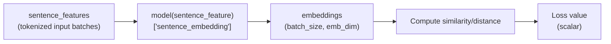
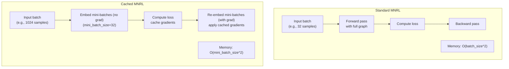
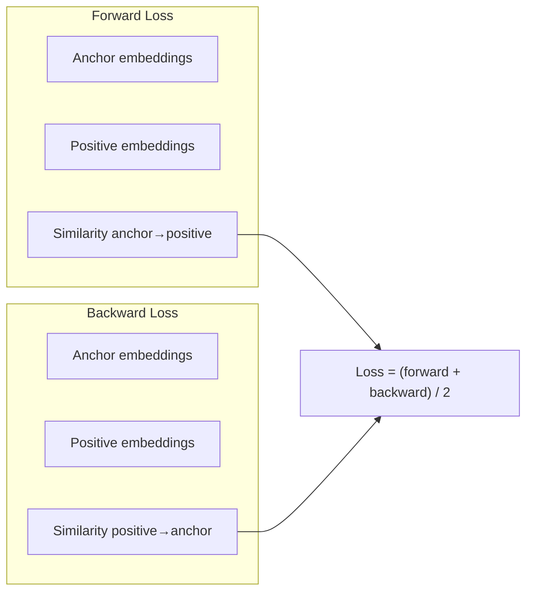
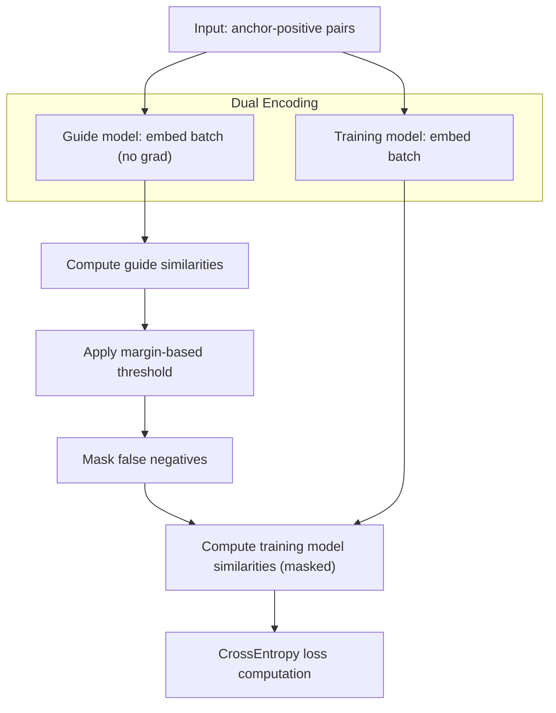
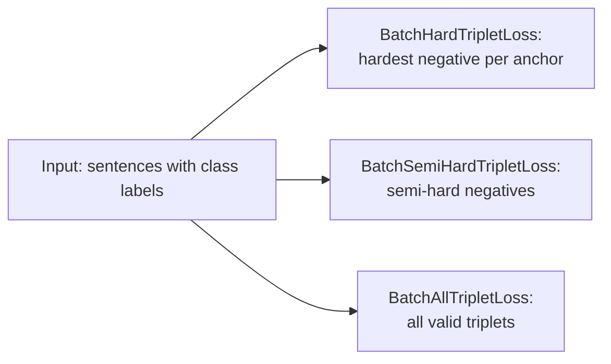
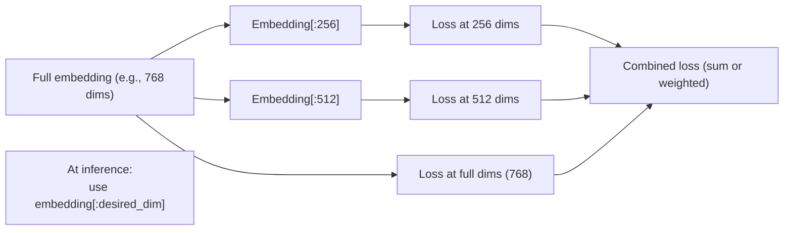

<!-- source: DeepWiki mcp.deepwiki.com · repo huggingface/sentence-transformers · extra page Dense Model Loss Functions · fetched 2026-10-26 -->

# Dense Model Loss Functions

<details>
<summary>Relevant source files</summary>

The following files were used as context for generating this wiki page:

- [docs/conf.py](docs/conf.py)
- [docs/package_reference/base/modules.rst](docs/package_reference/base/modules.rst)
- [docs/package_reference/sentence_transformer/losses.md](docs/package_reference/sentence_transformer/losses.md)
- [docs/package_reference/sparse_encoder/index.rst](docs/package_reference/sparse_encoder/index.rst)
- [examples/sentence_transformer/training/distillation/README.md](examples/sentence_transformer/training/distillation/README.md)
- [examples/sentence_transformer/training/distillation/model_distillation.py](examples/sentence_transformer/training/distillation/model_distillation.py)
- [examples/sentence_transformer/training/distillation/model_distillation_layer_reduction.py](examples/sentence_transformer/training/distillation/model_distillation_layer_reduction.py)
- [sentence_transformers/sentence_transformer/losses/__init__.py](sentence_transformers/sentence_transformer/losses/__init__.py)
- [sentence_transformers/sentence_transformer/losses/adaptive_layer.py](sentence_transformers/sentence_transformer/losses/adaptive_layer.py)
- [sentence_transformers/sentence_transformer/losses/batch_all_triplet.py](sentence_transformers/sentence_transformer/losses/batch_all_triplet.py)
- [sentence_transformers/sentence_transformer/losses/batch_hard_soft_margin_triplet.py](sentence_transformers/sentence_transformer/losses/batch_hard_soft_margin_triplet.py)
- [sentence_transformers/sentence_transformer/losses/batch_hard_triplet.py](sentence_transformers/sentence_transformer/losses/batch_hard_triplet.py)
- [sentence_transformers/sentence_transformer/losses/batch_semi_hard_triplet.py](sentence_transformers/sentence_transformer/losses/batch_semi_hard_triplet.py)
- [sentence_transformers/sentence_transformer/losses/cached_gist_embed.py](sentence_transformers/sentence_transformer/losses/cached_gist_embed.py)
- [sentence_transformers/sentence_transformer/losses/cached_multiple_negatives_ranking.py](sentence_transformers/sentence_transformer/losses/cached_multiple_negatives_ranking.py)
- [sentence_transformers/sentence_transformer/losses/contrastive.py](sentence_transformers/sentence_transformer/losses/contrastive.py)
- [sentence_transformers/sentence_transformer/losses/contrastive_tension.py](sentence_transformers/sentence_transformer/losses/contrastive_tension.py)
- [sentence_transformers/sentence_transformer/losses/cosine_similarity.py](sentence_transformers/sentence_transformer/losses/cosine_similarity.py)
- [sentence_transformers/sentence_transformer/losses/distill_kl_div.py](sentence_transformers/sentence_transformer/losses/distill_kl_div.py)
- [sentence_transformers/sentence_transformer/losses/embed_distill.py](sentence_transformers/sentence_transformer/losses/embed_distill.py)
- [sentence_transformers/sentence_transformer/losses/gist_embed.py](sentence_transformers/sentence_transformer/losses/gist_embed.py)
- [sentence_transformers/sentence_transformer/losses/margin_mse.py](sentence_transformers/sentence_transformer/losses/margin_mse.py)
- [sentence_transformers/sentence_transformer/losses/mse.py](sentence_transformers/sentence_transformer/losses/mse.py)
- [sentence_transformers/sentence_transformer/losses/multiple_negatives_ranking.py](sentence_transformers/sentence_transformer/losses/multiple_negatives_ranking.py)
- [sentence_transformers/sentence_transformer/losses/triplet.py](sentence_transformers/sentence_transformer/losses/triplet.py)
- [sentence_transformers/util/hard_negatives.py](sentence_transformers/util/hard_negatives.py)
- [skills/train-sentence-transformers/references/dataset_formats.md](skills/train-sentence-transformers/references/dataset_formats.md)
- [tests/sentence_transformer/losses/test_adaptive_layer.py](tests/sentence_transformer/losses/test_adaptive_layer.py)
- [tests/sentence_transformer/losses/test_cached_gist_embed.py](tests/sentence_transformer/losses/test_cached_gist_embed.py)
- [tests/sentence_transformer/losses/test_embed_distill.py](tests/sentence_transformer/losses/test_embed_distill.py)
- [tests/sentence_transformer/losses/test_gist_embed.py](tests/sentence_transformer/losses/test_gist_embed.py)
- [tests/sentence_transformer/losses/test_triplet.py](tests/sentence_transformer/losses/test_triplet.py)
- [tests/util/test_hard_negatives.py](tests/util/test_hard_negatives.py)

</details>


This page provides a detailed reference for loss functions used to train `SentenceTransformer` (dense embedding) models. Dense models produce fixed-size dense vectors as embeddings, and the choice of loss function significantly impacts the model performance on your specific task.

For loss functions specific to other model types, see [Sparse Model Loss Functions](#5.3.2) for `SparseEncoder` models or the Cross Encoder training documentation for reranking models. For a high-level overview of loss selection across all model types, see [Loss Functions](#5.3).

---

## Loss Function Architecture

All SentenceTransformer loss functions are subclasses of `torch.nn.Module`. They accept the model being trained as a constructor argument and implement a `forward` method that consumes batches of tokenized inputs (sentence features) and optional labels. Inside `forward`:

1. The model encodes input batches to produce sentence embeddings.
2. The loss function computes pairwise similarities or distances between embeddings.
3. A scalar loss value is computed to optimize the model.

Below is a generic flow of a loss function’s forward pass:



Sources: [sentence_transformers/sentence_transformer/losses/multiple_negatives_ranking.py:111-156]()

---

## Loss Function Taxonomy

The dense model loss functions can be grouped broadly by their training paradigm and data input characteristics.

```mermaid
graph TB
    Root["SentenceTransformer<br/>Loss Functions"]

    Root --> Contrastive["Contrastive Losses<br/>(In-Batch Negatives)"]
    Root --> Triplet["Triplet Losses<br/>(Hard Negative Mining)"]
    Root --> Regression["Regression Losses<br/>(Similarity Scores)"]
    Root --> Classification["Classification Losses<br/>(Softmax)"]
    Root --> Distillation["Distillation Losses<br/>(Knowledge Transfer)"]
    Root --> Modifiers["Loss Modifier Wrappers<br/>(Embedding Properties)"]

    Contrastive --> MNRL["MultipleNegativesRankingLoss"]
    Contrastive --> CMNRL["CachedMultipleNegativesRankingLoss"]
    Contrastive --> MNSRL["MultipleNegativesSymmetricRankingLoss"]
    Contrastive --> CMSNSRL["CachedMultipleNegativesSymmetricRankingLoss"]
    Contrastive --> GIST["GISTEmbedLoss"]
    Contrastive --> CGIST["CachedGISTEmbedLoss"]
    Contrastive --> CL["ContrastiveLoss"]
    Contrastive --> OCL["OnlineContrastiveLoss"]
    Contrastive --> CTL["ContrastiveTensionLoss"]

    Triplet --> TL["TripletLoss"]
    Triplet --> BHTL["BatchHardTripletLoss"]
    Triplet --> BSHTL["BatchSemiHardTripletLoss"]
    Triplet --> BATL["BatchAllTripletLoss"]
    Triplet --> BHSMTL["BatchHardSoftMarginTripletLoss"]

    Regression --> CoSENT["CoSENTLoss"]
    Regression --> AnglE["AnglELoss"]
    Regression --> CSL["CosineSimilarityLoss"]

    Classification --> Softmax["SoftmaxLoss"]

    Distillation --> MSE["MSELoss"]
    Distillation --> MarginMSE["MarginMSELoss"]
    Distillation --> KL["DistillKLDivLoss"]

    Modifiers --> Matryoshka["MatryoshkaLoss"]
    Modifiers --> Adaptive["AdaptiveLayerLoss"]
    Modifiers --> Matryoshka2d["Matryoshka2dLoss"]
```



Sources: [docs/package_reference/sentence_transformer/losses.md](), [sentence_transformers/sentence_transformer/losses/]()

---

## Contrastive Loss Functions

Contrastive losses train models by maximizing similarity between positive pairs and minimizing similarity to negatives. They commonly utilize in-batch negatives (i.e., other samples in the batch serve as negatives), making training efficient with high batch sizes.

### MultipleNegativesRankingLoss (MNRL)

The standard and most popular contrastive loss, sometimes called InfoNCE loss or in-batch negatives loss.

- **Input:** `(anchor, positive)` pairs or `(anchor, positive, negative_1, ..., negative_n)` tuples.
- **Labels:** None required.
- **Mechanism:** Cross-entropy based loss comparing similarity of correct pairs vs. all negatives in batch.
- **Formula:** For anchor \(a_i\), positive \(p_i\), scale \(\alpha\):
  
  \[
  \mathcal{L} = -\sum_i \log \frac{\exp(\alpha \cdot \mathrm{sim}(a_i, p_i))}{\sum_j \exp(\alpha \cdot \mathrm{sim}(a_i, p_j))}
  \]

```python
from sentence_transformers import SentenceTransformer, losses

model = SentenceTransformer("microsoft/mpnet-base")
loss = losses.MultipleNegativesRankingLoss(model)
```

### CachedMultipleNegativesRankingLoss (Cached MNRL)

This is a memory-efficient variant of MNRL. It uses gradient caching to reduce the memory footprint, allowing much larger effective batch sizes.

**Architecture Comparison:**



- **Benefits:** Can use batch sizes an order of magnitude larger with constant memory.
- **Trade-off:** Slightly slower (~2x) due to extra forward passes.
- **Config:** `mini_batch_size` sets the effective memory batch size.

### MultipleNegativesSymmetricRankingLoss (MNSRL)

Extends MNRL by computing loss in **both** directions: anchor→positive and positive→anchor, useful for symmetric relationships.



- Suitable for semantic similarity tasks where the relation is symmetric.
- Input format is `(anchor, positive)` pairs only.

Sources:
- [sentence_transformers/sentence_transformer/losses/multiple_negatives_ranking.py:17-177]()
- [sentence_transformers/sentence_transformer/losses/cached_multiple_negatives_ranking.py:28-340]()
- [sentence_transformers/sentence_transformer/losses/MultipleNegativesSymmetricRankingLoss.py](), [sentence_transformers/sentence_transformer/losses/CachedMultipleNegativesSymmetricRankingLoss.py]()

---

### GISTEmbedLoss and CachedGISTEmbedLoss

GISTEmbedLoss uses a **guide model** to better select in-batch negatives by filtering false negatives—samples mistakenly treated as negatives because their embeddings are close to the positive.

The key idea is to:

1. Encode the batch with the training model.
2. Encode the same batch with a separate guide model (frozen).
3. Compute similarity matrix with the guide embeddings.
4. Mask out negatives with similarity scores exceeding a margin threshold compared to the positive similarity.



- **CachedGISTEmbedLoss** combines GIST with gradient caching to enable training with larger batches and less memory.
- Supports margin strategies `"absolute"` and `"relative"`.
- Parameters include guide model, temperature scaling, margin, and options to contrast anchors and positives.

Sources:
- [sentence_transformers/sentence_transformer/losses/gist_embed.py:15-280]()
- [sentence_transformers/sentence_transformer/losses/cached_gist_embed.py:31-350]()

---

### ContrastiveLoss and OnlineContrastiveLoss

These losses require explicit positive/negative labels per pair.

- **ContrastiveLoss:** Minimizes distance (e.g., Euclidean) for positive pairs and ensures a margin for negative pairs.
- **OnlineContrastiveLoss:** Selects hard positive/negative pairs online during training.

Input format is `(anchor, other)` pairs with binary labels (1=positive, 0=negative).

Sources:
- [docs/package_reference/sentence_transformer/losses.md]()

---

### ContrastiveTensionLoss

An unsupervised loss that uses two **independent encoders** to create positive pairs via duplicate sentences, and negative pairs via random other sentences.

- Maintains two models: `model1` and `model2`.
- No labels required.
- Variant `ContrastiveTensionLossInBatchNegatives` uses in-batch negatives for stronger signals.

Sources:
- [sentence_transformers/sentence_transformer/losses/contrastive_tension.py]()

---

## Triplet Loss Functions

Triplet losses optimize the relative distance margin between anchor, positive, and negative embeddings:

\[
d(a, p) + \text{margin} < d(a, n)
\]

where \(d\) is a distance metric (Euclidean, Cosine, Manhattan).

### TripletLoss

Standard triplet loss requiring explicit `(anchor, positive, negative)` triplets in input.

- No label needed.
- Margin is fixed.

### Batch Mining Variants

These losses automatically mine hard negatives from the batch, removing the need to provide hand-crafted triplets.

| Loss | Mining Strategy | Description |
|-------|-----------------|-------------|
| `BatchHardTripletLoss` | Hardest negative | For each anchor, pick the negative closest to anchor. |
| `BatchSemiHardTripletLoss` | Semi-hard negatives | Negatives farther than positive but within margin. |
| `BatchAllTripletLoss` | All valid triplets | Uses every valid triplet in batch satisfying margin. |
| `BatchHardSoftMarginTripletLoss` | Hard mining + soft margin | Learns soft margin with semi-hard mining. |



- These losses require single sentence inputs with class labels for mining.

Sources:
- [docs/package_reference/sentence_transformer/losses.md]()

---

## Regression Loss Functions

Regression losses predict continuous similarity scores for sentence pairs, ideal when human-annotated similarity labels are available.

| Loss | Description |
|-------|-------------|
| `CoSENTLoss` | Uses circle loss with cosine similarity to optimize similarity scores with high performance. |
| `AnglELoss` | Angular loss optimizing spherical angles between embeddings. |
| `CosineSimilarityLoss` | Classic MSE loss between predicted and gold cosine similarities. |

- Input format: `(sentence_A, sentence_B)` pairs.
- Labels: Similarity scores (floats).

Sources:
- [docs/package_reference/sentence_transformer/losses.md]()

---

## Classification Loss Functions

### SoftmaxLoss

A classification loss for tasks like natural language inference (NLI) that predicts entailment labels.

- Input: `(sentence_A, sentence_B)` pairs.
- Labels: Class labels (e.g., entailment, contradiction).
- Mechanism: Concatenates embeddings `[u, v, |u-v|]` and applies softmax.

Sources:
- [docs/package_reference/sentence_transformer/losses.md]()

---

## Distillation Loss Functions

Distillation losses enable training a student model to mimic a larger teacher model’s embedding behavior.

### MSELoss

Minimizes the squared distance between student and teacher embeddings.

```mermaid
graph TB
    subgraph Teacher Model (Frozen)
        TInput["Input texts"]
        TModel["teacher_model.encode()"]
        TEmbed["Teacher embeddings (gold)"]
    end

    subgraph Student Model (Training)
        SInput["Same input texts"]
        SModel["student_model.encode()"]
        SEmbed["Student embeddings (predicted)"]
    end

    Loss["MSELoss: ||teacher - student||^2"]

    TInput --> TModel --> TEmbed --> Loss
    SInput --> SModel --> SEmbed --> Loss
```

### MarginMSELoss

Distills relative similarity margins between pairs rather than absolute embeddings.

- Input: triplets `(query, passage_one, passage_two)`
- Labels: difference in teacher similarity scores
- Advantage: More robust alignment of ranking behavior

### DistillKLDivLoss

Uses KL divergence to match the student's similarity score distribution to the teacher's.

- Input: tuples `(query, positive, negatives...)`
- Labels: teacher similarity scores for all pairs

Sources:
- [docs/package_reference/sentence_transformer/losses.md]()
- [examples/sentence_transformer/training/distillation/model_distillation.py]()

---

## Loss Modifier Functions

Modifiers wrap existing losses to add advanced properties without changing the core optimization objective.

### MatryoshkaLoss

Enables training a single model whose embeddings can be truncated dynamically to smaller dimensions during inference.



- Helps deploy models on devices with varying resource budgets.

### AdaptiveLayerLoss

Enables model training so that removing transformer layers at inference still yields good performance.

- Wraps any standard loss.
- Computes loss on embeddings from various transformer layers.

### Matryoshka2dLoss

Combines dimension truncation and layer removal flexibility for maximum deployment customization.

Sources:
- [docs/package_reference/sentence_transformer/losses.md]()

---

## Loss Function Selection Guide

Selecting a loss function depends on your data availability and target task.

```mermaid
graph TB
    Start["What data do you have?"]

    Start --> Q1{"Data Type"}
    Q1 -->|Unlabeled (anchor, positive) pairs| MNRL["MultipleNegativesRankingLoss or CachedMultipleNegativesRankingLoss (large batch)"]
    Q1 -->|Pairs with similarity scores| Reg["CoSENTLoss or AnglELoss"]
    Q1 -->|Pairs with binary labels| Cont["ContrastiveLoss"]
    Q1 -->|Single sentences with class labels| Trip["BatchHardTripletLoss"]
    Q1 -->|Triplets (anchor, pos, neg)| Trip2["TripletLoss or MultipleNegativesRankingLoss"]
    Q1 -->|Pairs with fine-grained class labels or entailment| Softmax["SoftmaxLoss"]
    Q1 -->|Distillation data from a teacher| Distill["MSELoss or MarginMSELoss"]

    MNRL & Reg & Cont & Trip & Trip2 & Softmax & Distill --> Enhancements["Need special embedding properties?"]
    Enhancements -->|Yes| Matryoshka["Use MatryoshkaLoss wrapper"]
    Enhancements -->|Yes| Adaptive["Use AdaptiveLayerLoss wrapper"]
    Enhancements -->|No| Done["Done"]
```

Common scenarios:

| Data Type                         | Recommended Loss                             | Notes                                        |
|----------------------------------|----------------------------------------------|----------------------------------------------|
| Anchor-positive pairs             | `CachedMultipleNegativesRankingLoss`         | Large batch size recommended; use no duplicates sampler |
| Sentence pairs with similarity   | `CoSENTLoss`                                  | State-of-the-art regression loss             |
| NLI triples (premise, hyp, label)| `SoftmaxLoss`                                 | Classifies entailment relations               |
| Images and captions              | `MultipleNegativesRankingLoss`                | Cross-modal retrieval                         |
| Sentences with class labels       | `BatchHardTripletLoss`                         | Automatic hard negative mining                 |
| Distilling large models           | `MarginMSELoss`                               | Preserves relative similarity rankings       |

Sources:
- [docs/package_reference/sentence_transformer/loss_overview.md]()
- [docs/package_reference/training_overview.md]()

---

## Implementation Guidelines

### Basic Usage

All losses follow the same instantiation pattern:

```python
from sentence_transformers import SentenceTransformer, SentenceTransformerTrainer, losses
from datasets import Dataset

# Initialize model
model = SentenceTransformer("microsoft/mpnet-base")

# Initialize loss with model
loss = losses.MultipleNegativesRankingLoss(model)

# Prepare dataset matching loss requirements
train_dataset = Dataset.from_dict({
    "anchor": ["query1", "query2"],
    "positive": ["answer1", "answer2"],
})

# Initialize trainer and train
trainer = SentenceTransformerTrainer(
    model=model,
    train_dataset=train_dataset,
    loss=loss,
)

trainer.train()
```

### Dataset Format Requirements

- Label columns: Named "label", "labels", "score", or "scores".
- Remaining columns treated as text inputs for respective parts required by the loss.
- Column names do not need to match any predefined scheme except for label columns.
- Number of input columns must match loss input expectations.

Example:  
`CoSENTLoss` expects 2 text columns and 1 label column (score).  
If your dataset columns are `["text1", "text2", "label"]`, it will work fine.

### Performance and Batch Sampling

| Loss Function                      | Recommended Batch Sampler       | Batch Size Range    | Tips                                                 |
|----------------------------------|---------------------------------|---------------------|-----------------------------------------------------|
| MultipleNegativesRankingLoss       | `NO_DUPLICATES`                 | As large as memory (32-128) | Larger batch = more negatives = better results      |
| CachedMultipleNegativesRankingLoss | `NO_DUPLICATES`                 | Very large (512-4096)        | Set `mini_batch_size` to fit GPU memory             |
| GISTEmbedLoss                     | `NO_DUPLICATES`                 | Large (128-512)              | Guide model needs separate powerful encoder         |
| CoSENTLoss                       | `DEFAULT`                      | Medium (16-64)               | No special sampler needed                            |
| BatchHardTripletLoss              | `GROUP_BY_LABEL`                | Large (64-256)               | More samples per class yield better mining          |

```python
from sentence_transformers.sentence_transformer.training_args import BatchSamplers
from sentence_transformers.sentence_transformer.training_args import SentenceTransformerTrainingArguments

args = SentenceTransformerTrainingArguments(
    output_dir="output",
    per_device_train_batch_size=128,
    batch_sampler=BatchSamplers.NO_DUPLICATES,
)
```

### Multi-GPU Training

Set `gather_across_devices=True` in contrastive losses like MNRL to gather embeddings from all GPUs and enhance effective batch size.

```python
loss = losses.MultipleNegativesRankingLoss(
    model, 
    gather_across_devices=True
)
```

Note: This introduces communication overhead but allows larger effective batches and better negative mining.

---

## Custom Loss Functions

Create custom loss functions by subclassing `torch.nn.Module` and implementing:

- `__init__(self, model: SentenceTransformer, ...)`
- `forward(self, sentence_features: list[dict[str, Tensor]], labels: Optional[Tensor] = None) -> Tensor`

It should:

- Encode inputs with `self.model`
- Compute similarity or distance matrices
- Return scalar loss

Optionally, implement `get_config_dict()` and a `citation` property for integration with model cards.

Example skeleton:

```python
import torch
from torch import nn, Tensor
from sentence_transformers import SentenceTransformer

class CustomLoss(nn.Module):
    def __init__(self, model: SentenceTransformer, param: float = 1.0):
        super().__init__()
        self.model = model
        self.param = param

    def forward(self, sentence_features: list[dict[str, Tensor]], labels: Tensor = None) -> Tensor:
        embeddings = [self.model(sf)["sentence_embedding"] for sf in sentence_features]
        # Custom loss logic here
        loss_value = ...
        return loss_value

    def get_config_dict(self):
        return {"param": self.param}

    @property
    def citation(self):
        return """@misc{author_year, ...}"""
```

---

## Loss Function Quick Reference Table

| Loss Name                          | File Location                                               | Use Case                                   |
|:---------------------------------|:-------------------------------------------------------------|:--------------------------------------------|
| `MultipleNegativesRankingLoss`     | `losses/multiple_negatives_ranking.py`                      | General contrastive learning                 |
| `CachedMultipleNegativesRankingLoss` | `losses/cached_multiple_negatives_ranking.py`             | Large batch contrastive learning             |
| `MultipleNegativesSymmetricRankingLoss` | `losses/MultipleNegativesSymmetricRankingLoss.py`        | Symmetric similarity tasks                    |
| `CachedMultipleNegativesSymmetricRankingLoss` | `losses/CachedMultipleNegativesSymmetricRankingLoss.py` | Large batch symmetric learning                |
| `GISTEmbedLoss`                   | `losses/gist_embed.py`                                       | Guided negative selection                      |
| `CachedGISTEmbedLoss`             | `losses/cached_gist_embed.py`                                | Large batch guided learning                    |
| `CoSENTLoss`                     | `losses/CoSENTLoss.py`                                        | Regression on similarity scores                |
| `AnglELoss`                     | `losses/AnglELoss.py`                                        | Angular regression on similarity                |
| `CosineSimilarityLoss`            | `losses/CosineSimilarityLoss.py`                             | Classic regression loss on cosine similarity  |
| `TripletLoss`                   | `losses/triplet.py`                                           | Margin-based triplet training                   |
| `BatchHardTripletLoss`          | `losses/batch_hard_triplet.py`                               | Hard negative mining from classes               |
| `SoftmaxLoss`                   | `losses/SoftmaxLoss.py`                                      | Classification for entailment tasks            |
| `ContrastiveLoss`               | `losses/contrastive.py`                                      | Binary pair classification                      |
| `ContrastiveTensionLoss`        | `losses/contrastive_tension.py`                              | Unsupervised leveraging duplicated sentences    |
| `MSELoss`                      | `losses/MSELoss.py`                                          | Embedding distillation                           |
| `MarginMSELoss`                | `losses/MarginMSELoss.py`                                    | Ranking distillation                             |
| `MatryoshkaLoss`                | `losses/MatryoshkaLoss.py`                                  | Training for variable embedding size             |
| `AdaptiveLayerLoss`             | `losses/AdaptiveLayerLoss.py`                               | Layer removal flexibility training               |

Sources: [docs/package_reference/sentence_transformer/losses.md](), [sentence_transformers/sentence_transformer/losses/]()

---

# Summary

Dense loss functions for SentenceTransformer models provide a wide range of options for different data formats and task requirements. Choice of loss should align with dataset structure (pairs, triplets, labels), model architecture, and desired embedding properties.

Key takeaways:

- Use `MultipleNegativesRankingLoss` or its cached variant for large-scale contrastive training with unlabeled pairs.
- Use triplet or batch triplet losses when class label mining is available.
- Use regression losses like `CoSENTLoss` for continuous similarity scores.
- Use distillation losses to compress or transfer knowledge from larger models.
- Wrap with modifier losses like `MatryoshkaLoss` to enable flexible embedding dimensions.

---

This leaf page does not have child pages. For related topics, see the main [Loss Functions](#5.3) page or the next topic [Sparse Model Loss Functions](#5.3.2).

---

**References**

- [sentence_transformers/sentence_transformer/losses/multiple_negatives_ranking.py]()
- [sentence_transformers/sentence_transformer/losses/cached_multiple_negatives_ranking.py]()
- [sentence_transformers/sentence_transformer/losses/MultipleNegativesSymmetricRankingLoss.py]()
- [sentence_transformers/sentence_transformer/losses/cached_gist_embed.py]()
- [sentence_transformers/sentence_transformer/losses/gist_embed.py]()
- [sentence_transformers/sentence_transformer/losses/contrastive_tension.py]()
- [examples/sentence_transformer/training/distillation/model_distillation.py]()
- [docs/package_reference/sentence_transformer/losses.md]()

---

