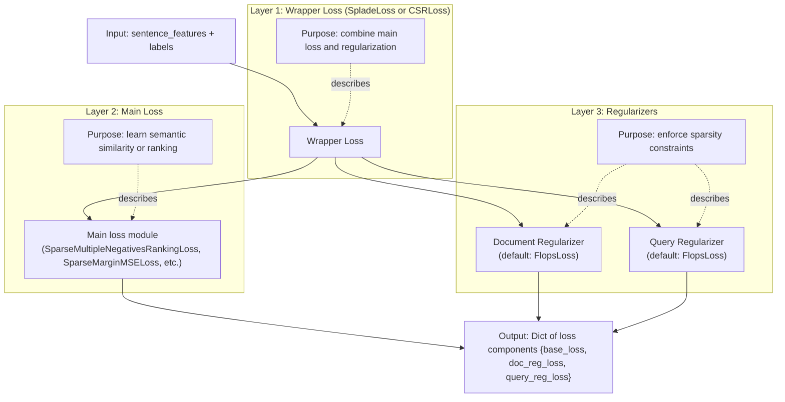
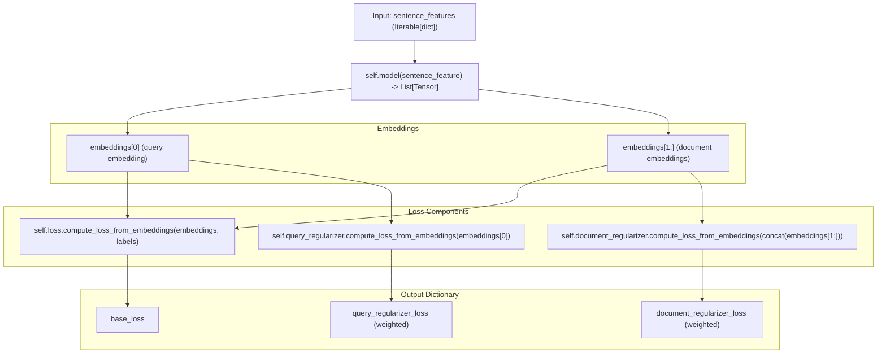
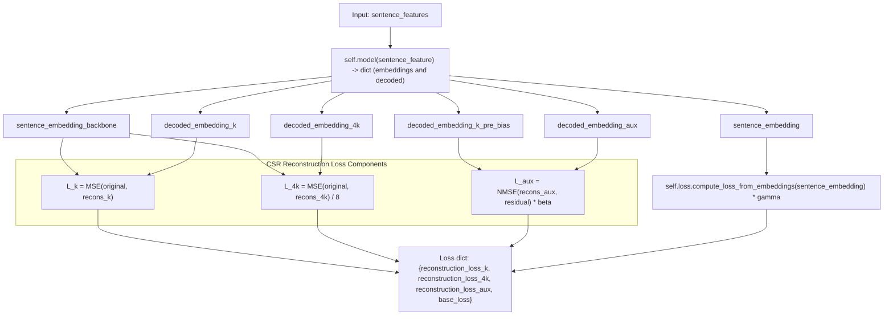
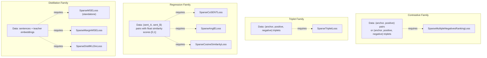
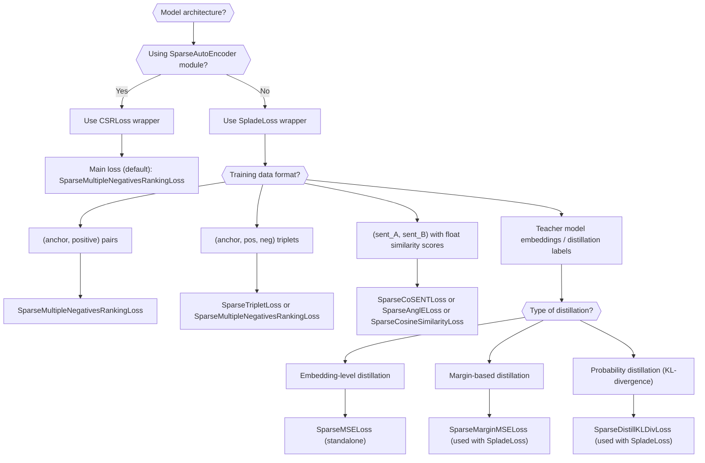
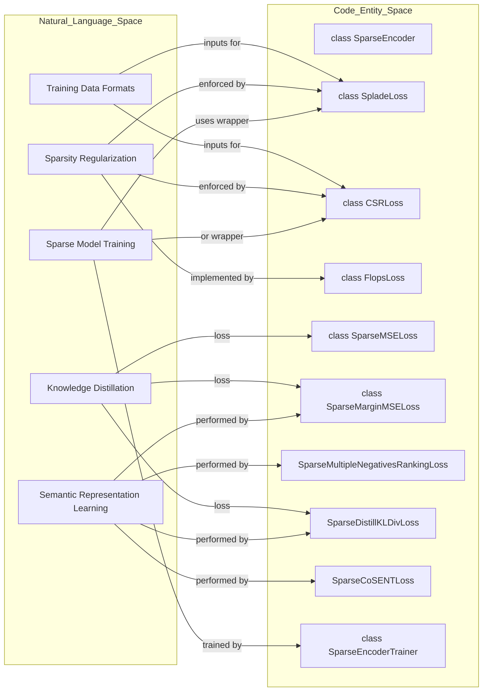
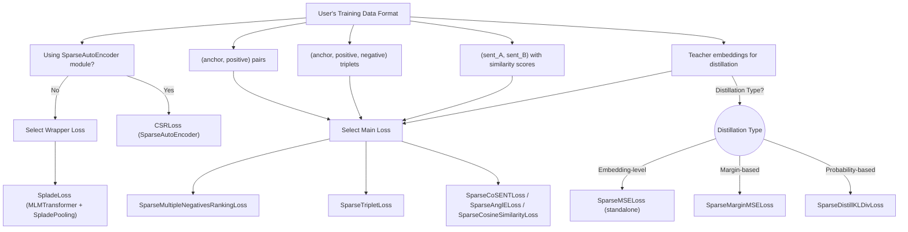

<!-- source: DeepWiki mcp.deepwiki.com · repo huggingface/sentence-transformers · extra page Sparse Model Loss Functions · fetched 2026-10-26 -->

# Sparse Model Loss Functions

<details>
<summary>Relevant source files</summary>

The following files were used as context for generating this wiki page:

- [docs/package_reference/sparse_encoder/losses.md](docs/package_reference/sparse_encoder/losses.md)
- [docs/sparse_encoder/loss_overview.md](docs/sparse_encoder/loss_overview.md)
- [sentence_transformers/base/modality.py](sentence_transformers/base/modality.py)
- [sentence_transformers/base/modality_types.py](sentence_transformers/base/modality_types.py)
- [sentence_transformers/cross_encoder/__init__.py](sentence_transformers/cross_encoder/__init__.py)
- [sentence_transformers/cross_encoder/evaluation/__init__.py](sentence_transformers/cross_encoder/evaluation/__init__.py)
- [sentence_transformers/sentence_transformer/__init__.py](sentence_transformers/sentence_transformer/__init__.py)
- [sentence_transformers/sparse_encoder/__init__.py](sentence_transformers/sparse_encoder/__init__.py)
- [sentence_transformers/sparse_encoder/losses/__init__.py](sentence_transformers/sparse_encoder/losses/__init__.py)
- [sentence_transformers/sparse_encoder/losses/cached_splade.py](sentence_transformers/sparse_encoder/losses/cached_splade.py)
- [sentence_transformers/sparse_encoder/losses/sparse_angle.py](sentence_transformers/sparse_encoder/losses/sparse_angle.py)
- [sentence_transformers/sparse_encoder/losses/sparse_cosent.py](sentence_transformers/sparse_encoder/losses/sparse_cosent.py)
- [sentence_transformers/sparse_encoder/losses/sparse_cosine_similarity.py](sentence_transformers/sparse_encoder/losses/sparse_cosine_similarity.py)
- [sentence_transformers/sparse_encoder/losses/sparse_distill_kl_div.py](sentence_transformers/sparse_encoder/losses/sparse_distill_kl_div.py)
- [sentence_transformers/sparse_encoder/losses/sparse_margin_mse.py](sentence_transformers/sparse_encoder/losses/sparse_margin_mse.py)
- [sentence_transformers/sparse_encoder/losses/sparse_mse.py](sentence_transformers/sparse_encoder/losses/sparse_mse.py)
- [sentence_transformers/sparse_encoder/losses/sparse_multiple_negatives_ranking.py](sentence_transformers/sparse_encoder/losses/sparse_multiple_negatives_ranking.py)
- [tests/base/test_modality.py](tests/base/test_modality.py)

</details>


## Purpose and Scope

This page provides a comprehensive technical reference for the loss functions used to train `SparseEncoder` models within the sentence-transformers codebase. Sparse encoders require specialized loss functions that jointly optimize semantic learning objectives and sparsity-inducing regularizers to produce efficient sparse representations suitable for retrieval.

**Key architectural note:**  
Training a `SparseEncoder` generally requires *wrapper* loss functions that combine a main semantic loss with regularizers for sparsity control. The primary wrappers are `SpladeLoss` and `CSRLoss`.  
The only exception is the `SparseMSELoss`, which performs direct embedding-level distillation and can be utilized standalone.

Sources: [docs/sparse_encoder/loss_overview.md:1-86](), [sentence_transformers/sparse_encoder/losses/__init__.py:1-29]()

---

## Loss Architecture Overview

Sparse model loss functions are architected following a compositional design that cleanly separates the semantic learning objective from sparsity regularization. This layered design enhances modularity and supports flexible combinations of main losses and regularizers.

### Two-Layer Architecture Pattern



**Note:**  
- The wrapper loss receives raw input batches and calls the model to produce sparse embeddings.  
- It then computes the main semantic loss from embeddings and labels.  
- Concurrently, it computes sparse regularization on query and document embeddings separately, weighted by hyperparameters.  
- Finally, it aggregates all components into a loss dictionary.  
- `SparseMSELoss` is a distinct loss that does not require wrapping and targets embedding-level distillation.

Sources: [sentence_transformers/sparse_encoder/losses/splade.py:15-163](), [sentence_transformers/sparse_encoder/losses/csr.py:129-229](), [docs/sparse_encoder/loss_overview.md:4-7]()

---

## Wrapper Losses

### SpladeLoss

`SpladeLoss` is the principal wrapper loss designed for SPLADE-style architectures, which leverage the `MLMTransformer` backbone with `SpladePooling` to produce sparse lexical-expansion embeddings.

#### Data Flow and Components



#### Important Parameters

| Parameter                        | Type                   | Purpose                                             |
|---------------------------------|------------------------|-----------------------------------------------------|
| `model`                         | `SparseEncoder`        | The underlying sparse model                          |
| `loss`                          | `nn.Module`            | Main semantic loss (e.g., `SparseMarginMSELoss`)    |
| `document_regularizer_weight`   | `float`                | Weight for document embedding sparsity regularizer  |
| `query_regularizer_weight`      | `float \| None`        | Weight for query embedding sparsity regularizer     |
| `document_regularizer`          | `nn.Module \| None`    | Custom doc regularizer, defaults to `FlopsLoss`     |
| `query_regularizer`             | `nn.Module \| None`    | Custom query regularizer, defaults to `FlopsLoss`   |
| `document_regularizer_threshold`| `int \| None`          | Min non-zero dims threshold for doc regularizer     |
| `query_regularizer_threshold`   | `int \| None`          | Min non-zero dims threshold for query regularizer   |
| `use_document_regularizer_only` | `bool`                 | Treat all inputs as documents, e.g., symmetric tasks|

#### Usage Example

```python
from sentence_transformers.sparse_encoder import SparseEncoder, losses

model = SparseEncoder("distilbert/distilbert-base-uncased")

loss = losses.SpladeLoss(
    model,
    loss=losses.SparseMarginMSELoss(model),
    document_regularizer_weight=3e-5,  # λ_d
    query_regularizer_weight=5e-5,     # λ_q
    document_regularizer_threshold=50, # ignore docs with fewer than 50 active dims
)
```

Sources: [sentence_transformers/sparse_encoder/losses/splade.py:15-204]()

---

### CSRLoss

`CSRLoss` is used with `SparseAutoEncoder` modules for training sparse encoders with Contrastive Sparse Representation learning objectives. It integrates reconstruction loss components that enforce faithful encoding-decoding of embeddings.

#### Data Flow and Components



#### Hyperparameters

| Parameter | Type               | Default | Purpose                                           |
|-----------|--------------------|---------|---------------------------------------------------|
| `model`   | `SparseEncoder`    | \-      | SparseAutoEncoder model                            |
| `loss`    | `nn.Module \| None`| default: `SparseMultipleNegativesRankingLoss` | Main contrastive loss for semantic training |
| `beta`    | `float`            | 0.1     | Weight for auxiliary reconstruction loss (L_aux) |
| `gamma`   | `float`            | 1.0     | Weight for main contrastive loss                   |

#### Usage Example

```python
from sentence_transformers.sparse_encoder import SparseEncoder, losses

model = SparseEncoder("sentence-transformers/all-MiniLM-L6-v2")

loss = losses.CSRLoss(
    model,
    loss=losses.SparseMultipleNegativesRankingLoss(model),
    beta=0.1,   # auxiliary reconstruction weight
    gamma=1.0,  # main contrastive loss weight
)
```

Sources: [sentence_transformers/sparse_encoder/losses/csr.py:28-229]()

---

## Main Loss Functions

Main loss functions define the core semantic learning objective and are usually combined inside wrapper losses for sparse training. They implement a required interface method:

```python
def compute_loss_from_embeddings(
    self,
    embeddings: list[torch.Tensor],
    labels: torch.Tensor | None = None
) -> torch.Tensor | dict[str, torch.Tensor]:
    """
    Computes loss given model embeddings and optional labels.

    Args:
        embeddings: list of sparse tensor embeddings, one per input column.
        labels: optional ground truth labels/tensors.

    Returns:
        Single loss scalar or dictionary of loss components.
    """
```

### Main Losses Taxonomy & Data Formats



---

### Contrastive Loss: SparseMultipleNegativesRankingLoss

- Implements InfoNCE loss using in-batch negatives.  
- Most commonly used for training sparse retrieval models.  
- Supports training on `(anchor, positive)` or `(anchor, positive, negative)` tuples.  

See: [sentence_transformers/sparse_encoder/losses/sparse_multiple_negatives_ranking.py]()

---

### Regression Losses

Train on pairs with continuous similarity scores in range [0,1].

- `SparseCoSENTLoss`: Circle loss variant specialized for sentence similarity.  
- `SparseAnglELoss`: Complex valued angle-based metric learning loss.  
- `SparseCosineSimilarityLoss`: Standard cosine similarity regression loss.

See: respective files in [sentence_transformers/sparse_encoder/losses/]()

---

### Triplet Loss: SparseTripletLoss

- Margin-based triplet loss enforcing `d(anchor, positive) + margin < d(anchor, negative)`.  
- Used when explicit triplet data with positives and negatives is available.

See: [sentence_transformers/sparse_encoder/losses/sparse_triplet.py]()

---

### Distillation Losses

Used for knowledge distillation from a teacher model.

- `SparseMSELoss`: Embedding-level MSE loss for directly copying sparse teacher embeddings. *Can be used standalone without wrapper.*  
- `SparseMarginMSELoss`: Uses margin differences for distillation of relative scores.  
- `SparseDistillKLDivLoss`: Distills the probability (softmax) distribution of teacher rankings.

See: [sentence_transformers/sparse_encoder/losses/sparse_mse.py](), [sparse_margin_mse.py](), [sparse_distill_kl_div.py]()

Sources: [sentence_transformers/sparse_encoder/losses/__init__.py:1-29](), [docs/sparse_encoder/loss_overview.md:43-62]()

---

## Regularizers

Regularizers enforce sparsity in sparse embeddings, promoting efficiency by penalizing embedding "density".

### FlopsLoss

- The default regularizer for `SpladeLoss` wrapper.  
- Implements squared L2 norm of mean embedding vector across batch, approximating the FLOPS cost of the sparse vectors.  
- Supports an optional `threshold` that masks out embeddings with fewer than `threshold` non-zero components.

#### Mathematical Expression

\[
\text{FlopsLoss} = \| \text{mean}(embeddings) \|_2^2
\]

With threshold mask \(m = \mathbf{1}[L_0(\text{embedding}) > \text{threshold}]\):

\[
embeddings = embeddings \times m
\]

#### Usage Illustration

```python
from sentence_transformers.sparse_encoder.losses import FlopsLoss

# Default usage inside SpladeLoss (no threshold)
loss = SpladeLoss(
    model,
    loss=SparseMultipleNegativesRankingLoss(model),
    document_regularizer_weight=3e-5,  # lambda_d
)

# Thresholded regularizer to ignore embeddings with <50 non-zero entries
loss = SpladeLoss(
    model,
    loss=SparseMultipleNegativesRankingLoss(model),
    document_regularizer_weight=3e-5,
    document_regularizer_threshold=50,
)

# Custom regularizer instance
custom_reg = FlopsLoss(model, threshold=100)
loss = SpladeLoss(
    model,
    loss=SparseMultipleNegativesRankingLoss(model),
    document_regularizer=custom_reg,
    document_regularizer_weight=3e-5,
)
```

**Note:**  
`FlopsLoss` is *not* used standalone as a primary loss but only as a sparsity regularizer inside wrappers.

Sources: [sentence_transformers/sparse_encoder/losses/flops.py:11-65]()

---

## Loss Selection Guide

### Decision Flowchart



### Typical Training Scenarios

| Scenario                   | Data Format                            | Recommended Loss Setup                                          |
|----------------------------|--------------------------------------|----------------------------------------------------------------|
| General retrieval training  | `(anchor, positive)` pairs            | `SpladeLoss` + `SparseMultipleNegativesRankingLoss`            |
| Training with hard negatives| `(anchor, positive, negative_1, ...)`| `SpladeLoss` + `SparseMultipleNegativesRankingLoss`            |
| Semantic similarity scoring | `(sent_A, sent_B)` pairs + float scores| `SpladeLoss` + one of `SparseCoSENTLoss`, `SparseAnglELoss`, `SparseCosineSimilarityLoss` |
| Distillation simplified     | Sentences + teacher embeddings        | `SparseMSELoss` (standalone, no wrapper)                        |
| Distillation advanced       | Triplets + teacher margin or probabilities | `SpladeLoss` + `SparseMarginMSELoss` or `SparseDistillKLDivLoss`|
| Autoencoder-based training  | `(anchor, positive)` pairs             | `CSRLoss` (wraps main + reconstruction losses)                  |

### Hyperparameter Guidelines

- For `SpladeLoss`:  
  - `document_regularizer_weight`: typically 1e-5 to 5e-5 (default ~3e-5)  
  - `query_regularizer_weight`: typically slightly higher (3e-5 to 1e-4, default ~5e-5)  
  - Heuristic: queries get stronger sparsity regularization to encourage efficiency  
- For `CSRLoss`:  
  - `beta` (auxiliary reconstruction loss weight): 0.1  
  - `gamma` (contrastive loss weight): 1.0  

Sources: [docs/sparse_encoder/loss_overview.md:63-70](), [sentence_transformers/sparse_encoder/losses/splade.py:36-57]()

---

## Complete Training Example

### Example Using SpladeLoss and Distillation

```python
from datasets import Dataset
from sentence_transformers.sparse_encoder import SparseEncoder, SparseEncoderTrainer, losses

# Initialize models
student_model = SparseEncoder("distilbert/distilbert-base-uncased")
teacher_model = SparseEncoder("naver/splade-cocondenser-ensembledistil")

# Prepare dataset
train_dataset = Dataset.from_dict({
    "query": ["What is machine learning?", "How to train models?"],
    "passage1": ["ML is a branch of AI.", "Training involves optimization."],
    "passage2": ["ML uses algorithms.", "Models learn from data."],
})

# Compute teacher labels (margin)
def compute_labels(batch):
    emb_q = teacher_model.encode(batch["query"])
    emb_p1 = teacher_model.encode(batch["passage1"])
    emb_p2 = teacher_model.encode(batch["passage2"])
    # similarity function returns scalar
    return {
      "label": teacher_model.similarity_pairwise(emb_q, emb_p1) - teacher_model.similarity_pairwise(emb_q, emb_p2)
    }

train_dataset = train_dataset.map(compute_labels, batched=True)

# Loss config
loss = losses.SpladeLoss(
    student_model,
    loss=losses.SparseMarginMSELoss(student_model),
    document_regularizer_weight=3e-5,
    query_regularizer_weight=5e-5,
    document_regularizer_threshold=50,
)

# Trainer
trainer = SparseEncoderTrainer(
    model=student_model,
    train_dataset=train_dataset,
    loss=loss,
)
trainer.train()
```

### Example Using CSRLoss

```python
from datasets import Dataset
from sentence_transformers.sparse_encoder import SparseEncoder, SparseEncoderTrainer, losses

# Model with sparse autoencoder
model = SparseEncoder("sentence-transformers/all-MiniLM-L6-v2")

# Prepare dataset
train_dataset = Dataset.from_dict({
    "anchor": ["Machine learning is fascinating.", "I love programming."],
    "positive": ["AI is interesting.", "Coding is fun."],
    "negative": ["I don't like sports.", "Weather is bad today."],
})

# Setup CSRLoss with reconstruction + contrastive main loss
loss = losses.CSRLoss(
    model,
    loss=losses.SparseMultipleNegativesRankingLoss(model),
    beta=0.1,
    gamma=1.0,
)

trainer = SparseEncoderTrainer(
    model=model,
    train_dataset=train_dataset,
    loss=loss,
)
trainer.train()
```

Sources: [sentence_transformers/sparse_encoder/losses/splade.py:68-102](), [sentence_transformers/sparse_encoder/losses/csr.py:161-179]()

---

## Implementation Details

### Loss Return Format

Loss functions in the sparse encoder system return either:

1. A single scalar tensor (for backward compatibility and simplicity)  
2. A dictionary mapping names to scalar loss components

Wrapper losses that return dictionaries enable flexible monitoring and weighted aggregation during training.

**Example output from `SpladeLoss`:**

```python
{
    "base_loss": tensor(0.523),
    "document_regularizer_loss": tensor(0.042),   # = unscaled_loss * document_regularizer_weight
    "query_regularizer_loss": tensor(0.067),      # = unscaled_loss * query_regularizer_weight
}
# Final train loss = 0.523 + 0.042 + 0.067 = 0.632
```

### `compute_loss_from_embeddings` Method

Main losses define this method to compute their loss from embeddings and optional labels:

```python
def compute_loss_from_embeddings(
    self,
    embeddings: list[torch.Tensor],
    labels: torch.Tensor | None = None,
) -> torch.Tensor | dict[str, torch.Tensor]:
    """
    Args:
        embeddings: One tensor per input column (e.g., queries, docs).
        labels: Optional labels tensor.

    Returns:
        A scalar tensor or a dictionary of loss components.
    """
```

Wrapper losses call this method on their main loss and regularizers, allowing shared embedding computation and modular composition.

Sources: [sentence_transformers/sparse_encoder/losses/splade.py:137-162](), [sentence_transformers/sparse_encoder/losses/csr.py:189-206]()

---

## Summary Table of Loss Functions

| Loss Class                        | Wrapper Required | Input Data Format                                   | Labels                         | Primary Use Case                        |
|----------------------------------|------------------|----------------------------------------------------|--------------------------------|---------------------------------------|
| `SpladeLoss`                     | No (is a wrapper) | Any                                                | Any                            | General SPLADE sparse encoder training|
| `CSRLoss`                       | No (is a wrapper) | Any                                                | Any                            | SparseAutoEncoder models               |
| `SparseMultipleNegativesRankingLoss` | Yes (Splade/CSR) | `(anchor, positive)(+ negatives)` pairs/tuples    | None                           | Default contrastive retrieval loss    |
| `SparseCoSENTLoss`                | Yes (Splade/CSR) | `(sent_A, sent_B)` pairs                            | Float similarity in [0,1]      | Regression for semantic similarity    |
| `SparseAnglELoss`                 | Yes (Splade/CSR) | `(sent_A, sent_B)` pairs                            | Float similarity in [0,1]      | Advanced regression loss               |
| `SparseCosineSimilarityLoss`      | Yes (Splade/CSR) | `(sent_A, sent_B)` pairs                            | Float similarity in [0,1]      | Classic similarity regression         |
| `SparseTripletLoss`               | Yes (Splade/CSR) | `(anchor, positive, negative)` triplets            | None                           | Margin-based triplet learning          |
| `SparseMSELoss`                  | No (standalone)   | Sentences / teacher embeddings                      | Teacher sparse embeddings      | Embedding-level knowledge distillation|
| `SparseMarginMSELoss`             | Yes (Splade/CSR) | Triplets + margin scores                             | Teacher margin scores          | Margin distillation                    |
| `SparseDistillKLDivLoss`          | Yes (Splade/CSR) | Triplets + probability distributions                | Teacher softscores             | Probability distillation               |
| `FlopsLoss`                     | No (regularizer)  | N/A                                                | N/A                           | Sparsity regularization                |
| `CSRReconstructionLoss`           | No (internal)     | N/A                                                | N/A                           | Autoencoder reconstruction             |

Sources: [sentence_transformers/sparse_encoder/losses/__init__.py:1-29](), [docs/sparse_encoder/loss_overview.md:1-86]()

---

# Bridging Natural Language Concepts with Code Entities: Architecture and Loss Associations



# Bridging Natural Language Concepts with Code Entities: Loss Usage and Selection



---

# Summary

This documentation outlined the sparse encoder loss function ecosystem:

- Wrapper losses (`SpladeLoss`, `CSRLoss`) combine main semantic losses and sparsity regularizers.  
- Main losses include contrastive, triplet, regression, and distillation variants tailored for sparse embeddings.  
- Regularizers such as `FlopsLoss` promote sparse and efficient vector representations.  
- The choice of loss depends on model architecture and available training data format.  
- Distillation losses provide advanced knowledge transfer mechanisms.

This modular design supports flexible, efficient training of sparse retrieval models aligned with recent research innovations.

---

Sources:  
- docs/sparse_encoder/loss_overview.md  
- sentence_transformers/sparse_encoder/losses/__init__.py  
- sentence_transformers/sparse_encoder/losses/splade.py  
- sentence_transformers/sparse_encoder/losses/csr.py  
- sentence_transformers/sparse_encoder/losses/flops.py  
- sentence_transformers/sparse_encoder/losses/sparse_mse.py  
- sentence_transformers/sparse_encoder/losses/sparse_margin_mse.py  
- sentence_transformers/sparse_encoder/losses/sparse_distill_kl_div.py

---

