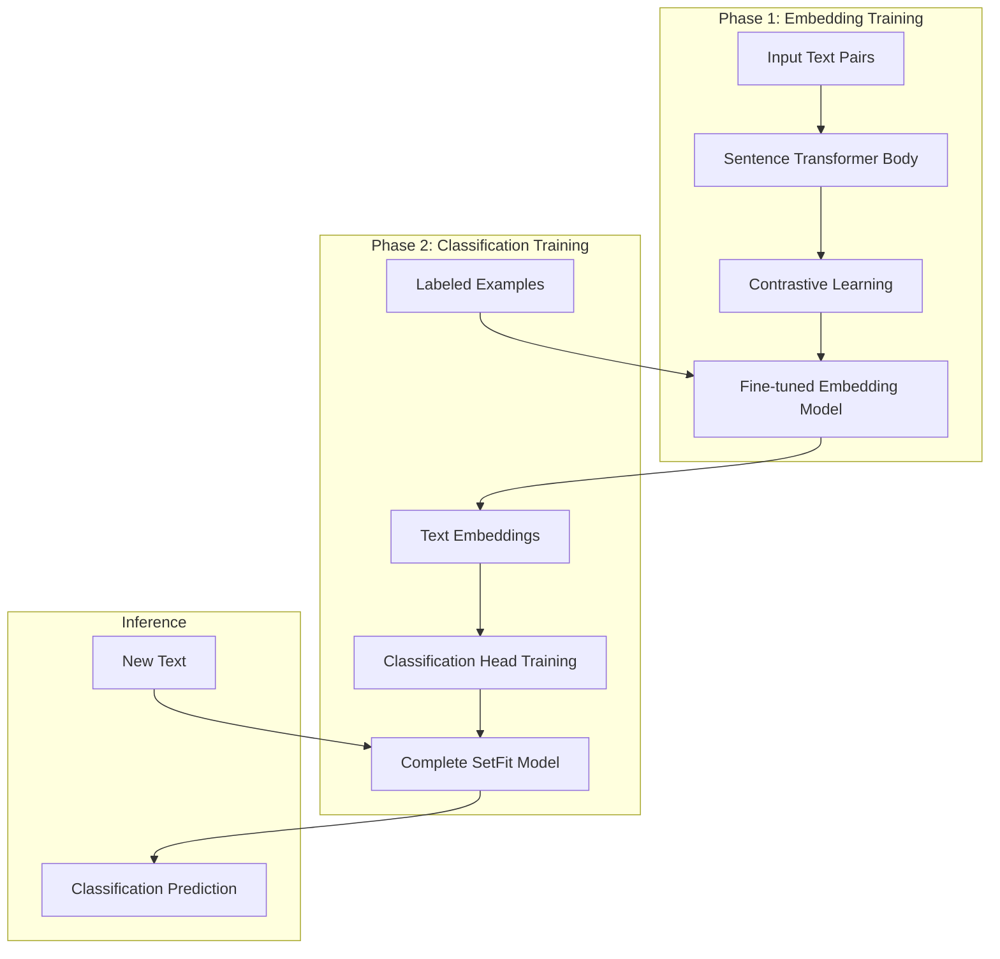
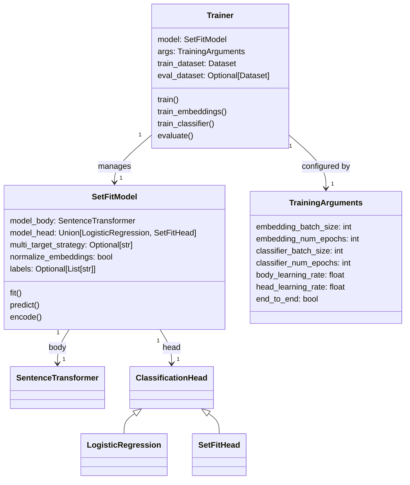
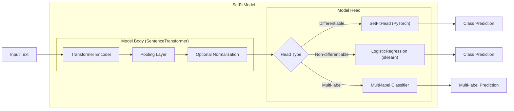
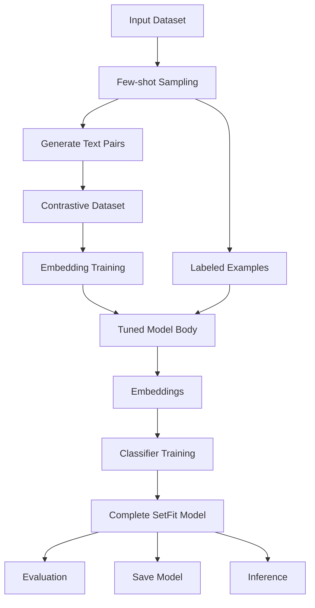

<!-- source: DeepWiki mcp.deepwiki.com · repo huggingface/setfit · page 1 Overview · fetched 2026-10-26 -->

# Overview

Relevant source files

The following files were used as context for generating this wiki page:

- [README.md](README.md)
- [scripts/setfit/run_fewshot.py](scripts/setfit/run_fewshot.py)
- [setup.py](setup.py)
- [src/setfit/__init__.py](src/setfit/__init__.py)
- [src/setfit/modeling.py](src/setfit/modeling.py)
- [src/setfit/trainer.py](src/setfit/trainer.py)
- [tests/test_modeling.py](tests/test_modeling.py)

SetFit is an efficient framework for few-shot text classification that leverages Sentence Transformers. This page provides a comprehensive overview of SetFit's architecture, core components, and training methodology. 

For installation and setup instructions, see [Installation and Setup](#1.1).

## What is SetFit?

SetFit (Sentence Transformer Fine-Tuning) is designed to perform text classification with very few labeled examples - sometimes as few as 8 examples per class. Unlike other few-shot learning methods that require handcrafted prompts or large language models, SetFit:

- Requires no prompts or verbalizers
- Is fast to train and lightweight to deploy
- Supports multilingual classification through multilingual sentence transformers
- Achieves high accuracy with minimal labeled data

The framework combines contrastive learning for fine-tuning sentence embeddings with a classification head to make predictions.

Sources: [README.md:8-16](), [setup.py:61-61]()

## Two-Phase Training Architecture

SetFit employs a two-phase training approach that separates embedding learning from classification:

This approach enables efficient few-shot learning by:
1. Using contrastive learning to fine-tune the sentence transformer on text pairs derived from labeled examples
2. Training a lightweight classification head on the resulting embeddings

Sources: [src/setfit/trainer.py:455-553](), [src/setfit/modeling.py:247-327]()

## Core Components

SetFit's architecture consists of three main components that work together to enable few-shot learning:

1. **SetFitModel**: Combines a sentence transformer body for embedding generation with a classification head. 
   - Supports both scikit-learn heads (LogisticRegression) and PyTorch-based differentiable heads (SetFitHead)
   - Handles multi-label classification through different strategies
   - Provides methods for encoding text, prediction, and model saving/loading

2. **Trainer**: Orchestrates the entire training process 
   - Manages the two-phase training approach
   - Handles dataset preparation and evaluation
   - Provides hyperparameter optimization capabilities

3. **TrainingArguments**: Configuration object for the training process
   - Controls parameters for both embedding and classifier training
   - Configures learning rates, batch sizes, epochs, etc.

Sources: [src/setfit/modeling.py:191-227](), [src/setfit/trainer.py:257-300]()

## Model Architecture

The SetFitModel architecture consists of two main parts:

The SetFitModel distinguishes itself through:
- **Flexible head options**: Choose between scikit-learn LogisticRegression for efficiency or PyTorch-based SetFitHead for end-to-end training
- **Multi-target support**: Ability to handle multi-label classification with different strategies
- **Normalization option**: Optional embedding normalization for improved performance in some scenarios

Sources: [src/setfit/modeling.py:39-189](), [src/setfit/modeling.py:191-324]()

## Training Pipeline

The complete SetFit training pipeline involves several steps, orchestrated by the Trainer:

Key aspects of the training pipeline:
1. **Few-shot sampling**: Select a small number of examples per class
2. **Pair generation**: Create text pairs for contrastive learning
3. **Embedding training**: Fine-tune the sentence transformer using contrastive learning
4. **Classifier training**: Train the classification head on the embeddings
5. **Model deployment**: Evaluate, save, or use the model for inference

Sources: [src/setfit/trainer.py:492-533](), [src/setfit/trainer.py:575-622](), [scripts/setfit/run_fewshot.py:142-167]()

## Extension Systems

SetFit includes specialized extensions for specific use cases:

### Aspect-Based Sentiment Analysis (ABSA)

The ABSA extension enables fine-grained sentiment analysis by:
- Extracting aspect candidates from text
- Filtering aspects using a specialized model
- Classifying polarity for each detected aspect

### Knowledge Distillation

The distillation system allows creating smaller, more efficient models by:
- Using a larger teacher model to guide a smaller student model
- Optimizing embedding similarity between teacher and student
- Maintaining performance while reducing model size

Sources: [src/setfit/__init__.py:10-12]()

## Typical Usage Pattern

Here's how SetFit is typically used in a few-shot learning scenario:

1. **Sample a small dataset**: Extract a few examples per class (e.g., 8 examples)
2. **Initialize a SetFit model**: Load a pretrained sentence transformer
3. **Configure training arguments**: Set batch sizes, learning rates, etc.
4. **Initialize trainer**: Connect model, arguments, and dataset
5. **Train the model**: Run the two-phase training process
6. **Evaluate**: Test on a held-out dataset
7. **Deploy**: Save the model or use it for inference

Sources: [README.md:50-101](), [scripts/setfit/run_fewshot.py:130-167]()

## Integration Options

SetFit models can be optimized and exported to various formats for deployment:

- **ONNX export**: Convert models to ONNX format for cross-platform deployment
- **OpenVINO export**: Optimize for Intel hardware acceleration
- **Hugging Face Hub integration**: Share and load models easily

Sources: [setup.py:24-36]()

## Supported Python Versions and Dependencies

SetFit requires:
- Python 3.9+
- Key dependencies:
  - sentence-transformers (≥3.0)
  - transformers (≥4.41.0)
  - datasets (≥2.15.0)
  - scikit-learn
  - huggingface_hub (≥0.24.0)

Sources: [setup.py:12-21](), [setup.py:82-85]()

---

