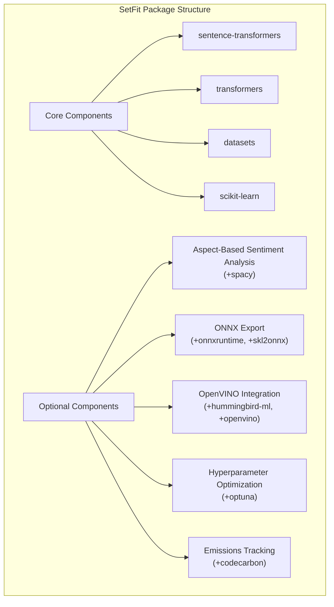
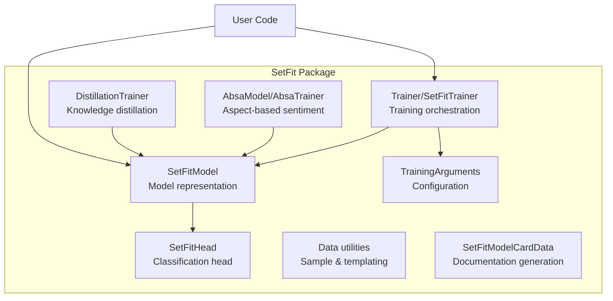

<!-- source: DeepWiki mcp.deepwiki.com · repo huggingface/setfit · page 1.1 Installation and Setup · fetched 2026-10-26 -->

# Installation and Setup

<details>
<summary>Relevant source files</summary>

The following files were used as context for generating this wiki page:

- [.gitignore](.gitignore)
- [Makefile](Makefile)
- [notebooks/README.md](notebooks/README.md)
- [notebooks/multilabel_HoC.ipynb](notebooks/multilabel_HoC.ipynb)
- [notebooks/setfit-optimum-intel.ipynb](notebooks/setfit-optimum-intel.ipynb)
- [setup.py](setup.py)
- [src/setfit/__init__.py](src/setfit/__init__.py)
- [utils/create_notebook_table.py](utils/create_notebook_table.py)
- [utils/release.py](utils/release.py)

</details>


This page provides comprehensive instructions for installing SetFit and setting up your environment. SetFit is a framework for efficient few-shot text classification that leverages Sentence Transformers. This guide covers installation methods, dependencies, and optional components to help you get started quickly.

## System Requirements

Before installing SetFit, ensure your system meets the following requirements:

- Python 3.9 or higher
- Sufficient disk space for model downloads
- For GPU acceleration: CUDA-compatible GPU with appropriate drivers

Sources: [setup.py:74-87]()

## Basic Installation

The simplest way to install SetFit is via pip:

```bash
pip install setfit
```

This installs the core functionality and required dependencies. SetFit automatically manages Python package dependencies, including:

- sentence-transformers (≥3)
- transformers (≥4.41.0)
- datasets (≥2.15.0)
- evaluate (≥0.3.0)
- huggingface_hub (≥0.24.0)
- scikit-learn
- packaging

Sources: [setup.py:13-21]()

## Installation Components

SetFit consists of core and optional components organized as follows:



Sources: [setup.py:12-40]()

## Optional Components

You can install SetFit with additional optional components by specifying extras:

### Aspect-Based Sentiment Analysis (ABSA)

```bash
pip install setfit[absa]
```

### ONNX Export Support

```bash
pip install setfit[onnx]
```

### OpenVINO Integration (requires ONNX)

```bash
pip install setfit[openvino]
```

### Hyperparameter Optimization with Optuna

```bash
pip install setfit[optuna]
```

### Emissions Tracking with CodeCarbon

```bash
pip install setfit[codecarbon]
```

### Multiple Optional Components

You can install multiple optional components at once:

```bash
pip install setfit[onnx,absa,optuna]
```

### All Optional Components

To install all optional components:

```bash
pip install setfit[dev]
```

Sources: [setup.py:30-47]()

## Installation from Source

For development purposes or to access the latest unreleased features, you can install SetFit from source:

```bash
git clone https://github.com/huggingface/setfit.git
cd setfit
pip install -e .
```

For development with all dependencies:

```bash
pip install -e ".[dev]"
```

Sources: [setup.py:57-90](), [Makefile:2-19]()

## Verification

To verify your installation, run the following Python code:

```python
from setfit import SetFitModel

# Should print the current version without errors
print(f"SetFit version: {SetFitModel.__module__.split('.')[0]}")
```

Sources: [src/setfit/__init__.py:1-24]()

## Package Structure

SetFit organizes its functionality through several modules imported at the package level:



Sources: [src/setfit/__init__.py:7-13]()

## Performance Optimization (Optional)

For improved performance on Intel CPUs, you can optionally set up optimization components:

### Intel Extension for PyTorch

```bash
pip install intel-extension-for-pytorch
```

### Optimum Intel for Model Optimization

```bash
pip install optimum[neural-compressor]
```

### TCMalloc for Memory Allocation (Linux only)

```bash
# Using conda
conda install gperftools -c conda-forge -y
echo export LD_PRELOAD=${CONDA_PREFIX}/lib/libtcmalloc.so:$LD_PRELOAD >> ~/.bashrc
# Restart your shell or source ~/.bashrc
```

For maximum performance on multi-socket systems, consider using `numactl` to control resource allocation:

```bash
OMP_NUM_THREADS=<NUM_THREADS> numactl -C <CORES_RANGE> -m 0 python your_script.py
```

Sources: [notebooks/setfit-optimum-intel.ipynb:93-114]()

## Docker Setup (Alternative)

For containerized applications, you can use a Dockerfile:

```dockerfile
FROM python:3.10-slim

WORKDIR /app

# Install system dependencies
RUN apt-get update && apt-get install -y --no-install-recommends \
    git \
    && rm -rf /var/lib/apt/lists/*

# Install SetFit and optional dependencies
RUN pip install --no-cache-dir setfit[onnx,absa]

# For specific version
# RUN pip install --no-cache-dir setfit==1.2.0

# Copy your application
COPY . .

# Run your application
CMD ["python", "your_application.py"]
```

## Development Environment

For development work on SetFit, additional tools are available:

### Code Quality

```bash
# Format code
make style

# Check code quality
make quality

# Run tests
make test

# Run tests with coverage
make coverage
```

Sources: [Makefile:8-21]()

## Environment Variables

SetFit uses certain environment variables for configuration:

- `TOKENIZERS_PARALLELISM`: Controls tokenizer parallelism (set to "false" to disable warnings)
- `CODECARBON_LOG_LEVEL`: Controls CodeCarbon logging level (automatically set to "error" if not defined)

Sources: [src/setfit/__init__.py:17-23]()

## Common Issues

### Jupyter Notebooks in Kaggle

When using SetFit in Kaggle notebooks, you might need to uninstall the pre-installed TensorFlow due to compatibility issues:

```python
%pip uninstall tensorflow -y
%pip install setfit
```

Sources: [notebooks/README.md:21-27]()

### CUDA Out of Memory

If you encounter CUDA out of memory errors:

1. Reduce batch size in TrainingArguments
2. Use a smaller model variant
3. Try using gradient accumulation

### Version Compatibility

SetFit has specific version requirements for its dependencies. If you encounter errors about incompatible versions:

```bash
# Install compatible versions
pip install datasets==2.15.0 sentence_transformers==3.0.0 transformers==4.41.0
```

For older datasets versions, use pandas<2:

```bash
pip install pandas<2 fsspec<2023.12.0
```

Sources: [setup.py:48-56]()

## Next Steps

After successful installation, you can proceed to:

- Training your first model with SetFit (see [Training Pipeline](#3))
- Exploring pre-trained models (see [Pretrained Models](#9))
- Understanding the core components (see [Core Components](#2))

---

