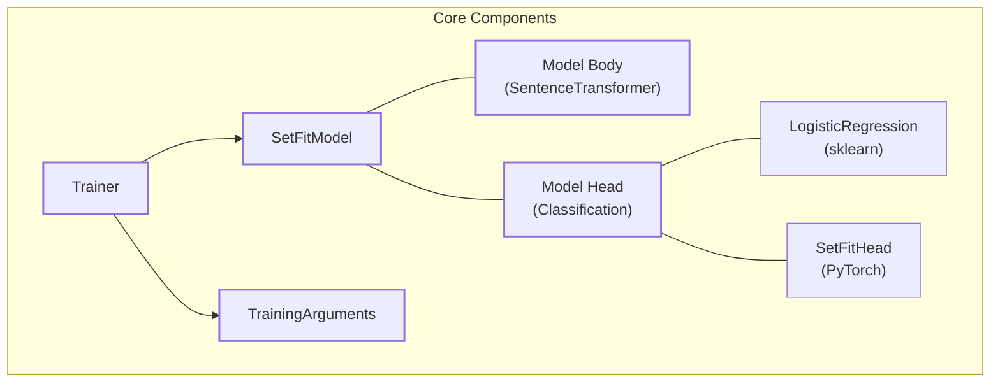
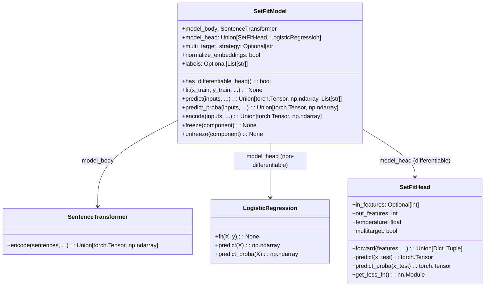
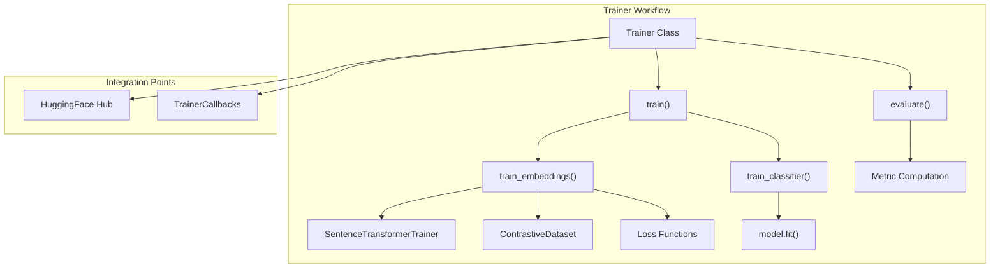
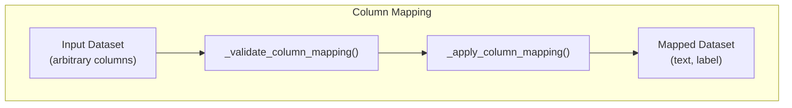
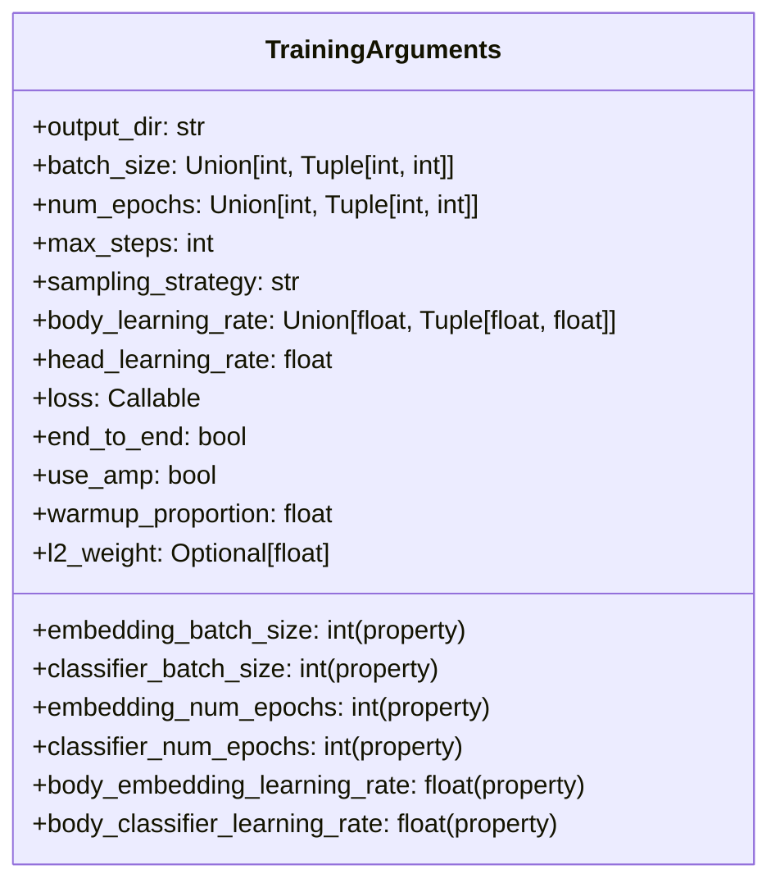
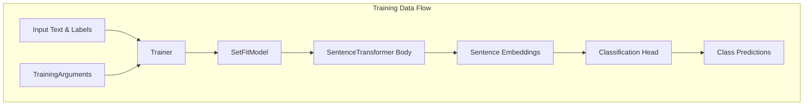

<!-- source: DeepWiki mcp.deepwiki.com · repo huggingface/setfit · page 2 Core Components · fetched 2026-10-26 -->

# Core Components

Relevant source files

The following files were used as context for generating this wiki page:

- [src/setfit/modeling.py](src/setfit/modeling.py)
- [src/setfit/trainer.py](src/setfit/trainer.py)
- [src/setfit/training_args.py](src/setfit/training_args.py)
- [tests/test_modeling.py](tests/test_modeling.py)
- [tests/test_training_args.py](tests/test_training_args.py)

This page provides a detailed overview of the core components in the SetFit framework, explaining their architecture, relationships, and key functionality. SetFit is designed around several primary components that work together to enable few-shot text classification with sentence transformers. For information about the training pipeline itself, see [Training Pipeline](#3), and for extension systems like Aspect-Based Sentiment Analysis or Knowledge Distillation, see [Extension Systems](#4).

## Core Architecture Overview

The SetFit framework is built around three primary components that work together to create, configure, and train few-shot text classification models:

Sources:
- [src/setfit/modeling.py:191-880]()
- [src/setfit/trainer.py:257-837]()
- [src/setfit/training_args.py:22-364]()

## SetFitModel

The `SetFitModel` is the central class that brings together a sentence transformer for text embeddings with a classification head for prediction. It implements the two-stage architecture of SetFit: embedding generation and classification.

Sources:
- [src/setfit/modeling.py:191-880]()
- [src/setfit/modeling.py:39-189]()

### Model Body

The model body is a `SentenceTransformer` instance that converts input text to dense embeddings. When training, these embeddings are fine-tuned using contrastive learning techniques before the classification head is trained.

Key features:
- Uses transformer models under the hood (BERT, RoBERTa, etc.)
- Outputs fixed-size sentence embeddings regardless of input length
- Can be frozen or unfrozen during training
- Supports embedding normalization

### Model Head

SetFit supports two types of classification heads:

1. **LogisticRegression (sklearn)**: The default non-differentiable head
   - Fast and efficient for few-shot learning
   - Supports multi-target classification via different strategies:
     - `one-vs-rest` using `OneVsRestClassifier`
     - `multi-output` using `MultiOutputClassifier`
     - `classifier-chain` using `ClassifierChain`

2. **SetFitHead (PyTorch)**: A differentiable neural network head
   - Enables end-to-end training with the model body
   - Built on top of a linear layer with temperature scaling
   - Supports both single-label and multi-label classification
   - Can use either `CrossEntropyLoss` (single-label) or `BCEWithLogitsLoss` (multi-label)

Sources:
- [src/setfit/modeling.py:39-189]()
- [src/setfit/modeling.py:210-232]()
- [src/setfit/modeling.py:847-866]()

## Trainer

The `Trainer` class orchestrates the entire training process for SetFit models, handling both the embedding fine-tuning phase and the classification head training phase.

Sources:
- [src/setfit/trainer.py:257-837]()
- [src/setfit/trainer.py:492-533]()
- [src/setfit/trainer.py:537-622]()
- [src/setfit/trainer.py:632-656]()

### Two-Phase Training Process

The Trainer implements SetFit's unique two-phase approach to few-shot learning:

1. **Embedding Training Phase**:
   - Creates text pairs/triplets from the limited labeled examples
   - Fine-tunes the Sentence Transformer body using contrastive learning
   - Uses a specialized `BCSentenceTransformersTrainer` as an adapter to SentenceTransformer's training functionality
   - Supports various contrastive loss functions:
     - `CosineSimilarityLoss` (default)
     - `BatchAllTripletLoss`
     - `BatchHardTripletLoss`
     - `BatchSemiHardTripletLoss`
     - `BatchHardSoftMarginTripletLoss`
     - `SupConLoss`

2. **Classification Training Phase**:
   - Train the classification head on labeled examples
   - For differentiable heads, can optionally train end-to-end with the model body
   - For non-differentiable heads, uses scikit-learn's fit method

Sources:
- [src/setfit/trainer.py:537-622]()
- [src/setfit/trainer.py:632-656]()
- [src/setfit/trainer.py:39-187]()

### Column Mapping

The Trainer includes a column mapping feature to handle datasets with differently named columns:

Sources:
- [src/setfit/trainer.py:189-254]()
- [src/setfit/trainer.py:306-318]()

## TrainingArguments

The `TrainingArguments` class provides extensive configuration options for the training process. It's structured to support the two-phase training approach with separate parameters for embedding and classification training.

Sources:
- [src/setfit/training_args.py:22-364]()
- [src/setfit/training_args.py:168-192]()
- [src/setfit/training_args.py:296-317]()

### Key Parameters

The TrainingArguments supports dual-phase training with parameters that can be specified separately for each phase:

| Parameter | Default | Description |
|-----------|---------|-------------|
| `batch_size` | `(16, 2)` | Batch sizes for embedding and classifier phases |
| `num_epochs` | `(1, 16)` | Number of epochs for embedding and classifier phases |
| `body_learning_rate` | `(2e-5, 1e-5)` | Learning rates for the model body in embedding and classifier phases |
| `head_learning_rate` | `1e-2` | Learning rate for the classifier head |

Other important parameters include:

- **Loss configuration**: `loss`, `distance_metric`, `margin`
- **Training strategies**: `sampling_strategy`, `num_iterations`, `end_to_end`
- **Optimization**: `use_amp`, `warmup_proportion`, `l2_weight`
- **Logging & Evaluation**: `logging_strategy`, `eval_strategy`, `save_strategy`

Sources:
- [src/setfit/training_args.py:168-192]()
- [src/setfit/training_args.py:295-317]()
- [tests/test_training_args.py:19-63]()

## Integration and Data Flow

The core components of SetFit are designed to work together seamlessly, with data flowing through the system as follows:

Sources:
- [src/setfit/trainer.py:492-533]()
- [src/setfit/modeling.py:248-327]()

## Component Initialization and Lifecycle

The typical lifecycle of SetFit components involves:

1. Creating a `TrainingArguments` instance with desired configuration
2. Initializing a `SetFitModel` either from scratch or with `from_pretrained()`
3. Creating a `Trainer` with the model, arguments, and datasets
4. Calling `trainer.train()` to execute the two-phase training
5. Using `model.predict()` or `model.predict_proba()` for inference
6. Optionally saving the model with `model.save_pretrained()` or `trainer.push_to_hub()`

This modular design makes the framework flexible for various text classification scenarios, from academic research to production applications.

Sources:
- [src/setfit/modeling.py:709-879]()
- [src/setfit/trainer.py:290-345]()
- [src/setfit/trainer.py:492-533]()
- [src/setfit/trainer.py:795-836]()

---

