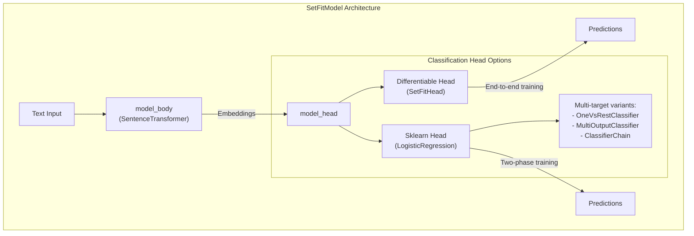
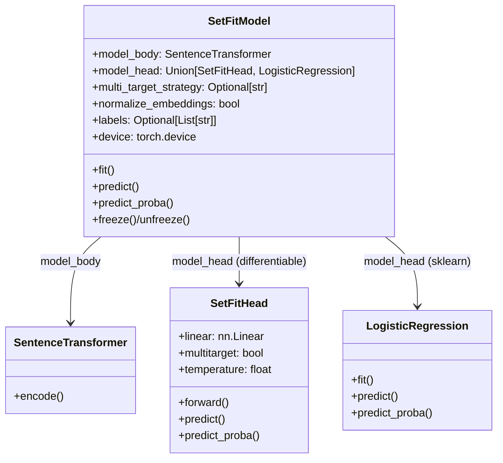
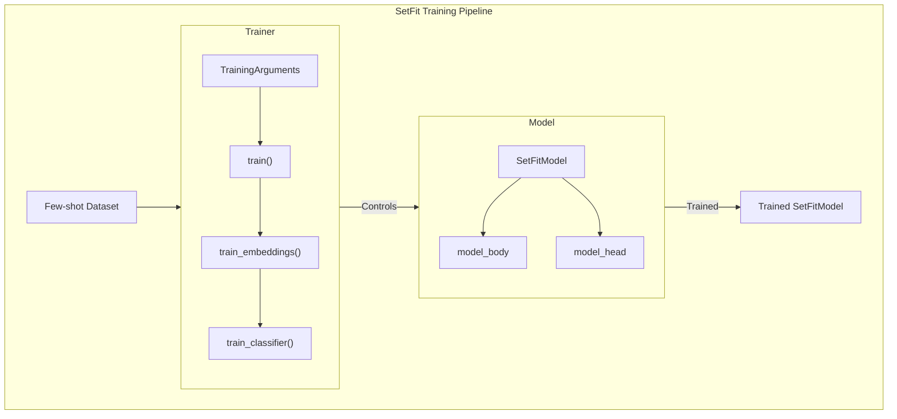

<!-- source: DeepWiki mcp.deepwiki.com · repo huggingface/setfit · page 2.1 SetFitModel · fetched 2026-10-26 -->

# SetFitModel

<details>
<summary>Relevant source files</summary>

The following files were used as context for generating this wiki page:

- [src/setfit/modeling.py](src/setfit/modeling.py)
- [src/setfit/trainer.py](src/setfit/trainer.py)
- [tests/test_modeling.py](tests/test_modeling.py)

</details>


The `SetFitModel` class is the core model component in the SetFit framework, designed for efficient few-shot text classification. It combines a Sentence Transformer for text embedding with a classification head for prediction, providing a unified interface for both training and inference. This page documents the architecture, usage, and key features of the `SetFitModel` class.

## Architecture Overview

`SetFitModel` follows a two-component architecture that separates embedding generation from classification:



Sources: [src/setfit/modeling.py:191-233](). [tests/test_modeling.py:22-74]()

### Core Components

The `SetFitModel` consists of two primary components:

1. **Model Body (`model_body`)**: A SentenceTransformer model that converts input text into embeddings (dense vector representations).

2. **Model Head (`model_head`)**: A classification component that takes embeddings and outputs predictions. It can be one of:
   - **PyTorch-based head**: `SetFitHead`, a differentiable neural network layer enabling end-to-end training
   - **Scikit-learn-based head**: `LogisticRegression` or its multi-label variants for traditional ML-based classification



Sources: [src/setfit/modeling.py:39-190](), [src/setfit/modeling.py:191-233]()

## Initialization and Loading

### Creating a New `SetFitModel`

A `SetFitModel` can be initialized directly by providing a model body and head:

```python
from setfit import SetFitModel
from sentence_transformers import SentenceTransformer
from sklearn.linear_model import LogisticRegression

model_body = SentenceTransformer("sentence-transformers/all-mpnet-base-v2")
model_head = LogisticRegression()

model = SetFitModel(
    model_body=model_body,
    model_head=model_head,
    labels=["negative", "positive"]
)
```

### Loading a Pre-trained Model

More commonly, models are loaded using the `from_pretrained` method, which can load models from the Hugging Face Hub or a local directory:

```python
# Load a model from the Hub
model = SetFitModel.from_pretrained("tomaarsen/setfit-bge-small-v1.5-sst2-8-shot")

# Load a model with a specific device
model = SetFitModel.from_pretrained("tomaarsen/setfit-bge-small-v1.5-sst2-8-shot", device="cuda")

# Load a base model and specify parameters for a fresh classification head
model = SetFitModel.from_pretrained(
    "sentence-transformers/paraphrase-mpnet-base-v2",
    labels=["negative", "positive"],
    use_differentiable_head=True
)
```

Sources: [src/setfit/modeling.py:709-879](), [tests/test_modeling.py:172-189]()

## Classification Heads

### PyTorch-based Head (`SetFitHead`)

The `SetFitHead` class is a PyTorch module that enables end-to-end training of the entire model. It features:

- A linear layer for classification
- Support for multi-target classification through the `multitarget` parameter
- Temperature scaling for controlling prediction confidence
- Customizable initialization and normalization

```python
model = SetFitModel.from_pretrained(
    "sentence-transformers/paraphrase-mpnet-base-v2",
    use_differentiable_head=True,
    head_params={"temperature": 0.5}
)
```

Sources: [src/setfit/modeling.py:39-189](), [tests/test_modeling.py:76-170]()

### Scikit-learn-based Head

For traditional machine learning-based classification, `SetFitModel` supports scikit-learn's `LogisticRegression` and its multi-label variants:

```python
# Standard classification
model = SetFitModel.from_pretrained(
    "sentence-transformers/paraphrase-mpnet-base-v2"
)  # Default is LogisticRegression

# Multi-label classification with OneVsRestClassifier
model = SetFitModel.from_pretrained(
    "sentence-transformers/paraphrase-mpnet-base-v2",
    multi_target_strategy="one-vs-rest"
)
```

The available multi-target strategies are:
- `"one-vs-rest"`: Uses `OneVsRestClassifier`
- `"multi-output"`: Uses `MultiOutputClassifier`
- `"classifier-chain"`: Uses `ClassifierChain`

Sources: [src/setfit/modeling.py:191-233](), [tests/test_modeling.py:52-73]()

## Training

The `fit` method is used to train the model on a dataset:

```python
model.fit(
    x_train=["This is great!", "This is terrible."],
    y_train=[1, 0],  # 1 for positive, 0 for negative
    num_epochs=10,
    batch_size=16,
    body_learning_rate=1e-5,
    head_learning_rate=2e-3,
    end_to_end=True  # Train the entire model end-to-end
)
```

Training behavior differs based on the head type:

1. **Differentiable head**: Uses PyTorch training with gradients propagating through the entire model if `end_to_end=True`
2. **Scikit-learn head**: Extracts embeddings from the model body first, then fits the classifier on these embeddings

### Freezing Model Components

The `freeze` and `unfreeze` methods control which parts of the model are trained:

```python
# Freeze only the body, keeping the head trainable
model.freeze("body")

# Unfreeze everything
model.unfreeze()
```

Sources: [src/setfit/modeling.py:248-327](), [src/setfit/modeling.py:390-435]()

## Inference

### Making Predictions

`SetFitModel` provides multiple methods for inference:

```python
# Get raw predictions (class indices or string labels)
predictions = model.predict(["This is a positive review", "This is a negative review"])

# Get class probabilities
probabilities = model.predict_proba(["This is a positive review"])

# Direct call (same as predict)
result = model("This is a positive review")
```

For models with string labels, the `predict` method will automatically return string labels instead of indices.

### Working with Embeddings

You can also extract embeddings directly:

```python
embeddings = model.encode(["This is a test sentence"])
```

Sources: [src/setfit/modeling.py:436-611](), [tests/test_modeling.py:290-354]()

## Device Management

`SetFitModel` supports moving the model between devices (CPU/GPU):

```python
# Move model to GPU
model.to("cuda")

# Move model to CPU
model.to("cpu")

# Check current device
current_device = model.device
```

The behavior ensures both the model body and head (if differentiable) are moved to the same device.

Sources: [src/setfit/modeling.py:613-649](), [tests/test_modeling.py:210-262]()

## Integration with Hugging Face Hub

### Saving and Loading Models

```python
# Save model to a local directory
model.save_pretrained("./my-setfit-model")

# Push model to the Hugging Face Hub
model.push_to_hub("username/model-name")
```

### Model Cards

`SetFitModel` automatically generates model cards when saving:

```python
# Generate a model card string
card_text = model.generate_model_card()

# Create and save a model card
model.create_model_card("./model-directory")
```

Sources: [src/setfit/modeling.py:651-708](), [src/setfit/modeling.py:795-836]()

## Usage in the SetFit Pipeline

The `SetFitModel` is a core component in the SetFit training pipeline, typically used with the `Trainer` class:



Sources: [src/setfit/trainer.py:257-303](), [src/setfit/trainer.py:492-533]()

## Conclusion

The `SetFitModel` class provides a flexible and powerful interface for few-shot text classification, combining the strengths of Sentence Transformers for embedding generation with various classification heads for prediction. Its integration with the Hugging Face ecosystem makes it easy to share, reuse, and deploy models for a wide range of text classification tasks.

For more information about training with SetFit, see the [Trainer](#2.2) documentation. For details about configuring the training process, see [TrainingArguments](#2.3).

---

