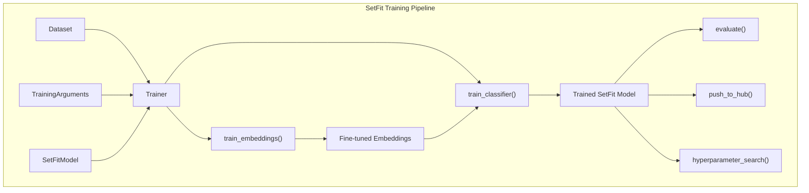
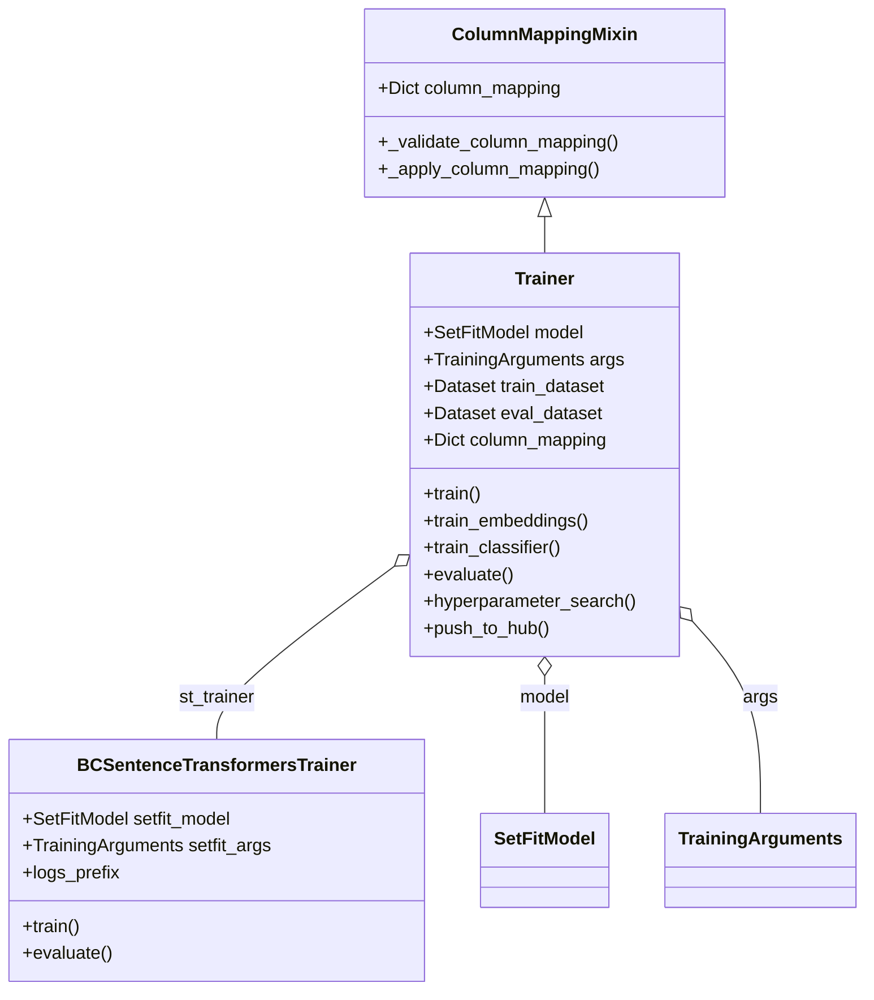
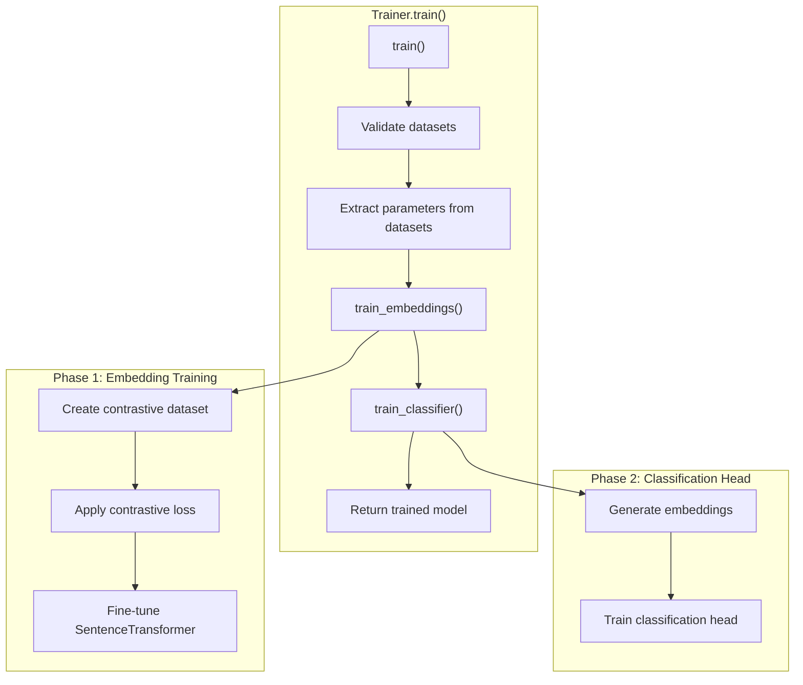
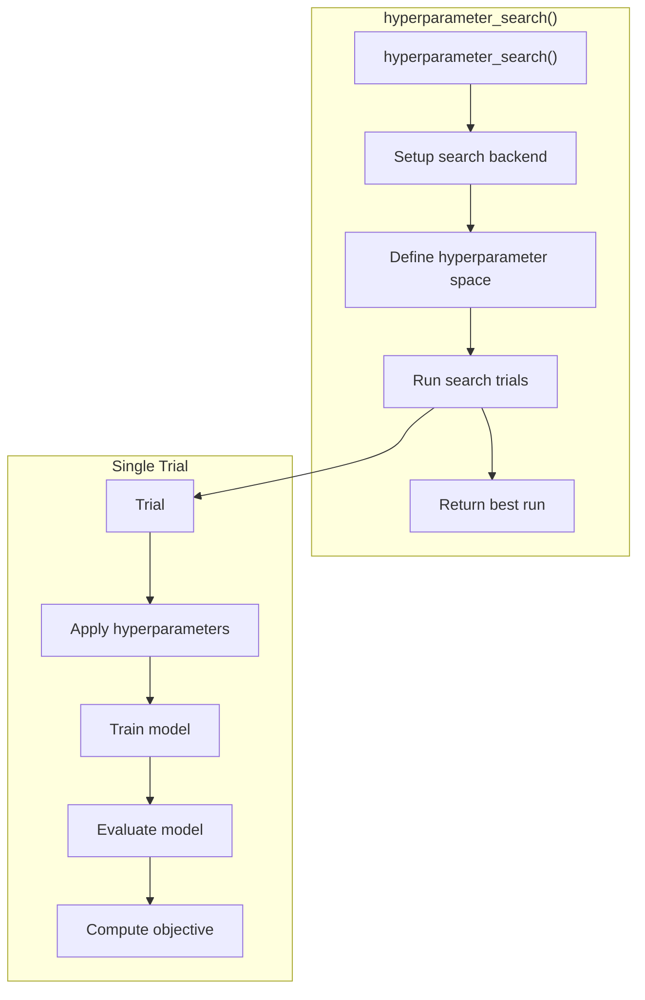

<!-- source: DeepWiki mcp.deepwiki.com · repo huggingface/setfit · page 2.2 Trainer · fetched 2026-10-26 -->

# Trainer

<details>
<summary>Relevant source files</summary>

The following files were used as context for generating this wiki page:

- [src/setfit/modeling.py](src/setfit/modeling.py)
- [src/setfit/trainer.py](src/setfit/trainer.py)
- [tests/test_deprecated_trainer.py](tests/test_deprecated_trainer.py)
- [tests/test_deprecated_trainer_distillation.py](tests/test_deprecated_trainer_distillation.py)
- [tests/test_modeling.py](tests/test_modeling.py)
- [tests/test_trainer.py](tests/test_trainer.py)
- [tests/test_trainer_distillation.py](tests/test_trainer_distillation.py)

</details>


The `Trainer` class is a central component of the SetFit framework that orchestrates the training process for few-shot text classification models. It implements SetFit's unique two-phase training strategy: first fine-tuning the sentence transformer embedding model using contrastive learning, then training a classification head on top of these embeddings.

For information about model components, see [SetFitModel](#2.1). For information about training configuration, see [TrainingArguments](#2.3).

## Class Overview

The `Trainer` class provides a high-level API that handles:
- Data preparation and column mapping
- Two-phase training execution
- Model evaluation 
- Hyperparameter optimization
- Model exporting to Hugging Face Hub



Sources: [src/setfit/trainer.py:257-837]()

## Class Structure

The `Trainer` class is built on top of `BCSentenceTransformersTrainer` which handles the embedding training phase, while the `Trainer` itself coordinates the complete training process.



Sources: [src/setfit/trainer.py:39-187](), [src/setfit/trainer.py:189-255](), [src/setfit/trainer.py:257-837]()

## Initialization

The `Trainer` is initialized with the following key parameters:

| Parameter | Type | Description |
|-----------|------|-------------|
| `model` | `SetFitModel` | The SetFit model to train. Required unless `model_init` is provided. |
| `args` | `TrainingArguments` | The training arguments that configure the training process. |
| `train_dataset` | `Dataset` | The dataset for training. |
| `eval_dataset` | `Dataset` | The dataset for evaluation. |
| `model_init` | `Callable[[], SetFitModel]` | Function that instantiates the model (used for hyperparameter search). |
| `metric` | `Union[str, Callable]` | Metric to use for evaluation (default: "accuracy"). |
| `callbacks` | `List[TrainerCallback]` | Callbacks to customize the training loop. |
| `column_mapping` | `Dict[str, str]` | Mapping from dataset columns to the columns expected by the model. |

Sources: [src/setfit/trainer.py:290-301]()

## Two-Phase Training Process

The SetFit training process is implemented in the `train()` method, which coordinates the two training phases:



Sources: [src/setfit/trainer.py:492-532](), [src/setfit/trainer.py:537-582](), [src/setfit/trainer.py:631-656]()

### Phase 1: Embedding Training

In this phase, the sentence transformer body is fine-tuned using contrastive learning via the `train_embeddings()` method. The process:

1. Creates text pairs/triplets using the `ContrastiveDataset` class
2. Applies a contrastive loss function (default is `CosineSimilarityLoss`)
3. Fine-tunes the sentence transformer to learn meaningful embeddings

Key implementation:
```python
train_dataset, loss = self.get_dataset(x_train, y_train, args, max_pairs)
self.st_trainer.train_dataset = train_dataset
self.st_trainer.loss = loss
self.st_trainer.train()
```

Sources: [src/setfit/trainer.py:537-582](), [src/setfit/trainer.py:584-620]()

### Phase 2: Classification Head Training

In this phase, a classification head is trained on top of the fine-tuned embeddings via the `train_classifier()` method:

1. Uses the fine-tuned embeddings to encode training data
2. Trains either a scikit-learn `LogisticRegression` head or a differentiable PyTorch head

Key implementation:
```python
self.model.fit(
    x_train,
    y_train,
    num_epochs=args.classifier_num_epochs,
    batch_size=args.classifier_batch_size,
    body_learning_rate=args.body_classifier_learning_rate,
    head_learning_rate=args.head_learning_rate,
    l2_weight=args.l2_weight,
    max_length=args.max_length,
    show_progress_bar=args.show_progress_bar,
    end_to_end=args.end_to_end,
)
```

Sources: [src/setfit/trainer.py:631-656]()

## Column Mapping

The `Trainer` provides column mapping functionality through the `ColumnMappingMixin` class. This allows adapting datasets with different column names to the standard format expected by SetFit ("text" and "label").

Example:
```python
trainer = Trainer(
    model=model,
    train_dataset=dataset,
    column_mapping={"content": "text", "class": "label"}
)
```

The `_validate_column_mapping()` method verifies that all required columns are present after mapping, and `_apply_column_mapping()` renames the columns according to the mapping.

Sources: [src/setfit/trainer.py:189-255]()

## Evaluation

The `evaluate()` method assesses model performance on a dataset:

1. Gets predictions from the model for examples in the evaluation dataset
2. Computes metrics based on the specified metric function
3. Returns a dictionary of metrics

```python
def evaluate(self, dataset=None, metric_key_prefix="test"):
    # Get dataset to evaluate on
    eval_dataset = dataset or self.eval_dataset
    
    # Get predictions
    y_pred = self.model.predict(eval_dataset["text"])
    y_test = eval_dataset["label"]
    
    # Compute metrics
    if isinstance(self.metric, str):
        metric_fn = evaluate.load(self.metric)
        results = metric_fn.compute(predictions=y_pred, references=y_test, **self.metric_kwargs)
    elif callable(self.metric):
        results = self.metric(y_pred, y_test, **self.metric_kwargs)
        
    return results
```

Sources: [src/setfit/trainer.py:658-717]()

## Hyperparameter Optimization

The `hyperparameter_search()` method uses Optuna to find optimal hyperparameters:



Key parameters for hyperparameter search:
- `hp_space`: Function that defines the hyperparameter search space
- `n_trials`: Number of trials to run
- `direction`: Whether to "maximize" or "minimize" the objective
- `compute_objective`: Function to compute the objective from evaluation metrics

Sources: [src/setfit/trainer.py:719-793]()

## Pushing to Hugging Face Hub

The `push_to_hub()` method uploads the trained model to the Hugging Face Hub:

```python
def push_to_hub(self, repo_id, **kwargs):
    """Upload model checkpoint to the Hub using `huggingface_hub`.
    
    Args:
        repo_id (`str`): The full repository ID to push to, e.g. `"tomaarsen/setfit-sst2"`.
    
    Returns:
        str: The url of the commit of your model in the given repository.
    """
    commit_message = kwargs.pop("commit_message", "Add SetFit model")
    return self.model.push_to_hub(repo_id, commit_message=commit_message, **kwargs)
```

Sources: [src/setfit/trainer.py:795-836]()

## Callbacks

The `Trainer` supports callbacks for customizing the training loop:

```python
# Add a callback
trainer.add_callback(CustomCallback())

# Remove a callback
trainer.remove_callback(callback)

# Pop a callback
popped_callback = trainer.pop_callback(callback_type)
```

The callbacks can hook into various stages of the training process, such as on_init_end, on_train_begin, on_step_end, etc.

Sources: [src/setfit/trainer.py:367-403]()

## Complete Example

Here's an end-to-end example of using the `Trainer`:

```python
from datasets import Dataset
from setfit import SetFitModel, Trainer, TrainingArguments

# Prepare dataset
dataset = Dataset.from_dict({
    "text": ["I love this movie", "This was terrible", "Pretty average film"],
    "label": [1, 0, 0]  # 1 = positive, 0 = negative
})

# Split into train/test
splits = dataset.train_test_split(test_size=0.2)
train_dataset = splits["train"]
test_dataset = splits["test"]

# Initialize model
model = SetFitModel.from_pretrained("sentence-transformers/paraphrase-mpnet-base-v2")

# Initialize training arguments
args = TrainingArguments(
    num_iterations=20,  # Number of contrastive learning pairs to generate
    embedding_batch_size=16,
    classifier_batch_size=16,
    body_embedding_learning_rate=1e-4,
    head_learning_rate=1e-3
)

# Initialize trainer
trainer = Trainer(
    model=model,
    args=args,
    train_dataset=train_dataset,
    eval_dataset=test_dataset
)

# Train the model
trainer.train()

# Evaluate the model
metrics = trainer.evaluate()
print(metrics)  # e.g., {"accuracy": 1.0}

# Push to Hub
trainer.push_to_hub("username/my-setfit-model")
```

Sources: [src/setfit/trainer.py](), [src/setfit/modeling.py]()

## Relationship with BCSentenceTransformersTrainer

The `Trainer` uses a `BCSentenceTransformersTrainer` internally to handle the embedding training phase. This class is a subclass of `SentenceTransformerTrainer` from the `sentence-transformers` library, with additional functionality to make it compatible with the SetFit API.

```python
self.st_trainer = BCSentenceTransformersTrainer(
    setfit_model=model,
    setfit_args=self.args,
    callbacks=callbacks,
)
```

The `BCSentenceTransformersTrainer` propagates training arguments from SetFit to the SentenceTransformer trainer and ensures consistent logging prefixes.

Sources: [src/setfit/trainer.py:39-187](), [src/setfit/trainer.py:341-345]()

---

