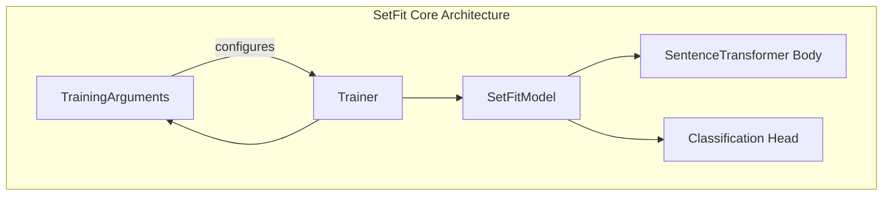
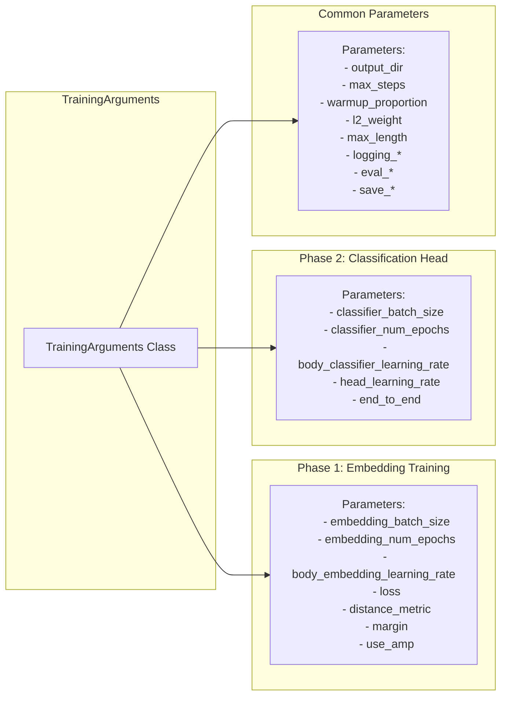
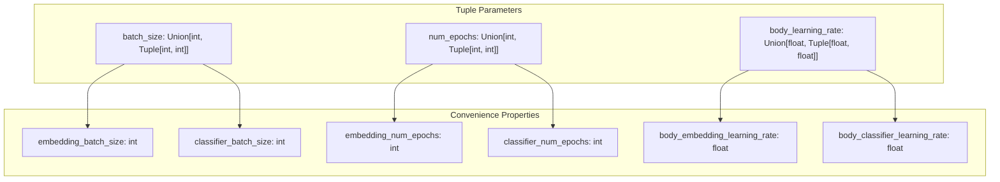

<!-- source: DeepWiki mcp.deepwiki.com · repo huggingface/setfit · page 2.3 TrainingArguments · fetched 2026-10-26 -->

# TrainingArguments

<details>
<summary>Relevant source files</summary>

The following files were used as context for generating this wiki page:

- [src/setfit/training_args.py](src/setfit/training_args.py)
- [tests/test_training_args.py](tests/test_training_args.py)

</details>


The `TrainingArguments` class is a central configuration component in the SetFit framework that controls all aspects of the training process. This document provides a comprehensive reference for the `TrainingArguments` class, how it works, and how to configure it for different training scenarios. For information about the actual training process, see [Trainer](#2.2) and [Training Pipeline](#3).

## Overview

`TrainingArguments` defines parameters that control both phases of SetFit's two-phase training approach:
1. The embedding training phase (fine-tuning the sentence transformer body)
2. The classification head training phase

Many parameters can take different values for each training phase, which is why SetFit uses tuples for certain configuration options.

Sources: [src/setfit/training_args.py:22-29]()</file>

## Architecture

### Relationship to Other Components



Sources: [src/setfit/training_args.py:22-29]()

### Two-Phase Training Configuration



Sources: [src/setfit/training_args.py:22-164]()

## Key Parameters

### Tuple Parameters

SetFit uses tuple parameters to configure both training phases separately. These parameters can accept either:
- A single value that applies to both phases
- A tuple of two values, where the first applies to the embedding phase and the second to the classifier phase



Sources: [src/setfit/training_args.py:168-175](), [src/setfit/training_args.py:182-184](), [src/setfit/training_args.py:226-237]()

### Parameter Categories

The `TrainingArguments` parameters can be grouped into the following categories:

| Category | Parameters | Purpose |
|----------|------------|---------|
| Basic Training | `batch_size`, `num_epochs`, `max_steps` | Control training batch sizes and duration |
| Learning Rates | `body_learning_rate`, `head_learning_rate` | Set learning rates for different model components |
| Loss Configuration | `loss`, `distance_metric`, `margin` | Configure the loss function for embedding training |
| Training Control | `end_to_end`, `use_amp`, `warmup_proportion`, `l2_weight` | Control training behavior and optimization |
| Evaluation | `eval_strategy`, `eval_steps`, `eval_delay`, `eval_max_steps` | Configure when and how to evaluate |
| Saving | `save_strategy`, `save_steps`, `save_total_limit`, `load_best_model_at_end` | Control model checkpoint saving |
| Logging | `logging_strategy`, `logging_steps`, `report_to`, `logging_dir` | Configure training logs and reporting |
| Other | `show_progress_bar`, `seed`, `max_length` | Miscellaneous settings |

Sources: [src/setfit/training_args.py:22-221]()

## Default Values and Parameter Details

### Basic Parameters

| Parameter | Default Value | Description |
|-----------|---------------|-------------|
| `output_dir` | `"checkpoints"` | Directory for saving model checkpoints and outputs |
| `batch_size` | `(16, 2)` | Batch sizes for embedding and classifier phases |
| `num_epochs` | `(1, 16)` | Number of epochs for embedding and classifier phases |
| `max_steps` | `-1` | Maximum number of training steps (overrides `num_epochs` if positive) |

### Loss Function Parameters

| Parameter | Default Value | Description |
|-----------|---------------|-------------|
| `loss` | `CosineSimilarityLoss` | Loss function for embedding training phase |
| `distance_metric` | `BatchHardTripletLossDistanceFunction.cosine_distance` | Distance function for triplet loss |
| `margin` | `0.25` | Margin for triplet loss |
| `sampling_strategy` | `"oversampling"` | Strategy for drawing pairs in training |
| `num_iterations` | `None` | Number of iterations to generate sentence pairs |

### Learning Rate Parameters

| Parameter | Default Value | Description |
|-----------|---------------|-------------|
| `body_learning_rate` | `(2e-5, 1e-5)` | Learning rates for model body in both phases |
| `head_learning_rate` | `1e-2` | Learning rate for classification head |
| `warmup_proportion` | `0.1` | Proportion of training steps for learning rate warmup |

### Training Control Parameters

| Parameter | Default Value | Description |
|-----------|---------------|-------------|
| `end_to_end` | `False` | Whether to train the entire model in the classifier phase |
| `use_amp` | `False` | Whether to use Automatic Mixed Precision |
| `l2_weight` | `0.01` | L2 regularization weight |
| `max_length` | `None` | Maximum token length for tokenization |

Sources: [src/setfit/training_args.py:32-164]()

## Parameter Validation

The `TrainingArguments` class performs several validations in its `__post_init__` method:

1. Converts single values to tuples for `batch_size`, `num_epochs`, and `body_learning_rate`
2. Ensures `warmup_proportion` is between 0.0 and 1.0
3. Validates evaluation and saving settings when `load_best_model_at_end=True`
4. Converts string strategies to `IntervalStrategy` objects
5. Ensures that if `eval_strategy` is `"steps"`, a valid `eval_steps` value is provided

Sources: [src/setfit/training_args.py:225-290]()

## Additional Methods

The `TrainingArguments` class provides several utility methods:

| Method | Description |
|--------|-------------|
| `to_dict()` | Convert instance to a dictionary |
| `from_dict(arguments, ignore_extra=False)` | Create instance from a dictionary |
| `copy()` | Create a shallow copy of the instance |
| `update(arguments, ignore_extra=False)` | Create a new instance with updated values |
| `to_json_string()` | Serialize the instance to a JSON string |
| `to_sanitized_dict()` | Create a sanitized dictionary for TensorBoard |

Sources: [src/setfit/training_args.py:319-363]()

## Usage Examples

Here's how to create a `TrainingArguments` instance with default values:

```python
from setfit import TrainingArguments

args = TrainingArguments()
```

Customize parameters for both training phases:

```python
args = TrainingArguments(
    batch_size=(32, 8),  # 32 for embedding phase, 8 for classifier phase
    num_epochs=(2, 20),  # 2 epochs for embedding phase, 20 for classifier phase
    body_learning_rate=(1e-5, 5e-6),  # Different learning rates for each phase
)
```

Configure evaluation and model saving:

```python
args = TrainingArguments(
    eval_strategy="steps",
    eval_steps=100,
    save_strategy="steps",
    save_steps=100,
    load_best_model_at_end=True,
)
```

## Common Pitfalls and Validation Errors

When using `TrainingArguments`, be aware of these common issues:

1. If `load_best_model_at_end=True`, `eval_strategy` and `save_strategy` must match
2. If `eval_strategy="steps"` and `save_strategy="steps"`, `save_steps` must be a multiple of `eval_steps`
3. The `warmup_proportion` must be between 0.0 and 1.0
4. If `eval_strategy="steps"`, `eval_steps` must be greater than 0
5. If `logging_strategy="steps"`, `logging_steps` must be greater than 0

Sources: [src/setfit/training_args.py:262-290](), [tests/test_training_args.py:9-105]()

## Relationship with HuggingFace Ecosystem

The SetFit `TrainingArguments` class is designed to be similar to the HuggingFace Transformers `TrainingArguments` class but is specifically tailored for SetFit's two-phase training approach. It uses some of the same utility functions and enums from the Transformers library, such as `IntervalStrategy`.

Sources: [src/setfit/training_args.py:11-14]()

---

