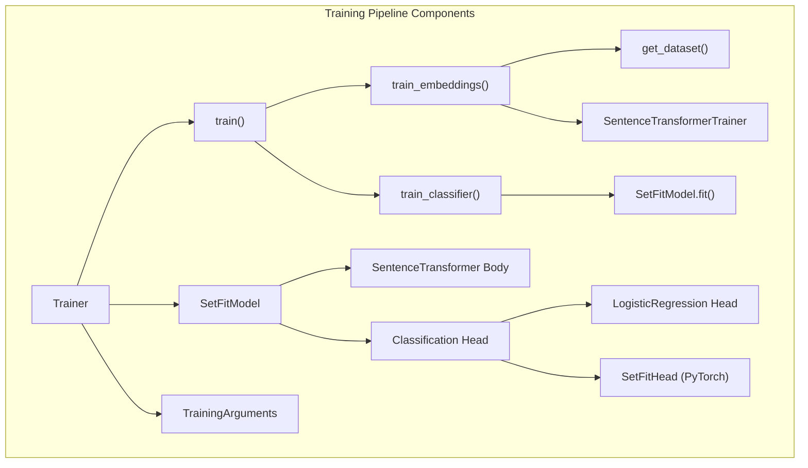
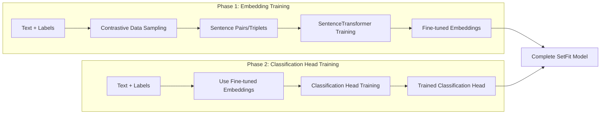
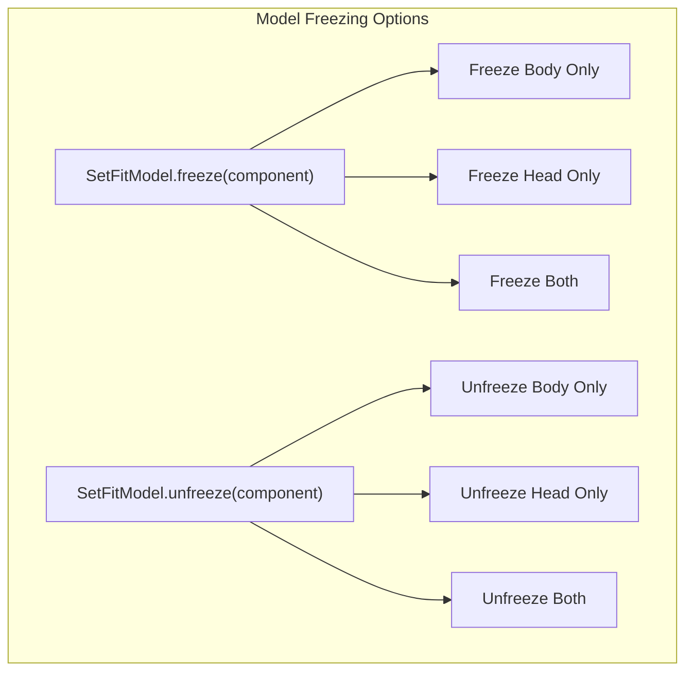
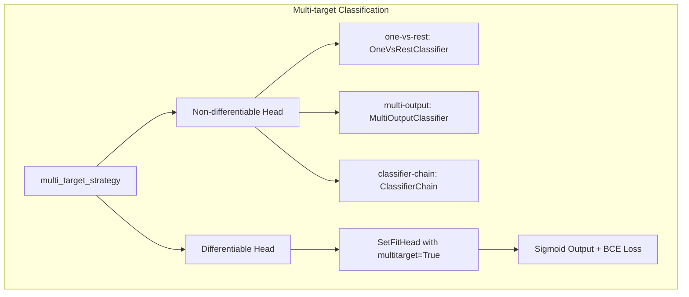
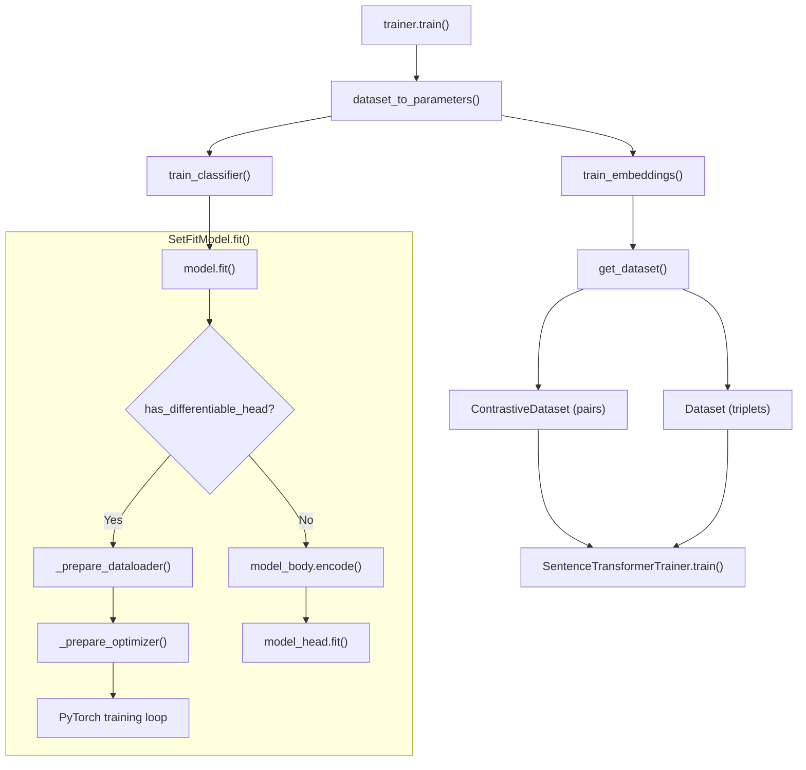

<!-- source: DeepWiki mcp.deepwiki.com · repo huggingface/setfit · page 3 Training Pipeline · fetched 2026-10-26 -->

# Training Pipeline

<details>
<summary>Relevant source files</summary>

The following files were used as context for generating this wiki page:

- [src/setfit/modeling.py](src/setfit/modeling.py)
- [src/setfit/trainer.py](src/setfit/trainer.py)
- [tests/test_modeling.py](tests/test_modeling.py)
- [tests/test_trainer.py](tests/test_trainer.py)

</details>


The Training Pipeline in SetFit implements a two-phase approach for efficient few-shot text classification. This page explains the architecture and workflow of the pipeline, focusing on how data flows through the system and the key components involved. For information about data preparation, see [Data Preparation](#3.1).

## Architecture Overview

SetFit's training pipeline combines contrastive learning for embedding fine-tuning with classifier training. The pipeline is orchestrated by the `Trainer` class, which coordinates both phases of the training process.



Sources: [src/setfit/trainer.py:257-407](), [src/setfit/modeling.py:191-244]()

## Two-Phase Training Process

The SetFit training process consists of two distinct phases that work together to create an effective few-shot classifier:



Sources: [src/setfit/trainer.py:492-533]()

### Phase 1: Embedding Training

In the first phase, the `train_embeddings` method fine-tunes the SentenceTransformer body using contrastive learning:

1. **Dataset Preparation**: The training data is processed to create sentence pairs or triplets for contrastive learning.
2. **Contrastive Learning**: The model learns to embed sentences so that similar examples (same class) are close together and dissimilar examples (different classes) are far apart.
3. **Loss Functions**: SetFit supports multiple loss functions including `CosineSimilarityLoss`, `BatchHardTripletLoss`, and `SupConLoss`.

```python
# Example of embedding training process flow
train_dataset, loss = get_dataset(x_train, y_train, args)
trainer.train_dataset = train_dataset
trainer.loss = loss
trainer.train()
```

Sources: [src/setfit/trainer.py:537-582](), [src/setfit/trainer.py:584-621]()

### Phase 2: Classification Head Training

In the second phase, the `train_classifier` method trains a classification head on top of the fine-tuned embeddings:

1. **Classifier Type**: Training works with either:
   - **Differentiable Head** (PyTorch-based `SetFitHead`): Trained using gradient-based optimization
   - **Non-differentiable Head** (scikit-learn's `LogisticRegression`): Trained using conventional ML approaches

2. **End-to-End Option**: When using a differentiable head, SetFit can optionally train the entire model end-to-end, allowing gradients to flow back to the embedding model.

```python
# Example of classifier training logic flow
if has_differentiable_head:  # train with PyTorch
    # Setup dataloader, criterion, optimizer
    # Train with gradient-based optimization
else:  # train with sklearn
    embeddings = model_body.encode(x_train)
    model_head.fit(embeddings, y_train)
```

Sources: [src/setfit/trainer.py:631-656](), [src/setfit/modeling.py:248-328]()

## Data Handling and Column Mapping

The `Trainer` class includes column mapping functionality to handle datasets with different column names:

```python
# Column mapping example
trainer = Trainer(
    model=model,
    train_dataset=dataset,
    column_mapping={"sentence": "text", "class": "label"}
)
```

When provided, column mapping renames dataset columns to match SetFit's expected format, which requires:
- A `text` column containing the input sentences
- A `label` column containing the target classes

Sources: [src/setfit/trainer.py:189-256](), [src/setfit/trainer.py:289-324]()

## Model Freezing and Fine-tuning Controls

SetFit offers flexible control over which parts of the model are trained:



During classifier training, the `end_to_end` parameter determines whether:
- Only the classification head is trained (default)
- Both the head and the embedding model are trained (when `end_to_end=True`)

Sources: [src/setfit/modeling.py:390-435]()

## Configuration Options

### Training Arguments

The `TrainingArguments` class provides comprehensive configuration for both training phases:

| Parameter | Description |
|-----------|-------------|
| `num_iterations` | Number of contrastive learning iterations for embedding training |
| `embedding_num_epochs` | Number of epochs for embedding training |
| `classifier_num_epochs` | Number of epochs for classifier training |
| `body_embedding_learning_rate` | Learning rate for SentenceTransformer body in embedding phase |
| `body_classifier_learning_rate` | Learning rate for SentenceTransformer body in classifier phase |
| `head_learning_rate` | Learning rate for the classification head |
| `loss` | Loss function for contrastive learning |
| `end_to_end` | Whether to train the entire model end-to-end during classifier training |
| `embedding_batch_size` | Batch size for embedding training |
| `classifier_batch_size` | Batch size for classifier training |

Sources: [src/setfit/trainer.py:125-163](), [src/setfit/modeling.py:265-280]()

### Hyperparameter Optimization

The `hyperparameter_search` method enables automatic hyperparameter tuning using Optuna:

```python
# Hyperparameter search example
def hp_space(trial):
    return {
        "learning_rate": trial.suggest_float("learning_rate", 1e-6, 1e-4, log=True),
        "batch_size": trial.suggest_categorical("batch_size", [4, 8, 16, 32]),
        "num_iterations": trial.suggest_int("num_iterations", 10, 50),
    }

best_run = trainer.hyperparameter_search(
    hp_space=hp_space,
    n_trials=10,
    direction="maximize"
)
```

This method:
1. Defines a search space for hyperparameters
2. Runs multiple trials with different hyperparameter combinations
3. Returns the best hyperparameters based on evaluation metrics

Sources: [src/setfit/trainer.py:719-793]()

### Multi-Target Classification

SetFit supports multi-target (multi-label) classification through the `multi_target_strategy` parameter:

- **With Non-differentiable Head**: Can use `"one-vs-rest"`, `"multi-output"`, or `"classifier-chain"` strategies
- **With Differentiable Head**: Uses a multi-target PyTorch head with sigmoid outputs and BCE loss

The model structure changes based on the chosen strategy:



Sources: [src/setfit/modeling.py:834-866](), [src/setfit/modeling.py:39-96]()

## Usage Examples

### Basic Training Example

```python
from setfit import SetFitModel, Trainer, TrainingArguments
from datasets import Dataset

# Prepare dataset
train_dataset = Dataset.from_dict({"text": ["I love this", "I hate this"], "label": [1, 0]})

# Initialize model
model = SetFitModel.from_pretrained("sentence-transformers/paraphrase-mpnet-base-v2")

# Configure training
args = TrainingArguments(
    num_iterations=20,
    embedding_num_epochs=1,
    classifier_num_epochs=5
)

# Initialize trainer and train model
trainer = Trainer(
    model=model,
    args=args,
    train_dataset=train_dataset
)
trainer.train()
```

### Advanced Training Example

```python
from setfit import SetFitModel, Trainer, TrainingArguments
from sentence_transformers import losses
from datasets import Dataset

# Prepare datasets
train_dataset = Dataset.from_dict({"text": ["I love this", "I hate this"], "label": [1, 0]})
eval_dataset = Dataset.from_dict({"text": ["This is great", "This is terrible"], "label": [1, 0]})

# Initialize model with differentiable head
model = SetFitModel.from_pretrained(
    "sentence-transformers/paraphrase-mpnet-base-v2",
    use_differentiable_head=True
)

# Configure training with custom settings
args = TrainingArguments(
    num_iterations=50,
    embedding_num_epochs=3,
    classifier_num_epochs=10,
    body_embedding_learning_rate=1e-5,
    head_learning_rate=1e-3,
    embedding_batch_size=32,
    classifier_batch_size=16,
    end_to_end=True,
    loss=losses.BatchHardTripletLoss
)

# Initialize trainer with evaluation dataset
trainer = Trainer(
    model=model,
    args=args,
    train_dataset=train_dataset,
    eval_dataset=eval_dataset
)

# Train and evaluate
trainer.train()
metrics = trainer.evaluate()
```

Sources: [tests/test_trainer.py:39-95](), [tests/test_modeling.py:209-235]()

## Internal Training Flow

The following diagram shows the detailed internal flow during the training process:



Sources: [src/setfit/trainer.py:492-533](), [src/setfit/modeling.py:248-328]()

---

