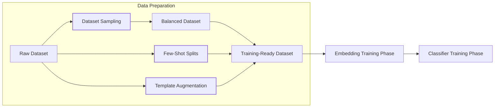
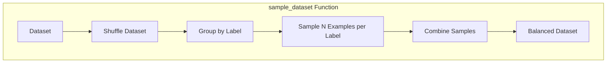
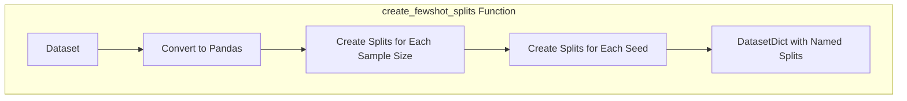
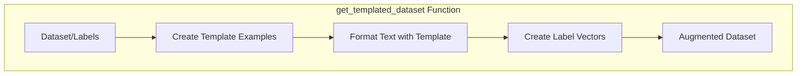
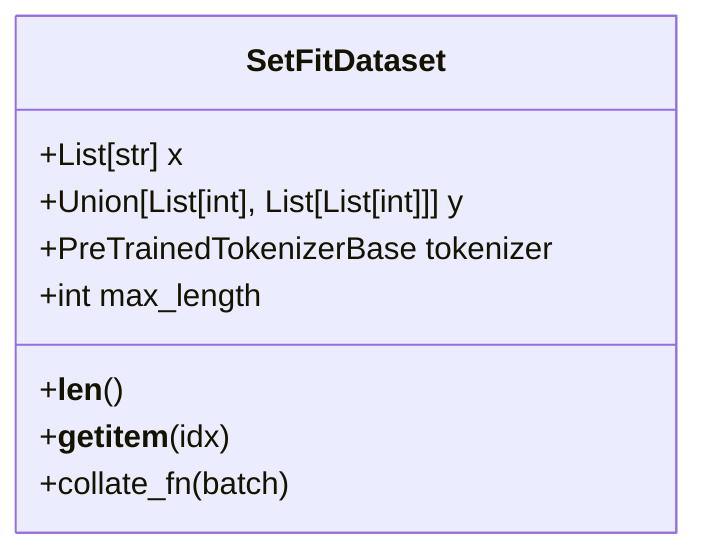
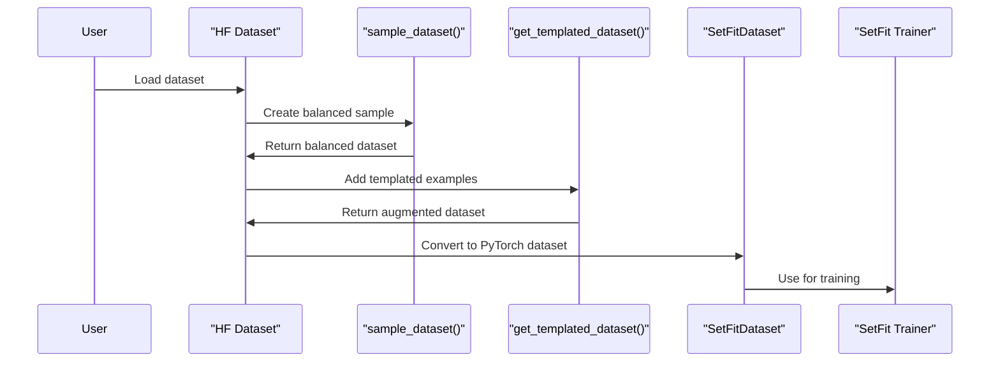

<!-- source: DeepWiki mcp.deepwiki.com · repo huggingface/setfit · page 3.1 Data Preparation · fetched 2026-10-26 -->

# Data Preparation

<details>
<summary>Relevant source files</summary>

The following files were used as context for generating this wiki page:

- [src/setfit/data.py](src/setfit/data.py)
- [tests/test_data.py](tests/test_data.py)

</details>


This document explains how to prepare datasets for SetFit, a framework for few-shot text classification. Proper data preparation is crucial for effective few-shot learning as it directly impacts model performance. For information about the actual training process, see [Training Pipeline](#3) and [Few-Shot Learning](#3.2).

## Overview of Data Preparation in SetFit

SetFit provides several utilities for preparing data, including:
- Dataset sampling for balanced class representation
- Creating few-shot splits for experimentation
- Data augmentation through templating
- Support for both single-label and multi-label classification

The diagram below illustrates where data preparation fits in the SetFit workflow:



Sources: [src/setfit/data.py:1-274]()

## Dataset Sampling

### Basic Sampling

To create a balanced dataset where each class has equal representation (when possible), use the `sample_dataset` function:



Sources: [src/setfit/data.py:146-156]()

The `sample_dataset` function takes a dataset and returns a new dataset with a balanced number of samples per class:

```python
sample_dataset(dataset, label_column="label", num_samples=8, seed=42)
```

Key parameters:
- `dataset`: The input dataset
- `label_column`: The name of the column containing labels
- `num_samples`: Maximum number of samples to include per class
- `seed`: Random seed for reproducibility

Sources: [src/setfit/data.py:146-156]()

### Creating Few-Shot Splits

For few-shot learning experiments, SetFit provides utilities to create multiple dataset splits with different numbers of examples per class:



Sources: [src/setfit/data.py:159-182]()

The `create_fewshot_splits` function creates multiple training splits:

```python
create_fewshot_splits(dataset, sample_sizes, add_data_augmentation=False, dataset_name=None)
```

Key parameters:
- `dataset`: The input dataset
- `sample_sizes`: List of sample sizes to create (e.g., `[2, 4, 8, 16]`)
- `add_data_augmentation`: Whether to add templated examples
- `dataset_name`: Required if `add_data_augmentation=True`

The function returns a `DatasetDict` with keys in the format `train-{sample_size}-{seed}`.

Sources: [src/setfit/data.py:159-182](), [tests/test_data.py:106-135]()

### Multi-label Classification Support

For multi-label classification, SetFit provides a specialized function:

```python
create_fewshot_splits_multilabel(dataset, sample_sizes)
```

This function works similarly to `create_fewshot_splits` but is designed for datasets where examples can have multiple labels.

Sources: [src/setfit/data.py:185-207](), [tests/test_data.py:137-150]()

## Data Augmentation through Templates

SetFit supports data augmentation through templating, which creates additional training examples based on class labels:



Sources: [src/setfit/data.py:23-105]()

The `get_templated_dataset` function creates templated examples:

```python
get_templated_dataset(
    dataset=None,
    candidate_labels=None,
    reference_dataset=None,
    template="This sentence is {}",
    sample_size=2,
    text_column="text",
    label_column="label",
    multi_label=False
)
```

Key parameters:
- `dataset`: Optional dataset to add examples to
- `candidate_labels`: List of labels to use in templates
- `reference_dataset`: Alternative to `candidate_labels`, extracts labels from this dataset
- `template`: Template string with `{}` placeholder for label
- `sample_size`: Number of examples to create per label
- `multi_label`: Whether to use multi-hot encoding for labels

Example template transformation:
- Label: "positive"
- Template: "This sentence is {}"
- Result: "This sentence is positive"

Sources: [src/setfit/data.py:23-105](), [tests/test_data.py:192-201]()

## The SetFitDataset Class

For training the differentiable head, SetFit provides a PyTorch dataset implementation:



Sources: [src/setfit/data.py:210-273]()

The `SetFitDataset` class converts text and labels into tokenized features:

```python
SetFitDataset(x, y, tokenizer, max_length=32)
```

Key features:
- `x`: List of input texts
- `y`: List of labels (integers for single-label, lists for multi-label)
- `tokenizer`: The tokenizer from the SetFitModel's body
- `max_length`: Maximum token length

The class also provides a `collate_fn` method for use with PyTorch's DataLoader.

Sources: [src/setfit/data.py:210-273](), [tests/test_data.py:204-227]()

## Constants and Default Values

SetFit provides some predefined constants for common use cases:

| Constant | Value | Purpose |
|----------|-------|---------|
| `SEEDS` | `[0, 1, 2, 3, 4, 5, 6, 7, 8, 9]` | Random seeds for reproducible sampling |
| `SAMPLE_SIZES` | `[2, 4, 8, 16, 32, 64]` | Common few-shot sample sizes |

Sources: [src/setfit/data.py:19-20]()

## Best Practices for Data Preparation

1. **Balance your dataset**: Use `sample_dataset` to ensure each class has equal representation.

2. **Use multiple seeds**: When evaluating few-shot performance, create splits with different seeds using `create_fewshot_splits`.

3. **Leverage data augmentation**: For very small datasets, augment with templates using `get_templated_dataset`.

4. **Preserve dataset features**: The sampling functions maintain the original dataset's features, including ClassLabel features.

5. **Batch processing**: When using `SetFitDataset`, leverage the provided `collate_fn` for proper batching with DataLoader.

Sources: [src/setfit/data.py:1-274](), [tests/test_data.py:1-236]()

## End-to-End Data Preparation Example

The workflow below demonstrates a typical SetFit data preparation pipeline:



Sources: [src/setfit/data.py:1-274]()

By properly preparing your data using these utilities, you can maximize the effectiveness of few-shot learning with SetFit, even with very limited labeled examples.

---

