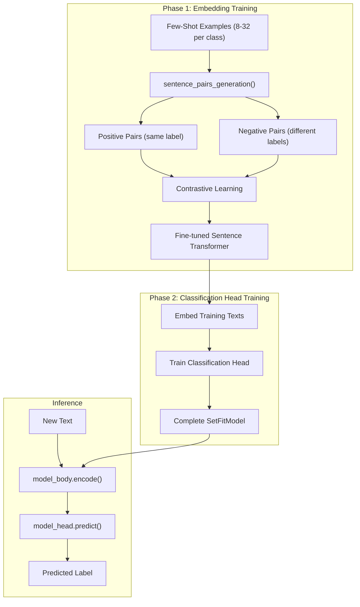
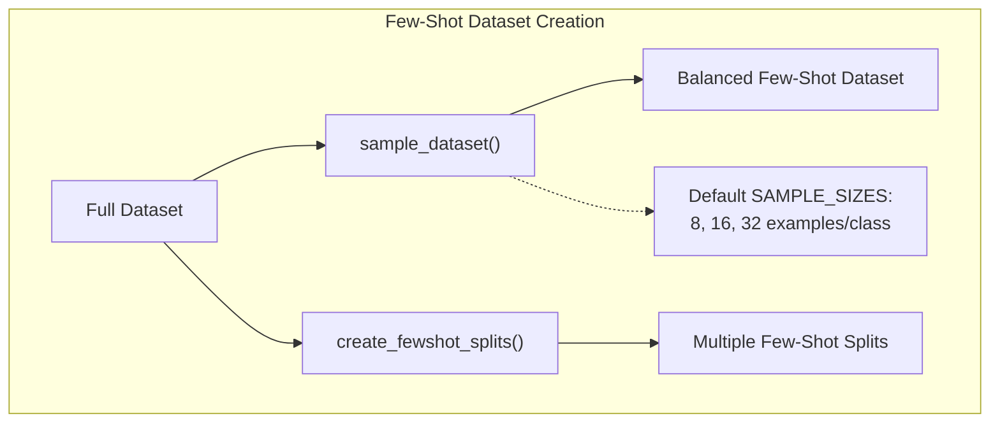
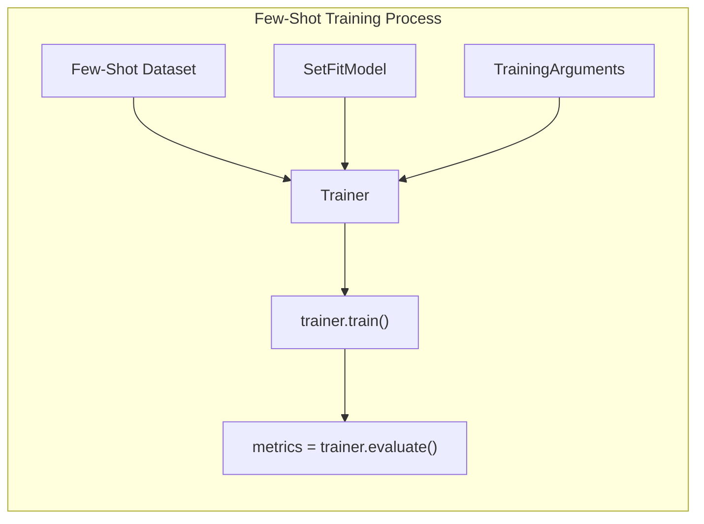
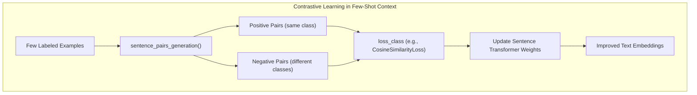
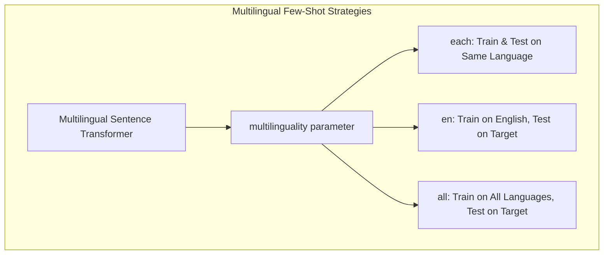

<!-- source: DeepWiki mcp.deepwiki.com · repo huggingface/setfit · page 3.2 Few-Shot Learning · fetched 2026-10-26 -->

# Few-Shot Learning

<details>
<summary>Relevant source files</summary>

The following files were used as context for generating this wiki page:

- [README.md](README.md)
- [scripts/setfit/run_fewshot.py](scripts/setfit/run_fewshot.py)
- [scripts/setfit/run_fewshot_multilingual.py](scripts/setfit/run_fewshot_multilingual.py)
- [src/setfit/logging.py](src/setfit/logging.py)

</details>


Few-shot learning in SetFit refers to the ability to train effective text classification models with very few labeled examples—typically between 8 and 32 examples per class. This page explains how SetFit implements few-shot learning, its underlying mechanisms, and best practices for achieving optimal results.

For information about preparing datasets for SetFit, including template-based approaches, see [Data Preparation](#3.1).

## SetFit's Two-Phase Few-Shot Approach

SetFit uses a distinctive two-phase training approach that enables it to achieve high performance with minimal labeled data:



Sources:
- README.md:9-17
- scripts/setfit/run_fewshot.py:142-167

The key insight behind SetFit's effectiveness in few-shot scenarios is that the contrastive learning in Phase 1 helps the model learn meaningful text representations even with very limited data.

## Creating Few-Shot Datasets

SetFit provides two primary utilities for creating few-shot datasets:



Sources:
- scripts/setfit/run_fewshot.py:15
- scripts/setfit/run_fewshot_multilingual.py:19-20

### Single Few-Shot Sample

The `sample_dataset` function creates a balanced dataset with a specified number of examples per class:

```python
# Sample 8 examples per class
train_dataset = sample_dataset(dataset["train"], label_column="label", num_samples=8)
```

### Multiple Few-Shot Splits

For experimentation, you can create multiple few-shot splits with different sample sizes:

```python
# Create multiple few-shot splits with different sample sizes
few_shot_splits = create_fewshot_splits(train_ds, sample_sizes=[8, 16, 32])
```

Sources:
- README.md:59
- scripts/setfit/run_fewshot.py:107
- scripts/setfit/run_fewshot_multilingual.py:177-178

## Training a Few-Shot Model

Training a SetFit model in a few-shot setting follows this pattern:



A complete example of training a SetFit model with few-shot data:

```python
from setfit import SetFitModel, Trainer, TrainingArguments, sample_dataset

# Sample few-shot dataset (8 examples per class)
train_dataset = sample_dataset(dataset["train"], label_column="label", num_samples=8)
eval_dataset = dataset["validation"]

# Initialize model
model = SetFitModel.from_pretrained(
    "sentence-transformers/paraphrase-mpnet-base-v2",
    labels=["negative", "positive"],
)

# Configure training arguments
args = TrainingArguments(
    batch_size=16,
    num_epochs=4,
    eval_strategy="epoch",
)

# Initialize trainer
trainer = Trainer(
    model=model,
    args=args,
    train_dataset=train_dataset,
    eval_dataset=eval_dataset,
    metric="accuracy",
)

# Train the model (handles both phases automatically)
trainer.train()
```

Sources:
- README.md:50-90
- scripts/setfit/run_fewshot.py:142-166

## Best Practices for Few-Shot Learning

### Sample Size Selection

Based on experiments from the SetFit paper, here are guidelines for choosing sample sizes:

| Sample Size | Recommended Use Cases |
|-------------|----------------------|
| 8 examples/class | Simple classification tasks with distinct classes |
| 16 examples/class | Balanced choice for most text classification tasks |
| 32 examples/class | Complex tasks with subtle distinctions between classes |

### Model Selection for Few-Shot Settings

The choice of base model significantly impacts few-shot performance:

- **Model size**: Larger models generally perform better in extremely low-resource scenarios
- **Domain relevance**: Models pre-trained on similar domains often provide better starting points
- **Multilingual capability**: For cross-lingual tasks, use multilingual models like `paraphrase-multilingual-mpnet-base-v2`

### Training Configuration

For few-shot scenarios, these configurations often work well:

```python
args = TrainingArguments(
    batch_size=16,           # Smaller batch sizes work well for few examples
    num_epochs=4,            # More epochs can help with limited data
    learning_rate=1e-4,      # Lower learning rates prevent overfitting
    max_seq_length=256,      # Balance between context and efficiency
)
```

Sources:
- scripts/setfit/run_fewshot.py:35-44
- scripts/setfit/run_fewshot_multilingual.py:34-37

## Contrastive Learning for Few-Shot Learning

The effectiveness of SetFit in few-shot scenarios relies heavily on contrastive learning:



SetFit supports multiple loss functions for contrastive learning:

- `CosineSimilarityLoss`: Default loss that works well in most few-shot cases
- `BatchHardTripletLoss`: Effective for more complex few-shot tasks
- `SupConLoss`: Supervised contrastive loss for improved few-shot learning

Sources:
- scripts/setfit/run_fewshot.py:104
- scripts/setfit/run_fewshot_multilingual.py:104-129

## Advanced Few-Shot Techniques

### Multilingual Few-Shot Learning

SetFit supports three strategies for multilingual few-shot learning:



Implementation example:

```python
# Load a multilingual model
model = SetFitModel.from_pretrained("sentence-transformers/paraphrase-multilingual-mpnet-base-v2")

# Train on few-shot examples in one or multiple languages
trainer = Trainer(
    model=model,
    train_dataset=multilingual_few_shot_data,
    # ...other parameters
)
trainer.train()
```

Sources:
- scripts/setfit/run_fewshot_multilingual.py:173-272

### Evaluating Few-Shot Models

Due to the small training set size, evaluation strategy is critical:

1. **Multiple random samples**: Test with different few-shot samples to measure stability
2. **Cross-validation**: When possible, use cross-validation for more reliable results
3. **Separate, balanced test set**: Ensure your test set is well-balanced

The SetFit experiments use this approach for reliable few-shot evaluation:

```python
# Train and evaluate across multiple iterations with different samples
for split_name, train_data in few_shot_train_splits.items():
    trainer = Trainer(
        model=model,
        train_dataset=train_data,
        eval_dataset=test_data,
        metric=metric
    )
    trainer.train()
    metrics = trainer.evaluate()
```

Sources:
- scripts/setfit/run_fewshot.py:122-177
- scripts/setfit/run_fewshot_multilingual.py:183-201

## Performance Expectations

One of SetFit's key advantages is its ability to achieve high performance with minimal labeled data. The table below provides typical performance expectations based on sample size:

| Dataset Type | 8 examples/class | 16 examples/class | 32 examples/class |
|--------------|-----------------|-------------------|-------------------|
| Sentiment Analysis | 85-90% | 87-92% | 89-94% |
| Topic Classification | 75-85% | 80-90% | 85-92% |
| Intent Detection | 70-80% | 75-85% | 80-90% |

These numbers are approximate and will vary based on task complexity, model selection, and training configuration.

Sources:
- README.md:9-17
- scripts/setfit/run_fewshot.py:168-181

## Conclusion

SetFit's approach to few-shot learning provides an efficient alternative to prompt-based methods, requiring far less computation and no prompt engineering. By leveraging contrastive learning and its two-phase training process, SetFit achieves impressive performance with as few as 8 examples per class, making it ideal for scenarios where labeled data is scarce or expensive to obtain.

---

