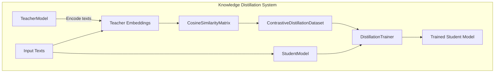
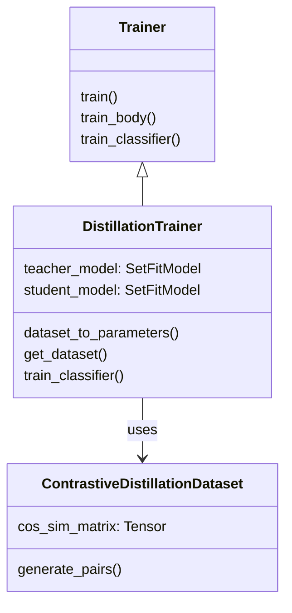
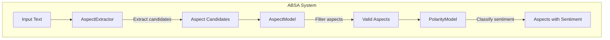
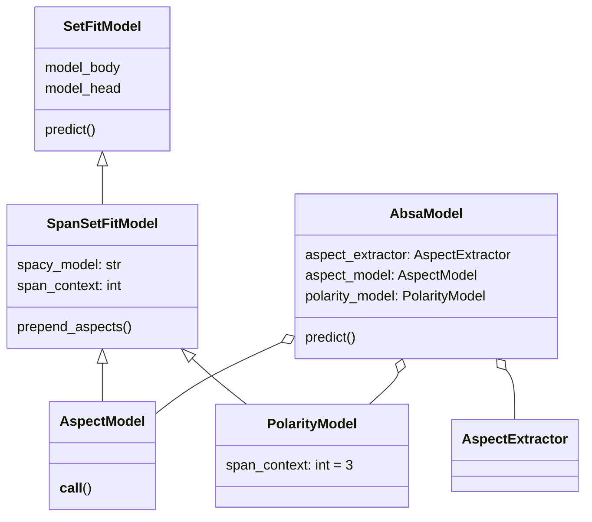
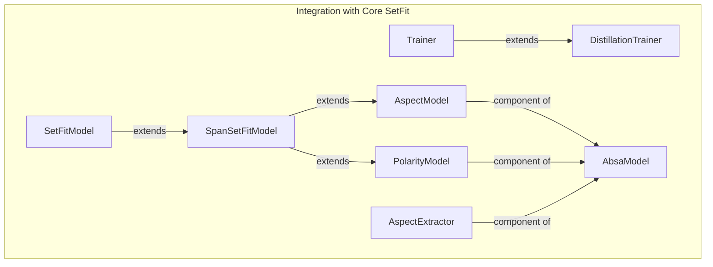

<!-- source: DeepWiki mcp.deepwiki.com · repo huggingface/setfit · page 4 Extension Systems · fetched 2026-10-26 -->

# Extension Systems

<details>
<summary>Relevant source files</summary>

The following files were used as context for generating this wiki page:

- [src/setfit/sampler.py](src/setfit/sampler.py)
- [src/setfit/span/modeling.py](src/setfit/span/modeling.py)
- [src/setfit/trainer_distillation.py](src/setfit/trainer_distillation.py)
- [tests/conftest.py](tests/conftest.py)
- [tests/span/test_modeling.py](tests/span/test_modeling.py)
- [tests/test_sampler.py](tests/test_sampler.py)

</details>


Extension Systems in SetFit provide specialized capabilities beyond core classification functionality. This page outlines the two primary extensions available in SetFit: Knowledge Distillation and Aspect-Based Sentiment Analysis (ABSA). For information about the core components of SetFit, see [Core Components](#2).

## Knowledge Distillation

Knowledge distillation enables compressing larger models (teachers) into smaller, more efficient models (students) while maintaining performance. This is particularly useful for deployment in resource-constrained environments.

### Architecture



The `DistillationTrainer` class inherits from the core `Trainer` class and orchestrates the distillation process:

1. The teacher model generates embeddings for input texts
2. A cosine similarity matrix is computed between these embeddings
3. `ContrastiveDistillationDataset` creates training pairs with similarity scores
4. The student model is trained to produce embeddings similar to the teacher

Sources: [src/setfit/trainer_distillation.py:23-109](), [src/setfit/sampler.py:150-184]()

### Implementation Details

The `DistillationTrainer` class requires:
- A teacher model (fully trained `SetFitModel`)
- A student model (typically smaller `SetFitModel`)
- Training arguments and dataset

The workflow specifically leverages the `ContrastiveDistillationDataset` class, which differs from the standard `ContrastiveDataset` in that it uses the similarity matrix from the teacher model to create learning targets.



Key methods:
- `get_dataset()`: Creates a distillation dataset using cosine similarity scores from the teacher
- `train_classifier()`: Uses teacher model predictions as training targets for the student's classifier head

Sources: [src/setfit/trainer_distillation.py:77-109](), [src/setfit/sampler.py:150-184]()

### Usage Example

```python
from setfit import SetFitModel, DistillationTrainer, TrainingArguments

# Load teacher and student models
teacher_model = SetFitModel.from_pretrained("large-model-path")
student_model = SetFitModel.from_pretrained("smaller-model-path")

# Initialize trainer
trainer = DistillationTrainer(
    teacher_model=teacher_model,
    student_model=student_model,
    train_dataset=train_dataset,
    args=TrainingArguments(
        num_iterations=20,
        batch_size=16
    )
)

# Train the student model
trainer.train()

# Fine-tune the classifier head
trainer.train_classifier(train_dataset["text"])
```

Sources: [src/setfit/trainer_distillation.py:23-75]()

## Aspect-Based Sentiment Analysis (ABSA)

ABSA provides fine-grained sentiment analysis by identifying specific aspects within text and determining the sentiment associated with each. For example, in a restaurant review, ABSA can separately identify sentiments about food quality, service, and ambiance.

### Architecture



The ABSA system consists of three main components:

1. **AspectExtractor**: Uses spaCy to identify potential aspect candidates from text
2. **AspectModel**: Filters candidates to determine valid aspects (extends `SpanSetFitModel`)
3. **PolarityModel**: Classifies the sentiment polarity for each valid aspect (extends `SpanSetFitModel`)

All three components are combined in the `AbsaModel` class, which provides a unified interface.

Sources: [src/setfit/span/modeling.py:151-367]()

### Implementation Details



- `SpanSetFitModel`: Extends `SetFitModel` with span processing capabilities
- `AspectModel`: Identifies aspects in text (typically classifies as "aspect" or "no aspect")
- `PolarityModel`: Classifies sentiment (typically "positive", "negative", or "neutral")
- `AbsaModel`: Orchestrates the ABSA pipeline and provides user-facing methods

Key features:
- Context window: `span_context` parameter controls how many words before/after the aspect are included
- Default span context is 0 for `AspectModel` and 3 for `PolarityModel`
- Input formats for both single texts and datasets with gold aspects

Sources: [src/setfit/span/modeling.py:28-147](), [src/setfit/span/modeling.py:151-367]()

### Usage Example

```python
from setfit import AbsaModel

# Load a pre-trained ABSA model
model = AbsaModel.from_pretrained(
    "tomaarsen/setfit-absa-bge-small-en-v1.5-restaurants-aspect",
    "tomaarsen/setfit-absa-bge-small-en-v1.5-restaurants-polarity"
)

# Analyze a single text
results = model.predict("The food was excellent but the service was slow.")
# Results: [{"span": "food", "polarity": "positive"}, 
#           {"span": "service", "polarity": "negative"}]

# Use with a dataset containing gold aspects
from datasets import Dataset
dataset = Dataset.from_dict({
    "text": ["The food was excellent."],
    "span": ["food"]
})
# Adds "pred_polarity" column
results = model.predict(dataset)
```

Sources: [src/setfit/span/modeling.py:211-245](), [tests/span/test_modeling.py:151-184]()

## Integration with Core SetFit

Both extension systems build upon and integrate seamlessly with the core SetFit components:



Key integration points:
- `DistillationTrainer` inherits from the core `Trainer` class
- `SpanSetFitModel` inherits from the core `SetFitModel` class
- `AspectModel` and `PolarityModel` inherit from `SpanSetFitModel`
- `AbsaModel` composes multiple components into a unified system

This hierarchical design allows the extensions to leverage core functionality while adding specialized capabilities for specific use cases.

Sources: [src/setfit/trainer_distillation.py:23-29](), [src/setfit/span/modeling.py:28-147]()

## Current Limitations and Future Directions

**Knowledge Distillation:**
- Currently focuses on embedding distillation rather than logit distillation
- Only supports distillation for classification tasks

**ABSA:**
- Requires a spaCy model for aspect candidate extraction
- Two-stage approach may introduce error propagation (aspect extraction errors affect polarity classification)
- Only officially supports English language (via spaCy models)

Future improvements may include multilingual ABSA support, end-to-end ABSA models, and more distillation techniques.

---

