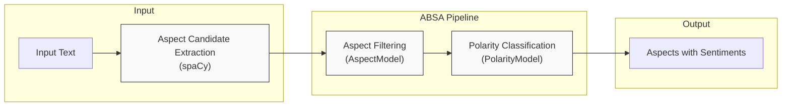
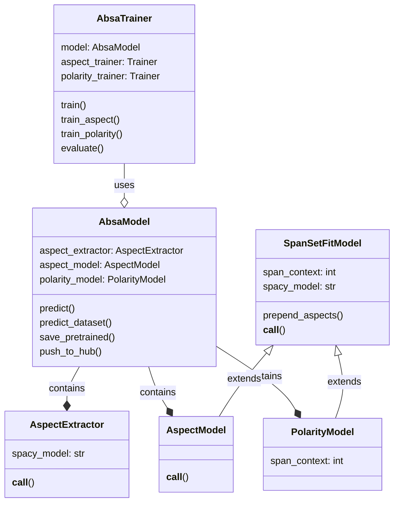
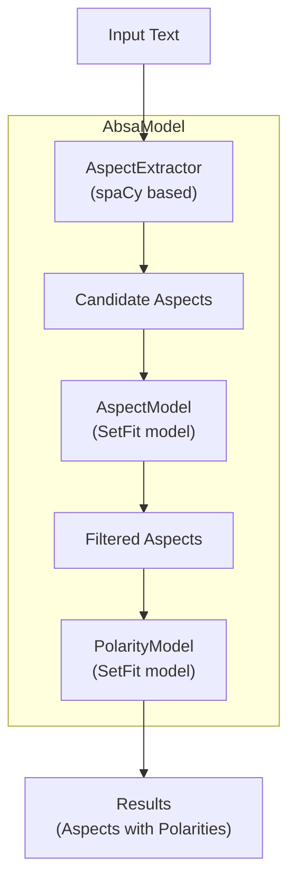
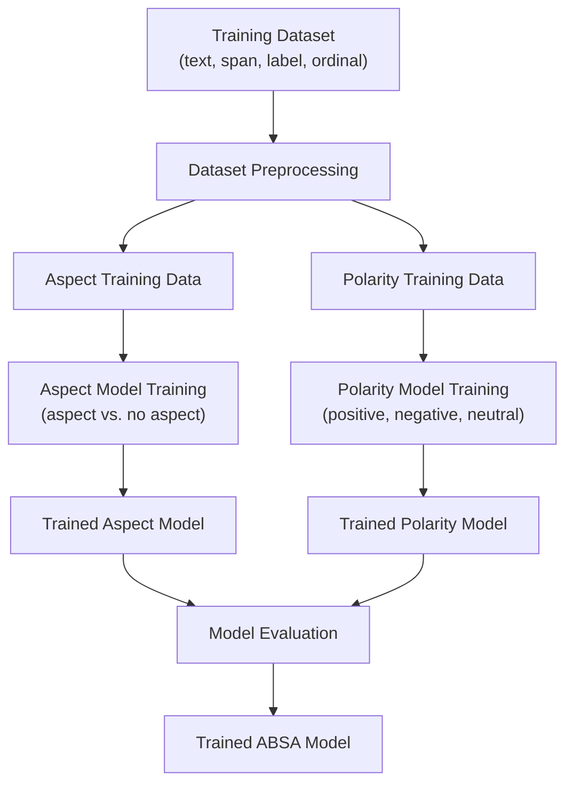

<!-- source: DeepWiki mcp.deepwiki.com · repo huggingface/setfit · page 4.1 Aspect-Based Sentiment Analysis · fetched 2026-10-26 -->

# Aspect-Based Sentiment Analysis

<details>
<summary>Relevant source files</summary>

The following files were used as context for generating this wiki page:

- [docs/source/en/how_to/absa.mdx](docs/source/en/how_to/absa.mdx)
- [docs/source/en/how_to/callbacks.mdx](docs/source/en/how_to/callbacks.mdx)
- [docs/source/en/how_to/v1.0.0_migration_guide.mdx](docs/source/en/how_to/v1.0.0_migration_guide.mdx)
- [docs/source/en/installation.mdx](docs/source/en/installation.mdx)
- [docs/source/en/reference/trainer.mdx](docs/source/en/reference/trainer.mdx)
- [src/setfit/span/modeling.py](src/setfit/span/modeling.py)
- [src/setfit/span/trainer.py](src/setfit/span/trainer.py)
- [tests/conftest.py](tests/conftest.py)
- [tests/span/test_modeling.py](tests/span/test_modeling.py)
- [tests/span/test_trainer.py](tests/span/test_trainer.py)

</details>


## Purpose and Scope

This page documents SetFit's Aspect-Based Sentiment Analysis (ABSA) implementation. ABSA is an extension to the core SetFit framework that enables fine-grained sentiment analysis by identifying specific aspects in text and determining the sentiment associated with each aspect. For information about SetFit's core components and training pipeline, see [Core Components](#2) and [Training Pipeline](#3).

## Overview

Aspect-Based Sentiment Analysis is a more granular form of sentiment analysis that identifies:
1. Specific aspects or features mentioned in text (e.g., "pizza," "service," "price")
2. The sentiment polarity associated with each aspect (positive, negative, or neutral)

For example, in the sentence "The food is delicious but the service is slow," a traditional sentiment classifier might classify the overall sentiment as mixed or neutral. In contrast, ABSA would identify that "food" has a positive sentiment while "service" has a negative sentiment.



Sources: [src/setfit/span/modeling.py:151-155](), [docs/source/en/how_to/absa.mdx:4-9]()

## Architecture

The ABSA system in SetFit consists of three main components working together:



Sources: [src/setfit/span/modeling.py:127-147](), [src/setfit/span/modeling.py:151-166](), [src/setfit/span/trainer.py:20-54]()

### Components in Detail

1. **AspectExtractor**: Uses spaCy to identify potential aspect candidates from text.
   
2. **AspectModel**: A specialized SetFit model that filters the candidate aspects to determine which are actual aspects. It inherits from `SpanSetFitModel` and is trained to classify spans as "aspect" or "no aspect".

3. **PolarityModel**: Another specialized SetFit model that determines the sentiment (positive, negative, neutral) for each identified aspect. It also inherits from `SpanSetFitModel` but is configured with a different `span_context` value by default.

4. **AbsaModel**: The main model that combines the above components into a unified pipeline, providing methods for prediction and model management.

5. **AbsaTrainer**: Specialized trainer for ABSA models that handles the training of both the aspect and polarity models.

The architecture uses a two-stage approach where potential aspects are first identified and filtered, then their sentiment is determined.

Sources: [src/setfit/span/modeling.py:28-147](), [src/setfit/span/modeling.py:151-367](), [src/setfit/span/trainer.py:20-336]()

## Data Flow

The following diagram shows the data flow through the ABSA system:



Sources: [src/setfit/span/modeling.py:210-267]()

## Data Format

ABSA models in SetFit expect datasets with a specific format for training:

| Column | Description | Example |
|--------|-------------|---------|
| `text` | The full text or sentence | "The pizza was delicious but the service was slow." |
| `span` | The aspect term | "pizza" |
| `label` | The sentiment label for the aspect | "positive" |
| `ordinal` | If the aspect appears multiple times, the index of occurrence (usually 0) | 0 |

Sources: [src/setfit/span/trainer.py:53](), [docs/source/en/how_to/absa.mdx:57-62]()

## Usage Examples

### Creating and Training an ABSA Model

```python
from setfit import AbsaModel, AbsaTrainer, TrainingArguments
from datasets import load_dataset

# Initialize a new ABSA model
model = AbsaModel.from_pretrained(
    "sentence-transformers/all-MiniLM-L6-v2",  # Aspect model base
    "sentence-transformers/all-mpnet-base-v2", # Polarity model base (optional)
    spacy_model="en_core_web_sm"               # spaCy model for aspect extraction
)

# Load dataset
dataset = load_dataset("tomaarsen/setfit-absa-semeval-restaurants", split="train")
train_dataset = dataset.select(range(128))
eval_dataset = dataset.select(range(128, 256))

# Configure training arguments
args = TrainingArguments(
    output_dir="models",
    num_epochs=5,
    batch_size=128,
    eval_strategy="steps",
    eval_steps=50
)

# Create trainer and train the model
trainer = AbsaTrainer(
    model,
    args=args,
    train_dataset=train_dataset,
    eval_dataset=eval_dataset
)
trainer.train()
```

Sources: [docs/source/en/how_to/absa.mdx:39-108]()

### Making Predictions

```python
# Make predictions on new texts
predictions = model.predict([
    "Best pizza outside of Italy and really tasty.",
    "The food variations are great and the prices are absolutely fair."
])

# Output format: list of dicts with 'span' and 'polarity' keys
# [
#     [{'span': 'pizza', 'polarity': 'positive'}],
#     [{'span': 'food variations', 'polarity': 'positive'}, {'span': 'prices', 'polarity': 'positive'}]
# ]
```

Sources: [docs/source/en/how_to/absa.mdx:219-230]()

### Working with Datasets Containing Gold Aspects

If you have a dataset with pre-identified aspects and want to predict polarities:

```python
from datasets import Dataset

# Dataset with gold aspects
gold_aspects = Dataset.from_dict({
    "text": [
        "But the staff was so horrible to us.",
        "The food is uniformly exceptional."
    ],
    "span": ["staff", "food"],
})

# Predict polarities for the gold aspects
results = model.predict(gold_aspects)
# Dataset with additional 'pred_polarity' column
```

Sources: [src/setfit/span/modeling.py:190-208](), [tests/span/test_modeling.py:151-184]()

## Training Process

The training process for ABSA involves training two separate models:

1. **Aspect Model Training**: Trains the model to identify which candidate spans are actual aspects.
2. **Polarity Model Training**: Trains the model to classify the sentiment of identified aspects.

The `AbsaTrainer` handles this two-phase training process:



Sources: [src/setfit/span/trainer.py:183-236](), [docs/source/en/how_to/absa.mdx:77-108]()

### Dataset Preprocessing

The trainer preprocesses the dataset to create:

1. **Aspect Training Data**: Pairs of sentences and spans with binary labels (aspect/no aspect)
2. **Polarity Training Data**: Pairs of sentences and filtered aspects with sentiment labels

Sources: [src/setfit/span/trainer.py:111-181]()

## Saving and Loading Models

ABSA models consist of two separate models (aspect and polarity) that need to be saved and loaded together:

### Saving a Model

```python
# Option 1: Specify both directories/repos
model.save_pretrained(
    "models/setfit-absa-model-aspect",
    "models/setfit-absa-model-polarity"
)

# Option 2: Automatic suffix addition
model.save_pretrained("models/setfit-absa-model")  # Creates -aspect and -polarity suffixes
```

Sources: [src/setfit/span/modeling.py:281-293](), [docs/source/en/how_to/absa.mdx:172-189]()

### Loading a Model

```python
from setfit import AbsaModel

# Load from local paths or Hub model IDs
model = AbsaModel.from_pretrained(
    "tomaarsen/setfit-absa-bge-small-en-v1.5-restaurants-aspect",
    "tomaarsen/setfit-absa-bge-small-en-v1.5-restaurants-polarity",
    spacy_model="en_core_web_lg"
)
```

Sources: [src/setfit/span/modeling.py:295-366](), [docs/source/en/how_to/absa.mdx:201-208]()

## Advanced Configuration

### Span Context

Both the `AspectModel` and `PolarityModel` have a `span_context` parameter that controls how many tokens before and after the span should be included when making predictions:

```python
# Configure span context for aspect and polarity models
model = AbsaModel.from_pretrained(
    "sentence-transformers/paraphrase-albert-small-v2",
    spacy_model="en_core_web_sm",
    span_contexts=(0, 3)  # 0 for AspectModel, 3 for PolarityModel
)
```

By default, `AspectModel` uses 0 context tokens while `PolarityModel` uses 3, which is typically more effective for sentiment classification.

Sources: [src/setfit/span/modeling.py:28-38](), [src/setfit/span/modeling.py:141-144](), [tests/span/test_modeling.py:50-59]()

### Custom Training Arguments

You can provide separate training arguments for the aspect and polarity models:

```python
aspect_args = TrainingArguments(num_epochs=3, batch_size=64)
polarity_args = TrainingArguments(num_epochs=5, batch_size=32)

trainer = AbsaTrainer(
    model,
    args=aspect_args,
    polarity_args=polarity_args,
    train_dataset=train_dataset,
    eval_dataset=eval_dataset
)
```

Sources: [src/setfit/span/trainer.py:56-66](), [src/setfit/span/trainer.py:82-87]()

## Model Evaluation

The `AbsaTrainer.evaluate()` method evaluates both aspect and polarity models and returns a dictionary with metrics for each:

```python
metrics = trainer.evaluate()
# {
#     'aspect': {'accuracy': 0.713},
#     'polarity': {'accuracy': 0.710}
# }
```

The aspect accuracy measures the model's ability to correctly identify aspect spans, while the polarity accuracy measures the model's ability to assign the correct sentiment to identified aspects.

Sources: [src/setfit/span/trainer.py:316-336](), [tests/span/test_trainer.py:16-24]()

## Integration with Hugging Face Hub

ABSA models can be pushed directly to the Hugging Face Hub:

```python
# Push both models to separate repositories
model.push_to_hub(
    "username/setfit-absa-model-aspect",
    "username/setfit-absa-model-polarity"
)

# Or use automatic suffix addition
model.push_to_hub("username/setfit-absa-model")
```

Sources: [src/setfit/span/modeling.py:368-389](), [docs/source/en/how_to/absa.mdx:172-189]()

## Installation

To use the ABSA functionality, you need to install SetFit with the ABSA dependencies:

```bash
pip install "setfit[absa]"
```

You also need to download a spaCy model:

```bash
python -m spacy download en_core_web_lg
```

Sources: [docs/source/en/how_to/absa.mdx:14-27](), [docs/source/en/installation.mdx:1-42]()

## Common Use Cases

ABSA is particularly useful for:

1. **Product reviews analysis**: Identifying specific aspects of products that customers liked or disliked
2. **Customer feedback processing**: Understanding which specific features receive positive or negative sentiment
3. **Competitive analysis**: Comparing sentiment across specific aspects of competing products or services
4. **Feature prioritization**: Identifying which aspects of a product or service receive the most negative sentiment and might need improvement

## Summary

SetFit's ABSA implementation provides a powerful framework for fine-grained sentiment analysis by combining spaCy for aspect extraction with specialized SetFit models for aspect filtering and polarity classification. The modular design allows for separate training and optimization of each component, and the integration with the Hugging Face ecosystem makes it easy to save, share, and use pretrained ABSA models.

---

