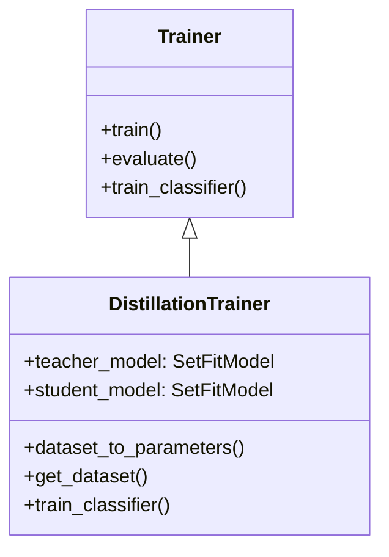
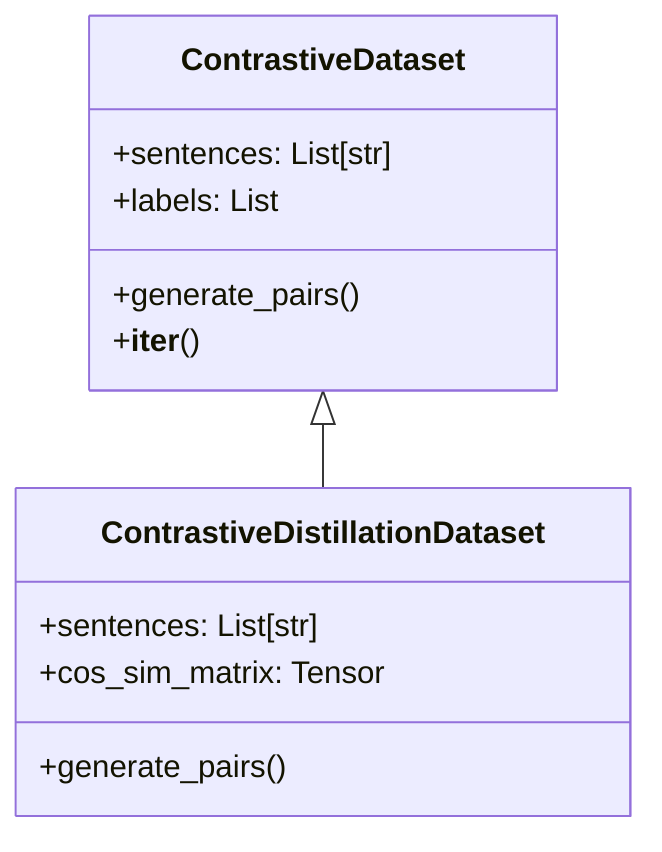
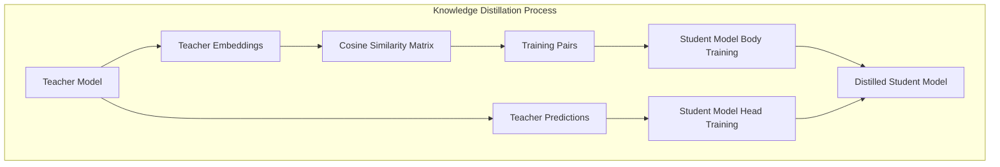
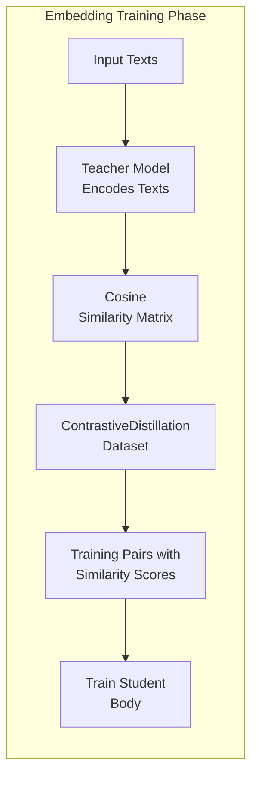
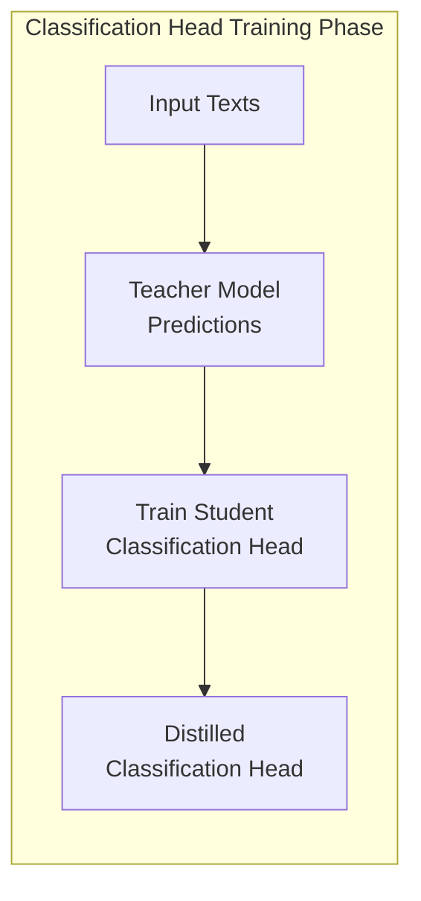
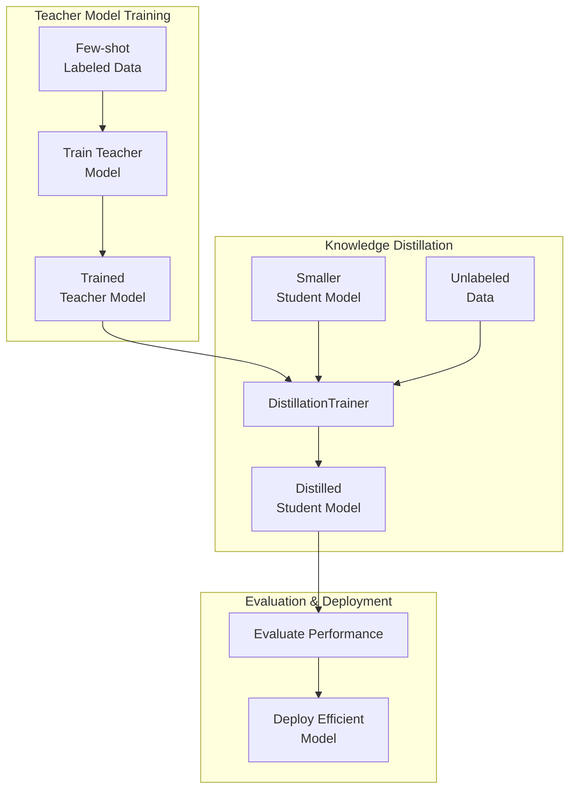

<!-- source: DeepWiki mcp.deepwiki.com · repo huggingface/setfit · page 4.2 Knowledge Distillation · fetched 2026-10-26 -->

# Knowledge Distillation

<details>
<summary>Relevant source files</summary>

The following files were used as context for generating this wiki page:

- [scripts/setfit/distillation_baseline.py](scripts/setfit/distillation_baseline.py)
- [scripts/setfit/run_fewshot_distillation.py](scripts/setfit/run_fewshot_distillation.py)
- [src/setfit/sampler.py](src/setfit/sampler.py)
- [src/setfit/trainer_distillation.py](src/setfit/trainer_distillation.py)
- [tests/test_sampler.py](tests/test_sampler.py)

</details>


## Purpose and Overview

Knowledge distillation in SetFit is a technique for creating smaller, more efficient models by transferring knowledge from a larger, more powerful model (the teacher) to a smaller model (the student). This approach enables the deployment of lightweight models that retain much of the performance of larger models while requiring fewer computational resources.

Knowledge distillation is particularly useful in few-shot learning scenarios where training data is limited, as it allows smaller models to benefit from the representations learned by larger models without requiring extensive labeled data.

## Core Components

The knowledge distillation system in SetFit consists of two primary components:

### DistillationTrainer

The `DistillationTrainer` class extends the base `Trainer` class and manages the knowledge transfer process from teacher to student models.



Sources: [src/setfit/trainer_distillation.py:23-109]()

The `DistillationTrainer` requires:
- A trained teacher model
- A student model (typically with a smaller architecture)
- Training data (which can include unlabeled data)

### ContrastiveDistillationDataset

The `ContrastiveDistillationDataset` class extends the `ContrastiveDataset` class and is responsible for creating training pairs based on embedding similarities from the teacher model:



Sources: [src/setfit/sampler.py:150-184]()

This dataset creates pairs where the label is the cosine similarity score between two texts as calculated from the teacher model's embeddings, rather than using class labels as in the standard contrastive training.

## Distillation Process

The knowledge distillation process in SetFit consists of two main phases:



Sources: [src/setfit/trainer_distillation.py:77-109]()

### Phase 1: Embedding Training

During the first phase, the student model's body (sentence transformer) is trained to mimic the embedding space of the teacher model:

1. The teacher model encodes the training texts to produce embeddings
2. A cosine similarity matrix is calculated between all text embeddings
3. The `ContrastiveDistillationDataset` creates training pairs with similarity scores as labels
4. The student model's body is trained to reproduce these similarity relationships

This approach transfers the teacher's semantic understanding to the student model without requiring labeled data.



Sources: [src/setfit/trainer_distillation.py:80-97](), [src/setfit/sampler.py:150-184]()

### Phase 2: Classification Head Training

In the second phase, the student model's classification head is trained using the teacher's predictions:

1. The teacher model generates predictions for the training texts
2. These predictions are used as targets for training the student's classification head
3. The student learns to replicate the teacher's decision boundaries

This approach transfers the classification capabilities from the teacher to the student.



Sources: [src/setfit/trainer_distillation.py:99-109]()

## Implementation Details

### Teacher-Student Embeddings Comparison

The core of the distillation process is comparing the embedding spaces between the teacher and student models. This is implemented in the `get_dataset` method of the `DistillationTrainer`:

```python
def get_dataset(self, x: List[str], y: Optional[Union[List[int], List[List[int]]]], args: TrainingArguments, max_pairs: int = -1):
    # Encode texts with teacher model
    x_embd_student = self.teacher_model.model_body.encode(
        x, convert_to_tensor=self.teacher_model.has_differentiable_head
    )
    # Calculate cosine similarity matrix
    cos_sim_matrix = util.cos_sim(x_embd_student, x_embd_student)
    
    # Create distillation dataset
    data_sampler = ContrastiveDistillationDataset(
        x, cos_sim_matrix, args.num_iterations, args.sampling_strategy, max_pairs=max_pairs
    )
    dataset = Dataset.from_list(list(data_sampler))
    loss = args.loss(self.model.model_body)
    return dataset, loss
```

Sources: [src/setfit/trainer_distillation.py:80-97]()

### Training the Student Classifier

The `train_classifier` method trains the student's classification head using the teacher's predictions:

```python
def train_classifier(self, x_train: List[str], args: Optional[TrainingArguments] = None) -> None:
    # Get teacher predictions
    y_train = self.teacher_model.predict(x_train, as_numpy=not self.student_model.has_differentiable_head)
    # Train student classifier with teacher predictions
    return super().train_classifier(x_train, y_train, args)
```

Sources: [src/setfit/trainer_distillation.py:99-109]()

## Usage Example

Here's a basic example of how to use the `DistillationTrainer` for knowledge distillation:

```python
from setfit import DistillationTrainer, SetFitModel, TrainingArguments
from datasets import Dataset

# Load models
teacher_model = SetFitModel.from_pretrained("large-setfit-model")
student_model = SetFitModel.from_pretrained("small-setfit-model")

# Prepare data
train_dataset = Dataset.from_dict({"text": ["example text 1", "example text 2", ...]})

# Configure training arguments
args = TrainingArguments(
    num_iterations=20,
    batch_size=16,
    body_learning_rate=2e-5,
    loss=losses.CosineSimilarityLoss
)

# Create the distillation trainer
trainer = DistillationTrainer(
    teacher_model=teacher_model,
    student_model=student_model,
    args=args,
    train_dataset=train_dataset
)

# Train the student model
trainer.train()

# Train the classifier head
trainer.train_classifier(train_texts)
```

Sources: [scripts/setfit/run_fewshot_distillation.py:242-259]()

## End-to-End Distillation Flow

The following diagram shows the complete flow of knowledge distillation in SetFit, from training the teacher model to evaluating the distilled student model:



Sources: [scripts/setfit/run_fewshot_distillation.py:292-325]()

## Benefits and Considerations

### Benefits
- **Reduced Model Size**: Distilled models require less memory and are more suitable for deployment on constrained devices.
- **Faster Inference**: Smaller models execute faster, improving response times in production.
- **Knowledge Transfer**: The student model benefits from the teacher's learned representations without needing the same amount of computational resources.
- **Unlabeled Data Utilization**: Distillation can leverage unlabeled data for training, making it particularly useful in few-shot scenarios.

### Considerations
- The quality of the distilled student model depends on the performance of the teacher model.
- There is typically a trade-off between model size and performance—smaller models may not achieve exactly the same performance as larger models.
- The distillation process requires additional computational resources during training but results in more efficient inference.

## Legacy API

Note that SetFit previously provided a `DistillationSetFitTrainer` class which has been deprecated in favor of the current `DistillationTrainer`. The legacy class will be removed in v2.0.0 of SetFit.

Sources: [src/setfit/trainer_distillation.py:112-162]()

---

