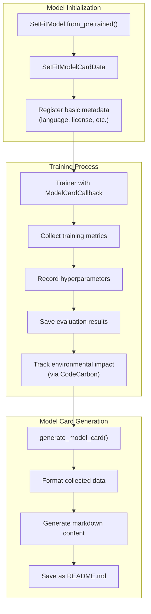
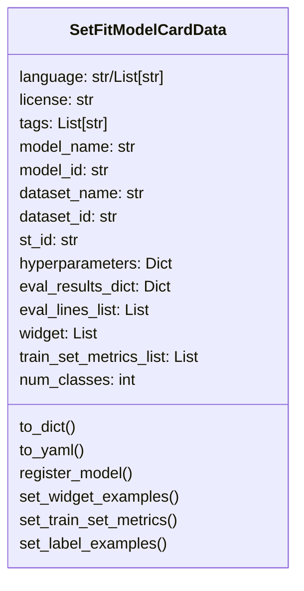
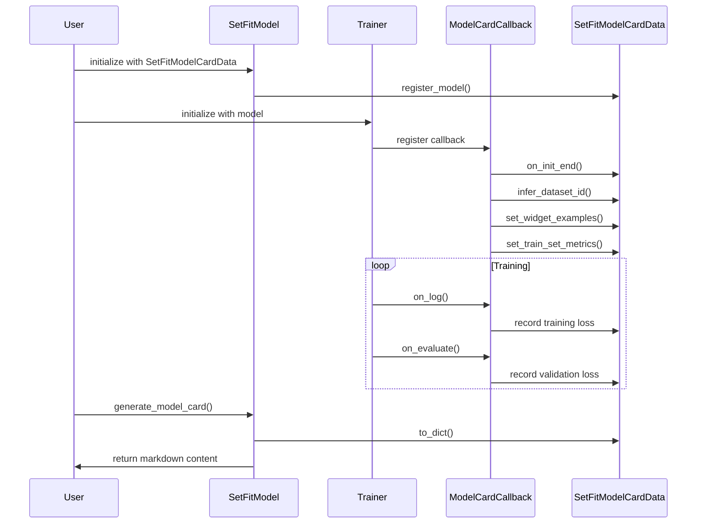
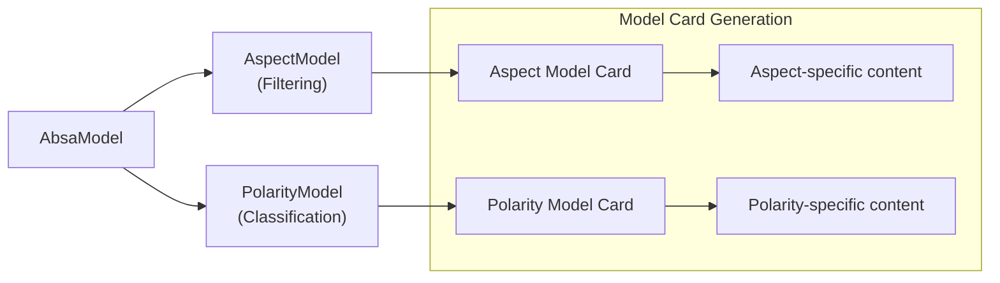
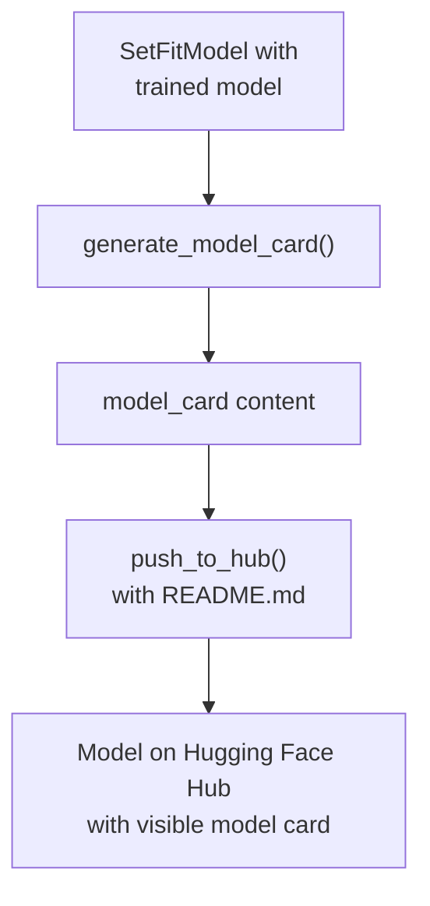

<!-- source: DeepWiki mcp.deepwiki.com · repo huggingface/setfit · page 5 Model Cards and Documentation · fetched 2026-10-26 -->

# Model Cards and Documentation

<details>
<summary>Relevant source files</summary>

The following files were used as context for generating this wiki page:

- [docs/source/en/_toctree.yml](docs/source/en/_toctree.yml)
- [docs/source/en/how_to/batch_sizes.mdx](docs/source/en/how_to/batch_sizes.mdx)
- [docs/source/en/how_to/model_cards.mdx](docs/source/en/how_to/model_cards.mdx)
- [docs/source/en/tutorials/onnx.mdx](docs/source/en/tutorials/onnx.mdx)
- [src/setfit/model_card.py](src/setfit/model_card.py)
- [tests/model_card_pattern.py](tests/model_card_pattern.py)
- [tests/span/aspect_model_card_pattern.py](tests/span/aspect_model_card_pattern.py)
- [tests/span/polarity_model_card_pattern.py](tests/span/polarity_model_card_pattern.py)
- [tests/span/test_model_card.py](tests/span/test_model_card.py)
- [tests/test_model_card.py](tests/test_model_card.py)

</details>


## Introduction

This page explains how SetFit automatically generates comprehensive model cards and documentation for trained models. Model cards provide essential information about a model's capabilities, training data, performance metrics, and usage instructions, making models more transparent and easier to use.

SetFit's model card generation is designed to capture relevant information throughout the training process and combine it with user-provided metadata to create detailed documentation that can be included when pushing models to the Hugging Face Hub.

Sources: [src/setfit/model_card.py:167-172]()

## Model Card Structure

SetFit model cards follow a standardized format that includes:

1. **Metadata** - Basic information about the model (language, license, etc.)
2. **Model Details** - Technical specifications of the model
3. **Evaluation Results** - Performance metrics on test datasets
4. **Training Information** - Details about the training process and hyperparameters
5. **Usage Guidelines** - Instructions for using the model
6. **Environmental Impact** - Information about computational resources used during training

The model cards are generated based on the data collected during model initialization and training, as well as user-provided metadata.

Sources: [src/setfit/model_card.py:572-575](), [tests/model_card_pattern.py:6-184]()

### Model Card Generation Flow



Sources: [src/setfit/model_card.py:36-148](), [src/setfit/model_card.py:572-575]()

## Setting Up Model Card Data

### The SetFitModelCardData Class

The `SetFitModelCardData` class is the core component for storing and organizing information used in model cards. It contains fields for various types of metadata, metrics, and examples.



Sources: [src/setfit/model_card.py:167-207](), [src/setfit/model_card.py:208-266]()

### Providing Model Card Data

To include metadata in your model card, provide a `SetFitModelCardData` instance when initializing your model:

```python
from setfit import SetFitModel, SetFitModelCardData

model = SetFitModel.from_pretrained(
    "sentence-transformers/paraphrase-mpnet-base-v2",
    labels=["negative", "positive"],
    model_card_data=SetFitModelCardData(
        model_id="username/setfit-mpnet-base-v2-sst2",
        dataset_name="SST2",
        dataset_id="sst2",
        language="en",
        license="apache-2.0",
    ),
)
```

Sources: [docs/source/en/how_to/model_cards.mdx:17-31]()

### Important Metadata Fields

| Field | Description | Example |
|-------|-------------|---------|
| `language` | The model language(s) | `"en"` or `["en", "de"]` |
| `license` | The model license | `"apache-2.0"` or `"mit"` |
| `model_name` | A descriptive name for the model | `"SetFit with mBERT-base on SST2"` |
| `model_id` | The model ID for the Hub | `"username/setfit-mpnet-base-v2-sst2"` |
| `dataset_name` | The dataset's display name | `"SST2"` |
| `dataset_id` | The dataset ID on the Hub | `"sst2"` |

Sources: [src/setfit/model_card.py:172-185]()

## Model Card Generation Process

### Automatic Data Collection

The `ModelCardCallback` class is registered with the SetFit Trainer and automatically collects information during training, including:

1. **Dataset Information** - Infers the dataset ID if not provided
2. **Widget Examples** - Creates example inputs for the model card interface
3. **Training Metrics** - Records loss values and evaluation metrics
4. **Hyperparameters** - Captures training configuration
5. **Label Examples** - Samples text examples for each label

Sources: [src/setfit/model_card.py:36-148](), [tests/test_model_card.py:15-51]()



Sources: [src/setfit/model_card.py:36-148](), [src/setfit/model_card.py:572-575]()

### Inferring Information

SetFit attempts to automatically infer certain information:

1. **Dataset ID** - If the dataset comes from the Hugging Face Hub
2. **Sentence Transformer ID** - From the model's configuration
3. **Number of Classes** - From the training dataset or model labels

Sources: [src/setfit/model_card.py:374-385](), [src/setfit/model_card.py:432-451]()

## Model Card Content

### Metadata Section

The metadata section is stored in YAML format at the top of the model card and includes fields like:

```yaml
---
language: en
license: apache-2.0
library_name: setfit
tags:
  - setfit
  - sentence-transformers
  - text-classification
datasets:
  - sst2
metrics:
  - accuracy
pipeline_tag: text-classification
base_model: sentence-transformers/paraphrase-mpnet-base-v2
---
```

Sources: [src/setfit/model_card.py:150-163](), [src/setfit/model_card.py:548-553]()

### Model Details

The model details section includes information about:

- Model type (SetFit)
- Sentence Transformer body
- Classification head type
- Maximum sequence length
- Number of classes
- Training dataset
- Language
- License

Sources: [tests/model_card_pattern.py:23-31]()

### Training Information

The training section includes:

- Training set metrics (word count statistics)
- Sample count per label
- Training hyperparameters
- Training loss and validation loss over epochs

```
| Training set | Min | Median | Max |
|:-------------|:----|:-------|:----|
| Word count   | 3   | 7.875  | 18  |

| Label    | Training Sample Count |
|:---------|:----------------------|
| negative | 8                     |
| positive | 8                     |
```

Sources: [tests/model_card_pattern.py:99-130](), [src/setfit/model_card.py:317-318](), [src/setfit/model_card.py:329-351]()

### Environmental Impact

If the [CodeCarbon](https://github.com/mlco2/codecarbon) package is installed, the model card includes information about:

- Carbon emissions
- Training duration
- Hardware details

```
Carbon emissions were measured using [CodeCarbon](https://github.com/mlco2/codecarbon).
- **Carbon Emitted**: 0.003 kg of CO2
- **Hours Used**: 0.072 hours
```

Sources: [docs/source/en/how_to/model_cards.mdx:93-101](), [src/setfit/model_card.py:519-532]()

### Usage Examples

The model card includes code examples for installing SetFit and using the model for inference:

```python
from setfit import SetFitModel

# Download from the Hugging Face Hub
model = SetFitModel.from_pretrained("username/setfit-model-name")
# Run inference
preds = model("This is a sample text")
```

Sources: [tests/model_card_pattern.py:64-71]()

## Label Support

Including proper labels in your model improves both the model card and the inference experience:

1. **String Labels in Prediction** - Returns human-readable labels instead of integers
2. **Better Model Card Tables** - Shows meaningful label names in tables
3. **Training Sample Counts** - Displays proper label names in training statistics

```python
model = SetFitModel.from_pretrained(
    "sentence-transformers/paraphrase-mpnet-base-v2",
    labels=["negative", "positive"]
)
```

Sources: [docs/source/en/how_to/model_cards.mdx:36-52](), [docs/source/en/how_to/model_cards.mdx:79-89]()

## Integration with Aspect-Based Sentiment Analysis

For ABSA models, SetFit generates specialized model cards that include:

1. **Role Description** - Whether the model filters aspect candidates or classifies polarities
2. **ABSA System Context** - Explanation of the model's role in the ABSA pipeline
3. **Related Model Links** - References to other components in the ABSA system



Sources: [tests/span/aspect_model_card_pattern.py:6-199](), [tests/span/polarity_model_card_pattern.py:6-199](), [tests/span/test_model_card.py:11-51]()

## Framework Integration

### Trainer Integration

The `ModelCardCallback` is automatically registered with the `Trainer` to collect information during training. This ensures that all relevant training metrics are captured without requiring additional user configuration.

Sources: [src/setfit/model_card.py:36-148]()

### Hugging Face Hub Integration

When pushing a model to the Hugging Face Hub, the model card is automatically included as a README.md file, making it immediately visible on the model's page.



Sources: [src/setfit/model_card.py:572-575]()

## Custom Metrics

If you use custom metrics in your training, they are automatically included in the model card's evaluation section:

```python
def compute_metrics(y_pred, y_test):
    accuracy = accuracy_score(y_test, y_pred)
    precision = precision_score(y_test, y_pred)
    recall = recall_score(y_test, y_pred)
    f1 = f1_score(y_test, y_pred)
    return {
        'accuracy': accuracy, 
        'precision': precision, 
        'recall': recall, 
        'f1': f1
    }

trainer = Trainer(
    model=model,
    args=args,
    train_dataset=train_dataset,
    eval_dataset=eval_dataset,
    metric=compute_metrics,
)
```

This will result in a metrics table with all custom metrics:

```
| Label   | Accuracy | Precision | Recall | F1     |
|:--------|:---------|:----------|:-------|:-------|
| **all** | 0.8062   | 0.7294    | 0.9725 | 0.8336 |
```

Sources: [docs/source/en/how_to/model_cards.mdx:102-157](), [src/setfit/model_card.py:467-471]()

## Conclusion

The SetFit model card generation system provides a comprehensive and automated way to document your trained models. By including accurate metadata, proper labels, and using features like CodeCarbon for emissions tracking, you can create informative and transparent model cards that make your models more accessible and easier to use.

---

