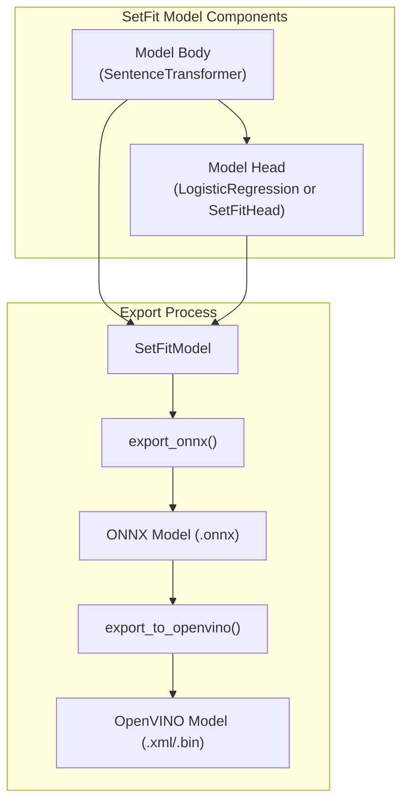
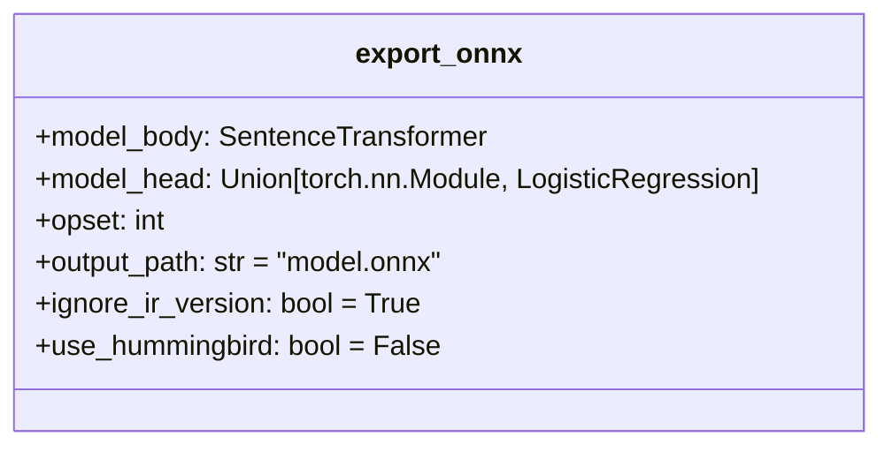
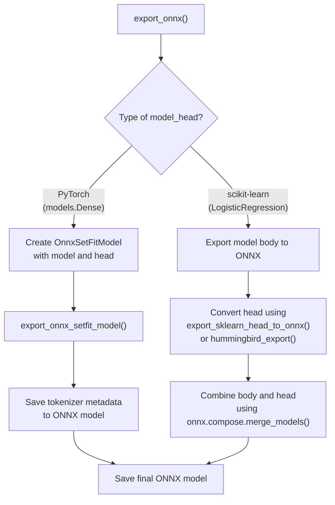
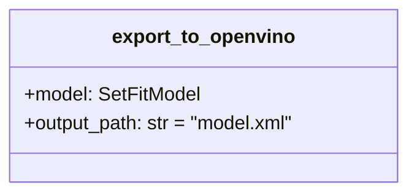
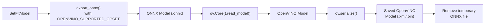

<!-- source: DeepWiki mcp.deepwiki.com · repo huggingface/setfit · page 6 Optimization and Export · fetched 2026-10-26 -->

# Optimization and Export

<details>
<summary>Relevant source files</summary>

The following files were used as context for generating this wiki page:

- [notebooks/openvino_inference.ipynb](notebooks/openvino_inference.ipynb)
- [src/setfit/exporters/onnx.py](src/setfit/exporters/onnx.py)
- [src/setfit/exporters/openvino.py](src/setfit/exporters/openvino.py)
- [tests/exporters/test_onnx.py](tests/exporters/test_onnx.py)

</details>


This page documents how to optimize SetFit models and export them to production-ready formats for faster inference. SetFit supports exporting models to ONNX format and further conversion to OpenVINO for deployment in various environments, including edge devices.

## Overview

Model optimization and export are key steps in the machine learning deployment workflow. After training a SetFit model, you can export it to standardized formats that allow for:

1. Faster inference
2. Deployment across different platforms 
3. Integration with hardware-specific optimizations
4. Reduced model size (in some cases)

SetFit currently supports two export formats:
- **ONNX** (Open Neural Network Exchange)
- **OpenVINO** (built on top of ONNX export)



Sources: [src/setfit/exporters/onnx.py:182-288](), [src/setfit/exporters/openvino.py:9-47]()

## ONNX Export

ONNX is an open format designed to represent machine learning models. It enables the interoperability between different frameworks and tools, allowing models to be trained in one framework and deployed in another.

### Export API

SetFit provides the `export_onnx()` function for exporting models to ONNX format:



Sources: [src/setfit/exporters/onnx.py:182-193]()

### Usage Example

```python
from setfit import SetFitModel
from setfit.exporters.onnx import export_onnx

# Load a pretrained SetFit model
model = SetFitModel.from_pretrained("lewtun/my-awesome-setfit-model")

# Export the model to ONNX format
export_onnx(
    model_body=model.model_body,
    model_head=model.model_head,
    opset=12,
    output_path="model.onnx"
)
```

Sources: [tests/exporters/test_onnx.py:25-35]()

### Export Process Architecture

The ONNX export process depends on the type of model head used in the SetFit model:



Sources: [src/setfit/exporters/onnx.py:182-288]()

### Internal Components

Internally, the export process uses several helper classes and functions:

1. **OnnxSetFitModel**: A PyTorch module wrapper that makes ONNX exporting easier by connecting the model body, pooler, and head
   
2. **export_onnx_setfit_model**: Function that exports an `OnnxSetFitModel` using `torch.onnx.export`

3. **export_sklearn_head_to_onnx**: Function that converts a scikit-learn head to ONNX format using `skl2onnx`

4. **hummingbird_export**: Alternative method to convert scikit-learn models to ONNX using the Hummingbird-ML library

Sources: [src/setfit/exporters/onnx.py:15-180]()

## OpenVINO Export

OpenVINO (Open Visual Inference and Neural network Optimization) is a toolkit that helps optimize neural network inference. It is especially useful for deployment on Intel hardware.

### Export API

SetFit provides the `export_to_openvino()` function for exporting models to OpenVINO format:



Sources: [src/setfit/exporters/openvino.py:9-26]()

### Usage Example

```python
from setfit import SetFitModel
from setfit.exporters.openvino import export_to_openvino

# Load a pretrained SetFit model
model = SetFitModel.from_pretrained("lewtun/my-awesome-setfit-model")

# Export the model to OpenVINO format
export_to_openvino(model, output_path="model.xml")
```

Sources: [notebooks/openvino_inference.ipynb:150-156]()

### Export Process Architecture

The OpenVINO export process builds on top of the ONNX export:



Sources: [src/setfit/exporters/openvino.py:9-47]()

## Inference with Exported Models

### Inference with ONNX

After exporting a model to ONNX format, you can use ONNX Runtime for inference:

```python
import onnxruntime
import numpy as np
from transformers import AutoTokenizer

# Load tokenizer
tokenizer = AutoTokenizer.from_pretrained("model_path")

# Prepare inputs
input_text = ["i loved the spiderman movie!", "pineapple on pizza is the worst 🤮"]
inputs = tokenizer(
    input_text,
    padding=True,
    truncation=True,
    return_attention_mask=True,
    return_token_type_ids=True,
    return_tensors="np",
)
# Map inputs to int64 from int32
inputs = {key: value.astype("int64") for key, value in inputs.items()}

# Run inference
session = onnxruntime.InferenceSession("model.onnx")
onnx_preds = session.run(None, dict(inputs))[0]
```

Sources: [tests/exporters/test_onnx.py:40-56]()

### Inference with OpenVINO

Similarly, after exporting to OpenVINO format, you can use OpenVINO Runtime:

```python
import openvino.runtime as ov
from transformers import AutoTokenizer

# Load tokenizer
tokenizer = AutoTokenizer.from_pretrained("model_path")

# Prepare inputs
input_text = ["i loved the spiderman movie!", "pineapple on pizza is the worst 🤮"]
inputs = tokenizer(
    input_text,
    padding=True,
    truncation=True,
    return_attention_mask=True,
    return_token_type_ids=True,
    return_tensors="np",
)

# Run inference
core = ov.Core()
ov_model = core.read_model("model.xml")
compiled_model = core.compile_model(ov_model, "CPU")
output = compiled_model.output(0)
ov_preds = compiled_model(dict(inputs))[output]
```

Sources: [notebooks/openvino_inference.ipynb:186-212]()

## Performance Comparison

Exporting models to specialized inference formats like ONNX and OpenVINO can significantly improve inference speed. Here's an example performance comparison from the OpenVINO notebook:

| Framework | Inference Time (100 iterations) |
|-----------|--------------------------------|
| PyTorch   | 1.74 seconds                   |
| OpenVINO  | 1.25 seconds                   |

This represents a performance improvement of approximately 28% when using OpenVINO compared to the original PyTorch model.

Sources: [notebooks/openvino_inference.ipynb:89-104](), [notebooks/openvino_inference.ipynb:186-212]()

## Supported Model Types

Currently, the export functionality has different levels of support depending on the model head type:

| Model Head Type | ONNX Export | OpenVINO Export |
|-----------------|-------------|-----------------|
| LogisticRegression (scikit-learn) | Fully supported | Fully supported |
| SetFitHead (PyTorch) | Partially supported | Partially supported |

The PyTorch head support is still under development, as indicated by the skipped test in `tests/exporters/test_onnx.py`.

Sources: [tests/exporters/test_onnx.py:65](), [src/setfit/exporters/onnx.py:228-264]()

## Known Limitations

1. **ONNX Opset Compatibility**: When exporting models with scikit-learn heads, there might be compatibility issues with ONNX opset versions. The export process will automatically use the highest opset version supported by both the sklearn head and the model body.

2. **IR Version Mismatches**: There might be IR version mismatches between the transformer and sklearn ONNX representations. The `ignore_ir_version` parameter allows coercing the versions to be the same, which works in practice but might cause errors in some cases.

3. **PyTorch Head Support**: Support for exporting models with PyTorch heads is still under development.

Sources: [src/setfit/exporters/onnx.py:255-277]()

## Installation Requirements

To use the export functionality, you might need to install additional dependencies:

- For ONNX export with scikit-learn heads: `skl2onnx`
- For alternative scikit-learn to ONNX conversion: `hummingbird-ml`
- For OpenVINO export: OpenVINO runtime (`openvino`)

You can install SetFit with OpenVINO support using:

```
pip install setfit[openvino]
```

Sources: [notebooks/openvino_inference.ipynb:44](), [src/setfit/exporters/onnx.py:124-136](), [src/setfit/exporters/onnx.py:173-178]()

---

