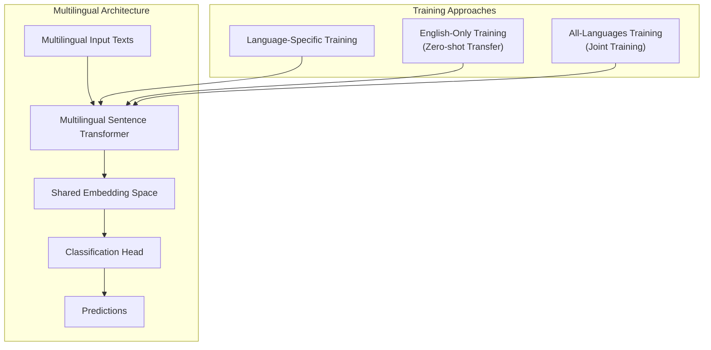
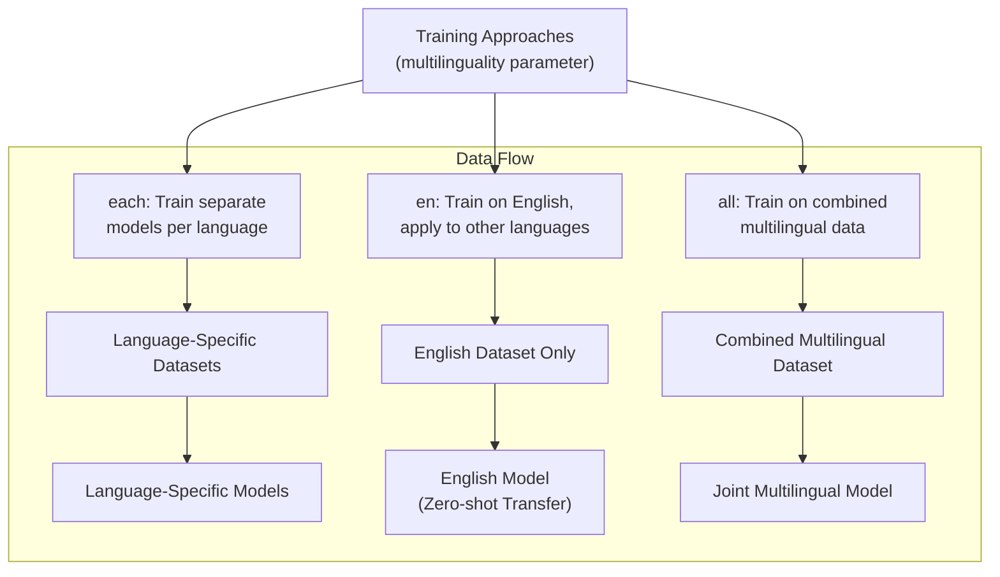
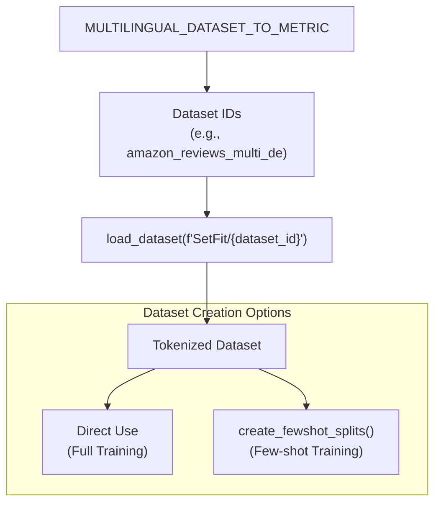

<!-- source: DeepWiki mcp.deepwiki.com · repo huggingface/setfit · page 7.1 Multilingual Support · fetched 2026-10-26 -->

# Multilingual Support

<details>
<summary>Relevant source files</summary>

The following files were used as context for generating this wiki page:

- [scripts/transformers/run_fewshot_multilingual.py](scripts/transformers/run_fewshot_multilingual.py)
- [scripts/transformers/run_full_multilingual.py](scripts/transformers/run_full_multilingual.py)
- [scripts/transformers/utils.py](scripts/transformers/utils.py)

</details>


This document provides a comprehensive guide on using SetFit for multilingual text classification. SetFit's multilingual capabilities allow you to train models that can classify text in multiple languages, either by using language-specific models or by leveraging cross-lingual transfer learning.

## Overview of Multilingual Support

SetFit supports multilingual text classification through:

1. Integration with multilingual foundation models
2. Flexible training approaches (language-specific, English-only, or all languages)
3. Language-specific dataset handling
4. Cross-lingual transfer learning



Sources: [scripts/transformers/run_full_multilingual.py:27-173](), [scripts/transformers/run_fewshot_multilingual.py:22-172]()

## Supported Multilingual Models

SetFit can use any multilingual sentence transformer as its base model. These models project text from multiple languages into a shared embedding space, allowing for cross-lingual transfer learning. Common multilingual models used with SetFit include:

| Model | Languages | Description |
|-------|-----------|-------------|
| xlm-roberta-base | 100+ | Multilingual RoBERTa model trained on data from 100+ languages |
| paraphrase-multilingual-MiniLM-L12-v2 | 50+ | Multilingual sentence transformer optimized for paraphrase detection |
| distiluse-base-multilingual-cased-v1 | 15 | Distilled multilingual Universal Sentence Encoder |

When initializing a SetFit model for multilingual use, you can specify any of these models:

```python
from setfit import SetFitModel

# Create a multilingual SetFit model
model = SetFitModel.from_pretrained("xlm-roberta-base")
```

Sources: [scripts/transformers/run_full_multilingual.py:29-39](), [scripts/transformers/run_fewshot_multilingual.py:24-38]()

## Multilingual Training Approaches

SetFit supports three approaches to multilingual training, controlled through the `multilinguality` parameter:



### Language-Specific Training (`multilinguality="each"`)

This approach trains separate models for each language, using only data from that specific language.

```python
# Train a German-specific SetFit model
trainer.train(dataset="amazon_reviews_multi_de", multilinguality="each")
```

### English-Only Training (`multilinguality="en"`)

This approach trains a model using only English data, then applies it to other languages, leveraging the cross-lingual transfer capabilities of the multilingual sentence transformer.

```python
# Train on English data only, for zero-shot transfer to other languages
trainer.train(dataset="amazon_reviews_multi_en", multilinguality="en")
```

### All-Languages Training (`multilinguality="all"`)

This approach trains a single model on data from all languages combined, allowing the model to learn from multiple languages simultaneously.

```python
# Train on data from all languages combined
trainer.train(dataset="amazon_reviews_multi", multilinguality="all")
```

Sources: [scripts/transformers/run_full_multilingual.py:44-61](), [scripts/transformers/run_fewshot_multilingual.py:44-65]()

## Multilingual Dataset Handling

SetFit uses language-specific datasets from the Hugging Face Hub. These datasets are organized under the "SetFit/" namespace and include multilingual versions of common text classification benchmarks.



The system automatically maps dataset IDs to appropriate evaluation metrics using the `MULTILINGUAL_DATASET_TO_METRIC` dictionary:

```python
# Example datasets and their metrics
MULTILINGUAL_DATASET_TO_METRIC = {
    "amazon_reviews_multi_de": "mae",  # German Amazon reviews
    "amazon_reviews_multi_en": "mae",  # English Amazon reviews
    # Other language-specific datasets...
}
```

Sources: [scripts/transformers/run_full_multilingual.py:16](), [scripts/transformers/run_fewshot_multilingual.py:12-13](), [scripts/transformers/run_fewshot_multilingual.py:44-65]()

## Training Multilingual Models

### Full Dataset Training

For training on complete datasets, SetFit provides a script that handles multilingual data:

```bash
python scripts/transformers/run_full_multilingual.py \
    --model_id "xlm-roberta-base" \
    --multilinguality "all" \
    --learning_rate 2e-5 \
    --batch_size 4
```

The script can train on a single dataset or all available multilingual datasets:

```python
# Train on all multilingual datasets
python scripts/transformers/run_full_multilingual.py train_all_datasets
```

Sources: [scripts/transformers/run_full_multilingual.py:27-173](), [scripts/transformers/run_full_multilingual.py:154-174]()

### Few-Shot Multilingual Training

For few-shot learning scenarios with multilingual data, SetFit provides a dedicated script:

```bash
python scripts/transformers/run_fewshot_multilingual.py \
    --model_id "xlm-roberta-base" \
    --multilinguality "each" \
    --sample_sizes [8, 16, 32, 64]
```

The few-shot script creates sample splits of different sizes to evaluate how well the model performs with limited data in various languages.

Sources: [scripts/transformers/run_fewshot_multilingual.py:22-172](), [scripts/transformers/run_fewshot_multilingual.py:173-199]()

## Evaluation of Multilingual Models

Multilingual models in SetFit are evaluated on language-specific test sets. The evaluation metrics are automatically selected based on the dataset:

```python
# Compute metrics on test set
metrics = trainer.evaluate(tokenized_test_dataset)
eval_metrics = {}
eval_metrics["score"] = metrics[f"eval_{metric}"] * 100.0
eval_metrics["measure"] = metric
```

The results are saved to JSON files for later analysis.

Sources: [scripts/transformers/run_full_multilingual.py:136-143](), [scripts/transformers/run_fewshot_multilingual.py:155-162](), [scripts/transformers/utils.py:17-19]()

## Best Practices for Multilingual Text Classification

### Model Selection

- For high-resource languages (German, French, Spanish, etc.), all three training approaches can work well
- For low-resource languages, the "all" approach often yields better results through joint learning
- When transfer performance is crucial, "en" approach provides zero-shot capabilities

### Data Preparation

When preparing multilingual datasets for SetFit:

1. Ensure consistent label mappings across languages
2. Balance the training data across languages when using the "all" approach
3. Consider using both in-language and translated examples for few-shot scenarios

### Hyperparameter Tuning

Multilingual models may require different hyperparameters than monolingual models:

- Often benefit from lower learning rates (e.g., 2e-5 instead of 5e-5)
- May require more training epochs to converge
- Few-shot scenarios particularly benefit from hyperparameter search

### Cross-Lingual Transfer Evaluation

To evaluate cross-lingual transfer capabilities:

1. Train on source language(s)
2. Evaluate on target language(s) without fine-tuning
3. Compare to language-specific models to measure transfer efficiency

Sources: [scripts/transformers/run_fewshot_multilingual.py:143-152]()

## Conclusion

SetFit's multilingual support enables effective text classification across languages by leveraging multilingual sentence transformers and flexible training approaches. By choosing the appropriate model, training strategy, and data preparation techniques, you can create efficient multilingual text classifiers with minimal labeled data.

For zero-shot classification capabilities in SetFit, see [Zero-Shot Classification](#7.2).

---

