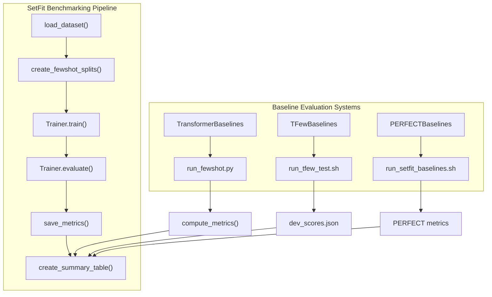
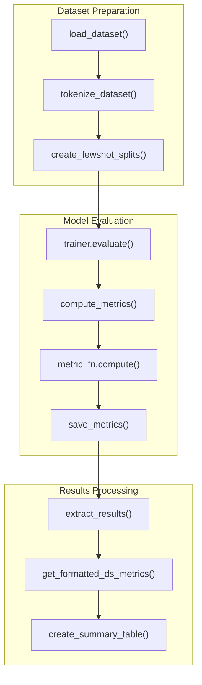
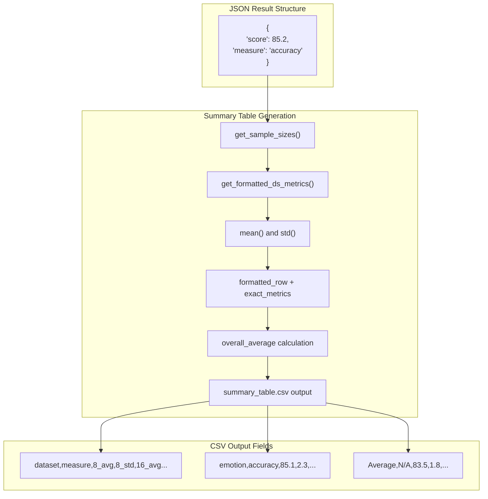

<!-- source: DeepWiki mcp.deepwiki.com · repo huggingface/setfit · page 8 Benchmarking and Evaluation · fetched 2026-10-26 -->

# Benchmarking and Evaluation

<details>
<summary>Relevant source files</summary>

The following files were used as context for generating this wiki page:

- [final_results/perfect.tar.gz](final_results/perfect.tar.gz)
- [final_results/tfew/t03b_pretrained-v2.tar.gz](final_results/tfew/t03b_pretrained-v2.tar.gz)
- [scripts/create_summary_table.py](scripts/create_summary_table.py)
- [scripts/perfect/README.md](scripts/perfect/README.md)
- [scripts/tfew/README.md](scripts/tfew/README.md)
- [scripts/tfew/run_tfew_11b.sh](scripts/tfew/run_tfew_11b.sh)
- [scripts/transformers/README.md](scripts/transformers/README.md)
- [scripts/transformers/run_fewshot.py](scripts/transformers/run_fewshot.py)
- [scripts/transformers/run_full.py](scripts/transformers/run_full.py)

</details>


## Introduction and Purpose

This document explains the benchmarking and evaluation framework in SetFit. It covers how to evaluate SetFit models, compare with baseline approaches (such as T-Few and PERFECT), and generate performance summaries. The framework ensures reproducible evaluations across different few-shot settings, enabling fair comparisons between SetFit and other methods.

For information about training SetFit models, see [Training Pipeline](#3).

Sources: [scripts/transformers/run_full.py](), [scripts/transformers/run_fewshot.py](), [scripts/create_summary_table.py]()

## Evaluation Datasets and Metrics

SetFit uses a standardized set of datasets for benchmarking and evaluation, defined in the `TEST_DATASET_TO_METRIC` dictionary.

### Test Datasets and Metrics

The following datasets are used in benchmark evaluations:

| Dataset | Metric | Task Type |
|---------|--------|-----------|
| emotion | accuracy | Emotion classification |
| SentEval-CR | accuracy | Customer review sentiment |
| sst5 | accuracy | Fine-grained sentiment (5 classes) |
| ag_news | accuracy | News categorization |
| enron_spam | accuracy | Spam detection |
| amazon_counterfactual_en | matthews_correlation | Counterfactual review detection |

These datasets are hosted on the Hugging Face Hub under the SetFit organization and can be loaded with `load_dataset(f"SetFit/{dataset_id}")`.

### Few-Shot Sample Sizes

The standard sample sizes used in SetFit benchmarks (examples per class):
- 8 examples
- 16 examples
- 32 examples
- 64 examples

These sample sizes are created using the `create_fewshot_splits` function:

```python
fewshot_dataset = create_fewshot_splits(tokenized_dataset["train"], sample_sizes)
```

Sources: [scripts/create_summary_table.py:21-28](), [scripts/transformers/run_fewshot.py:51-51]()

## Benchmark Architecture

The following diagram illustrates the SetFit benchmarking system architecture:



Sources: [scripts/transformers/run_fewshot.py:21-178](), [scripts/tfew/README.md:1-68](), [scripts/perfect/README.md:1-39]()

## Evaluating SetFit Models

### Basic Evaluation

To evaluate a SetFit model on a dataset:

```python
from setfit import SetFitModel, Trainer
from datasets import load_dataset

# Load model and dataset
model = SetFitModel.from_pretrained("setfit/model-name")
test_dataset = load_dataset("SetFit/dataset-name", split="test")

# Evaluate
trainer = Trainer(model=model)
metrics = trainer.evaluate(test_dataset)
print(f"Accuracy: {metrics['accuracy'] * 100:.2f}%")
```

### Detailed Evaluation Flow

The following diagram shows the detailed evaluation flow in SetFit:



Sources: [scripts/transformers/run_full.py:72-77](), [scripts/transformers/run_fewshot.py:60-66]()

## Baseline Methods

SetFit provides scripts for comparing with several baseline approaches:

### Transformer Baselines

To run transformer baselines in few-shot settings:

```bash
python scripts/transformers/run_fewshot.py train-all-datasets --model-id=distilbert-base-uncased
```

The `train_all_datasets` function iterates through each dataset in `TEST_DATASET_TO_METRIC` and:
1. Loads the dataset
2. Creates few-shot splits
3. Trains a model on each split
4. Evaluates on the test set
5. Saves metrics to JSON files

Sources: [scripts/transformers/README.md:1-97](), [scripts/transformers/run_fewshot.py:148-178]()

### T-Few Baselines

T-Few is a parameter-efficient fine-tuning method for few-shot learning. To run T-Few baselines:

```bash
cd scripts/tfew
./run_tfew_test.sh   # For 3B model
./run_tfew_11b.sh    # For 11B model
```

Key features of the T-Few benchmarks:
- Uses the same datasets and splits as SetFit
- Runs with multiple random seeds (5 seeds per configuration)
- Tests on sample sizes of 8 and 64 examples per class
- The median score is computed across all seeds

Sources: [scripts/tfew/README.md:1-68](), [scripts/tfew/run_tfew_11b.sh:1-25]()

### PERFECT Baselines

PERFECT (Prompt-free and Efficient Few-shot Learning with Language Models) is another baseline method. To run PERFECT:

```bash
cd scripts/perfect/perfect/fewshot
bash scripts/run_setfit_baselines.sh
```

Sources: [scripts/perfect/README.md:1-39]()

## Creating and Interpreting Summary Tables

SetFit provides a script to create summary tables from benchmark results:

```bash
python scripts/create_summary_table.py --path scripts/method_name/results/model_name
```

### Summary Table Format

The generated summary table has the following format:

| dataset | measure | 8_avg | 8_std | 16_avg | 16_std | 32_avg | 32_std | 64_avg | 64_std |
|---------|---------|-------|-------|--------|--------|--------|--------|--------|--------|
| emotion | accuracy | 85.1 | 2.3 | 88.4 | 1.2 | 90.2 | 0.8 | 92.1 | 0.5 |
| ... | ... | ... | ... | ... | ... | ... | ... | ... | ... |
| Average | N/A | 83.5 | 1.8 | 85.6 | 1.2 | 87.3 | 0.9 | 89.2 | 0.6 |

The table shows:
- Performance for each dataset (rows)
- Average score and standard deviation for each sample size (columns)
- Overall average across all datasets (bottom row)

Sources: [scripts/create_summary_table.py:80-100](), [scripts/create_summary_table.py:103-158]()

### Summary Table Generation Pipeline

This diagram shows how summary tables are generated:



Sources: [scripts/create_summary_table.py:95-158]()

## Best Practices for Fair Comparison

When benchmarking SetFit against other methods:

1. **Consistent Datasets**: Use the same datasets and splits for all methods
2. **Multiple Seeds**: Report average performance across multiple random seeds (typically 5-10)
3. **Same Metrics**: Use the same evaluation metrics for all methods (as defined in `TEST_DATASET_TO_METRIC`)
4. **Multiple Sample Sizes**: Report performance across different few-shot settings (8, 16, 32, 64 examples)
5. **Report Variability**: Include standard deviations to show robustness of methods

Example benchmark workflow:

```bash
# Run SetFit
python -m setfit.scripts.run_benchmarks --model-id=sentence-transformers/paraphrase-mpnet-base-v2

# Run transformer baseline
python scripts/transformers/run_fewshot.py train-all-datasets --model-id=distilbert-base-uncased

# Run T-Few baseline
cd scripts/tfew && ./run_tfew_test.sh

# Generate summary tables for each method
python scripts/create_summary_table.py --path results/setfit/
python scripts/create_summary_table.py --path results/transformers/
python scripts/create_summary_table.py --path scripts/tfew/results/
```

Sources: [scripts/transformers/run_fewshot.py:21-178](), [scripts/create_summary_table.py:103-158]()

---

