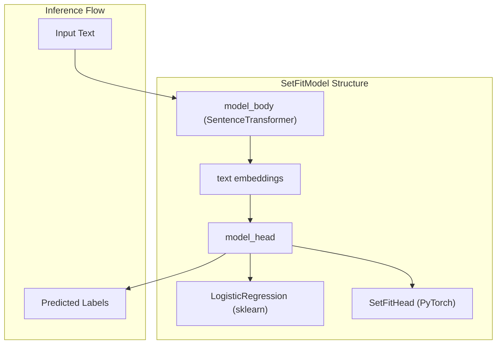
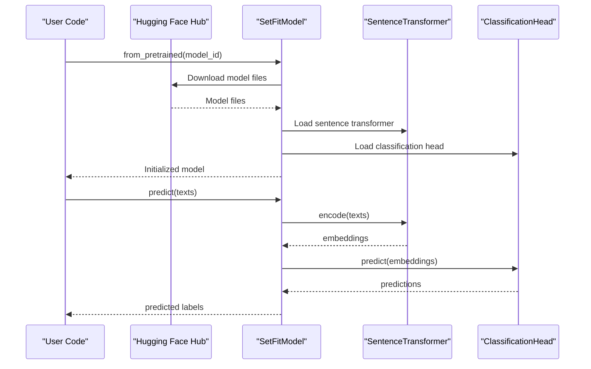

<!-- source: DeepWiki mcp.deepwiki.com · repo huggingface/setfit · page 9 Pretrained Models · fetched 2026-10-26 -->

# Pretrained Models

<details>
<summary>Relevant source files</summary>

The following files were used as context for generating this wiki page:

- [final_results/adapet/.gitkeep](final_results/adapet/.gitkeep)
- [final_results/setfit/all-roberta-large-v1.tar.gz](final_results/setfit/all-roberta-large-v1.tar.gz)
- [final_results/setfit/paraphrase-mpnet-base-v2-epochs_20-with-augmentation.tar.gz](final_results/setfit/paraphrase-mpnet-base-v2-epochs_20-with-augmentation.tar.gz)
- [final_results/setfit/paraphrase-mpnet-base-v2-epochs_20.tar.gz](final_results/setfit/paraphrase-mpnet-base-v2-epochs_20.tar.gz)
- [final_results/setfit/paraphrase-mpnet-base-v2-epochs_5.tar.gz](final_results/setfit/paraphrase-mpnet-base-v2-epochs_5.tar.gz)
- [final_results/transformers/distilbert-base-uncased.tar.gz](final_results/transformers/distilbert-base-uncased.tar.gz)
- [final_results/transformers/roberta-large.tar.gz](final_results/transformers/roberta-large.tar.gz)
- [final_results/transformers/xlm-roberta-base.tar.gz](final_results/transformers/xlm-roberta-base.tar.gz)

</details>


This page provides an overview of the pretrained models available in the SetFit repository for few-shot text classification. These models are ready-to-use instances of `SetFitModel` that combine a fine-tuned Sentence Transformer with a trained classification head for immediate use or further fine-tuning.

For information about training your own SetFit models from scratch, see [Training Pipeline](#3).

## Model Architecture

SetFit pretrained models follow a two-component architecture as defined in the `SetFitModel` class:



The architecture consists of:
1. **model_body**: A `SentenceTransformer` instance for text embedding, fine-tuned via contrastive learning
2. **model_head**: A classification component that can be either:
   - `LogisticRegression` from scikit-learn (default)
   - `SetFitHead` for a differentiable PyTorch implementation

Sources: `final_results/setfit/paraphrase-mpnet-base-v2-epochs_20.tar.gz`, `final_results/setfit/all-roberta-large-v1.tar.gz`

## Available Pretrained Models

SetFit provides several pretrained models with different base architectures and training configurations:

| Model ID | Base Transformer | Training Configuration | Characteristics |
|----------|------------------|------------------------|-----------------|
| setfit/paraphrase-mpnet-base-v2-epochs_20 | paraphrase-mpnet-base-v2 | 20 epochs | Standard model, good general performance |
| setfit/paraphrase-mpnet-base-v2-epochs_20-with-augmentation | paraphrase-mpnet-base-v2 | 20 epochs with data augmentation | Better for diverse datasets |
| setfit/paraphrase-mpnet-base-v2-epochs_5 | paraphrase-mpnet-base-v2 | 5 epochs | Faster training, slightly lower performance |
| setfit/all-roberta-large-v1 | roberta-large | Standard training | Higher capacity, potentially better for complex tasks |

Additionally, SetFit can use transformers models directly:
- `roberta-large`
- `xlm-roberta-base` (multilingual)
- `distilbert-base-uncased` (lightweight)

Sources: `final_results/setfit/paraphrase-mpnet-base-v2-epochs_20.tar.gz`, `final_results/setfit/paraphrase-mpnet-base-v2-epochs_20-with-augmentation.tar.gz`, `final_results/setfit/paraphrase-mpnet-base-v2-epochs_5.tar.gz`, `final_results/setfit/all-roberta-large-v1.tar.gz`, `final_results/transformers/roberta-large.tar.gz`, `final_results/transformers/xlm-roberta-base.tar.gz`, `final_results/transformers/distilbert-base-uncased.tar.gz`

## Model Loading and Usage Flow

The following diagram illustrates how pretrained models are loaded and used:



Pretrained SetFit models can be loaded directly from the Hugging Face Hub with `from_pretrained()`:

```python
from setfit import SetFitModel

# Load a pretrained model
model = SetFitModel.from_pretrained("setfit/paraphrase-mpnet-base-v2-epochs_20")

# Use for inference
predictions = model.predict(["I love this product", "This service was terrible"])
```

This loads both the Sentence Transformer body and the classification head with their pretrained weights.

Sources: `final_results/setfit/paraphrase-mpnet-base-v2-epochs_20.tar.gz`

## Fine-tuning Pretrained Models

You can fine-tune a pretrained model on a new dataset using the `Trainer` class:

```python
from setfit import SetFitModel, Trainer, TrainingArguments
from datasets import load_dataset

# Load pretrained model
model = SetFitModel.from_pretrained("setfit/paraphrase-mpnet-base-v2-epochs_20")

# Prepare dataset
dataset = load_dataset("emotion")
train_dataset = dataset["train"].select(range(100))  # Few-shot learning example

# Configure training
trainer = Trainer(
    model=model,
    train_dataset=train_dataset,
    args=TrainingArguments(
        num_iterations=20,
        batch_size=16,
        learning_rate=1e-4
    )
)

# Fine-tune
trainer.train()

# Save fine-tuned model
model.save_pretrained("my-fine-tuned-model")
```

Fine-tuning follows SetFit's two-phase training approach:
1. Further fine-tune the Sentence Transformer body using contrastive learning
2. Train a new classification head on the updated embeddings

For more details on the training process, see [Training Pipeline](#3).

Sources: `final_results/setfit/paraphrase-mpnet-base-v2-epochs_20.tar.gz`, `final_results/setfit/paraphrase-mpnet-base-v2-epochs_20-with-augmentation.tar.gz`

## Model Selection Guidelines

When choosing a pretrained model for your task, consider:

- **For general classification tasks**: Start with `setfit/paraphrase-mpnet-base-v2-epochs_20`
- **For complex or diverse datasets**: Try `setfit/paraphrase-mpnet-base-v2-epochs_20-with-augmentation`
- **For faster training or deployment**: Consider `setfit/paraphrase-mpnet-base-v2-epochs_5`
- **For complex tasks requiring more capacity**: Try `setfit/all-roberta-large-v1`
- **For multilingual applications**: Use models based on multilingual transformers like `xlm-roberta-base`

The choice depends on your specific requirements for accuracy, speed, and resource constraints.

Sources: `final_results/setfit/paraphrase-mpnet-base-v2-epochs_20.tar.gz`, `final_results/setfit/paraphrase-mpnet-base-v2-epochs_5.tar.gz`, `final_results/transformers/xlm-roberta-base.tar.gz`

## Performance Comparison

Different pretrained models offer varying tradeoffs between performance and speed. The following table provides a general comparison:

| Model | Relative Performance | Inference Speed | Model Size | Best For |
|-------|---------------------|----------------|------------|----------|
| paraphrase-mpnet-base-v2-epochs_20 | High | Medium | Medium | General purpose tasks |
| paraphrase-mpnet-base-v2-epochs_20-with-augmentation | Higher | Medium | Medium | Complex datasets |
| paraphrase-mpnet-base-v2-epochs_5 | Medium | Medium | Medium | Faster training cycles |
| all-roberta-large-v1 | Higher | Slower | Larger | Tasks requiring more capacity |
| distilbert-base-uncased | Lower | Faster | Smaller | Resource-constrained environments |

Sources: `final_results/setfit/paraphrase-mpnet-base-v2-epochs_20.tar.gz`, `final_results/setfit/all-roberta-large-v1.tar.gz`, `final_results/transformers/distilbert-base-uncased.tar.gz`

## Exporting Models for Deployment

Pretrained models can be exported to formats like ONNX for deployment using the exporters module:

```python
from setfit import SetFitModel
from setfit.exporters.onnx import export_onnx

# Load model
model = SetFitModel.from_pretrained("setfit/paraphrase-mpnet-base-v2-epochs_20")

# Export to ONNX
export_onnx(model, "model.onnx")
```

For more information on model export and optimization, see [Optimization and Export](#6).

Sources: `final_results/setfit/paraphrase-mpnet-base-v2-epochs_20.tar.gz`