# Page: Overview

# Overview

<details>
<summary>Relevant source files</summary>

The following files were used as context for generating this wiki page:

- [README.md](README.md)
- [scripts/setfit/run_fewshot.py](scripts/setfit/run_fewshot.py)
- [setup.py](setup.py)
- [src/setfit/__init__.py](src/setfit/__init__.py)
- [src/setfit/modeling.py](src/setfit/modeling.py)
- [src/setfit/trainer.py](src/setfit/trainer.py)
- [tests/test_modeling.py](tests/test_modeling.py)

</details>


SetFit is an efficient framework for few-shot text classification that leverages Sentence Transformers. This page provides a comprehensive overview of SetFit's architecture, core components, and training methodology. 

For installation and setup instructions, see [Installation and Setup](#1.1).

## What is SetFit?

SetFit (Sentence Transformer Fine-Tuning) is designed to perform text classification with very few labeled examples - sometimes as few as 8 examples per class. Unlike other few-shot learning methods that require handcrafted prompts or large language models, SetFit:

- Requires no prompts or verbalizers
- Is fast to train and lightweight to deploy
- Supports multilingual classification through multilingual sentence transformers
- Achieves high accuracy with minimal labeled data

The framework combines contrastive learning for fine-tuning sentence embeddings with a classification head to make predictions.

Sources: [README.md:8-16](), [setup.py:61-61]()

## Two-Phase Training Architecture

SetFit employs a two-phase training approach that separates embedding learning from classification:

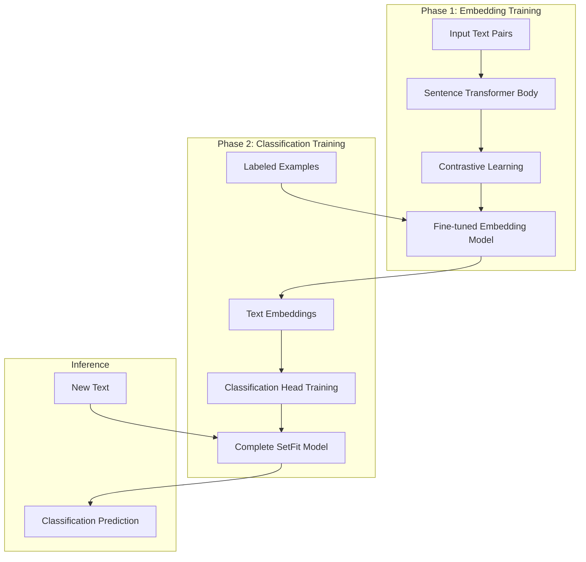

This approach enables efficient few-shot learning by:
1. Using contrastive learning to fine-tune the sentence transformer on text pairs derived from labeled examples
2. Training a lightweight classification head on the resulting embeddings

Sources: [src/setfit/trainer.py:455-553](), [src/setfit/modeling.py:247-327]()

## Core Components

SetFit's architecture consists of three main components that work together to enable few-shot learning:

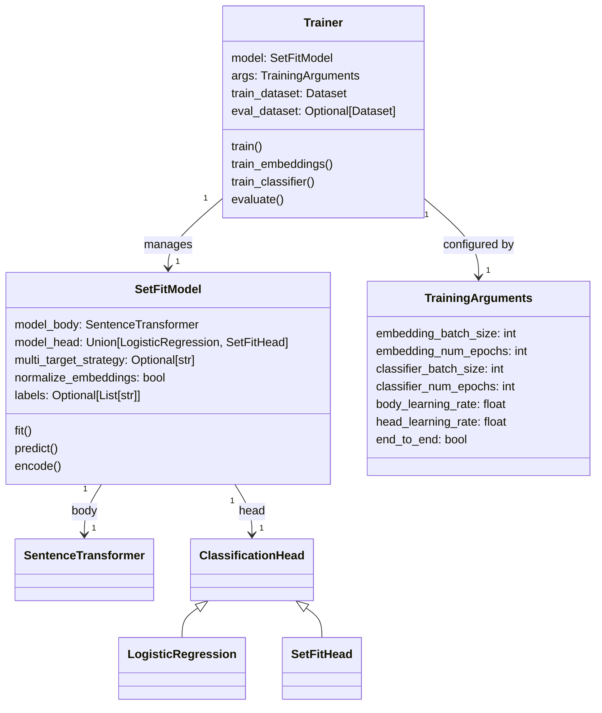

1. **SetFitModel**: Combines a sentence transformer body for embedding generation with a classification head. 
   - Supports both scikit-learn heads (LogisticRegression) and PyTorch-based differentiable heads (SetFitHead)
   - Handles multi-label classification through different strategies
   - Provides methods for encoding text, prediction, and model saving/loading

2. **Trainer**: Orchestrates the entire training process 
   - Manages the two-phase training approach
   - Handles dataset preparation and evaluation
   - Provides hyperparameter optimization capabilities

3. **TrainingArguments**: Configuration object for the training process
   - Controls parameters for both embedding and classifier training
   - Configures learning rates, batch sizes, epochs, etc.

Sources: [src/setfit/modeling.py:191-227](), [src/setfit/trainer.py:257-300]()

## Model Architecture

The SetFitModel architecture consists of two main parts:

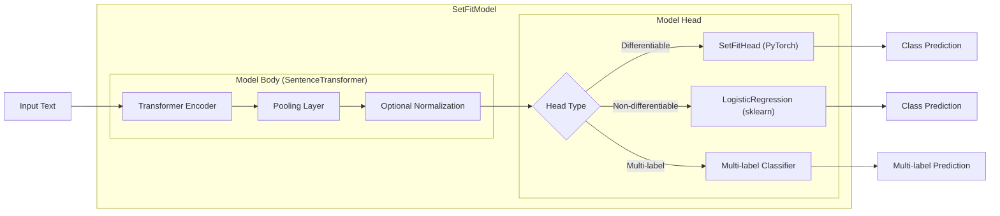

The SetFitModel distinguishes itself through:
- **Flexible head options**: Choose between scikit-learn LogisticRegression for efficiency or PyTorch-based SetFitHead for end-to-end training
- **Multi-target support**: Ability to handle multi-label classification with different strategies
- **Normalization option**: Optional embedding normalization for improved performance in some scenarios

Sources: [src/setfit/modeling.py:39-189](), [src/setfit/modeling.py:191-324]()

## Training Pipeline

The complete SetFit training pipeline involves several steps, orchestrated by the Trainer:

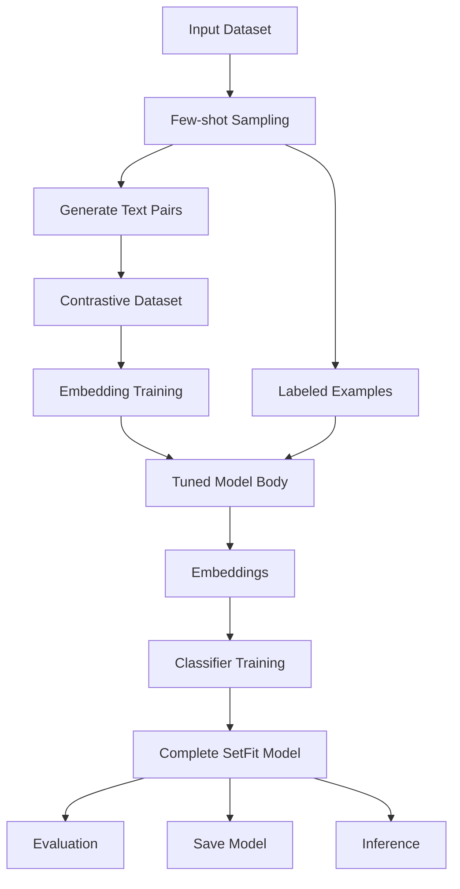

Key aspects of the training pipeline:
1. **Few-shot sampling**: Select a small number of examples per class
2. **Pair generation**: Create text pairs for contrastive learning
3. **Embedding training**: Fine-tune the sentence transformer using contrastive learning
4. **Classifier training**: Train the classification head on the embeddings
5. **Model deployment**: Evaluate, save, or use the model for inference

Sources: [src/setfit/trainer.py:492-533](), [src/setfit/trainer.py:575-622](), [scripts/setfit/run_fewshot.py:142-167]()

## Extension Systems

SetFit includes specialized extensions for specific use cases:

### Aspect-Based Sentiment Analysis (ABSA)

The ABSA extension enables fine-grained sentiment analysis by:
- Extracting aspect candidates from text
- Filtering aspects using a specialized model
- Classifying polarity for each detected aspect

### Knowledge Distillation

The distillation system allows creating smaller, more efficient models by:
- Using a larger teacher model to guide a smaller student model
- Optimizing embedding similarity between teacher and student
- Maintaining performance while reducing model size

Sources: [src/setfit/__init__.py:10-12]()

## Typical Usage Pattern

Here's how SetFit is typically used in a few-shot learning scenario:

1. **Sample a small dataset**: Extract a few examples per class (e.g., 8 examples)
2. **Initialize a SetFit model**: Load a pretrained sentence transformer
3. **Configure training arguments**: Set batch sizes, learning rates, etc.
4. **Initialize trainer**: Connect model, arguments, and dataset
5. **Train the model**: Run the two-phase training process
6. **Evaluate**: Test on a held-out dataset
7. **Deploy**: Save the model or use it for inference

Sources: [README.md:50-101](), [scripts/setfit/run_fewshot.py:130-167]()

## Integration Options

SetFit models can be optimized and exported to various formats for deployment:

- **ONNX export**: Convert models to ONNX format for cross-platform deployment
- **OpenVINO export**: Optimize for Intel hardware acceleration
- **Hugging Face Hub integration**: Share and load models easily

Sources: [setup.py:24-36]()

## Supported Python Versions and Dependencies

SetFit requires:
- Python 3.9+
- Key dependencies:
  - sentence-transformers (≥3.0)
  - transformers (≥4.41.0)
  - datasets (≥2.15.0)
  - scikit-learn
  - huggingface_hub (≥0.24.0)

Sources: [setup.py:12-21](), [setup.py:82-85]()

---

# Page: Installation and Setup

# Installation and Setup

<details>
<summary>Relevant source files</summary>

The following files were used as context for generating this wiki page:

- [.gitignore](.gitignore)
- [Makefile](Makefile)
- [notebooks/README.md](notebooks/README.md)
- [notebooks/multilabel_HoC.ipynb](notebooks/multilabel_HoC.ipynb)
- [notebooks/setfit-optimum-intel.ipynb](notebooks/setfit-optimum-intel.ipynb)
- [setup.py](setup.py)
- [src/setfit/__init__.py](src/setfit/__init__.py)
- [utils/create_notebook_table.py](utils/create_notebook_table.py)
- [utils/release.py](utils/release.py)

</details>


This page provides comprehensive instructions for installing SetFit and setting up your environment. SetFit is a framework for efficient few-shot text classification that leverages Sentence Transformers. This guide covers installation methods, dependencies, and optional components to help you get started quickly.

## System Requirements

Before installing SetFit, ensure your system meets the following requirements:

- Python 3.9 or higher
- Sufficient disk space for model downloads
- For GPU acceleration: CUDA-compatible GPU with appropriate drivers

Sources: [setup.py:74-87]()

## Basic Installation

The simplest way to install SetFit is via pip:

```bash
pip install setfit
```

This installs the core functionality and required dependencies. SetFit automatically manages Python package dependencies, including:

- sentence-transformers (≥3)
- transformers (≥4.41.0)
- datasets (≥2.15.0)
- evaluate (≥0.3.0)
- huggingface_hub (≥0.24.0)
- scikit-learn
- packaging

Sources: [setup.py:13-21]()

## Installation Components

SetFit consists of core and optional components organized as follows:

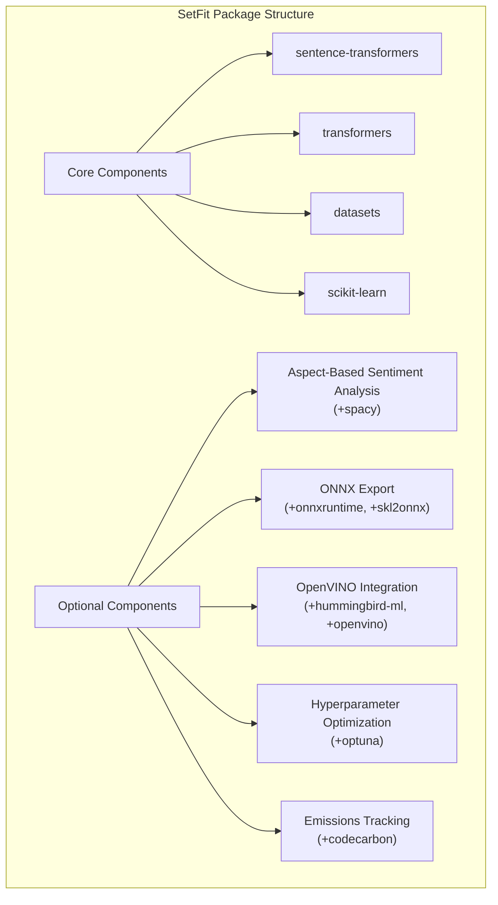

Sources: [setup.py:12-40]()

## Optional Components

You can install SetFit with additional optional components by specifying extras:

### Aspect-Based Sentiment Analysis (ABSA)

```bash
pip install setfit[absa]
```

### ONNX Export Support

```bash
pip install setfit[onnx]
```

### OpenVINO Integration (requires ONNX)

```bash
pip install setfit[openvino]
```

### Hyperparameter Optimization with Optuna

```bash
pip install setfit[optuna]
```

### Emissions Tracking with CodeCarbon

```bash
pip install setfit[codecarbon]
```

### Multiple Optional Components

You can install multiple optional components at once:

```bash
pip install setfit[onnx,absa,optuna]
```

### All Optional Components

To install all optional components:

```bash
pip install setfit[dev]
```

Sources: [setup.py:30-47]()

## Installation from Source

For development purposes or to access the latest unreleased features, you can install SetFit from source:

```bash
git clone https://github.com/huggingface/setfit.git
cd setfit
pip install -e .
```

For development with all dependencies:

```bash
pip install -e ".[dev]"
```

Sources: [setup.py:57-90](), [Makefile:2-19]()

## Verification

To verify your installation, run the following Python code:

```python
from setfit import SetFitModel

# Should print the current version without errors
print(f"SetFit version: {SetFitModel.__module__.split('.')[0]}")
```

Sources: [src/setfit/__init__.py:1-24]()

## Package Structure

SetFit organizes its functionality through several modules imported at the package level:

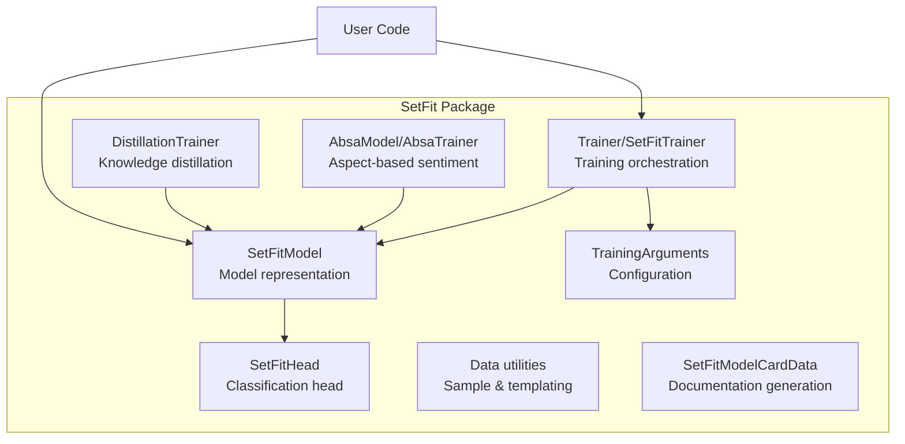

Sources: [src/setfit/__init__.py:7-13]()

## Performance Optimization (Optional)

For improved performance on Intel CPUs, you can optionally set up optimization components:

### Intel Extension for PyTorch

```bash
pip install intel-extension-for-pytorch
```

### Optimum Intel for Model Optimization

```bash
pip install optimum[neural-compressor]
```

### TCMalloc for Memory Allocation (Linux only)

```bash
# Using conda
conda install gperftools -c conda-forge -y
echo export LD_PRELOAD=${CONDA_PREFIX}/lib/libtcmalloc.so:$LD_PRELOAD >> ~/.bashrc
# Restart your shell or source ~/.bashrc
```

For maximum performance on multi-socket systems, consider using `numactl` to control resource allocation:

```bash
OMP_NUM_THREADS=<NUM_THREADS> numactl -C <CORES_RANGE> -m 0 python your_script.py
```

Sources: [notebooks/setfit-optimum-intel.ipynb:93-114]()

## Docker Setup (Alternative)

For containerized applications, you can use a Dockerfile:

```dockerfile
FROM python:3.10-slim

WORKDIR /app

# Install system dependencies
RUN apt-get update && apt-get install -y --no-install-recommends \
    git \
    && rm -rf /var/lib/apt/lists/*

# Install SetFit and optional dependencies
RUN pip install --no-cache-dir setfit[onnx,absa]

# For specific version
# RUN pip install --no-cache-dir setfit==1.2.0

# Copy your application
COPY . .

# Run your application
CMD ["python", "your_application.py"]
```

## Development Environment

For development work on SetFit, additional tools are available:

### Code Quality

```bash
# Format code
make style

# Check code quality
make quality

# Run tests
make test

# Run tests with coverage
make coverage
```

Sources: [Makefile:8-21]()

## Environment Variables

SetFit uses certain environment variables for configuration:

- `TOKENIZERS_PARALLELISM`: Controls tokenizer parallelism (set to "false" to disable warnings)
- `CODECARBON_LOG_LEVEL`: Controls CodeCarbon logging level (automatically set to "error" if not defined)

Sources: [src/setfit/__init__.py:17-23]()

## Common Issues

### Jupyter Notebooks in Kaggle

When using SetFit in Kaggle notebooks, you might need to uninstall the pre-installed TensorFlow due to compatibility issues:

```python
%pip uninstall tensorflow -y
%pip install setfit
```

Sources: [notebooks/README.md:21-27]()

### CUDA Out of Memory

If you encounter CUDA out of memory errors:

1. Reduce batch size in TrainingArguments
2. Use a smaller model variant
3. Try using gradient accumulation

### Version Compatibility

SetFit has specific version requirements for its dependencies. If you encounter errors about incompatible versions:

```bash
# Install compatible versions
pip install datasets==2.15.0 sentence_transformers==3.0.0 transformers==4.41.0
```

For older datasets versions, use pandas<2:

```bash
pip install pandas<2 fsspec<2023.12.0
```

Sources: [setup.py:48-56]()

## Next Steps

After successful installation, you can proceed to:

- Training your first model with SetFit (see [Training Pipeline](#3))
- Exploring pre-trained models (see [Pretrained Models](#9))
- Understanding the core components (see [Core Components](#2))

---

# Page: Core Components

# Core Components

<details>
<summary>Relevant source files</summary>

The following files were used as context for generating this wiki page:

- [src/setfit/modeling.py](src/setfit/modeling.py)
- [src/setfit/trainer.py](src/setfit/trainer.py)
- [src/setfit/training_args.py](src/setfit/training_args.py)
- [tests/test_modeling.py](tests/test_modeling.py)
- [tests/test_training_args.py](tests/test_training_args.py)

</details>


This page provides a detailed overview of the core components in the SetFit framework, explaining their architecture, relationships, and key functionality. SetFit is designed around several primary components that work together to enable few-shot text classification with sentence transformers. For information about the training pipeline itself, see [Training Pipeline](#3), and for extension systems like Aspect-Based Sentiment Analysis or Knowledge Distillation, see [Extension Systems](#4).

## Core Architecture Overview

The SetFit framework is built around three primary components that work together to create, configure, and train few-shot text classification models:

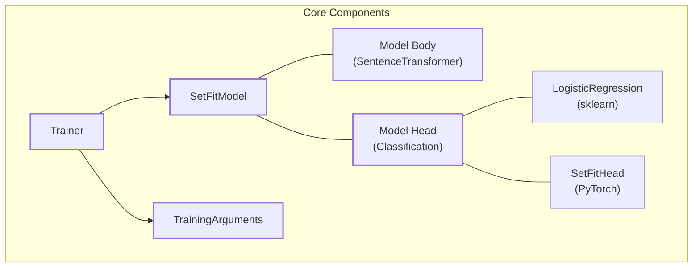

Sources:
- [src/setfit/modeling.py:191-880]()
- [src/setfit/trainer.py:257-837]()
- [src/setfit/training_args.py:22-364]()

## SetFitModel

The `SetFitModel` is the central class that brings together a sentence transformer for text embeddings with a classification head for prediction. It implements the two-stage architecture of SetFit: embedding generation and classification.

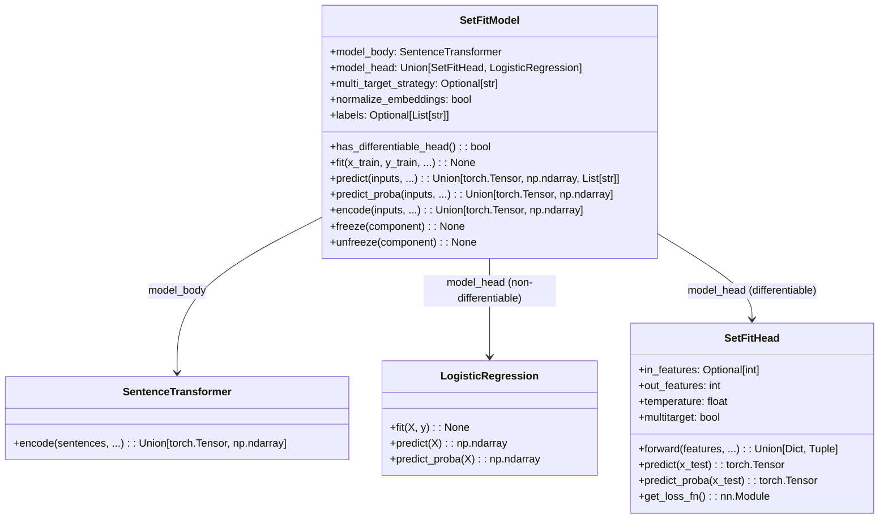

Sources:
- [src/setfit/modeling.py:191-880]()
- [src/setfit/modeling.py:39-189]()

### Model Body

The model body is a `SentenceTransformer` instance that converts input text to dense embeddings. When training, these embeddings are fine-tuned using contrastive learning techniques before the classification head is trained.

Key features:
- Uses transformer models under the hood (BERT, RoBERTa, etc.)
- Outputs fixed-size sentence embeddings regardless of input length
- Can be frozen or unfrozen during training
- Supports embedding normalization

### Model Head

SetFit supports two types of classification heads:

1. **LogisticRegression (sklearn)**: The default non-differentiable head
   - Fast and efficient for few-shot learning
   - Supports multi-target classification via different strategies:
     - `one-vs-rest` using `OneVsRestClassifier`
     - `multi-output` using `MultiOutputClassifier`
     - `classifier-chain` using `ClassifierChain`

2. **SetFitHead (PyTorch)**: A differentiable neural network head
   - Enables end-to-end training with the model body
   - Built on top of a linear layer with temperature scaling
   - Supports both single-label and multi-label classification
   - Can use either `CrossEntropyLoss` (single-label) or `BCEWithLogitsLoss` (multi-label)

Sources:
- [src/setfit/modeling.py:39-189]()
- [src/setfit/modeling.py:210-232]()
- [src/setfit/modeling.py:847-866]()

## Trainer

The `Trainer` class orchestrates the entire training process for SetFit models, handling both the embedding fine-tuning phase and the classification head training phase.

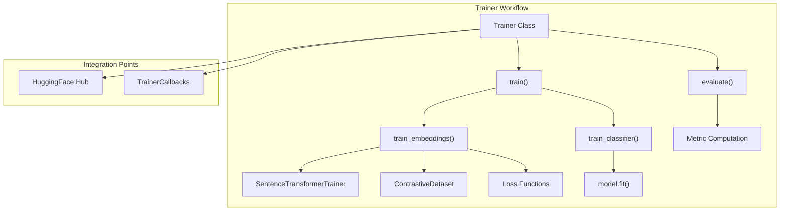

Sources:
- [src/setfit/trainer.py:257-837]()
- [src/setfit/trainer.py:492-533]()
- [src/setfit/trainer.py:537-622]()
- [src/setfit/trainer.py:632-656]()

### Two-Phase Training Process

The Trainer implements SetFit's unique two-phase approach to few-shot learning:

1. **Embedding Training Phase**:
   - Creates text pairs/triplets from the limited labeled examples
   - Fine-tunes the Sentence Transformer body using contrastive learning
   - Uses a specialized `BCSentenceTransformersTrainer` as an adapter to SentenceTransformer's training functionality
   - Supports various contrastive loss functions:
     - `CosineSimilarityLoss` (default)
     - `BatchAllTripletLoss`
     - `BatchHardTripletLoss`
     - `BatchSemiHardTripletLoss`
     - `BatchHardSoftMarginTripletLoss`
     - `SupConLoss`

2. **Classification Training Phase**:
   - Train the classification head on labeled examples
   - For differentiable heads, can optionally train end-to-end with the model body
   - For non-differentiable heads, uses scikit-learn's fit method

Sources:
- [src/setfit/trainer.py:537-622]()
- [src/setfit/trainer.py:632-656]()
- [src/setfit/trainer.py:39-187]()

### Column Mapping

The Trainer includes a column mapping feature to handle datasets with differently named columns:

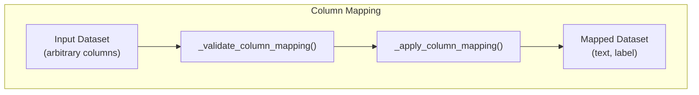

Sources:
- [src/setfit/trainer.py:189-254]()
- [src/setfit/trainer.py:306-318]()

## TrainingArguments

The `TrainingArguments` class provides extensive configuration options for the training process. It's structured to support the two-phase training approach with separate parameters for embedding and classification training.

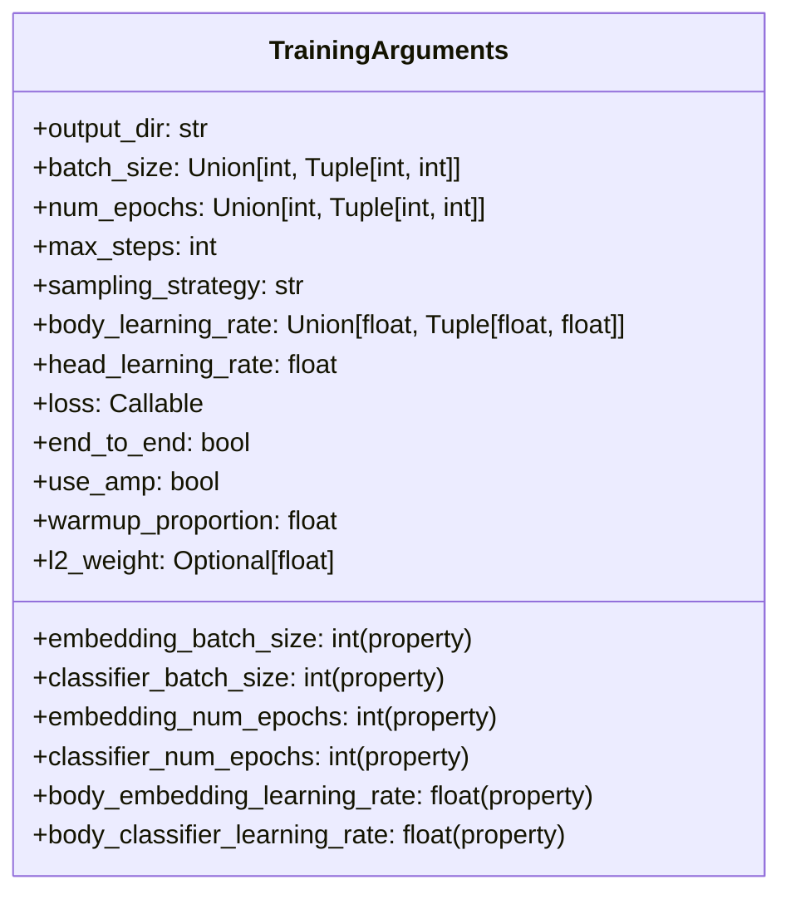

Sources:
- [src/setfit/training_args.py:22-364]()
- [src/setfit/training_args.py:168-192]()
- [src/setfit/training_args.py:296-317]()

### Key Parameters

The TrainingArguments supports dual-phase training with parameters that can be specified separately for each phase:

| Parameter | Default | Description |
|-----------|---------|-------------|
| `batch_size` | `(16, 2)` | Batch sizes for embedding and classifier phases |
| `num_epochs` | `(1, 16)` | Number of epochs for embedding and classifier phases |
| `body_learning_rate` | `(2e-5, 1e-5)` | Learning rates for the model body in embedding and classifier phases |
| `head_learning_rate` | `1e-2` | Learning rate for the classifier head |

Other important parameters include:

- **Loss configuration**: `loss`, `distance_metric`, `margin`
- **Training strategies**: `sampling_strategy`, `num_iterations`, `end_to_end`
- **Optimization**: `use_amp`, `warmup_proportion`, `l2_weight`
- **Logging & Evaluation**: `logging_strategy`, `eval_strategy`, `save_strategy`

Sources:
- [src/setfit/training_args.py:168-192]()
- [src/setfit/training_args.py:295-317]()
- [tests/test_training_args.py:19-63]()

## Integration and Data Flow

The core components of SetFit are designed to work together seamlessly, with data flowing through the system as follows:

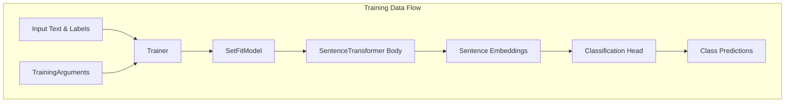

Sources:
- [src/setfit/trainer.py:492-533]()
- [src/setfit/modeling.py:248-327]()

## Component Initialization and Lifecycle

The typical lifecycle of SetFit components involves:

1. Creating a `TrainingArguments` instance with desired configuration
2. Initializing a `SetFitModel` either from scratch or with `from_pretrained()`
3. Creating a `Trainer` with the model, arguments, and datasets
4. Calling `trainer.train()` to execute the two-phase training
5. Using `model.predict()` or `model.predict_proba()` for inference
6. Optionally saving the model with `model.save_pretrained()` or `trainer.push_to_hub()`

This modular design makes the framework flexible for various text classification scenarios, from academic research to production applications.

Sources:
- [src/setfit/modeling.py:709-879]()
- [src/setfit/trainer.py:290-345]()
- [src/setfit/trainer.py:492-533]()
- [src/setfit/trainer.py:795-836]()

---

# Page: SetFitModel

# SetFitModel

<details>
<summary>Relevant source files</summary>

The following files were used as context for generating this wiki page:

- [src/setfit/modeling.py](src/setfit/modeling.py)
- [src/setfit/trainer.py](src/setfit/trainer.py)
- [tests/test_modeling.py](tests/test_modeling.py)

</details>


The `SetFitModel` class is the core model component in the SetFit framework, designed for efficient few-shot text classification. It combines a Sentence Transformer for text embedding with a classification head for prediction, providing a unified interface for both training and inference. This page documents the architecture, usage, and key features of the `SetFitModel` class.

## Architecture Overview

`SetFitModel` follows a two-component architecture that separates embedding generation from classification:

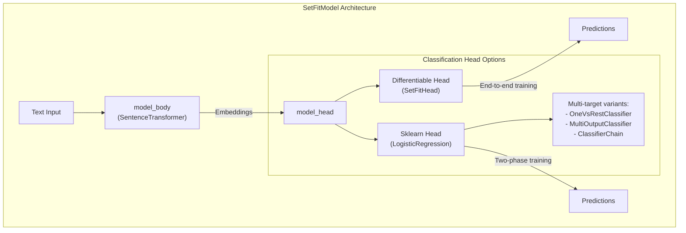

Sources: [src/setfit/modeling.py:191-233](). [tests/test_modeling.py:22-74]()

### Core Components

The `SetFitModel` consists of two primary components:

1. **Model Body (`model_body`)**: A SentenceTransformer model that converts input text into embeddings (dense vector representations).

2. **Model Head (`model_head`)**: A classification component that takes embeddings and outputs predictions. It can be one of:
   - **PyTorch-based head**: `SetFitHead`, a differentiable neural network layer enabling end-to-end training
   - **Scikit-learn-based head**: `LogisticRegression` or its multi-label variants for traditional ML-based classification

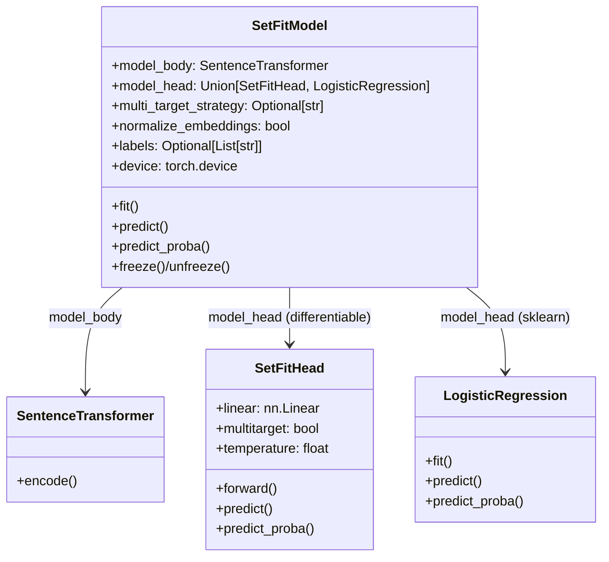

Sources: [src/setfit/modeling.py:39-190](), [src/setfit/modeling.py:191-233]()

## Initialization and Loading

### Creating a New `SetFitModel`

A `SetFitModel` can be initialized directly by providing a model body and head:

```python
from setfit import SetFitModel
from sentence_transformers import SentenceTransformer
from sklearn.linear_model import LogisticRegression

model_body = SentenceTransformer("sentence-transformers/all-mpnet-base-v2")
model_head = LogisticRegression()

model = SetFitModel(
    model_body=model_body,
    model_head=model_head,
    labels=["negative", "positive"]
)
```

### Loading a Pre-trained Model

More commonly, models are loaded using the `from_pretrained` method, which can load models from the Hugging Face Hub or a local directory:

```python
# Load a model from the Hub
model = SetFitModel.from_pretrained("tomaarsen/setfit-bge-small-v1.5-sst2-8-shot")

# Load a model with a specific device
model = SetFitModel.from_pretrained("tomaarsen/setfit-bge-small-v1.5-sst2-8-shot", device="cuda")

# Load a base model and specify parameters for a fresh classification head
model = SetFitModel.from_pretrained(
    "sentence-transformers/paraphrase-mpnet-base-v2",
    labels=["negative", "positive"],
    use_differentiable_head=True
)
```

Sources: [src/setfit/modeling.py:709-879](), [tests/test_modeling.py:172-189]()

## Classification Heads

### PyTorch-based Head (`SetFitHead`)

The `SetFitHead` class is a PyTorch module that enables end-to-end training of the entire model. It features:

- A linear layer for classification
- Support for multi-target classification through the `multitarget` parameter
- Temperature scaling for controlling prediction confidence
- Customizable initialization and normalization

```python
model = SetFitModel.from_pretrained(
    "sentence-transformers/paraphrase-mpnet-base-v2",
    use_differentiable_head=True,
    head_params={"temperature": 0.5}
)
```

Sources: [src/setfit/modeling.py:39-189](), [tests/test_modeling.py:76-170]()

### Scikit-learn-based Head

For traditional machine learning-based classification, `SetFitModel` supports scikit-learn's `LogisticRegression` and its multi-label variants:

```python
# Standard classification
model = SetFitModel.from_pretrained(
    "sentence-transformers/paraphrase-mpnet-base-v2"
)  # Default is LogisticRegression

# Multi-label classification with OneVsRestClassifier
model = SetFitModel.from_pretrained(
    "sentence-transformers/paraphrase-mpnet-base-v2",
    multi_target_strategy="one-vs-rest"
)
```

The available multi-target strategies are:
- `"one-vs-rest"`: Uses `OneVsRestClassifier`
- `"multi-output"`: Uses `MultiOutputClassifier`
- `"classifier-chain"`: Uses `ClassifierChain`

Sources: [src/setfit/modeling.py:191-233](), [tests/test_modeling.py:52-73]()

## Training

The `fit` method is used to train the model on a dataset:

```python
model.fit(
    x_train=["This is great!", "This is terrible."],
    y_train=[1, 0],  # 1 for positive, 0 for negative
    num_epochs=10,
    batch_size=16,
    body_learning_rate=1e-5,
    head_learning_rate=2e-3,
    end_to_end=True  # Train the entire model end-to-end
)
```

Training behavior differs based on the head type:

1. **Differentiable head**: Uses PyTorch training with gradients propagating through the entire model if `end_to_end=True`
2. **Scikit-learn head**: Extracts embeddings from the model body first, then fits the classifier on these embeddings

### Freezing Model Components

The `freeze` and `unfreeze` methods control which parts of the model are trained:

```python
# Freeze only the body, keeping the head trainable
model.freeze("body")

# Unfreeze everything
model.unfreeze()
```

Sources: [src/setfit/modeling.py:248-327](), [src/setfit/modeling.py:390-435]()

## Inference

### Making Predictions

`SetFitModel` provides multiple methods for inference:

```python
# Get raw predictions (class indices or string labels)
predictions = model.predict(["This is a positive review", "This is a negative review"])

# Get class probabilities
probabilities = model.predict_proba(["This is a positive review"])

# Direct call (same as predict)
result = model("This is a positive review")
```

For models with string labels, the `predict` method will automatically return string labels instead of indices.

### Working with Embeddings

You can also extract embeddings directly:

```python
embeddings = model.encode(["This is a test sentence"])
```

Sources: [src/setfit/modeling.py:436-611](), [tests/test_modeling.py:290-354]()

## Device Management

`SetFitModel` supports moving the model between devices (CPU/GPU):

```python
# Move model to GPU
model.to("cuda")

# Move model to CPU
model.to("cpu")

# Check current device
current_device = model.device
```

The behavior ensures both the model body and head (if differentiable) are moved to the same device.

Sources: [src/setfit/modeling.py:613-649](), [tests/test_modeling.py:210-262]()

## Integration with Hugging Face Hub

### Saving and Loading Models

```python
# Save model to a local directory
model.save_pretrained("./my-setfit-model")

# Push model to the Hugging Face Hub
model.push_to_hub("username/model-name")
```

### Model Cards

`SetFitModel` automatically generates model cards when saving:

```python
# Generate a model card string
card_text = model.generate_model_card()

# Create and save a model card
model.create_model_card("./model-directory")
```

Sources: [src/setfit/modeling.py:651-708](), [src/setfit/modeling.py:795-836]()

## Usage in the SetFit Pipeline

The `SetFitModel` is a core component in the SetFit training pipeline, typically used with the `Trainer` class:

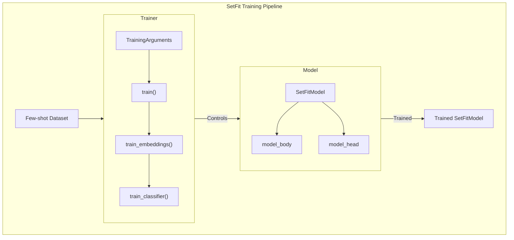

Sources: [src/setfit/trainer.py:257-303](), [src/setfit/trainer.py:492-533]()

## Conclusion

The `SetFitModel` class provides a flexible and powerful interface for few-shot text classification, combining the strengths of Sentence Transformers for embedding generation with various classification heads for prediction. Its integration with the Hugging Face ecosystem makes it easy to share, reuse, and deploy models for a wide range of text classification tasks.

For more information about training with SetFit, see the [Trainer](#2.2) documentation. For details about configuring the training process, see [TrainingArguments](#2.3).

---

# Page: Trainer

# Trainer

<details>
<summary>Relevant source files</summary>

The following files were used as context for generating this wiki page:

- [src/setfit/modeling.py](src/setfit/modeling.py)
- [src/setfit/trainer.py](src/setfit/trainer.py)
- [tests/test_deprecated_trainer.py](tests/test_deprecated_trainer.py)
- [tests/test_deprecated_trainer_distillation.py](tests/test_deprecated_trainer_distillation.py)
- [tests/test_modeling.py](tests/test_modeling.py)
- [tests/test_trainer.py](tests/test_trainer.py)
- [tests/test_trainer_distillation.py](tests/test_trainer_distillation.py)

</details>


The `Trainer` class is a central component of the SetFit framework that orchestrates the training process for few-shot text classification models. It implements SetFit's unique two-phase training strategy: first fine-tuning the sentence transformer embedding model using contrastive learning, then training a classification head on top of these embeddings.

For information about model components, see [SetFitModel](#2.1). For information about training configuration, see [TrainingArguments](#2.3).

## Class Overview

The `Trainer` class provides a high-level API that handles:
- Data preparation and column mapping
- Two-phase training execution
- Model evaluation 
- Hyperparameter optimization
- Model exporting to Hugging Face Hub

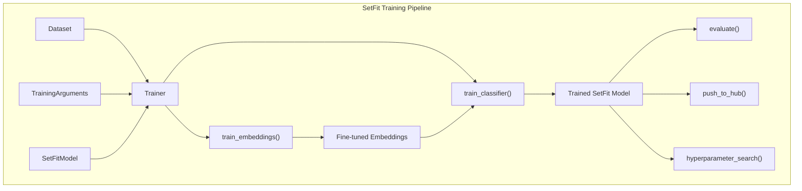

Sources: [src/setfit/trainer.py:257-837]()

## Class Structure

The `Trainer` class is built on top of `BCSentenceTransformersTrainer` which handles the embedding training phase, while the `Trainer` itself coordinates the complete training process.

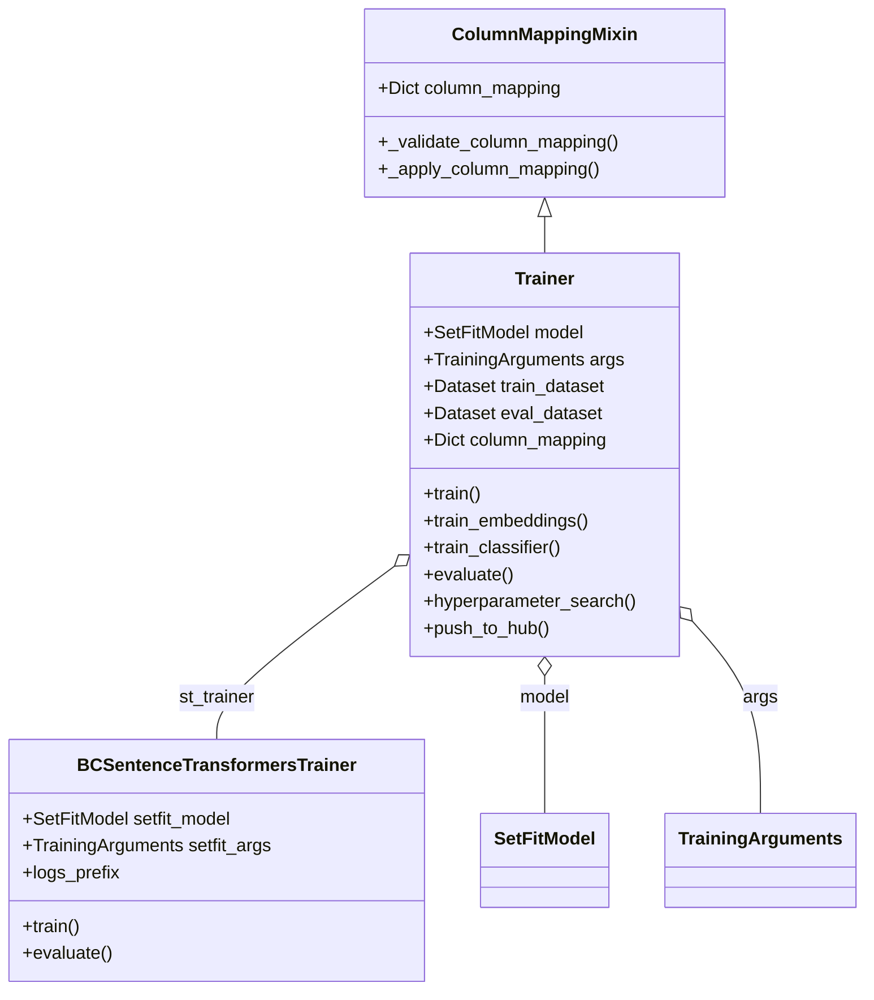

Sources: [src/setfit/trainer.py:39-187](), [src/setfit/trainer.py:189-255](), [src/setfit/trainer.py:257-837]()

## Initialization

The `Trainer` is initialized with the following key parameters:

| Parameter | Type | Description |
|-----------|------|-------------|
| `model` | `SetFitModel` | The SetFit model to train. Required unless `model_init` is provided. |
| `args` | `TrainingArguments` | The training arguments that configure the training process. |
| `train_dataset` | `Dataset` | The dataset for training. |
| `eval_dataset` | `Dataset` | The dataset for evaluation. |
| `model_init` | `Callable[[], SetFitModel]` | Function that instantiates the model (used for hyperparameter search). |
| `metric` | `Union[str, Callable]` | Metric to use for evaluation (default: "accuracy"). |
| `callbacks` | `List[TrainerCallback]` | Callbacks to customize the training loop. |
| `column_mapping` | `Dict[str, str]` | Mapping from dataset columns to the columns expected by the model. |

Sources: [src/setfit/trainer.py:290-301]()

## Two-Phase Training Process

The SetFit training process is implemented in the `train()` method, which coordinates the two training phases:

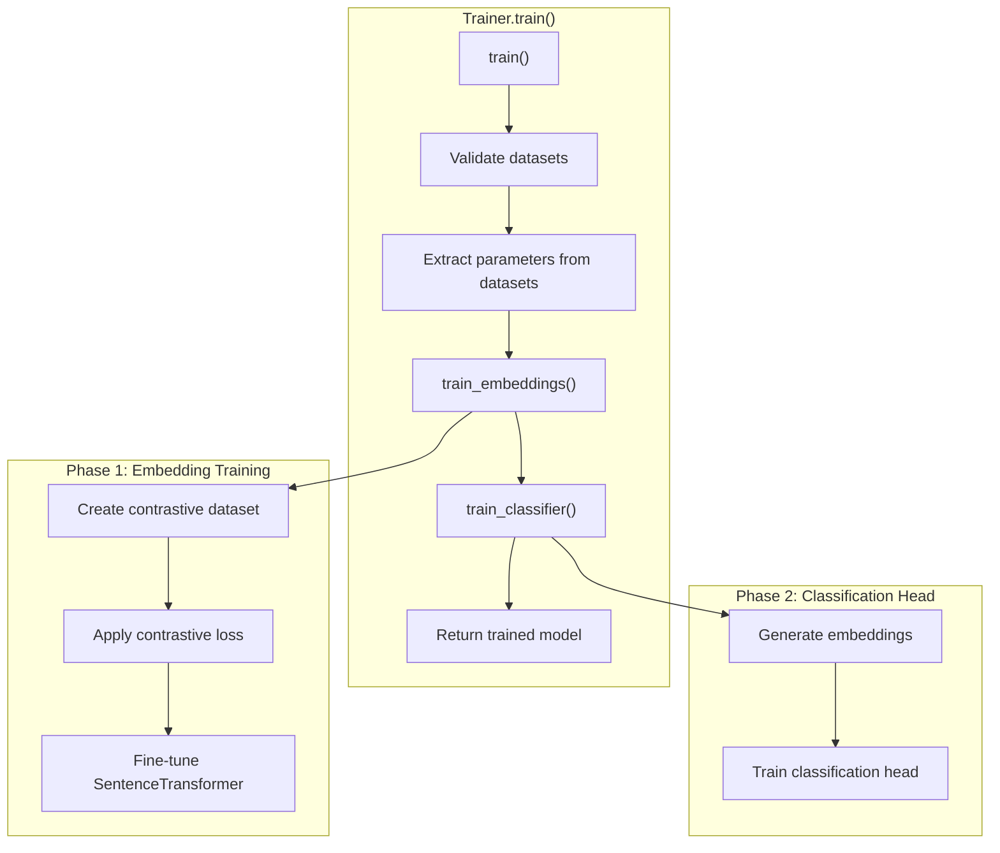

Sources: [src/setfit/trainer.py:492-532](), [src/setfit/trainer.py:537-582](), [src/setfit/trainer.py:631-656]()

### Phase 1: Embedding Training

In this phase, the sentence transformer body is fine-tuned using contrastive learning via the `train_embeddings()` method. The process:

1. Creates text pairs/triplets using the `ContrastiveDataset` class
2. Applies a contrastive loss function (default is `CosineSimilarityLoss`)
3. Fine-tunes the sentence transformer to learn meaningful embeddings

Key implementation:
```python
train_dataset, loss = self.get_dataset(x_train, y_train, args, max_pairs)
self.st_trainer.train_dataset = train_dataset
self.st_trainer.loss = loss
self.st_trainer.train()
```

Sources: [src/setfit/trainer.py:537-582](), [src/setfit/trainer.py:584-620]()

### Phase 2: Classification Head Training

In this phase, a classification head is trained on top of the fine-tuned embeddings via the `train_classifier()` method:

1. Uses the fine-tuned embeddings to encode training data
2. Trains either a scikit-learn `LogisticRegression` head or a differentiable PyTorch head

Key implementation:
```python
self.model.fit(
    x_train,
    y_train,
    num_epochs=args.classifier_num_epochs,
    batch_size=args.classifier_batch_size,
    body_learning_rate=args.body_classifier_learning_rate,
    head_learning_rate=args.head_learning_rate,
    l2_weight=args.l2_weight,
    max_length=args.max_length,
    show_progress_bar=args.show_progress_bar,
    end_to_end=args.end_to_end,
)
```

Sources: [src/setfit/trainer.py:631-656]()

## Column Mapping

The `Trainer` provides column mapping functionality through the `ColumnMappingMixin` class. This allows adapting datasets with different column names to the standard format expected by SetFit ("text" and "label").

Example:
```python
trainer = Trainer(
    model=model,
    train_dataset=dataset,
    column_mapping={"content": "text", "class": "label"}
)
```

The `_validate_column_mapping()` method verifies that all required columns are present after mapping, and `_apply_column_mapping()` renames the columns according to the mapping.

Sources: [src/setfit/trainer.py:189-255]()

## Evaluation

The `evaluate()` method assesses model performance on a dataset:

1. Gets predictions from the model for examples in the evaluation dataset
2. Computes metrics based on the specified metric function
3. Returns a dictionary of metrics

```python
def evaluate(self, dataset=None, metric_key_prefix="test"):
    # Get dataset to evaluate on
    eval_dataset = dataset or self.eval_dataset
    
    # Get predictions
    y_pred = self.model.predict(eval_dataset["text"])
    y_test = eval_dataset["label"]
    
    # Compute metrics
    if isinstance(self.metric, str):
        metric_fn = evaluate.load(self.metric)
        results = metric_fn.compute(predictions=y_pred, references=y_test, **self.metric_kwargs)
    elif callable(self.metric):
        results = self.metric(y_pred, y_test, **self.metric_kwargs)
        
    return results
```

Sources: [src/setfit/trainer.py:658-717]()

## Hyperparameter Optimization

The `hyperparameter_search()` method uses Optuna to find optimal hyperparameters:

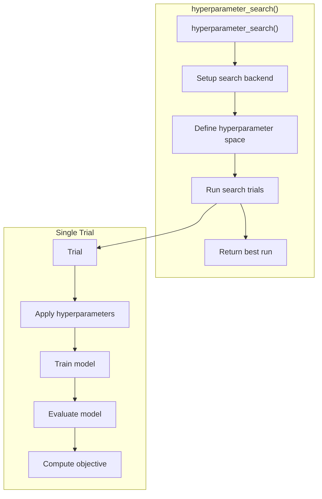

Key parameters for hyperparameter search:
- `hp_space`: Function that defines the hyperparameter search space
- `n_trials`: Number of trials to run
- `direction`: Whether to "maximize" or "minimize" the objective
- `compute_objective`: Function to compute the objective from evaluation metrics

Sources: [src/setfit/trainer.py:719-793]()

## Pushing to Hugging Face Hub

The `push_to_hub()` method uploads the trained model to the Hugging Face Hub:

```python
def push_to_hub(self, repo_id, **kwargs):
    """Upload model checkpoint to the Hub using `huggingface_hub`.
    
    Args:
        repo_id (`str`): The full repository ID to push to, e.g. `"tomaarsen/setfit-sst2"`.
    
    Returns:
        str: The url of the commit of your model in the given repository.
    """
    commit_message = kwargs.pop("commit_message", "Add SetFit model")
    return self.model.push_to_hub(repo_id, commit_message=commit_message, **kwargs)
```

Sources: [src/setfit/trainer.py:795-836]()

## Callbacks

The `Trainer` supports callbacks for customizing the training loop:

```python
# Add a callback
trainer.add_callback(CustomCallback())

# Remove a callback
trainer.remove_callback(callback)

# Pop a callback
popped_callback = trainer.pop_callback(callback_type)
```

The callbacks can hook into various stages of the training process, such as on_init_end, on_train_begin, on_step_end, etc.

Sources: [src/setfit/trainer.py:367-403]()

## Complete Example

Here's an end-to-end example of using the `Trainer`:

```python
from datasets import Dataset
from setfit import SetFitModel, Trainer, TrainingArguments

# Prepare dataset
dataset = Dataset.from_dict({
    "text": ["I love this movie", "This was terrible", "Pretty average film"],
    "label": [1, 0, 0]  # 1 = positive, 0 = negative
})

# Split into train/test
splits = dataset.train_test_split(test_size=0.2)
train_dataset = splits["train"]
test_dataset = splits["test"]

# Initialize model
model = SetFitModel.from_pretrained("sentence-transformers/paraphrase-mpnet-base-v2")

# Initialize training arguments
args = TrainingArguments(
    num_iterations=20,  # Number of contrastive learning pairs to generate
    embedding_batch_size=16,
    classifier_batch_size=16,
    body_embedding_learning_rate=1e-4,
    head_learning_rate=1e-3
)

# Initialize trainer
trainer = Trainer(
    model=model,
    args=args,
    train_dataset=train_dataset,
    eval_dataset=test_dataset
)

# Train the model
trainer.train()

# Evaluate the model
metrics = trainer.evaluate()
print(metrics)  # e.g., {"accuracy": 1.0}

# Push to Hub
trainer.push_to_hub("username/my-setfit-model")
```

Sources: [src/setfit/trainer.py](), [src/setfit/modeling.py]()

## Relationship with BCSentenceTransformersTrainer

The `Trainer` uses a `BCSentenceTransformersTrainer` internally to handle the embedding training phase. This class is a subclass of `SentenceTransformerTrainer` from the `sentence-transformers` library, with additional functionality to make it compatible with the SetFit API.

```python
self.st_trainer = BCSentenceTransformersTrainer(
    setfit_model=model,
    setfit_args=self.args,
    callbacks=callbacks,
)
```

The `BCSentenceTransformersTrainer` propagates training arguments from SetFit to the SentenceTransformer trainer and ensures consistent logging prefixes.

Sources: [src/setfit/trainer.py:39-187](), [src/setfit/trainer.py:341-345]()

---

# Page: TrainingArguments

# TrainingArguments

<details>
<summary>Relevant source files</summary>

The following files were used as context for generating this wiki page:

- [src/setfit/training_args.py](src/setfit/training_args.py)
- [tests/test_training_args.py](tests/test_training_args.py)

</details>


The `TrainingArguments` class is a central configuration component in the SetFit framework that controls all aspects of the training process. This document provides a comprehensive reference for the `TrainingArguments` class, how it works, and how to configure it for different training scenarios. For information about the actual training process, see [Trainer](#2.2) and [Training Pipeline](#3).

## Overview

`TrainingArguments` defines parameters that control both phases of SetFit's two-phase training approach:
1. The embedding training phase (fine-tuning the sentence transformer body)
2. The classification head training phase

Many parameters can take different values for each training phase, which is why SetFit uses tuples for certain configuration options.

Sources: [src/setfit/training_args.py:22-29]()</file>

## Architecture

### Relationship to Other Components

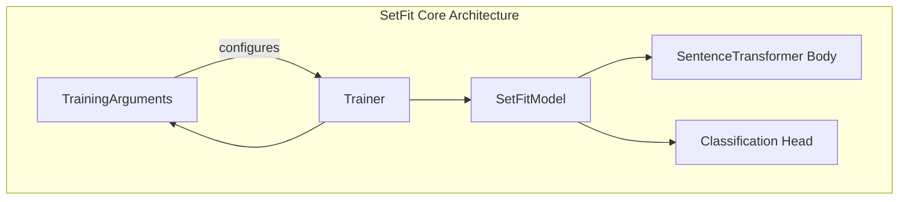

Sources: [src/setfit/training_args.py:22-29]()

### Two-Phase Training Configuration

```mermaid
graph LR
    subgraph "TrainingArguments"
        TA["TrainingArguments Class"]
    end
    
    subgraph "Phase 1: Embedding Training"
        EP1["Parameters:
        - embedding_batch_size
        - embedding_num_epochs
        - body_embedding_learning_rate
        - loss
        - distance_metric
        - margin
        - use_amp"]
    end
    
    subgraph "Phase 2: Classification Head"
        EP2["Parameters:
        - classifier_batch_size
        - classifier_num_epochs
        - body_classifier_learning_rate
        - head_learning_rate
        - end_to_end"]
    end
    
    subgraph "Common Parameters"
        CP["Parameters:
        - output_dir
        - max_steps
        - warmup_proportion
        - l2_weight
        - max_length
        - logging_*
        - eval_*
        - save_*"]
    end
    
    TA --> EP1
    TA --> EP2
    TA --> CP
```

Sources: [src/setfit/training_args.py:22-164]()

## Key Parameters

### Tuple Parameters

SetFit uses tuple parameters to configure both training phases separately. These parameters can accept either:
- A single value that applies to both phases
- A tuple of two values, where the first applies to the embedding phase and the second to the classifier phase

```mermaid
graph TD
    subgraph "Tuple Parameters"
        BatchSize["batch_size: Union[int, Tuple[int, int]]"]
        NumEpochs["num_epochs: Union[int, Tuple[int, int]]"]
        BodyLR["body_learning_rate: Union[float, Tuple[float, float]]"]
    end
    
    subgraph "Convenience Properties"
        EmbeddingBatchSize["embedding_batch_size: int"]
        ClassifierBatchSize["classifier_batch_size: int"]
        EmbeddingNumEpochs["embedding_num_epochs: int"]
        ClassifierNumEpochs["classifier_num_epochs: int"]
        BodyEmbeddingLR["body_embedding_learning_rate: float"]
        BodyClassifierLR["body_classifier_learning_rate: float"]
    end
    
    BatchSize --> EmbeddingBatchSize
    BatchSize --> ClassifierBatchSize
    NumEpochs --> EmbeddingNumEpochs
    NumEpochs --> ClassifierNumEpochs
    BodyLR --> BodyEmbeddingLR
    BodyLR --> BodyClassifierLR
```

Sources: [src/setfit/training_args.py:168-175](), [src/setfit/training_args.py:182-184](), [src/setfit/training_args.py:226-237]()

### Parameter Categories

The `TrainingArguments` parameters can be grouped into the following categories:

| Category | Parameters | Purpose |
|----------|------------|---------|
| Basic Training | `batch_size`, `num_epochs`, `max_steps` | Control training batch sizes and duration |
| Learning Rates | `body_learning_rate`, `head_learning_rate` | Set learning rates for different model components |
| Loss Configuration | `loss`, `distance_metric`, `margin` | Configure the loss function for embedding training |
| Training Control | `end_to_end`, `use_amp`, `warmup_proportion`, `l2_weight` | Control training behavior and optimization |
| Evaluation | `eval_strategy`, `eval_steps`, `eval_delay`, `eval_max_steps` | Configure when and how to evaluate |
| Saving | `save_strategy`, `save_steps`, `save_total_limit`, `load_best_model_at_end` | Control model checkpoint saving |
| Logging | `logging_strategy`, `logging_steps`, `report_to`, `logging_dir` | Configure training logs and reporting |
| Other | `show_progress_bar`, `seed`, `max_length` | Miscellaneous settings |

Sources: [src/setfit/training_args.py:22-221]()

## Default Values and Parameter Details

### Basic Parameters

| Parameter | Default Value | Description |
|-----------|---------------|-------------|
| `output_dir` | `"checkpoints"` | Directory for saving model checkpoints and outputs |
| `batch_size` | `(16, 2)` | Batch sizes for embedding and classifier phases |
| `num_epochs` | `(1, 16)` | Number of epochs for embedding and classifier phases |
| `max_steps` | `-1` | Maximum number of training steps (overrides `num_epochs` if positive) |

### Loss Function Parameters

| Parameter | Default Value | Description |
|-----------|---------------|-------------|
| `loss` | `CosineSimilarityLoss` | Loss function for embedding training phase |
| `distance_metric` | `BatchHardTripletLossDistanceFunction.cosine_distance` | Distance function for triplet loss |
| `margin` | `0.25` | Margin for triplet loss |
| `sampling_strategy` | `"oversampling"` | Strategy for drawing pairs in training |
| `num_iterations` | `None` | Number of iterations to generate sentence pairs |

### Learning Rate Parameters

| Parameter | Default Value | Description |
|-----------|---------------|-------------|
| `body_learning_rate` | `(2e-5, 1e-5)` | Learning rates for model body in both phases |
| `head_learning_rate` | `1e-2` | Learning rate for classification head |
| `warmup_proportion` | `0.1` | Proportion of training steps for learning rate warmup |

### Training Control Parameters

| Parameter | Default Value | Description |
|-----------|---------------|-------------|
| `end_to_end` | `False` | Whether to train the entire model in the classifier phase |
| `use_amp` | `False` | Whether to use Automatic Mixed Precision |
| `l2_weight` | `0.01` | L2 regularization weight |
| `max_length` | `None` | Maximum token length for tokenization |

Sources: [src/setfit/training_args.py:32-164]()

## Parameter Validation

The `TrainingArguments` class performs several validations in its `__post_init__` method:

1. Converts single values to tuples for `batch_size`, `num_epochs`, and `body_learning_rate`
2. Ensures `warmup_proportion` is between 0.0 and 1.0
3. Validates evaluation and saving settings when `load_best_model_at_end=True`
4. Converts string strategies to `IntervalStrategy` objects
5. Ensures that if `eval_strategy` is `"steps"`, a valid `eval_steps` value is provided

Sources: [src/setfit/training_args.py:225-290]()

## Additional Methods

The `TrainingArguments` class provides several utility methods:

| Method | Description |
|--------|-------------|
| `to_dict()` | Convert instance to a dictionary |
| `from_dict(arguments, ignore_extra=False)` | Create instance from a dictionary |
| `copy()` | Create a shallow copy of the instance |
| `update(arguments, ignore_extra=False)` | Create a new instance with updated values |
| `to_json_string()` | Serialize the instance to a JSON string |
| `to_sanitized_dict()` | Create a sanitized dictionary for TensorBoard |

Sources: [src/setfit/training_args.py:319-363]()

## Usage Examples

Here's how to create a `TrainingArguments` instance with default values:

```python
from setfit import TrainingArguments

args = TrainingArguments()
```

Customize parameters for both training phases:

```python
args = TrainingArguments(
    batch_size=(32, 8),  # 32 for embedding phase, 8 for classifier phase
    num_epochs=(2, 20),  # 2 epochs for embedding phase, 20 for classifier phase
    body_learning_rate=(1e-5, 5e-6),  # Different learning rates for each phase
)
```

Configure evaluation and model saving:

```python
args = TrainingArguments(
    eval_strategy="steps",
    eval_steps=100,
    save_strategy="steps",
    save_steps=100,
    load_best_model_at_end=True,
)
```

## Common Pitfalls and Validation Errors

When using `TrainingArguments`, be aware of these common issues:

1. If `load_best_model_at_end=True`, `eval_strategy` and `save_strategy` must match
2. If `eval_strategy="steps"` and `save_strategy="steps"`, `save_steps` must be a multiple of `eval_steps`
3. The `warmup_proportion` must be between 0.0 and 1.0
4. If `eval_strategy="steps"`, `eval_steps` must be greater than 0
5. If `logging_strategy="steps"`, `logging_steps` must be greater than 0

Sources: [src/setfit/training_args.py:262-290](), [tests/test_training_args.py:9-105]()

## Relationship with HuggingFace Ecosystem

The SetFit `TrainingArguments` class is designed to be similar to the HuggingFace Transformers `TrainingArguments` class but is specifically tailored for SetFit's two-phase training approach. It uses some of the same utility functions and enums from the Transformers library, such as `IntervalStrategy`.

Sources: [src/setfit/training_args.py:11-14]()

---

# Page: Training Pipeline

# Training Pipeline

<details>
<summary>Relevant source files</summary>

The following files were used as context for generating this wiki page:

- [src/setfit/modeling.py](src/setfit/modeling.py)
- [src/setfit/trainer.py](src/setfit/trainer.py)
- [tests/test_modeling.py](tests/test_modeling.py)
- [tests/test_trainer.py](tests/test_trainer.py)

</details>


The Training Pipeline in SetFit implements a two-phase approach for efficient few-shot text classification. This page explains the architecture and workflow of the pipeline, focusing on how data flows through the system and the key components involved. For information about data preparation, see [Data Preparation](#3.1).

## Architecture Overview

SetFit's training pipeline combines contrastive learning for embedding fine-tuning with classifier training. The pipeline is orchestrated by the `Trainer` class, which coordinates both phases of the training process.

```mermaid
graph TD
    subgraph "Training Pipeline Components"
        Trainer["Trainer"] --> train["train()"]
        train --> train_embeddings["train_embeddings()"]
        train --> train_classifier["train_classifier()"]
        
        Trainer --> SetFitModel["SetFitModel"]
        SetFitModel --> ModelBody["SentenceTransformer Body"]
        SetFitModel --> ModelHead["Classification Head"]
        ModelHead --> LogReg["LogisticRegression Head"]
        ModelHead --> SetFitHead["SetFitHead (PyTorch)"]
        
        Trainer --> TrainingArgs["TrainingArguments"]
        
        train_embeddings --> GetDataset["get_dataset()"]
        train_embeddings --> STTrainer["SentenceTransformerTrainer"]
        
        train_classifier --> ModelFit["SetFitModel.fit()"]
    end
```

Sources: [src/setfit/trainer.py:257-407](), [src/setfit/modeling.py:191-244]()

## Two-Phase Training Process

The SetFit training process consists of two distinct phases that work together to create an effective few-shot classifier:

```mermaid
flowchart LR
    subgraph "Phase 1: Embedding Training"
        Input1["Text + Labels"] --> DataSampling["Contrastive Data Sampling"]
        DataSampling --> ContrastivePairs["Sentence Pairs/Triplets"]
        ContrastivePairs --> EmbeddingTraining["SentenceTransformer Training"]
        EmbeddingTraining --> TunedEmbeddings["Fine-tuned Embeddings"]
    end
    
    subgraph "Phase 2: Classification Head Training"
        Input2["Text + Labels"] --> UseEmbeddings["Use Fine-tuned Embeddings"]
        UseEmbeddings --> ClassifierTraining["Classification Head Training"]
        ClassifierTraining --> TrainedClassifier["Trained Classification Head"]
    end
    
    TunedEmbeddings --> FinalModel["Complete SetFit Model"]
    TrainedClassifier --> FinalModel
```

Sources: [src/setfit/trainer.py:492-533]()

### Phase 1: Embedding Training

In the first phase, the `train_embeddings` method fine-tunes the SentenceTransformer body using contrastive learning:

1. **Dataset Preparation**: The training data is processed to create sentence pairs or triplets for contrastive learning.
2. **Contrastive Learning**: The model learns to embed sentences so that similar examples (same class) are close together and dissimilar examples (different classes) are far apart.
3. **Loss Functions**: SetFit supports multiple loss functions including `CosineSimilarityLoss`, `BatchHardTripletLoss`, and `SupConLoss`.

```python
# Example of embedding training process flow
train_dataset, loss = get_dataset(x_train, y_train, args)
trainer.train_dataset = train_dataset
trainer.loss = loss
trainer.train()
```

Sources: [src/setfit/trainer.py:537-582](), [src/setfit/trainer.py:584-621]()

### Phase 2: Classification Head Training

In the second phase, the `train_classifier` method trains a classification head on top of the fine-tuned embeddings:

1. **Classifier Type**: Training works with either:
   - **Differentiable Head** (PyTorch-based `SetFitHead`): Trained using gradient-based optimization
   - **Non-differentiable Head** (scikit-learn's `LogisticRegression`): Trained using conventional ML approaches

2. **End-to-End Option**: When using a differentiable head, SetFit can optionally train the entire model end-to-end, allowing gradients to flow back to the embedding model.

```python
# Example of classifier training logic flow
if has_differentiable_head:  # train with PyTorch
    # Setup dataloader, criterion, optimizer
    # Train with gradient-based optimization
else:  # train with sklearn
    embeddings = model_body.encode(x_train)
    model_head.fit(embeddings, y_train)
```

Sources: [src/setfit/trainer.py:631-656](), [src/setfit/modeling.py:248-328]()

## Data Handling and Column Mapping

The `Trainer` class includes column mapping functionality to handle datasets with different column names:

```python
# Column mapping example
trainer = Trainer(
    model=model,
    train_dataset=dataset,
    column_mapping={"sentence": "text", "class": "label"}
)
```

When provided, column mapping renames dataset columns to match SetFit's expected format, which requires:
- A `text` column containing the input sentences
- A `label` column containing the target classes

Sources: [src/setfit/trainer.py:189-256](), [src/setfit/trainer.py:289-324]()

## Model Freezing and Fine-tuning Controls

SetFit offers flexible control over which parts of the model are trained:

```mermaid
graph TD
    subgraph "Model Freezing Options"
        FreezeOptions["SetFitModel.freeze(component)"]
        FreezeOptions --> FreezeBody["Freeze Body Only"]
        FreezeOptions --> FreezeHead["Freeze Head Only"]
        FreezeOptions --> FreezeBoth["Freeze Both"]
        
        UnfreezeOptions["SetFitModel.unfreeze(component)"]
        UnfreezeOptions --> UnfreezeBody["Unfreeze Body Only"]
        UnfreezeOptions --> UnfreezeHead["Unfreeze Head Only"]
        UnfreezeOptions --> UnfreezeBoth["Unfreeze Both"]
    end
```

During classifier training, the `end_to_end` parameter determines whether:
- Only the classification head is trained (default)
- Both the head and the embedding model are trained (when `end_to_end=True`)

Sources: [src/setfit/modeling.py:390-435]()

## Configuration Options

### Training Arguments

The `TrainingArguments` class provides comprehensive configuration for both training phases:

| Parameter | Description |
|-----------|-------------|
| `num_iterations` | Number of contrastive learning iterations for embedding training |
| `embedding_num_epochs` | Number of epochs for embedding training |
| `classifier_num_epochs` | Number of epochs for classifier training |
| `body_embedding_learning_rate` | Learning rate for SentenceTransformer body in embedding phase |
| `body_classifier_learning_rate` | Learning rate for SentenceTransformer body in classifier phase |
| `head_learning_rate` | Learning rate for the classification head |
| `loss` | Loss function for contrastive learning |
| `end_to_end` | Whether to train the entire model end-to-end during classifier training |
| `embedding_batch_size` | Batch size for embedding training |
| `classifier_batch_size` | Batch size for classifier training |

Sources: [src/setfit/trainer.py:125-163](), [src/setfit/modeling.py:265-280]()

### Hyperparameter Optimization

The `hyperparameter_search` method enables automatic hyperparameter tuning using Optuna:

```python
# Hyperparameter search example
def hp_space(trial):
    return {
        "learning_rate": trial.suggest_float("learning_rate", 1e-6, 1e-4, log=True),
        "batch_size": trial.suggest_categorical("batch_size", [4, 8, 16, 32]),
        "num_iterations": trial.suggest_int("num_iterations", 10, 50),
    }

best_run = trainer.hyperparameter_search(
    hp_space=hp_space,
    n_trials=10,
    direction="maximize"
)
```

This method:
1. Defines a search space for hyperparameters
2. Runs multiple trials with different hyperparameter combinations
3. Returns the best hyperparameters based on evaluation metrics

Sources: [src/setfit/trainer.py:719-793]()

### Multi-Target Classification

SetFit supports multi-target (multi-label) classification through the `multi_target_strategy` parameter:

- **With Non-differentiable Head**: Can use `"one-vs-rest"`, `"multi-output"`, or `"classifier-chain"` strategies
- **With Differentiable Head**: Uses a multi-target PyTorch head with sigmoid outputs and BCE loss

The model structure changes based on the chosen strategy:

```mermaid
graph TD
    subgraph "Multi-target Classification"
        MultiTargetStrategies["multi_target_strategy"]
        
        MultiTargetStrategies --> NonDiff["Non-differentiable Head"]
        NonDiff --> OneVsRest["one-vs-rest: OneVsRestClassifier"]
        NonDiff --> MultiOutput["multi-output: MultiOutputClassifier"]
        NonDiff --> ClassifierChain["classifier-chain: ClassifierChain"]
        
        MultiTargetStrategies --> Diff["Differentiable Head"]
        Diff --> SetFitHeadMulti["SetFitHead with multitarget=True"]
        SetFitHeadMulti --> SigmoidOutput["Sigmoid Output + BCE Loss"]
    end
```

Sources: [src/setfit/modeling.py:834-866](), [src/setfit/modeling.py:39-96]()

## Usage Examples

### Basic Training Example

```python
from setfit import SetFitModel, Trainer, TrainingArguments
from datasets import Dataset

# Prepare dataset
train_dataset = Dataset.from_dict({"text": ["I love this", "I hate this"], "label": [1, 0]})

# Initialize model
model = SetFitModel.from_pretrained("sentence-transformers/paraphrase-mpnet-base-v2")

# Configure training
args = TrainingArguments(
    num_iterations=20,
    embedding_num_epochs=1,
    classifier_num_epochs=5
)

# Initialize trainer and train model
trainer = Trainer(
    model=model,
    args=args,
    train_dataset=train_dataset
)
trainer.train()
```

### Advanced Training Example

```python
from setfit import SetFitModel, Trainer, TrainingArguments
from sentence_transformers import losses
from datasets import Dataset

# Prepare datasets
train_dataset = Dataset.from_dict({"text": ["I love this", "I hate this"], "label": [1, 0]})
eval_dataset = Dataset.from_dict({"text": ["This is great", "This is terrible"], "label": [1, 0]})

# Initialize model with differentiable head
model = SetFitModel.from_pretrained(
    "sentence-transformers/paraphrase-mpnet-base-v2",
    use_differentiable_head=True
)

# Configure training with custom settings
args = TrainingArguments(
    num_iterations=50,
    embedding_num_epochs=3,
    classifier_num_epochs=10,
    body_embedding_learning_rate=1e-5,
    head_learning_rate=1e-3,
    embedding_batch_size=32,
    classifier_batch_size=16,
    end_to_end=True,
    loss=losses.BatchHardTripletLoss
)

# Initialize trainer with evaluation dataset
trainer = Trainer(
    model=model,
    args=args,
    train_dataset=train_dataset,
    eval_dataset=eval_dataset
)

# Train and evaluate
trainer.train()
metrics = trainer.evaluate()
```

Sources: [tests/test_trainer.py:39-95](), [tests/test_modeling.py:209-235]()

## Internal Training Flow

The following diagram shows the detailed internal flow during the training process:

```mermaid
flowchart TD
    train["trainer.train()"] --> dataset_params["dataset_to_parameters()"]
    dataset_params --> train_embeddings["train_embeddings()"]
    dataset_params --> train_classifier["train_classifier()"]
    
    train_embeddings --> get_dataset["get_dataset()"]
    get_dataset --> contrastive_dataset["ContrastiveDataset (pairs)"]
    get_dataset --> triplet_dataset["Dataset (triplets)"]
    
    contrastive_dataset --> st_trainer["SentenceTransformerTrainer.train()"]
    triplet_dataset --> st_trainer
    
    train_classifier --> model_fit["model.fit()"]
    
    subgraph "SetFitModel.fit()"
        model_fit --> has_diff{"has_differentiable_head?"}
        
        has_diff -->|"Yes"| prepare_dataloader["_prepare_dataloader()"]
        prepare_dataloader --> prepare_optimizer["_prepare_optimizer()"]
        prepare_optimizer --> pytorch_training["PyTorch training loop"]
        
        has_diff -->|"No"| encode_embeddings["model_body.encode()"]
        encode_embeddings --> sklearn_fit["model_head.fit()"]
    end
```

Sources: [src/setfit/trainer.py:492-533](), [src/setfit/modeling.py:248-328]()

---

# Page: Data Preparation

# Data Preparation

<details>
<summary>Relevant source files</summary>

The following files were used as context for generating this wiki page:

- [src/setfit/data.py](src/setfit/data.py)
- [tests/test_data.py](tests/test_data.py)

</details>


This document explains how to prepare datasets for SetFit, a framework for few-shot text classification. Proper data preparation is crucial for effective few-shot learning as it directly impacts model performance. For information about the actual training process, see [Training Pipeline](#3) and [Few-Shot Learning](#3.2).

## Overview of Data Preparation in SetFit

SetFit provides several utilities for preparing data, including:
- Dataset sampling for balanced class representation
- Creating few-shot splits for experimentation
- Data augmentation through templating
- Support for both single-label and multi-label classification

The diagram below illustrates where data preparation fits in the SetFit workflow:

```mermaid
flowchart LR
    subgraph "Data Preparation"
        RawDataset["Raw Dataset"] --> Sampling["Dataset Sampling"]
        Sampling --> BalancedDataset["Balanced Dataset"]
        RawDataset --> FewShotSplits["Few-Shot Splits"]
        RawDataset --> Templating["Template Augmentation"]
        
        BalancedDataset --> TrainingReady["Training-Ready Dataset"]
        FewShotSplits --> TrainingReady
        Templating --> TrainingReady
    end

    TrainingReady --> EmbeddingTraining["Embedding Training Phase"]
    EmbeddingTraining --> ClassifierTraining["Classifier Training Phase"]

    style Sampling stroke-width:2px
    style FewShotSplits stroke-width:2px
    style Templating stroke-width:2px
```

Sources: [src/setfit/data.py:1-274]()

## Dataset Sampling

### Basic Sampling

To create a balanced dataset where each class has equal representation (when possible), use the `sample_dataset` function:

```mermaid
graph TD
    subgraph "sample_dataset Function"
        input["Dataset"] --> shuffle["Shuffle Dataset"]
        shuffle --> group["Group by Label"]
        group --> sample["Sample N Examples per Label"]
        sample --> combine["Combine Samples"]
        combine --> output["Balanced Dataset"]
    end
```

Sources: [src/setfit/data.py:146-156]()

The `sample_dataset` function takes a dataset and returns a new dataset with a balanced number of samples per class:

```python
sample_dataset(dataset, label_column="label", num_samples=8, seed=42)
```

Key parameters:
- `dataset`: The input dataset
- `label_column`: The name of the column containing labels
- `num_samples`: Maximum number of samples to include per class
- `seed`: Random seed for reproducibility

Sources: [src/setfit/data.py:146-156]()

### Creating Few-Shot Splits

For few-shot learning experiments, SetFit provides utilities to create multiple dataset splits with different numbers of examples per class:

```mermaid
graph TD
    subgraph "create_fewshot_splits Function"
        input["Dataset"] --> convert["Convert to Pandas"]
        convert --> splits["Create Splits for Each Sample Size"]
        splits --> seeds["Create Splits for Each Seed"]
        seeds --> output["DatasetDict with Named Splits"]
    end
```

Sources: [src/setfit/data.py:159-182]()

The `create_fewshot_splits` function creates multiple training splits:

```python
create_fewshot_splits(dataset, sample_sizes, add_data_augmentation=False, dataset_name=None)
```

Key parameters:
- `dataset`: The input dataset
- `sample_sizes`: List of sample sizes to create (e.g., `[2, 4, 8, 16]`)
- `add_data_augmentation`: Whether to add templated examples
- `dataset_name`: Required if `add_data_augmentation=True`

The function returns a `DatasetDict` with keys in the format `train-{sample_size}-{seed}`.

Sources: [src/setfit/data.py:159-182](), [tests/test_data.py:106-135]()

### Multi-label Classification Support

For multi-label classification, SetFit provides a specialized function:

```python
create_fewshot_splits_multilabel(dataset, sample_sizes)
```

This function works similarly to `create_fewshot_splits` but is designed for datasets where examples can have multiple labels.

Sources: [src/setfit/data.py:185-207](), [tests/test_data.py:137-150]()

## Data Augmentation through Templates

SetFit supports data augmentation through templating, which creates additional training examples based on class labels:

```mermaid
graph TD
    subgraph "get_templated_dataset Function"
        input["Dataset/Labels"] --> create["Create Template Examples"]
        create --> format["Format Text with Template"]
        format --> labels["Create Label Vectors"]
        labels --> output["Augmented Dataset"]
    end
```

Sources: [src/setfit/data.py:23-105]()

The `get_templated_dataset` function creates templated examples:

```python
get_templated_dataset(
    dataset=None,
    candidate_labels=None,
    reference_dataset=None,
    template="This sentence is {}",
    sample_size=2,
    text_column="text",
    label_column="label",
    multi_label=False
)
```

Key parameters:
- `dataset`: Optional dataset to add examples to
- `candidate_labels`: List of labels to use in templates
- `reference_dataset`: Alternative to `candidate_labels`, extracts labels from this dataset
- `template`: Template string with `{}` placeholder for label
- `sample_size`: Number of examples to create per label
- `multi_label`: Whether to use multi-hot encoding for labels

Example template transformation:
- Label: "positive"
- Template: "This sentence is {}"
- Result: "This sentence is positive"

Sources: [src/setfit/data.py:23-105](), [tests/test_data.py:192-201]()

## The SetFitDataset Class

For training the differentiable head, SetFit provides a PyTorch dataset implementation:

```mermaid
classDiagram
    class SetFitDataset {
        +List[str] x
        +Union[List[int], List[List[int]]] y
        +PreTrainedTokenizerBase tokenizer
        +int max_length
        +__len__()
        +__getitem__(idx)
        +collate_fn(batch)
    }
```

Sources: [src/setfit/data.py:210-273]()

The `SetFitDataset` class converts text and labels into tokenized features:

```python
SetFitDataset(x, y, tokenizer, max_length=32)
```

Key features:
- `x`: List of input texts
- `y`: List of labels (integers for single-label, lists for multi-label)
- `tokenizer`: The tokenizer from the SetFitModel's body
- `max_length`: Maximum token length

The class also provides a `collate_fn` method for use with PyTorch's DataLoader.

Sources: [src/setfit/data.py:210-273](), [tests/test_data.py:204-227]()

## Constants and Default Values

SetFit provides some predefined constants for common use cases:

| Constant | Value | Purpose |
|----------|-------|---------|
| `SEEDS` | `[0, 1, 2, 3, 4, 5, 6, 7, 8, 9]` | Random seeds for reproducible sampling |
| `SAMPLE_SIZES` | `[2, 4, 8, 16, 32, 64]` | Common few-shot sample sizes |

Sources: [src/setfit/data.py:19-20]()

## Best Practices for Data Preparation

1. **Balance your dataset**: Use `sample_dataset` to ensure each class has equal representation.

2. **Use multiple seeds**: When evaluating few-shot performance, create splits with different seeds using `create_fewshot_splits`.

3. **Leverage data augmentation**: For very small datasets, augment with templates using `get_templated_dataset`.

4. **Preserve dataset features**: The sampling functions maintain the original dataset's features, including ClassLabel features.

5. **Batch processing**: When using `SetFitDataset`, leverage the provided `collate_fn` for proper batching with DataLoader.

Sources: [src/setfit/data.py:1-274](), [tests/test_data.py:1-236]()

## End-to-End Data Preparation Example

The workflow below demonstrates a typical SetFit data preparation pipeline:

```mermaid
sequenceDiagram
    participant User
    participant Dataset as "HF Dataset"
    participant Sampling as "sample_dataset()"
    participant Augmentation as "get_templated_dataset()"
    participant SetFitDataset as "SetFitDataset"
    participant Trainer as "SetFit Trainer"
    
    User->>Dataset: Load dataset
    Dataset->>Sampling: Create balanced sample
    Sampling->>Dataset: Return balanced dataset
    Dataset->>Augmentation: Add templated examples
    Augmentation->>Dataset: Return augmented dataset
    Dataset->>SetFitDataset: Convert to PyTorch dataset
    SetFitDataset->>Trainer: Use for training
```

Sources: [src/setfit/data.py:1-274]()

By properly preparing your data using these utilities, you can maximize the effectiveness of few-shot learning with SetFit, even with very limited labeled examples.

---

# Page: Few-Shot Learning

# Few-Shot Learning

<details>
<summary>Relevant source files</summary>

The following files were used as context for generating this wiki page:

- [README.md](README.md)
- [scripts/setfit/run_fewshot.py](scripts/setfit/run_fewshot.py)
- [scripts/setfit/run_fewshot_multilingual.py](scripts/setfit/run_fewshot_multilingual.py)
- [src/setfit/logging.py](src/setfit/logging.py)

</details>


Few-shot learning in SetFit refers to the ability to train effective text classification models with very few labeled examples—typically between 8 and 32 examples per class. This page explains how SetFit implements few-shot learning, its underlying mechanisms, and best practices for achieving optimal results.

For information about preparing datasets for SetFit, including template-based approaches, see [Data Preparation](#3.1).

## SetFit's Two-Phase Few-Shot Approach

SetFit uses a distinctive two-phase training approach that enables it to achieve high performance with minimal labeled data:

```mermaid
graph TD
    subgraph "Phase 1: Embedding Training"
        FewShotData["Few-Shot Examples (8-32 per class)"] --> PairGen["sentence_pairs_generation()"]
        PairGen --> PosPairs["Positive Pairs (same label)"]
        PairGen --> NegPairs["Negative Pairs (different labels)"]
        PosPairs --> ContrastiveLoss["Contrastive Learning"]
        NegPairs --> ContrastiveLoss
        ContrastiveLoss --> TunedEmbeddings["Fine-tuned Sentence Transformer"]
    end
    
    subgraph "Phase 2: Classification Head Training"
        TunedEmbeddings --> EmbedTexts["Embed Training Texts"]
        EmbedTexts --> TrainClassifier["Train Classification Head"]
        TrainClassifier --> FinalModel["Complete SetFitModel"]
    end
    
    subgraph "Inference"
        NewText["New Text"] --> ModelEncode["model_body.encode()"]
        ModelEncode --> HeadPredict["model_head.predict()"]
        HeadPredict --> Prediction["Predicted Label"]
    end
    
    FinalModel --> ModelEncode
```

Sources:
- README.md:9-17
- scripts/setfit/run_fewshot.py:142-167

The key insight behind SetFit's effectiveness in few-shot scenarios is that the contrastive learning in Phase 1 helps the model learn meaningful text representations even with very limited data.

## Creating Few-Shot Datasets

SetFit provides two primary utilities for creating few-shot datasets:

```mermaid
graph TD
    subgraph "Few-Shot Dataset Creation"
        Dataset["Full Dataset"] --> SampleUtil["sample_dataset()"]
        Dataset --> SplitsUtil["create_fewshot_splits()"]
        
        SampleUtil --> BalancedData["Balanced Few-Shot Dataset"]
        SplitsUtil --> MultipleDatasets["Multiple Few-Shot Splits"]
        
        SampleUtil -.-> SAMPLES["Default SAMPLE_SIZES:
        8, 16, 32 examples/class"]
    end
```

Sources:
- scripts/setfit/run_fewshot.py:15
- scripts/setfit/run_fewshot_multilingual.py:19-20

### Single Few-Shot Sample

The `sample_dataset` function creates a balanced dataset with a specified number of examples per class:

```python
# Sample 8 examples per class
train_dataset = sample_dataset(dataset["train"], label_column="label", num_samples=8)
```

### Multiple Few-Shot Splits

For experimentation, you can create multiple few-shot splits with different sample sizes:

```python
# Create multiple few-shot splits with different sample sizes
few_shot_splits = create_fewshot_splits(train_ds, sample_sizes=[8, 16, 32])
```

Sources:
- README.md:59
- scripts/setfit/run_fewshot.py:107
- scripts/setfit/run_fewshot_multilingual.py:177-178

## Training a Few-Shot Model

Training a SetFit model in a few-shot setting follows this pattern:

```mermaid
graph LR
    subgraph "Few-Shot Training Process"
        FewShotData["Few-Shot Dataset"] --> Trainer["Trainer"]
        Model["SetFitModel"] --> Trainer
        Args["TrainingArguments"] --> Trainer
        Trainer --> Train["trainer.train()"]
        Train --> EvalMetrics["metrics = trainer.evaluate()"]
    end
```

A complete example of training a SetFit model with few-shot data:

```python
from setfit import SetFitModel, Trainer, TrainingArguments, sample_dataset

# Sample few-shot dataset (8 examples per class)
train_dataset = sample_dataset(dataset["train"], label_column="label", num_samples=8)
eval_dataset = dataset["validation"]

# Initialize model
model = SetFitModel.from_pretrained(
    "sentence-transformers/paraphrase-mpnet-base-v2",
    labels=["negative", "positive"],
)

# Configure training arguments
args = TrainingArguments(
    batch_size=16,
    num_epochs=4,
    eval_strategy="epoch",
)

# Initialize trainer
trainer = Trainer(
    model=model,
    args=args,
    train_dataset=train_dataset,
    eval_dataset=eval_dataset,
    metric="accuracy",
)

# Train the model (handles both phases automatically)
trainer.train()
```

Sources:
- README.md:50-90
- scripts/setfit/run_fewshot.py:142-166

## Best Practices for Few-Shot Learning

### Sample Size Selection

Based on experiments from the SetFit paper, here are guidelines for choosing sample sizes:

| Sample Size | Recommended Use Cases |
|-------------|----------------------|
| 8 examples/class | Simple classification tasks with distinct classes |
| 16 examples/class | Balanced choice for most text classification tasks |
| 32 examples/class | Complex tasks with subtle distinctions between classes |

### Model Selection for Few-Shot Settings

The choice of base model significantly impacts few-shot performance:

- **Model size**: Larger models generally perform better in extremely low-resource scenarios
- **Domain relevance**: Models pre-trained on similar domains often provide better starting points
- **Multilingual capability**: For cross-lingual tasks, use multilingual models like `paraphrase-multilingual-mpnet-base-v2`

### Training Configuration

For few-shot scenarios, these configurations often work well:

```python
args = TrainingArguments(
    batch_size=16,           # Smaller batch sizes work well for few examples
    num_epochs=4,            # More epochs can help with limited data
    learning_rate=1e-4,      # Lower learning rates prevent overfitting
    max_seq_length=256,      # Balance between context and efficiency
)
```

Sources:
- scripts/setfit/run_fewshot.py:35-44
- scripts/setfit/run_fewshot_multilingual.py:34-37

## Contrastive Learning for Few-Shot Learning

The effectiveness of SetFit in few-shot scenarios relies heavily on contrastive learning:

```mermaid
graph TD
    subgraph "Contrastive Learning in Few-Shot Context"
        FewExamples["Few Labeled Examples"] --> PairGeneration["sentence_pairs_generation()"]
        PairGeneration --> PositivePairs["Positive Pairs (same class)"]
        PairGeneration --> NegativePairs["Negative Pairs (different classes)"]
        
        PositivePairs --> Loss["loss_class (e.g., CosineSimilarityLoss)"]
        NegativePairs --> Loss
        
        Loss --> UpdateWeights["Update Sentence Transformer Weights"]
        UpdateWeights --> BetterEmbeddings["Improved Text Embeddings"]
    end
```

SetFit supports multiple loss functions for contrastive learning:

- `CosineSimilarityLoss`: Default loss that works well in most few-shot cases
- `BatchHardTripletLoss`: Effective for more complex few-shot tasks
- `SupConLoss`: Supervised contrastive loss for improved few-shot learning

Sources:
- scripts/setfit/run_fewshot.py:104
- scripts/setfit/run_fewshot_multilingual.py:104-129

## Advanced Few-Shot Techniques

### Multilingual Few-Shot Learning

SetFit supports three strategies for multilingual few-shot learning:

```mermaid
graph TD
    subgraph "Multilingual Few-Shot Strategies"
        MultilingualModel["Multilingual Sentence Transformer"] --> Strategy["multilinguality parameter"]
        Strategy --> Each["each: Train & Test on Same Language"]
        Strategy --> EN["en: Train on English, Test on Target"]
        Strategy --> All["all: Train on All Languages, Test on Target"]
    end
```

Implementation example:

```python
# Load a multilingual model
model = SetFitModel.from_pretrained("sentence-transformers/paraphrase-multilingual-mpnet-base-v2")

# Train on few-shot examples in one or multiple languages
trainer = Trainer(
    model=model,
    train_dataset=multilingual_few_shot_data,
    # ...other parameters
)
trainer.train()
```

Sources:
- scripts/setfit/run_fewshot_multilingual.py:173-272

### Evaluating Few-Shot Models

Due to the small training set size, evaluation strategy is critical:

1. **Multiple random samples**: Test with different few-shot samples to measure stability
2. **Cross-validation**: When possible, use cross-validation for more reliable results
3. **Separate, balanced test set**: Ensure your test set is well-balanced

The SetFit experiments use this approach for reliable few-shot evaluation:

```python
# Train and evaluate across multiple iterations with different samples
for split_name, train_data in few_shot_train_splits.items():
    trainer = Trainer(
        model=model,
        train_dataset=train_data,
        eval_dataset=test_data,
        metric=metric
    )
    trainer.train()
    metrics = trainer.evaluate()
```

Sources:
- scripts/setfit/run_fewshot.py:122-177
- scripts/setfit/run_fewshot_multilingual.py:183-201

## Performance Expectations

One of SetFit's key advantages is its ability to achieve high performance with minimal labeled data. The table below provides typical performance expectations based on sample size:

| Dataset Type | 8 examples/class | 16 examples/class | 32 examples/class |
|--------------|-----------------|-------------------|-------------------|
| Sentiment Analysis | 85-90% | 87-92% | 89-94% |
| Topic Classification | 75-85% | 80-90% | 85-92% |
| Intent Detection | 70-80% | 75-85% | 80-90% |

These numbers are approximate and will vary based on task complexity, model selection, and training configuration.

Sources:
- README.md:9-17
- scripts/setfit/run_fewshot.py:168-181

## Conclusion

SetFit's approach to few-shot learning provides an efficient alternative to prompt-based methods, requiring far less computation and no prompt engineering. By leveraging contrastive learning and its two-phase training process, SetFit achieves impressive performance with as few as 8 examples per class, making it ideal for scenarios where labeled data is scarce or expensive to obtain.

---

# Page: Extension Systems

# Extension Systems

<details>
<summary>Relevant source files</summary>

The following files were used as context for generating this wiki page:

- [src/setfit/sampler.py](src/setfit/sampler.py)
- [src/setfit/span/modeling.py](src/setfit/span/modeling.py)
- [src/setfit/trainer_distillation.py](src/setfit/trainer_distillation.py)
- [tests/conftest.py](tests/conftest.py)
- [tests/span/test_modeling.py](tests/span/test_modeling.py)
- [tests/test_sampler.py](tests/test_sampler.py)

</details>


Extension Systems in SetFit provide specialized capabilities beyond core classification functionality. This page outlines the two primary extensions available in SetFit: Knowledge Distillation and Aspect-Based Sentiment Analysis (ABSA). For information about the core components of SetFit, see [Core Components](#2).

## Knowledge Distillation

Knowledge distillation enables compressing larger models (teachers) into smaller, more efficient models (students) while maintaining performance. This is particularly useful for deployment in resource-constrained environments.

### Architecture

```mermaid
graph TD
    subgraph "Knowledge Distillation System"
        TeacherModel["TeacherModel"] -->|"Encode texts"| TeacherEmbeddings["Teacher Embeddings"]
        InputTexts["Input Texts"] --> TeacherEmbeddings
        TeacherEmbeddings --> CosSim["CosineSimilarityMatrix"]
        CosSim --> CDDataset["ContrastiveDistillationDataset"]
        InputTexts --> StudentModel["StudentModel"]
        CDDataset --> DTrainer["DistillationTrainer"]
        StudentModel --> DTrainer
        DTrainer --> TrainedStudent["Trained Student Model"]
    end
```

The `DistillationTrainer` class inherits from the core `Trainer` class and orchestrates the distillation process:

1. The teacher model generates embeddings for input texts
2. A cosine similarity matrix is computed between these embeddings
3. `ContrastiveDistillationDataset` creates training pairs with similarity scores
4. The student model is trained to produce embeddings similar to the teacher

Sources: [src/setfit/trainer_distillation.py:23-109](), [src/setfit/sampler.py:150-184]()

### Implementation Details

The `DistillationTrainer` class requires:
- A teacher model (fully trained `SetFitModel`)
- A student model (typically smaller `SetFitModel`)
- Training arguments and dataset

The workflow specifically leverages the `ContrastiveDistillationDataset` class, which differs from the standard `ContrastiveDataset` in that it uses the similarity matrix from the teacher model to create learning targets.

```mermaid
classDiagram
    class Trainer {
        train()
        train_body()
        train_classifier()
    }
    class DistillationTrainer {
        teacher_model: SetFitModel
        student_model: SetFitModel
        dataset_to_parameters()
        get_dataset()
        train_classifier()
    }
    class ContrastiveDistillationDataset {
        cos_sim_matrix: Tensor
        generate_pairs()
    }
    Trainer <|-- DistillationTrainer
    DistillationTrainer --> ContrastiveDistillationDataset: uses
```

Key methods:
- `get_dataset()`: Creates a distillation dataset using cosine similarity scores from the teacher
- `train_classifier()`: Uses teacher model predictions as training targets for the student's classifier head

Sources: [src/setfit/trainer_distillation.py:77-109](), [src/setfit/sampler.py:150-184]()

### Usage Example

```python
from setfit import SetFitModel, DistillationTrainer, TrainingArguments

# Load teacher and student models
teacher_model = SetFitModel.from_pretrained("large-model-path")
student_model = SetFitModel.from_pretrained("smaller-model-path")

# Initialize trainer
trainer = DistillationTrainer(
    teacher_model=teacher_model,
    student_model=student_model,
    train_dataset=train_dataset,
    args=TrainingArguments(
        num_iterations=20,
        batch_size=16
    )
)

# Train the student model
trainer.train()

# Fine-tune the classifier head
trainer.train_classifier(train_dataset["text"])
```

Sources: [src/setfit/trainer_distillation.py:23-75]()

## Aspect-Based Sentiment Analysis (ABSA)

ABSA provides fine-grained sentiment analysis by identifying specific aspects within text and determining the sentiment associated with each. For example, in a restaurant review, ABSA can separately identify sentiments about food quality, service, and ambiance.

### Architecture

```mermaid
graph TD
    subgraph "ABSA System"
        InputText["Input Text"] --> AspectExtractor["AspectExtractor"]
        AspectExtractor -->|"Extract candidates"| AspectCandidates["Aspect Candidates"]
        AspectCandidates --> AspectModel["AspectModel"]
        AspectModel -->|"Filter aspects"| ValidAspects["Valid Aspects"]
        ValidAspects --> PolarityModel["PolarityModel"]
        PolarityModel -->|"Classify sentiment"| Results["Aspects with Sentiment"]
    end
```

The ABSA system consists of three main components:

1. **AspectExtractor**: Uses spaCy to identify potential aspect candidates from text
2. **AspectModel**: Filters candidates to determine valid aspects (extends `SpanSetFitModel`)
3. **PolarityModel**: Classifies the sentiment polarity for each valid aspect (extends `SpanSetFitModel`)

All three components are combined in the `AbsaModel` class, which provides a unified interface.

Sources: [src/setfit/span/modeling.py:151-367]()

### Implementation Details

```mermaid
classDiagram
    class SetFitModel {
        model_body
        model_head
        predict()
    }
    class SpanSetFitModel {
        spacy_model: str
        span_context: int
        prepend_aspects()
    }
    class AspectModel {
        __call__()
    }
    class PolarityModel {
        span_context: int = 3
    }
    class AbsaModel {
        aspect_extractor: AspectExtractor
        aspect_model: AspectModel
        polarity_model: PolarityModel
        predict()
    }
    
    SetFitModel <|-- SpanSetFitModel
    SpanSetFitModel <|-- AspectModel
    SpanSetFitModel <|-- PolarityModel
    AbsaModel o-- AspectModel
    AbsaModel o-- PolarityModel
    AbsaModel o-- AspectExtractor
```

- `SpanSetFitModel`: Extends `SetFitModel` with span processing capabilities
- `AspectModel`: Identifies aspects in text (typically classifies as "aspect" or "no aspect")
- `PolarityModel`: Classifies sentiment (typically "positive", "negative", or "neutral")
- `AbsaModel`: Orchestrates the ABSA pipeline and provides user-facing methods

Key features:
- Context window: `span_context` parameter controls how many words before/after the aspect are included
- Default span context is 0 for `AspectModel` and 3 for `PolarityModel`
- Input formats for both single texts and datasets with gold aspects

Sources: [src/setfit/span/modeling.py:28-147](), [src/setfit/span/modeling.py:151-367]()

### Usage Example

```python
from setfit import AbsaModel

# Load a pre-trained ABSA model
model = AbsaModel.from_pretrained(
    "tomaarsen/setfit-absa-bge-small-en-v1.5-restaurants-aspect",
    "tomaarsen/setfit-absa-bge-small-en-v1.5-restaurants-polarity"
)

# Analyze a single text
results = model.predict("The food was excellent but the service was slow.")
# Results: [{"span": "food", "polarity": "positive"}, 
#           {"span": "service", "polarity": "negative"}]

# Use with a dataset containing gold aspects
from datasets import Dataset
dataset = Dataset.from_dict({
    "text": ["The food was excellent."],
    "span": ["food"]
})
# Adds "pred_polarity" column
results = model.predict(dataset)
```

Sources: [src/setfit/span/modeling.py:211-245](), [tests/span/test_modeling.py:151-184]()

## Integration with Core SetFit

Both extension systems build upon and integrate seamlessly with the core SetFit components:

```mermaid
graph TD
    subgraph "Integration with Core SetFit"
        CoreModel["SetFitModel"] -->|"extends"| SpanSetFitModel["SpanSetFitModel"]
        CoreTrainer["Trainer"] -->|"extends"| DTrainer["DistillationTrainer"]
        
        SpanSetFitModel -->|"extends"| AspectModel["AspectModel"]
        SpanSetFitModel -->|"extends"| PolarityModel["PolarityModel"]
        
        AspectModel -->|"component of"| AbsaModel["AbsaModel"]
        PolarityModel -->|"component of"| AbsaModel
        AspectExtractor["AspectExtractor"] -->|"component of"| AbsaModel
    end
```

Key integration points:
- `DistillationTrainer` inherits from the core `Trainer` class
- `SpanSetFitModel` inherits from the core `SetFitModel` class
- `AspectModel` and `PolarityModel` inherit from `SpanSetFitModel`
- `AbsaModel` composes multiple components into a unified system

This hierarchical design allows the extensions to leverage core functionality while adding specialized capabilities for specific use cases.

Sources: [src/setfit/trainer_distillation.py:23-29](), [src/setfit/span/modeling.py:28-147]()

## Current Limitations and Future Directions

**Knowledge Distillation:**
- Currently focuses on embedding distillation rather than logit distillation
- Only supports distillation for classification tasks

**ABSA:**
- Requires a spaCy model for aspect candidate extraction
- Two-stage approach may introduce error propagation (aspect extraction errors affect polarity classification)
- Only officially supports English language (via spaCy models)

Future improvements may include multilingual ABSA support, end-to-end ABSA models, and more distillation techniques.

---

# Page: Aspect-Based Sentiment Analysis

# Aspect-Based Sentiment Analysis

<details>
<summary>Relevant source files</summary>

The following files were used as context for generating this wiki page:

- [docs/source/en/how_to/absa.mdx](docs/source/en/how_to/absa.mdx)
- [docs/source/en/how_to/callbacks.mdx](docs/source/en/how_to/callbacks.mdx)
- [docs/source/en/how_to/v1.0.0_migration_guide.mdx](docs/source/en/how_to/v1.0.0_migration_guide.mdx)
- [docs/source/en/installation.mdx](docs/source/en/installation.mdx)
- [docs/source/en/reference/trainer.mdx](docs/source/en/reference/trainer.mdx)
- [src/setfit/span/modeling.py](src/setfit/span/modeling.py)
- [src/setfit/span/trainer.py](src/setfit/span/trainer.py)
- [tests/conftest.py](tests/conftest.py)
- [tests/span/test_modeling.py](tests/span/test_modeling.py)
- [tests/span/test_trainer.py](tests/span/test_trainer.py)

</details>


## Purpose and Scope

This page documents SetFit's Aspect-Based Sentiment Analysis (ABSA) implementation. ABSA is an extension to the core SetFit framework that enables fine-grained sentiment analysis by identifying specific aspects in text and determining the sentiment associated with each aspect. For information about SetFit's core components and training pipeline, see [Core Components](#2) and [Training Pipeline](#3).

## Overview

Aspect-Based Sentiment Analysis is a more granular form of sentiment analysis that identifies:
1. Specific aspects or features mentioned in text (e.g., "pizza," "service," "price")
2. The sentiment polarity associated with each aspect (positive, negative, or neutral)

For example, in the sentence "The food is delicious but the service is slow," a traditional sentiment classifier might classify the overall sentiment as mixed or neutral. In contrast, ABSA would identify that "food" has a positive sentiment while "service" has a negative sentiment.

```mermaid
flowchart LR
    subgraph "Input"
        Text["Input Text"] --> AspectExtraction
    end
    
    subgraph "ABSA Pipeline"
        AspectExtraction["Aspect Candidate Extraction\n(spaCy)"] --> AspectFiltering["Aspect Filtering\n(AspectModel)"]
        AspectFiltering --> PolarityClassification["Polarity Classification\n(PolarityModel)"]
    end
    
    subgraph "Output"
        PolarityClassification --> Results["Aspects with Sentiments"]
    end

    style AspectExtraction fill:#f9f9f9,stroke:#333,stroke-width:1px
    style AspectFiltering fill:#f9f9f9,stroke:#333,stroke-width:1px
    style PolarityClassification fill:#f9f9f9,stroke:#333,stroke-width:1px
```

Sources: [src/setfit/span/modeling.py:151-155](), [docs/source/en/how_to/absa.mdx:4-9]()

## Architecture

The ABSA system in SetFit consists of three main components working together:

```mermaid
classDiagram
    class AbsaModel {
        aspect_extractor: AspectExtractor
        aspect_model: AspectModel
        polarity_model: PolarityModel
        predict()
        predict_dataset()
        save_pretrained()
        push_to_hub()
    }
    
    class AspectExtractor {
        spacy_model: str
        __call__()
    }
    
    class SpanSetFitModel {
        span_context: int
        spacy_model: str
        prepend_aspects()
        __call__()
    }
    
    class AspectModel {
        __call__()
    }
    
    class PolarityModel {
        span_context: int
    }
    
    AbsaModel --* AspectExtractor : contains
    AbsaModel --* AspectModel : contains
    AbsaModel --* PolarityModel : contains
    SpanSetFitModel <|-- AspectModel : extends
    SpanSetFitModel <|-- PolarityModel : extends
    
    class AbsaTrainer {
        model: AbsaModel
        aspect_trainer: Trainer
        polarity_trainer: Trainer
        train()
        train_aspect()
        train_polarity()
        evaluate()
    }
    
    AbsaTrainer --o AbsaModel : uses
```

Sources: [src/setfit/span/modeling.py:127-147](), [src/setfit/span/modeling.py:151-166](), [src/setfit/span/trainer.py:20-54]()

### Components in Detail

1. **AspectExtractor**: Uses spaCy to identify potential aspect candidates from text.
   
2. **AspectModel**: A specialized SetFit model that filters the candidate aspects to determine which are actual aspects. It inherits from `SpanSetFitModel` and is trained to classify spans as "aspect" or "no aspect".

3. **PolarityModel**: Another specialized SetFit model that determines the sentiment (positive, negative, neutral) for each identified aspect. It also inherits from `SpanSetFitModel` but is configured with a different `span_context` value by default.

4. **AbsaModel**: The main model that combines the above components into a unified pipeline, providing methods for prediction and model management.

5. **AbsaTrainer**: Specialized trainer for ABSA models that handles the training of both the aspect and polarity models.

The architecture uses a two-stage approach where potential aspects are first identified and filtered, then their sentiment is determined.

Sources: [src/setfit/span/modeling.py:28-147](), [src/setfit/span/modeling.py:151-367](), [src/setfit/span/trainer.py:20-336]()

## Data Flow

The following diagram shows the data flow through the ABSA system:

```mermaid
flowchart TD
    Input["Input Text"] --> AspectExtractor["AspectExtractor\n(spaCy based)"]
    AspectExtractor --> Candidates["Candidate Aspects"]
    Candidates --> AspectModel["AspectModel\n(SetFit model)"]
    AspectModel --> FilteredAspects["Filtered Aspects"]
    FilteredAspects --> PolarityModel["PolarityModel\n(SetFit model)"]
    PolarityModel --> Results["Results\n(Aspects with Polarities)"]
    
    subgraph "AbsaModel"
        AspectExtractor
        Candidates
        AspectModel
        FilteredAspects
        PolarityModel
    end
```

Sources: [src/setfit/span/modeling.py:210-267]()

## Data Format

ABSA models in SetFit expect datasets with a specific format for training:

| Column | Description | Example |
|--------|-------------|---------|
| `text` | The full text or sentence | "The pizza was delicious but the service was slow." |
| `span` | The aspect term | "pizza" |
| `label` | The sentiment label for the aspect | "positive" |
| `ordinal` | If the aspect appears multiple times, the index of occurrence (usually 0) | 0 |

Sources: [src/setfit/span/trainer.py:53](), [docs/source/en/how_to/absa.mdx:57-62]()

## Usage Examples

### Creating and Training an ABSA Model

```python
from setfit import AbsaModel, AbsaTrainer, TrainingArguments
from datasets import load_dataset

# Initialize a new ABSA model
model = AbsaModel.from_pretrained(
    "sentence-transformers/all-MiniLM-L6-v2",  # Aspect model base
    "sentence-transformers/all-mpnet-base-v2", # Polarity model base (optional)
    spacy_model="en_core_web_sm"               # spaCy model for aspect extraction
)

# Load dataset
dataset = load_dataset("tomaarsen/setfit-absa-semeval-restaurants", split="train")
train_dataset = dataset.select(range(128))
eval_dataset = dataset.select(range(128, 256))

# Configure training arguments
args = TrainingArguments(
    output_dir="models",
    num_epochs=5,
    batch_size=128,
    eval_strategy="steps",
    eval_steps=50
)

# Create trainer and train the model
trainer = AbsaTrainer(
    model,
    args=args,
    train_dataset=train_dataset,
    eval_dataset=eval_dataset
)
trainer.train()
```

Sources: [docs/source/en/how_to/absa.mdx:39-108]()

### Making Predictions

```python
# Make predictions on new texts
predictions = model.predict([
    "Best pizza outside of Italy and really tasty.",
    "The food variations are great and the prices are absolutely fair."
])

# Output format: list of dicts with 'span' and 'polarity' keys
# [
#     [{'span': 'pizza', 'polarity': 'positive'}],
#     [{'span': 'food variations', 'polarity': 'positive'}, {'span': 'prices', 'polarity': 'positive'}]
# ]
```

Sources: [docs/source/en/how_to/absa.mdx:219-230]()

### Working with Datasets Containing Gold Aspects

If you have a dataset with pre-identified aspects and want to predict polarities:

```python
from datasets import Dataset

# Dataset with gold aspects
gold_aspects = Dataset.from_dict({
    "text": [
        "But the staff was so horrible to us.",
        "The food is uniformly exceptional."
    ],
    "span": ["staff", "food"],
})

# Predict polarities for the gold aspects
results = model.predict(gold_aspects)
# Dataset with additional 'pred_polarity' column
```

Sources: [src/setfit/span/modeling.py:190-208](), [tests/span/test_modeling.py:151-184]()

## Training Process

The training process for ABSA involves training two separate models:

1. **Aspect Model Training**: Trains the model to identify which candidate spans are actual aspects.
2. **Polarity Model Training**: Trains the model to classify the sentiment of identified aspects.

The `AbsaTrainer` handles this two-phase training process:

```mermaid
flowchart TB
    Input["Training Dataset\n(text, span, label, ordinal)"] --> Preprocessing["Dataset Preprocessing"]
    
    Preprocessing --> AspectData["Aspect Training Data"]
    Preprocessing --> PolarityData["Polarity Training Data"]
    
    AspectData --> AspectTraining["Aspect Model Training\n(aspect vs. no aspect)"]
    PolarityData --> PolarityTraining["Polarity Model Training\n(positive, negative, neutral)"]
    
    AspectTraining --> TrainedAspectModel["Trained Aspect Model"]
    PolarityTraining --> TrainedPolarityModel["Trained Polarity Model"]
    
    TrainedAspectModel --> Evaluation["Model Evaluation"]
    TrainedPolarityModel --> Evaluation
    
    Evaluation --> FinalModel["Trained ABSA Model"]
```

Sources: [src/setfit/span/trainer.py:183-236](), [docs/source/en/how_to/absa.mdx:77-108]()

### Dataset Preprocessing

The trainer preprocesses the dataset to create:

1. **Aspect Training Data**: Pairs of sentences and spans with binary labels (aspect/no aspect)
2. **Polarity Training Data**: Pairs of sentences and filtered aspects with sentiment labels

Sources: [src/setfit/span/trainer.py:111-181]()

## Saving and Loading Models

ABSA models consist of two separate models (aspect and polarity) that need to be saved and loaded together:

### Saving a Model

```python
# Option 1: Specify both directories/repos
model.save_pretrained(
    "models/setfit-absa-model-aspect",
    "models/setfit-absa-model-polarity"
)

# Option 2: Automatic suffix addition
model.save_pretrained("models/setfit-absa-model")  # Creates -aspect and -polarity suffixes
```

Sources: [src/setfit/span/modeling.py:281-293](), [docs/source/en/how_to/absa.mdx:172-189]()

### Loading a Model

```python
from setfit import AbsaModel

# Load from local paths or Hub model IDs
model = AbsaModel.from_pretrained(
    "tomaarsen/setfit-absa-bge-small-en-v1.5-restaurants-aspect",
    "tomaarsen/setfit-absa-bge-small-en-v1.5-restaurants-polarity",
    spacy_model="en_core_web_lg"
)
```

Sources: [src/setfit/span/modeling.py:295-366](), [docs/source/en/how_to/absa.mdx:201-208]()

## Advanced Configuration

### Span Context

Both the `AspectModel` and `PolarityModel` have a `span_context` parameter that controls how many tokens before and after the span should be included when making predictions:

```python
# Configure span context for aspect and polarity models
model = AbsaModel.from_pretrained(
    "sentence-transformers/paraphrase-albert-small-v2",
    spacy_model="en_core_web_sm",
    span_contexts=(0, 3)  # 0 for AspectModel, 3 for PolarityModel
)
```

By default, `AspectModel` uses 0 context tokens while `PolarityModel` uses 3, which is typically more effective for sentiment classification.

Sources: [src/setfit/span/modeling.py:28-38](), [src/setfit/span/modeling.py:141-144](), [tests/span/test_modeling.py:50-59]()

### Custom Training Arguments

You can provide separate training arguments for the aspect and polarity models:

```python
aspect_args = TrainingArguments(num_epochs=3, batch_size=64)
polarity_args = TrainingArguments(num_epochs=5, batch_size=32)

trainer = AbsaTrainer(
    model,
    args=aspect_args,
    polarity_args=polarity_args,
    train_dataset=train_dataset,
    eval_dataset=eval_dataset
)
```

Sources: [src/setfit/span/trainer.py:56-66](), [src/setfit/span/trainer.py:82-87]()

## Model Evaluation

The `AbsaTrainer.evaluate()` method evaluates both aspect and polarity models and returns a dictionary with metrics for each:

```python
metrics = trainer.evaluate()
# {
#     'aspect': {'accuracy': 0.713},
#     'polarity': {'accuracy': 0.710}
# }
```

The aspect accuracy measures the model's ability to correctly identify aspect spans, while the polarity accuracy measures the model's ability to assign the correct sentiment to identified aspects.

Sources: [src/setfit/span/trainer.py:316-336](), [tests/span/test_trainer.py:16-24]()

## Integration with Hugging Face Hub

ABSA models can be pushed directly to the Hugging Face Hub:

```python
# Push both models to separate repositories
model.push_to_hub(
    "username/setfit-absa-model-aspect",
    "username/setfit-absa-model-polarity"
)

# Or use automatic suffix addition
model.push_to_hub("username/setfit-absa-model")
```

Sources: [src/setfit/span/modeling.py:368-389](), [docs/source/en/how_to/absa.mdx:172-189]()

## Installation

To use the ABSA functionality, you need to install SetFit with the ABSA dependencies:

```bash
pip install "setfit[absa]"
```

You also need to download a spaCy model:

```bash
python -m spacy download en_core_web_lg
```

Sources: [docs/source/en/how_to/absa.mdx:14-27](), [docs/source/en/installation.mdx:1-42]()

## Common Use Cases

ABSA is particularly useful for:

1. **Product reviews analysis**: Identifying specific aspects of products that customers liked or disliked
2. **Customer feedback processing**: Understanding which specific features receive positive or negative sentiment
3. **Competitive analysis**: Comparing sentiment across specific aspects of competing products or services
4. **Feature prioritization**: Identifying which aspects of a product or service receive the most negative sentiment and might need improvement

## Summary

SetFit's ABSA implementation provides a powerful framework for fine-grained sentiment analysis by combining spaCy for aspect extraction with specialized SetFit models for aspect filtering and polarity classification. The modular design allows for separate training and optimization of each component, and the integration with the Hugging Face ecosystem makes it easy to save, share, and use pretrained ABSA models.

---

# Page: Knowledge Distillation

# Knowledge Distillation

<details>
<summary>Relevant source files</summary>

The following files were used as context for generating this wiki page:

- [scripts/setfit/distillation_baseline.py](scripts/setfit/distillation_baseline.py)
- [scripts/setfit/run_fewshot_distillation.py](scripts/setfit/run_fewshot_distillation.py)
- [src/setfit/sampler.py](src/setfit/sampler.py)
- [src/setfit/trainer_distillation.py](src/setfit/trainer_distillation.py)
- [tests/test_sampler.py](tests/test_sampler.py)

</details>


## Purpose and Overview

Knowledge distillation in SetFit is a technique for creating smaller, more efficient models by transferring knowledge from a larger, more powerful model (the teacher) to a smaller model (the student). This approach enables the deployment of lightweight models that retain much of the performance of larger models while requiring fewer computational resources.

Knowledge distillation is particularly useful in few-shot learning scenarios where training data is limited, as it allows smaller models to benefit from the representations learned by larger models without requiring extensive labeled data.

## Core Components

The knowledge distillation system in SetFit consists of two primary components:

### DistillationTrainer

The `DistillationTrainer` class extends the base `Trainer` class and manages the knowledge transfer process from teacher to student models.

```mermaid
classDiagram
    class Trainer {
        +train()
        +evaluate()
        +train_classifier()
    }
    class DistillationTrainer {
        +teacher_model: SetFitModel
        +student_model: SetFitModel
        +dataset_to_parameters()
        +get_dataset()
        +train_classifier()
    }
    Trainer <|-- DistillationTrainer
```

Sources: [src/setfit/trainer_distillation.py:23-109]()

The `DistillationTrainer` requires:
- A trained teacher model
- A student model (typically with a smaller architecture)
- Training data (which can include unlabeled data)

### ContrastiveDistillationDataset

The `ContrastiveDistillationDataset` class extends the `ContrastiveDataset` class and is responsible for creating training pairs based on embedding similarities from the teacher model:

```mermaid
classDiagram
    class ContrastiveDataset {
        +sentences: List[str]
        +labels: List
        +generate_pairs()
        +__iter__()
    }
    class ContrastiveDistillationDataset {
        +sentences: List[str]
        +cos_sim_matrix: Tensor
        +generate_pairs()
    }
    ContrastiveDataset <|-- ContrastiveDistillationDataset
```

Sources: [src/setfit/sampler.py:150-184]()

This dataset creates pairs where the label is the cosine similarity score between two texts as calculated from the teacher model's embeddings, rather than using class labels as in the standard contrastive training.

## Distillation Process

The knowledge distillation process in SetFit consists of two main phases:

```mermaid
graph TD
    subgraph "Knowledge Distillation Process"
        Teacher["Teacher Model"] --> TeacherEmbd["Teacher Embeddings"]
        TeacherEmbd --> CosSim["Cosine Similarity Matrix"]
        CosSim --> Pairs["Training Pairs"]
        Pairs --> StudentBody["Student Model Body Training"]
        
        Teacher --> TeacherPred["Teacher Predictions"]
        TeacherPred --> StudentHead["Student Model Head Training"]
        
        StudentBody --> DistilledModel["Distilled Student Model"]
        StudentHead --> DistilledModel
    end
```

Sources: [src/setfit/trainer_distillation.py:77-109]()

### Phase 1: Embedding Training

During the first phase, the student model's body (sentence transformer) is trained to mimic the embedding space of the teacher model:

1. The teacher model encodes the training texts to produce embeddings
2. A cosine similarity matrix is calculated between all text embeddings
3. The `ContrastiveDistillationDataset` creates training pairs with similarity scores as labels
4. The student model's body is trained to reproduce these similarity relationships

This approach transfers the teacher's semantic understanding to the student model without requiring labeled data.

```mermaid
flowchart LR
    subgraph "Embedding Training Phase"
        x["Input Texts"] --> TeacherEncode["Teacher Model\nEncodes Texts"]
        TeacherEncode --> SimMatrix["Cosine\nSimilarity Matrix"]
        SimMatrix --> Dataset["ContrastiveDistillation\nDataset"]
        Dataset --> TrainPairs["Training Pairs with\nSimilarity Scores"]
        TrainPairs --> TrainStudent["Train Student\nBody"]
    end
```

Sources: [src/setfit/trainer_distillation.py:80-97](), [src/setfit/sampler.py:150-184]()

### Phase 2: Classification Head Training

In the second phase, the student model's classification head is trained using the teacher's predictions:

1. The teacher model generates predictions for the training texts
2. These predictions are used as targets for training the student's classification head
3. The student learns to replicate the teacher's decision boundaries

This approach transfers the classification capabilities from the teacher to the student.

```mermaid
flowchart LR
    subgraph "Classification Head Training Phase"
        Texts["Input Texts"] --> TeacherPredict["Teacher Model\nPredictions"]
        TeacherPredict --> TrainHead["Train Student\nClassification Head"]
        TrainHead --> DistilledHead["Distilled\nClassification Head"]
    end
```

Sources: [src/setfit/trainer_distillation.py:99-109]()

## Implementation Details

### Teacher-Student Embeddings Comparison

The core of the distillation process is comparing the embedding spaces between the teacher and student models. This is implemented in the `get_dataset` method of the `DistillationTrainer`:

```python
def get_dataset(self, x: List[str], y: Optional[Union[List[int], List[List[int]]]], args: TrainingArguments, max_pairs: int = -1):
    # Encode texts with teacher model
    x_embd_student = self.teacher_model.model_body.encode(
        x, convert_to_tensor=self.teacher_model.has_differentiable_head
    )
    # Calculate cosine similarity matrix
    cos_sim_matrix = util.cos_sim(x_embd_student, x_embd_student)
    
    # Create distillation dataset
    data_sampler = ContrastiveDistillationDataset(
        x, cos_sim_matrix, args.num_iterations, args.sampling_strategy, max_pairs=max_pairs
    )
    dataset = Dataset.from_list(list(data_sampler))
    loss = args.loss(self.model.model_body)
    return dataset, loss
```

Sources: [src/setfit/trainer_distillation.py:80-97]()

### Training the Student Classifier

The `train_classifier` method trains the student's classification head using the teacher's predictions:

```python
def train_classifier(self, x_train: List[str], args: Optional[TrainingArguments] = None) -> None:
    # Get teacher predictions
    y_train = self.teacher_model.predict(x_train, as_numpy=not self.student_model.has_differentiable_head)
    # Train student classifier with teacher predictions
    return super().train_classifier(x_train, y_train, args)
```

Sources: [src/setfit/trainer_distillation.py:99-109]()

## Usage Example

Here's a basic example of how to use the `DistillationTrainer` for knowledge distillation:

```python
from setfit import DistillationTrainer, SetFitModel, TrainingArguments
from datasets import Dataset

# Load models
teacher_model = SetFitModel.from_pretrained("large-setfit-model")
student_model = SetFitModel.from_pretrained("small-setfit-model")

# Prepare data
train_dataset = Dataset.from_dict({"text": ["example text 1", "example text 2", ...]})

# Configure training arguments
args = TrainingArguments(
    num_iterations=20,
    batch_size=16,
    body_learning_rate=2e-5,
    loss=losses.CosineSimilarityLoss
)

# Create the distillation trainer
trainer = DistillationTrainer(
    teacher_model=teacher_model,
    student_model=student_model,
    args=args,
    train_dataset=train_dataset
)

# Train the student model
trainer.train()

# Train the classifier head
trainer.train_classifier(train_texts)
```

Sources: [scripts/setfit/run_fewshot_distillation.py:242-259]()

## End-to-End Distillation Flow

The following diagram shows the complete flow of knowledge distillation in SetFit, from training the teacher model to evaluating the distilled student model:

```mermaid
flowchart TD
    subgraph "Teacher Model Training"
        TrainData["Few-shot\nLabeled Data"] --> TrainTeacher["Train Teacher\nModel"]
        TrainTeacher --> TeacherModel["Trained\nTeacher Model"]
    end
    
    subgraph "Knowledge Distillation"
        TeacherModel --> DistillTrainer["DistillationTrainer"]
        StudentModel["Smaller\nStudent Model"] --> DistillTrainer
        UnlabeledData["Unlabeled\nData"] --> DistillTrainer
        DistillTrainer --> DistilledModel["Distilled\nStudent Model"]
    end
    
    subgraph "Evaluation & Deployment"
        DistilledModel --> Evaluate["Evaluate Performance"]
        Evaluate --> Deploy["Deploy Efficient\nModel"]
    end
```

Sources: [scripts/setfit/run_fewshot_distillation.py:292-325]()

## Benefits and Considerations

### Benefits
- **Reduced Model Size**: Distilled models require less memory and are more suitable for deployment on constrained devices.
- **Faster Inference**: Smaller models execute faster, improving response times in production.
- **Knowledge Transfer**: The student model benefits from the teacher's learned representations without needing the same amount of computational resources.
- **Unlabeled Data Utilization**: Distillation can leverage unlabeled data for training, making it particularly useful in few-shot scenarios.

### Considerations
- The quality of the distilled student model depends on the performance of the teacher model.
- There is typically a trade-off between model size and performance—smaller models may not achieve exactly the same performance as larger models.
- The distillation process requires additional computational resources during training but results in more efficient inference.

## Legacy API

Note that SetFit previously provided a `DistillationSetFitTrainer` class which has been deprecated in favor of the current `DistillationTrainer`. The legacy class will be removed in v2.0.0 of SetFit.

Sources: [src/setfit/trainer_distillation.py:112-162]()

---

# Page: Model Cards and Documentation

# Model Cards and Documentation

<details>
<summary>Relevant source files</summary>

The following files were used as context for generating this wiki page:

- [docs/source/en/_toctree.yml](docs/source/en/_toctree.yml)
- [docs/source/en/how_to/batch_sizes.mdx](docs/source/en/how_to/batch_sizes.mdx)
- [docs/source/en/how_to/model_cards.mdx](docs/source/en/how_to/model_cards.mdx)
- [docs/source/en/tutorials/onnx.mdx](docs/source/en/tutorials/onnx.mdx)
- [src/setfit/model_card.py](src/setfit/model_card.py)
- [tests/model_card_pattern.py](tests/model_card_pattern.py)
- [tests/span/aspect_model_card_pattern.py](tests/span/aspect_model_card_pattern.py)
- [tests/span/polarity_model_card_pattern.py](tests/span/polarity_model_card_pattern.py)
- [tests/span/test_model_card.py](tests/span/test_model_card.py)
- [tests/test_model_card.py](tests/test_model_card.py)

</details>


## Introduction

This page explains how SetFit automatically generates comprehensive model cards and documentation for trained models. Model cards provide essential information about a model's capabilities, training data, performance metrics, and usage instructions, making models more transparent and easier to use.

SetFit's model card generation is designed to capture relevant information throughout the training process and combine it with user-provided metadata to create detailed documentation that can be included when pushing models to the Hugging Face Hub.

Sources: [src/setfit/model_card.py:167-172]()

## Model Card Structure

SetFit model cards follow a standardized format that includes:

1. **Metadata** - Basic information about the model (language, license, etc.)
2. **Model Details** - Technical specifications of the model
3. **Evaluation Results** - Performance metrics on test datasets
4. **Training Information** - Details about the training process and hyperparameters
5. **Usage Guidelines** - Instructions for using the model
6. **Environmental Impact** - Information about computational resources used during training

The model cards are generated based on the data collected during model initialization and training, as well as user-provided metadata.

Sources: [src/setfit/model_card.py:572-575](), [tests/model_card_pattern.py:6-184]()

### Model Card Generation Flow

```mermaid
flowchart TD
    subgraph "Model Initialization"
        A["SetFitModel.from_pretrained()"] --> B["SetFitModelCardData"]
        B --> C["Register basic metadata\n(language, license, etc.)"]
    end
    
    subgraph "Training Process"
        D["Trainer with ModelCardCallback"] --> E["Collect training metrics"]
        E --> F["Record hyperparameters"]
        F --> G["Save evaluation results"]
        G --> H["Track environmental impact\n(via CodeCarbon)"]
    end
    
    subgraph "Model Card Generation"
        I["generate_model_card()"] --> J["Format collected data"]
        J --> K["Generate markdown content"]
        K --> L["Save as README.md"]
    end
    
    C --> D
    H --> I
```

Sources: [src/setfit/model_card.py:36-148](), [src/setfit/model_card.py:572-575]()

## Setting Up Model Card Data

### The SetFitModelCardData Class

The `SetFitModelCardData` class is the core component for storing and organizing information used in model cards. It contains fields for various types of metadata, metrics, and examples.

```mermaid
classDiagram
    class SetFitModelCardData {
        language: str/List[str]
        license: str
        tags: List[str]
        model_name: str
        model_id: str
        dataset_name: str
        dataset_id: str
        st_id: str
        hyperparameters: Dict
        eval_results_dict: Dict
        eval_lines_list: List
        widget: List
        train_set_metrics_list: List
        num_classes: int
        to_dict()
        to_yaml()
        register_model()
        set_widget_examples()
        set_train_set_metrics()
        set_label_examples()
    }
```

Sources: [src/setfit/model_card.py:167-207](), [src/setfit/model_card.py:208-266]()

### Providing Model Card Data

To include metadata in your model card, provide a `SetFitModelCardData` instance when initializing your model:

```python
from setfit import SetFitModel, SetFitModelCardData

model = SetFitModel.from_pretrained(
    "sentence-transformers/paraphrase-mpnet-base-v2",
    labels=["negative", "positive"],
    model_card_data=SetFitModelCardData(
        model_id="username/setfit-mpnet-base-v2-sst2",
        dataset_name="SST2",
        dataset_id="sst2",
        language="en",
        license="apache-2.0",
    ),
)
```

Sources: [docs/source/en/how_to/model_cards.mdx:17-31]()

### Important Metadata Fields

| Field | Description | Example |
|-------|-------------|---------|
| `language` | The model language(s) | `"en"` or `["en", "de"]` |
| `license` | The model license | `"apache-2.0"` or `"mit"` |
| `model_name` | A descriptive name for the model | `"SetFit with mBERT-base on SST2"` |
| `model_id` | The model ID for the Hub | `"username/setfit-mpnet-base-v2-sst2"` |
| `dataset_name` | The dataset's display name | `"SST2"` |
| `dataset_id` | The dataset ID on the Hub | `"sst2"` |

Sources: [src/setfit/model_card.py:172-185]()

## Model Card Generation Process

### Automatic Data Collection

The `ModelCardCallback` class is registered with the SetFit Trainer and automatically collects information during training, including:

1. **Dataset Information** - Infers the dataset ID if not provided
2. **Widget Examples** - Creates example inputs for the model card interface
3. **Training Metrics** - Records loss values and evaluation metrics
4. **Hyperparameters** - Captures training configuration
5. **Label Examples** - Samples text examples for each label

Sources: [src/setfit/model_card.py:36-148](), [tests/test_model_card.py:15-51]()

```mermaid
sequenceDiagram
    participant User
    participant SetFitModel
    participant Trainer
    participant ModelCardCallback
    participant SetFitModelCardData
    
    User->>SetFitModel: initialize with SetFitModelCardData
    SetFitModel->>SetFitModelCardData: register_model()
    User->>Trainer: initialize with model
    Trainer->>ModelCardCallback: register callback
    ModelCardCallback->>SetFitModelCardData: on_init_end()
    ModelCardCallback->>SetFitModelCardData: infer_dataset_id()
    ModelCardCallback->>SetFitModelCardData: set_widget_examples()
    ModelCardCallback->>SetFitModelCardData: set_train_set_metrics()
    
    loop Training
        Trainer->>ModelCardCallback: on_log()
        ModelCardCallback->>SetFitModelCardData: record training loss
        Trainer->>ModelCardCallback: on_evaluate()
        ModelCardCallback->>SetFitModelCardData: record validation loss
    end
    
    User->>SetFitModel: generate_model_card()
    SetFitModel->>SetFitModelCardData: to_dict()
    SetFitModel->>User: return markdown content
```

Sources: [src/setfit/model_card.py:36-148](), [src/setfit/model_card.py:572-575]()

### Inferring Information

SetFit attempts to automatically infer certain information:

1. **Dataset ID** - If the dataset comes from the Hugging Face Hub
2. **Sentence Transformer ID** - From the model's configuration
3. **Number of Classes** - From the training dataset or model labels

Sources: [src/setfit/model_card.py:374-385](), [src/setfit/model_card.py:432-451]()

## Model Card Content

### Metadata Section

The metadata section is stored in YAML format at the top of the model card and includes fields like:

```yaml
---
language: en
license: apache-2.0
library_name: setfit
tags:
  - setfit
  - sentence-transformers
  - text-classification
datasets:
  - sst2
metrics:
  - accuracy
pipeline_tag: text-classification
base_model: sentence-transformers/paraphrase-mpnet-base-v2
---
```

Sources: [src/setfit/model_card.py:150-163](), [src/setfit/model_card.py:548-553]()

### Model Details

The model details section includes information about:

- Model type (SetFit)
- Sentence Transformer body
- Classification head type
- Maximum sequence length
- Number of classes
- Training dataset
- Language
- License

Sources: [tests/model_card_pattern.py:23-31]()

### Training Information

The training section includes:

- Training set metrics (word count statistics)
- Sample count per label
- Training hyperparameters
- Training loss and validation loss over epochs

```
| Training set | Min | Median | Max |
|:-------------|:----|:-------|:----|
| Word count   | 3   | 7.875  | 18  |

| Label    | Training Sample Count |
|:---------|:----------------------|
| negative | 8                     |
| positive | 8                     |
```

Sources: [tests/model_card_pattern.py:99-130](), [src/setfit/model_card.py:317-318](), [src/setfit/model_card.py:329-351]()

### Environmental Impact

If the [CodeCarbon](https://github.com/mlco2/codecarbon) package is installed, the model card includes information about:

- Carbon emissions
- Training duration
- Hardware details

```
Carbon emissions were measured using [CodeCarbon](https://github.com/mlco2/codecarbon).
- **Carbon Emitted**: 0.003 kg of CO2
- **Hours Used**: 0.072 hours
```

Sources: [docs/source/en/how_to/model_cards.mdx:93-101](), [src/setfit/model_card.py:519-532]()

### Usage Examples

The model card includes code examples for installing SetFit and using the model for inference:

```python
from setfit import SetFitModel

# Download from the Hugging Face Hub
model = SetFitModel.from_pretrained("username/setfit-model-name")
# Run inference
preds = model("This is a sample text")
```

Sources: [tests/model_card_pattern.py:64-71]()

## Label Support

Including proper labels in your model improves both the model card and the inference experience:

1. **String Labels in Prediction** - Returns human-readable labels instead of integers
2. **Better Model Card Tables** - Shows meaningful label names in tables
3. **Training Sample Counts** - Displays proper label names in training statistics

```python
model = SetFitModel.from_pretrained(
    "sentence-transformers/paraphrase-mpnet-base-v2",
    labels=["negative", "positive"]
)
```

Sources: [docs/source/en/how_to/model_cards.mdx:36-52](), [docs/source/en/how_to/model_cards.mdx:79-89]()

## Integration with Aspect-Based Sentiment Analysis

For ABSA models, SetFit generates specialized model cards that include:

1. **Role Description** - Whether the model filters aspect candidates or classifies polarities
2. **ABSA System Context** - Explanation of the model's role in the ABSA pipeline
3. **Related Model Links** - References to other components in the ABSA system

```mermaid
flowchart LR
    A["AbsaModel"] --> B["AspectModel\n(Filtering)"]
    A --> C["PolarityModel\n(Classification)"]
    
    subgraph "Model Card Generation"
        D["Aspect Model Card"] --> E["Aspect-specific content"]
        F["Polarity Model Card"] --> G["Polarity-specific content"]
    end
    
    B --> D
    C --> F
```

Sources: [tests/span/aspect_model_card_pattern.py:6-199](), [tests/span/polarity_model_card_pattern.py:6-199](), [tests/span/test_model_card.py:11-51]()

## Framework Integration

### Trainer Integration

The `ModelCardCallback` is automatically registered with the `Trainer` to collect information during training. This ensures that all relevant training metrics are captured without requiring additional user configuration.

Sources: [src/setfit/model_card.py:36-148]()

### Hugging Face Hub Integration

When pushing a model to the Hugging Face Hub, the model card is automatically included as a README.md file, making it immediately visible on the model's page.

```mermaid
flowchart TD
    A["SetFitModel with\ntrained model"] --> B["generate_model_card()"]
    B --> C["model_card content"]
    C --> D["push_to_hub()\nwith README.md"]
    D --> E["Model on Hugging Face Hub\nwith visible model card"]
```

Sources: [src/setfit/model_card.py:572-575]()

## Custom Metrics

If you use custom metrics in your training, they are automatically included in the model card's evaluation section:

```python
def compute_metrics(y_pred, y_test):
    accuracy = accuracy_score(y_test, y_pred)
    precision = precision_score(y_test, y_pred)
    recall = recall_score(y_test, y_pred)
    f1 = f1_score(y_test, y_pred)
    return {
        'accuracy': accuracy, 
        'precision': precision, 
        'recall': recall, 
        'f1': f1
    }

trainer = Trainer(
    model=model,
    args=args,
    train_dataset=train_dataset,
    eval_dataset=eval_dataset,
    metric=compute_metrics,
)
```

This will result in a metrics table with all custom metrics:

```
| Label   | Accuracy | Precision | Recall | F1     |
|:--------|:---------|:----------|:-------|:-------|
| **all** | 0.8062   | 0.7294    | 0.9725 | 0.8336 |
```

Sources: [docs/source/en/how_to/model_cards.mdx:102-157](), [src/setfit/model_card.py:467-471]()

## Conclusion

The SetFit model card generation system provides a comprehensive and automated way to document your trained models. By including accurate metadata, proper labels, and using features like CodeCarbon for emissions tracking, you can create informative and transparent model cards that make your models more accessible and easier to use.

---

# Page: Optimization and Export

# Optimization and Export

<details>
<summary>Relevant source files</summary>

The following files were used as context for generating this wiki page:

- [notebooks/openvino_inference.ipynb](notebooks/openvino_inference.ipynb)
- [src/setfit/exporters/onnx.py](src/setfit/exporters/onnx.py)
- [src/setfit/exporters/openvino.py](src/setfit/exporters/openvino.py)
- [tests/exporters/test_onnx.py](tests/exporters/test_onnx.py)

</details>


This page documents how to optimize SetFit models and export them to production-ready formats for faster inference. SetFit supports exporting models to ONNX format and further conversion to OpenVINO for deployment in various environments, including edge devices.

## Overview

Model optimization and export are key steps in the machine learning deployment workflow. After training a SetFit model, you can export it to standardized formats that allow for:

1. Faster inference
2. Deployment across different platforms 
3. Integration with hardware-specific optimizations
4. Reduced model size (in some cases)

SetFit currently supports two export formats:
- **ONNX** (Open Neural Network Exchange)
- **OpenVINO** (built on top of ONNX export)

```mermaid
flowchart TD
    subgraph "SetFit Model Components"
        ModelBody["Model Body<br>(SentenceTransformer)"]
        ModelHead["Model Head<br>(LogisticRegression or SetFitHead)"]
        ModelBody --> ModelHead
    end
    
    subgraph "Export Process"
        SetFitModel["SetFitModel"] --> OnnxExport["export_onnx()"]
        OnnxExport --> OnnxModel["ONNX Model (.onnx)"]
        OnnxModel --> OpenvExport["export_to_openvino()"]
        OpenvExport --> OpenVINOModel["OpenVINO Model (.xml/.bin)"]
    end
    
    ModelBody --> SetFitModel
    ModelHead --> SetFitModel
```

Sources: [src/setfit/exporters/onnx.py:182-288](), [src/setfit/exporters/openvino.py:9-47]()

## ONNX Export

ONNX is an open format designed to represent machine learning models. It enables the interoperability between different frameworks and tools, allowing models to be trained in one framework and deployed in another.

### Export API

SetFit provides the `export_onnx()` function for exporting models to ONNX format:

```mermaid
classDiagram
    class export_onnx {
        +model_body: SentenceTransformer
        +model_head: Union[torch.nn.Module, LogisticRegression]
        +opset: int
        +output_path: str = "model.onnx"
        +ignore_ir_version: bool = True
        +use_hummingbird: bool = False
    }
```

Sources: [src/setfit/exporters/onnx.py:182-193]()

### Usage Example

```python
from setfit import SetFitModel
from setfit.exporters.onnx import export_onnx

# Load a pretrained SetFit model
model = SetFitModel.from_pretrained("lewtun/my-awesome-setfit-model")

# Export the model to ONNX format
export_onnx(
    model_body=model.model_body,
    model_head=model.model_head,
    opset=12,
    output_path="model.onnx"
)
```

Sources: [tests/exporters/test_onnx.py:25-35]()

### Export Process Architecture

The ONNX export process depends on the type of model head used in the SetFit model:

```mermaid
flowchart TD
    Start["export_onnx()"] --> CheckHead{"Type of model_head?"}
    
    CheckHead -->|"PyTorch<br>(models.Dense)"| PyTorchPath["Create OnnxSetFitModel<br>with model and head"]
    PyTorchPath --> ExportPT["export_onnx_setfit_model()"]
    ExportPT --> SaveMetadata["Save tokenizer metadata<br>to ONNX model"]
    SaveMetadata --> End["Save final ONNX model"]
    
    CheckHead -->|"scikit-learn<br>(LogisticRegression)"| SKLearnPath["Export model body to ONNX"]
    SKLearnPath --> ExportHead["Convert head using<br>export_sklearn_head_to_onnx()<br>or hummingbird_export()"]
    ExportHead --> CombineModels["Combine body and head<br>using onnx.compose.merge_models()"]
    CombineModels --> End
```

Sources: [src/setfit/exporters/onnx.py:182-288]()

### Internal Components

Internally, the export process uses several helper classes and functions:

1. **OnnxSetFitModel**: A PyTorch module wrapper that makes ONNX exporting easier by connecting the model body, pooler, and head
   
2. **export_onnx_setfit_model**: Function that exports an `OnnxSetFitModel` using `torch.onnx.export`

3. **export_sklearn_head_to_onnx**: Function that converts a scikit-learn head to ONNX format using `skl2onnx`

4. **hummingbird_export**: Alternative method to convert scikit-learn models to ONNX using the Hummingbird-ML library

Sources: [src/setfit/exporters/onnx.py:15-180]()

## OpenVINO Export

OpenVINO (Open Visual Inference and Neural network Optimization) is a toolkit that helps optimize neural network inference. It is especially useful for deployment on Intel hardware.

### Export API

SetFit provides the `export_to_openvino()` function for exporting models to OpenVINO format:

```mermaid
classDiagram
    class export_to_openvino {
        +model: SetFitModel
        +output_path: str = "model.xml"
    }
```

Sources: [src/setfit/exporters/openvino.py:9-26]()

### Usage Example

```python
from setfit import SetFitModel
from setfit.exporters.openvino import export_to_openvino

# Load a pretrained SetFit model
model = SetFitModel.from_pretrained("lewtun/my-awesome-setfit-model")

# Export the model to OpenVINO format
export_to_openvino(model, output_path="model.xml")
```

Sources: [notebooks/openvino_inference.ipynb:150-156]()

### Export Process Architecture

The OpenVINO export process builds on top of the ONNX export:

```mermaid
flowchart LR
    SetFitModel["SetFitModel"] --> ExportONNX["export_onnx()<br>with OPENVINO_SUPPORTED_OPSET"]
    ExportONNX --> OnnxModel["ONNX Model (.onnx)"]
    OnnxModel --> ReadModel["ov.Core().read_model()"]
    ReadModel --> OvModel["OpenVINO Model"]
    OvModel --> Serialize["ov.serialize()"]
    Serialize --> SavedModel["Saved OpenVINO<br>Model (.xml/.bin)"]
    SavedModel --> Cleanup["Remove temporary<br>ONNX file"]
```

Sources: [src/setfit/exporters/openvino.py:9-47]()

## Inference with Exported Models

### Inference with ONNX

After exporting a model to ONNX format, you can use ONNX Runtime for inference:

```python
import onnxruntime
import numpy as np
from transformers import AutoTokenizer

# Load tokenizer
tokenizer = AutoTokenizer.from_pretrained("model_path")

# Prepare inputs
input_text = ["i loved the spiderman movie!", "pineapple on pizza is the worst 🤮"]
inputs = tokenizer(
    input_text,
    padding=True,
    truncation=True,
    return_attention_mask=True,
    return_token_type_ids=True,
    return_tensors="np",
)
# Map inputs to int64 from int32
inputs = {key: value.astype("int64") for key, value in inputs.items()}

# Run inference
session = onnxruntime.InferenceSession("model.onnx")
onnx_preds = session.run(None, dict(inputs))[0]
```

Sources: [tests/exporters/test_onnx.py:40-56]()

### Inference with OpenVINO

Similarly, after exporting to OpenVINO format, you can use OpenVINO Runtime:

```python
import openvino.runtime as ov
from transformers import AutoTokenizer

# Load tokenizer
tokenizer = AutoTokenizer.from_pretrained("model_path")

# Prepare inputs
input_text = ["i loved the spiderman movie!", "pineapple on pizza is the worst 🤮"]
inputs = tokenizer(
    input_text,
    padding=True,
    truncation=True,
    return_attention_mask=True,
    return_token_type_ids=True,
    return_tensors="np",
)

# Run inference
core = ov.Core()
ov_model = core.read_model("model.xml")
compiled_model = core.compile_model(ov_model, "CPU")
output = compiled_model.output(0)
ov_preds = compiled_model(dict(inputs))[output]
```

Sources: [notebooks/openvino_inference.ipynb:186-212]()

## Performance Comparison

Exporting models to specialized inference formats like ONNX and OpenVINO can significantly improve inference speed. Here's an example performance comparison from the OpenVINO notebook:

| Framework | Inference Time (100 iterations) |
|-----------|--------------------------------|
| PyTorch   | 1.74 seconds                   |
| OpenVINO  | 1.25 seconds                   |

This represents a performance improvement of approximately 28% when using OpenVINO compared to the original PyTorch model.

Sources: [notebooks/openvino_inference.ipynb:89-104](), [notebooks/openvino_inference.ipynb:186-212]()

## Supported Model Types

Currently, the export functionality has different levels of support depending on the model head type:

| Model Head Type | ONNX Export | OpenVINO Export |
|-----------------|-------------|-----------------|
| LogisticRegression (scikit-learn) | Fully supported | Fully supported |
| SetFitHead (PyTorch) | Partially supported | Partially supported |

The PyTorch head support is still under development, as indicated by the skipped test in `tests/exporters/test_onnx.py`.

Sources: [tests/exporters/test_onnx.py:65](), [src/setfit/exporters/onnx.py:228-264]()

## Known Limitations

1. **ONNX Opset Compatibility**: When exporting models with scikit-learn heads, there might be compatibility issues with ONNX opset versions. The export process will automatically use the highest opset version supported by both the sklearn head and the model body.

2. **IR Version Mismatches**: There might be IR version mismatches between the transformer and sklearn ONNX representations. The `ignore_ir_version` parameter allows coercing the versions to be the same, which works in practice but might cause errors in some cases.

3. **PyTorch Head Support**: Support for exporting models with PyTorch heads is still under development.

Sources: [src/setfit/exporters/onnx.py:255-277]()

## Installation Requirements

To use the export functionality, you might need to install additional dependencies:

- For ONNX export with scikit-learn heads: `skl2onnx`
- For alternative scikit-learn to ONNX conversion: `hummingbird-ml`
- For OpenVINO export: OpenVINO runtime (`openvino`)

You can install SetFit with OpenVINO support using:

```
pip install setfit[openvino]
```

Sources: [notebooks/openvino_inference.ipynb:44](), [src/setfit/exporters/onnx.py:124-136](), [src/setfit/exporters/onnx.py:173-178]()

---

# Page: Multilingual Support

# Multilingual Support

<details>
<summary>Relevant source files</summary>

The following files were used as context for generating this wiki page:

- [scripts/transformers/run_fewshot_multilingual.py](scripts/transformers/run_fewshot_multilingual.py)
- [scripts/transformers/run_full_multilingual.py](scripts/transformers/run_full_multilingual.py)
- [scripts/transformers/utils.py](scripts/transformers/utils.py)

</details>


This document provides a comprehensive guide on using SetFit for multilingual text classification. SetFit's multilingual capabilities allow you to train models that can classify text in multiple languages, either by using language-specific models or by leveraging cross-lingual transfer learning.

## Overview of Multilingual Support

SetFit supports multilingual text classification through:

1. Integration with multilingual foundation models
2. Flexible training approaches (language-specific, English-only, or all languages)
3. Language-specific dataset handling
4. Cross-lingual transfer learning

```mermaid
flowchart TD
    subgraph "Multilingual Architecture"
        MultilingualInput["Multilingual Input Texts"] --> MultilingualModel["Multilingual Sentence Transformer"]
        MultilingualModel --> EmbeddingSpace["Shared Embedding Space"]
        EmbeddingSpace --> ClassificationHead["Classification Head"]
        ClassificationHead --> Predictions["Predictions"]
    end
    
    subgraph "Training Approaches"
        LanguageSpecific["Language-Specific Training"]
        EnglishOnly["English-Only Training\n(Zero-shot Transfer)"]
        AllLanguages["All-Languages Training\n(Joint Training)"]
    end
    
    LanguageSpecific --> MultilingualModel
    EnglishOnly --> MultilingualModel
    AllLanguages --> MultilingualModel
```

Sources: [scripts/transformers/run_full_multilingual.py:27-173](), [scripts/transformers/run_fewshot_multilingual.py:22-172]()

## Supported Multilingual Models

SetFit can use any multilingual sentence transformer as its base model. These models project text from multiple languages into a shared embedding space, allowing for cross-lingual transfer learning. Common multilingual models used with SetFit include:

| Model | Languages | Description |
|-------|-----------|-------------|
| xlm-roberta-base | 100+ | Multilingual RoBERTa model trained on data from 100+ languages |
| paraphrase-multilingual-MiniLM-L12-v2 | 50+ | Multilingual sentence transformer optimized for paraphrase detection |
| distiluse-base-multilingual-cased-v1 | 15 | Distilled multilingual Universal Sentence Encoder |

When initializing a SetFit model for multilingual use, you can specify any of these models:

```python
from setfit import SetFitModel

# Create a multilingual SetFit model
model = SetFitModel.from_pretrained("xlm-roberta-base")
```

Sources: [scripts/transformers/run_full_multilingual.py:29-39](), [scripts/transformers/run_fewshot_multilingual.py:24-38]()

## Multilingual Training Approaches

SetFit supports three approaches to multilingual training, controlled through the `multilinguality` parameter:

```mermaid
flowchart TD
    Multilinguality["Training Approaches\n(multilinguality parameter)"] --> Each["each: Train separate\nmodels per language"]
    Multilinguality --> English["en: Train on English,\napply to other languages"]
    Multilinguality --> All["all: Train on combined\nmultilingual data"]
    
    subgraph "Data Flow"
        Each --> SeparateDatasets["Language-Specific Datasets"]
        English --> EnglishDataset["English Dataset Only"]
        All --> CombinedDataset["Combined Multilingual Dataset"]
        
        SeparateDatasets --> LanguageSpecificModels["Language-Specific Models"]
        EnglishDataset --> EnglishModel["English Model\n(Zero-shot Transfer)"]
        CombinedDataset --> MultilingualModel["Joint Multilingual Model"]
    end
```

### Language-Specific Training (`multilinguality="each"`)

This approach trains separate models for each language, using only data from that specific language.

```python
# Train a German-specific SetFit model
trainer.train(dataset="amazon_reviews_multi_de", multilinguality="each")
```

### English-Only Training (`multilinguality="en"`)

This approach trains a model using only English data, then applies it to other languages, leveraging the cross-lingual transfer capabilities of the multilingual sentence transformer.

```python
# Train on English data only, for zero-shot transfer to other languages
trainer.train(dataset="amazon_reviews_multi_en", multilinguality="en")
```

### All-Languages Training (`multilinguality="all"`)

This approach trains a single model on data from all languages combined, allowing the model to learn from multiple languages simultaneously.

```python
# Train on data from all languages combined
trainer.train(dataset="amazon_reviews_multi", multilinguality="all")
```

Sources: [scripts/transformers/run_full_multilingual.py:44-61](), [scripts/transformers/run_fewshot_multilingual.py:44-65]()

## Multilingual Dataset Handling

SetFit uses language-specific datasets from the Hugging Face Hub. These datasets are organized under the "SetFit/" namespace and include multilingual versions of common text classification benchmarks.

```mermaid
flowchart TD
    MDTM["MULTILINGUAL_DATASET_TO_METRIC"] --> DatasetIds["Dataset IDs\n(e.g., amazon_reviews_multi_de)"]
    DatasetIds --> LoadDataset["load_dataset(f'SetFit/{dataset_id}')"]
    LoadDataset --> TokenizedDataset["Tokenized Dataset"]
    
    subgraph "Dataset Creation Options"
        TokenizedDataset --> DirectUse["Direct Use\n(Full Training)"]
        TokenizedDataset --> FewshotSplits["create_fewshot_splits()\n(Few-shot Training)"]
    end
```

The system automatically maps dataset IDs to appropriate evaluation metrics using the `MULTILINGUAL_DATASET_TO_METRIC` dictionary:

```python
# Example datasets and their metrics
MULTILINGUAL_DATASET_TO_METRIC = {
    "amazon_reviews_multi_de": "mae",  # German Amazon reviews
    "amazon_reviews_multi_en": "mae",  # English Amazon reviews
    # Other language-specific datasets...
}
```

Sources: [scripts/transformers/run_full_multilingual.py:16](), [scripts/transformers/run_fewshot_multilingual.py:12-13](), [scripts/transformers/run_fewshot_multilingual.py:44-65]()

## Training Multilingual Models

### Full Dataset Training

For training on complete datasets, SetFit provides a script that handles multilingual data:

```bash
python scripts/transformers/run_full_multilingual.py \
    --model_id "xlm-roberta-base" \
    --multilinguality "all" \
    --learning_rate 2e-5 \
    --batch_size 4
```

The script can train on a single dataset or all available multilingual datasets:

```python
# Train on all multilingual datasets
python scripts/transformers/run_full_multilingual.py train_all_datasets
```

Sources: [scripts/transformers/run_full_multilingual.py:27-173](), [scripts/transformers/run_full_multilingual.py:154-174]()

### Few-Shot Multilingual Training

For few-shot learning scenarios with multilingual data, SetFit provides a dedicated script:

```bash
python scripts/transformers/run_fewshot_multilingual.py \
    --model_id "xlm-roberta-base" \
    --multilinguality "each" \
    --sample_sizes [8, 16, 32, 64]
```

The few-shot script creates sample splits of different sizes to evaluate how well the model performs with limited data in various languages.

Sources: [scripts/transformers/run_fewshot_multilingual.py:22-172](), [scripts/transformers/run_fewshot_multilingual.py:173-199]()

## Evaluation of Multilingual Models

Multilingual models in SetFit are evaluated on language-specific test sets. The evaluation metrics are automatically selected based on the dataset:

```python
# Compute metrics on test set
metrics = trainer.evaluate(tokenized_test_dataset)
eval_metrics = {}
eval_metrics["score"] = metrics[f"eval_{metric}"] * 100.0
eval_metrics["measure"] = metric
```

The results are saved to JSON files for later analysis.

Sources: [scripts/transformers/run_full_multilingual.py:136-143](), [scripts/transformers/run_fewshot_multilingual.py:155-162](), [scripts/transformers/utils.py:17-19]()

## Best Practices for Multilingual Text Classification

### Model Selection

- For high-resource languages (German, French, Spanish, etc.), all three training approaches can work well
- For low-resource languages, the "all" approach often yields better results through joint learning
- When transfer performance is crucial, "en" approach provides zero-shot capabilities

### Data Preparation

When preparing multilingual datasets for SetFit:

1. Ensure consistent label mappings across languages
2. Balance the training data across languages when using the "all" approach
3. Consider using both in-language and translated examples for few-shot scenarios

### Hyperparameter Tuning

Multilingual models may require different hyperparameters than monolingual models:

- Often benefit from lower learning rates (e.g., 2e-5 instead of 5e-5)
- May require more training epochs to converge
- Few-shot scenarios particularly benefit from hyperparameter search

### Cross-Lingual Transfer Evaluation

To evaluate cross-lingual transfer capabilities:

1. Train on source language(s)
2. Evaluate on target language(s) without fine-tuning
3. Compare to language-specific models to measure transfer efficiency

Sources: [scripts/transformers/run_fewshot_multilingual.py:143-152]()

## Conclusion

SetFit's multilingual support enables effective text classification across languages by leveraging multilingual sentence transformers and flexible training approaches. By choosing the appropriate model, training strategy, and data preparation techniques, you can create efficient multilingual text classifiers with minimal labeled data.

For zero-shot classification capabilities in SetFit, see [Zero-Shot Classification](#7.2).

---

# Page: Benchmarking and Evaluation

# Benchmarking and Evaluation

<details>
<summary>Relevant source files</summary>

The following files were used as context for generating this wiki page:

- [final_results/perfect.tar.gz](final_results/perfect.tar.gz)
- [final_results/tfew/t03b_pretrained-v2.tar.gz](final_results/tfew/t03b_pretrained-v2.tar.gz)
- [scripts/create_summary_table.py](scripts/create_summary_table.py)
- [scripts/perfect/README.md](scripts/perfect/README.md)
- [scripts/tfew/README.md](scripts/tfew/README.md)
- [scripts/tfew/run_tfew_11b.sh](scripts/tfew/run_tfew_11b.sh)
- [scripts/transformers/README.md](scripts/transformers/README.md)
- [scripts/transformers/run_fewshot.py](scripts/transformers/run_fewshot.py)
- [scripts/transformers/run_full.py](scripts/transformers/run_full.py)

</details>


## Introduction and Purpose

This document explains the benchmarking and evaluation framework in SetFit. It covers how to evaluate SetFit models, compare with baseline approaches (such as T-Few and PERFECT), and generate performance summaries. The framework ensures reproducible evaluations across different few-shot settings, enabling fair comparisons between SetFit and other methods.

For information about training SetFit models, see [Training Pipeline](#3).

Sources: [scripts/transformers/run_full.py](), [scripts/transformers/run_fewshot.py](), [scripts/create_summary_table.py]()

## Evaluation Datasets and Metrics

SetFit uses a standardized set of datasets for benchmarking and evaluation, defined in the `TEST_DATASET_TO_METRIC` dictionary.

### Test Datasets and Metrics

The following datasets are used in benchmark evaluations:

| Dataset | Metric | Task Type |
|---------|--------|-----------|
| emotion | accuracy | Emotion classification |
| SentEval-CR | accuracy | Customer review sentiment |
| sst5 | accuracy | Fine-grained sentiment (5 classes) |
| ag_news | accuracy | News categorization |
| enron_spam | accuracy | Spam detection |
| amazon_counterfactual_en | matthews_correlation | Counterfactual review detection |

These datasets are hosted on the Hugging Face Hub under the SetFit organization and can be loaded with `load_dataset(f"SetFit/{dataset_id}")`.

### Few-Shot Sample Sizes

The standard sample sizes used in SetFit benchmarks (examples per class):
- 8 examples
- 16 examples
- 32 examples
- 64 examples

These sample sizes are created using the `create_fewshot_splits` function:

```python
fewshot_dataset = create_fewshot_splits(tokenized_dataset["train"], sample_sizes)
```

Sources: [scripts/create_summary_table.py:21-28](), [scripts/transformers/run_fewshot.py:51-51]()

## Benchmark Architecture

The following diagram illustrates the SetFit benchmarking system architecture:

```mermaid
graph TD
    subgraph "SetFit Benchmarking Pipeline"
        LoadData["load_dataset()"] --> CreateSplits["create_fewshot_splits()"]
        CreateSplits --> TrainModel["Trainer.train()"]
        TrainModel --> EvaluateModel["Trainer.evaluate()"]
        EvaluateModel --> SaveMetrics["save_metrics()"]
        SaveMetrics --> GenerateTable["create_summary_table()"]
    end
    
    subgraph "Baseline Evaluation Systems"
        B1["TransformerBaselines"] --> RunFewShot["run_fewshot.py"]
        B2["TFewBaselines"] --> RunTFew["run_tfew_test.sh"]
        B3["PERFECTBaselines"] --> RunPERFECT["run_setfit_baselines.sh"]
    end
    
    RunFewShot --> EvaluationMetrics["compute_metrics()"]
    RunTFew --> TFewMetrics["dev_scores.json"]
    RunPERFECT --> PerfectMetrics["PERFECT metrics"] 
    
    EvaluationMetrics --> GenerateTable
    TFewMetrics --> GenerateTable
    PerfectMetrics --> GenerateTable
```

Sources: [scripts/transformers/run_fewshot.py:21-178](), [scripts/tfew/README.md:1-68](), [scripts/perfect/README.md:1-39]()

## Evaluating SetFit Models

### Basic Evaluation

To evaluate a SetFit model on a dataset:

```python
from setfit import SetFitModel, Trainer
from datasets import load_dataset

# Load model and dataset
model = SetFitModel.from_pretrained("setfit/model-name")
test_dataset = load_dataset("SetFit/dataset-name", split="test")

# Evaluate
trainer = Trainer(model=model)
metrics = trainer.evaluate(test_dataset)
print(f"Accuracy: {metrics['accuracy'] * 100:.2f}%")
```

### Detailed Evaluation Flow

The following diagram shows the detailed evaluation flow in SetFit:

```mermaid
flowchart TD
    subgraph "Dataset Preparation"
        LoadDataset["load_dataset()"] --> Tokenize["tokenize_dataset()"] 
        Tokenize --> FewShotSplits["create_fewshot_splits()"]
    end
    
    subgraph "Model Evaluation"
        FewShotSplits --> TrainerEval["trainer.evaluate()"]
        TrainerEval --> ComputeMetrics["compute_metrics()"]
        ComputeMetrics --> MetricFn["metric_fn.compute()"]
        MetricFn --> SaveResults["save_metrics()"]
    end
    
    subgraph "Results Processing"
        SaveResults --> ExtractResults["extract_results()"]
        ExtractResults --> GetMetrics["get_formatted_ds_metrics()"]
        GetMetrics --> SummaryTable["create_summary_table()"]
    end
```

Sources: [scripts/transformers/run_full.py:72-77](), [scripts/transformers/run_fewshot.py:60-66]()

## Baseline Methods

SetFit provides scripts for comparing with several baseline approaches:

### Transformer Baselines

To run transformer baselines in few-shot settings:

```bash
python scripts/transformers/run_fewshot.py train-all-datasets --model-id=distilbert-base-uncased
```

The `train_all_datasets` function iterates through each dataset in `TEST_DATASET_TO_METRIC` and:
1. Loads the dataset
2. Creates few-shot splits
3. Trains a model on each split
4. Evaluates on the test set
5. Saves metrics to JSON files

Sources: [scripts/transformers/README.md:1-97](), [scripts/transformers/run_fewshot.py:148-178]()

### T-Few Baselines

T-Few is a parameter-efficient fine-tuning method for few-shot learning. To run T-Few baselines:

```bash
cd scripts/tfew
./run_tfew_test.sh   # For 3B model
./run_tfew_11b.sh    # For 11B model
```

Key features of the T-Few benchmarks:
- Uses the same datasets and splits as SetFit
- Runs with multiple random seeds (5 seeds per configuration)
- Tests on sample sizes of 8 and 64 examples per class
- The median score is computed across all seeds

Sources: [scripts/tfew/README.md:1-68](), [scripts/tfew/run_tfew_11b.sh:1-25]()

### PERFECT Baselines

PERFECT (Prompt-free and Efficient Few-shot Learning with Language Models) is another baseline method. To run PERFECT:

```bash
cd scripts/perfect/perfect/fewshot
bash scripts/run_setfit_baselines.sh
```

Sources: [scripts/perfect/README.md:1-39]()

## Creating and Interpreting Summary Tables

SetFit provides a script to create summary tables from benchmark results:

```bash
python scripts/create_summary_table.py --path scripts/method_name/results/model_name
```

### Summary Table Format

The generated summary table has the following format:

| dataset | measure | 8_avg | 8_std | 16_avg | 16_std | 32_avg | 32_std | 64_avg | 64_std |
|---------|---------|-------|-------|--------|--------|--------|--------|--------|--------|
| emotion | accuracy | 85.1 | 2.3 | 88.4 | 1.2 | 90.2 | 0.8 | 92.1 | 0.5 |
| ... | ... | ... | ... | ... | ... | ... | ... | ... | ... |
| Average | N/A | 83.5 | 1.8 | 85.6 | 1.2 | 87.3 | 0.9 | 89.2 | 0.6 |

The table shows:
- Performance for each dataset (rows)
- Average score and standard deviation for each sample size (columns)
- Overall average across all datasets (bottom row)

Sources: [scripts/create_summary_table.py:80-100](), [scripts/create_summary_table.py:103-158]()

### Summary Table Generation Pipeline

This diagram shows how summary tables are generated:

```mermaid
graph TD
    subgraph "Summary Table Generation"
        ReadResults["get_sample_sizes()"] --> ProcessDatasets["get_formatted_ds_metrics()"]
        ProcessDatasets --> ComputeStats["mean() and std()"]
        ComputeStats --> FormatRows["formatted_row + exact_metrics"]
        FormatRows --> CalculateAverage["overall_average calculation"]
        CalculateAverage --> WriteCSV["summary_table.csv output"]
    end
    
    subgraph "JSON Result Structure"
        ResultsJSON["{
            'score': 85.2,
            'measure': 'accuracy'
        }"] --> ReadResults
    end
    
    subgraph "CSV Output Fields"
        WriteCSV --> CSVHeader["dataset,measure,8_avg,8_std,16_avg..."]
        WriteCSV --> DatasetRows["emotion,accuracy,85.1,2.3,..."]
        WriteCSV --> AverageRow["Average,N/A,83.5,1.8,..."]
    end
```

Sources: [scripts/create_summary_table.py:95-158]()

## Best Practices for Fair Comparison

When benchmarking SetFit against other methods:

1. **Consistent Datasets**: Use the same datasets and splits for all methods
2. **Multiple Seeds**: Report average performance across multiple random seeds (typically 5-10)
3. **Same Metrics**: Use the same evaluation metrics for all methods (as defined in `TEST_DATASET_TO_METRIC`)
4. **Multiple Sample Sizes**: Report performance across different few-shot settings (8, 16, 32, 64 examples)
5. **Report Variability**: Include standard deviations to show robustness of methods

Example benchmark workflow:

```bash
# Run SetFit
python -m setfit.scripts.run_benchmarks --model-id=sentence-transformers/paraphrase-mpnet-base-v2

# Run transformer baseline
python scripts/transformers/run_fewshot.py train-all-datasets --model-id=distilbert-base-uncased

# Run T-Few baseline
cd scripts/tfew && ./run_tfew_test.sh

# Generate summary tables for each method
python scripts/create_summary_table.py --path results/setfit/
python scripts/create_summary_table.py --path results/transformers/
python scripts/create_summary_table.py --path scripts/tfew/results/
```

Sources: [scripts/transformers/run_fewshot.py:21-178](), [scripts/create_summary_table.py:103-158]()

---

# Page: Pretrained Models

# Pretrained Models

<details>
<summary>Relevant source files</summary>

The following files were used as context for generating this wiki page:

- [final_results/adapet/.gitkeep](final_results/adapet/.gitkeep)
- [final_results/setfit/all-roberta-large-v1.tar.gz](final_results/setfit/all-roberta-large-v1.tar.gz)
- [final_results/setfit/paraphrase-mpnet-base-v2-epochs_20-with-augmentation.tar.gz](final_results/setfit/paraphrase-mpnet-base-v2-epochs_20-with-augmentation.tar.gz)
- [final_results/setfit/paraphrase-mpnet-base-v2-epochs_20.tar.gz](final_results/setfit/paraphrase-mpnet-base-v2-epochs_20.tar.gz)
- [final_results/setfit/paraphrase-mpnet-base-v2-epochs_5.tar.gz](final_results/setfit/paraphrase-mpnet-base-v2-epochs_5.tar.gz)
- [final_results/transformers/distilbert-base-uncased.tar.gz](final_results/transformers/distilbert-base-uncased.tar.gz)
- [final_results/transformers/roberta-large.tar.gz](final_results/transformers/roberta-large.tar.gz)
- [final_results/transformers/xlm-roberta-base.tar.gz](final_results/transformers/xlm-roberta-base.tar.gz)

</details>


This page provides an overview of the pretrained models available in the SetFit repository for few-shot text classification. These models are ready-to-use instances of `SetFitModel` that combine a fine-tuned Sentence Transformer with a trained classification head for immediate use or further fine-tuning.

For information about training your own SetFit models from scratch, see [Training Pipeline](#3).

## Model Architecture

SetFit pretrained models follow a two-component architecture as defined in the `SetFitModel` class:

```mermaid
graph TD
    subgraph "SetFitModel Structure"
        Body["model_body (SentenceTransformer)"] --> Embed["text embeddings"]
        Embed --> Head["model_head"]
        Head --> LogReg["LogisticRegression (sklearn)"]
        Head --> PyHead["SetFitHead (PyTorch)"]
    end

    subgraph "Inference Flow"
        Text["Input Text"] --> Body
        Head --> Labels["Predicted Labels"]
    end
```

The architecture consists of:
1. **model_body**: A `SentenceTransformer` instance for text embedding, fine-tuned via contrastive learning
2. **model_head**: A classification component that can be either:
   - `LogisticRegression` from scikit-learn (default)
   - `SetFitHead` for a differentiable PyTorch implementation

Sources: `final_results/setfit/paraphrase-mpnet-base-v2-epochs_20.tar.gz`, `final_results/setfit/all-roberta-large-v1.tar.gz`

## Available Pretrained Models

SetFit provides several pretrained models with different base architectures and training configurations:

| Model ID | Base Transformer | Training Configuration | Characteristics |
|----------|------------------|------------------------|-----------------|
| setfit/paraphrase-mpnet-base-v2-epochs_20 | paraphrase-mpnet-base-v2 | 20 epochs | Standard model, good general performance |
| setfit/paraphrase-mpnet-base-v2-epochs_20-with-augmentation | paraphrase-mpnet-base-v2 | 20 epochs with data augmentation | Better for diverse datasets |
| setfit/paraphrase-mpnet-base-v2-epochs_5 | paraphrase-mpnet-base-v2 | 5 epochs | Faster training, slightly lower performance |
| setfit/all-roberta-large-v1 | roberta-large | Standard training | Higher capacity, potentially better for complex tasks |

Additionally, SetFit can use transformers models directly:
- `roberta-large`
- `xlm-roberta-base` (multilingual)
- `distilbert-base-uncased` (lightweight)

Sources: `final_results/setfit/paraphrase-mpnet-base-v2-epochs_20.tar.gz`, `final_results/setfit/paraphrase-mpnet-base-v2-epochs_20-with-augmentation.tar.gz`, `final_results/setfit/paraphrase-mpnet-base-v2-epochs_5.tar.gz`, `final_results/setfit/all-roberta-large-v1.tar.gz`, `final_results/transformers/roberta-large.tar.gz`, `final_results/transformers/xlm-roberta-base.tar.gz`, `final_results/transformers/distilbert-base-uncased.tar.gz`

## Model Loading and Usage Flow

The following diagram illustrates how pretrained models are loaded and used:

```mermaid
sequenceDiagram
    participant User as "User Code"
    participant HFHub as "Hugging Face Hub"
    participant Model as "SetFitModel"
    participant ST as "SentenceTransformer"
    participant Head as "ClassificationHead"

    User->>Model: from_pretrained(model_id)
    Model->>HFHub: Download model files
    HFHub-->>Model: Model files
    Model->>ST: Load sentence transformer
    Model->>Head: Load classification head
    Model-->>User: Initialized model
    User->>Model: predict(texts)
    Model->>ST: encode(texts)
    ST-->>Model: embeddings
    Model->>Head: predict(embeddings)
    Head-->>Model: predictions
    Model-->>User: predicted labels
```

Pretrained SetFit models can be loaded directly from the Hugging Face Hub with `from_pretrained()`:

```python
from setfit import SetFitModel

# Load a pretrained model
model = SetFitModel.from_pretrained("setfit/paraphrase-mpnet-base-v2-epochs_20")

# Use for inference
predictions = model.predict(["I love this product", "This service was terrible"])
```

This loads both the Sentence Transformer body and the classification head with their pretrained weights.

Sources: `final_results/setfit/paraphrase-mpnet-base-v2-epochs_20.tar.gz`

## Fine-tuning Pretrained Models

You can fine-tune a pretrained model on a new dataset using the `Trainer` class:

```python
from setfit import SetFitModel, Trainer, TrainingArguments
from datasets import load_dataset

# Load pretrained model
model = SetFitModel.from_pretrained("setfit/paraphrase-mpnet-base-v2-epochs_20")

# Prepare dataset
dataset = load_dataset("emotion")
train_dataset = dataset["train"].select(range(100))  # Few-shot learning example

# Configure training
trainer = Trainer(
    model=model,
    train_dataset=train_dataset,
    args=TrainingArguments(
        num_iterations=20,
        batch_size=16,
        learning_rate=1e-4
    )
)

# Fine-tune
trainer.train()

# Save fine-tuned model
model.save_pretrained("my-fine-tuned-model")
```

Fine-tuning follows SetFit's two-phase training approach:
1. Further fine-tune the Sentence Transformer body using contrastive learning
2. Train a new classification head on the updated embeddings

For more details on the training process, see [Training Pipeline](#3).

Sources: `final_results/setfit/paraphrase-mpnet-base-v2-epochs_20.tar.gz`, `final_results/setfit/paraphrase-mpnet-base-v2-epochs_20-with-augmentation.tar.gz`

## Model Selection Guidelines

When choosing a pretrained model for your task, consider:

- **For general classification tasks**: Start with `setfit/paraphrase-mpnet-base-v2-epochs_20`
- **For complex or diverse datasets**: Try `setfit/paraphrase-mpnet-base-v2-epochs_20-with-augmentation`
- **For faster training or deployment**: Consider `setfit/paraphrase-mpnet-base-v2-epochs_5`
- **For complex tasks requiring more capacity**: Try `setfit/all-roberta-large-v1`
- **For multilingual applications**: Use models based on multilingual transformers like `xlm-roberta-base`

The choice depends on your specific requirements for accuracy, speed, and resource constraints.

Sources: `final_results/setfit/paraphrase-mpnet-base-v2-epochs_20.tar.gz`, `final_results/setfit/paraphrase-mpnet-base-v2-epochs_5.tar.gz`, `final_results/transformers/xlm-roberta-base.tar.gz`

## Performance Comparison

Different pretrained models offer varying tradeoffs between performance and speed. The following table provides a general comparison:

| Model | Relative Performance | Inference Speed | Model Size | Best For |
|-------|---------------------|----------------|------------|----------|
| paraphrase-mpnet-base-v2-epochs_20 | High | Medium | Medium | General purpose tasks |
| paraphrase-mpnet-base-v2-epochs_20-with-augmentation | Higher | Medium | Medium | Complex datasets |
| paraphrase-mpnet-base-v2-epochs_5 | Medium | Medium | Medium | Faster training cycles |
| all-roberta-large-v1 | Higher | Slower | Larger | Tasks requiring more capacity |
| distilbert-base-uncased | Lower | Faster | Smaller | Resource-constrained environments |

Sources: `final_results/setfit/paraphrase-mpnet-base-v2-epochs_20.tar.gz`, `final_results/setfit/all-roberta-large-v1.tar.gz`, `final_results/transformers/distilbert-base-uncased.tar.gz`

## Exporting Models for Deployment

Pretrained models can be exported to formats like ONNX for deployment using the exporters module:

```python
from setfit import SetFitModel
from setfit.exporters.onnx import export_onnx

# Load model
model = SetFitModel.from_pretrained("setfit/paraphrase-mpnet-base-v2-epochs_20")

# Export to ONNX
export_onnx(model, "model.onnx")
```

For more information on model export and optimization, see [Optimization and Export](#6).

Sources: `final_results/setfit/paraphrase-mpnet-base-v2-epochs_20.tar.gz`