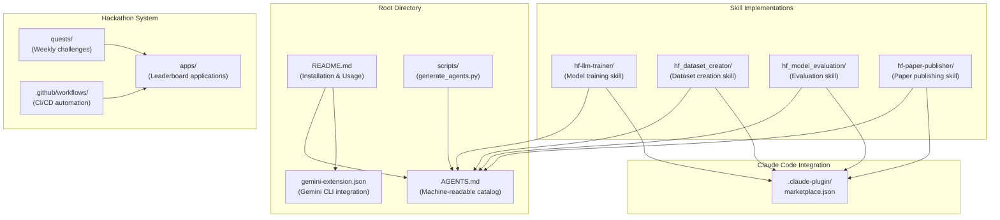
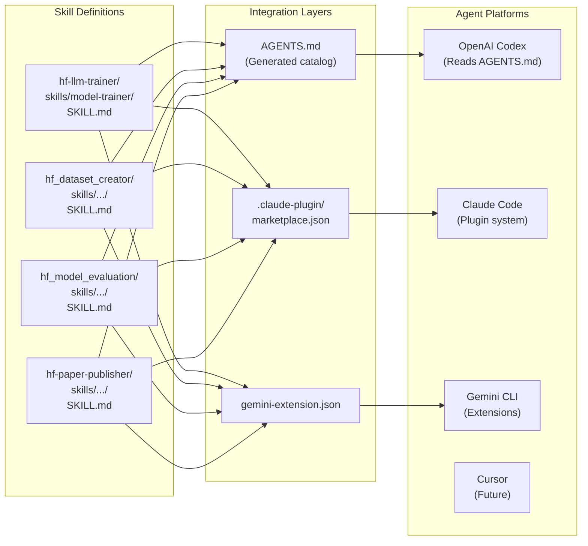
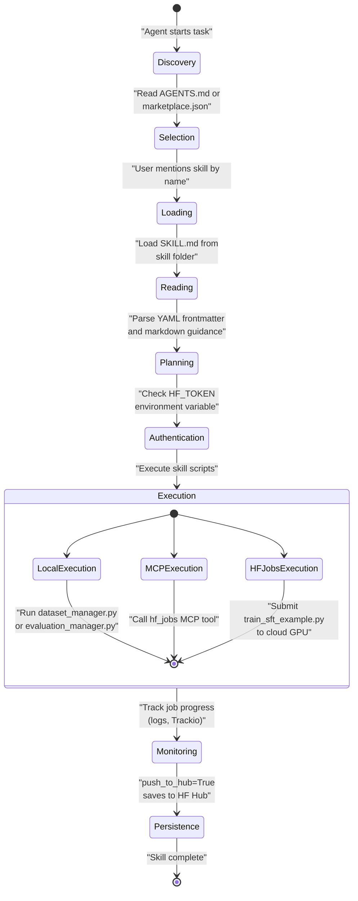
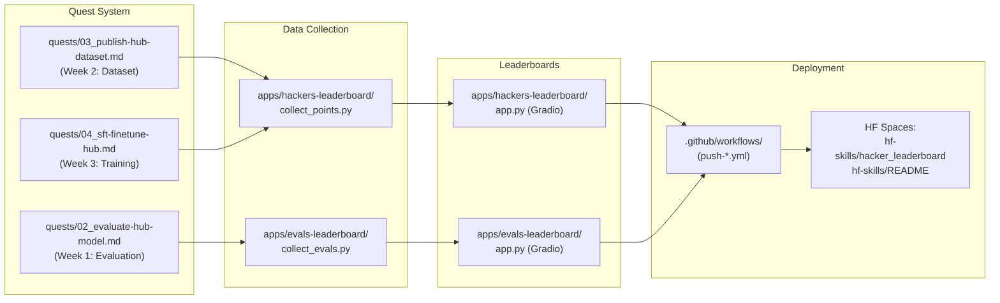

<!-- source: DeepWiki mcp.deepwiki.com · repo huggingface/skills · page 1 Overview · fetched 2026-10-30 -->

# Overview

<details>
<summary>Relevant source files</summary>

The following files were used as context for generating this wiki page:

- [.gitignore](.gitignore)
- [LICENSE](LICENSE)
- [README.md](README.md)
- [assets/banner.png](assets/banner.png)

</details>


## Purpose and Scope

This document provides an overview of the Hugging Face Skills repository, a system that enables AI coding agents to perform machine learning tasks through standardized skill definitions. The repository implements the Agent Context Protocol (ACP), providing interoperable skill packages for dataset creation, model training, evaluation management, and paper publishing across multiple agent platforms including Claude Code, OpenAI Codex, Gemini CLI, and Cursor.

This overview covers the fundamental concepts, repository structure, and architecture. For detailed information about specific components:
- For the SKILL.md format and AGENTS.md catalog, see [Core Skills Framework](#2)
- For platform-specific integration details, see [Agent Integration](#3)
- For individual skill documentation, see [Available Skills](#4)
- For the hackathon system, see [Hackathon Ecosystem](#5)

**Sources:** [README.md:1-107]()

## What are Hugging Face Skills?

Hugging Face Skills are self-contained folders that package instructions, scripts, and resources for AI agents to complete specific ML/AI tasks. Each skill folder contains:

- **SKILL.md**: A markdown file with YAML frontmatter defining the skill's name and description, followed by guidance, examples, and guardrails for the agent
- **scripts/**: Executable Python scripts that implement the skill's functionality
- **templates/**: Reusable patterns and configuration files (where applicable)

The term "skill" originates from Anthropic's Claude AI terminology, though the repository supports multiple agent platforms through different integration mechanisms.

**Sources:** [README.md:5-10]()

## Repository Structure

The repository follows a modular structure with four main skill implementations, agent integration adapters, and a hackathon ecosystem:



Each skill folder contains its own `SKILL.md` file and supporting resources. The `scripts/generate_agents.py` file collects all SKILL.md files to generate the `AGENTS.md` catalog.

**Sources:** [README.md:64-76](), Diagram 1, Diagram 4

## Agent Context Protocol (ACP)

The Agent Context Protocol defines how skills are structured and discovered by AI agents. The protocol has two key components:

### SKILL.md Format

Each skill is defined by a `SKILL.md` file with the following structure:

```markdown
---
name: skill-name
description: Brief description of what the skill does and when to use it
---

# Skill Title

Guidance section with instructions for the agent

## Examples
Code examples and usage patterns

## Guardrails
Critical constraints and error conditions to avoid
```

The YAML frontmatter provides metadata for skill discovery, while the markdown body provides agent-readable guidance.

### AGENTS.md Catalog

The `AGENTS.md` file is a machine-readable catalog generated from all SKILL.md files in the repository. OpenAI Codex and similar agents use this catalog to discover available skills. The catalog is generated by `scripts/generate_agents.py` and validated by CI workflows.

**Sources:** [README.md:5-10](), [README.md:91-100](), Diagram 2

## Multi-Agent Compatibility

The repository supports multiple AI coding agents through different integration mechanisms:



**Integration Methods:**

| Agent Platform | Integration Method | Key File |
|----------------|-------------------|----------|
| Claude Code | Plugin marketplace system | `.claude-plugin/marketplace.json` |
| OpenAI Codex | AGENTS.md catalog | `AGENTS.md` |
| Gemini CLI | Extension JSON | `gemini-extension.json` |
| Cursor | Future integration | TBD |

The multi-agent approach allows the same skill definitions to work across different agent tools without modification.

**Sources:** [README.md:3](), [README.md:10](), [README.md:12-62](), Diagram 2

## System Architecture

The following diagram shows the complete system architecture with actual code entities and their relationships:

```mermaid
graph TB
    subgraph "Core Framework"
        README_FILE["README.md"]
        SKILL_FORMAT["SKILL.md format<br/>(YAML + Markdown)"]
        GEN_SCRIPT["scripts/generate_agents.py"]
        AGENTS_OUTPUT["AGENTS.md"]
        TEMPLATE["scripts/AGENTS_TEMPLATE.md"]
    end
    
    subgraph "Agent Adapters"
        CLAUDE_JSON[".claude-plugin/marketplace.json"]
        GEMINI_EXT["gemini-extension.json"]
        CODEX_READER["Codex AGENTS.md reader"]
    end
    
    subgraph "Skill: hf-llm-trainer"
        TRAINER_SKILL["skills/model-trainer/SKILL.md"]
        TRAIN_SFT["scripts/train_sft_example.py"]
        TRAIN_DPO["scripts/train_dpo_example.py"]
        ESTIMATE["scripts/estimate_cost.py"]
        CONVERT_GGUF["scripts/convert_to_gguf.py"]
    end
    
    subgraph "Skill: hf_dataset_creator"
        DATASET_SKILL["skills/hugging-face-dataset-creator/SKILL.md"]
        DATASET_MGR["scripts/dataset_manager.py"]
        TEMPLATES_DIR["templates/<br/>(chat, qa, completion, etc)"]
    end
    
    subgraph "Skill: hf_model_evaluation"
        EVAL_SKILL["skills/hugging-face-evaluation-manager/SKILL.md"]
        EVAL_MGR["scripts/evaluation_manager.py"]
        INSPECT_EVAL["scripts/inspect_eval_uv.py"]
    end
    
    subgraph "Skill: hf-paper-publisher"
        PAPER_SKILL["skills/hugging-face-paper-publisher/SKILL.md"]
        PAPER_SCRIPTS["scripts/<br/>(paper management)"]
    end
    
    subgraph "Hackathon Apps"
        QUESTS_DIR["quests/<br/>(*.md challenge files)"]
        COLLECT_HACKERS["apps/hackers-leaderboard/collect_points.py"]
        COLLECT_EVALS["apps/evals-leaderboard/collect_evals.py"]
        HACKERS_APP["apps/hackers-leaderboard/app.py"]
        EVALS_APP["apps/evals-leaderboard/app.py"]
    end
    
    subgraph "External Platform"
        HF_JOBS["Hugging Face Jobs API"]
        HF_HUB["Hugging Face Hub"]
        HF_DATASETS["HF Datasets<br/>(leaderboard data)"]
        HF_SPACES["HF Spaces<br/>(deployed apps)"]
    end
    
    SKILL_FORMAT --> TRAINER_SKILL
    SKILL_FORMAT --> DATASET_SKILL
    SKILL_FORMAT --> EVAL_SKILL
    SKILL_FORMAT --> PAPER_SKILL
    
    TRAINER_SKILL --> GEN_SCRIPT
    DATASET_SKILL --> GEN_SCRIPT
    EVAL_SKILL --> GEN_SCRIPT
    PAPER_SKILL --> GEN_SCRIPT
    TEMPLATE --> GEN_SCRIPT
    GEN_SCRIPT --> AGENTS_OUTPUT
    
    TRAINER_SKILL --> CLAUDE_JSON
    DATASET_SKILL --> CLAUDE_JSON
    EVAL_SKILL --> CLAUDE_JSON
    PAPER_SKILL --> CLAUDE_JSON
    
    AGENTS_OUTPUT --> CODEX_READER
    README_FILE --> GEMINI_EXT
    
    TRAIN_SFT --> HF_JOBS
    TRAIN_DPO --> HF_JOBS
    DATASET_MGR --> HF_HUB
    EVAL_MGR --> HF_HUB
    PAPER_SCRIPTS --> HF_HUB
    
    QUESTS_DIR --> COLLECT_HACKERS
    COLLECT_HACKERS --> HF_DATASETS
    COLLECT_EVALS --> HF_DATASETS
    HF_DATASETS --> HACKERS_APP
    HF_DATASETS --> EVALS_APP
    HACKERS_APP --> HF_SPACES
    EVALS_APP --> HF_SPACES
```



The architecture separates concerns into distinct layers:

1. **Core Framework**: SKILL.md format definition and AGENTS.md generation
2. **Agent Adapters**: Platform-specific integration files
3. **Skill Implementations**: Four specialized skills with scripts and templates
4. **Hackathon Apps**: Quest definitions and leaderboard tracking systems
5. **External Platform**: Hugging Face infrastructure for execution and persistence

**Sources:** Diagram 1, Diagram 4, [README.md:64-76]()

## Skill Execution Lifecycle

When an agent uses a skill, it follows this execution flow:



**Key Execution Points:**

1. **Discovery**: Agent identifies available skills via `AGENTS.md` or `.claude-plugin/marketplace.json`
2. **Loading**: Agent loads the specific `SKILL.md` file from the skill's folder
3. **Planning**: Agent parses YAML frontmatter (name, description) and markdown guidance
4. **Authentication**: Agent verifies `HF_TOKEN` environment variable for Hub access
5. **Execution**: Three modes:
   - Local scripts: `dataset_manager.py`, `evaluation_manager.py`
   - MCP tools: `hf_jobs` tool for job submission
   - HF Jobs: Cloud GPU execution of `train_sft_example.py`, `train_dpo_example.py`
6. **Persistence**: Results saved to Hugging Face Hub with `push_to_hub=True`

**Sources:** Diagram 6, [README.md:77-87]()

## Available Skills

The repository provides four production-ready skills:

### Model Training (hf-llm-trainer)

Located in `hf-llm-trainer/`, this skill provides comprehensive LLM training capabilities including SFT, DPO, GRPO, and reward modeling. Key scripts:
- `scripts/train_sft_example.py`: Supervised fine-tuning
- `scripts/train_dpo_example.py`: Direct preference optimization
- `scripts/estimate_cost.py`: GPU cost estimation
- `scripts/convert_to_gguf.py`: Model conversion for local deployment

See [Model Trainer Skill](#4.1) for detailed documentation.

### Dataset Creation (hf_dataset_creator)

Located in `hf_dataset_creator/`, this skill enables dataset creation and management with templates for common formats. Key components:
- `scripts/dataset_manager.py`: Dataset CRUD operations
- `templates/`: Pre-built templates for chat, QA, classification, etc.

See [Dataset Creator Skill](#4.2) for detailed documentation.

### Evaluation Management (hf_model_evaluation)

Located in `hf_model_evaluation/`, this skill manages model evaluation results and metadata. Key scripts:
- `scripts/evaluation_manager.py`: Model card evaluation management
- `scripts/inspect_eval_uv.py`: Inspect-AI framework integration

See [Evaluation Manager Skill](#4.3) for detailed documentation.

### Paper Publishing (hf-paper-publisher)

Located in `hf-paper-publisher/`, this skill handles research paper publishing and linking on Hugging Face Hub, including arXiv indexing and model/dataset associations.

See [Paper Publisher Skill](#4.4) for detailed documentation.

**Sources:** [README.md:64-76](), Diagram 4

## Hackathon Ecosystem

The repository includes a hackathon system called "Humanity's Last Hackathon" with weekly quests, participant tracking, and dual leaderboards:



Participants complete weekly quests using the skills, and their contributions are automatically tracked and displayed on public leaderboards hosted on Hugging Face Spaces.

See [Hackathon Ecosystem](#5) for detailed documentation.

**Sources:** Diagram 3, Diagram 5

## CI/CD and Validation

The repository uses GitHub Actions workflows for continuous integration and deployment:

| Workflow | File | Purpose |
|----------|------|---------|
| AGENTS.md validation | `.github/workflows/generate-agents.yml` | Ensures `AGENTS.md` stays in sync with SKILL.md files |
| Hackers leaderboard deployment | `.github/workflows/push-hackers-leaderboard.yml` | Deploys to HF Spaces on changes |
| Evals leaderboard deployment | `.github/workflows/push-evals-leaderboard.yml` | Deploys to HF Spaces on changes |
| Quests deployment | `.github/workflows/push-quests.yml` | Syncs quest content to HF Spaces |

The validation workflow fails pull requests if `AGENTS.md` is out of sync, requiring developers to manually run `scripts/generate_agents.py` to regenerate the catalog.

See [CI/CD Workflows](#6.3) for detailed documentation.

**Sources:** Diagram 5

## Contributing and Customization

To create a custom skill:

1. Copy an existing skill folder (e.g., `hf_dataset_creator/`)
2. Update the `SKILL.md` frontmatter with a unique name and description
3. Add or modify scripts in the `scripts/` directory
4. Run `python scripts/generate_agents.py` to update `AGENTS.md`
5. Submit a pull request

The modular architecture allows skills to be developed independently while maintaining compatibility with all supported agent platforms.

See [Creating Custom Skills](#6.1) for a step-by-step guide.

**Sources:** [README.md:88-103]()

---

