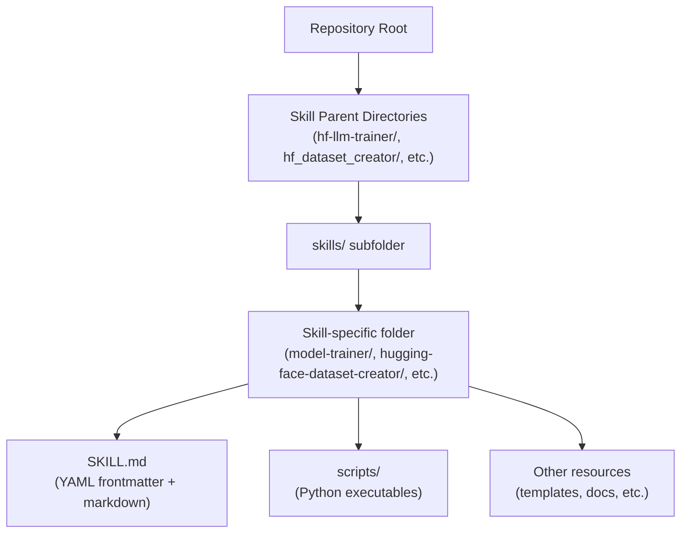
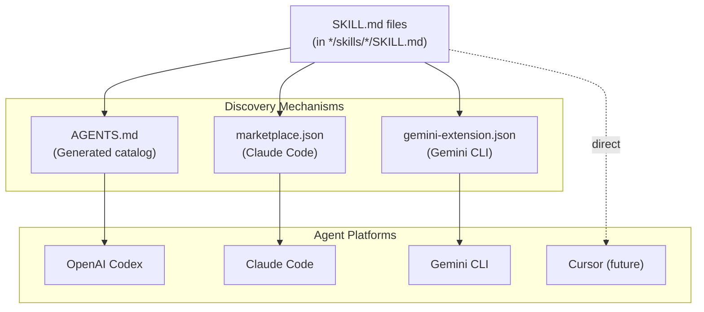
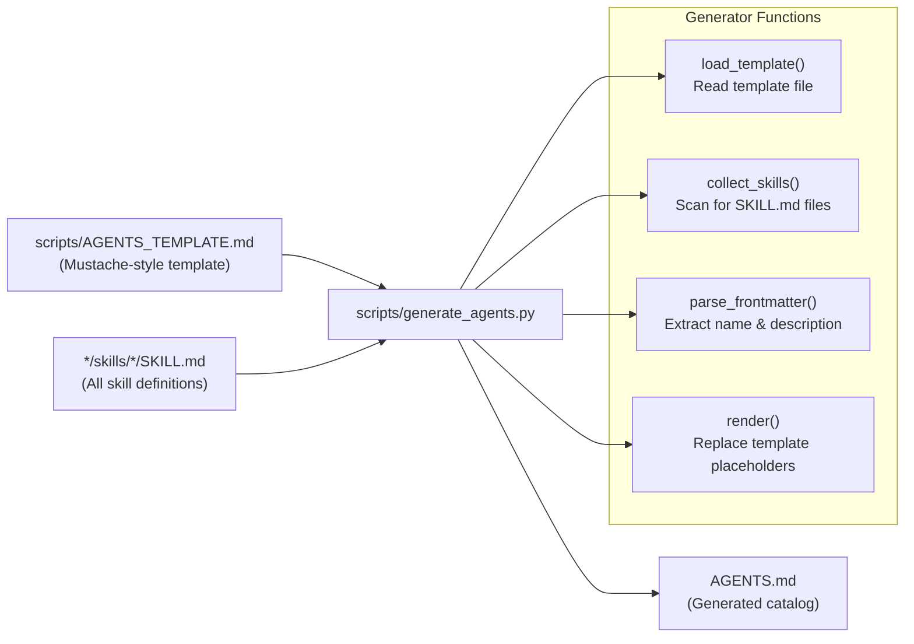
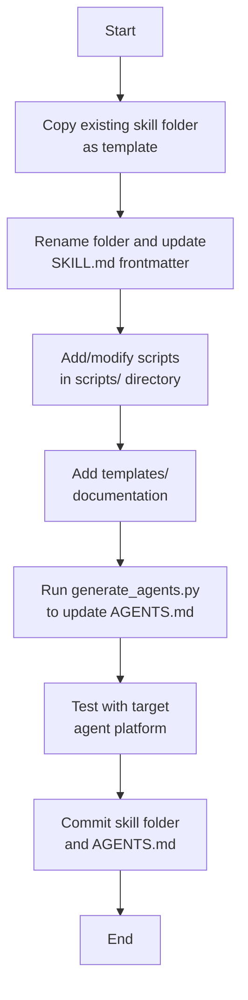
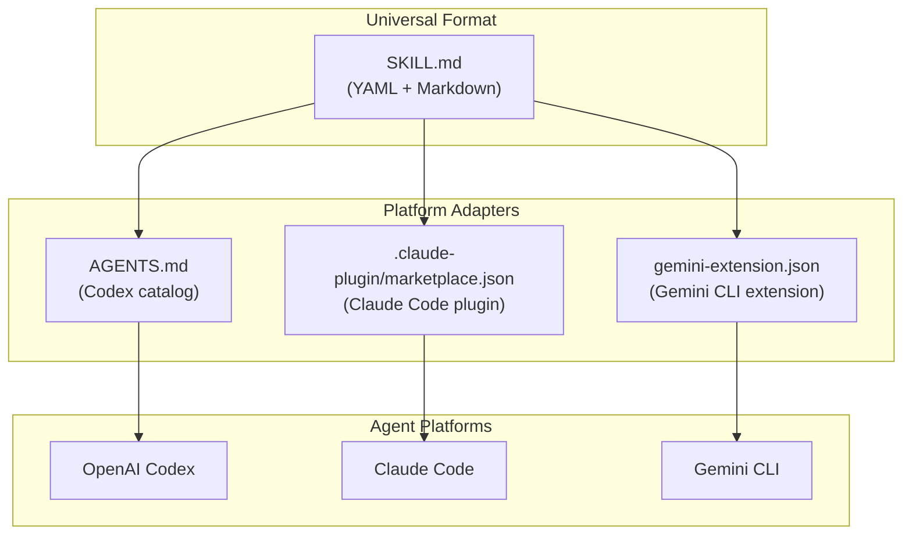

<!-- source: DeepWiki mcp.deepwiki.com · repo huggingface/skills · page 2 Core Skills Framework · fetched 2026-10-30 -->

# Core Skills Framework

<details>
<summary>Relevant source files</summary>

The following files were used as context for generating this wiki page:

- [.github/workflows/generate-agents.yml](.github/workflows/generate-agents.yml)
- [.gitignore](.gitignore)
- [AGENTS.md](AGENTS.md)
- [LICENSE](LICENSE)
- [README.md](README.md)
- [assets/banner.png](assets/banner.png)
- [scripts/AGENTS_TEMPLATE.md](scripts/AGENTS_TEMPLATE.md)
- [scripts/generate_agents.py](scripts/generate_agents.py)

</details>


## Purpose and Scope

This document describes the Core Skills Framework, which defines how skills are structured, discovered, and integrated with AI coding agents. It covers the Agent Context Protocol (ACP), the skill folder structure, and the AGENTS.md catalog generation system.

For detailed specifications of the SKILL.md file format, see [SKILL.md Format](#2.1). For the AGENTS.md catalog system implementation, see [AGENTS.md Catalog System](#2.2). For agent-specific integration details, see [Agent Integration](#3).

## Overview

The Core Skills Framework establishes a standard for packaging AI agent capabilities as self-contained, interoperable units. Each skill consists of a folder containing a `SKILL.md` file with YAML frontmatter (metadata) and markdown guidance, plus supporting scripts and resources.

The framework serves three primary functions:

1. **Skill Definition**: Provides a standardized format (`SKILL.md`) for describing agent capabilities
2. **Skill Discovery**: Generates a machine-readable catalog (`AGENTS.md`) of all available skills
3. **Multi-Agent Compatibility**: Supports Claude Code, OpenAI Codex, Gemini CLI, and other agent platforms

Sources: [README.md:1-107]()

## Agent Context Protocol (ACP)

The Agent Context Protocol is the conceptual model underlying the Skills Framework. In practice, ACP refers to the convention of using `SKILL.md` files with YAML frontmatter to define agent capabilities.

### Core ACP Principles

| Principle | Implementation |
|-----------|----------------|
| **Self-Contained** | Each skill is a complete folder with instructions, scripts, and resources |
| **Declarative Metadata** | YAML frontmatter declares `name` and `description` fields |
| **Human-Readable Guidance** | Markdown content provides examples, guardrails, and instructions |
| **Agent-Agnostic** | Same skill definition works across multiple agent platforms |

The ACP convention allows agents to:
- Discover skills by scanning for `SKILL.md` files
- Parse metadata from YAML frontmatter
- Load full instructions from markdown content
- Execute supporting scripts relative to the skill folder

Sources: [README.md:3-11]()

## Skills Directory Structure

Skills follow a consistent directory pattern that enables automatic discovery and catalog generation.



**Directory Pattern**: The generator searches for `SKILL.md` files using the glob pattern `*/skills/*/SKILL.md` from the repository root.

### Example Structure

```
hf-llm-trainer/
  skills/
    model-trainer/
      SKILL.md              # Skill definition with YAML frontmatter
      scripts/
        train_sft_example.py
        estimate_cost.py
        convert_to_gguf.py
      resources/
        documentation.md
```

Sources: [scripts/generate_agents.py:35-49]()

## SKILL.md File Structure

Each `SKILL.md` file contains two parts:

1. **YAML Frontmatter**: Enclosed in `---` delimiters, contains `name` and `description` fields
2. **Markdown Content**: Provides detailed guidance, examples, and guardrails for the agent

### Minimal Example

```markdown
---
name: skill-name
description: Brief description of what the skill does and when to use it
---

# Skill Title
Detailed guidance, examples, and guardrails for the agent to follow.
```

The frontmatter fields are parsed by [scripts/generate_agents.py:19-30]() to generate the AGENTS.md catalog. Skills missing either `name` or `description` are excluded from the catalog.

Sources: [README.md:88-102](), [scripts/generate_agents.py:19-30]()

## Skill Discovery and Loading

Different agent platforms discover and load skills using different mechanisms, but all rely on the same underlying `SKILL.md` format.



### Discovery Methods by Platform

| Platform | Discovery Method | Installation Command |
|----------|------------------|---------------------|
| **Codex** | Reads `AGENTS.md` automatically | N/A (auto-discovered) |
| **Claude Code** | Plugin marketplace system | `/plugin marketplace add huggingface/skills`<br/>`/plugin install <skill>@huggingface-skills` |
| **Gemini CLI** | Extension system with `gemini-extension.json` | `gemini extensions install .` |

When an agent needs to use a skill:

1. **Discovery**: Agent identifies relevant skill from catalog or marketplace
2. **Loading**: Agent reads the full `SKILL.md` file from the skill folder
3. **Execution**: Agent follows guidance and executes scripts relative to skill folder path

Sources: [README.md:12-62](), [AGENTS.md:1-24]()

## AGENTS.md Generation System

The `AGENTS.md` file is a machine-readable catalog generated from all `SKILL.md` files in the repository. It provides a quick lookup for Codex-style agents to discover available skills without scanning the filesystem.

### Generation Process



### Generator Implementation

The [scripts/generate_agents.py:1-81]() script performs four operations:

1. **load_template()** [15-16](): Reads [scripts/AGENTS_TEMPLATE.md:1-23]()
2. **collect_skills()** [33-49](): Globs `*/skills/*/SKILL.md` and extracts metadata
3. **parse_frontmatter()** [19-30](): Extracts `name` and `description` from YAML
4. **render()** [52-68](): Replaces `{{#skills}}...{{/skills}}` template loop

The template uses a minimal Mustache-like syntax with three placeholders:
- `{{name}}`: Skill name from frontmatter
- `{{description}}`: Skill description from frontmatter  
- `{{path}}`: Relative path to skill folder

### AGENTS.md Structure

The generated [AGENTS.md:1-24]() contains:

```xml
<skills>
You have additional SKILLs documented in directories containing a "SKILL.md" file.

These skills are:
 - skill-name -> "path/to/skill/SKILL.md"
 ...

IMPORTANT: You MUST read the SKILL.md file whenever the description matches user intent.

<available_skills>
skill-name: `Description of skill`
...
</available_skills>

Paths referenced within SKILL folders are relative to that SKILL.
</skills>
```

The format provides:
- **Skill Mapping**: Name → file path lookup
- **Quick Reference**: Name and description for each skill
- **Path Resolution**: Guidance on resolving relative paths within skills

Sources: [scripts/generate_agents.py:1-81](), [scripts/AGENTS_TEMPLATE.md:1-23](), [AGENTS.md:1-24]()

## CI/CD Validation

The framework includes a GitHub Actions workflow that validates `AGENTS.md` stays synchronized with `SKILL.md` files.

### Validation Workflow

The [.github/workflows/generate-agents.yml:1-32]() workflow:

1. **Triggers** on PRs that modify:
   - `scripts/AGENTS_TEMPLATE.md`
   - `scripts/generate_agents.py`
   - Any `**/SKILL.md` file
   - `AGENTS.md` itself

2. **Validates** by:
   - Running `python scripts/generate_agents.py`
   - Comparing output to committed `AGENTS.md`
   - Failing the PR if differences exist

This ensures developers must regenerate `AGENTS.md` when skill definitions change, keeping the catalog in sync with skill implementations.

### Manual Regeneration

To update `AGENTS.md` after modifying skills:

```bash
python scripts/generate_agents.py
git add AGENTS.md
git commit -m "Update AGENTS.md"
```

Sources: [.github/workflows/generate-agents.yml:1-32]()

## Skill Development Pattern

Creating a new skill follows this pattern:



### Required Components

| Component | Purpose | Required |
|-----------|---------|----------|
| `SKILL.md` | Skill definition with YAML frontmatter | ✓ |
| `name` field | Unique identifier for skill | ✓ |
| `description` field | Brief description for discovery | ✓ |
| `scripts/` directory | Executable tools | Optional |
| Templates/resources | Reusable patterns | Optional |

### Frontmatter Requirements

The [scripts/generate_agents.py:36-46]() parser requires:
- Valid YAML between `---` delimiters
- `name` field (string)
- `description` field (string)

Skills missing either field are silently excluded from the generated catalog [line 39-40]().

Sources: [README.md:88-103](), [scripts/generate_agents.py:33-49]()

## Path Resolution

Skills reference internal files using paths relative to their skill folder. Agent platforms must resolve these paths correctly.

### Resolution Rules

From [AGENTS.md:21]():

> Paths referenced within SKILL folders are relative to that SKILL. For example the hf_dataset_creator `scripts/example.py` would be referenced as `hf_dataset_creator/scripts/example.py`.

### Example Path Resolution

For skill at `hf_dataset_creator/skills/hugging-face-dataset-creator/`:

| Reference in SKILL.md | Absolute Path |
|-----------------------|---------------|
| `scripts/dataset_manager.py` | `hf_dataset_creator/skills/hugging-face-dataset-creator/scripts/dataset_manager.py` |
| `templates/chat.json` | `hf_dataset_creator/skills/hugging-face-dataset-creator/templates/chat.json` |
| `../../../README.md` | `README.md` (repository root) |

This convention allows skills to be self-contained while enabling cross-skill references when needed.

Sources: [AGENTS.md:21]()

## Integration with Agent Platforms

The framework supports multiple agent platforms through different integration layers while maintaining a single skill definition format.

### Integration Architecture



### Platform-Specific Files

| Platform | Adapter File | Purpose |
|----------|-------------|---------|
| Codex | `AGENTS.md` | Machine-readable skill catalog |
| Claude Code | `.claude-plugin/marketplace.json` | Plugin marketplace registration |
| Gemini CLI | `gemini-extension.json` | Extension metadata and entrypoint |

All platforms ultimately read the same `SKILL.md` files, but use different mechanisms for initial discovery and registration.

Sources: [README.md:12-62]()

## Framework Design Principles

The Core Skills Framework follows these design principles:

### Separation of Concerns

- **Skill Logic**: Contained in `SKILL.md` (agent-agnostic)
- **Platform Integration**: Handled by adapter files (platform-specific)
- **Catalog Generation**: Automated via `generate_agents.py`
- **Validation**: Enforced via GitHub Actions CI

### Deterministic Generation

The [scripts/generate_agents.py:49]() sorts skills alphabetically by name to ensure consistent output:

```python
return sorted(skills, key=lambda s: s["name"].lower())
```

This prevents spurious diffs in `AGENTS.md` when skills are added or modified.

### Minimal Dependencies

The generator [scripts/generate_agents.py:1-81]() uses only Python standard library:
- `pathlib` for file system operations
- `re` for regex parsing and template rendering
- No external dependencies required

This ensures the framework can run in any Python environment without additional setup.

Sources: [scripts/generate_agents.py:1-81]()

## Currently Available Skills

The repository currently implements four skills following this framework:

| Skill Folder | Skill Name | SKILL.md Path |
|-------------|-----------|---------------|
| `hf-llm-trainer/` | `model-trainer` | `hf-llm-trainer/skills/model-trainer/SKILL.md` |
| `hf_dataset_creator/` | `hugging-face-dataset-creator` | `hf_dataset_creator/skills/hugging-face-dataset-creator/SKILL.md` |
| `hf_model_evaluation/` | `hugging-face-evaluation-manager` | `hf_model_evaluation/skills/hugging-face-evaluation-manager/SKILL.md` |
| `hf-paper-publisher/` | `hugging-face-paper-publisher` | `hf-paper-publisher/skills/hugging-face-paper-publisher/SKILL.md` |

Each skill follows the same structural pattern but specializes in different aspects of the ML workflow. For detailed information about each skill, see [Available Skills](#4).

Sources: [AGENTS.md:5-18](), [README.md:64-76]()

---

