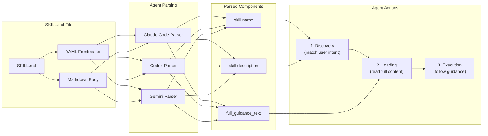

<!-- source: DeepWiki mcp.deepwiki.com · repo huggingface/skills · page 2.1 SKILL.md Format · fetched 2026-10-30 -->

# SKILL.md Format

<details>
<summary>Relevant source files</summary>

The following files were used as context for generating this wiki page:

- [.gitignore](.gitignore)
- [LICENSE](LICENSE)
- [README.md](README.md)
- [assets/banner.png](assets/banner.png)
- [hf-llm-trainer/skills/model-trainer/SKILL.md](hf-llm-trainer/skills/model-trainer/SKILL.md)

</details>


This document provides the technical specification for the `SKILL.md` file format used in the Hugging Face Skills repository. The SKILL.md format defines how skills are packaged and presented to AI coding agents.

For information about how SKILL.md files are aggregated into a catalog, see [AGENTS.md Catalog System](#2.2). For details on specific skill implementations, see [Available Skills](#4).

---

## Purpose and Scope

The `SKILL.md` format is the core file specification for the Agent Context Protocol (ACP) implementation in this repository. Each skill is defined by a single `SKILL.md` file that combines:

- **Machine-readable metadata** (YAML frontmatter) for skill discovery and indexing
- **Human-readable guidance** (Markdown body) for agent instruction and execution

This format enables AI coding agents (Claude Code, Codex, Gemini CLI, etc.) to discover, load, and execute skills without modification to the agent itself.

---

## File Structure Overview

A `SKILL.md` file consists of two parts separated by YAML frontmatter delimiters:

```mermaid
graph TB
    subgraph "SKILL.md File Structure"
        File["SKILL.md"]
        
        subgraph "Part 1: YAML Frontmatter"
            Open["---"]
            Name["name: skill-identifier"]
            Desc["description: When to use this skill..."]
            License["license: License information"]
            Close["---"]
        end
        
        subgraph "Part 2: Markdown Body"
            Title["# Skill Title"]
            Overview["## Overview section"]
            When["## When to Use This Skill"]
            Directives["## Key Directives"]
            Content["## Additional guidance sections"]
            Examples["## Examples and code"]
            Resources["## Resources"]
        end
        
        File --> Open
        Open --> Name
        Name --> Desc
        Desc --> License
        License --> Close
        Close --> Title
        Title --> Overview
        Overview --> When
        When --> Directives
        Directives --> Content
        Content --> Examples
        Examples --> Resources
    end
    
    style File fill:#f9f9f9
    style Open fill:#e8f4f8
    style Close fill:#e8f4f8
```



**Sources:** [README.md:7-9](), [README.md:91-102](), [hf-llm-trainer/skills/model-trainer/SKILL.md:1-5]()

---

## YAML Frontmatter Specification

The YAML frontmatter is delimited by triple dashes (`---`) at the beginning and end. It contains metadata fields that agents use for skill discovery and selection.

### Required Fields

| Field | Type | Description | Example |
|-------|------|-------------|---------|
| `name` | string | Unique skill identifier (kebab-case) | `model-trainer` |
| `description` | string | When to use this skill (triggers + capabilities) | `This skill should be used when users want to train or fine-tune language models...` |

### Optional Fields

| Field | Type | Description | Example |
|-------|------|-------------|---------|
| `license` | string | License information or reference | `Complete terms in LICENSE.txt` |

### Format Rules

- **Delimiter:** Frontmatter must start and end with `---` on its own line
- **Syntax:** Standard YAML key-value pairs
- **Description Content:** Should describe **when** to invoke the skill and **what** it does
- **Name Convention:** Use kebab-case for skill names (lowercase with hyphens)

### Example Frontmatter

```yaml
---
name: model-trainer
description: This skill should be used when users want to train or fine-tune language models using TRL (Transformer Reinforcement Learning) on Hugging Face Jobs infrastructure. Covers SFT, DPO, GRPO and reward modeling training methods, plus GGUF conversion for local deployment. Includes guidance on the TRL Jobs package, UV scripts with PEP 723 format, dataset preparation and validation, hardware selection, cost estimation, Trackio monitoring, Hub authentication, and model persistence. Should be invoked for tasks involving cloud GPU training, GGUF conversion, or when users mention training on Hugging Face Jobs without local GPU setup.
license: Complete terms in LICENSE.txt
---
```

**Sources:** [hf-llm-trainer/skills/model-trainer/SKILL.md:1-5](), [README.md:92-96]()

---

## Markdown Body Format

The Markdown body follows standard GitHub Flavored Markdown syntax and contains the actual guidance that agents read and follow when executing the skill.

### Structural Requirements

The body should be organized with clear hierarchical sections using Markdown headings:

```markdown
# Skill Title

## Overview
High-level description of what the skill does

## When to Use This Skill
Specific scenarios and use cases

## Key Directives
Critical instructions agents must follow (e.g., "ALWAYS use X", "NEVER do Y")

## [Domain-Specific Sections]
Additional guidance organized by topic

## Examples
Concrete code examples and usage patterns

## Resources
Links to external documentation, helper scripts, reference materials
```

### Content Guidelines

**Directive Syntax:**
- Use **numbered lists** for sequential steps
- Use **bold text** for emphasis on critical points (e.g., `**ALWAYS**`, `**MUST**`, `**CRITICAL**`)
- Use **warning markers** for common pitfalls (e.g., `⚠️ IMPORTANT:`)
- Use **checkboxes** for verification steps (e.g., `- [ ] Check authentication`)

**Code Examples:**
- Include language identifiers in fenced code blocks (e.g., `` ```python ``)
- Provide complete, runnable examples when possible
- Show both correct (`✅`) and incorrect (`❌`) patterns

**Cross-References:**
- Reference helper scripts: `` `scripts/train_sft_example.py` ``
- Reference documentation: `` `references/training_methods.md` ``
- Link to external resources with context

**Sources:** [hf-llm-trainer/skills/model-trainer/SKILL.md:7-694]()

---

## Content Organization Patterns

Analysis of existing SKILL.md files reveals common organizational patterns:


### Section Type Reference

| Section Type | Purpose | Example From Codebase |
|--------------|---------|----------------------|
| **Overview** | Introduce the skill's domain and capabilities | [hf-llm-trainer/skills/model-trainer/SKILL.md:9-27]() |
| **When to Use** | Define trigger conditions for agent invocation | [hf-llm-trainer/skills/model-trainer/SKILL.md:29-38]() |
| **Key Directives** | Provide critical instructions (MUST/NEVER statements) | [hf-llm-trainer/skills/model-trainer/SKILL.md:40-49]() |
| **Prerequisites** | List requirements before execution | [hf-llm-trainer/skills/model-trainer/SKILL.md:58-79]() |
| **Quick Start** | Provide multiple usage approaches | [hf-llm-trainer/skills/model-trainer/SKILL.md:119-334]() |
| **Configuration** | Document options and settings | [hf-llm-trainer/skills/model-trainer/SKILL.md:337-354]() |
| **Examples** | Show concrete implementation patterns | [hf-llm-trainer/skills/model-trainer/SKILL.md:432-443]() |
| **Troubleshooting** | Address common failure modes | [hf-llm-trainer/skills/model-trainer/SKILL.md:605-662]() |
| **Resources** | Link to scripts, references, external docs | [hf-llm-trainer/skills/model-trainer/SKILL.md:665-693]() |

**Sources:** [hf-llm-trainer/skills/model-trainer/SKILL.md]()

---

## Agent Consumption Model

Different AI agents parse and consume SKILL.md files in different ways based on their architecture:



### Parsing Stages

**Stage 1: Discovery**
- Agent reads `name` and `description` from frontmatter
- Compares `description` content to user request
- Determines if skill is applicable

**Stage 2: Loading**
- Agent loads complete Markdown body
- Parses sections, code blocks, and directives
- Builds internal representation of guidance

**Stage 3: Execution**
- Agent follows instructions from Markdown body
- References code examples and helper scripts
- Executes tasks according to directives

### Multi-Agent Compatibility

The format supports three integration modes:

| Agent | Discovery Method | Loading Method | Integration File |
|-------|-----------------|----------------|------------------|
| **Claude Code** | Plugin marketplace JSON | Direct SKILL.md read | `.claude-plugin/marketplace.json` |
| **Codex** | AGENTS.md catalog | SKILL.md reference | `AGENTS.md` |
| **Gemini CLI** | Extension JSON | Direct SKILL.md read | `gemini-extension.json` |

All three agents consume the same SKILL.md format, but use different index files for discovery.

**Sources:** [README.md:14-62](), Diagram 2 from system context

---

## File Location Conventions

SKILL.md files follow a specific directory structure:

```
{skill-folder}/
├── skills/
│   └── {skill-name}/
│       └── SKILL.md          ← The skill definition file
├── scripts/                  ← Helper scripts referenced in SKILL.md
│   ├── train_sft_example.py
│   └── estimate_cost.py
├── references/               ← Additional documentation
│   ├── training_methods.md
│   └── hardware_guide.md
└── resources/                ← Templates and other resources
```

### Path Reference Patterns

When referencing files within a SKILL.md, use relative paths from the skill's root directory:

```markdown
**See:** `scripts/train_sft_example.py` for complete implementation
**See:** `references/training_methods.md` for method comparison
```

**Sources:** [hf-llm-trainer/skills/model-trainer/SKILL.md:437-442](), [hf-llm-trainer/skills/model-trainer/SKILL.md:666-693]()

---

## Complete Example

Below is an annotated minimal SKILL.md file showing all required components:

```markdown
---
name: example-skill
description: This skill should be used when users need to perform X task using Y method. Provides guidance on A, B, and C. Should be invoked for scenarios involving D or when users mention E.
license: Apache 2.0
---

# Example Skill Title

## Overview

Brief description of what this skill enables. Include:
- Primary capability
- Key technologies/libraries used
- Expected outcomes

## When to Use This Skill

Use this skill when users want to:
- Specific scenario 1
- Specific scenario 2
- Specific scenario 3

## Key Directives

When assisting with this skill:

1. **ALWAYS do X** - Explain why this is critical
2. **NEVER do Y** - Explain the consequences
3. **Check Z first** - Prerequisites or validation

## Quick Start

### Approach 1: Primary Method

```python
# Complete, runnable example
from library import Tool

result = Tool.execute(
    param1="value1",
    param2="value2"
)
```

### Approach 2: Alternative Method

For different scenarios, use this approach...

## Configuration Options

| Parameter | Type | Default | Description |
|-----------|------|---------|-------------|
| `param1` | str | required | What this controls |
| `param2` | int | 100 | What this controls |

## Common Failure Modes

### Error: "Something went wrong"

**Fix:**
1. Check condition A
2. Verify setting B
3. Retry with option C

## Resources

### Scripts (In This Skill)
- `scripts/helper.py` - What it does
- `scripts/validator.py` - What it does

### External Links
- [Library Documentation](https://example.com)
- [API Reference](https://example.com/api)

## Key Takeaways

1. **Remember X** - Critical point
2. **Always Y** - Important pattern
3. **Use Z** - Best practice
```

**Sources:** [README.md:91-102](), [hf-llm-trainer/skills/model-trainer/SKILL.md:1-694]()

---

## Writing Guidelines

When creating or modifying SKILL.md files, follow these guidelines:

### DO:
- ✅ **Be specific in descriptions** - Mention exact technologies, methods, and use cases
- ✅ **Use clear action verbs** - "Submit", "Configure", "Validate" instead of "Handle", "Deal with"
- ✅ **Provide complete examples** - Show full code that actually runs
- ✅ **Highlight critical paths** - Use bold, warnings, and checkboxes for important steps
- ✅ **Reference concrete files** - Link to actual scripts and docs in the repository

### DON'T:
- ❌ **Use vague language** - Avoid "generally", "usually", "might"
- ❌ **Assume context** - Explicitly state prerequisites and requirements
- ❌ **Leave examples incomplete** - Partial code confuses agents
- ❌ **Skip error handling** - Include common failure modes and fixes
- ❌ **Forget the agent audience** - Write for AI that reads literally

**Sources:** [hf-llm-trainer/skills/model-trainer/SKILL.md:40-49]() (Key Directives pattern)

---

## Validation

To verify a SKILL.md file is correctly formatted:

### Manual Checks

1. **Frontmatter delimiters** - Must have `---` on lines before and after YAML
2. **Required fields** - `name` and `description` must be present
3. **Name format** - Use kebab-case (lowercase with hyphens)
4. **Description completeness** - Should describe when to use AND what it does
5. **Markdown validity** - Must parse as valid GitHub Flavored Markdown

### Automated Validation

The repository includes a CI workflow that validates SKILL.md files:

- **Workflow:** `.github/workflows/generate-agents.yml`
- **Validation:** Ensures SKILL.md files can be parsed for AGENTS.md generation
- **Trigger:** Runs on pull requests that modify SKILL.md files

If SKILL.md frontmatter is malformed or missing required fields, the CI will fail.

**Sources:** [.github/workflows/generate-agents.yml]() (referenced in Diagram 5), README.md context about AGENTS.md generation

---

## Summary

The SKILL.md format provides a standardized way to define AI agent skills through:

1. **YAML frontmatter** for machine-readable metadata (name, description)
2. **Markdown body** for human-readable guidance and instructions
3. **Consistent section patterns** for predictable agent parsing
4. **Multi-agent compatibility** through a simple, portable format

This format enables skills to be:
- **Discovered** by agents matching user intent to descriptions
- **Loaded** as complete instruction sets
- **Executed** by following structured guidance
- **Shared** across different agent platforms without modification

For information on how these individual SKILL.md files are aggregated into a machine-readable catalog, see [AGENTS.md Catalog System](#2.2).

**Sources:** [README.md:3-11](), [README.md:77-86](), [hf-llm-trainer/skills/model-trainer/SKILL.md]()

---

