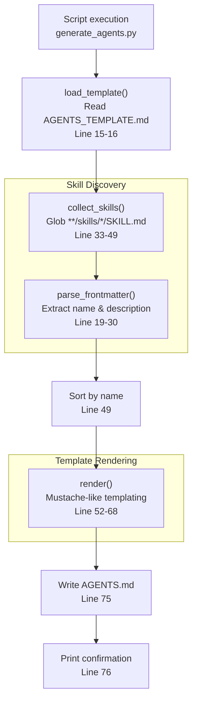
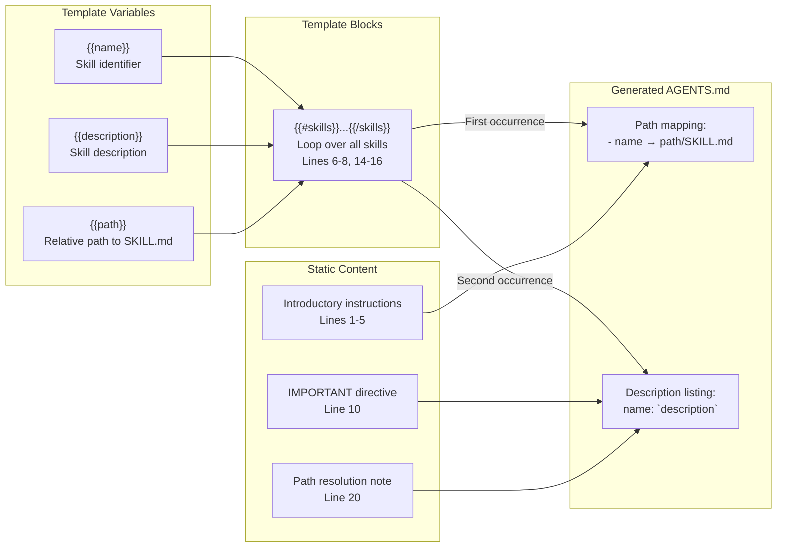
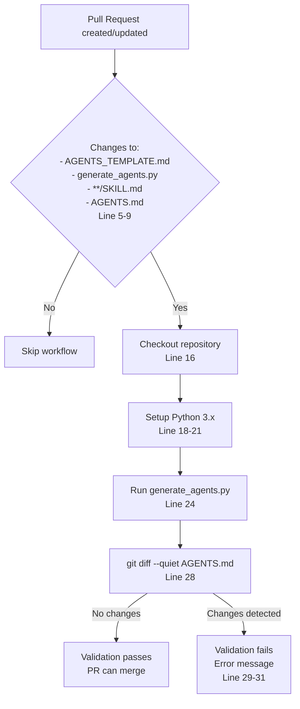
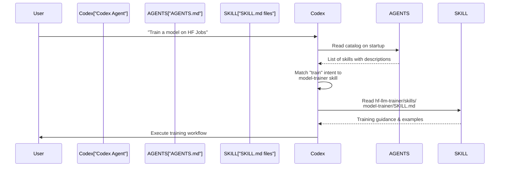

<!-- source: DeepWiki mcp.deepwiki.com · repo huggingface/skills · page 2.2 AGENTS.md Catalog System · fetched 2026-10-30 -->

# AGENTS.md Catalog System

<details>
<summary>Relevant source files</summary>

The following files were used as context for generating this wiki page:

- [.github/workflows/generate-agents.yml](.github/workflows/generate-agents.yml)
- [.gitignore](.gitignore)
- [AGENTS.md](AGENTS.md)
- [LICENSE](LICENSE)
- [README.md](README.md)
- [assets/banner.png](assets/banner.png)
- [scripts/AGENTS_TEMPLATE.md](scripts/AGENTS_TEMPLATE.md)
- [scripts/generate_agents.py](scripts/generate_agents.py)

</details>


## Purpose and Scope

The AGENTS.md Catalog System provides a machine-readable index of all available skills for coding agents that follow the OpenAI Codex conventions. The system automatically generates [AGENTS.md:1-24]() from individual [SKILL.md:1-100]() files using a template-based approach, ensuring that the catalog stays synchronized with skill definitions across the repository.

This document focuses on the generation pipeline, file format, and CI validation of AGENTS.md. For details on the underlying SKILL.md format that serves as the source of truth, see [SKILL.md Format](#2.1). For integration with specific agent platforms, see [OpenAI Codex Integration](#3.2).

---

## AGENTS.md File Structure

The generated AGENTS.md file serves as a central manifest that maps skill names to their respective SKILL.md file locations. The file uses XML-style tags to structure the content and provides two views of the available skills: a path mapping and a description listing.

### File Format

```mermaid
graph TB
    subgraph "AGENTS.md Structure"
        skills_open["&lt;skills&gt; tag<br/>Line 1"]
        intro["Introductory text<br/>Lines 3-5"]
        path_mapping["Path mapping section<br/>skill name → SKILL.md path<br/>Lines 6-9"]
        important["IMPORTANT directive<br/>Line 11"]
        available_open["&lt;available_skills&gt; tag<br/>Line 13"]
        desc_listing["Description listing<br/>name: description<br/>Lines 15-18"]
        available_close["&lt;/available_skills&gt; tag<br/>Line 19"]
        path_note["Path resolution note<br/>Line 21"]
        skills_close["&lt;/skills&gt; tag<br/>Line 23"]
    end
    
    skills_open --> intro
    intro --> path_mapping
    path_mapping --> important
    important --> available_open
    available_open --> desc_listing
    desc_listing --> available_close
    available_close --> path_note
    path_note --> skills_close
```



**Diagram: AGENTS.md Document Structure**

Sources: [AGENTS.md:1-24](), [scripts/AGENTS_TEMPLATE.md:1-23]()

### Content Sections

| Section | Lines | Purpose |
|---------|-------|---------|
| Skills wrapper | 1, 23 | XML-style container for all skill information |
| Path mapping | 6-9 | Direct mapping from skill name to SKILL.md file path |
| Important directive | 11 | Instructs agent to read SKILL.md when description matches user intent |
| Available skills | 13-19 | Backtick-wrapped descriptions for each skill |
| Path resolution | 21 | Explains relative path handling within skill folders |

Sources: [AGENTS.md:1-24]()

---

## Generation System Architecture

The AGENTS.md file is generated programmatically by [scripts/generate_agents.py:1-81](), which scans the repository for SKILL.md files, extracts their frontmatter metadata, and renders them into the final catalog using a template.

### Generation Process Flow



**Diagram: AGENTS.md Generation Pipeline**

Sources: [scripts/generate_agents.py:1-81]()

### Key Functions

#### `load_template()`

Reads the template file from [scripts/AGENTS_TEMPLATE.md:1-23]() which contains Mustache-style placeholders for skill data.

```python
def load_template() -> str:
    return TEMPLATE_PATH.read_text(encoding="utf-8")
```

Sources: [scripts/generate_agents.py:15-16]()

#### `parse_frontmatter()`

Extracts YAML frontmatter from SKILL.md files without external dependencies. Uses regex to locate the `---` delimited block and parses key-value pairs by splitting on colons.

```python
def parse_frontmatter(text: str) -> dict[str, str]:
    match = re.search(r"^---\s*\n(.*?)\n---\s*", text, re.DOTALL)
    # ... parsing logic
```

The function looks for:
- `name`: The skill identifier (kebab-case)
- `description`: Short description of skill purpose and when to use it

Sources: [scripts/generate_agents.py:19-30]()

#### `collect_skills()`

Discovers all SKILL.md files using the glob pattern `*/skills/*/SKILL.md` and extracts their metadata. Returns a sorted list of skill dictionaries containing `name`, `description`, and `path` fields.

The function:
1. Globs for SKILL.md files at [scripts/generate_agents.py:35]()
2. Parses frontmatter from each file at [scripts/generate_agents.py:36]()
3. Validates that both name and description exist at [scripts/generate_agents.py:39]()
4. Computes relative path from repository root at [scripts/generate_agents.py:45]()
5. Sorts alphabetically by skill name for deterministic output at [scripts/generate_agents.py:49]()

Sources: [scripts/generate_agents.py:33-49]()

#### `render()`

Implements a minimal Mustache-style template renderer that only supports `{{#skills}}...{{/skills}}` loop blocks. The renderer:
- Locates loop blocks using regex at [scripts/generate_agents.py:67]()
- Replaces `{{name}}`, `{{description}}`, and `{{path}}` placeholders for each skill at [scripts/generate_agents.py:58-62]()
- Joins rendered blocks with newlines at [scripts/generate_agents.py:64]()

Sources: [scripts/generate_agents.py:52-68]()

---

## Template System

The template at [scripts/AGENTS_TEMPLATE.md:1-23]() defines the structure of the generated AGENTS.md file using Mustache syntax.

### Template Structure Mapping



**Diagram: Template to Output Transformation**

Sources: [scripts/AGENTS_TEMPLATE.md:1-23](), [scripts/generate_agents.py:52-68]()

### Template Loop Sections

The template contains two `{{#skills}}` loop blocks:

1. **Path mapping block** (lines 6-8): Generates the mapping from skill names to SKILL.md paths
   ```
   - {{name}} -> "{{path}}/SKILL.md"
   ```

2. **Description listing block** (lines 14-16): Generates the available_skills section with descriptions
   ```
   {{name}}: `{{description}}`
   ```

Sources: [scripts/AGENTS_TEMPLATE.md:6-8,14-17]()

---

## Continuous Integration Validation

The repository enforces that AGENTS.md stays synchronized with SKILL.md files through a GitHub Actions workflow at [.github/workflows/generate-agents.yml:1-32]().

### CI Workflow Process



**Diagram: CI Validation Workflow**

Sources: [.github/workflows/generate-agents.yml:1-32]()

### Validation Logic

The workflow operates on a validation-only model rather than auto-commit:

1. **Trigger conditions** (lines 3-9): Activates when any of these files change:
   - `scripts/AGENTS_TEMPLATE.md`
   - `scripts/generate_agents.py`
   - Any file matching `**/SKILL.md`
   - `AGENTS.md` itself

2. **Regeneration** (line 24): Runs the generation script to produce a fresh AGENTS.md

3. **Diff check** (lines 27-31): Uses `git diff --quiet` to detect if regenerated file differs from committed version

4. **Failure mode**: If differences exist, the workflow fails with an error message instructing developers to run the script locally and commit the changes

This approach ensures developers are aware when skill definitions change and must explicitly regenerate the catalog.

Sources: [.github/workflows/generate-agents.yml:1-32]()

---

## Integration with Coding Agents

### Codex Usage Pattern

OpenAI Codex automatically loads AGENTS.md when present in a repository. The agent uses the file to discover available skills and loads the corresponding SKILL.md files on demand.



**Diagram: Codex Skill Discovery and Loading**

Sources: [README.md:36-44](), [AGENTS.md:11-18]()

### Verification Command

Users can verify that Codex has loaded the instructions correctly:

```bash
codex --ask-for-approval never "Summarize the current instructions."
```

This command outputs the loaded instructions, which should include content from AGENTS.md and any loaded SKILL.md files.

Sources: [README.md:38-42]()

### Path Resolution

The AGENTS.md file includes guidance on relative path handling at line 21:

> Paths referenced within SKILL folders are relative to that SKILL. For example the hf_dataset_creator `scripts/example.py` would be referenced as `hf_dataset_creator/scripts/example.py`.

This ensures that when agents execute scripts or reference files mentioned in SKILL.md, they construct correct paths relative to the repository root.

Sources: [AGENTS.md:21](), [scripts/AGENTS_TEMPLATE.md:20]()

---

## Skill Catalog Example

The current repository contains four skills registered in AGENTS.md:

| Skill Name | Path | Key Capability |
|------------|------|----------------|
| `hugging-face-dataset-creator` | `hf_dataset_creator/skills/hugging-face-dataset-creator/` | Create and manage datasets with templates |
| `hugging-face-evaluation-manager` | `hf_model_evaluation/skills/hugging-face-evaluation-manager/` | Add evaluation results to model cards |
| `hugging-face-paper-publisher` | `hf-paper-publisher/skills/hugging-face-paper-publisher/` | Publish and link research papers |
| `model-trainer` | `hf-llm-trainer/skills/model-trainer/` | Train LLMs on Hugging Face Jobs (SFT, DPO, GRPO) |

Sources: [AGENTS.md:6-9,15-18]()

---

## Technical Implementation Details

### File System Constants

The generation script defines key paths at [scripts/generate_agents.py:10-12]():

```python
ROOT = Path(__file__).resolve().parent.parent
TEMPLATE_PATH = ROOT / "scripts" / "AGENTS_TEMPLATE.md"
OUTPUT_PATH = ROOT / "AGENTS.md"
```

This ensures the script works correctly regardless of the working directory when executed.

### Skill Discovery Pattern

The glob pattern `*/skills/*/SKILL.md` at [scripts/generate_agents.py:35]() matches the standardized skill folder structure:

```
<skill-folder>/
  skills/
    <skill-name>/
      SKILL.md
      <other files>
```

This pattern assumes all skills follow the convention of placing their SKILL.md file within a `skills/<skill-name>/` subdirectory.

### Frontmatter Parsing Strategy

The `parse_frontmatter()` function implements a minimal YAML parser to avoid external dependencies. It uses a regex pattern `^---\s*\n(.*?)\n---\s*` with `re.DOTALL` flag to capture multi-line frontmatter blocks at [scripts/generate_agents.py:22]().

The parser only extracts simple `key: value` pairs and skips lines without colons at [scripts/generate_agents.py:26-27](), making it suitable for the limited frontmatter structure required by skills.

Sources: [scripts/generate_agents.py:19-30]()

### Deterministic Output

The generation script sorts skills alphabetically by name at [scripts/generate_agents.py:49]() to ensure consistent output across runs. This prevents spurious git diffs when skills are discovered in different orders due to filesystem traversal variations.

---

## Maintenance Workflow

### Adding a New Skill

When adding a new skill to the repository:

1. Create the skill folder structure with a SKILL.md file containing valid frontmatter
2. Run `python scripts/generate_agents.py` to regenerate AGENTS.md
3. Commit both the new SKILL.md and updated AGENTS.md
4. The CI workflow will validate the changes on PR

### Modifying Skill Metadata

When changing a skill's name or description in its SKILL.md frontmatter:

1. Edit the frontmatter in the SKILL.md file
2. Run `python scripts/generate_agents.py`
3. Review the diff in AGENTS.md
4. Commit both files

The CI workflow at [.github/workflows/generate-agents.yml:1-32]() will fail if AGENTS.md is not regenerated after SKILL.md changes, preventing merge until the catalog is updated.

Sources: [.github/workflows/generate-agents.yml:27-31]()

---

## Comparison with Agent-Specific Integration

The AGENTS.md catalog serves Codex-style agents that expect a central manifest. Other agent platforms use different integration approaches:

| Agent Platform | Integration Method | Catalog File |
|----------------|-------------------|--------------|
| **Codex** | Reads AGENTS.md catalog | AGENTS.md (generated) |
| **Claude Code** | Direct skill folder references via marketplace.json | .claude-plugin/marketplace.json (manual) |
| **Gemini CLI** | Repository-level extension registration | gemini-extension.json (manual) |

While Claude and Gemini use manually maintained configuration files that directly reference skill folders, the AGENTS.md approach provides:
- Automated synchronization with skill definitions
- Machine-readable format for bulk skill discovery
- Single source of truth derived from SKILL.md files

For details on Claude and Gemini integration, see [Claude Code Integration](#3.1) and [Gemini CLI Integration](#3.3).

Sources: [README.md:14-62](), [AGENTS.md:1-24]()

---

