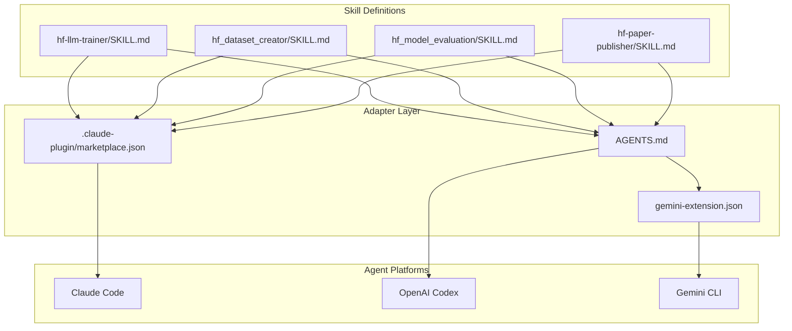
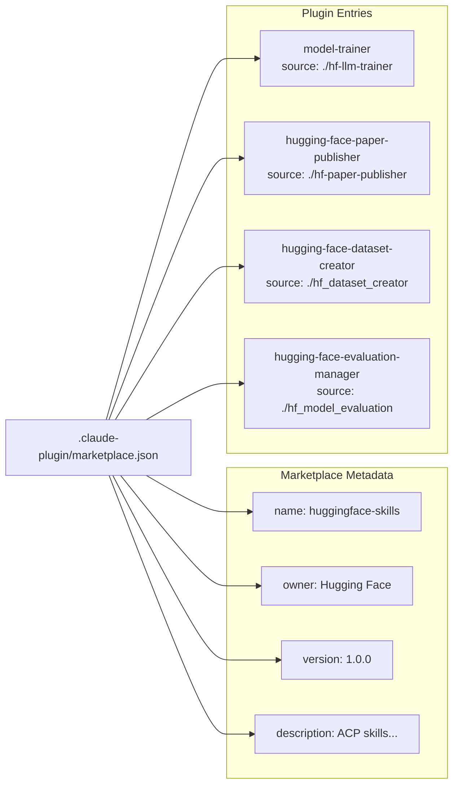
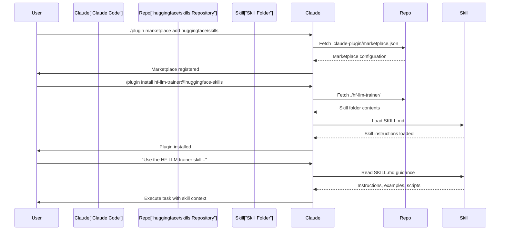
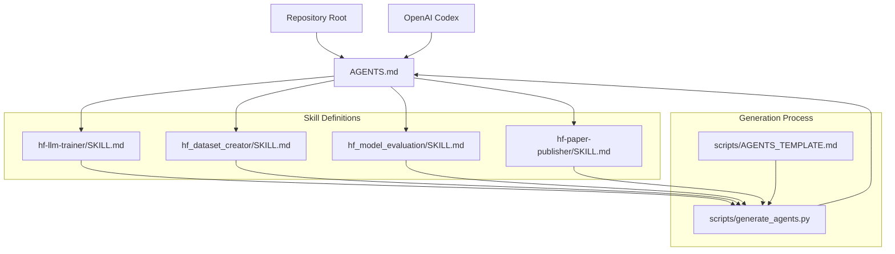
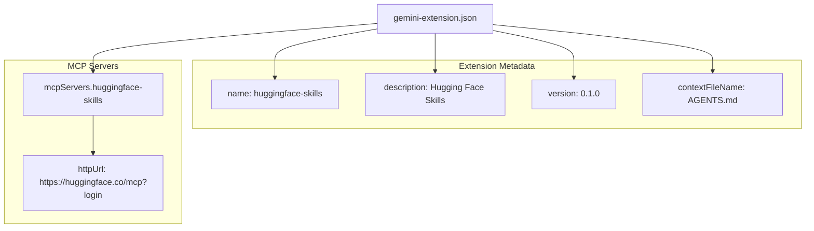
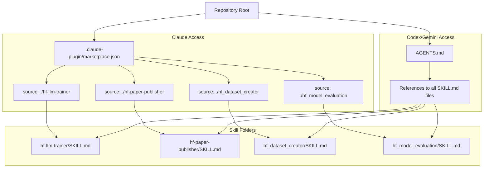

<!-- source: DeepWiki mcp.deepwiki.com · repo huggingface/skills · page 3 Agent Integration · fetched 2026-10-30 -->

# Agent Integration

<details>
<summary>Relevant source files</summary>

The following files were used as context for generating this wiki page:

- [.claude-plugin/marketplace.json](.claude-plugin/marketplace.json)
- [.gitignore](.gitignore)
- [LICENSE](LICENSE)
- [README.md](README.md)
- [assets/banner.png](assets/banner.png)
- [gemini-extension.json](gemini-extension.json)

</details>


## Purpose and Scope

This page documents how Hugging Face Skills integrate with different coding agent platforms including Claude Code, OpenAI Codex, and Gemini CLI. Each agent platform has its own discovery and integration mechanism, which this document explains in detail. For information about the SKILL.md format itself, see [SKILL.md Format](#2.1). For information about how AGENTS.md is generated, see [AGENTS.md Catalog System](#2.2).

The integration layer bridges the gap between platform-agnostic skill definitions and platform-specific plugin/extension systems. Skills are defined once and automatically exposed to all compatible agents through adapter configurations.

**Sources:** [README.md:1-107]()

## Multi-Platform Integration Architecture

Hugging Face Skills achieves cross-platform compatibility through a two-tier architecture: universal skill definitions and platform-specific adapters.

### Integration Pattern Overview



**Sources:** [README.md:3-10](), [README.md:14-62]()

### Platform Support Matrix

| Platform | Discovery Mechanism | Configuration File | Installation Command |
|----------|-------------------|-------------------|---------------------|
| Claude Code | Plugin Marketplace | `.claude-plugin/marketplace.json` | `/plugin marketplace add huggingface/skills` |
| OpenAI Codex | AGENTS.md Catalog | `AGENTS.md` | Automatic via repository |
| Gemini CLI | Extension Registry | `gemini-extension.json` | `gemini extensions install .` |
| Cursor | Future | TBD | Coming soon |
| Windsurf | Future | TBD | Coming soon |
| Continue | Future | TBD | Coming soon |

**Sources:** [README.md:14-62]()

## Claude Code Integration

Claude Code uses a plugin marketplace system where skills are discovered and installed through repository-based plugin definitions. The integration relies on the `.claude-plugin/marketplace.json` file which maps skill folders to plugin entries.

### Claude Marketplace Configuration

The marketplace configuration defines metadata for the entire skill collection and individual plugin entries:



**Sources:** [.claude-plugin/marketplace.json:1-32]()

### Marketplace JSON Structure

The `.claude-plugin/marketplace.json` file contains:

- **Marketplace metadata**: Repository-level information including name, owner, and version
- **Plugins array**: List of individual skills with their source directories and descriptions
- **Plugin descriptions**: Detailed usage guidance for when each skill should be invoked

Each plugin entry maps to a skill folder containing a `SKILL.md` file:

| Plugin Name | Source Directory | Primary Use Case |
|------------|------------------|------------------|
| `model-trainer` | `./hf-llm-trainer` | Training/fine-tuning LLMs with TRL on Hugging Face Jobs |
| `hugging-face-paper-publisher` | `./hf-paper-publisher` | Publishing and managing research papers on Hub |
| `hugging-face-dataset-creator` | `./hf_dataset_creator` | Creating and managing datasets on Hub |
| `hugging-face-evaluation-manager` | `./hf_model_evaluation` | Adding evaluation results to model cards |

**Sources:** [.claude-plugin/marketplace.json:10-31]()

### Claude Installation Workflow



**Sources:** [README.md:16-34]()

### Plugin Description Format

The `description` field in each plugin entry serves as invocation criteria for Claude. It should specify:

1. **When to use**: Conditions that trigger skill activation
2. **What it covers**: Core capabilities and methods
3. **Key concepts**: Important terminology and features

Example from `model-trainer`:

```
"This skill should be used when users want to train or fine-tune language models using TRL 
(Transformer Reinforcement Learning) on Hugging Face Jobs infrastructure. Covers SFT, DPO, 
GRPO and reward modeling training methods, plus GGUF conversion for local deployment..."
```

**Sources:** [.claude-plugin/marketplace.json:14]()

## OpenAI Codex Integration

OpenAI Codex integrates through the `AGENTS.md` file, which serves as a machine-readable catalog of all available skills. Unlike Claude's plugin marketplace, Codex automatically discovers skills by reading this file from the repository root.

### AGENTS.md Discovery Pattern



**Sources:** [README.md:36-44]()

### Codex Verification

Codex automatically loads instructions from `AGENTS.md`. Users can verify the loaded instructions:

```bash
codex --ask-for-approval never "Summarize the current instructions."
```

This command confirms that Codex has successfully loaded the skill definitions and can articulate what capabilities are available.

**Sources:** [README.md:38-42]()

### AGENTS.md vs Marketplace.json

| Aspect | AGENTS.md (Codex) | marketplace.json (Claude) |
|--------|------------------|---------------------------|
| **Loading** | Automatic on repository access | Explicit marketplace registration required |
| **Installation** | Skills available immediately | Per-skill installation via `/plugin install` |
| **Updates** | Reads current file | Cached until re-installed |
| **Format** | Markdown with skill references | JSON with metadata and plugin entries |
| **Generation** | Generated by `scripts/generate_agents.py` | Manually maintained |

**Sources:** [README.md:36-44](), [README.md:16-34]()

## Gemini CLI Integration

Gemini CLI uses an extension system configured through `gemini-extension.json`. This file defines the extension metadata and points to the `AGENTS.md` file as the context source.

### Gemini Extension Configuration



**Sources:** [gemini-extension.json:1-11]()

### Extension JSON Structure

The `gemini-extension.json` file contains:

```json
{
    "name": "huggingface-skills",
    "description": "Provides access to the Hugging Face Skills.",
    "version": "0.1.0",
    "contextFileName": "AGENTS.md",
    "mcpServers": {
        "huggingface-skills": {
            "httpUrl": "https://huggingface.co/mcp?login"
        }
    }
}
```

**Key fields:**
- **`contextFileName`**: Points to `AGENTS.md` for skill discovery (same file used by Codex)
- **`mcpServers`**: Configures Model Context Protocol servers for additional Hub integration
- **`httpUrl`**: MCP endpoint for authenticated Hugging Face Hub operations

**Sources:** [gemini-extension.json:1-11]()

### Gemini Installation Methods

Gemini CLI supports two installation approaches:

**Local installation:**
```bash
gemini extensions install . --consent
```

**Remote installation:**
```bash
gemini extensions install https://github.com/huggingface/skills.git --consent
```

Both methods install the extension and make skills available to the Gemini agent. The `--consent` flag indicates acceptance of extension permissions.

**Sources:** [README.md:48-62]()

### MCP Server Integration

The `mcpServers` configuration enables Gemini to access Hugging Face Hub through the Model Context Protocol. This provides:

- **Authentication**: Login flow via `?login` query parameter
- **Hub operations**: Direct access to Hub resources (models, datasets, spaces)
- **Skill coordination**: Skills can invoke MCP tools for Hub interactions

The MCP server URL `https://huggingface.co/mcp?login` initiates authenticated Hub access, allowing skills to perform operations like model uploads, dataset creation, and metadata updates.

**Sources:** [gemini-extension.json:6-10](), [README.md:48-62]()

## Cross-Platform Skill Invocation

Once installed, skills are invoked similarly across all platforms through natural language mentions.

### Common Invocation Pattern

```mermaid
sequenceDiagram
    participant User
    participant Agent["Coding Agent<br/>(Claude/Codex/Gemini)"]
    participant Skill["SKILL.md"]
    participant Scripts["Skill Scripts"]
    participant Hub["Hugging Face Hub"]
    
    User->>Agent: "Use the HF LLM trainer skill to estimate GPU memory"
    Agent->>Skill: Load skill instructions
    Skill-->>Agent: Guidance, examples, guardrails
    Agent->>Scripts: Identify relevant script (estimate_cost.py)
    Agent->>Scripts: Execute with parameters
    Scripts-->>Agent: Estimation results
    Agent->>User: Present memory requirements
    
    Note over User,Hub: For operations requiring Hub access
    Agent->>Hub: Authenticate via HF_TOKEN
    Hub-->>Agent: Authorized
    Agent->>Scripts: Execute Hub operations
    Scripts->>Hub: Push model/dataset/metadata
```

**Sources:** [README.md:77-86]()

### Example Invocation Commands

| Task | Invocation Example |
|------|-------------------|
| Cost estimation | "Use the HF LLM trainer skill to estimate the GPU memory needed for a 70B model run." |
| Evaluation | "Use the HF model evaluation skill to launch `run_eval_job.py` on the latest checkpoint." |
| Dataset creation | "Use the HF dataset creator skill to draft new few-shot classification templates." |
| Paper publishing | "Use the HF paper publisher skill to index my arXiv paper and link it to my model." |

The agent automatically:
1. Loads the corresponding `SKILL.md` file
2. Parses guidance, examples, and guardrails
3. Identifies relevant helper scripts
4. Executes the task with appropriate parameters

**Sources:** [README.md:77-86]()

## Platform-Specific Implementation Details

### File System Mapping

Different platforms access skill files through different paths:



**Sources:** [.claude-plugin/marketplace.json:10-31](), [README.md:36-62]()

### Skill Naming Conventions

Skill names vary across platforms due to different conventions:

| Skill Folder | Claude Plugin Name | Codex/Gemini Reference |
|-------------|-------------------|----------------------|
| `hf-llm-trainer/` | `model-trainer` | `hf-llm-trainer` |
| `hf-paper-publisher/` | `hugging-face-paper-publisher` | `hf-paper-publisher` |
| `hf_dataset_creator/` | `hugging-face-dataset-creator` | `hf_dataset_creator` |
| `hf_model_evaluation/` | `hugging-face-evaluation-manager` | `hf_model_evaluation` |

**Claude uses semantic names** (e.g., `model-trainer`) in the marketplace configuration, while **Codex/Gemini use folder names** directly from the repository structure.

**Sources:** [.claude-plugin/marketplace.json:12-29]()

### Authentication and Hub Access

All platforms access Hugging Face Hub through the same authentication mechanism:

1. **Environment variable**: `HF_TOKEN` must be set in the execution environment
2. **Verification**: Skills use `hf_whoami` to verify authentication before Hub operations
3. **MCP integration**: Gemini can additionally use MCP server for authenticated operations

Skills check authentication status before performing operations that require Hub access:

```python
# Common pattern in skill scripts
from huggingface_hub import whoami
whoami()  # Verifies HF_TOKEN is valid
```

**Sources:** [README.md:77-86](), [gemini-extension.json:6-10]()

## Future Platform Support

The repository structure anticipates integration with additional platforms:

| Platform | Status | Expected Integration Mechanism |
|----------|--------|-------------------------------|
| Cursor | Planned | TBD - likely similar to Claude marketplace |
| Windsurf | Planned | TBD - configuration format pending |
| Continue | Planned | TBD - extension system details pending |

The modular adapter architecture allows adding new platforms without modifying skill definitions. Future integrations will follow the pattern:
1. Create platform-specific configuration file
2. Map skill folders to platform's discovery format
3. Provide installation/registration instructions

**Sources:** [README.md:14]()

---

