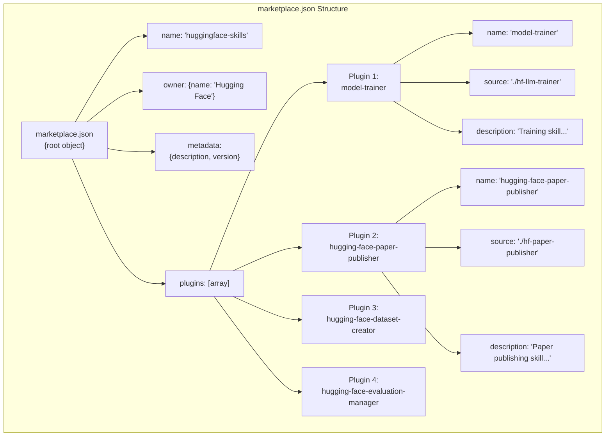
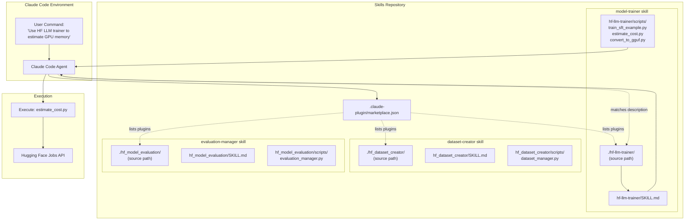
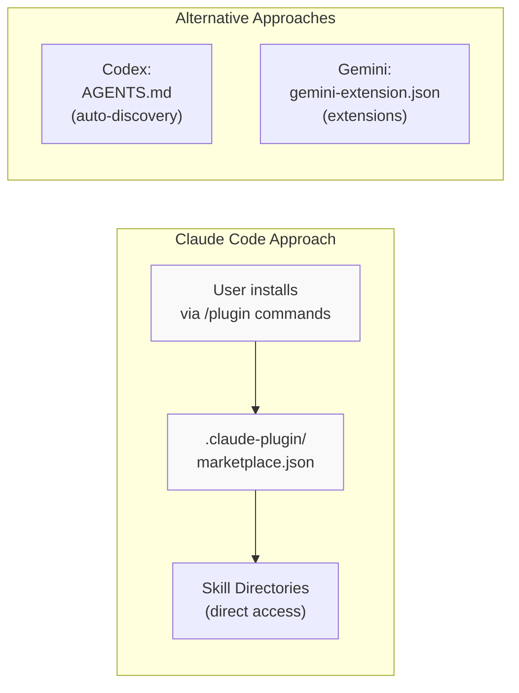
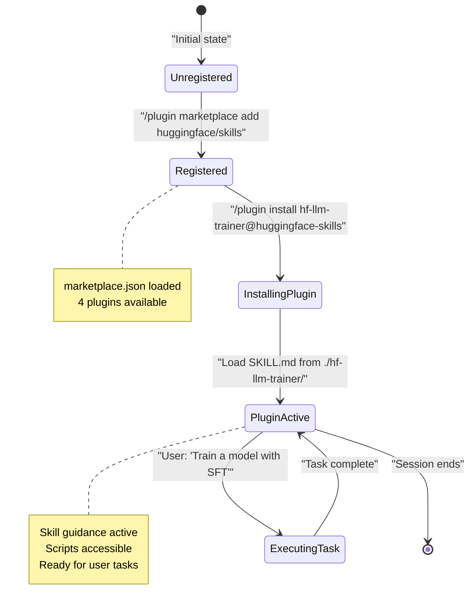

<!-- source: DeepWiki mcp.deepwiki.com · repo huggingface/skills · page 3.1 Claude Code Integration · fetched 2026-10-30 -->

# Claude Code Integration

<details>
<summary>Relevant source files</summary>

The following files were used as context for generating this wiki page:

- [.claude-plugin/marketplace.json](.claude-plugin/marketplace.json)
- [.gitignore](.gitignore)
- [LICENSE](LICENSE)
- [README.md](README.md)
- [assets/banner.png](assets/banner.png)

</details>


## Purpose and Scope

This document explains how to integrate Hugging Face Skills with Claude Code using the plugin marketplace system. Claude Code is an AI coding assistant that can load and execute skills through a standardized plugin interface defined in [.claude-plugin/marketplace.json]().

For integration with other coding agents, see [OpenAI Codex Integration](#3.2) and [Gemini CLI Integration](#3.3). For details on the SKILL.md format that Claude Code reads, see [SKILL.md Format](#2.1).

---

## Marketplace Configuration File

The repository uses [.claude-plugin/marketplace.json]() to define available skills for Claude Code. This file serves as the plugin registry that Claude Code queries when users register the marketplace.

### Marketplace.json Structure



**Sources:** [.claude-plugin/marketplace.json:1-32]()

### Plugin Definition Schema

Each plugin entry in the `plugins` array contains three required fields:

| Field | Type | Purpose | Example |
|-------|------|---------|---------|
| `name` | string | Unique identifier for the skill | `"model-trainer"` |
| `source` | string | Relative path to skill directory | `"./hf-llm-trainer"` |
| `description` | string | When to use this skill (for agent decision-making) | `"This skill should be used when users want to train or fine-tune language models..."` |

The `description` field is critical—it helps Claude Code determine which skill to activate based on user intent. For example, the model-trainer skill description [.claude-plugin/marketplace.json:14]() includes trigger phrases like "train or fine-tune language models", "cloud GPU training", and "Hugging Face Jobs".

**Sources:** [.claude-plugin/marketplace.json:10-31]()

---

## Installation Process

### Step 1: Register the Marketplace

Users register the entire repository as a plugin marketplace using the `/plugin marketplace add` command:

```bash
/plugin marketplace add huggingface/skills
```

This tells Claude Code to:
1. Clone or fetch the repository from `https://github.com/huggingface/skills`
2. Read [.claude-plugin/marketplace.json]() to discover available plugins
3. Make all plugins available for installation

**Sources:** [README.md:18-22]()

### Step 2: Install Individual Skills

After marketplace registration, users install specific skills using the `/plugin install` command:

```bash
/plugin install <skill-folder>@huggingface-skills
```

For example, to install the model trainer skill:

```bash
/plugin install hf-llm-trainer@huggingface-skills
```

The format is: `<source-directory>@<marketplace-name>`, where:
- `<source-directory>` matches the `source` field in marketplace.json (e.g., `"./hf-llm-trainer"`)
- `<marketplace-name>` is the marketplace identifier (defaults to repo name)

**Sources:** [README.md:24-34]()

---

## Skill Discovery and Loading

```mermaid
sequenceDiagram
    participant User
    participant Claude["Claude Code Agent"]
    participant Registry["marketplace.json"]
    participant SkillDir["Skill Directory<br/>(e.g., hf-llm-trainer/)"]
    participant SkillMD["SKILL.md"]
    
    User->>Claude: "/plugin marketplace add huggingface/skills"
    Claude->>Registry: Read marketplace configuration
    Registry-->>Claude: Return plugins array with metadata
    
    User->>Claude: "/plugin install hf-llm-trainer@huggingface-skills"
    Claude->>Registry: Lookup plugin by source path
    Registry-->>Claude: Plugin config: {name, source, description}
    Claude->>SkillDir: Navigate to ./hf-llm-trainer/
    Claude->>SkillMD: Load SKILL.md from directory
    SkillMD-->>Claude: YAML frontmatter + markdown guidance
    
    Note over Claude: Skill now active
    
    User->>Claude: "Train a model using SFT"
    Claude->>Claude: Match user intent to skill description
    Note over Claude: Description contains "train or fine-tune"
    Claude->>SkillMD: Read training guidance and examples
    Claude->>SkillDir: Access helper scripts
    Claude->>User: Execute training workflow
```

**Sources:** [README.md:16-34](), [.claude-plugin/marketplace.json:10-31]()

### Discovery Mechanism

When a user mentions a task, Claude Code:

1. **Matches descriptions**: Compares user intent against the `description` field in each installed plugin [.claude-plugin/marketplace.json:14,19,24,29]()
2. **Loads skill folder**: Navigates to the `source` directory specified in marketplace.json
3. **Reads SKILL.md**: Parses YAML frontmatter and markdown content from the skill's `SKILL.md` file
4. **Accesses resources**: Makes all files in the skill directory available (scripts, templates, documentation)

**Sources:** [.claude-plugin/marketplace.json:1-32](), [README.md:77-86]()

---

## Integration Architecture

The following diagram shows how Claude Code integrates with the Skills framework:



**Sources:** [.claude-plugin/marketplace.json:1-32](), [README.md:16-86]()

### Key Integration Points

| Component | File Path | Role |
|-----------|-----------|------|
| Marketplace Registry | `.claude-plugin/marketplace.json` | Lists all available skills with names, sources, and descriptions |
| Plugin Name | `marketplace.json:plugins[].name` | Identifier used in install commands |
| Source Directory | `marketplace.json:plugins[].source` | Path to skill folder relative to repository root |
| Description | `marketplace.json:plugins[].description` | Trigger text for skill selection |
| Skill Definition | `<source>/SKILL.md` | Contains YAML frontmatter and markdown guidance |
| Helper Scripts | `<source>/scripts/*.py` | Executable tools referenced by SKILL.md |

**Sources:** [.claude-plugin/marketplace.json:10-31]()

---

## Marketplace vs. Direct Reference

Unlike Codex (which uses AGENTS.md) and Gemini (which uses gemini-extension.json), Claude Code uses a **plugin marketplace model**:



The marketplace.json acts as an **index** but not as a content aggregator. Skills remain in their original directories, and Claude Code reads SKILL.md files directly from those locations.

**Sources:** [.claude-plugin/marketplace.json:1-32](), [README.md:10,36-62]()

---

## Usage Patterns

### Pattern 1: Explicit Skill Invocation

Users can explicitly mention the skill name:

```
"Use the HF LLM trainer skill to estimate the GPU memory needed for a 70B model run."
```

This triggers Claude Code to:
1. Look up "HF LLM trainer" or "model-trainer" in installed plugins
2. Load `hf-llm-trainer/SKILL.md`
3. Execute guidance from SKILL.md (likely calling `scripts/estimate_cost.py`)

**Sources:** [README.md:81]()

### Pattern 2: Intent-Based Activation

Users can describe the task without naming the skill:

```
"I want to fine-tune a model on Hugging Face Jobs with SFT."
```

Claude Code matches this intent against the model-trainer skill description: *"This skill should be used when users want to train or fine-tune language models using TRL...on Hugging Face Jobs"* [.claude-plugin/marketplace.json:14]()

**Sources:** [.claude-plugin/marketplace.json:14]()

### Pattern 3: Resource Access

Once a skill is active, Claude Code can access all resources in the skill directory:

- **Scripts**: `hf-llm-trainer/scripts/train_sft_example.py`, `convert_to_gguf.py`
- **Documentation**: Any markdown files or docs in the skill folder
- **Templates**: Configuration templates or example files

**Sources:** [.claude-plugin/marketplace.json:14](), [README.md:74]()

---

## Plugin Metadata Fields

The marketplace configuration [.claude-plugin/marketplace.json:1-9]() includes repository-level metadata:

```json
{
  "name": "huggingface-skills",
  "owner": {
    "name": "Hugging Face"
  },
  "metadata": {
    "description": "Agent Context Protocol (ACP) skills for AI/ML tasks...",
    "version": "1.0.0"
  }
}
```

| Field | Value | Purpose |
|-------|-------|---------|
| `name` | `"huggingface-skills"` | Marketplace identifier for installation commands |
| `owner.name` | `"Hugging Face"` | Marketplace publisher |
| `metadata.description` | Full ACP description | Overall marketplace purpose |
| `metadata.version` | `"1.0.0"` | Marketplace version for compatibility tracking |

**Sources:** [.claude-plugin/marketplace.json:1-9]()

---

## Skill Source Paths

All skill `source` paths in marketplace.json are relative to the repository root:

| Skill Name | Source Path | Target Directory |
|------------|-------------|------------------|
| `model-trainer` | `"./hf-llm-trainer"` | [hf-llm-trainer/]() |
| `hugging-face-paper-publisher` | `"./hf-paper-publisher"` | [hf-paper-publisher/]() |
| `hugging-face-dataset-creator` | `"./hf_dataset_creator"` | [hf_dataset_creator/]() |
| `hugging-face-evaluation-manager` | `"./hf_model_evaluation"` | [hf_model_evaluation/]() |

Each directory contains a `SKILL.md` file that Claude Code reads after installation.

**Sources:** [.claude-plugin/marketplace.json:13,18,23,28]()

---

## Installation Flow Diagram



**Sources:** [README.md:18-34](), [.claude-plugin/marketplace.json:1-32]()

---

## Comparison with Other Integrations

Claude Code's plugin marketplace approach differs from other agent integrations:

| Feature | Claude Code | Codex | Gemini CLI |
|---------|-------------|-------|------------|
| **Discovery File** | `.claude-plugin/marketplace.json` | `AGENTS.md` | `gemini-extension.json` |
| **Installation** | Explicit `/plugin install` commands | Automatic (reads AGENTS.md) | `gemini extensions install` |
| **Skill Storage** | Direct skill folder references | Aggregated in AGENTS.md | Extension registry |
| **Description Format** | JSON `description` field | Markdown sections in AGENTS.md | JSON configuration |
| **Multiple Skills** | Array of plugin objects | Sections in single file | Extension definitions |

All approaches ultimately load the same `SKILL.md` files from skill directories, but they differ in discovery and installation mechanics.

**Sources:** [.claude-plugin/marketplace.json:1-32](), [README.md:10-62]()

---

## Troubleshooting

### Skill Not Found

If Claude Code cannot find a skill after installation:
1. Verify the `source` path in [.claude-plugin/marketplace.json]() matches the actual directory name
2. Ensure `SKILL.md` exists in the target directory
3. Check that the marketplace name in the install command matches [marketplace.json:2]()

### Skill Not Activating

If a skill doesn't activate on relevant tasks:
1. Review the `description` field [.claude-plugin/marketplace.json:14,19,24,29]() to ensure it contains trigger keywords
2. Try explicit invocation: "Use the [skill-name] skill to..."
3. Verify the skill is installed with `/plugin list`

**Sources:** [.claude-plugin/marketplace.json:1-32](), [README.md:24-34]()

---

