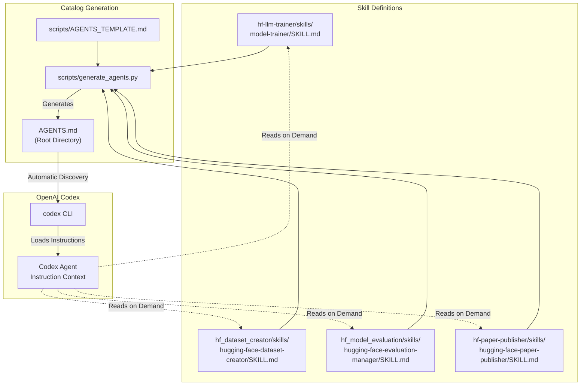
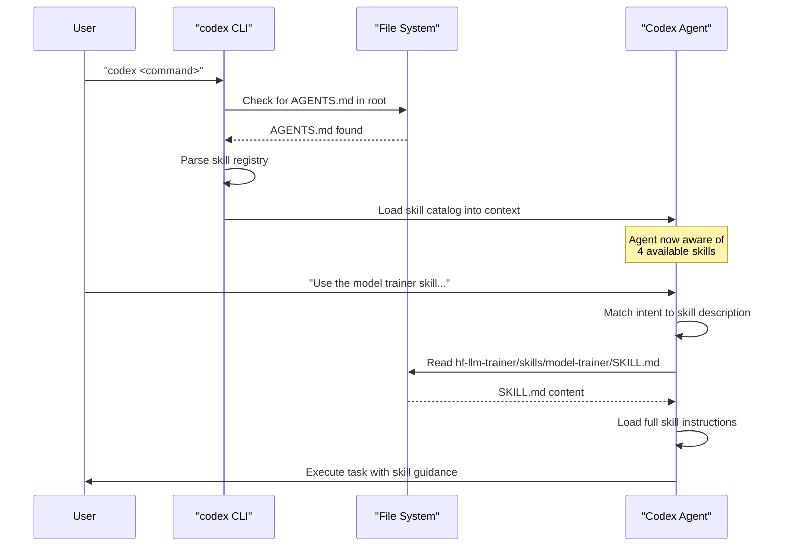
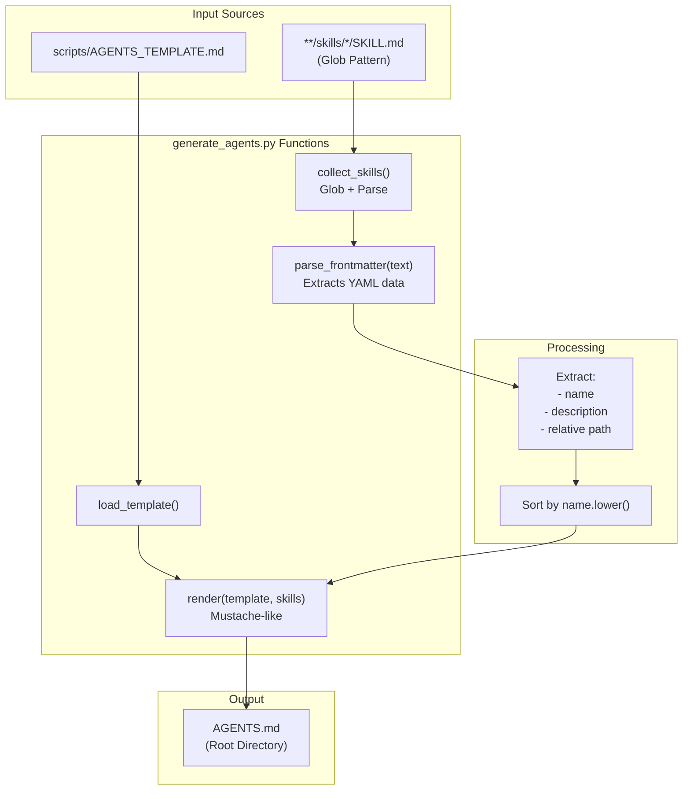
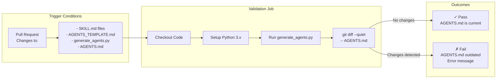

<!-- source: DeepWiki mcp.deepwiki.com · repo huggingface/skills · page 3.2 OpenAI Codex Integration · fetched 2026-10-30 -->

# OpenAI Codex Integration

<details>
<summary>Relevant source files</summary>

The following files were used as context for generating this wiki page:

- [.github/workflows/generate-agents.yml](.github/workflows/generate-agents.yml)
- [.gitignore](.gitignore)
- [AGENTS.md](AGENTS.md)
- [LICENSE](LICENSE)
- [README.md](README.md)
- [assets/banner.png](assets/banner.png)
- [scripts/AGENTS_TEMPLATE.md](scripts/AGENTS_TEMPLATE.md)
- [scripts/generate_agents.py](scripts/generate_agents.py)

</details>


## Purpose and Scope

This document describes how OpenAI Codex integrates with the Hugging Face Skills system through the `AGENTS.md` catalog file. It covers the automatic skill discovery mechanism, the catalog file format, the generation process from `SKILL.md` files, and verification procedures. For information about other agent integrations, see Claude Code Integration ([#3.1](#3.1)) and Gemini CLI Integration ([#3.3](#3.3)). For details on the SKILL.md format itself, see [#2.1](#2.1).

## Integration Architecture

OpenAI Codex uses a catalog-based approach for skill discovery, distinct from Claude Code's plugin marketplace system. The integration relies on a single machine-readable file, `AGENTS.md`, located at the repository root.



**Sources:** [README.md:36-44](), [AGENTS.md:1-24](), [scripts/generate_agents.py:1-81]()

## AGENTS.md File Format

The `AGENTS.md` file serves as a machine-readable catalog that Codex automatically loads when operating in the repository. The file structure consists of three main sections:

### File Structure

| Section | Purpose | Location |
|---------|---------|----------|
| Skill Registry | Lists all available skills with paths | Lines 5-9 |
| Available Skills | Provides skill descriptions | Lines 13-19 |
| Path Resolution Rules | Explains relative path handling | Lines 21-23 |

### Skill Registry Format

The skill registry section maps skill names to their `SKILL.md` file locations:

```xml
<skills>

You have additional SKILLs documented in directories containing a "SKILL.md" file.

These skills are:
 - hugging-face-dataset-creator -> "hf_dataset_creator/skills/hugging-face-dataset-creator/SKILL.md"
 - hugging-face-evaluation-manager -> "hf_model_evaluation/skills/hugging-face-evaluation-manager/SKILL.md"
 - hugging-face-paper-publisher -> "hf-paper-publisher/skills/hugging-face-paper-publisher/SKILL.md"
 - model-trainer -> "hf-llm-trainer/skills/model-trainer/SKILL.md"
```

**Sources:** [AGENTS.md:1-10]()

### Available Skills Section

The `<available_skills>` block provides quick-reference descriptions that help Codex determine when to load each skill:

```xml
<available_skills>

hugging-face-dataset-creator: `Create and manage datasets on Hugging Face Hub...`
hugging-face-evaluation-manager: `Add and manage evaluation results in Hugging Face model cards...`
hugging-face-paper-publisher: `Publish and manage research papers on Hugging Face Hub...`
model-trainer: `This skill should be used when users want to train or fine-tune language models...`
</available_skills>
```

The descriptions use natural language to specify when each skill should be invoked based on user intent.

**Sources:** [AGENTS.md:13-19]()

### Path Resolution Rules

The file includes explicit path resolution guidance to prevent errors when referencing skill-internal resources:

```
Paths referenced within SKILL folders are relative to that SKILL. For example the hf_dataset_creator 
`scripts/example.py` would be referenced as `hf_dataset_creator/scripts/example.py`.
```

This ensures Codex correctly resolves file references when executing skill-specific scripts or reading documentation.

**Sources:** [AGENTS.md:21]()

## Skill Discovery Process

Codex automatically discovers and loads the `AGENTS.md` file when operating within the repository. The discovery mechanism follows this flow:



**Sources:** [README.md:36-44]()

## Catalog Generation Process

The `AGENTS.md` file is not manually maintained; it is generated programmatically from individual `SKILL.md` files using the `generate_agents.py` script.

### Generation Script Architecture



**Sources:** [scripts/generate_agents.py:10-77]()

### Key Functions

| Function | Purpose | Lines |
|----------|---------|-------|
| `load_template()` | Reads AGENTS_TEMPLATE.md | [scripts/generate_agents.py:15-16]() |
| `parse_frontmatter(text)` | Extracts YAML frontmatter without external dependencies | [scripts/generate_agents.py:19-30]() |
| `collect_skills()` | Globs for SKILL.md files, extracts metadata | [scripts/generate_agents.py:33-49]() |
| `render(template, skills)` | Performs Mustache-like template substitution | [scripts/generate_agents.py:52-68]() |

### Frontmatter Parsing

The script implements a lightweight YAML parser specifically for frontmatter blocks:

```python
def parse_frontmatter(text: str) -> dict[str, str]:
    """Parse a minimal YAML-ish frontmatter block without external deps."""
    match = re.search(r"^---\s*\n(.*?)\n---\s*", text, re.DOTALL)
    if not match:
        return {}
    data: dict[str, str] = {}
    for line in match.group(1).splitlines():
        if ":" not in line:
            continue
        key, value = line.split(":", 1)
        data[key.strip()] = value.strip()
    return data
```

This extracts the `name` and `description` fields from each `SKILL.md` file's YAML frontmatter.

**Sources:** [scripts/generate_agents.py:19-30]()

### Template Rendering

The rendering process uses regex substitution to populate the Mustache-like template:

```python
def render(template: str, skills: list[dict[str, str]]) -> str:
    """Very small Mustache-like renderer that only supports a single skills loop."""
    def repl(match: re.Match[str]) -> str:
        block = match.group(1).strip("\n")
        rendered_blocks = []
        for skill in skills:
            rendered = (
                block.replace("{{name}}", skill["name"])
                .replace("{{description}}", skill["description"])
                .replace("{{path}}", skill["path"])
            )
            rendered_blocks.append(rendered)
        return "\n".join(rendered_blocks)

    # Render loop blocks
    content = re.sub(r"{{#skills}}(.*?){{/skills}}", repl, template, flags=re.DOTALL)
    return content
```

The template at [scripts/AGENTS_TEMPLATE.md:1-23]() defines two `{{#skills}}` blocks: one for the skill registry and one for the descriptions.

**Sources:** [scripts/generate_agents.py:52-68](), [scripts/AGENTS_TEMPLATE.md:1-23]()

## Continuous Integration Validation

The repository enforces that `AGENTS.md` stays synchronized with `SKILL.md` files through a GitHub Actions workflow.

### Validation Workflow



### Validation Logic

The workflow regenerates `AGENTS.md` and checks for differences:

```bash
git diff --quiet -- AGENTS.md || {
  echo "::error::AGENTS.md is outdated. Run 'python scripts/generate_agents.py' and commit the changes."
  exit 1
}
```

If differences exist, the PR fails with an error message instructing developers to regenerate and commit the file.

**Sources:** [.github/workflows/generate-agents.yml:1-32]()

### Manual Regeneration

Developers can manually regenerate `AGENTS.md` by running:

```bash
python scripts/generate_agents.py
```

The script outputs: `Wrote AGENTS.md with N skills.`

**Sources:** [scripts/generate_agents.py:71-76]()

## Verification and Debugging

### Verifying Codex Can See Instructions

Users can verify that Codex has loaded the instructions from `AGENTS.md`:

```bash
codex --ask-for-approval never "Summarize the current instructions."
```

This command causes Codex to output a summary of its loaded context, including skill definitions from `AGENTS.md`.

**Sources:** [README.md:38-42]()

### Troubleshooting Skill Loading

| Issue | Diagnosis | Solution |
|-------|-----------|----------|
| Skill not appearing in catalog | SKILL.md frontmatter missing or invalid | Verify `name` and `description` fields exist |
| Path resolution errors | Incorrect relative paths in skill scripts | Follow path rules in AGENTS.md line 21 |
| Outdated skill definitions | AGENTS.md not regenerated after SKILL.md changes | Run `python scripts/generate_agents.py` |
| CI validation failures | AGENTS.md committed without regeneration | Regenerate and commit before pushing |

### Debugging the Generation Process

To debug catalog generation, examine the glob pattern results:

```python
# From collect_skills() function
for skill_md in ROOT.glob("*/skills/*/SKILL.md"):
    meta = parse_frontmatter(skill_md.read_text(encoding="utf-8"))
    name = meta.get("name")
    description = meta.get("description")
    if not name or not description:
        continue  # Skill silently skipped if frontmatter incomplete
```

Skills without both `name` and `description` fields are silently excluded from the catalog.

**Sources:** [scripts/generate_agents.py:33-49]()

## File Path Resolution in Practice

When Codex reads a skill and encounters references to files within that skill, it must resolve paths correctly. The `AGENTS.md` file provides explicit guidance:

```
Paths referenced within SKILL folders are relative to that SKILL. For example the hf_dataset_creator 
`scripts/example.py` would be referenced as `hf_dataset_creator/scripts/example.py`.
```

### Example Path Resolution

For the `hugging-face-dataset-creator` skill located at `hf_dataset_creator/skills/hugging-face-dataset-creator/SKILL.md`:

- **Within SKILL.md:** `scripts/dataset_manager.py`
- **From repository root:** `hf_dataset_creator/scripts/dataset_manager.py`

This convention allows skill authors to use short, relative paths in their documentation while ensuring Codex can locate files when executing from the repository root.

**Sources:** [AGENTS.md:21]()

## Integration Comparison

The Codex integration differs from other agent integrations in several key ways:

| Aspect | Codex (AGENTS.md) | Claude Code | Gemini CLI |
|--------|-------------------|-------------|------------|
| Discovery Mechanism | Catalog file at root | Plugin marketplace registration | Extension JSON file |
| File Format | XML-like markdown | JSON marketplace manifest | JSON extension definition |
| Installation Command | Automatic (file present) | `/plugin marketplace add` | `gemini extensions install` |
| Catalog Location | Repository root | `.claude-plugin/marketplace.json` | `gemini-extension.json` |
| Generation Process | Python script from SKILL.md | Manual JSON authoring | Manual JSON authoring |
| CI Validation | Yes (GitHub Actions) | No | No |

The catalog-based approach makes Codex integration transparent and automatic—no explicit installation steps required. For details on other integrations, see [#3.1](#3.1) and [#3.3](#3.3).

**Sources:** [README.md:14-62](), [AGENTS.md:1-24](), [scripts/generate_agents.py:1-81]()

---

