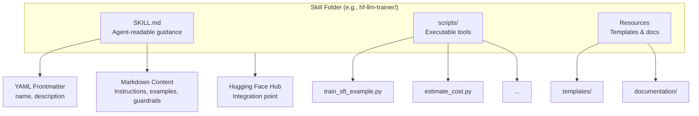
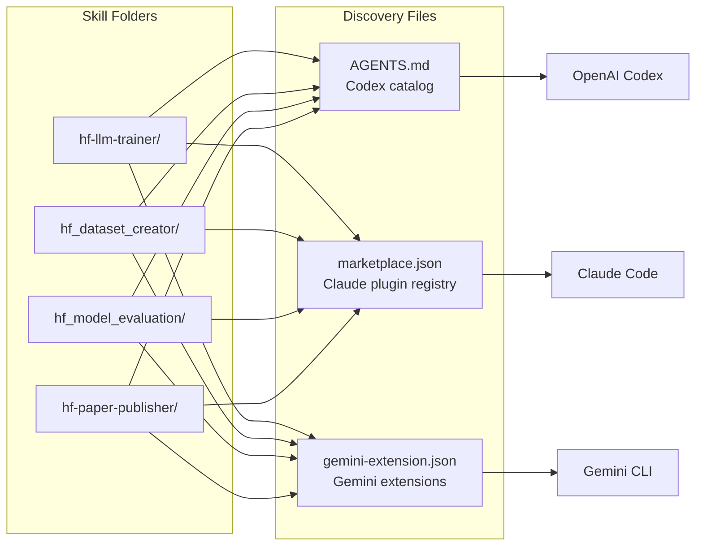
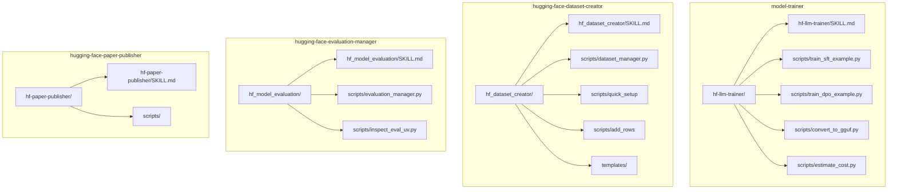
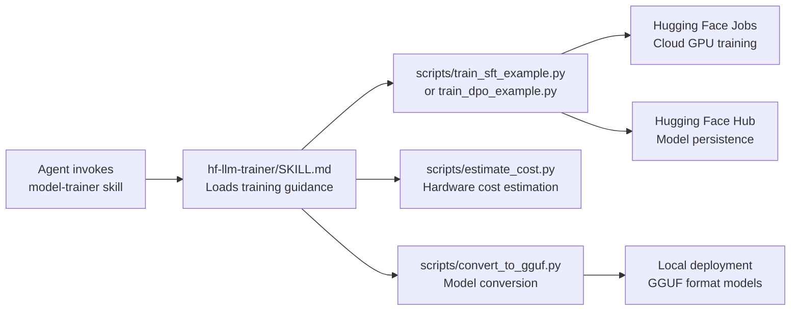
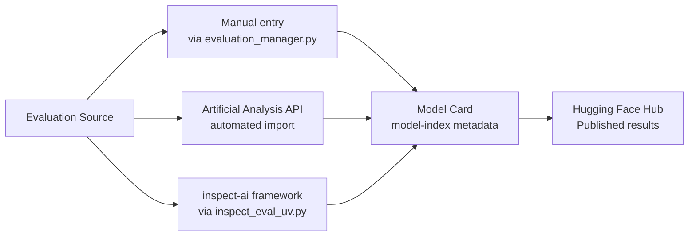
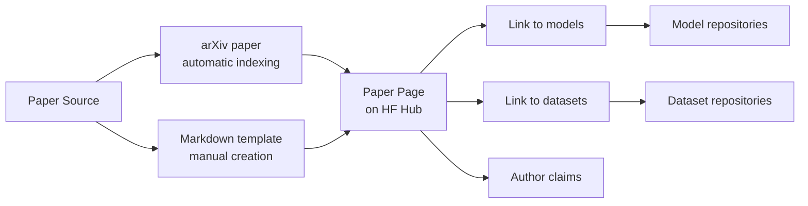
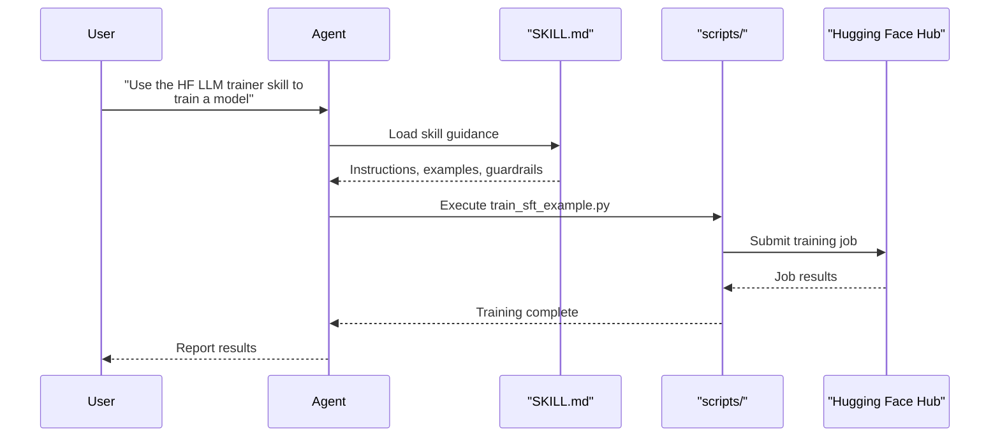

<!-- source: DeepWiki mcp.deepwiki.com · repo huggingface/skills · page 4 Available Skills · fetched 2026-10-30 -->

# Available Skills

Relevant source files

The following files were used as context for generating this wiki page:

- [.claude-plugin/marketplace.json](.claude-plugin/marketplace.json)
- [.gitignore](.gitignore)
- [LICENSE](LICENSE)
- [README.md](README.md)
- [assets/banner.png](assets/banner.png)

## Purpose and Scope

This page provides an overview of the four skills currently available in the Hugging Face Skills repository. Each skill is a self-contained module that packages instructions, scripts, and resources for specific AI/ML workflows. This document describes the common architectural pattern shared by all skills and introduces each skill's purpose and key capabilities.

For detailed information about individual skills, see:
- Model training workflows: [Model Trainer Skill](#4.1)
- Dataset creation workflows: [Dataset Creator Skill](#4.2)
- Evaluation management workflows: [Evaluation Manager Skill](#4.3)
- Research paper publishing workflows: [Paper Publisher Skill](#4.4)

For information about how skills are defined using SKILL.md format, see [SKILL.md Format](#2.1). For agent-specific installation instructions, see [Agent Integration](#3).

---

## Common Skill Architecture Pattern

All skills in this repository follow a consistent structural pattern. Each skill is organized as a self-contained folder containing three primary components:

### Core Components

| Component | Purpose | File/Directory |
|-----------|---------|----------------|
| **Skill Definition** | YAML frontmatter with name and description, followed by markdown guidance for agents | `SKILL.md` |
| **Executable Scripts** | Python scripts that agents can invoke to perform skill operations | `scripts/` directory |
| **Supporting Resources** | Templates, configuration files, and documentation | Various subdirectories |

### Skill Folder Structure Diagram

**Sources:** [README.md:89-102](), [.claude-plugin/marketplace.json:10-31]()

### Skill Discovery Mechanisms

Skills are made discoverable to different agent platforms through multiple integration files:

**Sources:** [README.md:12-63](), [.claude-plugin/marketplace.json:1-32]()

---

## Skill Catalog

The repository currently provides four production-ready skills:

| Skill Folder | Name | Primary Use Case | Key Scripts |
|--------------|------|------------------|-------------|
| `hf-llm-trainer/` | model-trainer | Training and fine-tuning LLMs on cloud GPUs | `train_sft_example.py`, `train_dpo_example.py`, `convert_to_gguf.py`, `estimate_cost.py` |
| `hf_dataset_creator/` | hugging-face-dataset-creator | Creating and managing Hub datasets with streaming updates | `dataset_manager.py`, `quick_setup`, `add_rows` |
| `hf_model_evaluation/` | hugging-face-evaluation-manager | Managing evaluation results in model cards | `evaluation_manager.py`, `inspect_eval_uv.py` |
| `hf-paper-publisher/` | hugging-face-paper-publisher | Publishing research papers on Hub with model/dataset links | Paper management scripts |

**Sources:** [README.md:68-76](), [.claude-plugin/marketplace.json:10-31]()

---

## Skill-to-Code Mapping

The following diagram maps each skill's user-facing name to its directory structure and primary executable components:

**Sources:** [README.md:70-75](), [.claude-plugin/marketplace.json:10-31]()

---

## Model Trainer Skill Overview

The `model-trainer` skill (directory: `hf-llm-trainer/`) enables training and fine-tuning of large language models using TRL (Transformer Reinforcement Learning) on Hugging Face Jobs infrastructure.

### Key Capabilities

- **Training Methods**: Supports SFT (Supervised Fine-Tuning), DPO (Direct Preference Optimization), GRPO (Group Relative Policy Optimization), and reward modeling
- **Cloud Execution**: Runs on Hugging Face Jobs with GPU acceleration (no local GPU required)
- **Cost Management**: Includes hardware selection guidance and cost estimation tools
- **Model Persistence**: Handles model saving to Hub and GGUF conversion for local deployment
- **Dataset Validation**: Validates and prepares datasets for training with format checking

### Integration Points

**Sources:** [README.md:74](), [.claude-plugin/marketplace.json:11-15]()

See [Model Trainer Skill](#4.1) for comprehensive documentation including training methods, hardware selection, dataset preparation, and model persistence workflows.

---

## Dataset Creator Skill Overview

The `hugging-face-dataset-creator` skill (directory: `hf_dataset_creator/`) provides tools for creating and managing structured datasets on Hugging Face Hub with support for streaming updates.

### Key Capabilities

- **Dataset Initialization**: Creates new dataset repositories with proper configuration
- **Template Support**: Provides pre-built templates for common dataset types (chat, classification, QA, completion, tabular)
- **Streaming Updates**: Supports incremental row additions without full dataset reloading
- **System Prompts**: Allows defining dataset-level system prompts and configuration
- **Hub Integration**: Direct push to Hugging Face Hub with version control

### Dataset Templates

| Template Type | Use Case | Key Fields |
|--------------|----------|------------|
| `chat` | Conversational datasets | messages, system prompts |
| `classification` | Text classification tasks | text, label |
| `qa` | Question-answering pairs | question, answer, context |
| `completion` | Text completion | prompt, completion |
| `tabular` | Structured data | Custom columns |

**Sources:** [README.md:72](), [.claude-plugin/marketplace.json:22-25]()

See [Dataset Creator Skill](#4.2) for detailed documentation on template usage, streaming workflows, and dataset configuration.

---

## Evaluation Manager Skill Overview

The `hugging-face-evaluation-manager` skill (directory: `hf_model_evaluation/`) manages evaluation results in Hugging Face model cards, supporting manual entry and API imports.

### Key Capabilities

- **Model Card Integration**: Adds evaluation results directly to model card metadata
- **Table Extraction**: Extracts existing evaluation tables from README content
- **API Integration**: Imports evaluation scores from Artificial Analysis API
- **Model-Index Format**: Works with standard `model-index` metadata structure
- **Inspect Framework**: Supports `inspect-ai` framework for evaluation orchestration

### Evaluation Workflow

**Sources:** [README.md:73](), [.claude-plugin/marketplace.json:27-30]()

See [Evaluation Manager Skill](#4.3) for complete documentation on evaluation workflows, metadata formats, and API integration.

---

## Paper Publisher Skill Overview

The `hugging-face-paper-publisher` skill (directory: `hf-paper-publisher/`) provides tools for publishing and managing research papers on Hugging Face Hub.

### Key Capabilities

- **Paper Indexing**: Index papers from arXiv with automatic metadata extraction
- **Model/Dataset Linking**: Create bidirectional links between papers and Hub resources
- **Authorship Management**: Claim and manage paper authorship
- **Article Generation**: Generate professional markdown-based research articles from templates
- **Hub Integration**: Native integration with Hugging Face Hub paper pages

### Publication Workflow

**Sources:** [README.md:75](), [.claude-plugin/marketplace.json:17-20]()

See [Paper Publisher Skill](#4.4) for detailed documentation on paper publishing workflows, linking mechanisms, and template usage.

---

## Skill Usage Patterns

Agents invoke skills by mentioning them in user instructions. The typical invocation pattern follows this flow:

**Sources:** [README.md:77-87]()

### Example Invocations

The following invocations demonstrate how users direct agents to use specific skills:

- **Training**: "Use the HF LLM trainer skill to estimate the GPU memory needed for a 70B model run."
- **Evaluation**: "Use the HF model evaluation skill to launch `run_eval_job.py` on the latest checkpoint."
- **Dataset Creation**: "Use the HF dataset creator skill to draft new few-shot classification templates."
- **Paper Publishing**: "Use the HF paper publisher skill to index my arXiv paper and link it to my model."

**Sources:** [README.md:80-84]()

---

## Skill Extension and Customization

The skills framework supports creating custom skills by following the established pattern:

1. **Copy existing skill folder** (e.g., `hf_dataset_creator/`) as a template
2. **Update `SKILL.md` frontmatter** with new name and description
3. **Add or modify scripts** in the `scripts/` directory
4. **Update supporting resources** (templates, documentation)
5. **Reinstall or reload** the skill bundle in the agent

This modular approach allows organizations to create domain-specific skills while maintaining compatibility with the Agent Context Protocol and multiple agent platforms.

**Sources:** [README.md:89-102]()

---

