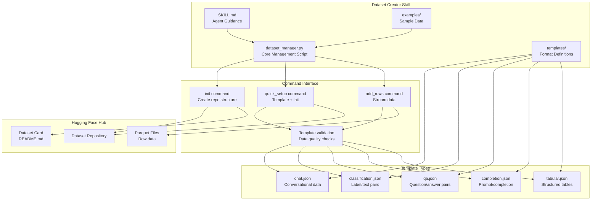
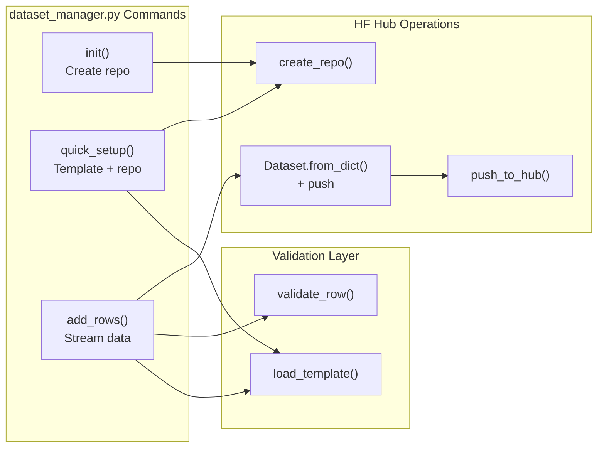
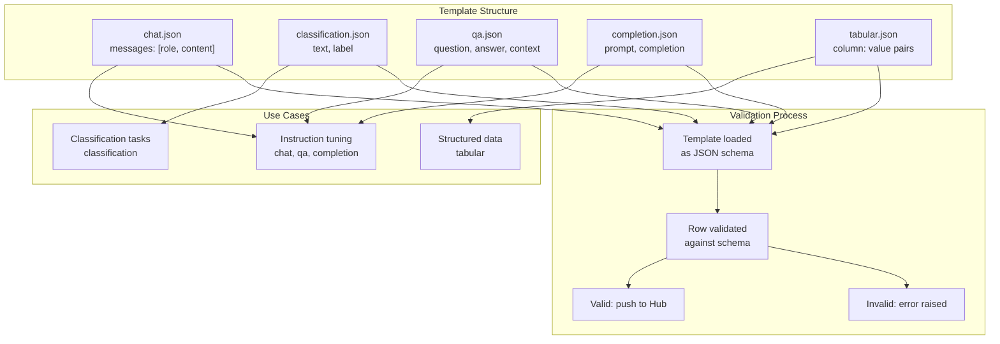
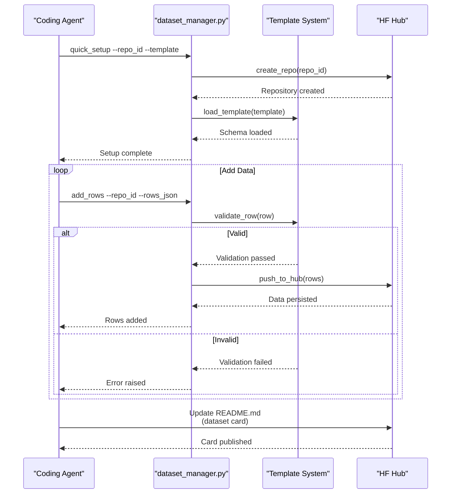

<!-- source: DeepWiki mcp.deepwiki.com · repo huggingface/skills · page 4.2 Dataset Creator Skill · fetched 2026-10-30 -->

# Dataset Creator Skill

<details>
<summary>Relevant source files</summary>

The following files were used as context for generating this wiki page:

- [.claude-plugin/marketplace.json](.claude-plugin/marketplace.json)
- [.gitignore](.gitignore)
- [LICENSE](LICENSE)
- [README.md](README.md)
- [apps/quests/02_evaluate-hub-model.md](apps/quests/02_evaluate-hub-model.md)
- [apps/quests/03_publish-hub-dataset.md](apps/quests/03_publish-hub-dataset.md)
- [apps/quests/04_sft-finetune-hub.md](apps/quests/04_sft-finetune-hub.md)
- [apps/quests/README.md](apps/quests/README.md)
- [assets/banner.png](assets/banner.png)

</details>


## Purpose and Scope

This document describes the Dataset Creator Skill (`hf_dataset_creator/`), which provides tools and templates for creating and managing structured datasets on Hugging Face Hub. The skill enables coding agents to initialize dataset repositories, validate data against templates, and stream row updates to the Hub without downloading entire datasets.

For information about training models with these datasets, see [Model Trainer Skill](#4.1). For evaluation workflows, see [Evaluation Manager Skill](#4.3). For overall skill system architecture, see [Core Skills Framework](#2).

**Sources:** [README.md:72](), [.claude-plugin/marketplace.json:22-24](), [apps/quests/03_publish-hub-dataset.md:1-71]()

## Overview

The Dataset Creator Skill addresses the challenge of creating well-structured, properly documented datasets that can be used for model training. It provides a template-based approach to ensure data quality and consistency across multiple dataset formats including chat conversations, text classification, question answering, text completion, and tabular data.

The skill is designed to work alongside the Hugging Face MCP (Model Context Protocol) server for comprehensive dataset workflows, enabling coding agents to create production-ready datasets with minimal manual intervention.

**Sources:** [README.md:72](), [.claude-plugin/marketplace.json:22-24]()

## Architecture

### System Components



**Diagram: Dataset Creator Skill Component Architecture**

The skill consists of four primary layers: (1) the `SKILL.md` guidance file that instructs coding agents, (2) the `dataset_manager.py` script that provides command-line operations, (3) a template system that enforces data structure, and (4) direct integration with Hugging Face Hub for persistence.

**Sources:** [README.md:72](), [apps/quests/03_publish-hub-dataset.md:11-22]()

## Core Components

### dataset_manager.py Script

The `dataset_manager.py` script is the central executable for dataset operations. It exposes three primary commands that map to different stages of the dataset creation lifecycle.

| Command | Purpose | Key Parameters |
|---------|---------|----------------|
| `init` | Create empty dataset repository with structure | `--repo_id` |
| `quick_setup` | Initialize repo and apply template in one step | `--repo_id`, `--template` |
| `add_rows` | Stream data rows to existing dataset | `--repo_id`, `--template`, `--rows_json` |



**Diagram: dataset_manager.py Command Flow**

Each command performs Hub authentication via `HF_TOKEN` environment variable, validates inputs against templates when applicable, and uses the `huggingface_hub` library for all Hub interactions.

**Sources:** [apps/quests/03_publish-hub-dataset.md:18-44]()

### Template System

The template system provides JSON schema definitions for five dataset formats. Templates are stored in `hf_dataset_creator/templates/` and serve two purposes: validation of incoming data and documentation for coding agents.



**Diagram: Template System Architecture**

The templates are intentionally minimal to avoid overly restrictive validation while still ensuring basic structural correctness. This allows for flexibility in dataset creation while preventing common structural errors.

**Sources:** [apps/quests/03_publish-hub-dataset.md:14-15](), [README.md:72]()

### Examples and System Prompts

The `hf_dataset_creator/examples/` directory contains reference implementations and system prompts that guide coding agents in proper dataset creation patterns. These examples demonstrate:

- Proper JSON structure for each template type
- Recommended dataset card formats
- Common data provenance patterns
- License specification examples

**Sources:** [apps/quests/03_publish-hub-dataset.md:69-70]()

## Dataset Creation Workflow

### Standard Workflow



**Diagram: Dataset Creation Sequence**

The workflow follows a two-phase pattern: (1) initialization with `quick_setup` or `init`, which creates the repository structure on the Hub, and (2) iterative data addition with `add_rows`, which streams validated rows to the repository without requiring local storage of the full dataset.

**Sources:** [apps/quests/03_publish-hub-dataset.md:18-44]()

### Streaming Upload Pattern

The skill's streaming capability enables creation of large datasets without local memory constraints. The `add_rows` command converts JSON rows to Hugging Face `Dataset` objects in-memory, then immediately pushes them to the Hub using `push_to_hub=True`.

```mermaid
graph LR
    subgraph "Data Flow"
        JSON["JSON Rows<br/>(in memory)"]
        DS["Dataset.from_dict()"]
        HUB["Hub Parquet Files"]
    end
    
    subgraph "No Local Storage"
        NO_DISK["No local disk writes"]
        NO_CACHE["No dataset caching"]
    end
    
    JSON --> DS
    DS --> HUB
    NO_DISK -.x.- JSON
    NO_CACHE -.x.- DS
```

**Diagram: Streaming Upload Architecture**

This pattern is particularly valuable for coding agents running in ephemeral environments or containers with limited disk space, as it avoids the need to materialize entire datasets locally.

**Sources:** [apps/quests/03_publish-hub-dataset.md:16](), [README.md:72]()

## Integration with Hugging Face Hub

### Repository Structure

When a dataset is created via the Dataset Creator Skill, it produces a standard Hugging Face dataset repository with the following structure:

```
username/dataset-name/
├── README.md              # Dataset card with metadata
├── data/
│   └── train-00000.parquet   # Row data in Parquet format
└── .gitattributes         # Hub-specific configuration
```

The `README.md` file serves as the dataset card and should include:
- Dataset description and purpose
- License information
- Data provenance (source, collection method)
- Split definitions (train, validation, test)
- Usage examples

**Sources:** [apps/quests/03_publish-hub-dataset.md:31-34]()

### Authentication and Permissions

All Hub operations require authentication via the `HF_TOKEN` environment variable. The token must have write permissions to create repositories and push data. Agents typically obtain this token via:

```bash
hf auth login
```

This sets the `HF_TOKEN` environment variable for subsequent operations.

**Sources:** [apps/quests/README.md:64-77]()

## Usage Patterns

### Quick Start with Template

The most common pattern is to use `quick_setup` with a template for rapid dataset creation:

```bash
python hf_dataset_creator/scripts/dataset_manager.py quick_setup \
  --repo_id "your-username/dataset-name" \
  --template chat
```

This command creates the repository on the Hub and configures it for the chat template format.

**Sources:** [apps/quests/03_publish-hub-dataset.md:18-22]()

### Iterative Row Addition

After initialization, data is added incrementally:

```bash
python hf_dataset_creator/scripts/dataset_manager.py add_rows \
  --repo_id "hf-skills/your-dataset-name" \
  --template classification \
  --rows_json "$(cat your_data.json)"
```

The `--rows_json` parameter accepts JSON-formatted data that conforms to the specified template schema. The command validates each row before pushing to the Hub.

**Sources:** [apps/quests/03_publish-hub-dataset.md:40-44]()

### Manual Initialization

For cases requiring custom configuration before data addition:

```bash
python hf_dataset_creator/scripts/dataset_manager.py init \
  --repo_id "hf-skills/your-dataset-name"
```

This creates an empty repository structure without applying a template, allowing manual README configuration before data upload.

**Sources:** [apps/quests/03_publish-hub-dataset.md:37-38]()

## Hackathon Integration

The Dataset Creator Skill is featured in Week 2 of the Humanity's Last Hackathon, where participants create and publish datasets under the `hf-skills` organization. The hackathon defines three XP tiers based on dataset quality and complexity:

| Tier | XP | Requirements |
|------|----|----|
| 🐢 Starter | 50 | ≤1,000 rows, complete dataset card, proper licensing |
| 🐕 Standard | 100 | Conversational dataset with complete documentation |
| 🦁 Advanced | 200 | Multi-language translated dataset from existing Hub data |

Activity tracking for hackathon contributions is performed by `collect_points.py`, which scans the `hf-skills` organization for dataset publications and awards XP accordingly.

**Sources:** [apps/quests/03_publish-hub-dataset.md:24-64](), [apps/quests/README.md:101-112]()

## Template Format Specifications

### Chat Template

The chat template defines conversational data with role-based messages:

```json
{
  "messages": [
    {"role": "user", "content": "Question or prompt"},
    {"role": "assistant", "content": "Response"}
  ]
}
```

This format is compatible with instruction-tuned models and conversational AI training.

### Classification Template

The classification template structures label/text pairs:

```json
{
  "text": "Input text to classify",
  "label": "Category or class name"
}
```

Suitable for supervised classification tasks and sentiment analysis.

### QA Template

The question-answering template includes optional context:

```json
{
  "question": "Question text",
  "answer": "Answer text",
  "context": "Optional supporting context"
}
```

Used for reading comprehension and extractive QA tasks.

### Completion Template

The completion template structures prompt/completion pairs:

```json
{
  "prompt": "Input prompt or prefix",
  "completion": "Expected completion text"
}
```

Appropriate for autoregressive language model training.

### Tabular Template

The tabular template accepts arbitrary column definitions:

```json
{
  "column_1": "value_1",
  "column_2": "value_2",
  "column_n": "value_n"
}
```

Flexible format for structured data without predetermined schema.

**Sources:** [apps/quests/03_publish-hub-dataset.md:14-15]()

## Integration with Model Training

Datasets created with the Dataset Creator Skill are designed to be directly consumable by the Model Trainer Skill (see [Model Trainer Skill](#4.1)). The template formats align with TRL (Transformer Reinforcement Learning) training script expectations:

- **Chat template** → SFT (Supervised Fine-Tuning) for instruction-following models
- **Classification template** → Reward model training
- **QA template** → SFT with context-aware training
- **Completion template** → Autoregressive language model fine-tuning

The dataset validation performed by templates ensures that downstream training scripts receive properly structured data, reducing training failures due to data format issues.

**Sources:** [README.md:72-74](), [apps/quests/03_publish-hub-dataset.md:7-8]()

---

**Sources:** [README.md:1-107](), [.claude-plugin/marketplace.json:1-32](), [apps/quests/03_publish-hub-dataset.md:1-75](), [apps/quests/README.md:1-122](), [apps/quests/02_evaluate-hub-model.md:1-100](), [apps/quests/04_sft-finetune-hub.md:1-34]()

---

