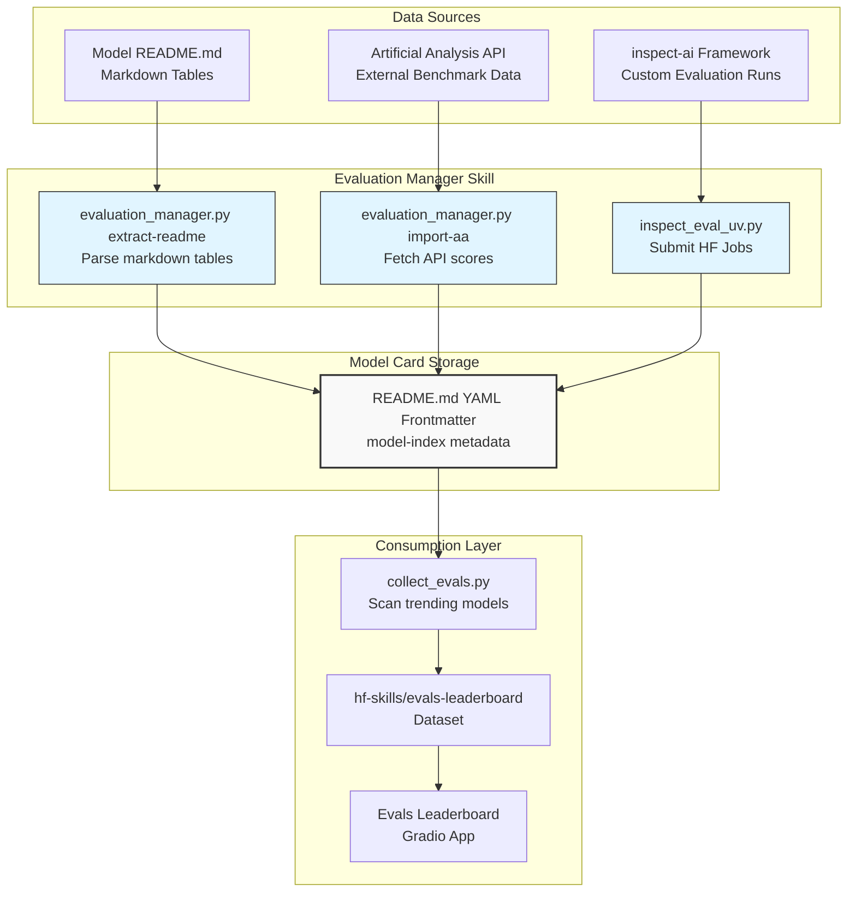
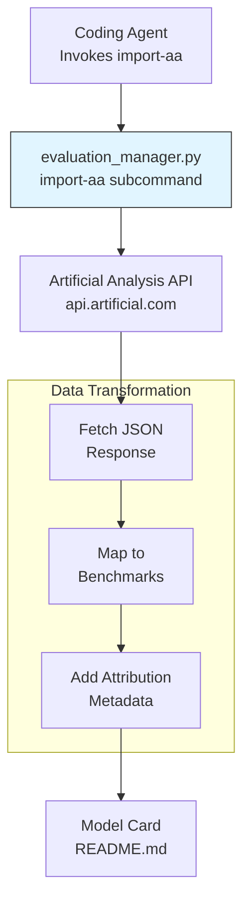
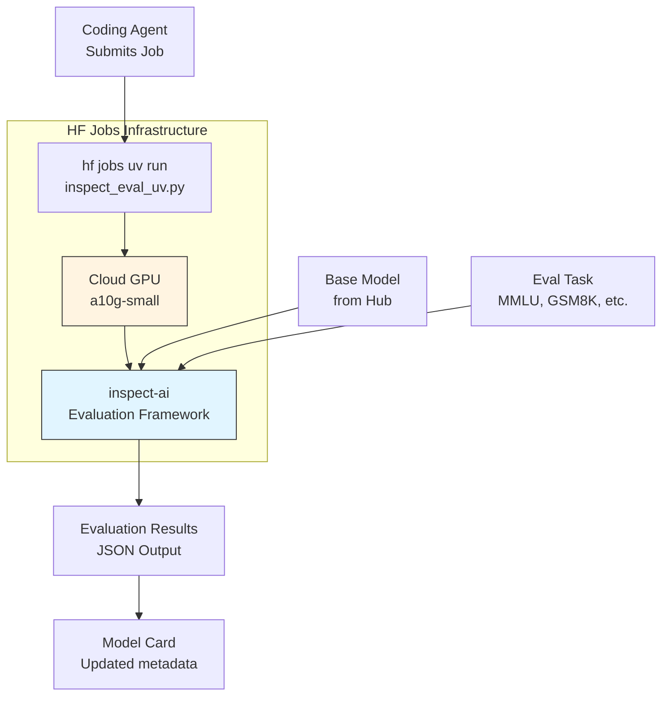
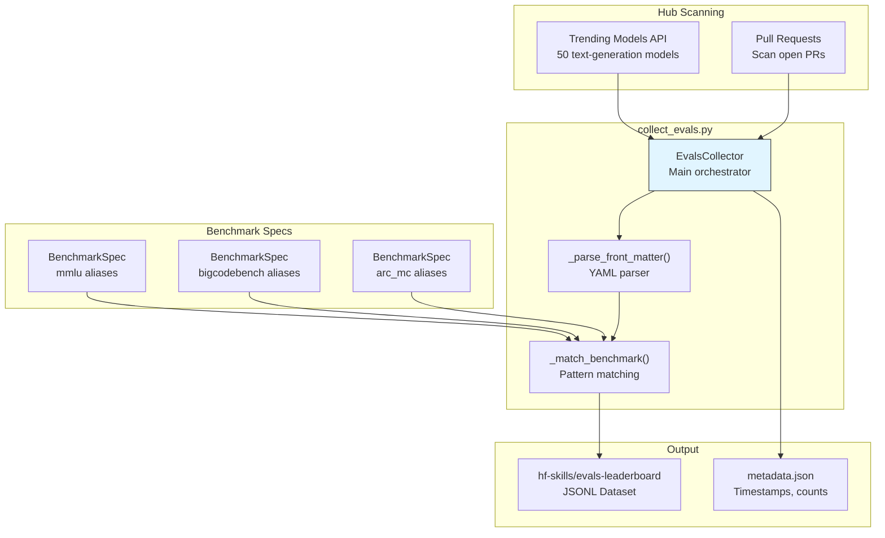

<!-- source: DeepWiki mcp.deepwiki.com · repo huggingface/skills · page 4.3 Evaluation Manager Skill · fetched 2026-10-30 -->

# Evaluation Manager Skill

<details>
<summary>Relevant source files</summary>

The following files were used as context for generating this wiki page:

- [.claude-plugin/marketplace.json](.claude-plugin/marketplace.json)
- [.gitignore](.gitignore)
- [LICENSE](LICENSE)
- [README.md](README.md)
- [apps/evals-leaderboard/app.py](apps/evals-leaderboard/app.py)
- [apps/evals-leaderboard/collect_evals.py](apps/evals-leaderboard/collect_evals.py)
- [apps/evals-leaderboard/requirements.txt](apps/evals-leaderboard/requirements.txt)
- [apps/quests/02_evaluate-hub-model.md](apps/quests/02_evaluate-hub-model.md)
- [apps/quests/03_publish-hub-dataset.md](apps/quests/03_publish-hub-dataset.md)
- [apps/quests/04_sft-finetune-hub.md](apps/quests/04_sft-finetune-hub.md)
- [apps/quests/README.md](apps/quests/README.md)
- [assets/banner.png](assets/banner.png)
- [pyproject.toml](pyproject.toml)

</details>


## Purpose and Scope

The Evaluation Manager Skill enables coding agents to add, extract, and manage evaluation results in Hugging Face model cards. This skill supports three primary workflows: extracting existing evaluation tables from README content, importing benchmark scores from external APIs like Artificial Analysis, and running custom evaluations using the inspect-ai framework on Hugging Face Jobs infrastructure. All evaluation data is stored in the `model-index` metadata format within model card YAML frontmatter, making it discoverable by leaderboard applications and model search.

For information about running the actual training jobs that produce models to evaluate, see [Model Trainer Skill](#4.1). For dataset creation, see [Dataset Creator Skill](#4.2). For the hackathon quest that uses this skill, see [Week 1: Model Evaluation Quest](#5.1.1).

---

## Overview

The Evaluation Manager Skill consists of two primary scripts and integrates with the broader evaluation ecosystem through the evals leaderboard system. The skill operates on the principle that evaluation results should be machine-readable metadata attached to model cards, rather than just markdown tables in README files.

| Component | Purpose | Location |
|-----------|---------|----------|
| `evaluation_manager.py` | Extract README tables, import from APIs, update model-index | [hf_model_evaluation/scripts/evaluation_manager.py]() |
| `inspect_eval_uv.py` | Run inspect-ai evaluations on HF Jobs | [hf_model_evaluation/scripts/inspect_eval_uv.py]() |
| `collect_evals.py` | Scan Hub for evaluation data (leaderboard backend) | [apps/evals-leaderboard/collect_evals.py]() |
| SKILL.md | Agent guidance document | [hf_model_evaluation/SKILL.md]() |

The skill is invoked during Week 1 of the hackathon, where participants earn XP by adding evaluation metadata to trending models on the Hub.

**Sources:** [README.md:70-75](), [.claude-plugin/marketplace.json:26-30](), [apps/quests/02_evaluate-hub-model.md:1-99]()

---

## Core Capabilities

The skill provides three distinct workflows for managing evaluation data:

### 1. Extract Evaluation Tables from README

Parses markdown tables in model README files and converts them into structured `model-index` metadata. Handles both standard table layouts (benchmarks as columns) and transposed layouts (benchmarks as rows).

### 2. Import from Artificial Analysis API

Fetches benchmark scores from the Artificial Analysis API and adds them to model cards with proper attribution. Supports querying by creator slug and model name.

### 3. Run Custom Evaluations with inspect-ai

Submits evaluation jobs to Hugging Face Jobs infrastructure using the inspect-ai framework. Runs evaluations on cloud GPUs and updates model cards with results automatically.

**Sources:** [apps/quests/02_evaluate-hub-model.md:34-85]()

---

## Evaluation Data Flow Architecture



**Evaluation Data Flow from Sources to Leaderboard**

This diagram shows how evaluation data flows from three sources (README tables, external APIs, custom runs) through the Evaluation Manager Skill scripts into model-index metadata, and ultimately into the public evals leaderboard.

**Sources:** [apps/quests/02_evaluate-hub-model.md:46-85](), [apps/evals-leaderboard/collect_evals.py:104-425]()

---

## Model-Index Metadata Format

The skill writes evaluation data into the `model-index` section of model card YAML frontmatter. This format follows the Hugging Face Hub specification for machine-readable evaluation metadata.

### Structure

```yaml
---
model-index:
- name: model-name
  results:
  - task:
      type: text-generation
    dataset:
      name: MMLU
      type: mmlu
    metrics:
    - type: accuracy
      value: 85.3
      name: Accuracy
---
```

### Key Fields

| Field | Description | Example |
|-------|-------------|---------|
| `name` | Model identifier | `"meta-llama/Llama-2-7b-hf"` |
| `task.type` | Task category | `"text-generation"` |
| `dataset.name` | Benchmark display name | `"MMLU"` |
| `dataset.type` | Benchmark identifier | `"mmlu"` |
| `metrics[].type` | Metric type | `"accuracy"` |
| `metrics[].value` | Score value | `85.3` |
| `metrics[].name` | Metric display name | `"Accuracy"` |

The `collect_evals.py` script parses this format to extract benchmark scores for the leaderboard.

**Sources:** [apps/evals-leaderboard/collect_evals.py:224-242](), [apps/evals-leaderboard/collect_evals.py:265-323]()

---

## Workflow: Extracting Tables from README

### Process Overview


**README Extraction Pipeline**

### Command Usage

```bash
python hf_model_evaluation/scripts/evaluation_manager.py extract-readme \
  --repo-id "model-author/model-name" --dry-run
```

### Key Flags

| Flag | Purpose | Example |
|------|---------|---------|
| `--repo-id` | Target model repository | `"meta-llama/Llama-2-7b-hf"` |
| `--dry-run` | Preview changes without pushing | N/A |
| `--create-pr` | Open PR instead of direct push | N/A |

### Implementation Notes

The `extract-readme` subcommand in `evaluation_manager.py`:
1. Downloads the model's README.md file
2. Parses markdown tables looking for benchmark names
3. Handles both column-oriented and row-oriented table layouts
4. Validates numeric scores and units (percentages, decimals)
5. Generates model-index YAML structure
6. Optionally pushes changes or opens a PR

**Sources:** [apps/quests/02_evaluate-hub-model.md:46-57]()

---

## Workflow: Importing from Artificial Analysis

### Integration Architecture



**Artificial Analysis API Import Flow**

### Command Usage

```bash
python hf_model_evaluation/scripts/evaluation_manager.py import-aa \
  --creator-slug "anthropic" \
  --model-name "claude-sonnet-4" \
  --repo-id "target/model" \
  --create-pr
```

### Parameters

| Parameter | Purpose | Example |
|-----------|---------|---------|
| `--creator-slug` | API creator identifier | `"anthropic"` |
| `--model-name` | API model name | `"claude-sonnet-4"` |
| `--repo-id` | Target Hub model | `"anthropic/claude-sonnet-4-hf"` |
| `--create-pr` | Open PR with attribution | N/A |

### Attribution Requirements

When importing from external sources, the skill adds attribution metadata to clearly identify the source of evaluation scores. This prevents misrepresentation and allows users to trace data provenance.

**Sources:** [apps/quests/02_evaluate-hub-model.md:59-71]()

---

## Workflow: Running Custom Evaluations

### Execution Architecture



**inspect-ai Evaluation Job Flow**

### Command Structure

```bash
HF_TOKEN=$HF_TOKEN hf jobs uv run hf_model_evaluation/scripts/inspect_eval_uv.py \
  --flavor a10g-small --secret HF_TOKEN=$HF_TOKEN \
  -- --model "meta-llama/Llama-2-7b-hf" --task "mmlu"
```

### Command Breakdown

| Component | Purpose |
|-----------|---------|
| `HF_TOKEN=$HF_TOKEN` | Passes auth token to job environment |
| `hf jobs uv run` | Submits job to HF Jobs with uv package manager |
| `--flavor a10g-small` | Specifies GPU type (see hardware options below) |
| `--secret HF_TOKEN=$HF_TOKEN` | Injects token as secure secret |
| `--model` | Model identifier to evaluate |
| `--task` | Evaluation task from inspect-ai catalog |

### Hardware Options

| Flavor | GPU | Use Case | Cost Tier |
|--------|-----|----------|-----------|
| `a10g-small` | NVIDIA A10G | Small models (<7B) | Low |
| `a10g-large` | NVIDIA A10G (larger) | Medium models (7B-13B) | Medium |
| `a100-large` | NVIDIA A100 | Large models (>13B) | High |

### Supported Evaluation Tasks

The `inspect_eval_uv.py` script supports tasks from the inspect-ai framework:
- `mmlu` - Massive Multitask Language Understanding
- `gsm8k` - Grade School Math
- `hellaswag` - Commonsense reasoning
- `arc` - AI2 Reasoning Challenge
- `humaneval` - Code generation

**Sources:** [apps/quests/02_evaluate-hub-model.md:73-85]()

---

## Leaderboard Integration

### Collection System Architecture



**Leaderboard Data Collection Pipeline**

### Benchmark Specifications

The collection system uses normalized benchmark patterns to match evaluation data:

```python
BENCHMARKS = {
    "mmlu": BenchmarkSpec(
        key="mmlu",
        label="MMLU",
        aliases=("mmlu", "massive multitask language understanding")
    ),
    "bigcodebench": BenchmarkSpec(
        key="bigcodebench",
        label="BigCodeBench",
        aliases=("bigcodebench", "big code bench")
    ),
    "arc_mc": BenchmarkSpec(
        key="arc_mc",
        label="ARC MC",
        aliases=("arc mc", "arc-challenge", "arc challenge", "arc multiple choice")
    )
}
```

These specifications enable flexible matching of benchmark names across different naming conventions in model cards.

**Sources:** [apps/evals-leaderboard/collect_evals.py:79-101](), [apps/evals-leaderboard/collect_evals.py:104-425]()

### Data Collection Process

The `EvalsCollector` class implements the following workflow:

1. **Fetch Trending Models**: Queries Hub API for top 50 trending text-generation models
2. **Check Main Branch**: Downloads README.md and parses model-index metadata
3. **Scan Pull Requests**: If no scores found, scans open PRs for evaluation contributions
4. **Extract Scores**: Uses benchmark pattern matching to identify relevant metrics
5. **Format Records**: Creates flat JSONL records with model, benchmark, score, source
6. **Push to Dataset**: Uploads to `hf-skills/evals-leaderboard` dataset

### Output Format

Each leaderboard entry contains:

```json
{
  "model_id": "meta-llama/Llama-2-7b-hf",
  "benchmark": "MMLU",
  "benchmark_key": "mmlu",
  "score": 85.30,
  "source_type": "model-card",
  "source_url": "https://huggingface.co/meta-llama/Llama-2-7b-hf",
  "contributor": "meta-llama",
  "collected_at": "2024-12-15T10:30:00+00:00"
}
```

**Sources:** [apps/evals-leaderboard/collect_evals.py:342-358](), [apps/evals-leaderboard/collect_evals.py:160-202]()

---

## Benchmark Support

### Currently Tracked Benchmarks

| Benchmark | Key | Description | Metric Type |
|-----------|-----|-------------|-------------|
| MMLU | `mmlu` | Massive Multitask Language Understanding | Accuracy (%) |
| BigCodeBench | `bigcodebench` | Code generation benchmark | Pass@1 (%) |
| ARC MC | `arc_mc` | AI2 Reasoning Challenge (multiple choice) | Accuracy (%) |

### Pattern Matching Logic

The collection system normalizes benchmark names by:
1. Converting to lowercase
2. Removing non-alphanumeric characters (except spaces)
3. Matching against predefined alias lists

This allows matching across variations like:
- "MMLU" ↔ "mmlu" ↔ "Massive Multitask Language Understanding"
- "ARC-Challenge" ↔ "arc mc" ↔ "ARC Multiple Choice"

**Sources:** [apps/evals-leaderboard/collect_evals.py:38-77](), [apps/evals-leaderboard/collect_evals.py:324-340]()

---

## Quest Integration

### XP Tier System

The evaluation skill is used in Week 1 of the hackathon with the following XP structure:

| Tier | XP | Requirements |
|------|----|--------------| 
| 🐢 Contributor | 1 XP | Extract evaluation results from one benchmark and update model card |
| 🐕 Evaluator | 5 XP | Import scores from third-party benchmarks (Artificial Analysis) |
| 🦁 Advanced | 20 XP | Run custom evaluation with inspect-ai and publish results |
| 🐉 Bonus | 20 XP | Contribute to leaderboard application itself |
| 🤢 Slop | -20 XP | Opening duplicate/incorrect PRs |

### Quality Standards

The hackathon emphasizes quality over quantity:
- **Clean PRs**: Properly formatted model-index metadata
- **Accurate Scores**: Validated against benchmark specifications
- **Attribution**: Clear source references for imported data
- **No Duplicates**: Check existing metadata before opening PRs

**Sources:** [apps/quests/02_evaluate-hub-model.md:19-29]()

---

## Usage Tips

### Best Practices

1. **Always Use Dry Run First**
   ```bash
   --dry-run  # Preview changes without pushing
   ```

2. **Check for Transposed Tables**
   - Standard: benchmarks as column headers
   - Transposed: benchmarks as row labels
   - The script handles both but preview first

3. **Validate Scores Manually**
   - Automated extraction may miss context
   - Verify percentages vs. decimals
   - Check that benchmark names match correctly

4. **Respect Model Maintainers**
   - Use `--create-pr` for models you don't own
   - Add descriptive PR messages
   - Be prepared to close PRs if requested

### Common Issues

| Issue | Cause | Solution |
|-------|-------|----------|
| Table not detected | Non-standard formatting | Manual YAML construction |
| Wrong benchmark matched | Name ambiguity | Add explicit `dataset.type` |
| Score units incorrect | Percentage vs. decimal | Normalize to decimal form |
| PR rejected | Duplicate/incorrect data | Validate before submission |

**Sources:** [apps/quests/02_evaluate-hub-model.md:87-92]()

---

## File Reference Summary

### Core Skill Files

- [hf_model_evaluation/SKILL.md]() - Primary agent guidance document
- [hf_model_evaluation/scripts/evaluation_manager.py]() - Main CLI for extract/import operations
- [hf_model_evaluation/scripts/inspect_eval_uv.py]() - inspect-ai evaluation runner
- [hf_model_evaluation/examples/USAGE_EXAMPLES.md]() - Worked examples
- [hf_model_evaluation/examples/metric_mapping.json]() - Standard metric type mappings

### Leaderboard Integration

- [apps/evals-leaderboard/collect_evals.py]() - Data collection backend
- [apps/evals-leaderboard/app.py]() - Gradio leaderboard UI
- [apps/evals-leaderboard/requirements.txt]() - Python dependencies

### Quest Definition

- [apps/quests/02_evaluate-hub-model.md]() - Week 1 hackathon quest
- [apps/quests/README.md]() - Overall hackathon overview

**Sources:** [README.md:70-75](), [apps/quests/02_evaluate-hub-model.md:94-98]()

---

