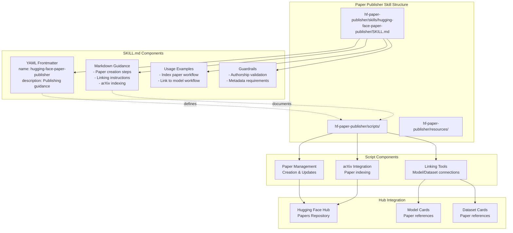
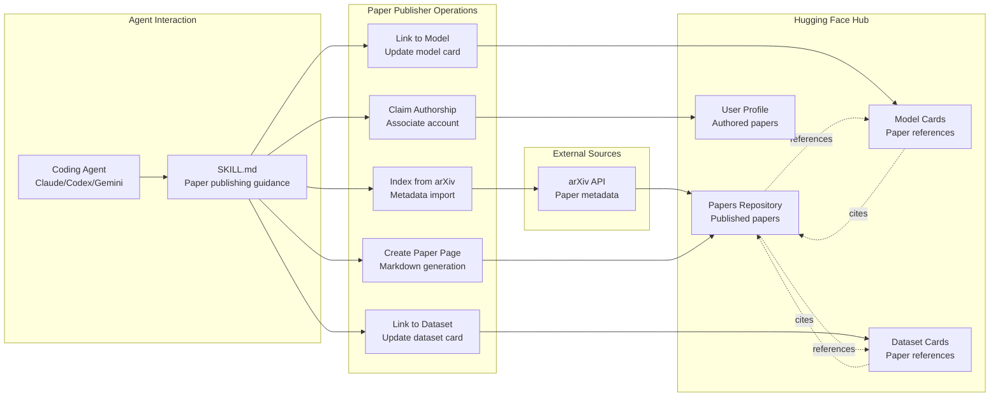
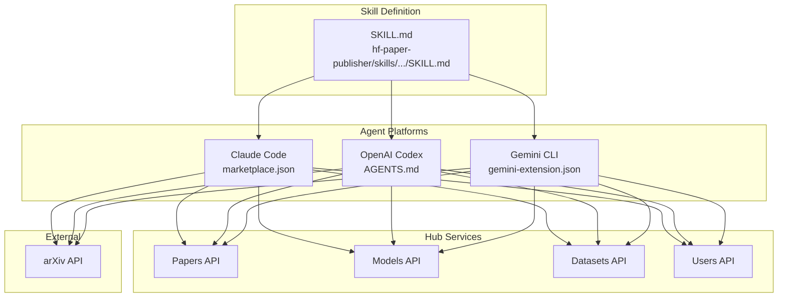

<!-- source: DeepWiki mcp.deepwiki.com · repo huggingface/skills · page 4.4 Paper Publisher Skill · fetched 2026-10-30 -->

# Paper Publisher Skill

<details>
<summary>Relevant source files</summary>

The following files were used as context for generating this wiki page:

- [.claude-plugin/marketplace.json](.claude-plugin/marketplace.json)
- [.gitignore](.gitignore)
- [LICENSE](LICENSE)
- [README.md](README.md)
- [assets/banner.png](assets/banner.png)

</details>


This page documents the Paper Publisher Skill, which enables AI agents to publish and manage research papers on Hugging Face Hub. For information about other available skills, see [Available Skills](#4).

## Purpose and Scope

The Paper Publisher Skill provides coding agents with the ability to publish research papers to Hugging Face Hub, link papers to models and datasets, claim authorship, and generate professional markdown-based research articles. This skill bridges the gap between research documentation and ML artifacts on the Hub.

This page covers the architecture, features, and integration points of the Paper Publisher Skill. For model training workflows, see [Model Trainer Skill](#4.1). For dataset creation, see [Dataset Creator Skill](#4.2).

**Sources:** [README.md:75](), [.claude-plugin/marketplace.json:17-20]()

## Skill Architecture

The Paper Publisher Skill follows the standard skill architecture pattern established by the Skills Framework, consisting of three main components:



**Skill Component Breakdown**

| Component | Location | Purpose |
|-----------|----------|---------|
| SKILL.md | `hf-paper-publisher/skills/hugging-face-paper-publisher/SKILL.md` | Agent-readable documentation with YAML frontmatter containing skill metadata and markdown guidance |
| Scripts | `hf-paper-publisher/scripts/` | Executable tools for paper management and linking operations |
| Resources | `hf-paper-publisher/resources/` | Templates and documentation for paper creation |

**Sources:** [README.md:75](), [.claude-plugin/marketplace.json:17-20]()

## Core Features

The Paper Publisher Skill provides four primary capabilities for research paper management on Hugging Face Hub:

### arXiv Paper Indexing

The skill enables automatic indexing of papers from arXiv into Hugging Face Hub. This feature allows researchers to:
- Import paper metadata from arXiv
- Create Hub paper pages with proper citations
- Maintain synchronization with arXiv updates

### Model and Dataset Linking

Papers can be bidirectionally linked to models and datasets on the Hub:
- Link papers to model cards to document the research behind a model
- Link papers to dataset cards to cite data sources
- Establish provenance chains between research and artifacts

### Authorship Management

The skill provides tools to manage paper authorship:
- Claim authorship for papers on the Hub
- Associate Hub accounts with paper authors
- Maintain author attribution and credit

### Paper Page Generation

Generate professional markdown-based research articles:
- Use templates for consistent formatting
- Convert research documentation into Hub-compatible format
- Include proper metadata for discoverability

**Sources:** [README.md:75](), [.claude-plugin/marketplace.json:17-20]()

## Integration with Hugging Face Hub



The Paper Publisher Skill integrates with Hugging Face Hub through several touchpoints:

1. **Papers Repository**: Direct publication and management of paper pages
2. **Model Cards**: Bidirectional linking between papers and models
3. **Dataset Cards**: Citation and reference management for datasets
4. **User Profiles**: Authorship claims and author attribution
5. **arXiv API**: External paper metadata source for indexing

**Sources:** [README.md:75](), [.claude-plugin/marketplace.json:17-20]()

## Agent Usage Patterns

Coding agents interact with the Paper Publisher Skill by referencing it in natural language instructions:

```
"Use the HF paper publisher skill to index my arXiv paper and link it to my model."
```

The agent then:
1. Loads the skill's `SKILL.md` file for guidance
2. Executes the appropriate scripts from `hf-paper-publisher/scripts/`
3. Interacts with Hugging Face Hub APIs to perform operations
4. Validates authorship and metadata requirements
5. Creates or updates paper pages, model cards, or dataset cards

**Common Workflows**

| Task | Agent Action | Hub Result |
|------|--------------|------------|
| Index arXiv paper | Load paper metadata, create Hub page | New paper entry in Papers repository |
| Link paper to model | Update model card with paper reference | Model card shows associated research |
| Link paper to dataset | Update dataset card with citation | Dataset card includes paper citation |
| Claim authorship | Associate Hub account with paper | User profile shows authored papers |
| Create paper from template | Generate markdown, publish to Hub | Professional paper page on Hub |

**Sources:** [README.md:84]()

## Skill Discovery and Installation

The Paper Publisher Skill is discoverable through multiple agent integration layers:

### Claude Code Integration

```
/plugin install hf-paper-publisher@huggingface-skills
```

The skill is registered in the Claude Code marketplace at [.claude-plugin/marketplace.json:17-20]().

### OpenAI Codex Integration

The skill is listed in the generated `AGENTS.md` catalog file, which Codex automatically loads to discover available skills.

### Gemini CLI Integration

The skill is included in the `gemini-extension.json` file for Gemini CLI integration.

**Sources:** [README.md:17-34](), [.claude-plugin/marketplace.json:17-20]()

## File Structure Pattern

Following the standard skill architecture pattern, the Paper Publisher Skill is organized as:

```
hf-paper-publisher/
├── skills/
│   └── hugging-face-paper-publisher/
│       └── SKILL.md              # Agent-readable guidance
├── scripts/                       # Paper management tools
│   ├── paper_manager.py          # Core paper operations (inferred)
│   ├── link_tools.py             # Model/dataset linking (inferred)
│   └── arxiv_indexer.py          # arXiv integration (inferred)
└── resources/                     # Templates and documentation
    └── templates/                 # Paper templates (inferred)
```

**Note:** The specific script names and structure are inferred from the skill pattern described in Diagram 4 of the high-level system architecture and the feature descriptions in the marketplace.json.

**Sources:** [.claude-plugin/marketplace.json:17-20]()

## Relationship to Hackathon Ecosystem

While the Paper Publisher Skill is not explicitly mentioned in the current weekly quests (which focus on model evaluation, dataset creation, and model fine-tuning), it plays a complementary role in the research lifecycle:

- **Model Training Quest (Week 3)**: After training a model, researchers can publish an associated paper documenting the methodology
- **Dataset Publishing Quest (Week 2)**: Datasets can be linked to papers describing data collection and processing
- **Model Evaluation Quest (Week 1)**: Evaluation results can be documented in research papers

The skill enables the full research publication workflow on Hugging Face Hub, connecting ML artifacts to their academic documentation.

**Sources:** [README.md:75]()

## Integration Points Summary



The Paper Publisher Skill serves as a bridge between academic research and machine learning infrastructure, enabling comprehensive documentation and attribution for models, datasets, and research contributions on Hugging Face Hub.

**Sources:** [README.md:75](), [.claude-plugin/marketplace.json:17-20]()

---

