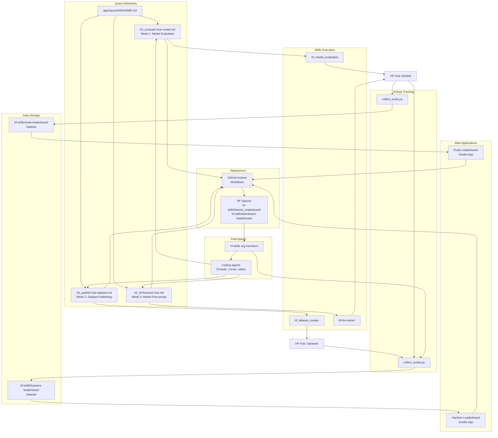
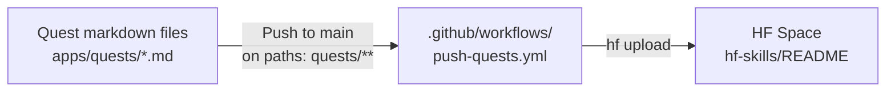
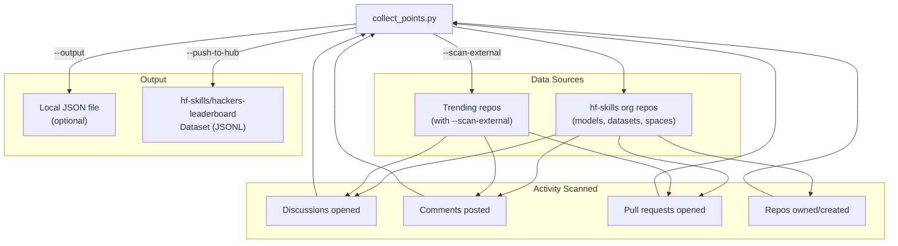
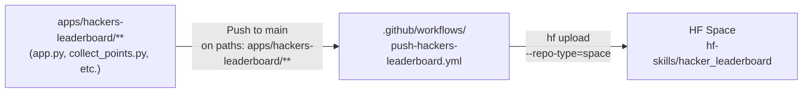
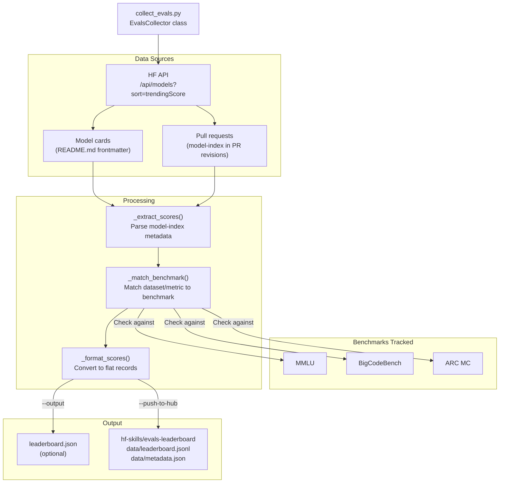
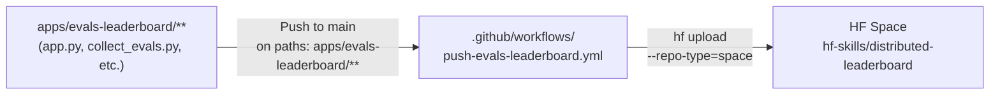
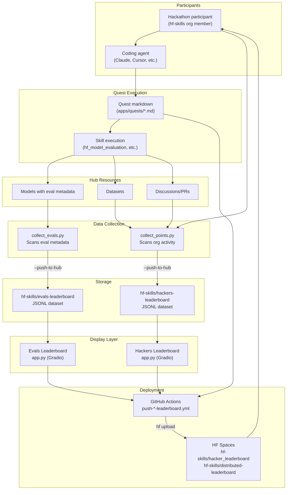

<!-- source: DeepWiki mcp.deepwiki.com · repo huggingface/skills · page 5 Hackathon Ecosystem · fetched 2026-10-30 -->

# Hackathon Ecosystem

<details>
<summary>Relevant source files</summary>

The following files were used as context for generating this wiki page:

- [.github/workflows/push-evals-leaderboard.yml](.github/workflows/push-evals-leaderboard.yml)
- [.github/workflows/push-hackers-leaderboard.yml](.github/workflows/push-hackers-leaderboard.yml)
- [apps/evals-leaderboard/app.py](apps/evals-leaderboard/app.py)
- [apps/evals-leaderboard/collect_evals.py](apps/evals-leaderboard/collect_evals.py)
- [apps/evals-leaderboard/requirements.txt](apps/evals-leaderboard/requirements.txt)
- [apps/hackers-leaderboard/README.md](apps/hackers-leaderboard/README.md)
- [apps/hackers-leaderboard/requirements.txt](apps/hackers-leaderboard/requirements.txt)
- [apps/quests/02_evaluate-hub-model.md](apps/quests/02_evaluate-hub-model.md)
- [apps/quests/03_publish-hub-dataset.md](apps/quests/03_publish-hub-dataset.md)
- [apps/quests/04_sft-finetune-hub.md](apps/quests/04_sft-finetune-hub.md)
- [apps/quests/README.md](apps/quests/README.md)

</details>


## Purpose and Scope

This document describes the "Humanity's Last Hackathon" system, which includes weekly quests, XP tracking, and dual leaderboard infrastructure. The hackathon ecosystem guides participants through using the skills framework to contribute to open source AI by evaluating models, creating datasets, and fine-tuning models. All contributions are automatically tracked and displayed on public leaderboards hosted on Hugging Face Spaces.

For details on individual skills used within quests (model training, dataset creation, evaluation management), see [Available Skills](#4). For information on how coding agents interact with skills, see [Agent Integration](#3).

---

## System Architecture

The hackathon ecosystem consists of three primary subsystems that work together to create a gamified contribution experience:



**Sources:** [apps/quests/README.md:1-122](), [Diagram 3 from context]()

The system operates as a closed loop: quest definitions guide participants to execute skills, skills modify Hub resources, tracking scripts scan Hub activity, datasets persist leaderboard data, Gradio apps display leaderboards, and GitHub Actions deploy apps to Spaces where participants can view their progress.

---

## Quest System

### Quest Structure

Each quest is defined as a markdown file in `apps/quests/` that provides task descriptions, XP tiers, skill references, and example commands. The hackathon runs for four weeks with one quest per week.

| Week | Quest File | Task | Skill Used |
|------|-----------|------|------------|
| 1 | `02_evaluate-hub-model.md` | Add evaluation results to model cards | `hf_model_evaluation` |
| 2 | `03_publish-hub-dataset.md` | Create and publish datasets | `hf_dataset_creator` |
| 3 | `04_sft-finetune-hub.md` | Fine-tune models on HF Jobs | `hf-llm-trainer` |
| 4 | TBA | Community sprint | Multiple skills |

**Sources:** [apps/quests/README.md:32-42]()

### Quest Deployment Flow



**Sources:** [.github/workflows/push-quests.yml:1-24]()

When quest files are modified on the `main` branch, the `push-quests.yml` workflow automatically uploads them to the `hf-skills/README` Space, making them visible to participants.

### XP Tier System

Each quest implements a three-tier XP system with escalating difficulty and rewards:

| Tier | Symbol | XP Range | Effort Level |
|------|--------|----------|--------------|
| Contributor | 🐢 | 1-75 XP | Complete the basics |
| Evaluator/Standard | 🐕 | 5-125 XP | Go deeper with more features |
| Advanced | 🦁 | 20-225 XP | Ship something impressive |

Additional tiers may include bonus (🐉) and negative XP for low-quality contributions (🤢).

**Sources:** [apps/quests/README.md:103-109](), [apps/quests/02_evaluate-hub-model.md:23-29]()

### Week 1: Model Evaluation Quest

The model evaluation quest tasks participants with adding structured evaluation results to model cards on the Hub.

**Goal:** Add evaluation scores to 100 trending models on the Hub, including benchmarks like AIME 2025, BigBenchHard, LiveCodeBench, MMLU, and ARC.

**XP Tiers:**

| Tier | XP | Description | Requirement |
|------|-----|-------------|-------------|
| 🐢 Contributor | 1 XP | Extract evaluation results from one benchmark and update model card | Any PR with evaluation data |
| 🐕 Evaluator | 5 XP | Import scores from third-party benchmarks like Artificial Analysis | Undefined benchmark scores and merged PRs |
| 🦁 Advanced | 20 XP | Run your own evaluation with inspect-ai and publish results | Original eval run and merged PR |
| 🐉 Bonus | 20 XP | Contribute to the leaderboard application | Any merged PR on hub or GitHub |
| 🤢 Slop | -20 XP | Opening non-useful PRs | Duplicate PRs, incorrect scores |

**Key Commands:**

Extract evaluation tables from README:
```bash
python hf_model_evaluation/scripts/evaluation_manager.py extract-readme \
  --repo-id "model-author/model-name" --dry-run
```

Import scores from Artificial Analysis API:
```bash
python hf_model_evaluation/scripts/evaluation_manager.py import-aa \
  --creator-slug "anthropic" --model-name "claude-sonnet-4" \
  --repo-id "target/model" --create-pr
```

Run evaluation with inspect-ai:
```bash
HF_TOKEN=$HF_TOKEN hf jobs uv run hf_model_evaluation/scripts/inspect_eval_uv.py \
  --flavor a10g-small --secret HF_TOKEN=$HF_TOKEN \
  -- --model "meta-llama/Llama-2-7b-hf" --task "mmlu"
```

**Sources:** [apps/quests/02_evaluate-hub-model.md:1-99]()

### Week 2: Dataset Publishing Quest

The dataset publishing quest focuses on creating high-quality, well-documented datasets for the community.

**Goal:** Publish datasets with proper structure, documentation, and licensing.

**XP Tiers:**

| Tier | XP | Description |
|------|-----|-------------|
| 🐢 Starter | 50 XP | Upload ≤1,000 rows with complete dataset card (license, splits, provenance) |
| 🐕 Standard | 100 XP | Publish conversational dataset with complete card |
| 🦁 Advanced | 200 XP | Translate existing dataset into multiple languages |

**Key Commands:**

Quick setup with template:
```bash
python hf_dataset_creator/scripts/dataset_manager.py quick_setup \
  --repo_id "your-username/dataset-name" --template chat
```

Initialize and add rows:
```bash
python hf_dataset_creator/scripts/dataset_manager.py init \
  --repo_id "hf-skills/your-dataset-name"

python hf_dataset_creator/scripts/dataset_manager.py add_rows \
  --repo_id "hf-skills/your-dataset-name" \
  --template classification \
  --rows_json "$(cat your_data.json)"
```

**Sources:** [apps/quests/03_publish-hub-dataset.md:1-75]()

### Week 3: Model Fine-tuning Quest

The fine-tuning quest guides participants through training models on Hugging Face Jobs infrastructure.

**Goal:** Fine-tune and share models using SFT, DPO, or GRPO training methods on cloud GPUs.

**Supported Methods:**
- **SFT** (Supervised Fine-Tuning) — Standard instruction tuning
- **DPO** (Direct Preference Optimization) — Alignment from preference data
- **GRPO** (Group Relative Policy Optimization) — Online RL training

The quest also covers GGUF conversion for local deployment and Trackio integration for monitoring.

**XP Tiers:** To be announced.

**Sources:** [apps/quests/04_sft-finetune-hub.md:1-34]()

---

## Hackers Leaderboard

The Hackers Leaderboard tracks engagement from members of the `hf-skills` organization by scanning Hub activity and calculating points based on contributions.

### Points Collection System

The `collect_points.py` script scans Hub activity to assign points to participants.



**Sources:** [apps/hackers-leaderboard/collect_points.py:1-86](), [apps/hackers-leaderboard/README.md:17-47]()

### Points System

The points system is simple and fair: **1 point per activity**.

| Activity | Points |
|----------|--------|
| 💬 Open a discussion | 1 |
| 📝 Post a comment | 1 |
| 🔀 Open a PR | 1 |
| 📦 Own/create a repo | 1 |

**Sources:** [apps/hackers-leaderboard/README.md:17-25]()

### Collection Script Usage

```bash
# Collect org activity only
HF_TOKEN=$HF_TOKEN python collect_points.py

# Scan trending repos for member PRs/discussions
HF_TOKEN=$HF_TOKEN python collect_points.py --scan-external

# Filter by repo type
HF_TOKEN=$HF_TOKEN python collect_points.py --scan-external --repo-type models
HF_TOKEN=$HF_TOKEN python collect_points.py --scan-external --repo-type models datasets

# Push to HF dataset
HF_TOKEN=$HF_TOKEN python collect_points.py --scan-external --push-to-hub

# Custom output
python collect_points.py --output my_leaderboard.json --repo-id my-org/my-dataset
```

**Command-line flags:**

| Flag | Description |
|------|-------------|
| `--scan-external` | Scan trending repos across Hub for member activity |
| `--repo-type` | Filter external scan to: `models`, `datasets`, `spaces` |
| `--push-to-hub` | Push results to HF dataset |
| `--repo-id` | Target dataset repo (default: `hf-skills/hackers-leaderboard`) |
| `--output` | Local JSON output path |

**Sources:** [apps/hackers-leaderboard/README.md:31-57]()

### Data Format

The collector outputs user records in JSONL format:

```json
{
  "username": "user123",
  "total_points": 15,
  "discussions_opened": 3,
  "comments_made": 8,
  "prs_opened": 2,
  "repos_owned": 2
}
```

**Sources:** [apps/hackers-leaderboard/README.md:74-85]()

### Hackers Leaderboard Gradio App

The `app.py` file in [apps/hackers-leaderboard/app.py:1-64]() implements a Gradio interface that reads data from the `hf-skills/hackers-leaderboard` dataset and displays it in a table.

**Dependencies:**
- `gradio>=5.50.0`
- `huggingface_hub>=1.1.4`
- `requests>=2.32.5`

**Sources:** [apps/hackers-leaderboard/requirements.txt:1-3](), [apps/hackers-leaderboard/README.md:1-86]()

### Hackers Leaderboard Deployment



The workflow at [.github/workflows/push-hackers-leaderboard.yml:1-25]() triggers on pushes to `apps/hackers-leaderboard/**` and uploads the entire directory to the `hf-skills/hacker_leaderboard` Space using the `hf upload` command.

**Sources:** [.github/workflows/push-hackers-leaderboard.yml:1-25]()

---

## Evals Leaderboard

The Evals Leaderboard displays model evaluation scores collected from trending models' model-index metadata or pull requests.

### Evaluation Collection Architecture



**Sources:** [apps/evals-leaderboard/collect_evals.py:1-481]()

### EvalsCollector Class

The `EvalsCollector` class at [apps/evals-leaderboard/collect_evals.py:104-425]() implements the evaluation collection logic.

**Key methods:**

| Method | Purpose | Lines |
|--------|---------|-------|
| `collect_all()` | Main entry point that fetches trending models and collects scores | [122-135]() |
| `_fetch_trending_models()` | Fetches trending text-generation models from HF API | [137-158]() |
| `_collect_scores()` | Collects scores from model card and PRs for a single model | [160-202]() |
| `_read_model_card()` | Downloads and parses model card frontmatter | [204-222]() |
| `_fetch_pull_requests()` | Fetches open PRs for a model | [244-263]() |
| `_extract_scores()` | Extracts benchmark scores from model-index metadata | [265-322]() |
| `_match_benchmark()` | Matches dataset/metric names to target benchmarks | [324-340]() |
| `push_to_hub()` | Uploads leaderboard data to HF dataset | [377-424]() |

**Sources:** [apps/evals-leaderboard/collect_evals.py:104-425]()

### Benchmark Configuration

Benchmarks are defined as `BenchmarkSpec` dataclasses at [apps/evals-leaderboard/collect_evals.py:62-101]():

```python
@dataclass(frozen=True)
class BenchmarkSpec:
    key: str
    label: str
    aliases: tuple[str, ...]
```

Tracked benchmarks:

| Key | Label | Aliases |
|-----|-------|---------|
| `mmlu` | MMLU | "mmlu", "massive multitask language understanding" |
| `bigcodebench` | BigCodeBench | "bigcodebench", "big code bench" |
| `arc_mc` | ARC MC | "arc mc", "arc-challenge", "arc challenge", "arc multiple choice", "arc c" |

The `matches()` method uses normalized string matching to identify benchmarks from dataset names, metric names, and types.

**Sources:** [apps/evals-leaderboard/collect_evals.py:62-101]()

### Collection Script Usage

```bash
# Collect and save locally
python collect_evals.py --output leaderboard.json

# Push to HF dataset
python collect_evals.py --push-to-hub

# Custom dataset repo
python collect_evals.py --push-to-hub --repo-id my-org/my-dataset
```

**Constants:**

| Constant | Value | Purpose |
|----------|-------|---------|
| `API_BASE` | `"https://huggingface.co/api"` | HF API base URL |
| `PIPELINE_FILTER` | `"text-generation"` | Pipeline tag filter |
| `TRENDING_LIMIT` | `50` | Number of trending models to process |
| `TRENDING_FETCH_LIMIT` | `100` | Number of trending models to fetch |
| `PR_SCAN_LIMIT` | `40` | Number of PRs to scan per model |

**Sources:** [apps/evals-leaderboard/collect_evals.py:30-35](), [apps/evals-leaderboard/collect_evals.py:427-480]()

### Evals Leaderboard Gradio App

The Gradio app at [apps/evals-leaderboard/app.py:1-137]() displays evaluation scores in a table format.

**Key functions:**

| Function | Purpose | Lines |
|----------|---------|-------|
| `fetch_leaderboard()` | Fetches leaderboard JSONL and metadata from dataset | [49-61]() |
| `refresh_handler()` | Refreshes data and builds table rows | [64-97]() |
| `format_model_link()` | Formats model ID as clickable link | [39-41]() |
| `format_source_link()` | Formats source as clickable link | [44-46]() |

**Table schema:**

| Header | Datatype | Content |
|--------|----------|---------|
| Model | `markdown` | Clickable model link |
| Benchmark | `text` | Benchmark name |
| Score | `number` | Evaluation score |
| Source | `markdown` | Source type and contributor link |

**Data URLs:**

```python
DATASET_REPO = "hf-skills/evals-leaderboard"
LEADERBOARD_URL = f"https://huggingface.co/datasets/{DATASET_REPO}/raw/main/data/leaderboard.jsonl"
METADATA_URL = f"https://huggingface.co/datasets/{DATASET_REPO}/raw/main/data/metadata.json"
```

**Sources:** [apps/evals-leaderboard/app.py:1-137](), [apps/evals-leaderboard/app.py:19-36]()

### Evals Leaderboard Deployment



The workflow at [.github/workflows/push-evals-leaderboard.yml:1-25]() triggers on pushes to `apps/evals-leaderboard/**` and uploads the entire directory to the `hf-skills/distributed-leaderboard` Space.

**Sources:** [.github/workflows/push-evals-leaderboard.yml:1-25]()

---

## Complete Data Flow

The following diagram shows how data flows through the entire hackathon ecosystem, from participant actions to leaderboard display:



**Sources:** [Diagram 3 from context](), [apps/quests/README.md:1-122](), [apps/hackers-leaderboard/README.md:1-86](), [apps/evals-leaderboard/collect_evals.py:1-481]()

This closed-loop system ensures that:
1. Participants follow quest instructions to use skills
2. Skills modify Hub resources (models, datasets, discussions)
3. Collection scripts scan Hub activity periodically
4. Results are persisted to datasets
5. Gradio apps read datasets and display leaderboards
6. GitHub Actions deploy apps to Spaces automatically
7. Participants view their progress and continue contributing

---

## Deployment Infrastructure

All hackathon components are automatically deployed to Hugging Face Spaces using GitHub Actions workflows.

### Workflow Triggers

Each deployment workflow uses path-based triggers to minimize unnecessary deployments:

| Workflow | Trigger Path | Target Space | Lines |
|----------|--------------|--------------|-------|
| `push-hackers-leaderboard.yml` | `apps/hackers-leaderboard/**` | `hf-skills/hacker_leaderboard` | [1-25]() |
| `push-evals-leaderboard.yml` | `apps/evals-leaderboard/**` | `hf-skills/distributed-leaderboard` | [1-25]() |
| `push-quests.yml` | `apps/quests/**` | `hf-skills/README` | [1-24]() |

All workflows trigger on push to the `main` branch and can also be manually triggered via `workflow_dispatch`.

**Sources:** [.github/workflows/push-hackers-leaderboard.yml:1-25](), [.github/workflows/push-evals-leaderboard.yml:1-25]()

### Deployment Process

Each workflow follows the same pattern:

1. Checkout repository
2. Install Hugging Face CLI (`curl -LsSf https://hf.co/cli/install.sh | bash`)
3. Upload files to Space using `hf upload <space-id> <source> . --repo-type=space`

Example from [.github/workflows/push-hackers-leaderboard.yml:14-24]():

```yaml
- name: Install huggingface_hub
  run: curl -LsSf https://hf.co/cli/install.sh | bash

- name: Upload hackers leaderboard to HF Space
  env:
    HF_TOKEN: ${{ secrets.HF_TOKEN }}
  run: hf upload hf-skills/hacker_leaderboard apps/hackers-leaderboard . --repo-type=space
```

The `HF_TOKEN` secret must be configured in the repository settings with write access to the target Spaces.

**Sources:** [.github/workflows/push-hackers-leaderboard.yml:18-24](), [.github/workflows/push-evals-leaderboard.yml:18-24]()

---

## Summary

The Hackathon Ecosystem consists of:

1. **Quest Definitions** - Markdown files in `apps/quests/` that guide participants through weekly challenges
2. **Skills Integration** - Quests leverage the three main skills (evaluation, dataset creation, training)
3. **Activity Tracking** - Two collection scripts (`collect_points.py`, `collect_evals.py`) scan Hub activity
4. **Data Persistence** - Results stored in two HF datasets (`hf-skills/hackers-leaderboard`, `hf-skills/evals-leaderboard`)
5. **Display Layer** - Two Gradio apps that read datasets and display leaderboards
6. **Deployment Pipeline** - Three GitHub Actions workflows that automatically deploy to HF Spaces

This architecture creates a gamified contribution experience where participants use coding agents to complete quests, earn XP, and climb public leaderboards, all while contributing valuable resources to the open source AI ecosystem.

---

