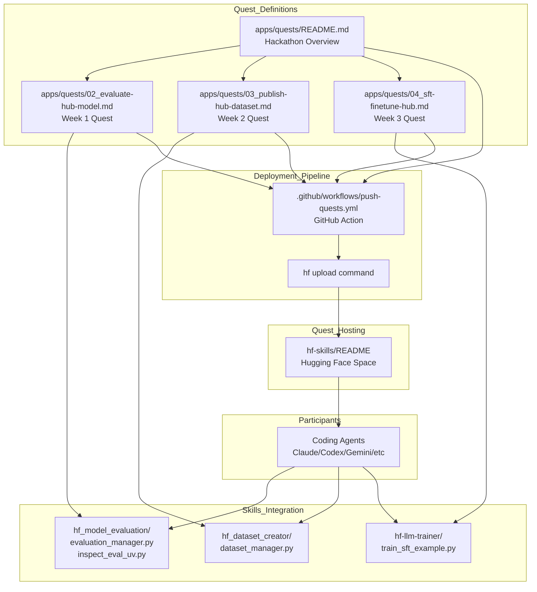
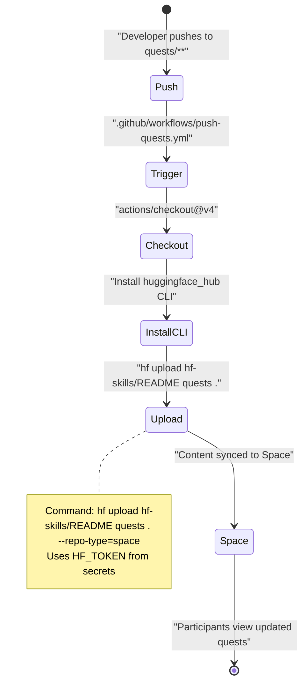
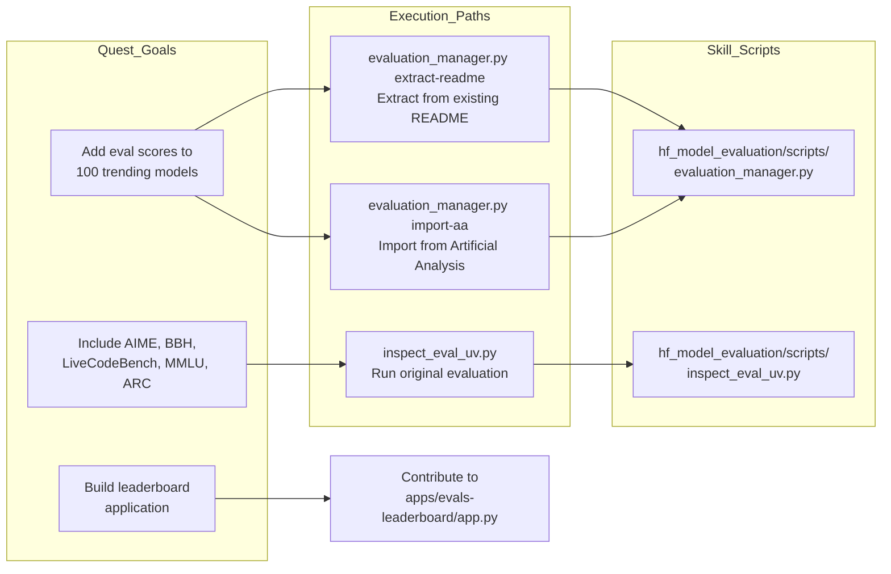
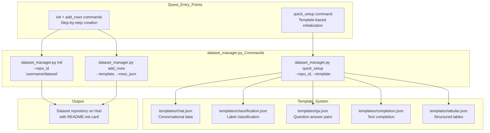
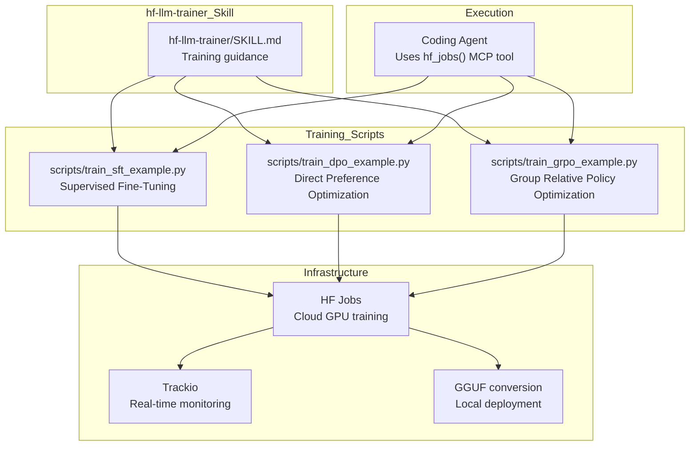
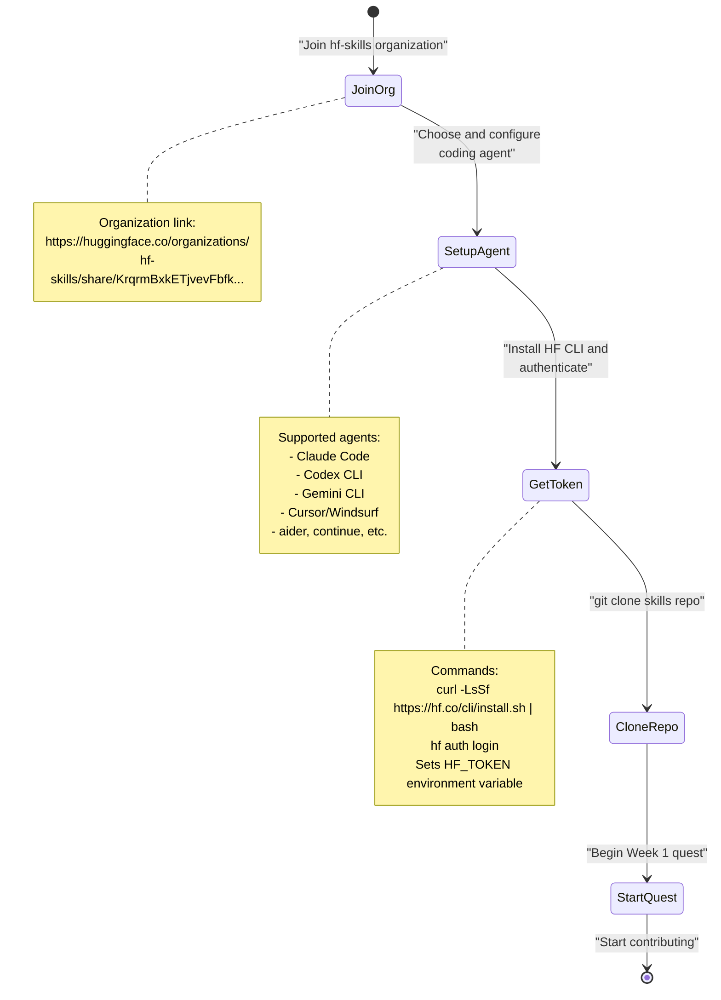

<!-- source: DeepWiki mcp.deepwiki.com · repo huggingface/skills · page 5.1 Weekly Quests · fetched 2026-10-30 -->

# Weekly Quests

<details>
<summary>Relevant source files</summary>

The following files were used as context for generating this wiki page:

- [.github/workflows/push-quests.yml](.github/workflows/push-quests.yml)
- [apps/quests/02_evaluate-hub-model.md](apps/quests/02_evaluate-hub-model.md)
- [apps/quests/03_publish-hub-dataset.md](apps/quests/03_publish-hub-dataset.md)
- [apps/quests/04_sft-finetune-hub.md](apps/quests/04_sft-finetune-hub.md)
- [apps/quests/README.md](apps/quests/README.md)

</details>


## Purpose and Scope

This document describes the Weekly Quests system, which is the core mechanism of the Humanity's Last Hackathon. Weekly quests are time-bound challenges that guide participants to use specific Hugging Face Skills to contribute to open source AI infrastructure. For information about the overall hackathon structure and leaderboards, see [Hackathon Ecosystem](#5). For details on the skills used by quests, see [Available Skills](#4).

Sources: [apps/quests/README.md:1-122]()

## System Architecture

The Weekly Quests system consists of quest definition files that are automatically deployed to Hugging Face Spaces, where participants can view challenges, track progress, and access resources. Each quest targets a specific skill and defines tiered XP rewards based on contribution quality.

### Quest System Components



Sources: [apps/quests/README.md:1-122](), [.github/workflows/push-quests.yml:1-26]()

### Quest Deployment Workflow

The quest files are automatically synchronized to Hugging Face Spaces via GitHub Actions. When changes are pushed to the `quests/**` path on the main branch, the `push-quests.yml` workflow uploads the entire quests directory to the `hf-skills/README` Space.



Sources: [.github/workflows/push-quests.yml:1-26]()

## Quest Structure and Format

Each quest is defined as a markdown file in the `apps/quests/` directory. Quest files follow a consistent structure that includes the challenge description, skill references, XP tiers, usage examples, and resources.

### Standard Quest File Structure

| Section | Purpose | Location in Files |
|---------|---------|-------------------|
| **Title and Task** | High-level objective statement | [apps/quests/02_evaluate-hub-model.md:1-3]() |
| **Why This Matters** | Context and community impact | [apps/quests/02_evaluate-hub-model.md:8-10]() |
| **Goals** | Specific targets and success metrics | [apps/quests/02_evaluate-hub-model.md:12-17]() |
| **XP Tiers** | Point allocation and requirements | [apps/quests/02_evaluate-hub-model.md:19-29]() |
| **The Skill** | Skill reference and key capabilities | [apps/quests/02_evaluate-hub-model.md:34-42]() |
| **Usage Examples** | Code snippets and commands | [apps/quests/02_evaluate-hub-model.md:46-86]() |
| **Tips** | Best practices and warnings | [apps/quests/02_evaluate-hub-model.md:88-93]() |
| **Resources** | Links to SKILL.md and examples | [apps/quests/02_evaluate-hub-model.md:95-99]() |

Sources: [apps/quests/02_evaluate-hub-model.md:1-100](), [apps/quests/03_publish-hub-dataset.md:1-75](), [apps/quests/04_sft-finetune-hub.md:1-34]()

## Hackathon Schedule and Timeline

The hackathon runs over four weeks with a structured release schedule for quests. Each Monday releases a new quest, with Wednesday livestreams for Q&A support.

```mermaid
gantt
    title "Humanity's Last Hackathon Schedule"
    dateFormat YYYY-MM-DD
    section "Week_1"
    "Quest Released: Evaluate Hub Model" :milestone, w1_release, 2025-12-02, 0d
    "Week 1 Quest Active" :w1_active, 2025-12-02, 7d
    "Livestream 1" :milestone, w1_stream, 2025-12-04, 0d
    section "Week_2"
    "Quest Released: Publish Dataset" :milestone, w2_release, 2025-12-09, 0d
    "Week 2 Quest Active" :w2_active, 2025-12-09, 7d
    "Livestream 2" :milestone, w2_stream, 2025-12-11, 0d
    section "Week_3"
    "Quest Released: SFT Fine-Tuning" :milestone, w3_release, 2025-12-16, 0d
    "Week 3 Quest Active" :w3_active, 2025-12-16, 7d
    "Livestream 3" :milestone, w3_stream, 2025-12-18, 0d
    section "Week_4"
    "Community Sprint" :milestone, w4_sprint, 2025-12-23, 0d
    "Week 4 Active" :w4_active, 2025-12-23, 8d
    section "End"
    "Hackathon Ends" :milestone, end, 2025-12-31, 0d
```

Sources: [apps/quests/README.md:31-42]()

## XP Tier System

Each quest implements a tiered reward system using animal emoji markers. The tier system incentivizes both participation and quality contributions.

### Standard Tier Structure

| Tier | Emoji | Typical XP Range | Requirements |
|------|-------|------------------|--------------|
| **Contributor** | 🐢 | 1-75 XP | Basic completion, minimal requirements |
| **Intermediate** | 🐕 | 5-125 XP | Enhanced features, multiple benchmarks |
| **Advanced** | 🦁 | 20-225 XP | Original contributions, complex work |
| **Bonus** | 🐉 | 20 XP | Extra contributions beyond quest scope |
| **Penalty** | 🤢 | -20 XP | Low-quality or spam submissions |

Sources: [apps/quests/README.md:101-110](), [apps/quests/02_evaluate-hub-model.md:19-29]()

### Quest-Specific XP Allocation

Each quest defines its own tier values based on effort and impact:

**Week 1 (Model Evaluation):**
- 🐢 Contributor: 1 XP per model card update
- 🐕 Evaluator: 5 XP for third-party benchmark imports
- 🦁 Advanced: 20 XP for original inspect-ai evaluation runs
- 🐉 Bonus: 20 XP for leaderboard app contributions
- 🤢 Slop: -20 XP for duplicate/incorrect PRs

**Week 2 (Dataset Publishing):**
- 🐢 Starter: 50 XP for small dataset (≤1,000 rows) with complete card
- 🐕 Standard: 100 XP for conversational dataset with documentation
- 🦁 Advanced: 200 XP for multi-language dataset translations

**Week 3 (SFT Fine-Tuning):**
- XP tiers to be announced (placeholder in quest file)

Sources: [apps/quests/02_evaluate-hub-model.md:23-29](), [apps/quests/03_publish-hub-dataset.md:24-64](), [apps/quests/04_sft-finetune-hub.md:22-24]()

## Week 1 Quest: Evaluate Hub Model

The first quest focuses on adding structured evaluation metadata to model cards on the Hub. Participants extract existing benchmark results, import third-party scores, or run original evaluations.

### Quest Objectives



Sources: [apps/quests/02_evaluate-hub-model.md:12-17]()

### Execution Methods

**Method 1: Extract from README**

Uses `evaluation_manager.py extract-readme` to parse existing evaluation tables from model card content.

```bash
python hf_model_evaluation/scripts/evaluation_manager.py extract-readme \
  --repo-id "model-author/model-name" --dry-run
```

**Method 2: Import from Artificial Analysis**

Uses `evaluation_manager.py import-aa` to fetch benchmark scores from the Artificial Analysis API.

```bash
python hf_model_evaluation/scripts/evaluation_manager.py import-aa \
  --creator-slug "anthropic" --model-name "claude-sonnet-4" \
  --repo-id "target/model" --create-pr
```

**Method 3: Run Original Evaluation**

Uses `inspect_eval_uv.py` to execute evaluations on HF Jobs infrastructure with inspect-ai framework.

```bash
HF_TOKEN=$HF_TOKEN hf jobs uv run hf_model_evaluation/scripts/inspect_eval_uv.py \
  --flavor a10g-small --secret HF_TOKEN=$HF_TOKEN \
  -- --model "meta-llama/Llama-2-7b-hf" --task "mmlu"
```

Sources: [apps/quests/02_evaluate-hub-model.md:46-86]()

### Best Practices and Guardrails

The quest includes explicit guidance to maintain quality:

- Always use `--dry-run` flag for preview before pushing changes
- Check for transposed tables (models as rows vs. columns)
- Respect model ownership when creating PRs
- Manually validate extracted scores
- Close PRs if validation fails

The quest also includes a "slop" penalty tier (-20 XP) for duplicate PRs, incorrect scores, or spam contributions.

Sources: [apps/quests/02_evaluate-hub-model.md:88-93](), [apps/quests/02_evaluate-hub-model.md:29]()

## Week 2 Quest: Publish Hub Dataset

The second quest focuses on creating and publishing high-quality datasets with proper documentation and structure. This quest emphasizes data quality over quantity.

### Quest Implementation Path



Sources: [apps/quests/03_publish-hub-dataset.md:9-22]()

### Tier Requirements

**🐢 Starter (50 XP):**
- Dataset with ≤1,000 rows
- Complete dataset card covering license, splits, data provenance
- Upload to Hub under `hf-skills` organization or personal account

Example commands:
```bash
python hf_dataset_creator/scripts/dataset_manager.py init \
  --repo_id "hf-skills/your-dataset-name"

python hf_dataset_creator/scripts/dataset_manager.py add_rows \
  --repo_id "hf-skills/your-dataset-name" \
  --template classification \
  --rows_json "$(cat your_data.json)"
```

**🐕 Standard (100 XP):**
- Conversational dataset with ≤1,000 rows
- Complete dataset card with license and splits
- Upload to `hf-skills` organization

**🦁 Advanced (200 XP):**
- Translate existing Hub dataset into multiple languages
- Publish translated datasets on Hub under `hf-skills`
- Document translation methodology

Sources: [apps/quests/03_publish-hub-dataset.md:24-64]()

### Key Capabilities

The `hf_dataset_creator` skill provides:

- Dataset repository initialization with proper structure
- Multi-format support (chat, classification, QA, completion, tabular)
- Template-based validation for data quality
- Streaming uploads without full dataset downloads

Sources: [apps/quests/03_publish-hub-dataset.md:9-22]()

## Week 3 Quest: Supervised Fine-Tuning

The third quest focuses on fine-tuning models using the `hf-llm-trainer` skill and Hugging Face Jobs infrastructure. This quest requires cloud GPU training and model publishing.

### Training Methods Supported



Sources: [apps/quests/04_sft-finetune-hub.md:1-34]()

### Quest Structure

Unlike Weeks 1 and 2, Week 3 quest does not yet have finalized XP tiers. The quest file states "We'll announce the XP tiers for this quest soon."

The quest emphasizes:
- Fine-tuning base models on custom data
- Publishing results for community use
- Documenting training methodology
- Reproducible training recipes

Key capabilities provided by `hf-llm-trainer`:
- **SFT** — Standard instruction tuning
- **DPO** — Alignment from preference data
- **GRPO** — Online RL training
- Cloud GPU training on HF Jobs (no local setup)
- Trackio integration for monitoring
- GGUF conversion for local deployment

Sources: [apps/quests/04_sft-finetune-hub.md:1-34]()

## Participant Onboarding Flow

The quest system requires specific setup steps before participants can begin contributing. The onboarding flow is documented in the main README.



Sources: [apps/quests/README.md:44-87]()

### Required Setup Steps

1. **Join Organization:** Use invitation link to join `hf-skills` organization on Hugging Face Hub
2. **Set Up Coding Agent:** Install and configure any agent (Claude Code, Codex, Gemini, Cursor, etc.)
3. **Get HF Token:** Install HF CLI and run `hf auth login` to create/store token
4. **Clone Repository:** `git clone https://github.com/huggingface/skills.git`
5. **Point Agent:** Configure agent to use skill definitions from cloned repo

Sources: [apps/quests/README.md:44-87]()

## Support Resources

Each quest provides multiple support channels and documentation references:

| Resource Type | Purpose | References |
|---------------|---------|-----------|
| **SKILL.md files** | Complete skill documentation | [apps/quests/02_evaluate-hub-model.md:96](), [apps/quests/03_publish-hub-dataset.md:68]() |
| **Discord channel** | Real-time help and community | [apps/quests/README.md:115]() |
| **Livestreams** | Weekly walkthroughs and Q&A | [apps/quests/README.md:33-42]() |
| **GitHub Issues** | Bug reports and feature requests | [apps/quests/README.md:117]() |
| **Example files** | Worked examples and templates | [apps/quests/02_evaluate-hub-model.md:97-99]() |

Sources: [apps/quests/README.md:113-118]()

## Technical Implementation Details

### Quest File Naming Convention

Quest files use a numeric prefix for ordering:
- `02_evaluate-hub-model.md` — Week 1
- `03_publish-hub-dataset.md` — Week 2
- `04_sft-finetune-hub.md` — Week 3

The numbering starts at 02 because `01_` is likely reserved for an introduction or overview file not present in the repository snapshot.

### Deployment Configuration

The GitHub Actions workflow `push-quests.yml` triggers on:
- Push to `main` branch
- Changes to `quests/**` path
- Manual workflow dispatch

The workflow performs these steps:
1. Checkout repository with `actions/checkout@v4`
2. Install Hugging Face CLI: `curl -LsSf https://hf.co/cli/install.sh | bash`
3. Upload to Space: `hf upload hf-skills/README quests . --repo-type=space`

The deployment uses `HF_TOKEN` from GitHub secrets for authentication.

Sources: [.github/workflows/push-quests.yml:1-26]()

### Quest-to-Skill Mapping

| Quest File | Target Skill Directory | Primary Scripts |
|------------|------------------------|-----------------|
| `02_evaluate-hub-model.md` | `hf_model_evaluation/` | `evaluation_manager.py`, `inspect_eval_uv.py` |
| `03_publish-hub-dataset.md` | `hf_dataset_creator/` | `dataset_manager.py` |
| `04_sft-finetune-hub.md` | `hf-llm-trainer/` | `train_sft_example.py`, `train_dpo_example.py`, `train_grpo_example.py` |

Each quest document links to the corresponding SKILL.md file and provides direct command examples using the skill's scripts.

Sources: [apps/quests/02_evaluate-hub-model.md:34-42](), [apps/quests/03_publish-hub-dataset.md:9-22](), [apps/quests/04_sft-finetune-hub.md:9-21]()

---

