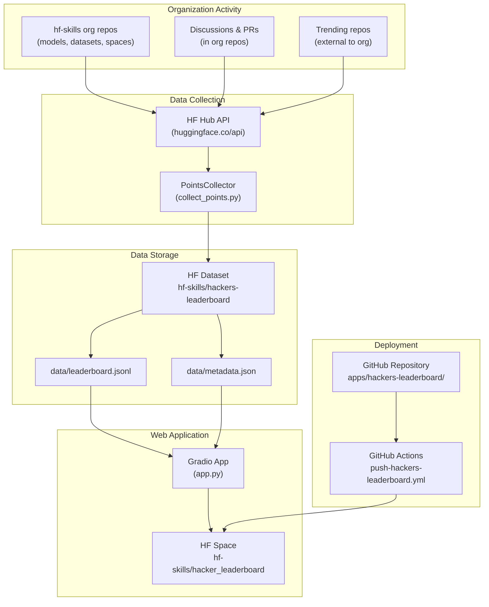
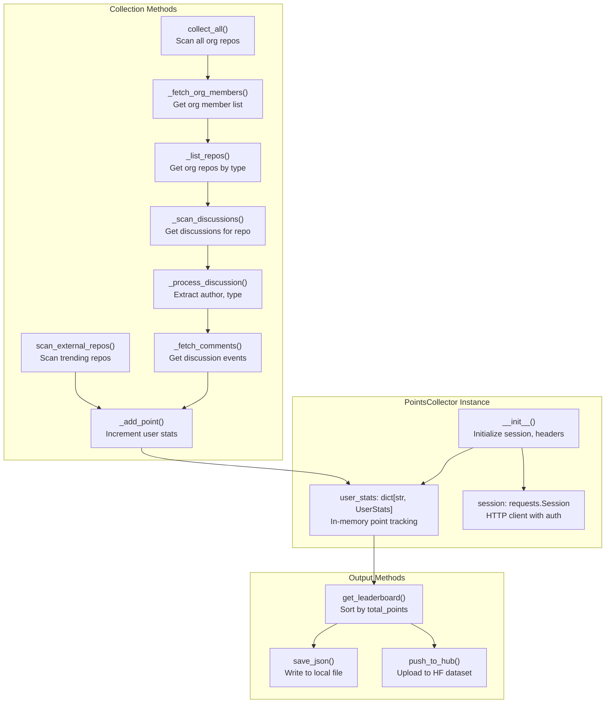
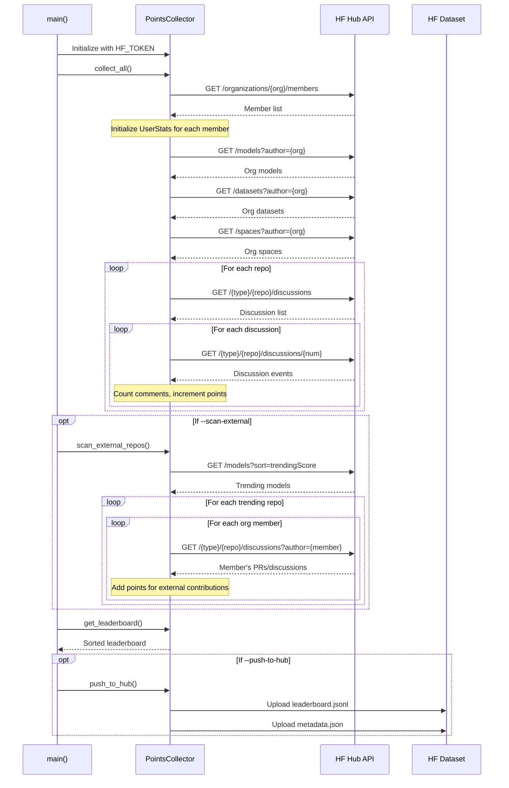
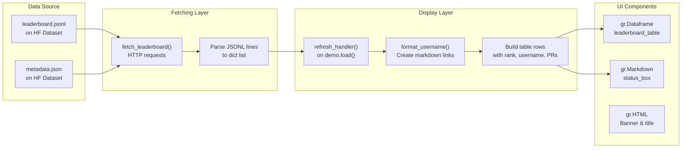
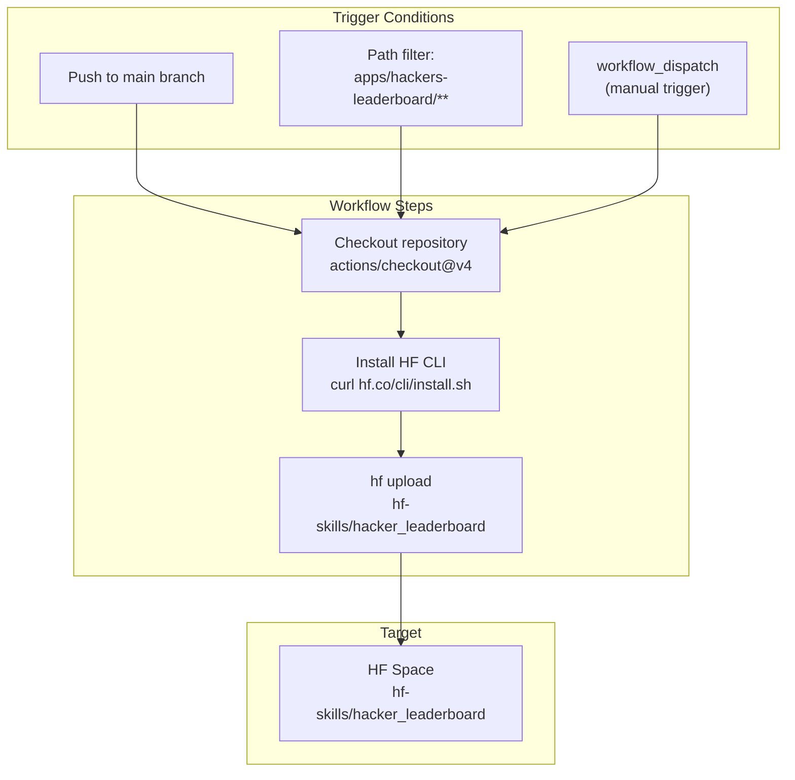

<!-- source: DeepWiki mcp.deepwiki.com · repo huggingface/skills · page 5.2 Hackers Leaderboard · fetched 2026-10-30 -->

# Hackers Leaderboard

<details>
<summary>Relevant source files</summary>

The following files were used as context for generating this wiki page:

- [.github/workflows/push-evals-leaderboard.yml](.github/workflows/push-evals-leaderboard.yml)
- [.github/workflows/push-hackers-leaderboard.yml](.github/workflows/push-hackers-leaderboard.yml)
- [apps/hackers-leaderboard/README.md](apps/hackers-leaderboard/README.md)
- [apps/hackers-leaderboard/app.py](apps/hackers-leaderboard/app.py)
- [apps/hackers-leaderboard/collect_points.py](apps/hackers-leaderboard/collect_points.py)
- [apps/hackers-leaderboard/requirements.txt](apps/hackers-leaderboard/requirements.txt)
- [apps/quests/02_evaluate-hub-model.md](apps/quests/02_evaluate-hub-model.md)
- [apps/quests/03_publish-hub-dataset.md](apps/quests/03_publish-hub-dataset.md)
- [apps/quests/04_sft-finetune-hub.md](apps/quests/04_sft-finetune-hub.md)
- [apps/quests/README.md](apps/quests/README.md)

</details>


## Purpose and Scope

The Hackers Leaderboard is an automated engagement tracking system that monitors contributions from members of the `hf-skills` organization across the Hugging Face Hub. The system collects activity data, calculates points, stores results in a Hub dataset, and displays rankings through a Gradio web application deployed to Hugging Face Spaces.

This page covers the leaderboard architecture, points collection logic, and deployment pipeline. For information about the weekly quests that drive participation, see [Weekly Quests](#5.1). For the separate evaluation results leaderboard, see [Evals Leaderboard](#5.3). For details about the points collection subsystem specifically, see [Points Collection System](#5.2.1).

**Sources:** [apps/hackers-leaderboard/README.md:1-86](), [apps/quests/README.md:1-122]()

## System Architecture

The Hackers Leaderboard consists of three main components: a data collection script (`collect_points.py`), a Hugging Face dataset for persistent storage, and a Gradio application for visualization.

### High-Level Component Diagram



The system operates in two independent cycles:

1. **Data Collection Cycle**: The `PointsCollector` class periodically scans the Hub API to gather activity, calculates points using `UserStats`, and pushes results to the `hf-skills/hackers-leaderboard` dataset.

2. **Deployment Cycle**: GitHub Actions automatically deploys the Gradio app to Hugging Face Spaces whenever changes are pushed to `apps/hackers-leaderboard/**` on the main branch.

**Sources:** [apps/hackers-leaderboard/collect_points.py:1-536](), [apps/hackers-leaderboard/app.py:1-126](), [.github/workflows/push-hackers-leaderboard.yml:1-26]()

## Points System

The leaderboard uses a simple, transparent points system where every activity type is worth exactly 1 point.

### Activity Types and Point Values

| Activity | Points | Tracked Field | Description |
|----------|--------|---------------|-------------|
| 💬 Open a discussion | 1 | `discussions_opened` | Create a new discussion on any repo |
| 📝 Post a comment | 1 | `comments_made` | Comment on existing discussions or PRs |
| 🔀 Open a PR | 1 | `prs_opened` | Create a pull request |
| 📦 Own/create a repo | 1 | `repos_owned` | Create or own a model, dataset, or space |

The `UserStats` class at [apps/hackers-leaderboard/collect_points.py:36-61]() tracks these metrics for each user. The `total_points` property simply sums all four fields:

```python
@property
def total_points(self) -> int:
    return self.discussions_opened + self.comments_made + self.prs_opened + self.repos_owned
```

**Sources:** [apps/hackers-leaderboard/README.md:16-26](), [apps/hackers-leaderboard/collect_points.py:36-61]()

## Data Collection Implementation

### PointsCollector Class Architecture



The `PointsCollector` class at [apps/hackers-leaderboard/collect_points.py:63-459]() is the core data collection engine. It maintains a dictionary of `UserStats` objects keyed by username, incrementing counters as it discovers activities across the Hub.

**Sources:** [apps/hackers-leaderboard/collect_points.py:63-459]()

### Collection Workflow

The collection process follows this sequence:



The `collect_all()` method at [apps/hackers-leaderboard/collect_points.py:106-141]() orchestrates the collection across all organization repositories. It uses the pattern of calling `_list_repos()` for each repo type (models, datasets, spaces), then calling `_scan_discussions()` for each discovered repository.

**Sources:** [apps/hackers-leaderboard/collect_points.py:106-141](), [apps/hackers-leaderboard/collect_points.py:287-324]()

### External Repository Scanning

The optional `--scan-external` flag enables tracking contributions to repositories outside the `hf-skills` organization. This is implemented in the `scan_external_repos()` method at [apps/hackers-leaderboard/collect_points.py:143-176]().

The external scanning process:

1. **Fetch trending repos**: Uses `_fetch_trending()` at [apps/hackers-leaderboard/collect_points.py:177-188]() to get the top 50 trending repos of each type
2. **Filter to org members**: Loads the existing `user_stats` dictionary populated during `collect_all()`
3. **Per-member API queries**: Uses the `author` query parameter to efficiently fetch only discussions/PRs by specific members via `_fetch_member_discussions()` at [apps/hackers-leaderboard/collect_points.py:215-259]()

This approach minimizes API calls by leveraging the Hub's filtering capabilities rather than fetching all discussions and filtering client-side.

**Sources:** [apps/hackers-leaderboard/collect_points.py:143-286]()

## Data Model

### UserStats Dataclass

The `UserStats` dataclass at [apps/hackers-leaderboard/collect_points.py:36-61]() represents a participant's engagement metrics:

```python
@dataclass
class UserStats:
    username: str
    is_org_member: bool = True
    discussions_opened: int = 0
    comments_made: int = 0
    prs_opened: int = 0
    repos_owned: int = 0
    activities: list[dict[str, Any]] = field(default_factory=list)
```

The `is_org_member` field distinguishes between members of the `hf-skills` organization and external contributors who interact with org repositories. The `activities` list provides an audit trail of all point-earning actions, storing structured dictionaries with `type`, `repo_id`, `discussion_num`, and `timestamp` fields.

**Sources:** [apps/hackers-leaderboard/collect_points.py:36-61](), [apps/hackers-leaderboard/collect_points.py:383-390]()

### Dataset Output Format

The `push_to_hub()` method at [apps/hackers-leaderboard/collect_points.py:411-459]() writes two files to the `hf-skills/hackers-leaderboard` dataset:

**data/leaderboard.jsonl** - One JSON object per line, each representing a user:
```json
{
  "username": "user123",
  "is_org_member": true,
  "total_points": 15,
  "discussions_opened": 3,
  "comments_made": 8,
  "prs_opened": 2,
  "repos_owned": 2
}
```

**data/metadata.json** - Aggregate statistics:
```json
{
  "generated_at": "2025-01-15T10:30:00Z",
  "organization": "hf-skills",
  "total_participants": 47,
  "total_points": 1234
}
```

**Sources:** [apps/hackers-leaderboard/collect_points.py:411-459](), [apps/hackers-leaderboard/README.md:74-86]()

## Gradio Application

### Application Structure

The Gradio app at [apps/hackers-leaderboard/app.py:1-126]() is a simple data visualization interface that reads from the dataset and displays a table.



The app follows a simple request-response pattern. On page load, `demo.load()` at [apps/hackers-leaderboard/app.py:108-111]() calls `refresh_handler()` which fetches data from the dataset URLs defined at [apps/hackers-leaderboard/app.py:33-35]().

**Sources:** [apps/hackers-leaderboard/app.py:1-126]()

### Table Configuration

The leaderboard table uses three columns defined at [apps/hackers-leaderboard/app.py:19-30]():

```python
TABLE_HEADERS = [
    "Rank",
    "Username",
    "Points",
    "💬 Discussions",
]

TABLE_DATATYPES = [
    "number",
    "markdown",
    "number",
]
```

The `format_username()` function at [apps/hackers-leaderboard/app.py:38-41]() converts usernames to clickable Markdown links:

```python
def format_username(username: str) -> str:
    """Format username as a clickable link."""
    return f"[{username}](https://huggingface.co/{username})"
```

Note that the table displays `prs_opened` at [apps/hackers-leaderboard/app.py:70]() in the "Points" column, which appears to be a bug since it should display `total_points` instead.

**Sources:** [apps/hackers-leaderboard/app.py:19-30](), [apps/hackers-leaderboard/app.py:38-41](), [apps/hackers-leaderboard/app.py:64-73]()

## Deployment Pipeline

### GitHub Actions Workflow

The deployment workflow at [.github/workflows/push-hackers-leaderboard.yml:1-26]() automatically syncs the application to Hugging Face Spaces.



The workflow uses path filtering at [.github/workflows/push-hackers-leaderboard.yml:7-8]() to trigger only when files in `apps/hackers-leaderboard/**` change. The upload command at [.github/workflows/push-hackers-leaderboard.yml:24]() syncs the entire directory:

```yaml
run: hf upload hf-skills/hacker_leaderboard apps/hackers-leaderboard . --repo-type=space
```

This uploads all files from `apps/hackers-leaderboard/` to the root of the Space repository, including `app.py`, `requirements.txt`, and `README.md`.

**Sources:** [.github/workflows/push-hackers-leaderboard.yml:1-26]()

### Dependencies

The application requires three Python packages specified in [apps/hackers-leaderboard/requirements.txt:1-3]():

| Package | Version | Purpose |
|---------|---------|---------|
| `gradio` | ≥5.50.0 | Web UI framework |
| `huggingface_hub` | ≥1.1.4 | Dataset operations (used by collect_points.py) |
| `requests` | ≥2.32.5 | HTTP client for fetching leaderboard data |

**Sources:** [apps/hackers-leaderboard/requirements.txt:1-3]()

## Command-Line Interface

The `collect_points.py` script provides a flexible CLI for different collection scenarios.

### Basic Usage Examples

```bash
# Collect org activity only
HF_TOKEN=$HF_TOKEN python collect_points.py

# Also scan trending repos for member PRs/discussions
HF_TOKEN=$HF_TOKEN python collect_points.py --scan-external

# Scan only specific repo types
HF_TOKEN=$HF_TOKEN python collect_points.py --scan-external --repo-type models
HF_TOKEN=$HF_TOKEN python collect_points.py --scan-external --repo-type models datasets

# Push to HF dataset
HF_TOKEN=$HF_TOKEN python collect_points.py --scan-external --push-to-hub

# Custom output
python collect_points.py --output my_leaderboard.json --repo-id my-org/my-dataset
```

### CLI Arguments

The argument parser at [apps/hackers-leaderboard/collect_points.py:461-493]() defines these options:

| Flag | Type | Default | Description |
|------|------|---------|-------------|
| `--push-to-hub` | boolean | False | Push results to HF dataset |
| `--output` | string | `leaderboard.json` | Local JSON output path |
| `--repo-id` | string | `hf-skills/hackers-leaderboard` | Target dataset repo ID |
| `--scan-external` | boolean | False | Scan trending repos for member activity |
| `--repo-type` | string[] | None (all) | Filter external scan to: models, datasets, spaces |

**Sources:** [apps/hackers-leaderboard/README.md:29-58](), [apps/hackers-leaderboard/collect_points.py:461-493]()

## Integration with Hackathon Ecosystem

The Hackers Leaderboard is embedded into the quest system, providing real-time feedback on participant rankings.

### Embedded Leaderboard Display

The quest README at [apps/quests/README.md:92-99]() embeds the leaderboard Space using an iframe:

```html
<iframe
	src="https://hf-skills-hacker-leaderboard.hf.space"
	frameborder="0"
	width="850"
	height="450"
></iframe>
```

This allows participants to view their current standings directly from the quest instructions without navigating away.

**Sources:** [apps/quests/README.md:92-99]()

### Relation to XP Tiers

While the quests define XP tiers (🐢 50 XP, 🐕 100 XP, 🦁 200 XP) for specific achievements, the Hackers Leaderboard uses a simpler 1-point-per-activity model. This suggests two parallel tracking systems:

1. **Activity Points** (Hackers Leaderboard) - Automatic, tracks all engagement
2. **Quest XP** (Quest system) - Manual/semi-manual, tracks quest completion

The relationship between these systems is not explicitly defined in the codebase, suggesting they may serve different purposes: activity points measure participation volume, while quest XP measures achievement quality.

**Sources:** [apps/quests/README.md:101-112](), [apps/quests/02_evaluate-hub-model.md:19-29]()

## API Constants and Configuration

### Hardcoded Constants

The collector uses several constants defined at [apps/hackers-leaderboard/collect_points.py:28-32]():

```python
API_BASE = "https://huggingface.co/api"
ORG_NAME = "hf-skills"
USER_AGENT = "hf-skills-leaderboard/1.0"
DISCUSSION_LIMIT = 100  # Max discussions to fetch per repo
TRENDING_LIMIT = 50  # Number of trending repos to scan for external PRs
```

These limits prevent excessive API calls while still providing comprehensive coverage. The `DISCUSSION_LIMIT` of 100 is sufficient for most organization repositories, while the `TRENDING_LIMIT` of 50 balances external contribution tracking with API quota management.

**Sources:** [apps/hackers-leaderboard/collect_points.py:28-32]()

### Dataset URLs

The Gradio app constructs dataset URLs at [apps/hackers-leaderboard/app.py:33-35]():

```python
DATASET_REPO = "hf-skills/hackers-leaderboard"
LEADERBOARD_URL = f"https://huggingface.co/datasets/{DATASET_REPO}/raw/main/data/leaderboard.jsonl"
METADATA_URL = f"https://huggingface.co/datasets/{DATASET_REPO}/raw/main/data/metadata.json"
```

These URLs point to the `raw` endpoint, which serves files directly without rendering, enabling efficient JSON parsing.

**Sources:** [apps/hackers-leaderboard/app.py:33-35]()

---

