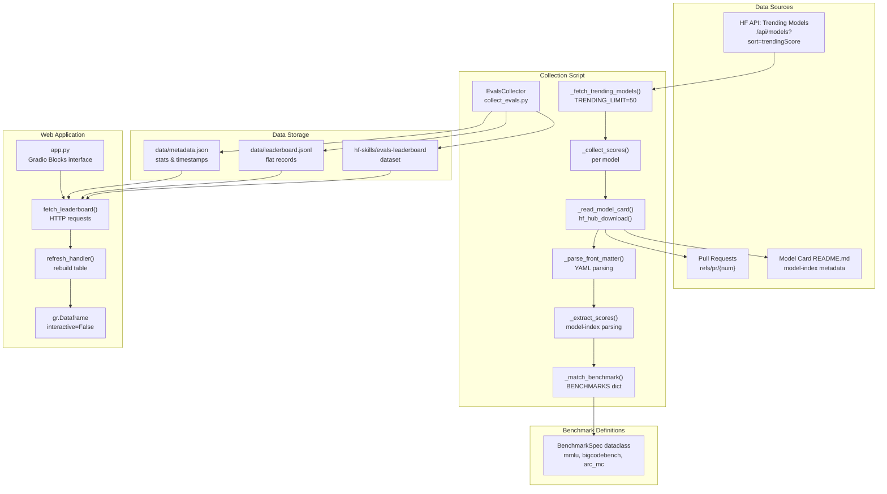
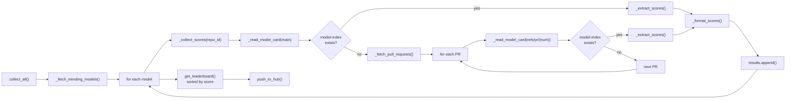
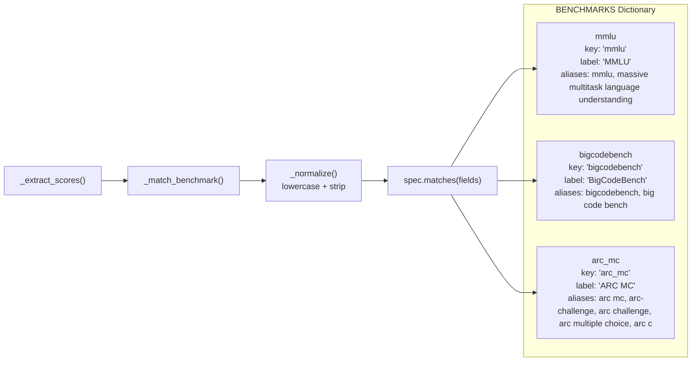
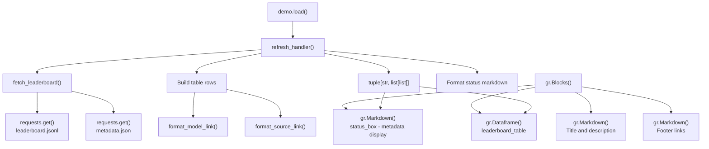
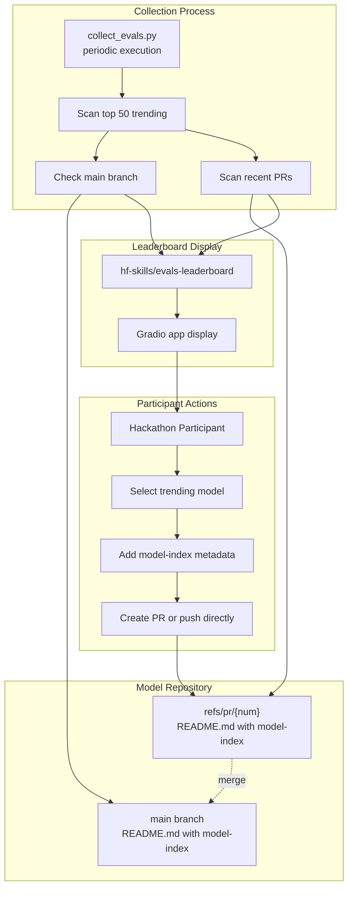

<!-- source: DeepWiki mcp.deepwiki.com · repo huggingface/skills · page 5.3 Evals Leaderboard · fetched 2026-10-30 -->

# Evals Leaderboard

<details>
<summary>Relevant source files</summary>

The following files were used as context for generating this wiki page:

- [apps/evals-leaderboard/app.py](apps/evals-leaderboard/app.py)
- [apps/evals-leaderboard/collect_evals.py](apps/evals-leaderboard/collect_evals.py)
- [apps/evals-leaderboard/requirements.txt](apps/evals-leaderboard/requirements.txt)
- [apps/quests/02_evaluate-hub-model.md](apps/quests/02_evaluate-hub-model.md)
- [apps/quests/03_publish-hub-dataset.md](apps/quests/03_publish-hub-dataset.md)
- [apps/quests/04_sft-finetune-hub.md](apps/quests/04_sft-finetune-hub.md)
- [apps/quests/README.md](apps/quests/README.md)
- [pyproject.toml](pyproject.toml)

</details>


## Purpose and Scope

The Evals Leaderboard system displays model evaluation scores collected from trending text-generation models on the Hugging Face Hub. It automatically scans model cards and pull requests for benchmark results (MMLU, BigCodeBench, ARC MC), aggregates them into a dataset, and presents them in a Gradio web application. This leaderboard complements the Week 1 hackathon quest where participants add evaluation metadata to model cards.

For information about tracking participant contributions and XP points, see [Hackers Leaderboard](#5.2). For details on the Week 1 quest that populates this leaderboard, see [Week 1: Model Evaluation Quest](#5.1.1).

---

## System Architecture

The Evals Leaderboard operates as a three-component pipeline: data collection, storage, and display. The `collect_evals.py` script periodically scans the Hub, the results are stored in a HuggingFace dataset, and the Gradio app reads from this dataset to display the leaderboard.

**Architecture: Evals Leaderboard Data Pipeline**



**Sources:** [apps/evals-leaderboard/collect_evals.py:1-481](), [apps/evals-leaderboard/app.py:1-137]()

---

## Data Collection Process

### EvalsCollector Class

The `EvalsCollector` class [apps/evals-leaderboard/collect_evals.py:104-425]() orchestrates the entire collection pipeline. It maintains a requests session with authentication and accumulates results as it scans models.

**Collection Flow: From Hub API to Dataset**



**Sources:** [apps/evals-leaderboard/collect_evals.py:121-203]()

### Trending Model Selection

The collector fetches up to 100 models from the trending API, then filters for text-generation models and limits to the top 50 [apps/evals-leaderboard/collect_evals.py:137-158](). Constants controlling this behavior:

| Constant | Value | Purpose |
|----------|-------|---------|
| `TRENDING_FETCH_LIMIT` | 100 | Initial fetch size from API |
| `TRENDING_LIMIT` | 50 | Final limit after filtering |
| `PIPELINE_FILTER` | "text-generation" | Pipeline tag to match |
| `PR_SCAN_LIMIT` | 40 | Maximum PRs to scan per model |

**Sources:** [apps/evals-leaderboard/collect_evals.py:32-35]()

### Model Card Parsing

The `_read_model_card()` method downloads README.md files using `hf_hub_download()` [apps/evals-leaderboard/collect_evals.py:204-222](). The `_parse_front_matter()` method extracts YAML frontmatter by finding content between the first and second `---` delimiters [apps/evals-leaderboard/collect_evals.py:224-242]().

For models without evaluation metadata in the main branch, the collector scans pull requests ordered by creation date (newest first) [apps/evals-leaderboard/collect_evals.py:244-263]().

**Sources:** [apps/evals-leaderboard/collect_evals.py:204-263]()

---

## Benchmark Matching System

### BenchmarkSpec Dataclass

The system recognizes three benchmarks using the `BenchmarkSpec` dataclass [apps/evals-leaderboard/collect_evals.py:62-76]():

```python
@dataclass(frozen=True)
class BenchmarkSpec:
    key: str           # Internal identifier
    label: str         # Display name
    aliases: tuple[str, ...]  # Variations to match
```

**Benchmark Definitions**



**Sources:** [apps/evals-leaderboard/collect_evals.py:62-101]()

### Score Extraction

The `_extract_scores()` method walks through the `model-index` structure [apps/evals-leaderboard/collect_evals.py:265-322]():

1. Iterate over model-index entries (each entry represents a model variant)
2. For each entry, iterate over results (evaluation runs)
3. For each result, extract dataset info and iterate over metrics
4. Match metric against benchmark specs using normalized field comparison
5. Coerce score value to float, handling percentage strings [apps/evals-leaderboard/collect_evals.py:46-59]()
6. Keep highest score per benchmark if multiple variants exist

**Extracted Payload Structure:**

| Field | Source | Example |
|-------|--------|---------|
| `model` | `repo_id` parameter | "meta-llama/Llama-2-7b-hf" |
| `model_name` | `entry["name"]` or repo basename | "Llama-2-7b-hf" |
| `benchmark_key` | `_match_benchmark()` result | "mmlu" |
| `benchmark_label` | `BENCHMARKS[key].label` | "MMLU" |
| `value` | `_coerce_score(metric["value"])` | 45.3 |
| `unit` | `metric["unit"]` or inferred | "%" |
| `contributor` | Owner or PR author | "meta-llama" |
| `source_type` | "model-card" or "pull-request" | "model-card" |
| `source_url` | Link to model or PR discussion | "https://huggingface.co/meta-llama/..." |

**Sources:** [apps/evals-leaderboard/collect_evals.py:265-322]()

---

## Data Storage Format

### Dataset Structure

The collector pushes data to the `hf-skills/evals-leaderboard` dataset using the `HfApi` [apps/evals-leaderboard/collect_evals.py:377-424]():

```
hf-skills/evals-leaderboard/
├── data/
│   ├── leaderboard.jsonl    # One entry per model-benchmark pair
│   └── metadata.json        # Statistics and timestamps
```

### Leaderboard JSONL Format

Each line in `data/leaderboard.jsonl` is a flat JSON record [apps/evals-leaderboard/collect_evals.py:342-358]():

```json
{
  "model_id": "meta-llama/Llama-2-7b-hf",
  "benchmark": "MMLU",
  "benchmark_key": "mmlu",
  "score": 45.30,
  "source_type": "model-card",
  "source_url": "https://huggingface.co/meta-llama/Llama-2-7b-hf",
  "contributor": "meta-llama",
  "collected_at": "2024-12-15T10:30:00Z"
}
```

### Metadata JSON Format

The `data/metadata.json` file contains aggregate statistics [apps/evals-leaderboard/collect_evals.py:392-397]():

```json
{
  "generated_at": "2024-12-15T10:30:00Z",
  "total_entries": 150,
  "models_with_scores": 50,
  "benchmarks": ["mmlu", "bigcodebench", "arc_mc"]
}
```

**Sources:** [apps/evals-leaderboard/collect_evals.py:342-424]()

---

## Leaderboard Display Application

### Gradio Application Structure

The `app.py` file defines a Gradio Blocks interface [apps/evals-leaderboard/app.py:100-136](). The application has no server-side state; it fetches data from the dataset on each page load.

**Application Component Hierarchy**



**Sources:** [apps/evals-leaderboard/app.py:1-137]()

### Data Fetching

The `fetch_leaderboard()` function makes HTTP requests to the raw dataset files [apps/evals-leaderboard/app.py:49-61]():

| URL | Timeout | Processing |
|-----|---------|------------|
| `LEADERBOARD_URL` | 30s | Parse JSONL: `[json.loads(line) for line in resp.text.strip().split("\n")]` |
| `METADATA_URL` | 30s | Parse JSON: `resp.json()` |

**Sources:** [apps/evals-leaderboard/app.py:34-61]()

### Table Formatting

The `refresh_handler()` function transforms leaderboard entries into table rows [apps/evals-leaderboard/app.py:64-97]():

```python
# Table configuration
TABLE_HEADERS = ["Model", "Benchmark", "Score", "Source"]
TABLE_DATATYPES = ["markdown", "text", "number", "markdown"]

# Row format
row = [
    format_model_link(entry["model_id"]),        # [model_id](https://huggingface.co/...)
    entry["benchmark"],                          # "MMLU"
    entry["score"],                              # 45.30
    format_source_link(                          # "model-card by [contributor](url)"
        entry["source_type"],
        entry["contributor"],
        entry["source_url"]
    )
]
```

**Sources:** [apps/evals-leaderboard/app.py:19-97]()

### Status Display

The status box displays metadata as formatted markdown [apps/evals-leaderboard/app.py:85-92]():

```
**Data from:** [hf-skills/evals-leaderboard](https://huggingface.co/datasets/hf-skills/evals-leaderboard)
**Last updated:** 2024-12-15T10:30:00Z
**Models with scores:** 50
**Total entries:** 150
```

**Sources:** [apps/evals-leaderboard/app.py:85-92]()

---

## Integration with Week 1 Quest

### Quest Structure

The Week 1 quest [apps/quests/02_evaluate-hub-model.md:1-100]() guides participants to add evaluation metadata using the `hf_model_evaluation` skill. The leaderboard displays results from both quest participants and existing model cards.

**XP Tier Contributions:**

| Tier | XP | Activity | Impact on Leaderboard |
|------|----|---------|-----------------------|
| 🐢 Contributor | 1 | Extract one benchmark | New entry if model trending |
| 🐕 Evaluator | 5 | Import from Artificial Analysis | New entry if model trending |
| 🦁 Advanced | 20 | Run inspect-ai evaluation | New entry if model trending |
| 🐉 Bonus | 20 | Contribute to leaderboard app | Direct app improvements |

**Sources:** [apps/quests/02_evaluate-hub-model.md:19-28]()

### Data Flow: Quest to Leaderboard



**Sources:** [apps/quests/02_evaluate-hub-model.md:1-100](), [apps/evals-leaderboard/collect_evals.py:121-203]()

### Bonus XP for Leaderboard Contributions

Participants can earn bonus XP by contributing to the leaderboard application itself [apps/quests/02_evaluate-hub-model.md:5-6](). Contributions can target:

- The Hub Space: `https://huggingface.co/spaces/hf-skills/distributed-leaderboard/discussions`
- The GitHub repository: `https://github.com/huggingface/skills/blob/main/apps/evals-leaderboard/app.py`

**Sources:** [apps/quests/02_evaluate-hub-model.md:5-6]()

---

## Deployment and Execution

### Manual Execution

The collection script can be run locally or via CI [apps/evals-leaderboard/collect_evals.py:427-480]():

```bash
# Collect and save locally
python apps/evals-leaderboard/collect_evals.py --output leaderboard.json

# Collect and push to Hub dataset
HF_TOKEN=... python apps/evals-leaderboard/collect_evals.py --push-to-hub

# Custom dataset repo
python apps/evals-leaderboard/collect_evals.py --push-to-hub --repo-id "org/custom-repo"
```

### Gradio App Execution

The Gradio app launches a web server [apps/evals-leaderboard/app.py:135-136]():

```bash
python apps/evals-leaderboard/app.py
```

The app loads data on each page load via the `demo.load()` event handler [apps/evals-leaderboard/app.py:119-122]().

**Sources:** [apps/evals-leaderboard/collect_evals.py:427-480](), [apps/evals-leaderboard/app.py:119-136]()

### Continuous Deployment

GitHub Actions workflows automatically deploy the application to Hugging Face Spaces when the `apps/evals-leaderboard/` directory changes [.github/workflows/push-evals-leaderboard.yml](). The data collection script runs separately on a schedule to populate the dataset.

**Sources:** Based on deployment pattern described in high-level diagrams.

---

## Error Handling and Logging

### Collection Script Logging

The `EvalsCollector` class maintains an internal log of operations [apps/evals-leaderboard/collect_evals.py:113-119]():

```python
def log(self, message: str) -> None:
    """Add a log message."""
    print(message)
    self.logs.append(message)
```

**Log Messages:**

| Emoji | Message Type | Example |
|-------|-------------|---------|
| 🔍 | Info | "Fetching trending text-generation models..." |
| 📊 | Success | "Found 50 trending text-generation models" |
| ✅ | Found data | "meta-llama/Llama-2-7b-hf: model card metadata found." |
| 📝 | PR found | "meta-llama/Llama-2-7b-hf: PR #123 by contributor." |
| ⚠️ | No data | "meta-llama/Llama-2-7b-hf: no target benchmarks located." |
| 🚫 | Error | "meta-llama/Llama-2-7b-hf (main): README download failed (404)." |

**Sources:** [apps/evals-leaderboard/collect_evals.py:113-263]()

### Application Error Handling

The Gradio app handles fetch failures gracefully [apps/evals-leaderboard/app.py:96-97]():

```python
except Exception as e:
    return f"❌ Failed to load leaderboard: {e}", []
```

Failed fetches display an error message in the status box and return an empty table.

**Sources:** [apps/evals-leaderboard/app.py:64-97]()

---

## Configuration and Constants

### Collection Script Configuration

Key constants in `collect_evals.py` [apps/evals-leaderboard/collect_evals.py:30-36]():

| Constant | Value | Description |
|----------|-------|-------------|
| `API_BASE` | "https://huggingface.co/api" | Hub API endpoint |
| `PIPELINE_FILTER` | "text-generation" | Model type filter |
| `TRENDING_LIMIT` | 50 | Final trending models to process |
| `TRENDING_FETCH_LIMIT` | 100 | Initial fetch from API |
| `PR_SCAN_LIMIT` | 40 | Max PRs per model |
| `USER_AGENT` | "skills-evals-leaderboard/0.3" | HTTP user agent |

### Application Configuration

Constants in `app.py` [apps/evals-leaderboard/app.py:19-36]():

| Constant | Value | Purpose |
|----------|-------|---------|
| `DATASET_REPO` | "hf-skills/evals-leaderboard" | Source dataset |
| `LEADERBOARD_URL` | Raw JSONL file URL | Data fetch endpoint |
| `METADATA_URL` | Raw JSON file URL | Metadata fetch endpoint |
| `TABLE_HEADERS` | ["Model", "Benchmark", "Score", "Source"] | Column headers |
| `TABLE_DATATYPES` | ["markdown", "text", "number", "markdown"] | Column types |

**Sources:** [apps/evals-leaderboard/collect_evals.py:30-36](), [apps/evals-leaderboard/app.py:19-36]()

---

## Dependencies

The leaderboard applications require the following packages [apps/evals-leaderboard/requirements.txt:1-5]():

| Package | Purpose |
|---------|---------|
| `gradio` | Web application framework |
| `requests` | HTTP client for API calls |
| `pyyaml` | YAML frontmatter parsing |
| `huggingface_hub` | Hub API and file downloads |

**Sources:** [apps/evals-leaderboard/requirements.txt:1-5](), [pyproject.toml:7-13]()

---

