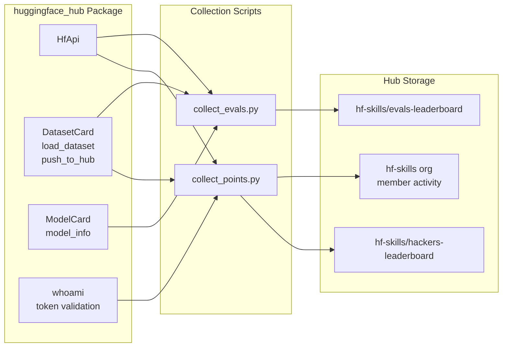
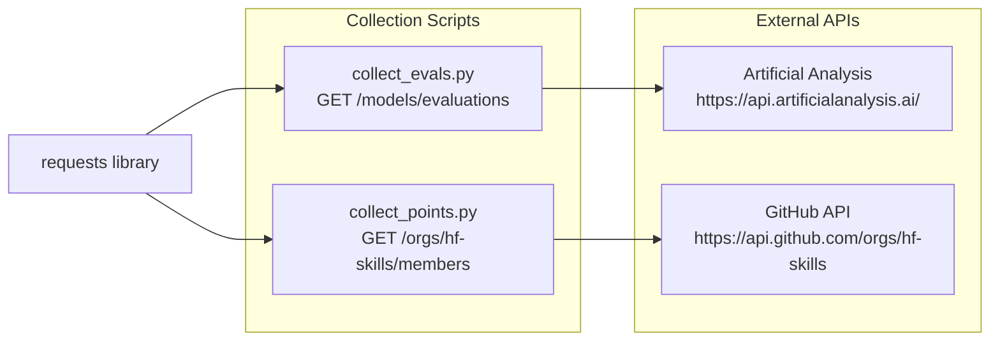
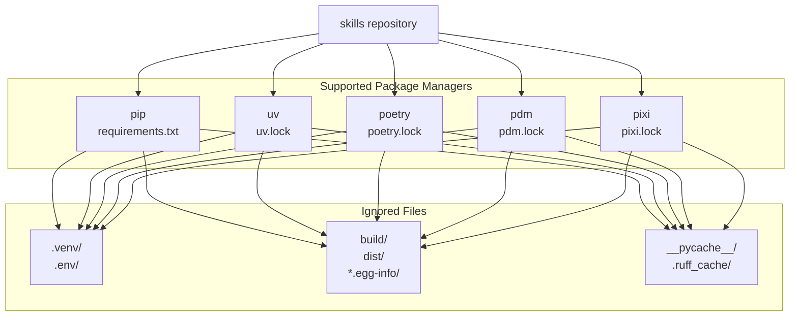
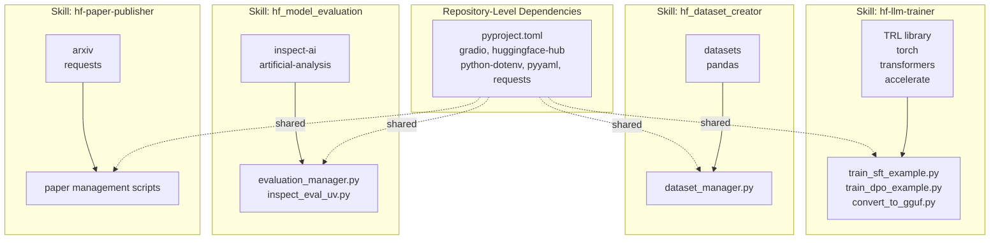

<!-- source: DeepWiki mcp.deepwiki.com · repo huggingface/skills · page 6.2 Project Dependencies · fetched 2026-10-30 -->

# Project Dependencies

<details>
<summary>Relevant source files</summary>

The following files were used as context for generating this wiki page:

- [.gitignore](.gitignore)
- [LICENSE](LICENSE)
- [README.md](README.md)
- [assets/banner.png](assets/banner.png)
- [pyproject.toml](pyproject.toml)

</details>


This page documents the Python dependencies required by the Hugging Face Skills repository, their purposes, and how to set up a development environment. It covers the `pyproject.toml` configuration, core package requirements, and the relationship between dependencies and different repository components.

For information about creating custom skills that may require additional dependencies, see [Creating Custom Skills](#6.1). For deployment-related dependencies managed through CI/CD, see [CI/CD Workflows](#6.3).

---

## Purpose and Scope

The Hugging Face Skills repository maintains a minimal set of core dependencies to support:
- **Web applications** (Gradio-based leaderboards and quest dashboards)
- **Hub integration** (authentication, dataset/model operations)
- **Metadata processing** (YAML frontmatter parsing in SKILL.md files)
- **External API interactions** (evaluation data collection)

Individual skills may have their own dependencies specified in their respective directories, but this page focuses on the repository-level requirements defined in [pyproject.toml:1-13]().

---

## Core Dependencies Overview

The repository uses a standard Python packaging configuration with five primary dependencies:

| Package | Version Constraint | Primary Use Cases |
|---------|-------------------|-------------------|
| `gradio` | >=5.50.0 | Leaderboard web apps ([apps/hackers-leaderboard](), [apps/evals-leaderboard]()) |
| `huggingface-hub` | >=1.1.4 | Hub authentication, dataset operations, model/paper management |
| `python-dotenv` | >=1.2.1 | Environment variable management (HF_TOKEN, API keys) |
| `pyyaml` | >=6.0.3 | SKILL.md frontmatter parsing, AGENTS.md generation |
| `requests` | >=2.32.5 | External API calls (Artificial Analysis, GitHub API) |

**Sources:** [pyproject.toml:1-13]()

---

## Dependency-to-Component Mapping

The following diagram shows how each core dependency maps to specific repository components and their file locations:

```mermaid
graph TB
    subgraph "pyproject.toml Dependencies"
        GRADIO["gradio>=5.50.0"]
        HF_HUB["huggingface-hub>=1.1.4"]
        DOTENV["python-dotenv>=1.2.1"]
        PYYAML["pyyaml>=6.0.3"]
        REQUESTS["requests>=2.32.5"]
    end
    
    subgraph "Leaderboard Applications"
        HACKERS_APP["apps/hackers-leaderboard/app.py"]
        EVALS_APP["apps/evals-leaderboard/app.py"]
        QUESTS_APP["apps/quests/app.py"]
    end
    
    subgraph "Data Collection Scripts"
        COLLECT_HACKERS["apps/hackers-leaderboard/collect_points.py"]
        COLLECT_EVALS["apps/evals-leaderboard/collect_evals.py"]
    end
    
    subgraph "Skill Definition System"
        SKILL_FILES["*/skills/*/SKILL.md<br/>YAML frontmatter"]
        AGENTS_GEN["scripts/generate_agents.py"]
        AGENTS_MD["AGENTS.md"]
    end
    
    subgraph "Hub Resources"
        HF_DATASETS["Datasets API<br/>hf-skills/hackers-leaderboard<br/>hf-skills/evals-leaderboard"]
        HF_MODELS["Models API<br/>Model card operations"]
        HF_PAPERS["Papers API<br/>arXiv indexing"]
        HF_AUTH["Authentication<br/>HF_TOKEN validation"]
    end
    
    subgraph "External Services"
        AA_API["Artificial Analysis API<br/>Model evaluation data"]
        GH_API["GitHub API<br/>Organization activity"]
    end
    
    GRADIO --> HACKERS_APP
    GRADIO --> EVALS_APP
    GRADIO --> QUESTS_APP
    
    HF_HUB --> COLLECT_HACKERS
    HF_HUB --> COLLECT_EVALS
    HF_HUB --> AGENTS_GEN
    HF_HUB --> HF_DATASETS
    HF_HUB --> HF_MODELS
    HF_HUB --> HF_PAPERS
    HF_HUB --> HF_AUTH
    
    DOTENV --> COLLECT_HACKERS
    DOTENV --> COLLECT_EVALS
    DOTENV --> HF_AUTH
    
    PYYAML --> SKILL_FILES
    PYYAML --> AGENTS_GEN
    SKILL_FILES --> AGENTS_MD
    
    REQUESTS --> AA_API
    REQUESTS --> GH_API
    REQUESTS --> COLLECT_EVALS
    REQUESTS --> COLLECT_HACKERS
    
    HACKERS_APP --> HF_DATASETS
    EVALS_APP --> HF_DATASETS
```



**Sources:** [pyproject.toml:7-12](), [apps/hackers-leaderboard/](), [apps/evals-leaderboard/](), [scripts/generate_agents.py]()

---

## Package Roles and Usage Patterns

### gradio (>=5.50.0)

**Purpose:** Web application framework for leaderboard interfaces

**Usage Locations:**
- [apps/hackers-leaderboard/app.py]() - Displays participant XP and contributions
- [apps/evals-leaderboard/app.py]() - Visualizes model evaluation scores
- [apps/quests/app.py]() - Quest dashboard and progress tracking

**Key Features Used:**
- `gr.Blocks` for layout composition
- `gr.Dataframe` for tabular leaderboard data
- `gr.Markdown` for quest descriptions and formatting
- Built-in theming and responsive design

The Gradio applications are deployed to Hugging Face Spaces via GitHub Actions workflows and consume data from Hub datasets.

**Sources:** [pyproject.toml:8](), [apps/hackers-leaderboard/](), [apps/evals-leaderboard/]()

---

### huggingface-hub (>=1.1.4)

**Purpose:** Primary integration with Hugging Face Hub APIs

**Usage Locations:**
- [apps/hackers-leaderboard/collect_points.py]() - Scans organization activity, pushes datasets
- [apps/evals-leaderboard/collect_evals.py]() - Reads model cards, extracts evaluation tables
- [scripts/generate_agents.py]() - Validates Hub connectivity for skill documentation

**Key Operations:**


**Authentication Pattern:**
The library expects `HF_TOKEN` environment variable for write operations and organization scanning.

**Sources:** [pyproject.toml:9](), [apps/hackers-leaderboard/collect_points.py](), [apps/evals-leaderboard/collect_evals.py]()

---

### python-dotenv (>=1.2.1)

**Purpose:** Environment variable management for secrets and configuration

**Usage Pattern:**
```python
from dotenv import load_dotenv
import os

load_dotenv()  # Loads .env file if present
hf_token = os.getenv("HF_TOKEN")
aa_api_key = os.getenv("ARTIFICIAL_ANALYSIS_API_KEY")
```

**Environment Variables:**

| Variable | Purpose | Required By |
|----------|---------|-------------|
| `HF_TOKEN` | Hub authentication token | Collection scripts, deployment workflows |
| `ARTIFICIAL_ANALYSIS_API_KEY` | External evaluation API key | [collect_evals.py]() |

**Security Note:**
The [.gitignore:139]() file excludes `.env` files from version control. Tokens should never be committed to the repository.

**Sources:** [pyproject.toml:10](), [.gitignore:138-139]()

---

### pyyaml (>=6.0.3)

**Purpose:** YAML parsing for SKILL.md frontmatter and configuration files

**Usage Locations:**
- [scripts/generate_agents.py]() - Extracts `name` and `description` from SKILL.md files
- Plugin/extension configurations - Parses marketplace.json and gemini-extension.json

**SKILL.md Frontmatter Format:**
```yaml
---
name: skill-identifier
description: Brief description for agent discovery
---
# Rest of SKILL.md content
```

The `generate_agents.py` script uses PyYAML to parse this frontmatter and generate the consolidated [AGENTS.md]() catalog file.

**Sources:** [pyproject.toml:11](), [scripts/generate_agents.py]()

---

### requests (>=2.32.5)

**Purpose:** HTTP client for external API integrations

**Usage Locations:**
- [apps/evals-leaderboard/collect_evals.py]() - Fetches evaluation data from Artificial Analysis API
- [apps/hackers-leaderboard/collect_points.py]() - Queries GitHub API for organization activity

**API Endpoints:**



**Rate Limiting:**
GitHub API has rate limits (60 requests/hour unauthenticated, 5000/hour authenticated). The collection scripts should handle rate limiting gracefully.

**Sources:** [pyproject.toml:12](), [apps/evals-leaderboard/collect_evals.py](), [apps/hackers-leaderboard/collect_points.py]()

---

## Development Environment Setup

### Prerequisites

- **Python 3.13 or higher** ([pyproject.toml:6]())
- **pip** or a compatible package manager (uv, poetry, pdm, pixi)

### Installation Methods

#### Standard pip Installation

```bash
# Clone the repository
git clone https://github.com/huggingface/skills.git
cd skills

# Install dependencies
pip install -e .
```

#### Using uv (Recommended for Fast Installs)

The [.gitignore:97-101]() file shows support for uv lockfiles:

```bash
# Install with uv
uv pip install -e .

# With lockfile (if present)
uv pip sync uv.lock
```

#### Using poetry

```bash
# Install with poetry
poetry install
```

#### Using pdm

```bash
# Install with pdm
pdm install
```

**Sources:** [pyproject.toml:1-13](), [.gitignore:97-125]()

---

## Dependency Verification

### Testing Hub Connectivity

After installation, verify `huggingface-hub` authentication:

```bash
huggingface-cli whoami
```

This command validates your `HF_TOKEN` and confirms API connectivity.

### Testing YAML Parsing

Verify SKILL.md files can be parsed:

```bash
python scripts/generate_agents.py
```

This script will fail if:
- PyYAML cannot parse frontmatter
- SKILL.md files have invalid YAML syntax
- Required `name` or `description` fields are missing

### Testing Gradio Applications Locally

```bash
# Test hackers leaderboard
cd apps/hackers-leaderboard
python app.py

# Test evals leaderboard
cd apps/evals-leaderboard
python app.py
```

Applications should launch on `http://localhost:7860` by default.

**Sources:** [scripts/generate_agents.py](), [apps/hackers-leaderboard/app.py](), [apps/evals-leaderboard/app.py]()

---

## Package Manager Compatibility

The repository supports multiple Python package managers through [.gitignore]() exclusions:



### Lock File Handling

Lock files are **not committed** to the repository ([.gitignore:95-122]()), allowing developers to use their preferred package manager without conflicts. Each developer can generate their own lock file:

```bash
# uv
uv pip compile pyproject.toml -o requirements.txt

# poetry
poetry lock

# pdm
pdm lock

# pixi
pixi install
```

**Sources:** [.gitignore:89-125]()

---

## Skill-Specific Dependencies

Individual skills may declare additional dependencies in their directories:



**Note:** Skill-specific dependencies are typically documented in each skill's SKILL.md file and installed when the skill is activated by a coding agent. Repository-level dependencies support the infrastructure and meta-operations.

**Sources:** [hf-llm-trainer/](), [hf_dataset_creator/](), [hf_model_evaluation/](), [hf-paper-publisher/]()

---

## Dependency Update Strategy

### Minimum Version Constraints

All dependencies use minimum version constraints (`>=`) rather than pinned versions:

```toml
gradio>=5.50.0      # Not gradio==5.50.0
huggingface-hub>=1.1.4
```

This approach:
- Allows users to upgrade packages independently
- Reduces conflicts in projects that depend on multiple packages
- Follows Hugging Face ecosystem best practices

### Version Requirements Rationale

| Package | Minimum Version | Reason |
|---------|-----------------|--------|
| `gradio` | 5.50.0 | Dataframe component improvements, theming support |
| `huggingface-hub` | 1.1.4 | Organization API support for member scanning |
| `python-dotenv` | 1.2.1 | Python 3.13 compatibility |
| `pyyaml` | 6.0.3 | Security fixes, Python 3.13 compatibility |
| `requests` | 2.32.5 | Security updates, modern TLS support |

### Testing Updates

Before updating minimum version constraints, verify:
1. CI/CD workflows pass ([.github/workflows/]())
2. Gradio apps render correctly
3. Hub operations function (authentication, dataset push)
4. YAML parsing handles all SKILL.md files

**Sources:** [pyproject.toml:6-12]()

---

## Common Dependency Issues

### ImportError: No module named 'gradio'

**Solution:**
```bash
pip install -e .
```

Ensure you're installing from the repository root containing [pyproject.toml]().

### Authentication Errors with huggingface-hub

**Symptom:**
```
HTTPError: 401 Client Error: Unauthorized
```

**Solution:**
```bash
# Set HF_TOKEN in .env file
echo "HF_TOKEN=hf_..." > .env

# Or export directly
export HF_TOKEN=hf_...

# Verify authentication
huggingface-cli whoami
```

### YAML Parsing Errors

**Symptom:**
```
yaml.scanner.ScannerError: mapping values are not allowed here
```

**Solution:**
Check SKILL.md frontmatter syntax. Common issues:
- Missing closing `---` delimiter
- Unquoted values containing colons
- Incorrect indentation

**Correct format:**
```yaml
---
name: my-skill
description: "Description: with colon"
---
```

**Sources:** [pyproject.toml:1-13](), [scripts/generate_agents.py]()

---

