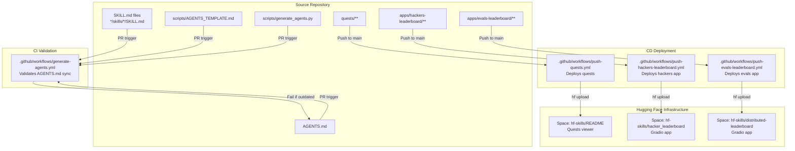
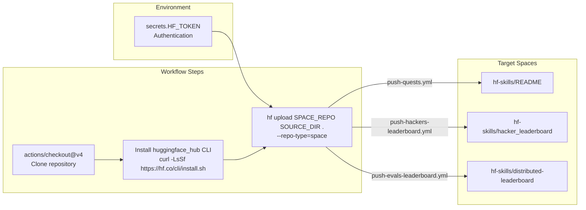
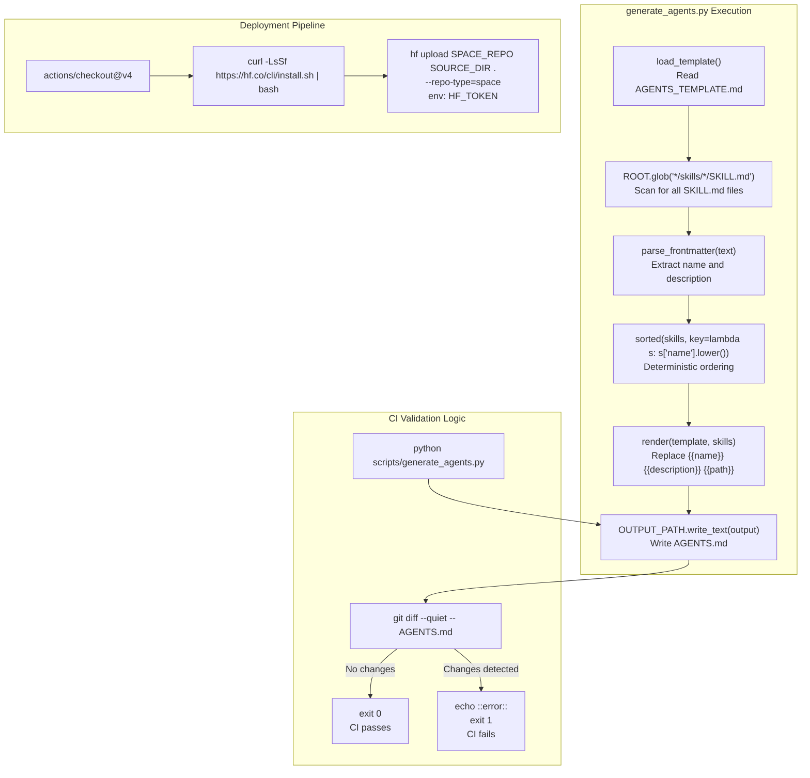

<!-- source: DeepWiki mcp.deepwiki.com · repo huggingface/skills · page 6.3 CI/CD Workflows · fetched 2026-10-30 -->

# CI/CD Workflows

<details>
<summary>Relevant source files</summary>

The following files were used as context for generating this wiki page:

- [.github/workflows/generate-agents.yml](.github/workflows/generate-agents.yml)
- [.github/workflows/push-evals-leaderboard.yml](.github/workflows/push-evals-leaderboard.yml)
- [.github/workflows/push-hackers-leaderboard.yml](.github/workflows/push-hackers-leaderboard.yml)
- [.github/workflows/push-quests.yml](.github/workflows/push-quests.yml)
- [AGENTS.md](AGENTS.md)
- [apps/hackers-leaderboard/README.md](apps/hackers-leaderboard/README.md)
- [apps/hackers-leaderboard/requirements.txt](apps/hackers-leaderboard/requirements.txt)
- [scripts/AGENTS_TEMPLATE.md](scripts/AGENTS_TEMPLATE.md)
- [scripts/generate_agents.py](scripts/generate_agents.py)

</details>


This document explains the GitHub Actions-based CI/CD pipeline that maintains the Skills repository. The pipeline has two primary responsibilities: (1) validating that the machine-readable [AGENTS.md](#2.2) catalog stays synchronized with individual [SKILL.md](#2.1) files, and (2) automatically deploying applications and quest content to Hugging Face Spaces when source code changes.

For information about the hackathon applications that these workflows deploy, see [Hackathon Ecosystem](#5). For the AGENTS.md generation process itself, see [AGENTS.md Catalog System](#2.2).

## CI/CD Architecture Overview

The repository employs four GitHub Actions workflows that execute different automation tasks based on file path changes. The validation workflow runs on pull requests to ensure consistency, while deployment workflows run on pushes to `main` to publish content.



**Workflow Architecture**

The CI/CD system uses path-based triggers to minimize unnecessary builds and deployments. Each workflow monitors specific directories and only executes when relevant files change.

**Sources:** [.github/workflows/generate-agents.yml:1-32](), [.github/workflows/push-quests.yml:1-25](), [.github/workflows/push-hackers-leaderboard.yml:1-25](), [.github/workflows/push-evals-leaderboard.yml:1-25]()

## AGENTS.md Validation Workflow

The `generate-agents.yml` workflow ensures that the [AGENTS.md](#2.2) catalog remains synchronized with individual skill definitions. This workflow runs on pull requests and validates consistency rather than auto-committing changes.

### Trigger Conditions

The workflow executes when a pull request modifies any of these paths:

| Path Pattern | Purpose |
|-------------|---------|
| `scripts/AGENTS_TEMPLATE.md` | Template structure changes |
| `scripts/generate_agents.py` | Generator logic changes |
| `**/SKILL.md` | Any skill definition changes |
| `AGENTS.md` | Direct catalog modifications |

**Sources:** [.github/workflows/generate-agents.yml:3-9]()

### Validation Process

```mermaid
stateDiagram-v2
    [*] --> PROpened: "Pull request created/updated"
    
    PROpened --> PathCheck: "Check modified files"
    
    PathCheck --> SkipWorkflow: "No relevant paths"
    PathCheck --> SetupPython: "Relevant paths modified"
    
    SetupPython --> RunGenerator: "python-version: 3.x"
    
    RunGenerator --> GitDiff: "python scripts/generate_agents.py"
    
    GitDiff --> Success: "git diff --quiet -- AGENTS.md<br/>No changes detected"
    GitDiff --> Failure: "Differences found"
    
    Success --> [*]: "CI passes"
    Failure --> ErrorMessage: "::error::AGENTS.md is outdated"
    ErrorMessage --> [*]: "CI fails, blocks merge"
    
    SkipWorkflow --> [*]: "Workflow skipped"
```

**Validation State Machine**

The workflow uses `git diff --quiet` to detect changes after regeneration. If differences exist, the build fails with an error message instructing developers to run `python scripts/generate_agents.py` locally and commit the updated `AGENTS.md`.

**Sources:** [.github/workflows/generate-agents.yml:14-31]()

### Generator Script Implementation

The `generate_agents.py` script orchestrates the catalog generation process:

**File Scanning**

The script discovers all skills using the glob pattern `*/skills/*/SKILL.md` relative to the repository root:

```python
for skill_md in ROOT.glob("*/skills/*/SKILL.md"):
    meta = parse_frontmatter(skill_md.read_text(encoding="utf-8"))
```

**Sources:** [scripts/generate_agents.py:35-36]()

**Frontmatter Parsing**

The `parse_frontmatter()` function extracts YAML metadata without external dependencies using regex pattern matching:

```
^---\s*\n(.*?)\n---\s*
```

This captures content between triple-dash delimiters. Each line is split on the first colon to extract key-value pairs.

**Sources:** [scripts/generate_agents.py:19-30]()

**Template Rendering**

The `render()` function implements a minimal Mustache-like template engine that processes `{{#skills}}...{{/skills}}` loop blocks:

```python
content = re.sub(r"{{#skills}}(.*?){{/skills}}", repl, template, flags=re.DOTALL)
```

Within each loop iteration, placeholders are replaced:
- `{{name}}` → skill name from frontmatter
- `{{description}}` → skill description from frontmatter  
- `{{path}}` → relative path to skill directory

**Sources:** [scripts/generate_agents.py:52-68]()

**Deterministic Output**

Skills are sorted alphabetically by name using `sorted(skills, key=lambda s: s["name"].lower())` to ensure consistent output across executions, which simplifies git diff detection.

**Sources:** [scripts/generate_agents.py:49]()

## Deployment Workflows

Three deployment workflows handle automatic synchronization of content to Hugging Face Spaces. Each workflow monitors a specific directory and deploys only when that directory changes.

### Workflow Trigger Configuration

All three deployment workflows share a common trigger structure:

```yaml
on:
  push:
    branches:
      - main
    paths:
      - 'target-directory/**'
  workflow_dispatch:
```

The `workflow_dispatch` trigger enables manual execution from the GitHub Actions UI.

**Sources:** [.github/workflows/push-quests.yml:3-9](), [.github/workflows/push-hackers-leaderboard.yml:3-9](), [.github/workflows/push-evals-leaderboard.yml:3-9]()

### Deployment Execution Flow



**Deployment Pipeline**

Each workflow executes three steps in sequence. The `huggingface_hub` CLI is installed directly from the official installation script rather than using a system package manager.

**Sources:** [.github/workflows/push-quests.yml:14-24](), [.github/workflows/push-hackers-leaderboard.yml:14-24](), [.github/workflows/push-evals-leaderboard.yml:14-24]()

### Quests Deployment

The `push-quests.yml` workflow deploys quest markdown files to the `hf-skills/README` Space:

| Configuration | Value |
|--------------|-------|
| **Trigger path** | `quests/**` |
| **Source directory** | `quests` |
| **Target Space** | `hf-skills/README` |
| **Upload command** | `hf upload hf-skills/README quests . --repo-type=space` |

This Space serves as the quest viewer for the [Humanity's Last Hackathon](#5) ecosystem. When participants visit the Space, they see the latest quest definitions from the `quests/` directory.

**Sources:** [.github/workflows/push-quests.yml:7-8](), [.github/workflows/push-quests.yml:24]()

### Hackers Leaderboard Deployment

The `push-hackers-leaderboard.yml` workflow deploys the Gradio application that displays participant points:

| Configuration | Value |
|--------------|-------|
| **Trigger path** | `apps/hackers-leaderboard/**` |
| **Source directory** | `apps/hackers-leaderboard` |
| **Target Space** | `hf-skills/hacker_leaderboard` |
| **Upload command** | `hf upload hf-skills/hacker_leaderboard apps/hackers-leaderboard . --repo-type=space` |

The deployed application includes:
- `app.py` - Gradio interface code
- `collect_points.py` - Points collection script (executed separately)
- `requirements.txt` - Python dependencies (`gradio>=5.50.0`, `huggingface_hub>=1.1.4`, `requests>=2.32.5`)
- `README.md` - Space configuration with frontmatter

**Sources:** [.github/workflows/push-hackers-leaderboard.yml:7-8](), [.github/workflows/push-hackers-leaderboard.yml:24](), [apps/hackers-leaderboard/requirements.txt:1-3]()

### Evals Leaderboard Deployment

The `push-evals-leaderboard.yml` workflow deploys the evaluation scores leaderboard:

| Configuration | Value |
|--------------|-------|
| **Trigger path** | `apps/evals-leaderboard/**` |
| **Source directory** | `apps/evals-leaderboard` |
| **Target Space** | `hf-skills/distributed-leaderboard` |
| **Upload command** | `hf upload hf-skills/distributed-leaderboard apps/evals-leaderboard . --repo-type=space` |

This Space displays evaluation results collected from model cards by the [evals leaderboard system](#5.3).

**Sources:** [.github/workflows/push-evals-leaderboard.yml:7-8](), [.github/workflows/push-evals-leaderboard.yml:24]()

## Path-Based Triggering Strategy

The CI/CD system uses GitHub Actions path filters to minimize unnecessary workflow executions. Each workflow only runs when files in its monitored paths change.

### Path Filter Patterns

| Workflow | Path Filter | Impact |
|----------|------------|--------|
| `generate-agents.yml` | `scripts/AGENTS_TEMPLATE.md`<br/>`scripts/generate_agents.py`<br/>`**/SKILL.md`<br/>`AGENTS.md` | Validates catalog sync on PR |
| `push-quests.yml` | `quests/**` | Deploys only quest changes |
| `push-hackers-leaderboard.yml` | `apps/hackers-leaderboard/**` | Deploys only hackers app changes |
| `push-evals-leaderboard.yml` | `apps/evals-leaderboard/**` | Deploys only evals app changes |

### Benefits of Path Filtering

1. **Performance**: Reduces GitHub Actions compute time by skipping irrelevant builds
2. **Reliability**: Minimizes deployment churn for unrelated changes
3. **Debugging**: Simplifies troubleshooting by creating clear cause-effect relationships
4. **Cost**: Reduces Actions minutes consumption in the repository

**Sources:** [.github/workflows/generate-agents.yml:5-9](), [.github/workflows/push-quests.yml:7-8](), [.github/workflows/push-hackers-leaderboard.yml:7-8](), [.github/workflows/push-evals-leaderboard.yml:7-8]()

## Manual Workflow Dispatch

All deployment workflows support manual triggering via the `workflow_dispatch` event. This enables:

- **Emergency deployments** without waiting for code changes
- **Rollback scenarios** by manually triggering from older commits
- **Testing deployments** during development without modifying tracked paths
- **Force refresh** of Spaces when Hub state becomes inconsistent

To manually trigger a workflow:
1. Navigate to the Actions tab in the GitHub repository
2. Select the desired workflow from the left sidebar
3. Click "Run workflow" button
4. Select the branch (typically `main`)
5. Click "Run workflow" to execute

**Sources:** [.github/workflows/push-quests.yml:9](), [.github/workflows/push-hackers-leaderboard.yml:9](), [.github/workflows/push-evals-leaderboard.yml:9]()

## Integration with Hugging Face Spaces

The deployment workflows use the `huggingface_hub` CLI to upload content to Spaces. The `hf upload` command synchronizes local directories with remote Space repositories.

### Upload Command Structure

```bash
hf upload TARGET_SPACE SOURCE_DIR . --repo-type=space
```

| Parameter | Description |
|-----------|-------------|
| `TARGET_SPACE` | Space identifier in format `org/space-name` |
| `SOURCE_DIR` | Local directory to upload |
| `.` | Upload current directory contents to Space root |
| `--repo-type=space` | Specifies target is a Space (not model/dataset) |

### Authentication

The workflows authenticate using the `HF_TOKEN` secret stored in GitHub repository secrets. This token must have write access to the target Spaces.

```yaml
env:
  HF_TOKEN: ${{ secrets.HF_TOKEN }}
```

The token is exposed as an environment variable during the upload step, allowing the `huggingface_hub` CLI to authenticate API requests.

**Sources:** [.github/workflows/push-quests.yml:22-24](), [.github/workflows/push-hackers-leaderboard.yml:22-24](), [.github/workflows/push-evals-leaderboard.yml:22-24]()

### Space Configuration

Each deployed application includes a `README.md` with YAML frontmatter that configures the Space:

```yaml
---
title: Space Title
emoji: 🎯
colorFrom: purple
colorTo: pink
sdk: gradio
sdk_version: 5.50.0
app_file: app.py
pinned: false
---
```

The Hugging Face Spaces runtime uses this metadata to configure the execution environment, install the specified SDK version, and locate the entry point file.

**Sources:** [apps/hackers-leaderboard/README.md:1-10]()

## Workflow Execution Details



**Code Entity Flow**

This diagram maps the execution flow to specific code entities in the repository. The `generate_agents.py` script uses pure Python operations without external dependencies, while deployment workflows leverage the `huggingface_hub` CLI installed at runtime.

**Sources:** [scripts/generate_agents.py:15-76](), [.github/workflows/generate-agents.yml:23-31](), [.github/workflows/push-quests.yml:14-24]()

## Validation-Only Approach Rationale

The `generate-agents.yml` workflow deliberately fails on mismatches rather than auto-committing changes. This design decision provides several benefits:

| Benefit | Explanation |
|---------|-------------|
| **Developer awareness** | Forces developers to consciously review catalog changes |
| **Commit hygiene** | Prevents automated commits that clutter git history |
| **Review clarity** | Keeps AGENTS.md changes in the same PR as SKILL.md changes |
| **Debugging transparency** | Makes it obvious when manual catalog updates are needed |
| **Rollback simplicity** | Avoids complicated automated commit rollback scenarios |

The error message `::error::AGENTS.md is outdated. Run 'python scripts/generate_agents.py' and commit the changes.` provides explicit instructions for developers to resolve the validation failure.

**Sources:** [.github/workflows/generate-agents.yml:28-31]()