# Page: Overview

# Overview

<details>
<summary>Relevant source files</summary>

The following files were used as context for generating this wiki page:

- [.gitignore](.gitignore)
- [LICENSE](LICENSE)
- [README.md](README.md)
- [assets/banner.png](assets/banner.png)

</details>


## Purpose and Scope

This document provides an overview of the Hugging Face Skills repository, a system that enables AI coding agents to perform machine learning tasks through standardized skill definitions. The repository implements the Agent Context Protocol (ACP), providing interoperable skill packages for dataset creation, model training, evaluation management, and paper publishing across multiple agent platforms including Claude Code, OpenAI Codex, Gemini CLI, and Cursor.

This overview covers the fundamental concepts, repository structure, and architecture. For detailed information about specific components:
- For the SKILL.md format and AGENTS.md catalog, see [Core Skills Framework](#2)
- For platform-specific integration details, see [Agent Integration](#3)
- For individual skill documentation, see [Available Skills](#4)
- For the hackathon system, see [Hackathon Ecosystem](#5)

**Sources:** [README.md:1-107]()

## What are Hugging Face Skills?

Hugging Face Skills are self-contained folders that package instructions, scripts, and resources for AI agents to complete specific ML/AI tasks. Each skill folder contains:

- **SKILL.md**: A markdown file with YAML frontmatter defining the skill's name and description, followed by guidance, examples, and guardrails for the agent
- **scripts/**: Executable Python scripts that implement the skill's functionality
- **templates/**: Reusable patterns and configuration files (where applicable)

The term "skill" originates from Anthropic's Claude AI terminology, though the repository supports multiple agent platforms through different integration mechanisms.

**Sources:** [README.md:5-10]()

## Repository Structure

The repository follows a modular structure with four main skill implementations, agent integration adapters, and a hackathon ecosystem:

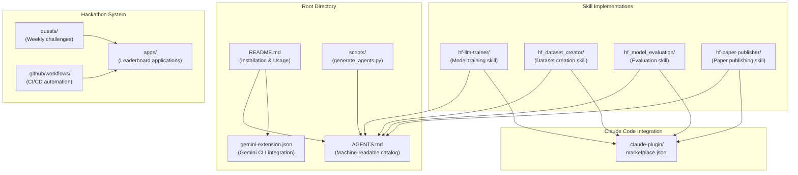

Each skill folder contains its own `SKILL.md` file and supporting resources. The `scripts/generate_agents.py` file collects all SKILL.md files to generate the `AGENTS.md` catalog.

**Sources:** [README.md:64-76](), Diagram 1, Diagram 4

## Agent Context Protocol (ACP)

The Agent Context Protocol defines how skills are structured and discovered by AI agents. The protocol has two key components:

### SKILL.md Format

Each skill is defined by a `SKILL.md` file with the following structure:

```markdown
---
name: skill-name
description: Brief description of what the skill does and when to use it
---

# Skill Title

Guidance section with instructions for the agent

## Examples
Code examples and usage patterns

## Guardrails
Critical constraints and error conditions to avoid
```

The YAML frontmatter provides metadata for skill discovery, while the markdown body provides agent-readable guidance.

### AGENTS.md Catalog

The `AGENTS.md` file is a machine-readable catalog generated from all SKILL.md files in the repository. OpenAI Codex and similar agents use this catalog to discover available skills. The catalog is generated by `scripts/generate_agents.py` and validated by CI workflows.

**Sources:** [README.md:5-10](), [README.md:91-100](), Diagram 2

## Multi-Agent Compatibility

The repository supports multiple AI coding agents through different integration mechanisms:

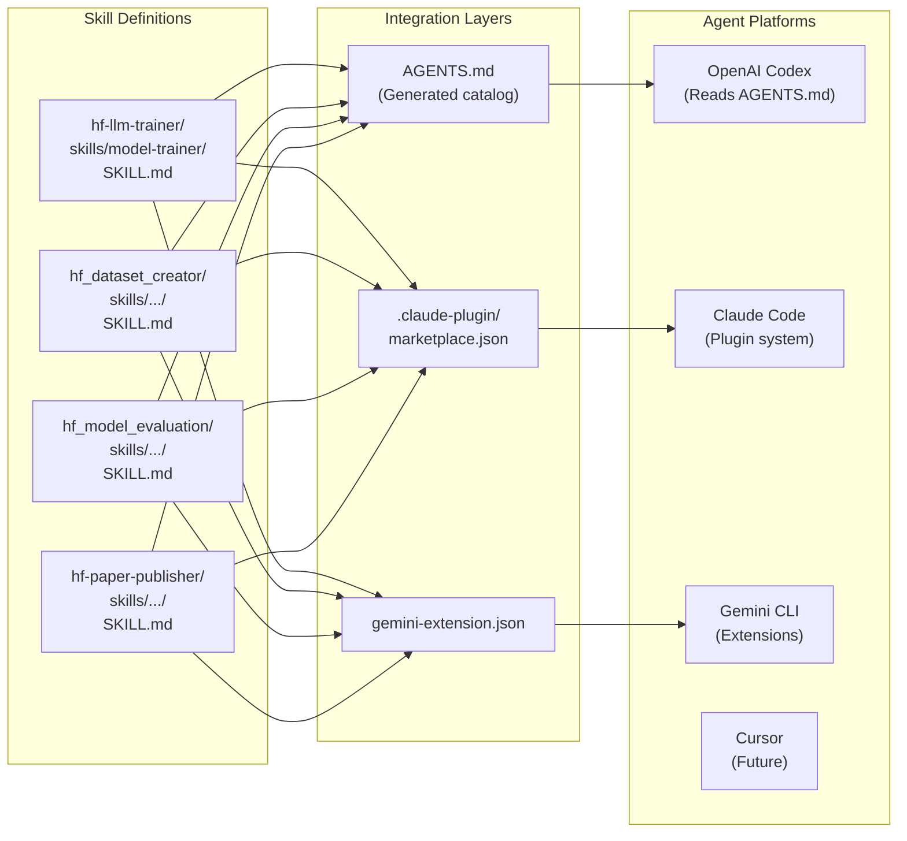

**Integration Methods:**

| Agent Platform | Integration Method | Key File |
|----------------|-------------------|----------|
| Claude Code | Plugin marketplace system | `.claude-plugin/marketplace.json` |
| OpenAI Codex | AGENTS.md catalog | `AGENTS.md` |
| Gemini CLI | Extension JSON | `gemini-extension.json` |
| Cursor | Future integration | TBD |

The multi-agent approach allows the same skill definitions to work across different agent tools without modification.

**Sources:** [README.md:3](), [README.md:10](), [README.md:12-62](), Diagram 2

## System Architecture

The following diagram shows the complete system architecture with actual code entities and their relationships:

```mermaid
graph TB
    subgraph "Core Framework"
        README_FILE["README.md"]
        SKILL_FORMAT["SKILL.md format<br/>(YAML + Markdown)"]
        GEN_SCRIPT["scripts/generate_agents.py"]
        AGENTS_OUTPUT["AGENTS.md"]
        TEMPLATE["scripts/AGENTS_TEMPLATE.md"]
    end
    
    subgraph "Agent Adapters"
        CLAUDE_JSON[".claude-plugin/marketplace.json"]
        GEMINI_EXT["gemini-extension.json"]
        CODEX_READER["Codex AGENTS.md reader"]
    end
    
    subgraph "Skill: hf-llm-trainer"
        TRAINER_SKILL["skills/model-trainer/SKILL.md"]
        TRAIN_SFT["scripts/train_sft_example.py"]
        TRAIN_DPO["scripts/train_dpo_example.py"]
        ESTIMATE["scripts/estimate_cost.py"]
        CONVERT_GGUF["scripts/convert_to_gguf.py"]
    end
    
    subgraph "Skill: hf_dataset_creator"
        DATASET_SKILL["skills/hugging-face-dataset-creator/SKILL.md"]
        DATASET_MGR["scripts/dataset_manager.py"]
        TEMPLATES_DIR["templates/<br/>(chat, qa, completion, etc)"]
    end
    
    subgraph "Skill: hf_model_evaluation"
        EVAL_SKILL["skills/hugging-face-evaluation-manager/SKILL.md"]
        EVAL_MGR["scripts/evaluation_manager.py"]
        INSPECT_EVAL["scripts/inspect_eval_uv.py"]
    end
    
    subgraph "Skill: hf-paper-publisher"
        PAPER_SKILL["skills/hugging-face-paper-publisher/SKILL.md"]
        PAPER_SCRIPTS["scripts/<br/>(paper management)"]
    end
    
    subgraph "Hackathon Apps"
        QUESTS_DIR["quests/<br/>(*.md challenge files)"]
        COLLECT_HACKERS["apps/hackers-leaderboard/collect_points.py"]
        COLLECT_EVALS["apps/evals-leaderboard/collect_evals.py"]
        HACKERS_APP["apps/hackers-leaderboard/app.py"]
        EVALS_APP["apps/evals-leaderboard/app.py"]
    end
    
    subgraph "External Platform"
        HF_JOBS["Hugging Face Jobs API"]
        HF_HUB["Hugging Face Hub"]
        HF_DATASETS["HF Datasets<br/>(leaderboard data)"]
        HF_SPACES["HF Spaces<br/>(deployed apps)"]
    end
    
    SKILL_FORMAT --> TRAINER_SKILL
    SKILL_FORMAT --> DATASET_SKILL
    SKILL_FORMAT --> EVAL_SKILL
    SKILL_FORMAT --> PAPER_SKILL
    
    TRAINER_SKILL --> GEN_SCRIPT
    DATASET_SKILL --> GEN_SCRIPT
    EVAL_SKILL --> GEN_SCRIPT
    PAPER_SKILL --> GEN_SCRIPT
    TEMPLATE --> GEN_SCRIPT
    GEN_SCRIPT --> AGENTS_OUTPUT
    
    TRAINER_SKILL --> CLAUDE_JSON
    DATASET_SKILL --> CLAUDE_JSON
    EVAL_SKILL --> CLAUDE_JSON
    PAPER_SKILL --> CLAUDE_JSON
    
    AGENTS_OUTPUT --> CODEX_READER
    README_FILE --> GEMINI_EXT
    
    TRAIN_SFT --> HF_JOBS
    TRAIN_DPO --> HF_JOBS
    DATASET_MGR --> HF_HUB
    EVAL_MGR --> HF_HUB
    PAPER_SCRIPTS --> HF_HUB
    
    QUESTS_DIR --> COLLECT_HACKERS
    COLLECT_HACKERS --> HF_DATASETS
    COLLECT_EVALS --> HF_DATASETS
    HF_DATASETS --> HACKERS_APP
    HF_DATASETS --> EVALS_APP
    HACKERS_APP --> HF_SPACES
    EVALS_APP --> HF_SPACES
```

The architecture separates concerns into distinct layers:

1. **Core Framework**: SKILL.md format definition and AGENTS.md generation
2. **Agent Adapters**: Platform-specific integration files
3. **Skill Implementations**: Four specialized skills with scripts and templates
4. **Hackathon Apps**: Quest definitions and leaderboard tracking systems
5. **External Platform**: Hugging Face infrastructure for execution and persistence

**Sources:** Diagram 1, Diagram 4, [README.md:64-76]()

## Skill Execution Lifecycle

When an agent uses a skill, it follows this execution flow:

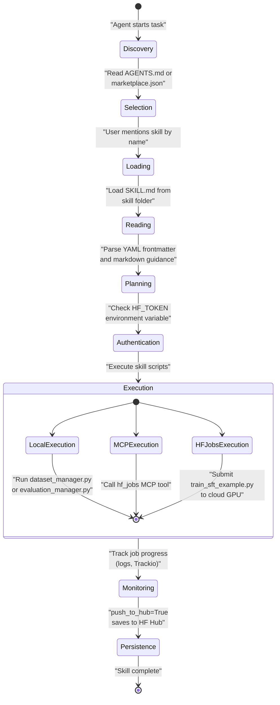

**Key Execution Points:**

1. **Discovery**: Agent identifies available skills via `AGENTS.md` or `.claude-plugin/marketplace.json`
2. **Loading**: Agent loads the specific `SKILL.md` file from the skill's folder
3. **Planning**: Agent parses YAML frontmatter (name, description) and markdown guidance
4. **Authentication**: Agent verifies `HF_TOKEN` environment variable for Hub access
5. **Execution**: Three modes:
   - Local scripts: `dataset_manager.py`, `evaluation_manager.py`
   - MCP tools: `hf_jobs` tool for job submission
   - HF Jobs: Cloud GPU execution of `train_sft_example.py`, `train_dpo_example.py`
6. **Persistence**: Results saved to Hugging Face Hub with `push_to_hub=True`

**Sources:** Diagram 6, [README.md:77-87]()

## Available Skills

The repository provides four production-ready skills:

### Model Training (hf-llm-trainer)

Located in `hf-llm-trainer/`, this skill provides comprehensive LLM training capabilities including SFT, DPO, GRPO, and reward modeling. Key scripts:
- `scripts/train_sft_example.py`: Supervised fine-tuning
- `scripts/train_dpo_example.py`: Direct preference optimization
- `scripts/estimate_cost.py`: GPU cost estimation
- `scripts/convert_to_gguf.py`: Model conversion for local deployment

See [Model Trainer Skill](#4.1) for detailed documentation.

### Dataset Creation (hf_dataset_creator)

Located in `hf_dataset_creator/`, this skill enables dataset creation and management with templates for common formats. Key components:
- `scripts/dataset_manager.py`: Dataset CRUD operations
- `templates/`: Pre-built templates for chat, QA, classification, etc.

See [Dataset Creator Skill](#4.2) for detailed documentation.

### Evaluation Management (hf_model_evaluation)

Located in `hf_model_evaluation/`, this skill manages model evaluation results and metadata. Key scripts:
- `scripts/evaluation_manager.py`: Model card evaluation management
- `scripts/inspect_eval_uv.py`: Inspect-AI framework integration

See [Evaluation Manager Skill](#4.3) for detailed documentation.

### Paper Publishing (hf-paper-publisher)

Located in `hf-paper-publisher/`, this skill handles research paper publishing and linking on Hugging Face Hub, including arXiv indexing and model/dataset associations.

See [Paper Publisher Skill](#4.4) for detailed documentation.

**Sources:** [README.md:64-76](), Diagram 4

## Hackathon Ecosystem

The repository includes a hackathon system called "Humanity's Last Hackathon" with weekly quests, participant tracking, and dual leaderboards:

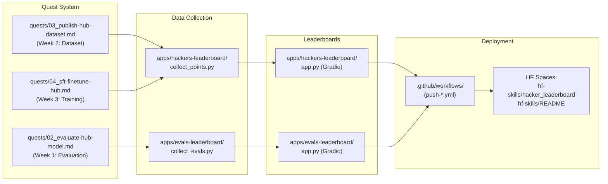

Participants complete weekly quests using the skills, and their contributions are automatically tracked and displayed on public leaderboards hosted on Hugging Face Spaces.

See [Hackathon Ecosystem](#5) for detailed documentation.

**Sources:** Diagram 3, Diagram 5

## CI/CD and Validation

The repository uses GitHub Actions workflows for continuous integration and deployment:

| Workflow | File | Purpose |
|----------|------|---------|
| AGENTS.md validation | `.github/workflows/generate-agents.yml` | Ensures `AGENTS.md` stays in sync with SKILL.md files |
| Hackers leaderboard deployment | `.github/workflows/push-hackers-leaderboard.yml` | Deploys to HF Spaces on changes |
| Evals leaderboard deployment | `.github/workflows/push-evals-leaderboard.yml` | Deploys to HF Spaces on changes |
| Quests deployment | `.github/workflows/push-quests.yml` | Syncs quest content to HF Spaces |

The validation workflow fails pull requests if `AGENTS.md` is out of sync, requiring developers to manually run `scripts/generate_agents.py` to regenerate the catalog.

See [CI/CD Workflows](#6.3) for detailed documentation.

**Sources:** Diagram 5

## Contributing and Customization

To create a custom skill:

1. Copy an existing skill folder (e.g., `hf_dataset_creator/`)
2. Update the `SKILL.md` frontmatter with a unique name and description
3. Add or modify scripts in the `scripts/` directory
4. Run `python scripts/generate_agents.py` to update `AGENTS.md`
5. Submit a pull request

The modular architecture allows skills to be developed independently while maintaining compatibility with all supported agent platforms.

See [Creating Custom Skills](#6.1) for a step-by-step guide.

**Sources:** [README.md:88-103]()

---

# Page: Core Skills Framework

# Core Skills Framework

<details>
<summary>Relevant source files</summary>

The following files were used as context for generating this wiki page:

- [.github/workflows/generate-agents.yml](.github/workflows/generate-agents.yml)
- [.gitignore](.gitignore)
- [AGENTS.md](AGENTS.md)
- [LICENSE](LICENSE)
- [README.md](README.md)
- [assets/banner.png](assets/banner.png)
- [scripts/AGENTS_TEMPLATE.md](scripts/AGENTS_TEMPLATE.md)
- [scripts/generate_agents.py](scripts/generate_agents.py)

</details>


## Purpose and Scope

This document describes the Core Skills Framework, which defines how skills are structured, discovered, and integrated with AI coding agents. It covers the Agent Context Protocol (ACP), the skill folder structure, and the AGENTS.md catalog generation system.

For detailed specifications of the SKILL.md file format, see [SKILL.md Format](#2.1). For the AGENTS.md catalog system implementation, see [AGENTS.md Catalog System](#2.2). For agent-specific integration details, see [Agent Integration](#3).

## Overview

The Core Skills Framework establishes a standard for packaging AI agent capabilities as self-contained, interoperable units. Each skill consists of a folder containing a `SKILL.md` file with YAML frontmatter (metadata) and markdown guidance, plus supporting scripts and resources.

The framework serves three primary functions:

1. **Skill Definition**: Provides a standardized format (`SKILL.md`) for describing agent capabilities
2. **Skill Discovery**: Generates a machine-readable catalog (`AGENTS.md`) of all available skills
3. **Multi-Agent Compatibility**: Supports Claude Code, OpenAI Codex, Gemini CLI, and other agent platforms

Sources: [README.md:1-107]()

## Agent Context Protocol (ACP)

The Agent Context Protocol is the conceptual model underlying the Skills Framework. In practice, ACP refers to the convention of using `SKILL.md` files with YAML frontmatter to define agent capabilities.

### Core ACP Principles

| Principle | Implementation |
|-----------|----------------|
| **Self-Contained** | Each skill is a complete folder with instructions, scripts, and resources |
| **Declarative Metadata** | YAML frontmatter declares `name` and `description` fields |
| **Human-Readable Guidance** | Markdown content provides examples, guardrails, and instructions |
| **Agent-Agnostic** | Same skill definition works across multiple agent platforms |

The ACP convention allows agents to:
- Discover skills by scanning for `SKILL.md` files
- Parse metadata from YAML frontmatter
- Load full instructions from markdown content
- Execute supporting scripts relative to the skill folder

Sources: [README.md:3-11]()

## Skills Directory Structure

Skills follow a consistent directory pattern that enables automatic discovery and catalog generation.

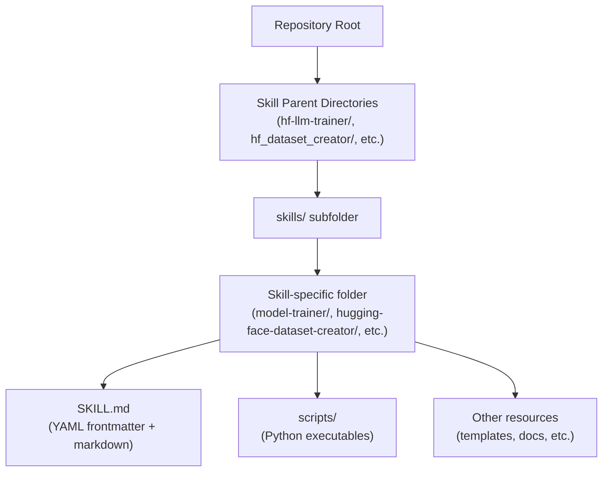

**Directory Pattern**: The generator searches for `SKILL.md` files using the glob pattern `*/skills/*/SKILL.md` from the repository root.

### Example Structure

```
hf-llm-trainer/
  skills/
    model-trainer/
      SKILL.md              # Skill definition with YAML frontmatter
      scripts/
        train_sft_example.py
        estimate_cost.py
        convert_to_gguf.py
      resources/
        documentation.md
```

Sources: [scripts/generate_agents.py:35-49]()

## SKILL.md File Structure

Each `SKILL.md` file contains two parts:

1. **YAML Frontmatter**: Enclosed in `---` delimiters, contains `name` and `description` fields
2. **Markdown Content**: Provides detailed guidance, examples, and guardrails for the agent

### Minimal Example

```markdown
---
name: skill-name
description: Brief description of what the skill does and when to use it
---

# Skill Title
Detailed guidance, examples, and guardrails for the agent to follow.
```

The frontmatter fields are parsed by [scripts/generate_agents.py:19-30]() to generate the AGENTS.md catalog. Skills missing either `name` or `description` are excluded from the catalog.

Sources: [README.md:88-102](), [scripts/generate_agents.py:19-30]()

## Skill Discovery and Loading

Different agent platforms discover and load skills using different mechanisms, but all rely on the same underlying `SKILL.md` format.

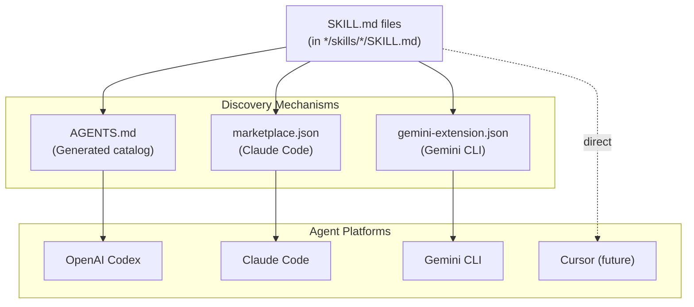

### Discovery Methods by Platform

| Platform | Discovery Method | Installation Command |
|----------|------------------|---------------------|
| **Codex** | Reads `AGENTS.md` automatically | N/A (auto-discovered) |
| **Claude Code** | Plugin marketplace system | `/plugin marketplace add huggingface/skills`<br/>`/plugin install <skill>@huggingface-skills` |
| **Gemini CLI** | Extension system with `gemini-extension.json` | `gemini extensions install .` |

When an agent needs to use a skill:

1. **Discovery**: Agent identifies relevant skill from catalog or marketplace
2. **Loading**: Agent reads the full `SKILL.md` file from the skill folder
3. **Execution**: Agent follows guidance and executes scripts relative to skill folder path

Sources: [README.md:12-62](), [AGENTS.md:1-24]()

## AGENTS.md Generation System

The `AGENTS.md` file is a machine-readable catalog generated from all `SKILL.md` files in the repository. It provides a quick lookup for Codex-style agents to discover available skills without scanning the filesystem.

### Generation Process

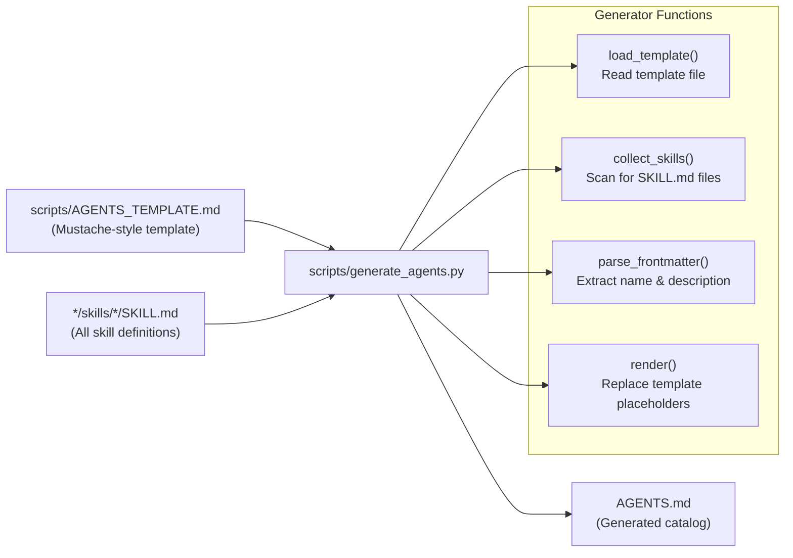

### Generator Implementation

The [scripts/generate_agents.py:1-81]() script performs four operations:

1. **load_template()** [15-16](): Reads [scripts/AGENTS_TEMPLATE.md:1-23]()
2. **collect_skills()** [33-49](): Globs `*/skills/*/SKILL.md` and extracts metadata
3. **parse_frontmatter()** [19-30](): Extracts `name` and `description` from YAML
4. **render()** [52-68](): Replaces `{{#skills}}...{{/skills}}` template loop

The template uses a minimal Mustache-like syntax with three placeholders:
- `{{name}}`: Skill name from frontmatter
- `{{description}}`: Skill description from frontmatter  
- `{{path}}`: Relative path to skill folder

### AGENTS.md Structure

The generated [AGENTS.md:1-24]() contains:

```xml
<skills>
You have additional SKILLs documented in directories containing a "SKILL.md" file.

These skills are:
 - skill-name -> "path/to/skill/SKILL.md"
 ...

IMPORTANT: You MUST read the SKILL.md file whenever the description matches user intent.

<available_skills>
skill-name: `Description of skill`
...
</available_skills>

Paths referenced within SKILL folders are relative to that SKILL.
</skills>
```

The format provides:
- **Skill Mapping**: Name → file path lookup
- **Quick Reference**: Name and description for each skill
- **Path Resolution**: Guidance on resolving relative paths within skills

Sources: [scripts/generate_agents.py:1-81](), [scripts/AGENTS_TEMPLATE.md:1-23](), [AGENTS.md:1-24]()

## CI/CD Validation

The framework includes a GitHub Actions workflow that validates `AGENTS.md` stays synchronized with `SKILL.md` files.

### Validation Workflow

The [.github/workflows/generate-agents.yml:1-32]() workflow:

1. **Triggers** on PRs that modify:
   - `scripts/AGENTS_TEMPLATE.md`
   - `scripts/generate_agents.py`
   - Any `**/SKILL.md` file
   - `AGENTS.md` itself

2. **Validates** by:
   - Running `python scripts/generate_agents.py`
   - Comparing output to committed `AGENTS.md`
   - Failing the PR if differences exist

This ensures developers must regenerate `AGENTS.md` when skill definitions change, keeping the catalog in sync with skill implementations.

### Manual Regeneration

To update `AGENTS.md` after modifying skills:

```bash
python scripts/generate_agents.py
git add AGENTS.md
git commit -m "Update AGENTS.md"
```

Sources: [.github/workflows/generate-agents.yml:1-32]()

## Skill Development Pattern

Creating a new skill follows this pattern:

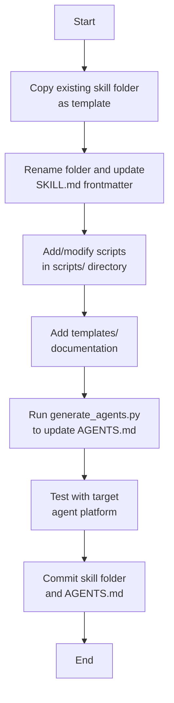

### Required Components

| Component | Purpose | Required |
|-----------|---------|----------|
| `SKILL.md` | Skill definition with YAML frontmatter | ✓ |
| `name` field | Unique identifier for skill | ✓ |
| `description` field | Brief description for discovery | ✓ |
| `scripts/` directory | Executable tools | Optional |
| Templates/resources | Reusable patterns | Optional |

### Frontmatter Requirements

The [scripts/generate_agents.py:36-46]() parser requires:
- Valid YAML between `---` delimiters
- `name` field (string)
- `description` field (string)

Skills missing either field are silently excluded from the generated catalog [line 39-40]().

Sources: [README.md:88-103](), [scripts/generate_agents.py:33-49]()

## Path Resolution

Skills reference internal files using paths relative to their skill folder. Agent platforms must resolve these paths correctly.

### Resolution Rules

From [AGENTS.md:21]():

> Paths referenced within SKILL folders are relative to that SKILL. For example the hf_dataset_creator `scripts/example.py` would be referenced as `hf_dataset_creator/scripts/example.py`.

### Example Path Resolution

For skill at `hf_dataset_creator/skills/hugging-face-dataset-creator/`:

| Reference in SKILL.md | Absolute Path |
|-----------------------|---------------|
| `scripts/dataset_manager.py` | `hf_dataset_creator/skills/hugging-face-dataset-creator/scripts/dataset_manager.py` |
| `templates/chat.json` | `hf_dataset_creator/skills/hugging-face-dataset-creator/templates/chat.json` |
| `../../../README.md` | `README.md` (repository root) |

This convention allows skills to be self-contained while enabling cross-skill references when needed.

Sources: [AGENTS.md:21]()

## Integration with Agent Platforms

The framework supports multiple agent platforms through different integration layers while maintaining a single skill definition format.

### Integration Architecture

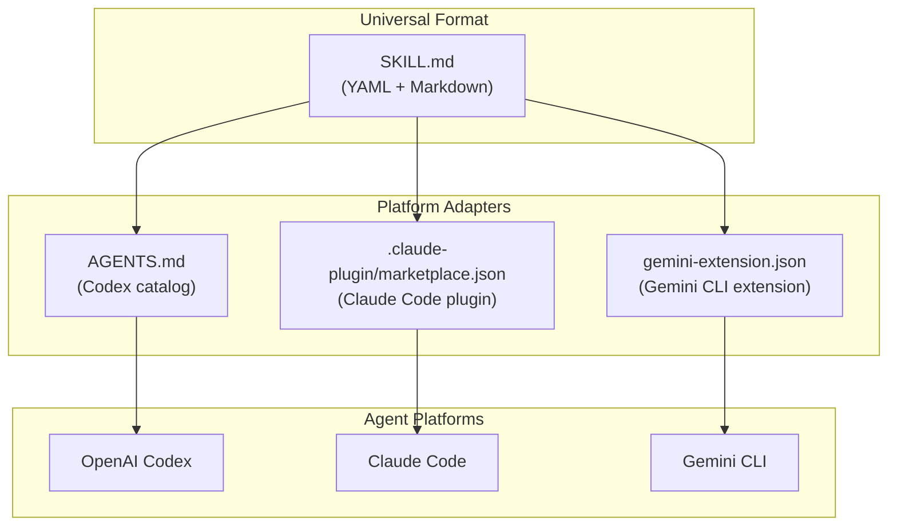

### Platform-Specific Files

| Platform | Adapter File | Purpose |
|----------|-------------|---------|
| Codex | `AGENTS.md` | Machine-readable skill catalog |
| Claude Code | `.claude-plugin/marketplace.json` | Plugin marketplace registration |
| Gemini CLI | `gemini-extension.json` | Extension metadata and entrypoint |

All platforms ultimately read the same `SKILL.md` files, but use different mechanisms for initial discovery and registration.

Sources: [README.md:12-62]()

## Framework Design Principles

The Core Skills Framework follows these design principles:

### Separation of Concerns

- **Skill Logic**: Contained in `SKILL.md` (agent-agnostic)
- **Platform Integration**: Handled by adapter files (platform-specific)
- **Catalog Generation**: Automated via `generate_agents.py`
- **Validation**: Enforced via GitHub Actions CI

### Deterministic Generation

The [scripts/generate_agents.py:49]() sorts skills alphabetically by name to ensure consistent output:

```python
return sorted(skills, key=lambda s: s["name"].lower())
```

This prevents spurious diffs in `AGENTS.md` when skills are added or modified.

### Minimal Dependencies

The generator [scripts/generate_agents.py:1-81]() uses only Python standard library:
- `pathlib` for file system operations
- `re` for regex parsing and template rendering
- No external dependencies required

This ensures the framework can run in any Python environment without additional setup.

Sources: [scripts/generate_agents.py:1-81]()

## Currently Available Skills

The repository currently implements four skills following this framework:

| Skill Folder | Skill Name | SKILL.md Path |
|-------------|-----------|---------------|
| `hf-llm-trainer/` | `model-trainer` | `hf-llm-trainer/skills/model-trainer/SKILL.md` |
| `hf_dataset_creator/` | `hugging-face-dataset-creator` | `hf_dataset_creator/skills/hugging-face-dataset-creator/SKILL.md` |
| `hf_model_evaluation/` | `hugging-face-evaluation-manager` | `hf_model_evaluation/skills/hugging-face-evaluation-manager/SKILL.md` |
| `hf-paper-publisher/` | `hugging-face-paper-publisher` | `hf-paper-publisher/skills/hugging-face-paper-publisher/SKILL.md` |

Each skill follows the same structural pattern but specializes in different aspects of the ML workflow. For detailed information about each skill, see [Available Skills](#4).

Sources: [AGENTS.md:5-18](), [README.md:64-76]()

---

# Page: SKILL.md Format

# SKILL.md Format

<details>
<summary>Relevant source files</summary>

The following files were used as context for generating this wiki page:

- [.gitignore](.gitignore)
- [LICENSE](LICENSE)
- [README.md](README.md)
- [assets/banner.png](assets/banner.png)
- [hf-llm-trainer/skills/model-trainer/SKILL.md](hf-llm-trainer/skills/model-trainer/SKILL.md)

</details>


This document provides the technical specification for the `SKILL.md` file format used in the Hugging Face Skills repository. The SKILL.md format defines how skills are packaged and presented to AI coding agents.

For information about how SKILL.md files are aggregated into a catalog, see [AGENTS.md Catalog System](#2.2). For details on specific skill implementations, see [Available Skills](#4).

---

## Purpose and Scope

The `SKILL.md` format is the core file specification for the Agent Context Protocol (ACP) implementation in this repository. Each skill is defined by a single `SKILL.md` file that combines:

- **Machine-readable metadata** (YAML frontmatter) for skill discovery and indexing
- **Human-readable guidance** (Markdown body) for agent instruction and execution

This format enables AI coding agents (Claude Code, Codex, Gemini CLI, etc.) to discover, load, and execute skills without modification to the agent itself.

---

## File Structure Overview

A `SKILL.md` file consists of two parts separated by YAML frontmatter delimiters:

```mermaid
graph TB
    subgraph "SKILL.md File Structure"
        File["SKILL.md"]
        
        subgraph "Part 1: YAML Frontmatter"
            Open["---"]
            Name["name: skill-identifier"]
            Desc["description: When to use this skill..."]
            License["license: License information"]
            Close["---"]
        end
        
        subgraph "Part 2: Markdown Body"
            Title["# Skill Title"]
            Overview["## Overview section"]
            When["## When to Use This Skill"]
            Directives["## Key Directives"]
            Content["## Additional guidance sections"]
            Examples["## Examples and code"]
            Resources["## Resources"]
        end
        
        File --> Open
        Open --> Name
        Name --> Desc
        Desc --> License
        License --> Close
        Close --> Title
        Title --> Overview
        Overview --> When
        When --> Directives
        Directives --> Content
        Content --> Examples
        Examples --> Resources
    end
    
    style File fill:#f9f9f9
    style Open fill:#e8f4f8
    style Close fill:#e8f4f8
```

**Sources:** [README.md:7-9](), [README.md:91-102](), [hf-llm-trainer/skills/model-trainer/SKILL.md:1-5]()

---

## YAML Frontmatter Specification

The YAML frontmatter is delimited by triple dashes (`---`) at the beginning and end. It contains metadata fields that agents use for skill discovery and selection.

### Required Fields

| Field | Type | Description | Example |
|-------|------|-------------|---------|
| `name` | string | Unique skill identifier (kebab-case) | `model-trainer` |
| `description` | string | When to use this skill (triggers + capabilities) | `This skill should be used when users want to train or fine-tune language models...` |

### Optional Fields

| Field | Type | Description | Example |
|-------|------|-------------|---------|
| `license` | string | License information or reference | `Complete terms in LICENSE.txt` |

### Format Rules

- **Delimiter:** Frontmatter must start and end with `---` on its own line
- **Syntax:** Standard YAML key-value pairs
- **Description Content:** Should describe **when** to invoke the skill and **what** it does
- **Name Convention:** Use kebab-case for skill names (lowercase with hyphens)

### Example Frontmatter

```yaml
---
name: model-trainer
description: This skill should be used when users want to train or fine-tune language models using TRL (Transformer Reinforcement Learning) on Hugging Face Jobs infrastructure. Covers SFT, DPO, GRPO and reward modeling training methods, plus GGUF conversion for local deployment. Includes guidance on the TRL Jobs package, UV scripts with PEP 723 format, dataset preparation and validation, hardware selection, cost estimation, Trackio monitoring, Hub authentication, and model persistence. Should be invoked for tasks involving cloud GPU training, GGUF conversion, or when users mention training on Hugging Face Jobs without local GPU setup.
license: Complete terms in LICENSE.txt
---
```

**Sources:** [hf-llm-trainer/skills/model-trainer/SKILL.md:1-5](), [README.md:92-96]()

---

## Markdown Body Format

The Markdown body follows standard GitHub Flavored Markdown syntax and contains the actual guidance that agents read and follow when executing the skill.

### Structural Requirements

The body should be organized with clear hierarchical sections using Markdown headings:

```markdown
# Skill Title

## Overview
High-level description of what the skill does

## When to Use This Skill
Specific scenarios and use cases

## Key Directives
Critical instructions agents must follow (e.g., "ALWAYS use X", "NEVER do Y")

## [Domain-Specific Sections]
Additional guidance organized by topic

## Examples
Concrete code examples and usage patterns

## Resources
Links to external documentation, helper scripts, reference materials
```

### Content Guidelines

**Directive Syntax:**
- Use **numbered lists** for sequential steps
- Use **bold text** for emphasis on critical points (e.g., `**ALWAYS**`, `**MUST**`, `**CRITICAL**`)
- Use **warning markers** for common pitfalls (e.g., `⚠️ IMPORTANT:`)
- Use **checkboxes** for verification steps (e.g., `- [ ] Check authentication`)

**Code Examples:**
- Include language identifiers in fenced code blocks (e.g., `` ```python ``)
- Provide complete, runnable examples when possible
- Show both correct (`✅`) and incorrect (`❌`) patterns

**Cross-References:**
- Reference helper scripts: `` `scripts/train_sft_example.py` ``
- Reference documentation: `` `references/training_methods.md` ``
- Link to external resources with context

**Sources:** [hf-llm-trainer/skills/model-trainer/SKILL.md:7-694]()

---

## Content Organization Patterns

Analysis of existing SKILL.md files reveals common organizational patterns:

```mermaid
graph TB
    subgraph "Standard SKILL.md Sections"
        A["# Title"]
        B["## Overview"]
        C["## When to Use This Skill"]
        D["## Key Directives"]
        
        subgraph "Prerequisites Block"
            E1["## Prerequisites Checklist"]
            E2["### Account & Authentication"]
            E3["### Resource Requirements"]
            E4["### Critical Settings"]
        end
        
        subgraph "Usage Block"
            F1["## Quick Start"]
            F2["## Approach 1: Method A"]
            F3["## Approach 2: Method B"]
            F4["## Common Patterns"]
        end
        
        subgraph "Configuration Block"
            G1["## Configuration Options"]
            G2["## Hardware Selection"]
            G3["## Cost Estimation"]
        end
        
        subgraph "Troubleshooting Block"
            H1["## Common Failure Modes"]
            H2["## Troubleshooting"]
        end
        
        I["## Resources"]
        J["## Key Takeaways"]
    end
    
    A --> B
    B --> C
    C --> D
    D --> E1
    E1 --> E2
    E2 --> E3
    E3 --> E4
    E4 --> F1
    F1 --> F2
    F2 --> F3
    F3 --> F4
    F4 --> G1
    G1 --> G2
    G2 --> G3
    G3 --> H1
    H1 --> H2
    H2 --> I
    I --> J
```

### Section Type Reference

| Section Type | Purpose | Example From Codebase |
|--------------|---------|----------------------|
| **Overview** | Introduce the skill's domain and capabilities | [hf-llm-trainer/skills/model-trainer/SKILL.md:9-27]() |
| **When to Use** | Define trigger conditions for agent invocation | [hf-llm-trainer/skills/model-trainer/SKILL.md:29-38]() |
| **Key Directives** | Provide critical instructions (MUST/NEVER statements) | [hf-llm-trainer/skills/model-trainer/SKILL.md:40-49]() |
| **Prerequisites** | List requirements before execution | [hf-llm-trainer/skills/model-trainer/SKILL.md:58-79]() |
| **Quick Start** | Provide multiple usage approaches | [hf-llm-trainer/skills/model-trainer/SKILL.md:119-334]() |
| **Configuration** | Document options and settings | [hf-llm-trainer/skills/model-trainer/SKILL.md:337-354]() |
| **Examples** | Show concrete implementation patterns | [hf-llm-trainer/skills/model-trainer/SKILL.md:432-443]() |
| **Troubleshooting** | Address common failure modes | [hf-llm-trainer/skills/model-trainer/SKILL.md:605-662]() |
| **Resources** | Link to scripts, references, external docs | [hf-llm-trainer/skills/model-trainer/SKILL.md:665-693]() |

**Sources:** [hf-llm-trainer/skills/model-trainer/SKILL.md]()

---

## Agent Consumption Model

Different AI agents parse and consume SKILL.md files in different ways based on their architecture:

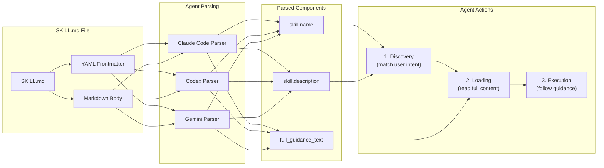

### Parsing Stages

**Stage 1: Discovery**
- Agent reads `name` and `description` from frontmatter
- Compares `description` content to user request
- Determines if skill is applicable

**Stage 2: Loading**
- Agent loads complete Markdown body
- Parses sections, code blocks, and directives
- Builds internal representation of guidance

**Stage 3: Execution**
- Agent follows instructions from Markdown body
- References code examples and helper scripts
- Executes tasks according to directives

### Multi-Agent Compatibility

The format supports three integration modes:

| Agent | Discovery Method | Loading Method | Integration File |
|-------|-----------------|----------------|------------------|
| **Claude Code** | Plugin marketplace JSON | Direct SKILL.md read | `.claude-plugin/marketplace.json` |
| **Codex** | AGENTS.md catalog | SKILL.md reference | `AGENTS.md` |
| **Gemini CLI** | Extension JSON | Direct SKILL.md read | `gemini-extension.json` |

All three agents consume the same SKILL.md format, but use different index files for discovery.

**Sources:** [README.md:14-62](), Diagram 2 from system context

---

## File Location Conventions

SKILL.md files follow a specific directory structure:

```
{skill-folder}/
├── skills/
│   └── {skill-name}/
│       └── SKILL.md          ← The skill definition file
├── scripts/                  ← Helper scripts referenced in SKILL.md
│   ├── train_sft_example.py
│   └── estimate_cost.py
├── references/               ← Additional documentation
│   ├── training_methods.md
│   └── hardware_guide.md
└── resources/                ← Templates and other resources
```

### Path Reference Patterns

When referencing files within a SKILL.md, use relative paths from the skill's root directory:

```markdown
**See:** `scripts/train_sft_example.py` for complete implementation
**See:** `references/training_methods.md` for method comparison
```

**Sources:** [hf-llm-trainer/skills/model-trainer/SKILL.md:437-442](), [hf-llm-trainer/skills/model-trainer/SKILL.md:666-693]()

---

## Complete Example

Below is an annotated minimal SKILL.md file showing all required components:

```markdown
---
name: example-skill
description: This skill should be used when users need to perform X task using Y method. Provides guidance on A, B, and C. Should be invoked for scenarios involving D or when users mention E.
license: Apache 2.0
---

# Example Skill Title

## Overview

Brief description of what this skill enables. Include:
- Primary capability
- Key technologies/libraries used
- Expected outcomes

## When to Use This Skill

Use this skill when users want to:
- Specific scenario 1
- Specific scenario 2
- Specific scenario 3

## Key Directives

When assisting with this skill:

1. **ALWAYS do X** - Explain why this is critical
2. **NEVER do Y** - Explain the consequences
3. **Check Z first** - Prerequisites or validation

## Quick Start

### Approach 1: Primary Method

```python
# Complete, runnable example
from library import Tool

result = Tool.execute(
    param1="value1",
    param2="value2"
)
```

### Approach 2: Alternative Method

For different scenarios, use this approach...

## Configuration Options

| Parameter | Type | Default | Description |
|-----------|------|---------|-------------|
| `param1` | str | required | What this controls |
| `param2` | int | 100 | What this controls |

## Common Failure Modes

### Error: "Something went wrong"

**Fix:**
1. Check condition A
2. Verify setting B
3. Retry with option C

## Resources

### Scripts (In This Skill)
- `scripts/helper.py` - What it does
- `scripts/validator.py` - What it does

### External Links
- [Library Documentation](https://example.com)
- [API Reference](https://example.com/api)

## Key Takeaways

1. **Remember X** - Critical point
2. **Always Y** - Important pattern
3. **Use Z** - Best practice
```

**Sources:** [README.md:91-102](), [hf-llm-trainer/skills/model-trainer/SKILL.md:1-694]()

---

## Writing Guidelines

When creating or modifying SKILL.md files, follow these guidelines:

### DO:
- ✅ **Be specific in descriptions** - Mention exact technologies, methods, and use cases
- ✅ **Use clear action verbs** - "Submit", "Configure", "Validate" instead of "Handle", "Deal with"
- ✅ **Provide complete examples** - Show full code that actually runs
- ✅ **Highlight critical paths** - Use bold, warnings, and checkboxes for important steps
- ✅ **Reference concrete files** - Link to actual scripts and docs in the repository

### DON'T:
- ❌ **Use vague language** - Avoid "generally", "usually", "might"
- ❌ **Assume context** - Explicitly state prerequisites and requirements
- ❌ **Leave examples incomplete** - Partial code confuses agents
- ❌ **Skip error handling** - Include common failure modes and fixes
- ❌ **Forget the agent audience** - Write for AI that reads literally

**Sources:** [hf-llm-trainer/skills/model-trainer/SKILL.md:40-49]() (Key Directives pattern)

---

## Validation

To verify a SKILL.md file is correctly formatted:

### Manual Checks

1. **Frontmatter delimiters** - Must have `---` on lines before and after YAML
2. **Required fields** - `name` and `description` must be present
3. **Name format** - Use kebab-case (lowercase with hyphens)
4. **Description completeness** - Should describe when to use AND what it does
5. **Markdown validity** - Must parse as valid GitHub Flavored Markdown

### Automated Validation

The repository includes a CI workflow that validates SKILL.md files:

- **Workflow:** `.github/workflows/generate-agents.yml`
- **Validation:** Ensures SKILL.md files can be parsed for AGENTS.md generation
- **Trigger:** Runs on pull requests that modify SKILL.md files

If SKILL.md frontmatter is malformed or missing required fields, the CI will fail.

**Sources:** [.github/workflows/generate-agents.yml]() (referenced in Diagram 5), README.md context about AGENTS.md generation

---

## Summary

The SKILL.md format provides a standardized way to define AI agent skills through:

1. **YAML frontmatter** for machine-readable metadata (name, description)
2. **Markdown body** for human-readable guidance and instructions
3. **Consistent section patterns** for predictable agent parsing
4. **Multi-agent compatibility** through a simple, portable format

This format enables skills to be:
- **Discovered** by agents matching user intent to descriptions
- **Loaded** as complete instruction sets
- **Executed** by following structured guidance
- **Shared** across different agent platforms without modification

For information on how these individual SKILL.md files are aggregated into a machine-readable catalog, see [AGENTS.md Catalog System](#2.2).

**Sources:** [README.md:3-11](), [README.md:77-86](), [hf-llm-trainer/skills/model-trainer/SKILL.md]()

---

# Page: AGENTS.md Catalog System

# AGENTS.md Catalog System

<details>
<summary>Relevant source files</summary>

The following files were used as context for generating this wiki page:

- [.github/workflows/generate-agents.yml](.github/workflows/generate-agents.yml)
- [.gitignore](.gitignore)
- [AGENTS.md](AGENTS.md)
- [LICENSE](LICENSE)
- [README.md](README.md)
- [assets/banner.png](assets/banner.png)
- [scripts/AGENTS_TEMPLATE.md](scripts/AGENTS_TEMPLATE.md)
- [scripts/generate_agents.py](scripts/generate_agents.py)

</details>


## Purpose and Scope

The AGENTS.md Catalog System provides a machine-readable index of all available skills for coding agents that follow the OpenAI Codex conventions. The system automatically generates [AGENTS.md:1-24]() from individual [SKILL.md:1-100]() files using a template-based approach, ensuring that the catalog stays synchronized with skill definitions across the repository.

This document focuses on the generation pipeline, file format, and CI validation of AGENTS.md. For details on the underlying SKILL.md format that serves as the source of truth, see [SKILL.md Format](#2.1). For integration with specific agent platforms, see [OpenAI Codex Integration](#3.2).

---

## AGENTS.md File Structure

The generated AGENTS.md file serves as a central manifest that maps skill names to their respective SKILL.md file locations. The file uses XML-style tags to structure the content and provides two views of the available skills: a path mapping and a description listing.

### File Format

```mermaid
graph TB
    subgraph "AGENTS.md Structure"
        skills_open["&lt;skills&gt; tag<br/>Line 1"]
        intro["Introductory text<br/>Lines 3-5"]
        path_mapping["Path mapping section<br/>skill name → SKILL.md path<br/>Lines 6-9"]
        important["IMPORTANT directive<br/>Line 11"]
        available_open["&lt;available_skills&gt; tag<br/>Line 13"]
        desc_listing["Description listing<br/>name: description<br/>Lines 15-18"]
        available_close["&lt;/available_skills&gt; tag<br/>Line 19"]
        path_note["Path resolution note<br/>Line 21"]
        skills_close["&lt;/skills&gt; tag<br/>Line 23"]
    end
    
    skills_open --> intro
    intro --> path_mapping
    path_mapping --> important
    important --> available_open
    available_open --> desc_listing
    desc_listing --> available_close
    available_close --> path_note
    path_note --> skills_close
```

**Diagram: AGENTS.md Document Structure**

Sources: [AGENTS.md:1-24](), [scripts/AGENTS_TEMPLATE.md:1-23]()

### Content Sections

| Section | Lines | Purpose |
|---------|-------|---------|
| Skills wrapper | 1, 23 | XML-style container for all skill information |
| Path mapping | 6-9 | Direct mapping from skill name to SKILL.md file path |
| Important directive | 11 | Instructs agent to read SKILL.md when description matches user intent |
| Available skills | 13-19 | Backtick-wrapped descriptions for each skill |
| Path resolution | 21 | Explains relative path handling within skill folders |

Sources: [AGENTS.md:1-24]()

---

## Generation System Architecture

The AGENTS.md file is generated programmatically by [scripts/generate_agents.py:1-81](), which scans the repository for SKILL.md files, extracts their frontmatter metadata, and renders them into the final catalog using a template.

### Generation Process Flow

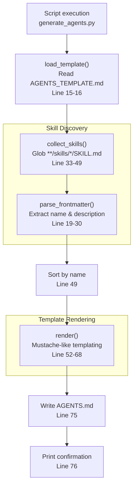

**Diagram: AGENTS.md Generation Pipeline**

Sources: [scripts/generate_agents.py:1-81]()

### Key Functions

#### `load_template()`

Reads the template file from [scripts/AGENTS_TEMPLATE.md:1-23]() which contains Mustache-style placeholders for skill data.

```python
def load_template() -> str:
    return TEMPLATE_PATH.read_text(encoding="utf-8")
```

Sources: [scripts/generate_agents.py:15-16]()

#### `parse_frontmatter()`

Extracts YAML frontmatter from SKILL.md files without external dependencies. Uses regex to locate the `---` delimited block and parses key-value pairs by splitting on colons.

```python
def parse_frontmatter(text: str) -> dict[str, str]:
    match = re.search(r"^---\s*\n(.*?)\n---\s*", text, re.DOTALL)
    # ... parsing logic
```

The function looks for:
- `name`: The skill identifier (kebab-case)
- `description`: Short description of skill purpose and when to use it

Sources: [scripts/generate_agents.py:19-30]()

#### `collect_skills()`

Discovers all SKILL.md files using the glob pattern `*/skills/*/SKILL.md` and extracts their metadata. Returns a sorted list of skill dictionaries containing `name`, `description`, and `path` fields.

The function:
1. Globs for SKILL.md files at [scripts/generate_agents.py:35]()
2. Parses frontmatter from each file at [scripts/generate_agents.py:36]()
3. Validates that both name and description exist at [scripts/generate_agents.py:39]()
4. Computes relative path from repository root at [scripts/generate_agents.py:45]()
5. Sorts alphabetically by skill name for deterministic output at [scripts/generate_agents.py:49]()

Sources: [scripts/generate_agents.py:33-49]()

#### `render()`

Implements a minimal Mustache-style template renderer that only supports `{{#skills}}...{{/skills}}` loop blocks. The renderer:
- Locates loop blocks using regex at [scripts/generate_agents.py:67]()
- Replaces `{{name}}`, `{{description}}`, and `{{path}}` placeholders for each skill at [scripts/generate_agents.py:58-62]()
- Joins rendered blocks with newlines at [scripts/generate_agents.py:64]()

Sources: [scripts/generate_agents.py:52-68]()

---

## Template System

The template at [scripts/AGENTS_TEMPLATE.md:1-23]() defines the structure of the generated AGENTS.md file using Mustache syntax.

### Template Structure Mapping

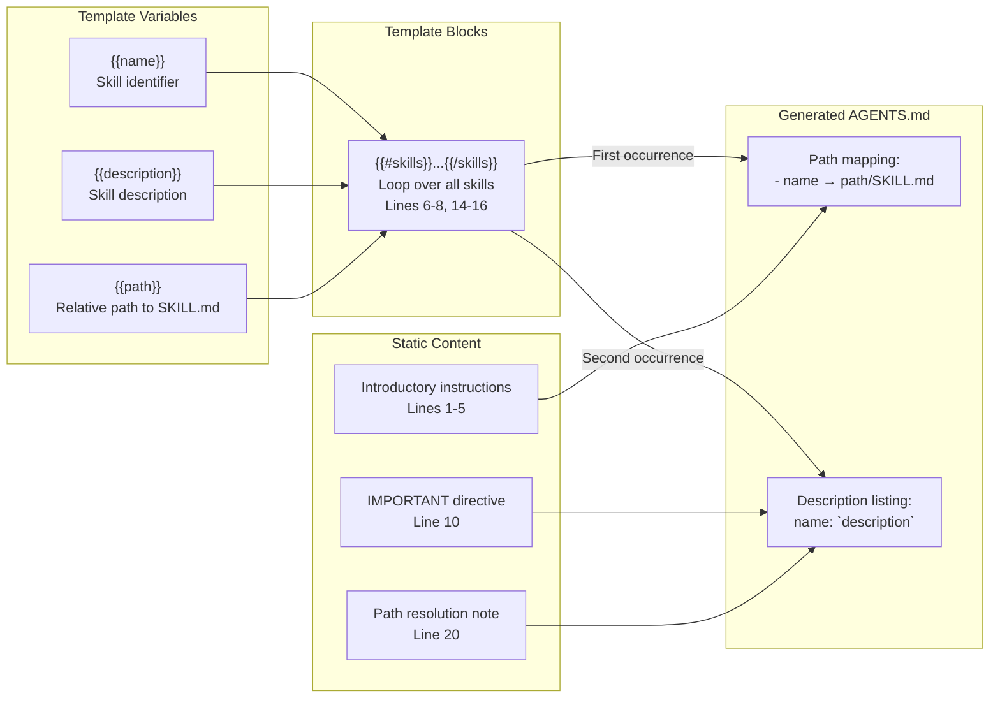

**Diagram: Template to Output Transformation**

Sources: [scripts/AGENTS_TEMPLATE.md:1-23](), [scripts/generate_agents.py:52-68]()

### Template Loop Sections

The template contains two `{{#skills}}` loop blocks:

1. **Path mapping block** (lines 6-8): Generates the mapping from skill names to SKILL.md paths
   ```
   - {{name}} -> "{{path}}/SKILL.md"
   ```

2. **Description listing block** (lines 14-16): Generates the available_skills section with descriptions
   ```
   {{name}}: `{{description}}`
   ```

Sources: [scripts/AGENTS_TEMPLATE.md:6-8,14-17]()

---

## Continuous Integration Validation

The repository enforces that AGENTS.md stays synchronized with SKILL.md files through a GitHub Actions workflow at [.github/workflows/generate-agents.yml:1-32]().

### CI Workflow Process

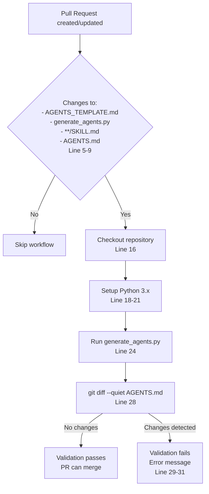

**Diagram: CI Validation Workflow**

Sources: [.github/workflows/generate-agents.yml:1-32]()

### Validation Logic

The workflow operates on a validation-only model rather than auto-commit:

1. **Trigger conditions** (lines 3-9): Activates when any of these files change:
   - `scripts/AGENTS_TEMPLATE.md`
   - `scripts/generate_agents.py`
   - Any file matching `**/SKILL.md`
   - `AGENTS.md` itself

2. **Regeneration** (line 24): Runs the generation script to produce a fresh AGENTS.md

3. **Diff check** (lines 27-31): Uses `git diff --quiet` to detect if regenerated file differs from committed version

4. **Failure mode**: If differences exist, the workflow fails with an error message instructing developers to run the script locally and commit the changes

This approach ensures developers are aware when skill definitions change and must explicitly regenerate the catalog.

Sources: [.github/workflows/generate-agents.yml:1-32]()

---

## Integration with Coding Agents

### Codex Usage Pattern

OpenAI Codex automatically loads AGENTS.md when present in a repository. The agent uses the file to discover available skills and loads the corresponding SKILL.md files on demand.

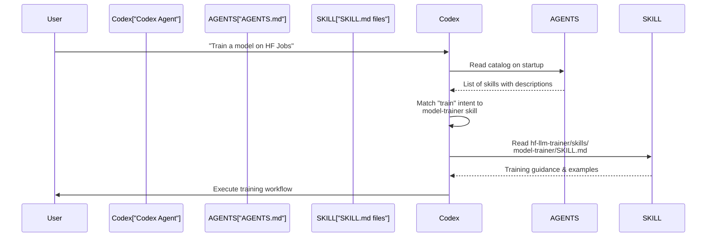

**Diagram: Codex Skill Discovery and Loading**

Sources: [README.md:36-44](), [AGENTS.md:11-18]()

### Verification Command

Users can verify that Codex has loaded the instructions correctly:

```bash
codex --ask-for-approval never "Summarize the current instructions."
```

This command outputs the loaded instructions, which should include content from AGENTS.md and any loaded SKILL.md files.

Sources: [README.md:38-42]()

### Path Resolution

The AGENTS.md file includes guidance on relative path handling at line 21:

> Paths referenced within SKILL folders are relative to that SKILL. For example the hf_dataset_creator `scripts/example.py` would be referenced as `hf_dataset_creator/scripts/example.py`.

This ensures that when agents execute scripts or reference files mentioned in SKILL.md, they construct correct paths relative to the repository root.

Sources: [AGENTS.md:21](), [scripts/AGENTS_TEMPLATE.md:20]()

---

## Skill Catalog Example

The current repository contains four skills registered in AGENTS.md:

| Skill Name | Path | Key Capability |
|------------|------|----------------|
| `hugging-face-dataset-creator` | `hf_dataset_creator/skills/hugging-face-dataset-creator/` | Create and manage datasets with templates |
| `hugging-face-evaluation-manager` | `hf_model_evaluation/skills/hugging-face-evaluation-manager/` | Add evaluation results to model cards |
| `hugging-face-paper-publisher` | `hf-paper-publisher/skills/hugging-face-paper-publisher/` | Publish and link research papers |
| `model-trainer` | `hf-llm-trainer/skills/model-trainer/` | Train LLMs on Hugging Face Jobs (SFT, DPO, GRPO) |

Sources: [AGENTS.md:6-9,15-18]()

---

## Technical Implementation Details

### File System Constants

The generation script defines key paths at [scripts/generate_agents.py:10-12]():

```python
ROOT = Path(__file__).resolve().parent.parent
TEMPLATE_PATH = ROOT / "scripts" / "AGENTS_TEMPLATE.md"
OUTPUT_PATH = ROOT / "AGENTS.md"
```

This ensures the script works correctly regardless of the working directory when executed.

### Skill Discovery Pattern

The glob pattern `*/skills/*/SKILL.md` at [scripts/generate_agents.py:35]() matches the standardized skill folder structure:

```
<skill-folder>/
  skills/
    <skill-name>/
      SKILL.md
      <other files>
```

This pattern assumes all skills follow the convention of placing their SKILL.md file within a `skills/<skill-name>/` subdirectory.

### Frontmatter Parsing Strategy

The `parse_frontmatter()` function implements a minimal YAML parser to avoid external dependencies. It uses a regex pattern `^---\s*\n(.*?)\n---\s*` with `re.DOTALL` flag to capture multi-line frontmatter blocks at [scripts/generate_agents.py:22]().

The parser only extracts simple `key: value` pairs and skips lines without colons at [scripts/generate_agents.py:26-27](), making it suitable for the limited frontmatter structure required by skills.

Sources: [scripts/generate_agents.py:19-30]()

### Deterministic Output

The generation script sorts skills alphabetically by name at [scripts/generate_agents.py:49]() to ensure consistent output across runs. This prevents spurious git diffs when skills are discovered in different orders due to filesystem traversal variations.

---

## Maintenance Workflow

### Adding a New Skill

When adding a new skill to the repository:

1. Create the skill folder structure with a SKILL.md file containing valid frontmatter
2. Run `python scripts/generate_agents.py` to regenerate AGENTS.md
3. Commit both the new SKILL.md and updated AGENTS.md
4. The CI workflow will validate the changes on PR

### Modifying Skill Metadata

When changing a skill's name or description in its SKILL.md frontmatter:

1. Edit the frontmatter in the SKILL.md file
2. Run `python scripts/generate_agents.py`
3. Review the diff in AGENTS.md
4. Commit both files

The CI workflow at [.github/workflows/generate-agents.yml:1-32]() will fail if AGENTS.md is not regenerated after SKILL.md changes, preventing merge until the catalog is updated.

Sources: [.github/workflows/generate-agents.yml:27-31]()

---

## Comparison with Agent-Specific Integration

The AGENTS.md catalog serves Codex-style agents that expect a central manifest. Other agent platforms use different integration approaches:

| Agent Platform | Integration Method | Catalog File |
|----------------|-------------------|--------------|
| **Codex** | Reads AGENTS.md catalog | AGENTS.md (generated) |
| **Claude Code** | Direct skill folder references via marketplace.json | .claude-plugin/marketplace.json (manual) |
| **Gemini CLI** | Repository-level extension registration | gemini-extension.json (manual) |

While Claude and Gemini use manually maintained configuration files that directly reference skill folders, the AGENTS.md approach provides:
- Automated synchronization with skill definitions
- Machine-readable format for bulk skill discovery
- Single source of truth derived from SKILL.md files

For details on Claude and Gemini integration, see [Claude Code Integration](#3.1) and [Gemini CLI Integration](#3.3).

Sources: [README.md:14-62](), [AGENTS.md:1-24]()

---

# Page: Agent Integration

# Agent Integration

<details>
<summary>Relevant source files</summary>

The following files were used as context for generating this wiki page:

- [.claude-plugin/marketplace.json](.claude-plugin/marketplace.json)
- [.gitignore](.gitignore)
- [LICENSE](LICENSE)
- [README.md](README.md)
- [assets/banner.png](assets/banner.png)
- [gemini-extension.json](gemini-extension.json)

</details>


## Purpose and Scope

This page documents how Hugging Face Skills integrate with different coding agent platforms including Claude Code, OpenAI Codex, and Gemini CLI. Each agent platform has its own discovery and integration mechanism, which this document explains in detail. For information about the SKILL.md format itself, see [SKILL.md Format](#2.1). For information about how AGENTS.md is generated, see [AGENTS.md Catalog System](#2.2).

The integration layer bridges the gap between platform-agnostic skill definitions and platform-specific plugin/extension systems. Skills are defined once and automatically exposed to all compatible agents through adapter configurations.

**Sources:** [README.md:1-107]()

## Multi-Platform Integration Architecture

Hugging Face Skills achieves cross-platform compatibility through a two-tier architecture: universal skill definitions and platform-specific adapters.

### Integration Pattern Overview

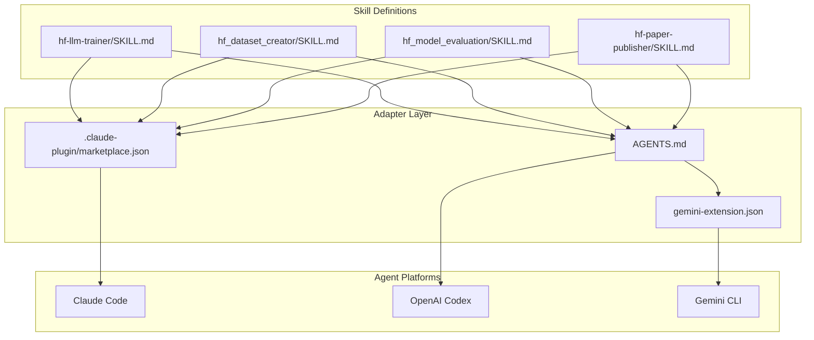

**Sources:** [README.md:3-10](), [README.md:14-62]()

### Platform Support Matrix

| Platform | Discovery Mechanism | Configuration File | Installation Command |
|----------|-------------------|-------------------|---------------------|
| Claude Code | Plugin Marketplace | `.claude-plugin/marketplace.json` | `/plugin marketplace add huggingface/skills` |
| OpenAI Codex | AGENTS.md Catalog | `AGENTS.md` | Automatic via repository |
| Gemini CLI | Extension Registry | `gemini-extension.json` | `gemini extensions install .` |
| Cursor | Future | TBD | Coming soon |
| Windsurf | Future | TBD | Coming soon |
| Continue | Future | TBD | Coming soon |

**Sources:** [README.md:14-62]()

## Claude Code Integration

Claude Code uses a plugin marketplace system where skills are discovered and installed through repository-based plugin definitions. The integration relies on the `.claude-plugin/marketplace.json` file which maps skill folders to plugin entries.

### Claude Marketplace Configuration

The marketplace configuration defines metadata for the entire skill collection and individual plugin entries:

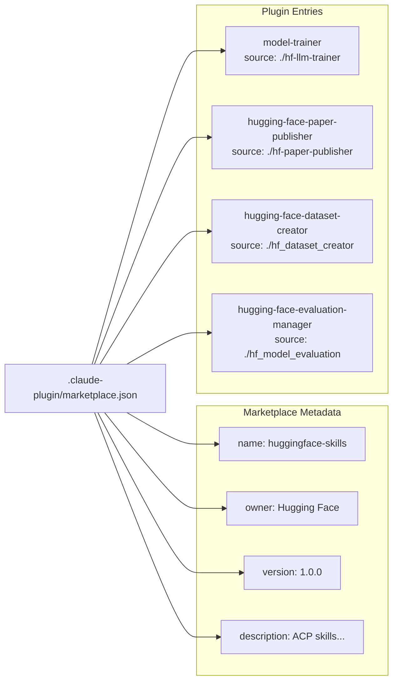

**Sources:** [.claude-plugin/marketplace.json:1-32]()

### Marketplace JSON Structure

The `.claude-plugin/marketplace.json` file contains:

- **Marketplace metadata**: Repository-level information including name, owner, and version
- **Plugins array**: List of individual skills with their source directories and descriptions
- **Plugin descriptions**: Detailed usage guidance for when each skill should be invoked

Each plugin entry maps to a skill folder containing a `SKILL.md` file:

| Plugin Name | Source Directory | Primary Use Case |
|------------|------------------|------------------|
| `model-trainer` | `./hf-llm-trainer` | Training/fine-tuning LLMs with TRL on Hugging Face Jobs |
| `hugging-face-paper-publisher` | `./hf-paper-publisher` | Publishing and managing research papers on Hub |
| `hugging-face-dataset-creator` | `./hf_dataset_creator` | Creating and managing datasets on Hub |
| `hugging-face-evaluation-manager` | `./hf_model_evaluation` | Adding evaluation results to model cards |

**Sources:** [.claude-plugin/marketplace.json:10-31]()

### Claude Installation Workflow

```mermaid
sequenceDiagram
    participant User
    participant Claude["Claude Code"]
    participant Repo["huggingface/skills Repository"]
    participant Skill["Skill Folder"]
    
    User->>Claude: /plugin marketplace add huggingface/skills
    Claude->>Repo: Fetch .claude-plugin/marketplace.json
    Repo-->>Claude: Marketplace configuration
    Claude->>User: Marketplace registered
    
    User->>Claude: /plugin install hf-llm-trainer@huggingface-skills
    Claude->>Repo: Fetch ./hf-llm-trainer/
    Repo-->>Claude: Skill folder contents
    Claude->>Skill: Load SKILL.md
    Skill-->>Claude: Skill instructions loaded
    Claude->>User: Plugin installed
    
    User->>Claude: "Use the HF LLM trainer skill..."
    Claude->>Skill: Read SKILL.md guidance
    Skill-->>Claude: Instructions, examples, scripts
    Claude->>User: Execute task with skill context
```

**Sources:** [README.md:16-34]()

### Plugin Description Format

The `description` field in each plugin entry serves as invocation criteria for Claude. It should specify:

1. **When to use**: Conditions that trigger skill activation
2. **What it covers**: Core capabilities and methods
3. **Key concepts**: Important terminology and features

Example from `model-trainer`:

```
"This skill should be used when users want to train or fine-tune language models using TRL 
(Transformer Reinforcement Learning) on Hugging Face Jobs infrastructure. Covers SFT, DPO, 
GRPO and reward modeling training methods, plus GGUF conversion for local deployment..."
```

**Sources:** [.claude-plugin/marketplace.json:14]()

## OpenAI Codex Integration

OpenAI Codex integrates through the `AGENTS.md` file, which serves as a machine-readable catalog of all available skills. Unlike Claude's plugin marketplace, Codex automatically discovers skills by reading this file from the repository root.

### AGENTS.md Discovery Pattern

```mermaid
graph TB
    REPO["Repository Root"]
    AGENTS["AGENTS.md"]
    CODEX["OpenAI Codex"]
    
    subgraph "Skill Definitions"
        S1["hf-llm-trainer/SKILL.md"]
        S2["hf_dataset_creator/SKILL.md"]
        S3["hf_model_evaluation/SKILL.md"]
        S4["hf-paper-publisher/SKILL.md"]
    end
    
    subgraph "Generation Process"
        TEMPLATE["scripts/AGENTS_TEMPLATE.md"]
        GENERATOR["scripts/generate_agents.py"]
    end
    
    S1 --> GENERATOR
    S2 --> GENERATOR
    S3 --> GENERATOR
    S4 --> GENERATOR
    TEMPLATE --> GENERATOR
    
    GENERATOR --> AGENTS
    REPO --> AGENTS
    CODEX --> AGENTS
    
    AGENTS --> S1
    AGENTS --> S2
    AGENTS --> S3
    AGENTS --> S4
```

**Sources:** [README.md:36-44]()

### Codex Verification

Codex automatically loads instructions from `AGENTS.md`. Users can verify the loaded instructions:

```bash
codex --ask-for-approval never "Summarize the current instructions."
```

This command confirms that Codex has successfully loaded the skill definitions and can articulate what capabilities are available.

**Sources:** [README.md:38-42]()

### AGENTS.md vs Marketplace.json

| Aspect | AGENTS.md (Codex) | marketplace.json (Claude) |
|--------|------------------|---------------------------|
| **Loading** | Automatic on repository access | Explicit marketplace registration required |
| **Installation** | Skills available immediately | Per-skill installation via `/plugin install` |
| **Updates** | Reads current file | Cached until re-installed |
| **Format** | Markdown with skill references | JSON with metadata and plugin entries |
| **Generation** | Generated by `scripts/generate_agents.py` | Manually maintained |

**Sources:** [README.md:36-44](), [README.md:16-34]()

## Gemini CLI Integration

Gemini CLI uses an extension system configured through `gemini-extension.json`. This file defines the extension metadata and points to the `AGENTS.md` file as the context source.

### Gemini Extension Configuration

```mermaid
graph TB
    EXT["gemini-extension.json"]
    
    subgraph "Extension Metadata"
        NAME["name: huggingface-skills"]
        DESC["description: Hugging Face Skills"]
        VERSION["version: 0.1.0"]
        CONTEXT["contextFileName: AGENTS.md"]
    end
    
    subgraph "MCP Servers"
        MCP["mcpServers.huggingface-skills"]
        URL["httpUrl: https://huggingface.co/mcp?login"]
    end
    
    EXT --> NAME
    EXT --> DESC
    EXT --> VERSION
    EXT --> CONTEXT
    EXT --> MCP
    MCP --> URL
```

**Sources:** [gemini-extension.json:1-11]()

### Extension JSON Structure

The `gemini-extension.json` file contains:

```json
{
    "name": "huggingface-skills",
    "description": "Provides access to the Hugging Face Skills.",
    "version": "0.1.0",
    "contextFileName": "AGENTS.md",
    "mcpServers": {
        "huggingface-skills": {
            "httpUrl": "https://huggingface.co/mcp?login"
        }
    }
}
```

**Key fields:**
- **`contextFileName`**: Points to `AGENTS.md` for skill discovery (same file used by Codex)
- **`mcpServers`**: Configures Model Context Protocol servers for additional Hub integration
- **`httpUrl`**: MCP endpoint for authenticated Hugging Face Hub operations

**Sources:** [gemini-extension.json:1-11]()

### Gemini Installation Methods

Gemini CLI supports two installation approaches:

**Local installation:**
```bash
gemini extensions install . --consent
```

**Remote installation:**
```bash
gemini extensions install https://github.com/huggingface/skills.git --consent
```

Both methods install the extension and make skills available to the Gemini agent. The `--consent` flag indicates acceptance of extension permissions.

**Sources:** [README.md:48-62]()

### MCP Server Integration

The `mcpServers` configuration enables Gemini to access Hugging Face Hub through the Model Context Protocol. This provides:

- **Authentication**: Login flow via `?login` query parameter
- **Hub operations**: Direct access to Hub resources (models, datasets, spaces)
- **Skill coordination**: Skills can invoke MCP tools for Hub interactions

The MCP server URL `https://huggingface.co/mcp?login` initiates authenticated Hub access, allowing skills to perform operations like model uploads, dataset creation, and metadata updates.

**Sources:** [gemini-extension.json:6-10](), [README.md:48-62]()

## Cross-Platform Skill Invocation

Once installed, skills are invoked similarly across all platforms through natural language mentions.

### Common Invocation Pattern

```mermaid
sequenceDiagram
    participant User
    participant Agent["Coding Agent<br/>(Claude/Codex/Gemini)"]
    participant Skill["SKILL.md"]
    participant Scripts["Skill Scripts"]
    participant Hub["Hugging Face Hub"]
    
    User->>Agent: "Use the HF LLM trainer skill to estimate GPU memory"
    Agent->>Skill: Load skill instructions
    Skill-->>Agent: Guidance, examples, guardrails
    Agent->>Scripts: Identify relevant script (estimate_cost.py)
    Agent->>Scripts: Execute with parameters
    Scripts-->>Agent: Estimation results
    Agent->>User: Present memory requirements
    
    Note over User,Hub: For operations requiring Hub access
    Agent->>Hub: Authenticate via HF_TOKEN
    Hub-->>Agent: Authorized
    Agent->>Scripts: Execute Hub operations
    Scripts->>Hub: Push model/dataset/metadata
```

**Sources:** [README.md:77-86]()

### Example Invocation Commands

| Task | Invocation Example |
|------|-------------------|
| Cost estimation | "Use the HF LLM trainer skill to estimate the GPU memory needed for a 70B model run." |
| Evaluation | "Use the HF model evaluation skill to launch `run_eval_job.py` on the latest checkpoint." |
| Dataset creation | "Use the HF dataset creator skill to draft new few-shot classification templates." |
| Paper publishing | "Use the HF paper publisher skill to index my arXiv paper and link it to my model." |

The agent automatically:
1. Loads the corresponding `SKILL.md` file
2. Parses guidance, examples, and guardrails
3. Identifies relevant helper scripts
4. Executes the task with appropriate parameters

**Sources:** [README.md:77-86]()

## Platform-Specific Implementation Details

### File System Mapping

Different platforms access skill files through different paths:

```mermaid
graph TB
    ROOT["Repository Root"]
    
    subgraph "Claude Access"
        CLAUDE_MARKET[".claude-plugin/marketplace.json"]
        CLAUDE_S1["source: ./hf-llm-trainer"]
        CLAUDE_S2["source: ./hf-paper-publisher"]
        CLAUDE_S3["source: ./hf_dataset_creator"]
        CLAUDE_S4["source: ./hf_model_evaluation"]
    end
    
    subgraph "Codex/Gemini Access"
        AGENTS_FILE["AGENTS.md"]
        AGENTS_REF["References to all SKILL.md files"]
    end
    
    subgraph "Skill Folders"
        F1["hf-llm-trainer/SKILL.md"]
        F2["hf-paper-publisher/SKILL.md"]
        F3["hf_dataset_creator/SKILL.md"]
        F4["hf_model_evaluation/SKILL.md"]
    end
    
    ROOT --> CLAUDE_MARKET
    ROOT --> AGENTS_FILE
    
    CLAUDE_MARKET --> CLAUDE_S1
    CLAUDE_MARKET --> CLAUDE_S2
    CLAUDE_MARKET --> CLAUDE_S3
    CLAUDE_MARKET --> CLAUDE_S4
    
    AGENTS_FILE --> AGENTS_REF
    
    CLAUDE_S1 --> F1
    CLAUDE_S2 --> F2
    CLAUDE_S3 --> F3
    CLAUDE_S4 --> F4
    
    AGENTS_REF --> F1
    AGENTS_REF --> F2
    AGENTS_REF --> F3
    AGENTS_REF --> F4
```

**Sources:** [.claude-plugin/marketplace.json:10-31](), [README.md:36-62]()

### Skill Naming Conventions

Skill names vary across platforms due to different conventions:

| Skill Folder | Claude Plugin Name | Codex/Gemini Reference |
|-------------|-------------------|----------------------|
| `hf-llm-trainer/` | `model-trainer` | `hf-llm-trainer` |
| `hf-paper-publisher/` | `hugging-face-paper-publisher` | `hf-paper-publisher` |
| `hf_dataset_creator/` | `hugging-face-dataset-creator` | `hf_dataset_creator` |
| `hf_model_evaluation/` | `hugging-face-evaluation-manager` | `hf_model_evaluation` |

**Claude uses semantic names** (e.g., `model-trainer`) in the marketplace configuration, while **Codex/Gemini use folder names** directly from the repository structure.

**Sources:** [.claude-plugin/marketplace.json:12-29]()

### Authentication and Hub Access

All platforms access Hugging Face Hub through the same authentication mechanism:

1. **Environment variable**: `HF_TOKEN` must be set in the execution environment
2. **Verification**: Skills use `hf_whoami` to verify authentication before Hub operations
3. **MCP integration**: Gemini can additionally use MCP server for authenticated operations

Skills check authentication status before performing operations that require Hub access:

```python
# Common pattern in skill scripts
from huggingface_hub import whoami
whoami()  # Verifies HF_TOKEN is valid
```

**Sources:** [README.md:77-86](), [gemini-extension.json:6-10]()

## Future Platform Support

The repository structure anticipates integration with additional platforms:

| Platform | Status | Expected Integration Mechanism |
|----------|--------|-------------------------------|
| Cursor | Planned | TBD - likely similar to Claude marketplace |
| Windsurf | Planned | TBD - configuration format pending |
| Continue | Planned | TBD - extension system details pending |

The modular adapter architecture allows adding new platforms without modifying skill definitions. Future integrations will follow the pattern:
1. Create platform-specific configuration file
2. Map skill folders to platform's discovery format
3. Provide installation/registration instructions

**Sources:** [README.md:14]()

---

# Page: Claude Code Integration

# Claude Code Integration

<details>
<summary>Relevant source files</summary>

The following files were used as context for generating this wiki page:

- [.claude-plugin/marketplace.json](.claude-plugin/marketplace.json)
- [.gitignore](.gitignore)
- [LICENSE](LICENSE)
- [README.md](README.md)
- [assets/banner.png](assets/banner.png)

</details>


## Purpose and Scope

This document explains how to integrate Hugging Face Skills with Claude Code using the plugin marketplace system. Claude Code is an AI coding assistant that can load and execute skills through a standardized plugin interface defined in [.claude-plugin/marketplace.json]().

For integration with other coding agents, see [OpenAI Codex Integration](#3.2) and [Gemini CLI Integration](#3.3). For details on the SKILL.md format that Claude Code reads, see [SKILL.md Format](#2.1).

---

## Marketplace Configuration File

The repository uses [.claude-plugin/marketplace.json]() to define available skills for Claude Code. This file serves as the plugin registry that Claude Code queries when users register the marketplace.

### Marketplace.json Structure

```mermaid
graph TB
    subgraph "marketplace.json Structure"
        ROOT["marketplace.json<br/>{root object}"]
        NAME["name: 'huggingface-skills'"]
        OWNER["owner: {name: 'Hugging Face'}"]
        META["metadata:<br/>{description, version}"]
        PLUGINS["plugins: [array]"]
        
        ROOT --> NAME
        ROOT --> OWNER
        ROOT --> META
        ROOT --> PLUGINS
        
        PLUGINS --> P1["Plugin 1:<br/>model-trainer"]
        PLUGINS --> P2["Plugin 2:<br/>hugging-face-paper-publisher"]
        PLUGINS --> P3["Plugin 3:<br/>hugging-face-dataset-creator"]
        PLUGINS --> P4["Plugin 4:<br/>hugging-face-evaluation-manager"]
        
        P1 --> P1_NAME["name: 'model-trainer'"]
        P1 --> P1_SRC["source: './hf-llm-trainer'"]
        P1 --> P1_DESC["description: 'Training skill...'"]
        
        P2 --> P2_NAME["name: 'hugging-face-paper-publisher'"]
        P2 --> P2_SRC["source: './hf-paper-publisher'"]
        P2 --> P2_DESC["description: 'Paper publishing skill...'"]
    end
```

**Sources:** [.claude-plugin/marketplace.json:1-32]()

### Plugin Definition Schema

Each plugin entry in the `plugins` array contains three required fields:

| Field | Type | Purpose | Example |
|-------|------|---------|---------|
| `name` | string | Unique identifier for the skill | `"model-trainer"` |
| `source` | string | Relative path to skill directory | `"./hf-llm-trainer"` |
| `description` | string | When to use this skill (for agent decision-making) | `"This skill should be used when users want to train or fine-tune language models..."` |

The `description` field is critical—it helps Claude Code determine which skill to activate based on user intent. For example, the model-trainer skill description [.claude-plugin/marketplace.json:14]() includes trigger phrases like "train or fine-tune language models", "cloud GPU training", and "Hugging Face Jobs".

**Sources:** [.claude-plugin/marketplace.json:10-31]()

---

## Installation Process

### Step 1: Register the Marketplace

Users register the entire repository as a plugin marketplace using the `/plugin marketplace add` command:

```bash
/plugin marketplace add huggingface/skills
```

This tells Claude Code to:
1. Clone or fetch the repository from `https://github.com/huggingface/skills`
2. Read [.claude-plugin/marketplace.json]() to discover available plugins
3. Make all plugins available for installation

**Sources:** [README.md:18-22]()

### Step 2: Install Individual Skills

After marketplace registration, users install specific skills using the `/plugin install` command:

```bash
/plugin install <skill-folder>@huggingface-skills
```

For example, to install the model trainer skill:

```bash
/plugin install hf-llm-trainer@huggingface-skills
```

The format is: `<source-directory>@<marketplace-name>`, where:
- `<source-directory>` matches the `source` field in marketplace.json (e.g., `"./hf-llm-trainer"`)
- `<marketplace-name>` is the marketplace identifier (defaults to repo name)

**Sources:** [README.md:24-34]()

---

## Skill Discovery and Loading

```mermaid
sequenceDiagram
    participant User
    participant Claude["Claude Code Agent"]
    participant Registry["marketplace.json"]
    participant SkillDir["Skill Directory<br/>(e.g., hf-llm-trainer/)"]
    participant SkillMD["SKILL.md"]
    
    User->>Claude: "/plugin marketplace add huggingface/skills"
    Claude->>Registry: Read marketplace configuration
    Registry-->>Claude: Return plugins array with metadata
    
    User->>Claude: "/plugin install hf-llm-trainer@huggingface-skills"
    Claude->>Registry: Lookup plugin by source path
    Registry-->>Claude: Plugin config: {name, source, description}
    Claude->>SkillDir: Navigate to ./hf-llm-trainer/
    Claude->>SkillMD: Load SKILL.md from directory
    SkillMD-->>Claude: YAML frontmatter + markdown guidance
    
    Note over Claude: Skill now active
    
    User->>Claude: "Train a model using SFT"
    Claude->>Claude: Match user intent to skill description
    Note over Claude: Description contains "train or fine-tune"
    Claude->>SkillMD: Read training guidance and examples
    Claude->>SkillDir: Access helper scripts
    Claude->>User: Execute training workflow
```

**Sources:** [README.md:16-34](), [.claude-plugin/marketplace.json:10-31]()

### Discovery Mechanism

When a user mentions a task, Claude Code:

1. **Matches descriptions**: Compares user intent against the `description` field in each installed plugin [.claude-plugin/marketplace.json:14,19,24,29]()
2. **Loads skill folder**: Navigates to the `source` directory specified in marketplace.json
3. **Reads SKILL.md**: Parses YAML frontmatter and markdown content from the skill's `SKILL.md` file
4. **Accesses resources**: Makes all files in the skill directory available (scripts, templates, documentation)

**Sources:** [.claude-plugin/marketplace.json:1-32](), [README.md:77-86]()

---

## Integration Architecture

The following diagram shows how Claude Code integrates with the Skills framework:

```mermaid
graph TB
    subgraph "Claude Code Environment"
        USER["User Command:<br/>'Use HF LLM trainer to estimate GPU memory'"]
        CLAUDE["Claude Code Agent"]
    end
    
    subgraph "Skills Repository"
        MARKETPLACE[".claude-plugin/marketplace.json"]
        
        subgraph "model-trainer skill"
            MT_SOURCE["./hf-llm-trainer/<br/>(source path)"]
            MT_SKILL["hf-llm-trainer/SKILL.md"]
            MT_SCRIPTS["hf-llm-trainer/scripts/<br/>train_sft_example.py<br/>estimate_cost.py<br/>convert_to_gguf.py"]
        end
        
        subgraph "dataset-creator skill"
            DS_SOURCE["./hf_dataset_creator/<br/>(source path)"]
            DS_SKILL["hf_dataset_creator/SKILL.md"]
            DS_SCRIPTS["hf_dataset_creator/scripts/<br/>dataset_manager.py"]
        end
        
        subgraph "evaluation-manager skill"
            EV_SOURCE["./hf_model_evaluation/<br/>(source path)"]
            EV_SKILL["hf_model_evaluation/SKILL.md"]
            EV_SCRIPTS["hf_model_evaluation/scripts/<br/>evaluation_manager.py"]
        end
    end
    
    subgraph "Execution"
        SCRIPT_RUN["Execute: estimate_cost.py"]
        HF_JOBS["Hugging Face Jobs API"]
    end
    
    USER --> CLAUDE
    CLAUDE --> MARKETPLACE
    MARKETPLACE -.lists plugins.-> MT_SOURCE
    MARKETPLACE -.lists plugins.-> DS_SOURCE
    MARKETPLACE -.lists plugins.-> EV_SOURCE
    
    CLAUDE -.matches description.-> MT_SOURCE
    MT_SOURCE --> MT_SKILL
    MT_SKILL --> CLAUDE
    MT_SCRIPTS --> CLAUDE
    
    CLAUDE --> SCRIPT_RUN
    SCRIPT_RUN --> HF_JOBS
```

**Sources:** [.claude-plugin/marketplace.json:1-32](), [README.md:16-86]()

### Key Integration Points

| Component | File Path | Role |
|-----------|-----------|------|
| Marketplace Registry | `.claude-plugin/marketplace.json` | Lists all available skills with names, sources, and descriptions |
| Plugin Name | `marketplace.json:plugins[].name` | Identifier used in install commands |
| Source Directory | `marketplace.json:plugins[].source` | Path to skill folder relative to repository root |
| Description | `marketplace.json:plugins[].description` | Trigger text for skill selection |
| Skill Definition | `<source>/SKILL.md` | Contains YAML frontmatter and markdown guidance |
| Helper Scripts | `<source>/scripts/*.py` | Executable tools referenced by SKILL.md |

**Sources:** [.claude-plugin/marketplace.json:10-31]()

---

## Marketplace vs. Direct Reference

Unlike Codex (which uses AGENTS.md) and Gemini (which uses gemini-extension.json), Claude Code uses a **plugin marketplace model**:

```mermaid
graph LR
    subgraph "Claude Code Approach"
        CLAUDE_CMD["User installs<br/>via /plugin commands"]
        MARKETPLACE_JSON[".claude-plugin/<br/>marketplace.json"]
        SKILL_FOLDERS["Skill Directories<br/>(direct access)"]
        
        CLAUDE_CMD --> MARKETPLACE_JSON
        MARKETPLACE_JSON --> SKILL_FOLDERS
    end
    
    subgraph "Alternative Approaches"
        CODEX["Codex:<br/>AGENTS.md<br/>(auto-discovery)"]
        GEMINI["Gemini:<br/>gemini-extension.json<br/>(extensions)"]
    end
    
    style CLAUDE_CMD fill:#f9f9f9
    style MARKETPLACE_JSON fill:#f9f9f9
```

The marketplace.json acts as an **index** but not as a content aggregator. Skills remain in their original directories, and Claude Code reads SKILL.md files directly from those locations.

**Sources:** [.claude-plugin/marketplace.json:1-32](), [README.md:10,36-62]()

---

## Usage Patterns

### Pattern 1: Explicit Skill Invocation

Users can explicitly mention the skill name:

```
"Use the HF LLM trainer skill to estimate the GPU memory needed for a 70B model run."
```

This triggers Claude Code to:
1. Look up "HF LLM trainer" or "model-trainer" in installed plugins
2. Load `hf-llm-trainer/SKILL.md`
3. Execute guidance from SKILL.md (likely calling `scripts/estimate_cost.py`)

**Sources:** [README.md:81]()

### Pattern 2: Intent-Based Activation

Users can describe the task without naming the skill:

```
"I want to fine-tune a model on Hugging Face Jobs with SFT."
```

Claude Code matches this intent against the model-trainer skill description: *"This skill should be used when users want to train or fine-tune language models using TRL...on Hugging Face Jobs"* [.claude-plugin/marketplace.json:14]()

**Sources:** [.claude-plugin/marketplace.json:14]()

### Pattern 3: Resource Access

Once a skill is active, Claude Code can access all resources in the skill directory:

- **Scripts**: `hf-llm-trainer/scripts/train_sft_example.py`, `convert_to_gguf.py`
- **Documentation**: Any markdown files or docs in the skill folder
- **Templates**: Configuration templates or example files

**Sources:** [.claude-plugin/marketplace.json:14](), [README.md:74]()

---

## Plugin Metadata Fields

The marketplace configuration [.claude-plugin/marketplace.json:1-9]() includes repository-level metadata:

```json
{
  "name": "huggingface-skills",
  "owner": {
    "name": "Hugging Face"
  },
  "metadata": {
    "description": "Agent Context Protocol (ACP) skills for AI/ML tasks...",
    "version": "1.0.0"
  }
}
```

| Field | Value | Purpose |
|-------|-------|---------|
| `name` | `"huggingface-skills"` | Marketplace identifier for installation commands |
| `owner.name` | `"Hugging Face"` | Marketplace publisher |
| `metadata.description` | Full ACP description | Overall marketplace purpose |
| `metadata.version` | `"1.0.0"` | Marketplace version for compatibility tracking |

**Sources:** [.claude-plugin/marketplace.json:1-9]()

---

## Skill Source Paths

All skill `source` paths in marketplace.json are relative to the repository root:

| Skill Name | Source Path | Target Directory |
|------------|-------------|------------------|
| `model-trainer` | `"./hf-llm-trainer"` | [hf-llm-trainer/]() |
| `hugging-face-paper-publisher` | `"./hf-paper-publisher"` | [hf-paper-publisher/]() |
| `hugging-face-dataset-creator` | `"./hf_dataset_creator"` | [hf_dataset_creator/]() |
| `hugging-face-evaluation-manager` | `"./hf_model_evaluation"` | [hf_model_evaluation/]() |

Each directory contains a `SKILL.md` file that Claude Code reads after installation.

**Sources:** [.claude-plugin/marketplace.json:13,18,23,28]()

---

## Installation Flow Diagram

```mermaid
stateDiagram-v2
    [*] --> Unregistered: "Initial state"
    
    Unregistered --> Registered: "/plugin marketplace add huggingface/skills"
    
    note right of Registered
        marketplace.json loaded
        4 plugins available
    end note
    
    Registered --> InstallingPlugin: "/plugin install hf-llm-trainer@huggingface-skills"
    
    InstallingPlugin --> PluginActive: "Load SKILL.md from ./hf-llm-trainer/"
    
    note right of PluginActive
        Skill guidance active
        Scripts accessible
        Ready for user tasks
    end note
    
    PluginActive --> ExecutingTask: "User: 'Train a model with SFT'"
    
    ExecutingTask --> PluginActive: "Task complete"
    
    PluginActive --> [*]: "Session ends"
```

**Sources:** [README.md:18-34](), [.claude-plugin/marketplace.json:1-32]()

---

## Comparison with Other Integrations

Claude Code's plugin marketplace approach differs from other agent integrations:

| Feature | Claude Code | Codex | Gemini CLI |
|---------|-------------|-------|------------|
| **Discovery File** | `.claude-plugin/marketplace.json` | `AGENTS.md` | `gemini-extension.json` |
| **Installation** | Explicit `/plugin install` commands | Automatic (reads AGENTS.md) | `gemini extensions install` |
| **Skill Storage** | Direct skill folder references | Aggregated in AGENTS.md | Extension registry |
| **Description Format** | JSON `description` field | Markdown sections in AGENTS.md | JSON configuration |
| **Multiple Skills** | Array of plugin objects | Sections in single file | Extension definitions |

All approaches ultimately load the same `SKILL.md` files from skill directories, but they differ in discovery and installation mechanics.

**Sources:** [.claude-plugin/marketplace.json:1-32](), [README.md:10-62]()

---

## Troubleshooting

### Skill Not Found

If Claude Code cannot find a skill after installation:
1. Verify the `source` path in [.claude-plugin/marketplace.json]() matches the actual directory name
2. Ensure `SKILL.md` exists in the target directory
3. Check that the marketplace name in the install command matches [marketplace.json:2]()

### Skill Not Activating

If a skill doesn't activate on relevant tasks:
1. Review the `description` field [.claude-plugin/marketplace.json:14,19,24,29]() to ensure it contains trigger keywords
2. Try explicit invocation: "Use the [skill-name] skill to..."
3. Verify the skill is installed with `/plugin list`

**Sources:** [.claude-plugin/marketplace.json:1-32](), [README.md:24-34]()

---

# Page: OpenAI Codex Integration

# OpenAI Codex Integration

<details>
<summary>Relevant source files</summary>

The following files were used as context for generating this wiki page:

- [.github/workflows/generate-agents.yml](.github/workflows/generate-agents.yml)
- [.gitignore](.gitignore)
- [AGENTS.md](AGENTS.md)
- [LICENSE](LICENSE)
- [README.md](README.md)
- [assets/banner.png](assets/banner.png)
- [scripts/AGENTS_TEMPLATE.md](scripts/AGENTS_TEMPLATE.md)
- [scripts/generate_agents.py](scripts/generate_agents.py)

</details>


## Purpose and Scope

This document describes how OpenAI Codex integrates with the Hugging Face Skills system through the `AGENTS.md` catalog file. It covers the automatic skill discovery mechanism, the catalog file format, the generation process from `SKILL.md` files, and verification procedures. For information about other agent integrations, see Claude Code Integration ([#3.1](#3.1)) and Gemini CLI Integration ([#3.3](#3.3)). For details on the SKILL.md format itself, see [#2.1](#2.1).

## Integration Architecture

OpenAI Codex uses a catalog-based approach for skill discovery, distinct from Claude Code's plugin marketplace system. The integration relies on a single machine-readable file, `AGENTS.md`, located at the repository root.

```mermaid
graph TB
    subgraph "Skill Definitions"
        SKILL1["hf-llm-trainer/skills/<br/>model-trainer/SKILL.md"]
        SKILL2["hf_dataset_creator/skills/<br/>hugging-face-dataset-creator/SKILL.md"]
        SKILL3["hf_model_evaluation/skills/<br/>hugging-face-evaluation-manager/SKILL.md"]
        SKILL4["hf-paper-publisher/skills/<br/>hugging-face-paper-publisher/SKILL.md"]
    end
    
    subgraph "Catalog Generation"
        TEMPLATE["scripts/AGENTS_TEMPLATE.md"]
        GENERATOR["scripts/generate_agents.py"]
        AGENTS_MD["AGENTS.md<br/>(Root Directory)"]
    end
    
    subgraph "OpenAI Codex"
        CODEX_CLI["codex CLI"]
        CODEX_AGENT["Codex Agent<br/>Instruction Context"]
    end
    
    SKILL1 --> GENERATOR
    SKILL2 --> GENERATOR
    SKILL3 --> GENERATOR
    SKILL4 --> GENERATOR
    TEMPLATE --> GENERATOR
    
    GENERATOR -->|"Generates"| AGENTS_MD
    
    AGENTS_MD -->|"Automatic Discovery"| CODEX_CLI
    CODEX_CLI -->|"Loads Instructions"| CODEX_AGENT
    
    CODEX_AGENT -.->|"Reads on Demand"| SKILL1
    CODEX_AGENT -.->|"Reads on Demand"| SKILL2
    CODEX_AGENT -.->|"Reads on Demand"| SKILL3
    CODEX_AGENT -.->|"Reads on Demand"| SKILL4
```

**Sources:** [README.md:36-44](), [AGENTS.md:1-24](), [scripts/generate_agents.py:1-81]()

## AGENTS.md File Format

The `AGENTS.md` file serves as a machine-readable catalog that Codex automatically loads when operating in the repository. The file structure consists of three main sections:

### File Structure

| Section | Purpose | Location |
|---------|---------|----------|
| Skill Registry | Lists all available skills with paths | Lines 5-9 |
| Available Skills | Provides skill descriptions | Lines 13-19 |
| Path Resolution Rules | Explains relative path handling | Lines 21-23 |

### Skill Registry Format

The skill registry section maps skill names to their `SKILL.md` file locations:

```xml
<skills>

You have additional SKILLs documented in directories containing a "SKILL.md" file.

These skills are:
 - hugging-face-dataset-creator -> "hf_dataset_creator/skills/hugging-face-dataset-creator/SKILL.md"
 - hugging-face-evaluation-manager -> "hf_model_evaluation/skills/hugging-face-evaluation-manager/SKILL.md"
 - hugging-face-paper-publisher -> "hf-paper-publisher/skills/hugging-face-paper-publisher/SKILL.md"
 - model-trainer -> "hf-llm-trainer/skills/model-trainer/SKILL.md"
```

**Sources:** [AGENTS.md:1-10]()

### Available Skills Section

The `<available_skills>` block provides quick-reference descriptions that help Codex determine when to load each skill:

```xml
<available_skills>

hugging-face-dataset-creator: `Create and manage datasets on Hugging Face Hub...`
hugging-face-evaluation-manager: `Add and manage evaluation results in Hugging Face model cards...`
hugging-face-paper-publisher: `Publish and manage research papers on Hugging Face Hub...`
model-trainer: `This skill should be used when users want to train or fine-tune language models...`
</available_skills>
```

The descriptions use natural language to specify when each skill should be invoked based on user intent.

**Sources:** [AGENTS.md:13-19]()

### Path Resolution Rules

The file includes explicit path resolution guidance to prevent errors when referencing skill-internal resources:

```
Paths referenced within SKILL folders are relative to that SKILL. For example the hf_dataset_creator 
`scripts/example.py` would be referenced as `hf_dataset_creator/scripts/example.py`.
```

This ensures Codex correctly resolves file references when executing skill-specific scripts or reading documentation.

**Sources:** [AGENTS.md:21]()

## Skill Discovery Process

Codex automatically discovers and loads the `AGENTS.md` file when operating within the repository. The discovery mechanism follows this flow:

```mermaid
sequenceDiagram
    participant User
    participant Codex as "codex CLI"
    participant FS as "File System"
    participant Agent as "Codex Agent"
    
    User->>Codex: "codex <command>"
    Codex->>FS: Check for AGENTS.md in root
    FS-->>Codex: AGENTS.md found
    Codex->>Codex: Parse skill registry
    Codex->>Agent: Load skill catalog into context
    
    Note over Agent: Agent now aware of<br/>4 available skills
    
    User->>Agent: "Use the model trainer skill..."
    Agent->>Agent: Match intent to skill description
    Agent->>FS: Read hf-llm-trainer/skills/model-trainer/SKILL.md
    FS-->>Agent: SKILL.md content
    Agent->>Agent: Load full skill instructions
    Agent->>User: Execute task with skill guidance
```

**Sources:** [README.md:36-44]()

## Catalog Generation Process

The `AGENTS.md` file is not manually maintained; it is generated programmatically from individual `SKILL.md` files using the `generate_agents.py` script.

### Generation Script Architecture

```mermaid
graph TB
    subgraph "Input Sources"
        TEMPLATE["scripts/AGENTS_TEMPLATE.md"]
        SKILL_FILES["**/skills/*/SKILL.md<br/>(Glob Pattern)"]
    end
    
    subgraph "generate_agents.py Functions"
        LOAD_TEMPLATE["load_template()"]
        PARSE_FM["parse_frontmatter(text)<br/>Extracts YAML data"]
        COLLECT["collect_skills()<br/>Glob + Parse"]
        RENDER["render(template, skills)<br/>Mustache-like"]
    end
    
    subgraph "Processing"
        YAML_EXTRACT["Extract:<br/>- name<br/>- description<br/>- relative path"]
        SORT["Sort by name.lower()"]
    end
    
    subgraph "Output"
        AGENTS_OUT["AGENTS.md<br/>(Root Directory)"]
    end
    
    TEMPLATE --> LOAD_TEMPLATE
    SKILL_FILES --> COLLECT
    
    LOAD_TEMPLATE --> RENDER
    COLLECT --> PARSE_FM
    PARSE_FM --> YAML_EXTRACT
    YAML_EXTRACT --> SORT
    SORT --> RENDER
    
    RENDER --> AGENTS_OUT
```

**Sources:** [scripts/generate_agents.py:10-77]()

### Key Functions

| Function | Purpose | Lines |
|----------|---------|-------|
| `load_template()` | Reads AGENTS_TEMPLATE.md | [scripts/generate_agents.py:15-16]() |
| `parse_frontmatter(text)` | Extracts YAML frontmatter without external dependencies | [scripts/generate_agents.py:19-30]() |
| `collect_skills()` | Globs for SKILL.md files, extracts metadata | [scripts/generate_agents.py:33-49]() |
| `render(template, skills)` | Performs Mustache-like template substitution | [scripts/generate_agents.py:52-68]() |

### Frontmatter Parsing

The script implements a lightweight YAML parser specifically for frontmatter blocks:

```python
def parse_frontmatter(text: str) -> dict[str, str]:
    """Parse a minimal YAML-ish frontmatter block without external deps."""
    match = re.search(r"^---\s*\n(.*?)\n---\s*", text, re.DOTALL)
    if not match:
        return {}
    data: dict[str, str] = {}
    for line in match.group(1).splitlines():
        if ":" not in line:
            continue
        key, value = line.split(":", 1)
        data[key.strip()] = value.strip()
    return data
```

This extracts the `name` and `description` fields from each `SKILL.md` file's YAML frontmatter.

**Sources:** [scripts/generate_agents.py:19-30]()

### Template Rendering

The rendering process uses regex substitution to populate the Mustache-like template:

```python
def render(template: str, skills: list[dict[str, str]]) -> str:
    """Very small Mustache-like renderer that only supports a single skills loop."""
    def repl(match: re.Match[str]) -> str:
        block = match.group(1).strip("\n")
        rendered_blocks = []
        for skill in skills:
            rendered = (
                block.replace("{{name}}", skill["name"])
                .replace("{{description}}", skill["description"])
                .replace("{{path}}", skill["path"])
            )
            rendered_blocks.append(rendered)
        return "\n".join(rendered_blocks)

    # Render loop blocks
    content = re.sub(r"{{#skills}}(.*?){{/skills}}", repl, template, flags=re.DOTALL)
    return content
```

The template at [scripts/AGENTS_TEMPLATE.md:1-23]() defines two `{{#skills}}` blocks: one for the skill registry and one for the descriptions.

**Sources:** [scripts/generate_agents.py:52-68](), [scripts/AGENTS_TEMPLATE.md:1-23]()

## Continuous Integration Validation

The repository enforces that `AGENTS.md` stays synchronized with `SKILL.md` files through a GitHub Actions workflow.

### Validation Workflow

```mermaid
graph LR
    subgraph "Trigger Conditions"
        PR["Pull Request<br/>Changes to:"]
        FILES["- SKILL.md files<br/>- AGENTS_TEMPLATE.md<br/>- generate_agents.py<br/>- AGENTS.md"]
    end
    
    subgraph "Validation Job"
        CHECKOUT["Checkout Code"]
        SETUP_PY["Setup Python 3.x"]
        REGEN["Run generate_agents.py"]
        DIFF["git diff --quiet<br/>-- AGENTS.md"]
    end
    
    subgraph "Outcomes"
        SUCCESS["✓ Pass<br/>AGENTS.md is current"]
        FAIL["✗ Fail<br/>AGENTS.md outdated<br/>Error message"]
    end
    
    PR --> FILES
    FILES --> CHECKOUT
    CHECKOUT --> SETUP_PY
    SETUP_PY --> REGEN
    REGEN --> DIFF
    
    DIFF -->|"No changes"| SUCCESS
    DIFF -->|"Changes detected"| FAIL
```

### Validation Logic

The workflow regenerates `AGENTS.md` and checks for differences:

```bash
git diff --quiet -- AGENTS.md || {
  echo "::error::AGENTS.md is outdated. Run 'python scripts/generate_agents.py' and commit the changes."
  exit 1
}
```

If differences exist, the PR fails with an error message instructing developers to regenerate and commit the file.

**Sources:** [.github/workflows/generate-agents.yml:1-32]()

### Manual Regeneration

Developers can manually regenerate `AGENTS.md` by running:

```bash
python scripts/generate_agents.py
```

The script outputs: `Wrote AGENTS.md with N skills.`

**Sources:** [scripts/generate_agents.py:71-76]()

## Verification and Debugging

### Verifying Codex Can See Instructions

Users can verify that Codex has loaded the instructions from `AGENTS.md`:

```bash
codex --ask-for-approval never "Summarize the current instructions."
```

This command causes Codex to output a summary of its loaded context, including skill definitions from `AGENTS.md`.

**Sources:** [README.md:38-42]()

### Troubleshooting Skill Loading

| Issue | Diagnosis | Solution |
|-------|-----------|----------|
| Skill not appearing in catalog | SKILL.md frontmatter missing or invalid | Verify `name` and `description` fields exist |
| Path resolution errors | Incorrect relative paths in skill scripts | Follow path rules in AGENTS.md line 21 |
| Outdated skill definitions | AGENTS.md not regenerated after SKILL.md changes | Run `python scripts/generate_agents.py` |
| CI validation failures | AGENTS.md committed without regeneration | Regenerate and commit before pushing |

### Debugging the Generation Process

To debug catalog generation, examine the glob pattern results:

```python
# From collect_skills() function
for skill_md in ROOT.glob("*/skills/*/SKILL.md"):
    meta = parse_frontmatter(skill_md.read_text(encoding="utf-8"))
    name = meta.get("name")
    description = meta.get("description")
    if not name or not description:
        continue  # Skill silently skipped if frontmatter incomplete
```

Skills without both `name` and `description` fields are silently excluded from the catalog.

**Sources:** [scripts/generate_agents.py:33-49]()

## File Path Resolution in Practice

When Codex reads a skill and encounters references to files within that skill, it must resolve paths correctly. The `AGENTS.md` file provides explicit guidance:

```
Paths referenced within SKILL folders are relative to that SKILL. For example the hf_dataset_creator 
`scripts/example.py` would be referenced as `hf_dataset_creator/scripts/example.py`.
```

### Example Path Resolution

For the `hugging-face-dataset-creator` skill located at `hf_dataset_creator/skills/hugging-face-dataset-creator/SKILL.md`:

- **Within SKILL.md:** `scripts/dataset_manager.py`
- **From repository root:** `hf_dataset_creator/scripts/dataset_manager.py`

This convention allows skill authors to use short, relative paths in their documentation while ensuring Codex can locate files when executing from the repository root.

**Sources:** [AGENTS.md:21]()

## Integration Comparison

The Codex integration differs from other agent integrations in several key ways:

| Aspect | Codex (AGENTS.md) | Claude Code | Gemini CLI |
|--------|-------------------|-------------|------------|
| Discovery Mechanism | Catalog file at root | Plugin marketplace registration | Extension JSON file |
| File Format | XML-like markdown | JSON marketplace manifest | JSON extension definition |
| Installation Command | Automatic (file present) | `/plugin marketplace add` | `gemini extensions install` |
| Catalog Location | Repository root | `.claude-plugin/marketplace.json` | `gemini-extension.json` |
| Generation Process | Python script from SKILL.md | Manual JSON authoring | Manual JSON authoring |
| CI Validation | Yes (GitHub Actions) | No | No |

The catalog-based approach makes Codex integration transparent and automatic—no explicit installation steps required. For details on other integrations, see [#3.1](#3.1) and [#3.3](#3.3).

**Sources:** [README.md:14-62](), [AGENTS.md:1-24](), [scripts/generate_agents.py:1-81]()

---

# Page: Gemini CLI Integration

# Gemini CLI Integration

<details>
<summary>Relevant source files</summary>

The following files were used as context for generating this wiki page:

- [.gitignore](.gitignore)
- [LICENSE](LICENSE)
- [README.md](README.md)
- [assets/banner.png](assets/banner.png)
- [gemini-extension.json](gemini-extension.json)

</details>


## Purpose and Scope

This document describes how to install and use Hugging Face Skills with Google DeepMind's Gemini CLI through the extensions system. For Claude Code integration, see [Claude Code Integration](#3.1). For OpenAI Codex integration, see [OpenAI Codex Integration](#3.2).

## Extension System Overview

Gemini CLI uses an "extensions" mechanism to integrate external skill repositories, in contrast to Claude Code's "plugin marketplace" or Codex's direct `AGENTS.md` consumption. The extension system is configured through a `gemini-extension.json` file at the repository root.

The extension defines:
- Extension metadata (name, description, version)
- Context file location for skill definitions
- Optional MCP (Model Context Protocol) server endpoints

**Extension Architecture**

```mermaid
graph TB
    subgraph "Repository Root"
        GEJ["gemini-extension.json<br/>{name, description, version}"]
        AGENTS["AGENTS.md<br/>Skill Catalog"]
        SKILLS["Skills Folders<br/>hf-llm-trainer/<br/>hf_dataset_creator/<br/>etc."]
    end
    
    subgraph "Gemini CLI"
        EXT_INSTALL["gemini extensions install"]
        EXT_LOADER["Extension Loader"]
        CTX_LOADER["Context Loader"]
        MCP_CLIENT["MCP Client"]
    end
    
    subgraph "Remote Services"
        MCP_SERVER["MCP Server<br/>https://huggingface.co/mcp"]
    end
    
    EXT_INSTALL --> GEJ
    GEJ --> EXT_LOADER
    GEJ -- "contextFileName" --> AGENTS
    GEJ -- "mcpServers" --> MCP_SERVER
    
    EXT_LOADER --> CTX_LOADER
    CTX_LOADER --> AGENTS
    AGENTS --> SKILLS
    
    EXT_LOADER --> MCP_CLIENT
    MCP_CLIENT --> MCP_SERVER
```

Sources: [README.md:46-62](), [gemini-extension.json:1-11]()

## Configuration File Structure

The `gemini-extension.json` file defines the extension configuration with the following schema:

| Field | Type | Purpose | Value in Codebase |
|-------|------|---------|-------------------|
| `name` | string | Unique extension identifier | `"huggingface-skills"` |
| `description` | string | Human-readable purpose | `"Provides access to the Hugging Face Skills."` |
| `version` | string | Semantic version | `"0.1.0"` |
| `contextFileName` | string | Path to skill catalog file | `"AGENTS.md"` |
| `mcpServers` | object | MCP server configurations (optional) | Server definitions |

**Configuration File Location and Content**

```mermaid
graph LR
    ROOT["Repository Root<br/>github.com/huggingface/skills"]
    GEJ["gemini-extension.json<br/>Lines 1-11"]
    
    ROOT --> GEJ
    
    GEJ --> NAME["name: huggingface-skills"]
    GEJ --> DESC["description: Provides access..."]
    GEJ --> VER["version: 0.1.0"]
    GEJ --> CTX["contextFileName: AGENTS.md"]
    GEJ --> MCP["mcpServers.huggingface-skills"]
    
    MCP --> HTTPURL["httpUrl: https://huggingface.co/mcp?login"]
```

Sources: [gemini-extension.json:1-11]()

### Context File Name

The `contextFileName` field points to `AGENTS.md`, which is the machine-readable catalog generated from all `SKILL.md` files. This allows Gemini CLI to discover available skills without manually loading individual skill folders. For details on how `AGENTS.md` is generated, see [AGENTS.md Catalog System](#2.2).

Sources: [gemini-extension.json:5](), [README.md:38-44]()

### MCP Server Configuration

The `mcpServers` object defines Model Context Protocol endpoints that provide additional tool capabilities:

```json
"mcpServers": {
    "huggingface-skills": {
        "httpUrl": "https://huggingface.co/mcp?login"
    }
}
```

The MCP server at `https://huggingface.co/mcp` provides tools for interacting with Hugging Face Hub (model uploads, dataset management, etc.). The `?login` query parameter indicates authentication is required.

Sources: [gemini-extension.json:6-10]()

## Installation Methods

Gemini CLI supports two installation methods: local filesystem and remote GitHub URL.

**Installation Flow Diagram**

```mermaid
stateDiagram-v2
    [*] --> InstallCommand: User runs command
    
    InstallCommand --> LocalInstall: gemini extensions install . --consent
    InstallCommand --> RemoteInstall: gemini extensions install https://...
    
    LocalInstall --> ReadConfig: Read gemini-extension.json
    RemoteInstall --> CloneRepo: Clone repository
    CloneRepo --> ReadConfig
    
    ReadConfig --> ParseMetadata: Parse name, description, version
    ParseMetadata --> LoadContext: Load contextFileName
    
    LoadContext --> LoadAGENTS: Load AGENTS.md
    LoadAGENTS --> ExtractSkills: Extract skill definitions
    
    ParseMetadata --> ConfigureMCP: Configure mcpServers
    ConfigureMCP --> ConnectMCP: Connect to MCP endpoints
    
    ExtractSkills --> Ready
    ConnectMCP --> Ready
    Ready --> [*]: Extension installed
```

Sources: [README.md:46-62]()

### Local Installation

For local development or when working with a cloned repository:

```bash
gemini extensions install . --consent
```

This command:
1. Reads `gemini-extension.json` from the current directory
2. Loads `AGENTS.md` as specified in `contextFileName`
3. Configures MCP servers from the `mcpServers` object
4. Makes all skills available to Gemini CLI

The `--consent` flag grants permission for the extension to access defined MCP servers.

Sources: [README.md:50-54]()

### Remote Installation

For installing directly from the GitHub repository:

```bash
gemini extensions install https://github.com/huggingface/skills.git --consent
```

This command:
1. Clones the repository to a temporary location
2. Reads `gemini-extension.json` from the repository root
3. Follows the same loading process as local installation
4. Keeps extension synchronized with the remote repository

Sources: [README.md:56-60]()

## Context Loading Mechanism

When Gemini CLI loads the extension, it processes the context file to make skills available to the agent.

**Context Loading Process**

```mermaid
graph TB
    subgraph "Extension Load Time"
        EXT_START["Extension Loaded"]
        READ_JSON["Read gemini-extension.json"]
        GET_CTX["Get contextFileName value"]
    end
    
    subgraph "AGENTS.md Processing"
        LOAD_AGENTS["Load AGENTS.md"]
        PARSE_MD["Parse Markdown Structure"]
        EXTRACT_SKILLS["Extract Skill Definitions:<br/>- name<br/>- description<br/>- full SKILL.md content"]
    end
    
    subgraph "Skill Availability"
        SKILL_INDEX["Build Skill Index"]
        READY["Skills Available to Agent"]
    end
    
    EXT_START --> READ_JSON
    READ_JSON --> GET_CTX
    GET_CTX --> LOAD_AGENTS
    LOAD_AGENTS --> PARSE_MD
    PARSE_MD --> EXTRACT_SKILLS
    EXTRACT_SKILLS --> SKILL_INDEX
    SKILL_INDEX --> READY
```

Sources: [gemini-extension.json:5](), [README.md:38-44]()

The `AGENTS.md` file contains the complete content of each skill's `SKILL.md`, including:
- YAML frontmatter with `name` and `description`
- Full guidance text
- Examples
- Guardrails
- Script references

When a user mentions a skill by name or when the agent determines a skill is needed, Gemini CLI has immediate access to the complete skill definition without needing to read individual files.

Sources: [README.md:6-10]()

## MCP Server Integration

The extension can define MCP (Model Context Protocol) servers that provide additional tools beyond the skill definitions in `AGENTS.md`.

**MCP Integration Architecture**

```mermaid
graph TB
    subgraph "Gemini CLI"
        AGENT["Gemini Agent"]
        MCP_CLIENT["MCP Client"]
        SKILL_LOADER["Skill Loader"]
    end
    
    subgraph "Extension Configuration"
        GEJ["gemini-extension.json"]
        MCP_CONFIG["mcpServers.<br/>huggingface-skills"]
    end
    
    subgraph "Remote MCP Server"
        MCP_ENDPOINT["https://huggingface.co/mcp?login"]
        AUTH["Authentication Handler"]
        TOOLS["MCP Tools:<br/>- hf_jobs<br/>- push_to_hub<br/>- etc."]
    end
    
    subgraph "Skills Context"
        AGENTS_MD["AGENTS.md"]
        SKILLS["Skill Definitions"]
    end
    
    GEJ --> MCP_CONFIG
    GEJ --> AGENTS_MD
    
    MCP_CONFIG --> MCP_CLIENT
    AGENTS_MD --> SKILL_LOADER
    
    MCP_CLIENT --> MCP_ENDPOINT
    MCP_ENDPOINT --> AUTH
    AUTH --> TOOLS
    
    AGENT --> MCP_CLIENT
    AGENT --> SKILL_LOADER
    SKILL_LOADER --> SKILLS
    
    TOOLS --> AGENT
    SKILLS --> AGENT
```

Sources: [gemini-extension.json:6-10]()

### Hugging Face MCP Server

The configured MCP server at `https://huggingface.co/mcp` provides programmatic access to Hugging Face Hub functionality. The `?login` parameter indicates that the server requires authentication via Hugging Face credentials.

MCP tools complement skill guidance by providing:
- Direct API access to Hub operations
- Structured function calls with typed parameters
- Real-time status updates for long-running operations

Skills reference these MCP tools in their guidance sections. For example, the model-trainer skill references the `hf_jobs` MCP tool for submitting training jobs. See [Model Trainer Skill](#4.1) for details.

Sources: [gemini-extension.json:8]()

## Usage Pattern

Once installed, users interact with skills through natural language in Gemini CLI:

```bash
gemini "Use the HF LLM trainer skill to estimate GPU memory for a 7B model"
```

**Runtime Execution Flow**

```mermaid
sequenceDiagram
    participant U as User
    participant G as Gemini CLI
    participant SI as Skill Index
    participant AM as AGENTS.md
    participant MCP as MCP Server
    
    U->>G: "Use HF LLM trainer skill..."
    G->>SI: Query skill by name/description
    SI->>AM: Retrieve full SKILL.md content
    AM->>G: Return skill guidance
    G->>G: Parse guidance, examples, guardrails
    G->>MCP: Call MCP tools if needed
    MCP->>G: Tool results
    G->>U: Execute skill with guidance
```

Sources: [README.md:77-86]()

## Comparison with Other Agent Integrations

| Aspect | Gemini CLI | Claude Code | OpenAI Codex |
|--------|------------|-------------|--------------|
| Configuration File | `gemini-extension.json` | `.claude-plugin/marketplace.json` | None (direct `AGENTS.md` read) |
| Installation Command | `gemini extensions install` | `/plugin marketplace add` | Automatic |
| Skill Discovery | `contextFileName` → `AGENTS.md` | Direct skill folder references | `AGENTS.md` in repository root |
| MCP Support | Yes (via `mcpServers`) | No | No |
| Consent Mechanism | `--consent` flag | Per-plugin approval | Implicit |

Sources: [README.md:12-62]()

### Gemini-Specific Features

The Gemini extension system provides unique capabilities:

1. **MCP Server Integration**: Native support for Model Context Protocol servers, enabling structured tool calls beyond skill guidance
2. **Context File Abstraction**: The `contextFileName` field allows different files to serve as the skill catalog (though `AGENTS.md` is the current standard)
3. **Remote Installation**: Direct installation from GitHub URLs without manual cloning
4. **Explicit Consent**: The `--consent` flag provides transparent permission model for external server access

Sources: [gemini-extension.json:1-11](), [README.md:46-62]()

## Verification

After installation, users can verify the extension is loaded:

```bash
gemini extensions list
```

This should display:
- Extension name: `huggingface-skills`
- Version: `0.1.0`
- Status: Active
- Context file: `AGENTS.md` (loaded)
- MCP servers: `huggingface-skills` (connected)

For more information on the Gemini CLI extensions system, see the [Gemini CLI extensions documentation](https://geminicli.com/docs/extensions/).

Sources: [README.md:62]()

---

# Page: Available Skills

# Available Skills

<details>
<summary>Relevant source files</summary>

The following files were used as context for generating this wiki page:

- [.claude-plugin/marketplace.json](.claude-plugin/marketplace.json)
- [.gitignore](.gitignore)
- [LICENSE](LICENSE)
- [README.md](README.md)
- [assets/banner.png](assets/banner.png)

</details>


## Purpose and Scope

This page provides an overview of the four skills currently available in the Hugging Face Skills repository. Each skill is a self-contained module that packages instructions, scripts, and resources for specific AI/ML workflows. This document describes the common architectural pattern shared by all skills and introduces each skill's purpose and key capabilities.

For detailed information about individual skills, see:
- Model training workflows: [Model Trainer Skill](#4.1)
- Dataset creation workflows: [Dataset Creator Skill](#4.2)
- Evaluation management workflows: [Evaluation Manager Skill](#4.3)
- Research paper publishing workflows: [Paper Publisher Skill](#4.4)

For information about how skills are defined using SKILL.md format, see [SKILL.md Format](#2.1). For agent-specific installation instructions, see [Agent Integration](#3).

---

## Common Skill Architecture Pattern

All skills in this repository follow a consistent structural pattern. Each skill is organized as a self-contained folder containing three primary components:

### Core Components

| Component | Purpose | File/Directory |
|-----------|---------|----------------|
| **Skill Definition** | YAML frontmatter with name and description, followed by markdown guidance for agents | `SKILL.md` |
| **Executable Scripts** | Python scripts that agents can invoke to perform skill operations | `scripts/` directory |
| **Supporting Resources** | Templates, configuration files, and documentation | Various subdirectories |

### Skill Folder Structure Diagram

```mermaid
graph TB
    subgraph SkillFolder["Skill Folder (e.g., hf-llm-trainer/)"]
        SKILL["SKILL.md<br/>Agent-readable guidance"]
        SCRIPTS["scripts/<br/>Executable tools"]
        RESOURCES["Resources<br/>Templates & docs"]
    end
    
    SKILL --> Frontmatter["YAML Frontmatter<br/>name, description"]
    SKILL --> Guidance["Markdown Content<br/>Instructions, examples, guardrails"]
    
    SCRIPTS --> Script1["train_sft_example.py"]
    SCRIPTS --> Script2["estimate_cost.py"]
    SCRIPTS --> ScriptN["..."]
    
    RESOURCES --> Templates["templates/"]
    RESOURCES --> Docs["documentation/"]
    
    SkillFolder --> HubIntegration["Hugging Face Hub<br/>Integration point"]
```

**Sources:** [README.md:89-102](), [.claude-plugin/marketplace.json:10-31]()

### Skill Discovery Mechanisms

Skills are made discoverable to different agent platforms through multiple integration files:

```mermaid
graph LR
    subgraph "Skill Folders"
        HF_TRAINER["hf-llm-trainer/"]
        HF_DATASET["hf_dataset_creator/"]
        HF_EVAL["hf_model_evaluation/"]
        HF_PAPER["hf-paper-publisher/"]
    end
    
    subgraph "Discovery Files"
        AGENTS_MD["AGENTS.md<br/>Codex catalog"]
        MARKETPLACE["marketplace.json<br/>Claude plugin registry"]
        GEMINI_EXT["gemini-extension.json<br/>Gemini extensions"]
    end
    
    HF_TRAINER --> AGENTS_MD
    HF_DATASET --> AGENTS_MD
    HF_EVAL --> AGENTS_MD
    HF_PAPER --> AGENTS_MD
    
    HF_TRAINER --> MARKETPLACE
    HF_DATASET --> MARKETPLACE
    HF_EVAL --> MARKETPLACE
    HF_PAPER --> MARKETPLACE
    
    HF_TRAINER --> GEMINI_EXT
    HF_DATASET --> GEMINI_EXT
    HF_EVAL --> GEMINI_EXT
    HF_PAPER --> GEMINI_EXT
    
    AGENTS_MD --> CodexAgent["OpenAI Codex"]
    MARKETPLACE --> ClaudeAgent["Claude Code"]
    GEMINI_EXT --> GeminiAgent["Gemini CLI"]
```

**Sources:** [README.md:12-63](), [.claude-plugin/marketplace.json:1-32]()

---

## Skill Catalog

The repository currently provides four production-ready skills:

| Skill Folder | Name | Primary Use Case | Key Scripts |
|--------------|------|------------------|-------------|
| `hf-llm-trainer/` | model-trainer | Training and fine-tuning LLMs on cloud GPUs | `train_sft_example.py`, `train_dpo_example.py`, `convert_to_gguf.py`, `estimate_cost.py` |
| `hf_dataset_creator/` | hugging-face-dataset-creator | Creating and managing Hub datasets with streaming updates | `dataset_manager.py`, `quick_setup`, `add_rows` |
| `hf_model_evaluation/` | hugging-face-evaluation-manager | Managing evaluation results in model cards | `evaluation_manager.py`, `inspect_eval_uv.py` |
| `hf-paper-publisher/` | hugging-face-paper-publisher | Publishing research papers on Hub with model/dataset links | Paper management scripts |

**Sources:** [README.md:68-76](), [.claude-plugin/marketplace.json:10-31]()

---

## Skill-to-Code Mapping

The following diagram maps each skill's user-facing name to its directory structure and primary executable components:

```mermaid
graph TB
    subgraph ModelTrainer["model-trainer"]
        MT_DIR["hf-llm-trainer/"]
        MT_SKILL["hf-llm-trainer/SKILL.md"]
        MT_SFT["scripts/train_sft_example.py"]
        MT_DPO["scripts/train_dpo_example.py"]
        MT_GGUF["scripts/convert_to_gguf.py"]
        MT_COST["scripts/estimate_cost.py"]
    end
    
    subgraph DatasetCreator["hugging-face-dataset-creator"]
        DS_DIR["hf_dataset_creator/"]
        DS_SKILL["hf_dataset_creator/SKILL.md"]
        DS_MGR["scripts/dataset_manager.py"]
        DS_QUICK["scripts/quick_setup"]
        DS_ROWS["scripts/add_rows"]
        DS_TEMPLATES["templates/"]
    end
    
    subgraph EvalManager["hugging-face-evaluation-manager"]
        EV_DIR["hf_model_evaluation/"]
        EV_SKILL["hf_model_evaluation/SKILL.md"]
        EV_MGR["scripts/evaluation_manager.py"]
        EV_INSPECT["scripts/inspect_eval_uv.py"]
    end
    
    subgraph PaperPublisher["hugging-face-paper-publisher"]
        PP_DIR["hf-paper-publisher/"]
        PP_SKILL["hf-paper-publisher/SKILL.md"]
        PP_SCRIPTS["scripts/"]
    end
    
    MT_DIR --> MT_SKILL
    MT_DIR --> MT_SFT
    MT_DIR --> MT_DPO
    MT_DIR --> MT_GGUF
    MT_DIR --> MT_COST
    
    DS_DIR --> DS_SKILL
    DS_DIR --> DS_MGR
    DS_DIR --> DS_QUICK
    DS_DIR --> DS_ROWS
    DS_DIR --> DS_TEMPLATES
    
    EV_DIR --> EV_SKILL
    EV_DIR --> EV_MGR
    EV_DIR --> EV_INSPECT
    
    PP_DIR --> PP_SKILL
    PP_DIR --> PP_SCRIPTS
```

**Sources:** [README.md:70-75](), [.claude-plugin/marketplace.json:10-31]()

---

## Model Trainer Skill Overview

The `model-trainer` skill (directory: `hf-llm-trainer/`) enables training and fine-tuning of large language models using TRL (Transformer Reinforcement Learning) on Hugging Face Jobs infrastructure.

### Key Capabilities

- **Training Methods**: Supports SFT (Supervised Fine-Tuning), DPO (Direct Preference Optimization), GRPO (Group Relative Policy Optimization), and reward modeling
- **Cloud Execution**: Runs on Hugging Face Jobs with GPU acceleration (no local GPU required)
- **Cost Management**: Includes hardware selection guidance and cost estimation tools
- **Model Persistence**: Handles model saving to Hub and GGUF conversion for local deployment
- **Dataset Validation**: Validates and prepares datasets for training with format checking

### Integration Points

```mermaid
graph LR
    AgentInvocation["Agent invokes<br/>model-trainer skill"]
    
    AgentInvocation --> SKILL_MD["hf-llm-trainer/SKILL.md<br/>Loads training guidance"]
    
    SKILL_MD --> TrainScript["scripts/train_sft_example.py<br/>or train_dpo_example.py"]
    SKILL_MD --> CostScript["scripts/estimate_cost.py<br/>Hardware cost estimation"]
    SKILL_MD --> GGUFScript["scripts/convert_to_gguf.py<br/>Model conversion"]
    
    TrainScript --> HFJobs["Hugging Face Jobs<br/>Cloud GPU training"]
    TrainScript --> HFHub["Hugging Face Hub<br/>Model persistence"]
    
    GGUFScript --> LocalDeployment["Local deployment<br/>GGUF format models"]
```

**Sources:** [README.md:74](), [.claude-plugin/marketplace.json:11-15]()

See [Model Trainer Skill](#4.1) for comprehensive documentation including training methods, hardware selection, dataset preparation, and model persistence workflows.

---

## Dataset Creator Skill Overview

The `hugging-face-dataset-creator` skill (directory: `hf_dataset_creator/`) provides tools for creating and managing structured datasets on Hugging Face Hub with support for streaming updates.

### Key Capabilities

- **Dataset Initialization**: Creates new dataset repositories with proper configuration
- **Template Support**: Provides pre-built templates for common dataset types (chat, classification, QA, completion, tabular)
- **Streaming Updates**: Supports incremental row additions without full dataset reloading
- **System Prompts**: Allows defining dataset-level system prompts and configuration
- **Hub Integration**: Direct push to Hugging Face Hub with version control

### Dataset Templates

| Template Type | Use Case | Key Fields |
|--------------|----------|------------|
| `chat` | Conversational datasets | messages, system prompts |
| `classification` | Text classification tasks | text, label |
| `qa` | Question-answering pairs | question, answer, context |
| `completion` | Text completion | prompt, completion |
| `tabular` | Structured data | Custom columns |

**Sources:** [README.md:72](), [.claude-plugin/marketplace.json:22-25]()

See [Dataset Creator Skill](#4.2) for detailed documentation on template usage, streaming workflows, and dataset configuration.

---

## Evaluation Manager Skill Overview

The `hugging-face-evaluation-manager` skill (directory: `hf_model_evaluation/`) manages evaluation results in Hugging Face model cards, supporting manual entry and API imports.

### Key Capabilities

- **Model Card Integration**: Adds evaluation results directly to model card metadata
- **Table Extraction**: Extracts existing evaluation tables from README content
- **API Integration**: Imports evaluation scores from Artificial Analysis API
- **Model-Index Format**: Works with standard `model-index` metadata structure
- **Inspect Framework**: Supports `inspect-ai` framework for evaluation orchestration

### Evaluation Workflow

```mermaid
graph LR
    EvalSource["Evaluation Source"]
    
    EvalSource --> ManualEntry["Manual entry<br/>via evaluation_manager.py"]
    EvalSource --> AAApi["Artificial Analysis API<br/>automated import"]
    EvalSource --> InspectAI["inspect-ai framework<br/>via inspect_eval_uv.py"]
    
    ManualEntry --> ModelCard["Model Card<br/>model-index metadata"]
    AAApi --> ModelCard
    InspectAI --> ModelCard
    
    ModelCard --> HFHub["Hugging Face Hub<br/>Published results"]
```

**Sources:** [README.md:73](), [.claude-plugin/marketplace.json:27-30]()

See [Evaluation Manager Skill](#4.3) for complete documentation on evaluation workflows, metadata formats, and API integration.

---

## Paper Publisher Skill Overview

The `hugging-face-paper-publisher` skill (directory: `hf-paper-publisher/`) provides tools for publishing and managing research papers on Hugging Face Hub.

### Key Capabilities

- **Paper Indexing**: Index papers from arXiv with automatic metadata extraction
- **Model/Dataset Linking**: Create bidirectional links between papers and Hub resources
- **Authorship Management**: Claim and manage paper authorship
- **Article Generation**: Generate professional markdown-based research articles from templates
- **Hub Integration**: Native integration with Hugging Face Hub paper pages

### Publication Workflow

```mermaid
graph LR
    PaperSource["Paper Source"]
    
    PaperSource --> ArXiv["arXiv paper<br/>automatic indexing"]
    PaperSource --> Template["Markdown template<br/>manual creation"]
    
    ArXiv --> PaperPage["Paper Page<br/>on HF Hub"]
    Template --> PaperPage
    
    PaperPage --> ModelLink["Link to models"]
    PaperPage --> DatasetLink["Link to datasets"]
    PaperPage --> AuthorClaim["Author claims"]
    
    ModelLink --> HFModels["Model repositories"]
    DatasetLink --> HFDatasets["Dataset repositories"]
```

**Sources:** [README.md:75](), [.claude-plugin/marketplace.json:17-20]()

See [Paper Publisher Skill](#4.4) for detailed documentation on paper publishing workflows, linking mechanisms, and template usage.

---

## Skill Usage Patterns

Agents invoke skills by mentioning them in user instructions. The typical invocation pattern follows this flow:

```mermaid
sequenceDiagram
    participant User
    participant Agent
    participant SkillMD as "SKILL.md"
    participant Scripts as "scripts/"
    participant HFHub as "Hugging Face Hub"
    
    User->>Agent: "Use the HF LLM trainer skill to<br/>train a model"
    Agent->>SkillMD: Load skill guidance
    SkillMD-->>Agent: Instructions, examples, guardrails
    Agent->>Scripts: Execute train_sft_example.py
    Scripts->>HFHub: Submit training job
    HFHub-->>Scripts: Job results
    Scripts-->>Agent: Training complete
    Agent-->>User: Report results
```

**Sources:** [README.md:77-87]()

### Example Invocations

The following invocations demonstrate how users direct agents to use specific skills:

- **Training**: "Use the HF LLM trainer skill to estimate the GPU memory needed for a 70B model run."
- **Evaluation**: "Use the HF model evaluation skill to launch `run_eval_job.py` on the latest checkpoint."
- **Dataset Creation**: "Use the HF dataset creator skill to draft new few-shot classification templates."
- **Paper Publishing**: "Use the HF paper publisher skill to index my arXiv paper and link it to my model."

**Sources:** [README.md:80-84]()

---

## Skill Extension and Customization

The skills framework supports creating custom skills by following the established pattern:

1. **Copy existing skill folder** (e.g., `hf_dataset_creator/`) as a template
2. **Update `SKILL.md` frontmatter** with new name and description
3. **Add or modify scripts** in the `scripts/` directory
4. **Update supporting resources** (templates, documentation)
5. **Reinstall or reload** the skill bundle in the agent

This modular approach allows organizations to create domain-specific skills while maintaining compatibility with the Agent Context Protocol and multiple agent platforms.

**Sources:** [README.md:89-102]()

---

# Page: Model Trainer Skill

# Model Trainer Skill

<details>
<summary>Relevant source files</summary>

The following files were used as context for generating this wiki page:

- [.claude-plugin/marketplace.json](.claude-plugin/marketplace.json)
- [.gitignore](.gitignore)
- [LICENSE](LICENSE)
- [README.md](README.md)
- [assets/banner.png](assets/banner.png)
- [hf-llm-trainer/skills/model-trainer/SKILL.md](hf-llm-trainer/skills/model-trainer/SKILL.md)

</details>


## Purpose and Scope

The Model Trainer Skill provides AI coding agents with the ability to fine-tune language models on Hugging Face Jobs infrastructure using TRL (Transformer Reinforcement Learning). This skill handles cloud-based GPU training without requiring local infrastructure, supporting multiple training methods including Supervised Fine-Tuning (SFT), Direct Preference Optimization (DPO), Group Relative Policy Optimization (GRPO), and reward modeling.

This document covers the overall architecture, job submission workflow, and integration points of the model trainer skill. For detailed information on specific topics, see:
- Training method details and selection criteria: [Training Methods](#4.1.1)
- GPU selection and cost estimation: [Hardware Selection & Cost Management](#4.1.2)
- Dataset format validation: [Dataset Validation & Preparation](#4.1.3)
- Model saving and GGUF conversion: [Model Persistence & GGUF Conversion](#4.1.4)

For information about other skills in the repository, see [Available Skills](#4). For the skill definition format, see [SKILL.md Format](#2.1).

**Sources:** [hf-llm-trainer/skills/model-trainer/SKILL.md:1-10](), [README.md:70-75]()

## Architecture Overview

The Model Trainer Skill operates as a self-contained skill module within the Hugging Face Skills framework. It packages training guidance, executable scripts, and resource documentation in a standardized folder structure compatible with multiple coding agent platforms.

```mermaid
graph TB
    subgraph "Agent Integration Layer"
        Claude["Claude Code Plugin<br/>.claude-plugin/marketplace.json"]
        Codex["OpenAI Codex<br/>AGENTS.md"]
        Gemini["Gemini Extension<br/>gemini-extension.json"]
    end
    
    subgraph "Skill Definition: hf-llm-trainer/"
        SkillMD["SKILL.md<br/>Training guidance + examples"]
        Scripts["scripts/<br/>train_sft_example.py<br/>train_dpo_example.py<br/>train_grpo_example.py<br/>estimate_cost.py<br/>convert_to_gguf.py"]
        Refs["references/<br/>training_methods.md<br/>hardware_guide.md<br/>trackio_guide.md<br/>gguf_conversion.md"]
    end
    
    subgraph "Execution Environment"
        MCPTool["hf_jobs() MCP Tool<br/>Job submission API"]
        CLI["hf jobs CLI<br/>Command-line interface"]
    end
    
    subgraph "Hugging Face Infrastructure"
        Jobs["HF Jobs Service<br/>Docker containers<br/>GPU hardware"]
        Hub["Hugging Face Hub<br/>Model storage"]
        Trackio["Trackio Service<br/>Metrics visualization"]
    end
    
    subgraph "Training Framework"
        TRL["TRL Library<br/>SFTTrainer<br/>DPOTrainer<br/>GRPOTrainer<br/>RewardTrainer"]
        PEFT["PEFT Library<br/>LoraConfig"]
        Datasets["Datasets Library<br/>load_dataset()"]
    end
    
    Claude --> SkillMD
    Codex --> SkillMD
    Gemini --> SkillMD
    
    SkillMD --> Scripts
    SkillMD --> Refs
    
    Scripts --> MCPTool
    Scripts --> CLI
    
    MCPTool --> Jobs
    CLI --> Jobs
    
    Jobs --> TRL
    TRL --> PEFT
    TRL --> Datasets
    
    TRL --> Hub
    TRL --> Trackio
    
    Hub -.Model persistence.-> Scripts
```

**Diagram: Model Trainer Skill Architecture**

The skill consists of three primary layers:

1. **Skill Definition Layer** - Contains the SKILL.md guidance document, example scripts, and reference documentation
2. **Execution Layer** - Provides job submission interfaces via MCP tool or CLI
3. **Infrastructure Layer** - Hugging Face Jobs service executes training using TRL on cloud GPUs

**Sources:** [hf-llm-trainer/skills/model-trainer/SKILL.md:1-10](), [.claude-plugin/marketplace.json:11-15](), [README.md:12-62]()

## SKILL.md Structure

The skill's primary definition is contained in `SKILL.md` with YAML frontmatter followed by structured markdown guidance.

| Section | Purpose | Content |
|---------|---------|---------|
| YAML Frontmatter | Agent-readable metadata | `name`, `description`, `license` fields |
| Overview | Training method summary | SFT, DPO, GRPO, reward modeling descriptions |
| When to Use | Invocation criteria | Cloud GPU training, GGUF conversion, Hub persistence |
| Key Directives | Critical instructions | Use `hf_jobs()`, include Trackio, validate datasets |
| Prerequisites | Setup requirements | Authentication, dataset format, timeout configuration |
| Quick Start | Three approaches | UV scripts, TRL scripts, CLI commands |
| Hardware Selection | GPU recommendations | Flavor selection table by model size |
| Critical Sections | Must-read guidance | Hub saving, timeout management, cost estimation |
| Resources | Reference materials | Links to scripts/ and references/ directories |

**Sources:** [hf-llm-trainer/skills/model-trainer/SKILL.md:1-706]()

## Job Submission Workflow

Training jobs follow a standardized submission workflow from agent intent to cloud execution.

```mermaid
sequenceDiagram
    participant Agent as "Coding Agent"
    participant Skill as "SKILL.md Guidance"
    participant MCP as "hf_jobs() MCP Tool"
    participant Jobs as "HF Jobs Service"
    participant Container as "Docker Container"
    participant TRL as "TRL Training"
    participant Hub as "Hugging Face Hub"
    participant Trackio as "Trackio Dashboard"
    
    Agent->>Skill: User: "Train model X on dataset Y"
    Skill-->>Agent: Load training guidance
    Agent->>Agent: Create UV script with<br/>PEP 723 dependencies
    Agent->>MCP: hf_jobs("uv", {script, flavor, timeout, secrets})
    MCP->>Jobs: Submit job request
    Jobs-->>MCP: Return job_id
    MCP-->>Agent: Job submitted
    Agent->>Agent: Provide job_id, monitoring URL
    
    Jobs->>Container: Provision GPU container
    Container->>Container: Install dependencies via uv
    Container->>TRL: Execute training script
    TRL->>Hub: Authenticate with HF_TOKEN
    TRL->>TRL: Load dataset, model, run training
    TRL->>Trackio: Stream metrics (report_to="trackio")
    TRL->>Hub: push_to_hub() on completion
    Container-->>Jobs: Job complete
    
    Agent->>MCP: User requests: hf_jobs("logs", {job_id})
    MCP->>Jobs: Fetch logs
    Jobs-->>Agent: Return training logs
```

**Diagram: Training Job Submission Sequence**

The workflow consists of three phases:

1. **Submission Phase** - Agent creates training script, calls `hf_jobs()` with parameters
2. **Execution Phase** - Jobs service provisions container, executes training asynchronously
3. **Monitoring Phase** - Agent queries logs on user request, training streams to Trackio

**Sources:** [hf-llm-trainer/skills/model-trainer/SKILL.md:39-117](), [hf-llm-trainer/skills/model-trainer/SKILL.md:80-117]()

## Core Components

### SKILL.md Guidance Document

The primary skill definition at [hf-llm-trainer/skills/model-trainer/SKILL.md]() provides structured guidance organized into functional sections:

**Critical Directives Section** [lines 39-50]():
- Mandates use of `hf_jobs()` MCP tool for job submission
- Requires Trackio integration in all training scripts
- Specifies inline script passing (not file paths)
- Enforces immediate job submission on training requests

**Prerequisites Checklist** [lines 58-79]():
- Account requirements: Pro/Team/Enterprise plan for Jobs access
- Authentication: `hf_whoami()` verification, `HF_TOKEN` with write permissions
- Dataset requirements: Hub-accessible datasets in correct format
- Critical settings: Timeout > training time, `push_to_hub=True` enabled

**Job Configuration** [lines 187-190]():
```python
{
    "script": "<Python code or URL>",
    "flavor": "a10g-large",
    "timeout": "2h",
    "secrets": {"HF_TOKEN": "$HF_TOKEN"}
}
```

**Sources:** [hf-llm-trainer/skills/model-trainer/SKILL.md:1-706]()

### Example Scripts

The `scripts/` directory contains production-ready training templates demonstrating best practices.

| Script | Purpose | Key Features |
|--------|---------|--------------|
| `train_sft_example.py` | Supervised fine-tuning template | LoRA, Trackio, checkpointing, Hub push |
| `train_dpo_example.py` | Preference optimization template | DPO-specific dataset format, chosen/rejected pairs |
| `train_grpo_example.py` | Online RL training template | GRPO configuration, reward computation |
| `estimate_cost.py` | Cost estimation utility | Hardware selection, time/cost calculation |
| `convert_to_gguf.py` | GGUF conversion script | Local deployment format generation |

These scripts are referenced in SKILL.md [lines 433-443]() and serve as copy-paste templates for agents creating custom training jobs.

**Sources:** [hf-llm-trainer/skills/model-trainer/SKILL.md:433-443](), [hf-llm-trainer/skills/model-trainer/SKILL.md:677-682]()

### Reference Documentation

The `references/` directory provides detailed technical documentation for specific topics:

| Document | Content |
|----------|---------|
| `training_methods.md` | Detailed comparison of SFT, DPO, GRPO, KTO, PPO, reward modeling |
| `hardware_guide.md` | GPU specifications, memory requirements, multi-GPU configuration |
| `trackio_guide.md` | Monitoring setup, run grouping, metric visualization |
| `gguf_conversion.md` | Quantization options, conversion workflow, deployment targets |
| `hub_saving.md` | Authentication troubleshooting, repository configuration |
| `troubleshooting.md` | Common errors, OOM fixes, timeout management |

Referenced in SKILL.md [lines 666-675]() with explicit guidance to agents on when to consult each document.

**Sources:** [hf-llm-trainer/skills/model-trainer/SKILL.md:666-675]()

## Execution Approaches

The skill supports three primary execution approaches with different use cases.

### Approach 1: UV Scripts with PEP 723

Recommended approach using inline dependency declarations. The agent constructs a Python script with PEP 723 header and passes it directly to `hf_jobs()`.

**Script Structure** [lines 150-191]():
```python
# /// script
# dependencies = ["trl>=0.12.0", "peft>=0.7.0", "trackio"]
# ///

from trl import SFTTrainer, SFTConfig
from peft import LoraConfig
import trackio

# Training code...
```

**Job Submission** [lines 150-191]():
```python
hf_jobs("uv", {
    "script": "<inline Python code>",
    "flavor": "a10g-large",
    "timeout": "2h",
    "secrets": {"HF_TOKEN": "$HF_TOKEN"}
})
```

**Key Characteristics:**
- Self-contained scripts with inline dependencies
- No file system persistence required
- Full control over training configuration
- Primary method for Claude Code integration

**Sources:** [hf-llm-trainer/skills/model-trainer/SKILL.md:145-194]()

### Approach 2: TRL Maintained Scripts

Uses official TRL example scripts from GitHub, suitable for standard training without customization.

**Script URLs** [lines 236-258]():
- SFT: `https://github.com/huggingface/trl/blob/main/trl/scripts/sft.py`
- DPO: `https://github.com/huggingface/trl/blob/main/trl/scripts/dpo.py`
- GRPO: `https://github.com/huggingface/trl/blob/main/trl/scripts/grpo.py`

**Job Submission with Arguments** [lines 240-254]():
```python
hf_jobs("uv", {
    "script": "https://github.com/huggingface/trl/blob/main/trl/scripts/sft.py",
    "script_args": [
        "--model_name_or_path", "Qwen/Qwen2.5-0.5B",
        "--dataset_name", "trl-lib/Capybara",
        "--output_dir", "my-model",
        "--push_to_hub",
        "--hub_model_id", "username/my-model"
    ],
    "flavor": "a10g-large"
})
```

**Sources:** [hf-llm-trainer/skills/model-trainer/SKILL.md:236-259]()

### Approach 3: HF Jobs CLI

Command-line interface for direct terminal usage when MCP tool is unavailable.

**CLI Syntax Rules** [lines 278-299]():
```bash
# Correct syntax - flags BEFORE script URL
hf jobs uv run --flavor a10g-large --timeout 2h --secrets HF_TOKEN "https://example.com/train.py"

# Common mistakes to avoid:
# - "run uv" instead of "uv run"
# - Flags AFTER script URL (ignored)
# - "--secret" instead of "--secrets" (plural)
```

**Status Monitoring** [lines 309-315]():
```bash
hf jobs ps                    # List all jobs
hf jobs logs <job-id>         # View logs
hf jobs inspect <job-id>      # Job details
hf jobs cancel <job-id>       # Cancel job
```

**Sources:** [hf-llm-trainer/skills/model-trainer/SKILL.md:276-335]()

## Integration Points

### Hugging Face Jobs Service

The Jobs service provides managed GPU infrastructure with Docker container isolation.

**Job Configuration Parameters:**
- `flavor`: GPU type (e.g., `"t4-small"`, `"a10g-large"`, `"a100-large"`)
- `timeout`: Maximum runtime (e.g., `"2h"`, `"90m"`, integer seconds)
- `secrets`: Environment variables (e.g., `{"HF_TOKEN": "$HF_TOKEN"}`)
- `env`: Additional environment variables

**Container Lifecycle:**
1. Jobs service provisions Docker container with specified GPU
2. UV installs dependencies from PEP 723 header
3. Script executes with access to secrets and environment
4. Container destroyed on completion (ephemeral environment)

**Critical Consideration** [lines 358-388](): Training environment is ephemeral - all files deleted on job completion. Models MUST be pushed to Hub or all training is lost.

**Sources:** [hf-llm-trainer/skills/model-trainer/SKILL.md:337-355](), [hf-llm-trainer/skills/model-trainer/SKILL.md:358-388]()

### TRL Training Framework

TRL (Transformer Reinforcement Learning) provides trainer classes for different training methods.

**Trainer Classes:**
- `SFTTrainer` with `SFTConfig` - Supervised fine-tuning
- `DPOTrainer` with `DPOConfig` - Direct preference optimization
- `GRPOTrainer` with `GRPOConfig` - Group relative policy optimization
- `RewardTrainer` with `RewardConfig` - Reward model training

**Configuration Pattern** [lines 166-182]():
```python
trainer = SFTTrainer(
    model="Qwen/Qwen2.5-0.5B",
    train_dataset=dataset_split["train"],
    eval_dataset=dataset_split["test"],
    peft_config=LoraConfig(r=16, lora_alpha=32),
    args=SFTConfig(
        output_dir="my-model",
        push_to_hub=True,
        hub_model_id="username/my-model",
        num_train_epochs=3,
        eval_strategy="steps",
        report_to="trackio"
    )
)
```

**Sources:** [hf-llm-trainer/skills/model-trainer/SKILL.md:13-26](), [hf-llm-trainer/skills/model-trainer/SKILL.md:150-186]()

### Trackio Monitoring

Trackio provides real-time training metrics visualization integrated via TRL's `report_to` parameter.

**Configuration** [lines 454-467]():
- **Space ID**: `{username}/trackio` (default)
- **Run naming**: Descriptive task/model/purpose identifier
- **Project grouping**: `project="project_name"` for related runs
- **Report target**: `report_to="trackio"` in trainer config

**Integration Pattern** [lines 175-180]():
```python
args=SFTConfig(
    report_to="trackio",
    project="meaningful_project_name",
    run_name="meaningful_run_name",
    # ... other config
)
```

**Sources:** [hf-llm-trainer/skills/model-trainer/SKILL.md:444-467]()

## Critical Configuration Requirements

### Authentication and Hub Access

**Token Requirements** [lines 62-69]():
- `HF_TOKEN` environment variable with write permissions
- Passed via `secrets={"HF_TOKEN": "$HF_TOKEN"}` in job config
- Verified before training: `hf_whoami()` check recommended
- Required for: Hub authentication, model push, private datasets

**Account Requirements** [lines 63-64]():
- Hugging Face Pro, Team, or Enterprise plan
- Free tier does NOT have Jobs access

**Sources:** [hf-llm-trainer/skills/model-trainer/SKILL.md:58-79]()

### Timeout Configuration

**Default Limitation** [lines 392-393](): Default 30-minute timeout is TOO SHORT for most training. Minimum recommended: 1-2 hours.

**Timeout Guidelines** [lines 403-411]():

| Scenario | Recommended Timeout | Notes |
|----------|---------------------|-------|
| Quick demo (50-100 examples) | 10-30 min | Setup verification |
| Development training | 1-2 hours | Small datasets |
| Production (3-7B model) | 4-6 hours | Full datasets |
| Large model with LoRA | 3-6 hours | Dataset dependent |

**Buffer Calculation** [line 411](): Always add 20-30% buffer for loading, checkpoint saving, Hub push, and network delays.

**Consequences** [line 414](): On timeout, job killed immediately, all unsaved progress lost, must restart from beginning.

**Sources:** [hf-llm-trainer/skills/model-trainer/SKILL.md:390-414]()

### Model Persistence

**Critical Requirement** [lines 358-361](): Jobs environment is temporary. All files deleted when job ends. If model isn't pushed to Hub, ALL TRAINING IS LOST.

**Required Configuration** [lines 364-371]():
```python
# In trainer config
SFTConfig(
    push_to_hub=True,
    hub_model_id="username/model-name",  # MUST specify
    hub_strategy="every_save",  # Optional: push checkpoints
)

# In job submission
{"secrets": {"HF_TOKEN": "$HF_TOKEN"}}  # Enables authentication
```

**Verification Checklist** [lines 381-387]():
- [ ] `push_to_hub=True` set in config
- [ ] `hub_model_id` includes username/repo-name
- [ ] `secrets` parameter includes HF_TOKEN
- [ ] User has write access to target repo

**Sources:** [hf-llm-trainer/skills/model-trainer/SKILL.md:358-388]()

## Agent Interaction Guidelines

### Asynchronous Job Execution

**Important Behavior** [lines 82-83](): Training jobs run asynchronously and can take hours. Jobs run in background - submission returns immediately.

**Required Actions on Training Request** [lines 86-90]():
1. Create training script with Trackio included
2. Submit immediately using `hf_jobs()` with inline script content
3. Report submission with job ID, monitoring URL, estimated time
4. Wait for user to request status checks - don't poll automatically

**Ground Rules** [lines 92-96]():
- Jobs run in background - training continues independently
- Initial logs delayed - can take 30-60 seconds to appear
- User checks status - wait for explicit status update requests
- Avoid polling - provide monitoring links instead of repeated checks

**Response Template** [lines 106-117]():
```
✅ Job submitted successfully!

Job ID: abc123xyz
Monitor: https://huggingface.co/jobs/username/abc123xyz

Expected time: ~2 hours
Estimated cost: ~$10

The job is running in the background. Ask me to check status/logs when ready!
```

**Sources:** [hf-llm-trainer/skills/model-trainer/SKILL.md:80-117]()

### Script Content Handling

**Critical Rule** [line 43](): Do NOT save to local files unless user explicitly requests it. Pass script content as string to `hf_jobs()`.

**Why Local Paths Fail** [lines 200-204](): Jobs run in isolated Docker containers without access to local filesystem. Scripts must be inline code, publicly accessible URLs, or private repo URLs.

**Common Mistakes** [lines 207-212]():
```python
# ❌ These will all fail
hf_jobs("uv", {"script": "train.py"})
hf_jobs("uv", {"script": "./scripts/train.py"})
hf_jobs("uv", {"script": "/path/to/train.py"})
```

**Correct Approaches** [lines 215-227]():
```python
# ✅ Inline code (recommended)
hf_jobs("uv", {"script": "# /// script\n# dependencies = [...]\n# ///\n\n<code>"})

# ✅ From Hugging Face Hub
hf_jobs("uv", {"script": "https://huggingface.co/user/repo/resolve/main/train.py"})

# ✅ From GitHub
hf_jobs("uv", {"script": "https://raw.githubusercontent.com/user/repo/main/train.py"})
```

**Sources:** [hf-llm-trainer/skills/model-trainer/SKILL.md:197-234]()

## Hardware and Cost Management

### GPU Flavor Selection

**Hardware Table** [lines 339-346]():

| Model Size | Recommended Hardware | Cost (approx/hr) | Use Case |
|------------|---------------------|------------------|----------|
| <1B params | `t4-small` | ~$0.75 | Demos, quick tests only (no eval) |
| 1-3B params | `t4-medium`, `l4x1` | ~$1.50-2.50 | Development |
| 3-7B params | `a10g-small`, `a10g-large` | ~$3.50-5.00 | Production training |
| 7-13B params | `a10g-large`, `a100-large` | ~$5-10 | Large models (use LoRA) |
| 13B+ params | `a100-large`, `a10g-largex2` | ~$10-20 | Very large (use LoRA) |

**Available Flavors** [line 347]: cpu-basic/upgrade/performance/xl, t4-small/medium, l4x1/x4, a10g-small/large/largex2/largex4, a100-large, h100/h100x8

**Guidelines** [lines 349-352]():
- Use LoRA/PEFT for models >7B to reduce memory
- Multi-GPU automatically handled by TRL/Accelerate
- Start with smaller hardware for testing

**Sources:** [hf-llm-trainer/skills/model-trainer/SKILL.md:337-354]()

### Cost Estimation Tool

The `estimate_cost.py` script provides time and cost estimates before job submission.

**Usage** [lines 418-426]():
```bash
python scripts/estimate_cost.py \
  --model meta-llama/Llama-2-7b-hf \
  --dataset trl-lib/Capybara \
  --hardware a10g-large \
  --dataset-size 16000 \
  --epochs 3
```

**Output Includes:**
- Estimated training time
- Total cost projection
- Recommended timeout with buffer
- Optimization suggestions

**When to Offer** [line 430](): User planning job, asks about cost/time, choosing hardware, job will run >1 hour or cost >$5.

**Sources:** [hf-llm-trainer/skills/model-trainer/SKILL.md:416-430]()

## Dataset Validation

The skill emphasizes pre-training dataset validation to prevent format-related failures.

**Validation Statistics** [lines 489-492]():
- 50%+ of training failures due to dataset format issues
- DPO especially strict: requires exact column names (`prompt`, `chosen`, `rejected`)
- Failed GPU jobs waste $1-10 and 30-60 minutes
- Validation on CPU costs ~$0.01, takes <1 minute

**Validation Tool** [lines 507-514]():
```python
hf_jobs("uv", {
    "script": "https://huggingface.co/datasets/mcp-tools/skills/raw/main/dataset_inspector.py",
    "script_args": ["--dataset", "username/dataset-name", "--split", "train"]
})
```

**Output Markers** [lines 517-522]():
- **`✓ READY`** - Dataset compatible, use directly
- **`✗ NEEDS MAPPING`** - Compatible but needs preprocessing (code provided)
- **`✗ INCOMPATIBLE`** - Cannot be used for this method

**When to Validate** [lines 496-504]():
- ALWAYS for: Unknown datasets, DPO training (critical), non-TRL-compatible datasets
- Skip for: Known TRL datasets (`trl-lib/ultrachat_200k`, `trl-lib/Capybara`, etc.)

For complete dataset preparation guidance, see [Dataset Validation & Preparation](#4.1.3).

**Sources:** [hf-llm-trainer/skills/model-trainer/SKILL.md:484-562]()

## Configuration Examples

### Sequence Length Configuration

TRL config classes use `max_length` parameter to control tokenized sequence length.

**Correct Usage** [lines 128-133]():
```python
# ✅ CORRECT
SFTConfig(max_length=512)   # Truncate sequences to 512 tokens
DPOConfig(max_length=2048)  # Longer context (2048 tokens)

# ❌ WRONG
SFTConfig(max_seq_length=512)  # TypeError! Parameter doesn't exist
```

**Default Behavior** [line 136]: `max_length=1024` (truncates from right)

**When to Override** [lines 138-141]():
- Longer context: Set higher (e.g., `max_length=2048`)
- Memory constraints: Set lower (e.g., `max_length=512`)
- Vision models: Set `max_length=None` (prevents cutting image tokens)

**Sources:** [hf-llm-trainer/skills/model-trainer/SKILL.md:123-143]()

### Memory Optimization

**Demo Configuration Tip** [line 121]: For quick demos on smaller GPUs (t4-small), omit `eval_dataset` and `eval_strategy` to save ~40% memory.

**OOM Troubleshooting Steps** [lines 609-612]():
1. Reduce batch size: `per_device_train_batch_size=1`, increase `gradient_accumulation_steps=8`
2. Enable gradient checkpointing: `gradient_checkpointing=True`
3. Upgrade hardware: t4-small → l4x1, a10g-small → a10g-large

**Effective Batch Size** [line 610]: `per_device_train_batch_size` × `gradient_accumulation_steps`. Keep close to 128 for best performance.

**Sources:** [hf-llm-trainer/skills/model-trainer/SKILL.md:121-122](), [hf-llm-trainer/skills/model-trainer/SKILL.md:607-613]()

## Troubleshooting Quick Reference

**Common Issues** [lines 655-662]():

| Issue | Fix |
|-------|-----|
| Job times out | Increase timeout, reduce epochs/dataset, use smaller model/LoRA |
| Model not saved to Hub | Check `push_to_hub=True`, `hub_model_id`, `secrets=HF_TOKEN` |
| Out of Memory (OOM) | Reduce batch size, increase gradient accumulation, enable LoRA, use larger GPU |
| Dataset format error | Validate with dataset inspector (see [Dataset Validation](#4.1.3)) |
| Import/module errors | Add PEP 723 header with dependencies, verify format |
| Authentication errors | Check `hf_whoami()`, token permissions, secrets parameter |

For detailed troubleshooting procedures, see the complete guide at `references/troubleshooting.md`.

**Sources:** [hf-llm-trainer/skills/model-trainer/SKILL.md:653-663]()

## Related Documentation

### Internal References

Scripts in `scripts/` directory:
- [scripts/train_sft_example.py]() - Production SFT template
- [scripts/train_dpo_example.py]() - Production DPO template
- [scripts/train_grpo_example.py]() - Production GRPO template
- [scripts/estimate_cost.py]() - Cost estimation utility
- [scripts/convert_to_gguf.py]() - GGUF conversion script

Reference documentation in `references/` directory:
- [references/training_methods.md]() - Training method comparison and selection
- [references/hardware_guide.md]() - Hardware specifications
- [references/trackio_guide.md]() - Monitoring setup
- [references/gguf_conversion.md]() - GGUF conversion guide
- [references/hub_saving.md]() - Hub authentication troubleshooting
- [references/troubleshooting.md]() - Common issues and solutions

**Sources:** [hf-llm-trainer/skills/model-trainer/SKILL.md:666-682]()

### External Resources

**TRL Documentation** [lines 686-694]():
- [TRL Documentation](https://huggingface.co/docs/trl) - Official TRL library docs
- [TRL Jobs Training Guide](https://huggingface.co/docs/trl/en/jobs_training) - Jobs-specific guide
- [TRL Example Scripts](https://github.com/huggingface/trl/tree/main/examples/scripts) - Official examples
- [HF Jobs Documentation](https://huggingface.co/docs/huggingface_hub/guides/jobs) - Jobs API reference

**UV Scripts**:
- [UV Scripts Guide](https://docs.astral.sh/uv/guides/scripts/) - PEP 723 format
- [UV Scripts Organization](https://huggingface.co/uv-scripts) - Ready-to-use script collections

**Sources:** [hf-llm-trainer/skills/model-trainer/SKILL.md:686-694]()

## Key Takeaways

From SKILL.md [lines 695-706]():

1. **Submit scripts inline** - Pass Python code directly to `hf_jobs()`; no file saving unless requested
2. **Jobs are asynchronous** - Don't wait/poll; let user check when ready
3. **Always set timeout** - Default 30 min insufficient; minimum 1-2 hours recommended
4. **Always enable Hub push** - Environment ephemeral; without push, all results lost
5. **Include Trackio** - Use example scripts as templates for real-time monitoring
6. **Offer cost estimation** - When parameters known, use `scripts/estimate_cost.py`
7. **Use UV scripts (Approach 1)** - Default to `hf_jobs("uv", {...})` with inline scripts
8. **Use hf_doc_fetch/hf_doc_search** - For latest TRL documentation
9. **Validate dataset format** - Before training with dataset inspector
10. **Choose appropriate hardware** - For model size; use LoRA for models >7B

**Sources:** [hf-llm-trainer/skills/model-trainer/SKILL.md:695-706]()

---

# Page: Training Methods

# Training Methods

<details>
<summary>Relevant source files</summary>

The following files were used as context for generating this wiki page:

- [hf-llm-trainer/skills/model-trainer/SKILL.md](hf-llm-trainer/skills/model-trainer/SKILL.md)

</details>


## Purpose and Scope

This document provides detailed technical specifications for the four training methods supported by the model-trainer skill: Supervised Fine-Tuning (SFT), Direct Preference Optimization (DPO), Group Relative Policy Optimization (GRPO), and Reward Modeling. Each method serves different training objectives and requires specific dataset formats and configurations.

For overall guidance on using the model-trainer skill, see [Model Trainer Skill](#4.1). For hardware selection and cost management details, see [Hardware Selection & Cost Management](#4.1.2). For dataset validation procedures, see [Dataset Validation & Preparation](#4.1.3).

---

## TRL Training Methods Architecture

The model-trainer skill leverages the TRL (Transformer Reinforcement Learning) library to provide four distinct training approaches, each implemented through dedicated trainer classes and configuration objects.

```mermaid
graph TB
    subgraph "Training Method Selection"
        UserIntent["User Training Goal"]
    end
    
    subgraph "TRL Training Methods"
        SFT["SFT<br/>Supervised Fine-Tuning"]
        DPO["DPO<br/>Direct Preference Optimization"]
        GRPO["GRPO<br/>Group Relative Policy Optimization"]
        RM["Reward Modeling"]
    end
    
    subgraph "TRL Implementation Classes"
        SFTTrainer["trl.SFTTrainer"]
        DPOTrainer["trl.DPOTrainer"]
        GRPOTrainer["trl.GRPOTrainer"]
        RewardTrainer["trl.RewardTrainer"]
    end
    
    subgraph "TRL Configuration Classes"
        SFTConfig["trl.SFTConfig"]
        DPOConfig["trl.DPOConfig"]
        GRPOConfig["trl.GRPOConfig"]
        RewardConfig["trl.RewardConfig"]
    end
    
    subgraph "Dataset Format Requirements"
        SFTFormat["messages or text<br/>or prompt/completion"]
        DPOFormat["prompt, chosen, rejected"]
        GRPOFormat["prompt only"]
        RMFormat["text with scores<br/>or chosen/rejected"]
    end
    
    subgraph "Example Scripts"
        SFTScript["scripts/train_sft_example.py"]
        DPOScript["scripts/train_dpo_example.py"]
        GRPOScript["scripts/train_grpo_example.py"]
    end
    
    UserIntent --> SFT
    UserIntent --> DPO
    UserIntent --> GRPO
    UserIntent --> RM
    
    SFT --> SFTTrainer
    DPO --> DPOTrainer
    GRPO --> GRPOTrainer
    RM --> RewardTrainer
    
    SFTTrainer --> SFTConfig
    DPOTrainer --> DPOConfig
    GRPOTrainer --> GRPOConfig
    RewardTrainer --> RewardConfig
    
    SFT --> SFTFormat
    DPO --> DPOFormat
    GRPO --> GRPOFormat
    RM --> RMFormat
    
    SFT --> SFTScript
    DPO --> DPOScript
    GRPO --> GRPOScript
```

**Sources:** [hf-llm-trainer/skills/model-trainer/SKILL.md:13-17](), [hf-llm-trainer/skills/model-trainer/SKILL.md:437-441]()

---

## Supervised Fine-Tuning (SFT)

### Overview

Supervised Fine-Tuning is the standard method for instruction tuning and adapting pre-trained language models to specific tasks or domains. SFT trains the model on input-output pairs using standard supervised learning with cross-entropy loss.

**Implementation:** Uses `trl.SFTTrainer` with `trl.SFTConfig` configuration class.

### When to Use SFT

- Standard instruction tuning (e.g., teaching the model to follow instructions)
- Domain adaptation (e.g., medical, legal, code generation)
- Task-specific fine-tuning (e.g., summarization, translation)
- Initial training before applying alignment methods (DPO, GRPO)
- Teaching the model specific formats or styles

### Dataset Format Requirements

SFT accepts three primary dataset formats:

| Format Type | Required Columns | Example Use Case |
|-------------|------------------|------------------|
| **Messages** (conversational) | `messages` (list of chat messages) | Instruction-following, chat models |
| **Text** (completion) | `text` (single string) | Document completion, code generation |
| **Prompt-Completion** | `prompt`, `completion` | Question answering, task pairs |

**Messages format structure:**
```python
{
    "messages": [
        {"role": "user", "content": "What is 2+2?"},
        {"role": "assistant", "content": "2+2 equals 4."}
    ]
}
```

**Text format structure:**
```python
{
    "text": "Full formatted text with instruction and response"
}
```

**Prompt-Completion format structure:**
```python
{
    "prompt": "Question or instruction",
    "completion": "Expected response"
}
```

### Configuration Parameters

Key `SFTConfig` parameters for SFT training:

| Parameter | Default | Purpose |
|-----------|---------|---------|
| `max_length` | 1024 | Maximum sequence length in tokens |
| `num_train_epochs` | 3 | Number of complete passes through dataset |
| `per_device_train_batch_size` | 4 | Batch size per GPU device |
| `gradient_accumulation_steps` | 4 | Steps to accumulate gradients before update |
| `learning_rate` | 2e-5 | Optimizer learning rate |
| `push_to_hub` | False | Enable automatic Hub upload |
| `hub_model_id` | None | Target repository for model uploads |
| `eval_strategy` | "no" | Evaluation frequency (steps/epoch/no) |
| `save_strategy` | "steps" | Checkpoint save frequency |

**Effective batch size** = `per_device_train_batch_size` × `gradient_accumulation_steps` × `num_gpus`

### SFT Training Configuration Diagram

```mermaid
graph LR
    subgraph "Input Dataset"
        DS["Dataset with<br/>messages/text/prompt-completion"]
    end
    
    subgraph "SFT Configuration"
        Config["SFTConfig"]
        MaxLen["max_length=1024"]
        Epochs["num_train_epochs=3"]
        BatchSize["per_device_train_batch_size=4"]
        GradAccum["gradient_accumulation_steps=4"]
        LR["learning_rate=2e-5"]
        PushHub["push_to_hub=True"]
        HubID["hub_model_id=username/model"]
    end
    
    subgraph "Training Process"
        Trainer["SFTTrainer"]
        PEFT["peft.LoraConfig<br/>r=16, lora_alpha=32"]
        Model["Base Model<br/>e.g. Qwen/Qwen2.5-0.5B"]
    end
    
    subgraph "Output"
        FinalModel["Fine-tuned Model<br/>on Hugging Face Hub"]
    end
    
    DS --> Trainer
    Config --> Trainer
    MaxLen --> Config
    Epochs --> Config
    BatchSize --> Config
    GradAccum --> Config
    LR --> Config
    PushHub --> Config
    HubID --> Config
    
    PEFT --> Trainer
    Model --> Trainer
    
    Trainer --> FinalModel
```

**Sources:** [hf-llm-trainer/skills/model-trainer/SKILL.md:14](), [hf-llm-trainer/skills/model-trainer/SKILL.md:71-73](), [hf-llm-trainer/skills/model-trainer/SKILL.md:125-143](), [hf-llm-trainer/skills/model-trainer/SKILL.md:156-186]()

### Example Usage

Basic SFT training invocation using `hf_jobs()` MCP tool:

```python
hf_jobs("uv", {
    "script": """
# /// script
# dependencies = ["trl>=0.12.0", "peft>=0.7.0", "trackio"]
# ///

from datasets import load_dataset
from peft import LoraConfig
from trl import SFTTrainer, SFTConfig

dataset = load_dataset("trl-lib/Capybara", split="train")
dataset_split = dataset.train_test_split(test_size=0.1, seed=42)

trainer = SFTTrainer(
    model="Qwen/Qwen2.5-0.5B",
    train_dataset=dataset_split["train"],
    eval_dataset=dataset_split["test"],
    peft_config=LoraConfig(r=16, lora_alpha=32),
    args=SFTConfig(
        output_dir="my-model",
        push_to_hub=True,
        hub_model_id="username/my-model",
        num_train_epochs=3,
        eval_strategy="steps",
        eval_steps=50,
        report_to="trackio",
        run_name="sft-capybara",
    )
)

trainer.train()
trainer.push_to_hub()
""",
    "flavor": "a10g-large",
    "timeout": "2h",
    "secrets": {"HF_TOKEN": "$HF_TOKEN"}
})
```

**Sources:** [hf-llm-trainer/skills/model-trainer/SKILL.md:149-191](), [hf-llm-trainer/skills/model-trainer/SKILL.md:437]()

---

## Direct Preference Optimization (DPO)

### Overview

Direct Preference Optimization trains models to align with human preferences using paired comparison data (chosen vs. rejected responses). DPO optimizes the policy directly without requiring a separate reward model, making it more efficient than traditional RLHF.

**Implementation:** Uses `trl.DPOTrainer` with `trl.DPOConfig` configuration class.

### When to Use DPO

- Alignment from preference data (human or AI feedback)
- Teaching the model to prefer certain response styles
- Improving response quality after initial SFT
- Reducing harmful or undesired outputs
- Fine-tuning on preference datasets from RLHF pipelines

### Dataset Format Requirements

DPO has strict format requirements and is the most common source of dataset format errors.

**Required columns:**
- `prompt` (str): The input/instruction
- `chosen` (str): The preferred response
- `rejected` (str): The non-preferred response

**Example structure:**
```python
{
    "prompt": "Explain quantum computing",
    "chosen": "Quantum computing uses quantum mechanics principles...",
    "rejected": "It's complicated and uses qubits."
}
```

**Critical Note:** Most DPO datasets on the Hub use non-standard column names (e.g., `instruction`, `chosen_response`, `rejected_response`). The dataset inspector tool detects this and provides mapping code.

### DPO Dataset Format Validation

```mermaid
graph TB
    subgraph "Raw Dataset"
        RawDS["Dataset from Hub<br/>e.g. argilla/distilabel-math-preference-dpo"]
        RawCols["Columns: instruction,<br/>chosen_response,<br/>rejected_response"]
    end
    
    subgraph "Dataset Inspector Tool"
        Inspector["dataset_inspector.py"]
        Check["Validate columns"]
        Status["Status Check"]
    end
    
    subgraph "Validation Results"
        Ready["✓ READY<br/>Use directly"]
        NeedsMapping["✗ NEEDS MAPPING<br/>Apply mapping code"]
        Incompatible["✗ INCOMPATIBLE<br/>Cannot use for DPO"]
    end
    
    subgraph "Mapping Process"
        MappingCode["def format_for_dpo(example):<br/>return {'prompt': example['instruction'],<br/>'chosen': example['chosen_response'],<br/>'rejected': example['rejected_response']}"]
        ApplyMap["dataset.map(format_for_dpo)"]
    end
    
    subgraph "DPO Training"
        DPOTrainer["DPOTrainer"]
        DPOConfig["DPOConfig"]
        RequiredFormat["prompt, chosen, rejected"]
    end
    
    RawDS --> RawCols
    RawCols --> Inspector
    Inspector --> Check
    Check --> Status
    
    Status --> Ready
    Status --> NeedsMapping
    Status --> Incompatible
    
    NeedsMapping --> MappingCode
    MappingCode --> ApplyMap
    ApplyMap --> RequiredFormat
    Ready --> RequiredFormat
    
    RequiredFormat --> DPOTrainer
    DPOConfig --> DPOTrainer
```

**Sources:** [hf-llm-trainer/skills/model-trainer/SKILL.md:15](), [hf-llm-trainer/skills/model-trainer/SKILL.md:486-562](), [hf-llm-trainer/skills/model-trainer/SKILL.md:438]()

### Configuration Parameters

Key `DPOConfig` parameters:

| Parameter | Default | Purpose |
|-----------|---------|---------|
| `beta` | 0.1 | KL divergence coefficient (controls how much model can deviate from reference) |
| `max_length` | 1024 | Maximum sequence length for prompt+response |
| `max_prompt_length` | 512 | Maximum length for prompt portion |
| `learning_rate` | 5e-7 | Lower than SFT (model already trained) |
| `num_train_epochs` | 3 | Complete passes through dataset |
| `loss_type` | "sigmoid" | Loss function (sigmoid, hinge, ipo, kto) |

### Example Usage

DPO training with dataset mapping:

```python
hf_jobs("uv", {
    "script": """
# /// script
# dependencies = ["trl>=0.12.0", "peft>=0.7.0", "trackio"]
# ///

from datasets import load_dataset
from peft import LoraConfig
from trl import DPOTrainer, DPOConfig

# Load and map dataset to required format
dataset = load_dataset("argilla/distilabel-math-preference-dpo", split="train")

def format_for_dpo(example):
    return {
        'prompt': example['instruction'],
        'chosen': example['chosen_response'],
        'rejected': example['rejected_response'],
    }

dataset = dataset.map(format_for_dpo, remove_columns=dataset.column_names)
dataset_split = dataset.train_test_split(test_size=0.1, seed=42)

trainer = DPOTrainer(
    model="username/my-sft-model",  # Use pre-trained SFT model
    train_dataset=dataset_split["train"],
    eval_dataset=dataset_split["test"],
    peft_config=LoraConfig(r=16, lora_alpha=32),
    args=DPOConfig(
        output_dir="my-dpo-model",
        push_to_hub=True,
        hub_model_id="username/my-dpo-model",
        beta=0.1,
        learning_rate=5e-7,
        num_train_epochs=3,
        report_to="trackio",
        run_name="dpo-alignment",
    )
)

trainer.train()
trainer.push_to_hub()
""",
    "flavor": "a10g-large",
    "timeout": "2h",
    "secrets": {"HF_TOKEN": "$HF_TOKEN"}
})
```

**Sources:** [hf-llm-trainer/skills/model-trainer/SKILL.md:438](), [hf-llm-trainer/skills/model-trainer/SKILL.md:541-548]()

---

## Group Relative Policy Optimization (GRPO)

### Overview

Group Relative Policy Optimization is an online reinforcement learning method that trains models using a reward model or reward function. GRPO generates multiple responses per prompt during training and uses relative rankings within groups to update the policy.

**Implementation:** Uses `trl.GRPOTrainer` with `trl.GRPOConfig` configuration class.

### When to Use GRPO

- Online reinforcement learning with reward signals
- Training with custom reward functions
- Optimizing for specific metrics (e.g., code correctness, factuality)
- When you have a reward model or scoring function
- Advanced alignment beyond preference pairs

### Dataset Format Requirements

GRPO requires only prompts, as responses are generated during training.

**Required columns:**
- `prompt` (str): The input/instruction

**Example structure:**
```python
{
    "prompt": "Write a Python function to calculate factorial"
}
```

**Optional columns:**
- `messages` (list): Conversational format with system/user messages

### Configuration Parameters

Key `GRPOConfig` parameters:

| Parameter | Default | Purpose |
|-----------|---------|---------|
| `num_generations` | 4 | Number of responses to generate per prompt |
| `temperature` | 0.9 | Sampling temperature for generation |
| `reward_model_path` | None | Path to reward model for scoring |
| `kl_coef` | 0.1 | KL divergence coefficient |
| `learning_rate` | 1e-6 | Policy learning rate |
| `max_length` | 1024 | Maximum sequence length |

### GRPO Training Flow

```mermaid
graph TB
    subgraph "Input"
        Prompts["Prompt Dataset<br/>prompt column only"]
    end
    
    subgraph "GRPO Training Loop"
        Sample["Generate N responses<br/>per prompt"]
        Score["Score with reward model<br/>or reward function"]
        Rank["Rank responses<br/>within group"]
        Update["Update policy<br/>using relative rankings"]
    end
    
    subgraph "Configuration"
        GRPOCfg["GRPOConfig"]
        NumGen["num_generations=4"]
        RewardModel["reward_model_path"]
        KL["kl_coef=0.1"]
    end
    
    subgraph "Components"
        Policy["Policy Model<br/>being trained"]
        Reward["Reward Model<br/>or scoring function"]
    end
    
    subgraph "Output"
        Trained["Trained Policy Model<br/>optimized for reward"]
    end
    
    Prompts --> Sample
    
    Sample --> Score
    Score --> Rank
    Rank --> Update
    Update --> Sample
    
    GRPOCfg --> Sample
    NumGen --> GRPOCfg
    RewardModel --> GRPOCfg
    KL --> GRPOCfg
    
    Policy --> Sample
    Policy --> Update
    Reward --> Score
    
    Update --> Trained
```

**Sources:** [hf-llm-trainer/skills/model-trainer/SKILL.md:16](), [hf-llm-trainer/skills/model-trainer/SKILL.md:72](), [hf-llm-trainer/skills/model-trainer/SKILL.md:439]()

### Example Usage

```python
hf_jobs("uv", {
    "script": """
# /// script
# dependencies = ["trl>=0.12.0", "peft>=0.7.0", "trackio"]
# ///

from datasets import load_dataset
from peft import LoraConfig
from trl import GRPOTrainer, GRPOConfig

# Dataset with only prompts
dataset = load_dataset("username/my-prompts", split="train")
dataset_split = dataset.train_test_split(test_size=0.1, seed=42)

trainer = GRPOTrainer(
    model="username/my-sft-model",
    reward_model="username/my-reward-model",  # Or pass reward function
    train_dataset=dataset_split["train"],
    eval_dataset=dataset_split["test"],
    peft_config=LoraConfig(r=16, lora_alpha=32),
    args=GRPOConfig(
        output_dir="my-grpo-model",
        push_to_hub=True,
        hub_model_id="username/my-grpo-model",
        num_generations=4,
        temperature=0.9,
        kl_coef=0.1,
        learning_rate=1e-6,
        num_train_epochs=1,
        report_to="trackio",
        run_name="grpo-reward-optimization",
    )
)

trainer.train()
trainer.push_to_hub()
""",
    "flavor": "a10g-large",
    "timeout": "3h",
    "secrets": {"HF_TOKEN": "$HF_TOKEN"}
})
```

**Sources:** [hf-llm-trainer/skills/model-trainer/SKILL.md:439]()

---

## Reward Modeling

### Overview

Reward Modeling trains a model to predict scalar reward scores for responses, typically used as a component in RLHF pipelines. The reward model learns to score responses based on quality, helpfulness, safety, or other criteria.

**Implementation:** Uses `trl.RewardTrainer` with `trl.RewardConfig` configuration class.

### When to Use Reward Modeling

- Building reward models for RLHF pipelines
- Training scorers for GRPO/PPO
- Creating quality assessment models
- Preference prediction tasks
- Building components for advanced alignment methods

### Dataset Format Requirements

Reward modeling can use two formats:

**Format 1: Text with scores**
- `text` (str): The response to score
- `score` (float): The reward score

**Format 2: Preference pairs**
- `prompt` (str): The input
- `chosen` (str): Preferred response (implicit higher score)
- `rejected` (str): Non-preferred response (implicit lower score)

### Configuration Parameters

Key `RewardConfig` parameters:

| Parameter | Default | Purpose |
|-----------|---------|---------|
| `num_train_epochs` | 3 | Training epochs |
| `learning_rate` | 1e-5 | Model learning rate |
| `max_length` | 1024 | Maximum sequence length |
| `center_rewards_coefficient` | 0.01 | Reward centering strength |

### Example Usage

```python
hf_jobs("uv", {
    "script": """
# /// script
# dependencies = ["trl>=0.12.0", "peft>=0.7.0", "trackio"]
# ///

from datasets import load_dataset
from peft import LoraConfig
from trl import RewardTrainer, RewardConfig

# Dataset with chosen/rejected pairs
dataset = load_dataset("Anthropic/hh-rlhf", split="train")
dataset_split = dataset.train_test_split(test_size=0.1, seed=42)

trainer = RewardTrainer(
    model="Qwen/Qwen2.5-0.5B",
    train_dataset=dataset_split["train"],
    eval_dataset=dataset_split["test"],
    peft_config=LoraConfig(r=16, lora_alpha=32),
    args=RewardConfig(
        output_dir="my-reward-model",
        push_to_hub=True,
        hub_model_id="username/my-reward-model",
        num_train_epochs=3,
        learning_rate=1e-5,
        report_to="trackio",
        run_name="reward-model-training",
    )
)

trainer.train()
trainer.push_to_hub()
""",
    "flavor": "a10g-large",
    "timeout": "2h",
    "secrets": {"HF_TOKEN": "$HF_TOKEN"}
})
```

**Sources:** [hf-llm-trainer/skills/model-trainer/SKILL.md:17](), [hf-llm-trainer/skills/model-trainer/SKILL.md:72]()

---

## Training Method Selection Decision Tree

The following diagram provides guidance for selecting the appropriate training method based on your data and objectives.

```mermaid
graph TB
    Start["Training Goal"]
    
    HasPairs{"Do you have<br/>preference pairs<br/>(chosen/rejected)?"}
    HasReward{"Do you have<br/>reward model or<br/>scoring function?"}
    HasInstruct{"Do you have<br/>instruction-response<br/>pairs?"}
    BuildReward{"Building reward<br/>model for RLHF?"}
    
    SFT["Use SFT<br/>SFTTrainer + SFTConfig"]
    DPO["Use DPO<br/>DPOTrainer + DPOConfig"]
    GRPO["Use GRPO<br/>GRPOTrainer + GRPOConfig"]
    RM["Use Reward Modeling<br/>RewardTrainer + RewardConfig"]
    
    SFTDetails["Dataset: messages/text/prompt-completion<br/>Goal: Instruction tuning, domain adaptation"]
    DPODetails["Dataset: prompt, chosen, rejected<br/>Goal: Alignment from preferences"]
    GRPODetails["Dataset: prompt only<br/>Goal: Online RL with reward signals"]
    RMDetails["Dataset: text+scores or chosen/rejected<br/>Goal: Train reward model"]
    
    Start --> HasPairs
    
    HasPairs -->|Yes| DPO
    HasPairs -->|No| HasReward
    
    HasReward -->|Yes| GRPO
    HasReward -->|No| HasInstruct
    
    HasInstruct -->|Yes| SFT
    HasInstruct -->|No| BuildReward
    
    BuildReward -->|Yes| RM
    BuildReward -->|No| SFT
    
    SFT --> SFTDetails
    DPO --> DPODetails
    GRPO --> GRPODetails
    RM --> RMDetails
```

**Sources:** [hf-llm-trainer/skills/model-trainer/SKILL.md:13-17](), [hf-llm-trainer/skills/model-trainer/SKILL.md:27]()

---

## Training Method Comparison

| Aspect | SFT | DPO | GRPO | Reward Modeling |
|--------|-----|-----|------|-----------------|
| **Trainer Class** | `SFTTrainer` | `DPOTrainer` | `GRPOTrainer` | `RewardTrainer` |
| **Config Class** | `SFTConfig` | `DPOConfig` | `GRPOConfig` | `RewardConfig` |
| **Dataset Format** | messages/text/prompt-completion | prompt, chosen, rejected | prompt only | text+scores or chosen/rejected |
| **Training Type** | Supervised learning | Preference optimization | Online RL | Supervised reward prediction |
| **Typical Use Case** | Initial instruction tuning | Alignment from preferences | Custom reward optimization | RLHF component |
| **Requires Reward Model** | No | No | Yes | N/A (trains reward model) |
| **Typical Learning Rate** | 2e-5 | 5e-7 | 1e-6 | 1e-5 |
| **Common Sequence** | First | After SFT | After SFT/DPO | Before GRPO/PPO |
| **Example Script** | `train_sft_example.py` | `train_dpo_example.py` | `train_grpo_example.py` | N/A |
| **Dataset Validation Critical** | Moderate | High (90% need mapping) | Low | Moderate |
| **Memory Requirements** | Baseline | 1.2-1.5x SFT | 1.5-2x SFT | Baseline |

**Sources:** [hf-llm-trainer/skills/model-trainer/SKILL.md:13-17](), [hf-llm-trainer/skills/model-trainer/SKILL.md:437-441](), [hf-llm-trainer/skills/model-trainer/SKILL.md:498-500]()

---

## Common Configuration Patterns

### Sequence Length Configuration

All TRL config classes use the `max_length` parameter (not `max_seq_length`) to control tokenized sequence length:

```python
# ✅ CORRECT
SFTConfig(max_length=512)   # Truncate sequences to 512 tokens
DPOConfig(max_length=2048)  # Longer context
GRPOConfig(max_length=1024) # Default

# ❌ WRONG - Parameter doesn't exist
SFTConfig(max_seq_length=512)  # TypeError
```

**Default:** `max_length=1024` (truncates from right)

**When to override:**
- **Longer context:** Set higher (e.g., `max_length=2048`)
- **Memory constraints:** Set lower (e.g., `max_length=512`)
- **Vision models:** Set `max_length=None` (prevents cutting image tokens)

**Sources:** [hf-llm-trainer/skills/model-trainer/SKILL.md:123-143]()

### Hub Persistence Configuration

All training methods require identical Hub persistence configuration to save results:

```python
Config(
    push_to_hub=True,
    hub_model_id="username/model-name",
    hub_strategy="every_save",  # Optional: push checkpoints
)
```

Job submission must include token secret:
```python
{
    "secrets": {"HF_TOKEN": "$HF_TOKEN"}
}
```

**Critical:** The training environment is ephemeral. Without Hub push, all training results are permanently lost.

**Sources:** [hf-llm-trainer/skills/model-trainer/SKILL.md:356-388](), [hf-llm-trainer/skills/model-trainer/SKILL.md:635-642]()

### Evaluation Configuration

Enable evaluation monitoring during training:

```python
Config(
    eval_strategy="steps",       # Evaluate every N steps
    eval_steps=50,               # Evaluation frequency
    eval_dataset=eval_split,     # Evaluation split
)
```

**Note:** Omitting `eval_dataset` and `eval_strategy` saves ~40% memory on smaller GPUs (t4-small) for quick demos.

**Sources:** [hf-llm-trainer/skills/model-trainer/SKILL.md:121](), [hf-llm-trainer/skills/model-trainer/SKILL.md:176-177]()

### Trackio Monitoring Configuration

All methods support identical Trackio configuration for real-time monitoring:

```python
Config(
    report_to="trackio",
    project="project_name",     # Project grouping
    run_name="descriptive_name" # Specific run identifier
)
```

**Sources:** [hf-llm-trainer/skills/model-trainer/SKILL.md:178-180](), [hf-llm-trainer/skills/model-trainer/SKILL.md:445-467]()

---

## Method-Specific Best Practices

### SFT Best Practices

1. **Use train/eval split** for monitoring progress
2. **Start with LoRA** for models >3B parameters
3. **Test on small dataset first** (50-100 examples) on t4-small
4. **Standard learning rate:** 2e-5 works for most cases
5. **Include Trackio** for real-time loss visualization

### DPO Best Practices

1. **Always validate dataset format** - 90% of DPO datasets need column mapping
2. **Use pre-trained SFT model** as starting point, not base model
3. **Lower learning rate** than SFT (typically 5e-7)
4. **Adjust beta** to control deviation from reference model
5. **Monitor chosen/rejected rewards** to verify preference learning

### GRPO Best Practices

1. **Requires quality reward model** or scoring function
2. **Start with low KL coefficient** (0.05-0.1) to prevent over-optimization
3. **Use fewer epochs** than SFT/DPO (typically 1-2)
4. **Generate multiple responses** per prompt (4-8)
5. **Monitor KL divergence** to prevent mode collapse

### Reward Modeling Best Practices

1. **Large, diverse preference dataset** improves generalization
2. **Train longer than policy models** for stable predictions
3. **Validate on held-out preferences** to check calibration
4. **Consider multi-objective rewards** for complex preferences
5. **Test reward model predictions** before using in RL training

**Sources:** [hf-llm-trainer/skills/model-trainer/SKILL.md:486-562](), [hf-llm-trainer/skills/model-trainer/SKILL.md:608-633]()

---

# Page: Hardware Selection & Cost Management

# Hardware Selection & Cost Management

<details>
<summary>Relevant source files</summary>

The following files were used as context for generating this wiki page:

- [hf-llm-trainer/skills/model-trainer/SKILL.md](hf-llm-trainer/skills/model-trainer/SKILL.md)

</details>


This page explains how to select appropriate GPU hardware for training jobs on Hugging Face Jobs infrastructure, estimate costs, and manage resource allocation effectively. It covers GPU flavor selection, cost estimation tools, timeout configuration, and memory optimization strategies.

For information about training methods and when to use each, see [Training Methods](#4.1.1). For dataset format requirements, see [Dataset Validation & Preparation](#4.1.3).

## Purpose and Scope

Hardware selection and cost management are critical for efficient training on cloud GPU infrastructure. This guide covers:

- **GPU Flavor Selection**: Matching model size to appropriate hardware
- **Cost Estimation**: Using `estimate_cost.py` to predict job costs
- **Timeout Configuration**: Preventing premature job termination
- **Memory Optimization**: Strategies to reduce GPU memory usage
- **Cost Control**: Balancing performance and budget constraints

The Hugging Face Jobs infrastructure provides multiple GPU tiers with hourly pricing. Selecting the wrong hardware leads to failed jobs (out of memory) or unnecessary costs (oversized hardware).

Sources: [hf-llm-trainer/skills/model-trainer/SKILL.md:337-354]()

## GPU Hardware Flavors

The Jobs infrastructure provides multiple GPU flavors with different compute capabilities, memory sizes, and pricing tiers. Hardware selection depends primarily on model size and training method.

### Available GPU Flavors

```mermaid
graph TB
    subgraph CPU_Tier["CPU Tier"]
        CPU_BASIC["cpu-basic<br/>Low cost, testing only"]
        CPU_UPGRADE["cpu-upgrade<br/>Development tasks"]
        CPU_PERF["cpu-performance<br/>Data processing"]
        CPU_XL["cpu-xl<br/>Large dataset prep"]
    end
    
    subgraph Entry_GPU["Entry GPU Tier"]
        T4_SMALL["t4-small<br/>16GB, ~$0.75/hr<br/><1B params demos"]
        T4_MEDIUM["t4-medium<br/>16GB, ~$1.50/hr<br/>1-3B params dev"]
    end
    
    subgraph Mid_GPU["Mid-Tier GPU"]
        L4X1["l4x1<br/>24GB, ~$2.50/hr<br/>1-3B params"]
        A10G_SMALL["a10g-small<br/>24GB, ~$3.50/hr<br/>3-7B params"]
        A10G_LARGE["a10g-large<br/>24GB, ~$5.00/hr<br/>3-7B params production"]
    end
    
    subgraph High_GPU["High-Performance GPU"]
        A100_LARGE["a100-large<br/>80GB, ~$10/hr<br/>7-13B params with LoRA"]
        A10G_X2["a10g-largex2<br/>48GB, ~$10/hr<br/>Multi-GPU 7-13B"]
        A10G_X4["a10g-largex4<br/>96GB, ~$20/hr<br/>Multi-GPU 13B+"]
    end
    
    subgraph Premium_GPU["Premium GPU Tier"]
        H100["h100<br/>80GB, high cost<br/>Large scale training"]
        H100X8["h100x8<br/>640GB, very high cost<br/>Distributed training"]
        L4X4["l4x4<br/>96GB<br/>Multi-GPU workloads"]
    end
    
    CPU_Tier -.upgrade.-> Entry_GPU
    Entry_GPU -.more memory/speed.-> Mid_GPU
    Mid_GPU -.more memory/speed.-> High_GPU
    High_GPU -.maximum performance.-> Premium_GPU
    
    style T4_SMALL fill:#f5f5f5,stroke:#333,stroke-width:2px
    style A10G_LARGE fill:#f5f5f5,stroke:#333,stroke-width:2px
    style A100_LARGE fill:#f5f5f5,stroke:#333,stroke-width:2px
```

**Hardware Selection Decision Tree**

Sources: [hf-llm-trainer/skills/model-trainer/SKILL.md:337-348]()

### Model Size to Hardware Mapping

| Model Size | Recommended Hardware | Cost (approx/hr) | Use Case |
|------------|---------------------|------------------|----------|
| <1B params | `t4-small` | ~$0.75 | Demos, quick tests (omit eval) |
| 1-3B params | `t4-medium`, `l4x1` | ~$1.50-2.50 | Development |
| 3-7B params | `a10g-small`, `a10g-large` | ~$3.50-5.00 | Production training |
| 7-13B params | `a10g-large`, `a100-large` | ~$5-10 | Large models (use LoRA) |
| 13B+ params | `a100-large`, `a10g-largex2` | ~$10-20 | Very large (use LoRA) |

**Key Guidelines:**
- Use **LoRA/PEFT** for models >7B to reduce memory requirements
- Multi-GPU configurations (e.g., `a10g-largex2`, `l4x4`) automatically use distributed training via TRL/Accelerate
- Start with smaller hardware for testing, then scale up for production
- For demos on `t4-small`, omit `eval_dataset` and `eval_strategy` to save ~40% memory

Sources: [hf-llm-trainer/skills/model-trainer/SKILL.md:339-353]()

### Hardware Configuration in Job Submissions

```mermaid
graph LR
    subgraph Job_Submission["hf_jobs() Call"]
        FLAVOR_PARAM["flavor parameter<br/>Specifies GPU type"]
        TIMEOUT_PARAM["timeout parameter<br/>Max runtime"]
        SECRETS["secrets parameter<br/>HF_TOKEN for Hub push"]
        SCRIPT["script parameter<br/>Training code"]
    end
    
    subgraph Hardware_Selection["Hardware Selection Logic"]
        MODEL_SIZE["Model size<br/>1B, 3B, 7B, 13B+"]
        DATASET_SIZE["Dataset size<br/>Affects training time"]
        TRAINING_METHOD["Training method<br/>SFT, DPO, GRPO"]
        MEMORY_OPT["Memory optimizations<br/>LoRA, gradient checkpointing"]
    end
    
    subgraph Job_Config["Job Configuration"]
        SELECTED_FLAVOR["Selected flavor<br/>e.g., a10g-large"]
        COMPUTED_TIMEOUT["Timeout with buffer<br/>e.g., 2h + 30%"]
        COST_ESTIMATE["Estimated cost<br/>From estimate_cost.py"]
    end
    
    MODEL_SIZE --> SELECTED_FLAVOR
    DATASET_SIZE --> COMPUTED_TIMEOUT
    TRAINING_METHOD --> SELECTED_FLAVOR
    MEMORY_OPT --> SELECTED_FLAVOR
    
    SELECTED_FLAVOR --> FLAVOR_PARAM
    COMPUTED_TIMEOUT --> TIMEOUT_PARAM
    
    FLAVOR_PARAM --> HF_JOBS["hf_jobs()<br/>MCP tool invocation"]
    TIMEOUT_PARAM --> HF_JOBS
    SECRETS --> HF_JOBS
    SCRIPT --> HF_JOBS
    
    COST_ESTIMATE -.informs.-> SELECTED_FLAVOR
    COST_ESTIMATE -.informs.-> COMPUTED_TIMEOUT
```

**Job Submission Hardware Configuration Flow**

The `flavor` parameter in `hf_jobs()` determines GPU hardware. Example:

```python
hf_jobs("uv", {
    "script": "...",
    "flavor": "a10g-large",      # Hardware selection
    "timeout": "2h",              # Runtime limit
    "secrets": {"HF_TOKEN": "$HF_TOKEN"}
})
```

Sources: [hf-llm-trainer/skills/model-trainer/SKILL.md:149-191](), [hf-llm-trainer/skills/model-trainer/SKILL.md:187-190]()

## Cost Estimation

The `estimate_cost.py` script provides pre-training cost estimates based on model size, dataset size, hardware selection, and training epochs. This prevents budget surprises and helps select appropriate hardware.

### Using estimate_cost.py

```bash
python scripts/estimate_cost.py \
  --model meta-llama/Llama-2-7b-hf \
  --dataset trl-lib/Capybara \
  --hardware a10g-large \
  --dataset-size 16000 \
  --epochs 3
```

**Output includes:**
- Estimated training time
- Total cost estimate
- Recommended timeout (with 20-30% buffer)
- Optimization suggestions

**When to offer cost estimation:**
- User is planning a training job
- User explicitly asks about cost or time
- User is choosing hardware
- Job will run >1 hour or cost >$5

Sources: [hf-llm-trainer/skills/model-trainer/SKILL.md:416-430]()

### Cost Estimation Workflow

```mermaid
stateDiagram-v2
    [*] --> User_Request: User requests training
    
    User_Request --> Gather_Params: Collect parameters
    
    state Gather_Params {
        [*] --> Model_Name
        Model_Name --> Dataset_Info
        Dataset_Info --> Hardware_Choice
        Hardware_Choice --> Epochs_Config
        Epochs_Config --> [*]
    }
    
    Gather_Params --> Run_estimate_cost: Execute estimate_cost.py
    
    state Run_estimate_cost {
        [*] --> Load_Model_Size
        Load_Model_Size --> Calculate_Tokens
        Calculate_Tokens --> Estimate_Time
        Estimate_Time --> Calculate_Cost
        Calculate_Cost --> Add_Buffer
        Add_Buffer --> Generate_Recommendations
        Generate_Recommendations --> [*]
    }
    
    Run_estimate_cost --> Present_Results: Show estimates
    
    state Present_Results {
        [*] --> Display_Time
        Display_Time --> Display_Cost
        Display_Cost --> Display_Timeout
        Display_Timeout --> Display_Suggestions
        Display_Suggestions --> [*]
    }
    
    Present_Results --> User_Decision: User reviews
    
    User_Decision --> Adjust_Hardware: Too expensive
    User_Decision --> Adjust_Epochs: Too long
    User_Decision --> Submit_Job: Acceptable
    
    Adjust_Hardware --> Gather_Params
    Adjust_Epochs --> Gather_Params
    
    Submit_Job --> [*]
    
    note right of Run_estimate_cost
        Scripts location:
        scripts/estimate_cost.py
        
        Required parameters:
        --model (Hub ID)
        --dataset (Hub ID)
        --hardware (flavor)
        --dataset-size (int)
        --epochs (int)
    end note
```

**Cost Estimation Process Flow**

Sources: [hf-llm-trainer/skills/model-trainer/SKILL.md:416-430]()

### Cost Components

Training costs on Hugging Face Jobs are calculated based on:

1. **GPU Time**: Hardware flavor hourly rate × actual runtime
2. **Storage**: Model checkpoints and logs (typically negligible)
3. **Network Transfer**: Hub uploads/downloads (included)

**Cost Factors:**

| Factor | Impact | Control |
|--------|--------|---------|
| Hardware flavor | Direct multiplier | Choose appropriate tier |
| Training time | Linear cost scaling | Reduce epochs, dataset size |
| Checkpoint frequency | Minor (storage) | Use `save_strategy` wisely |
| Timeout buffer | Safety margin | Add 20-30% to estimate |

**Example Cost Calculation:**

```
Model: Llama-2-7B (7B params)
Dataset: 16,000 examples
Hardware: a10g-large ($5/hr)
Epochs: 3
Estimated time: 2 hours
Buffer: 30% → 2.6 hours
Total cost: $5/hr × 2.6hr = $13.00
```

Sources: [hf-llm-trainer/skills/model-trainer/SKILL.md:339-345]()

## Timeout Management

Timeouts prevent runaway jobs but must be set appropriately to avoid losing training progress. The default 30-minute timeout is insufficient for most training workloads.

### Timeout Configuration

Timeouts are specified in the job submission:

```python
{
    "timeout": "2h"   # Formats: "90m", "2h", "1.5h", or integer seconds
}
```

**Default Warning:** The default timeout is 30 minutes, which is **too short** for real training. Always specify explicit timeouts.

Sources: [hf-llm-trainer/skills/model-trainer/SKILL.md:391-413]()

### Timeout Guidelines

| Scenario | Recommended Timeout | Notes |
|----------|-------------------|-------|
| Quick demo (50-100 examples) | 10-30 min | Verify setup only |
| Development training | 1-2 hours | Small datasets |
| Production (3-7B model) | 4-6 hours | Full datasets |
| Large model with LoRA | 3-6 hours | Depends on dataset size |

**Critical Rules:**

1. **Always add 20-30% buffer** to account for:
   - Model and dataset loading time
   - Checkpoint saving operations
   - Hub push operations
   - Network delays and initialization

2. **On timeout:** Job is killed immediately, all unsaved progress is lost, and training must restart from beginning

3. **Checkpoint strategy:** Use `save_strategy="steps"` with `save_steps=500` and `hub_strategy="every_save"` to recover from timeouts

Sources: [hf-llm-trainer/skills/model-trainer/SKILL.md:402-413]()

### Timeout Decision Flow

```mermaid
graph TD
    START["Start: Planning Training Job"] --> ESTIMATE["Get time estimate<br/>From estimate_cost.py"]
    
    ESTIMATE --> BASE_TIME["Base training time<br/>e.g., 90 minutes"]
    
    BASE_TIME --> ADD_OVERHEAD["Add overhead time"]
    
    subgraph Overhead_Calculation["Overhead Components"]
        LOAD["Model/dataset loading<br/>+5-10 min"]
        SAVE["Checkpoint saving<br/>+5-10 min"]
        PUSH["Hub push operations<br/>+5-15 min"]
        BUFFER["Network/init buffer<br/>+10-20%"]
    end
    
    ADD_OVERHEAD --> TOTAL_TIME["Total time with buffer<br/>e.g., 120 minutes"]
    
    TOTAL_TIME --> CHECK_DEFAULT{"> 30 min default?"}
    
    CHECK_DEFAULT -->|Yes| SET_EXPLICIT["Set explicit timeout<br/>timeout: 2h"]
    CHECK_DEFAULT -->|No| WARNING["WARNING: Most training<br/>exceeds 30 min default"]
    
    WARNING --> SET_EXPLICIT
    
    SET_EXPLICIT --> CONFIG_JOB["Configure job with timeout"]
    
    CONFIG_JOB --> CHECKPOINTS{Enable checkpoints?}
    
    CHECKPOINTS -->|Yes| CHECKPOINT_CONFIG["save_strategy: steps<br/>save_steps: 500<br/>hub_strategy: every_save"]
    CHECKPOINTS -->|No| RISK["Risk: Lose all progress<br/>if timeout exceeded"]
    
    CHECKPOINT_CONFIG --> SUBMIT["Submit job with<br/>adequate timeout"]
    RISK --> SUBMIT
    
    SUBMIT --> END["Job running"]
    
    style CHECK_DEFAULT fill:#f5f5f5,stroke:#333,stroke-width:2px
    style WARNING fill:#f5f5f5,stroke:#333,stroke-width:2px
    style SET_EXPLICIT fill:#f5f5f5,stroke:#333,stroke-width:2px
```

**Timeout Calculation and Configuration Process**

Sources: [hf-llm-trainer/skills/model-trainer/SKILL.md:391-413](), [hf-llm-trainer/skills/model-trainer/SKILL.md:630-632]()

## Memory Optimization Strategies

When training fails with Out of Memory (OOM) errors, several strategies can reduce GPU memory usage without changing hardware.

### OOM Mitigation Hierarchy

```mermaid
graph TB
    OOM_ERROR["Out of Memory Error"] --> TRY_BATCH["Strategy 1: Reduce Batch Size"]
    
    TRY_BATCH --> BATCH_CONFIG["per_device_train_batch_size=1<br/>gradient_accumulation_steps=8"]
    
    BATCH_CONFIG --> EFFECTIVE_BATCH["Effective batch size =<br/>per_device × accumulation<br/>Target: ~128"]
    
    EFFECTIVE_BATCH --> STILL_OOM{Still OOM?}
    
    STILL_OOM -->|Yes| TRY_CHECKPOINT["Strategy 2: Gradient Checkpointing"]
    STILL_OOM -->|No| SUCCESS["Training succeeds"]
    
    TRY_CHECKPOINT --> CHECKPOINT_CONFIG["gradient_checkpointing=True<br/>Trade memory for compute"]
    
    CHECKPOINT_CONFIG --> STILL_OOM2{Still OOM?}
    
    STILL_OOM2 -->|Yes| TRY_LORA["Strategy 3: Use LoRA"]
    STILL_OOM2 -->|No| SUCCESS
    
    TRY_LORA --> LORA_CONFIG["LoraConfig<br/>r=16, lora_alpha=32<br/>Only train small adapters"]
    
    LORA_CONFIG --> STILL_OOM3{Still OOM?}
    
    STILL_OOM3 -->|Yes| UPGRADE_HW["Strategy 4: Upgrade Hardware"]
    STILL_OOM3 -->|No| SUCCESS
    
    UPGRADE_HW --> HW_PATH["t4-small → l4x1<br/>a10g-small → a10g-large<br/>a10g-large → a100-large"]
    
    HW_PATH --> SUCCESS
    
    style OOM_ERROR fill:#f5f5f5,stroke:#333,stroke-width:2px
    style SUCCESS fill:#f5f5f5,stroke:#333,stroke-width:2px
```

**Out of Memory Resolution Strategy Flow**

Sources: [hf-llm-trainer/skills/model-trainer/SKILL.md:607-613]()

### Strategy 1: Batch Size Reduction

Reduce `per_device_train_batch_size` and increase `gradient_accumulation_steps` to maintain effective batch size while reducing memory:

```python
SFTConfig(
    per_device_train_batch_size=1,      # Minimal batch per device
    gradient_accumulation_steps=8,       # Accumulate 8 steps
    # Effective batch = 1 × 8 = 8 per device
)
```

**Key Concept:** Effective batch size = `per_device_train_batch_size` × `gradient_accumulation_steps` × `num_devices`

**Target:** Keep effective batch size close to 128 for optimal performance

Sources: [hf-llm-trainer/skills/model-trainer/SKILL.md:610-611]()

### Strategy 2: Gradient Checkpointing

Trade computation time for memory by recomputing activations during backward pass:

```python
SFTConfig(
    gradient_checkpointing=True,    # Enable memory-compute tradeoff
)
```

**Impact:** Reduces memory by ~30-40% at cost of ~20% slower training

Sources: [hf-llm-trainer/skills/model-trainer/SKILL.md:612]()

### Strategy 3: LoRA/PEFT

Use Low-Rank Adaptation to train only small adapter layers instead of full model:

```python
from peft import LoraConfig

peft_config = LoraConfig(
    r=16,                    # Rank (lower = less memory)
    lora_alpha=32,          # Scaling factor
)

trainer = SFTTrainer(
    model="Qwen/Qwen2.5-7B",
    peft_config=peft_config,    # Only train adapters
    ...
)
```

**Impact:** Reduces memory by 50-70% for models >7B parameters

**Recommendation:** Always use LoRA for models >7B parameters

Sources: [hf-llm-trainer/skills/model-trainer/SKILL.md:170](), [hf-llm-trainer/skills/model-trainer/SKILL.md:349-350]()

### Strategy 4: Hardware Upgrade

When optimization strategies are exhausted, upgrade to larger GPU:

```
Upgrade Path:
t4-small (16GB) → l4x1 (24GB)
a10g-small (24GB) → a10g-large (24GB, faster)
a10g-large → a100-large (80GB)
a100-large → h100 (80GB, faster)
```

Sources: [hf-llm-trainer/skills/model-trainer/SKILL.md:613]()

## Cost Optimization Strategies

Beyond hardware selection, several strategies reduce training costs without sacrificing model quality.

### Optimization Techniques

| Technique | Cost Reduction | Quality Impact | When to Use |
|-----------|---------------|----------------|-------------|
| Start with smaller hardware | 50-70% | None (testing only) | Initial development |
| Use LoRA instead of full fine-tune | 30-50% | Minimal (0-2% accuracy) | Models >7B params |
| Reduce epochs | Linear scaling | Check eval metrics | If overfitting |
| Downsample dataset | Linear scaling | Depends on size | Large datasets |
| Omit eval during training | 40% memory saved | None (eval after) | Demos on small GPUs |
| Use checkpoint resumption | Avoid waste | None | Long training jobs |

Sources: [hf-llm-trainer/skills/model-trainer/SKILL.md:121](), [hf-llm-trainer/skills/model-trainer/SKILL.md:349-350]()

### Cost-Effective Development Workflow

```mermaid
graph TD
    START["Start: New Training Project"] --> QUICK_TEST["Quick Test Run"]
    
    QUICK_TEST --> TEST_CONFIG["Configuration:<br/>t4-small, 50 examples<br/>1 epoch, no eval<br/>Cost: ~$0.10, 5 min"]
    
    TEST_CONFIG --> VERIFY["Verify:<br/>Script runs<br/>No format errors<br/>Hub push works"]
    
    VERIFY --> DEV_RUN["Development Run"]
    
    DEV_RUN --> DEV_CONFIG["Configuration:<br/>a10g-small, 1K examples<br/>2 epochs, with eval<br/>Cost: ~$5, 30 min"]
    
    DEV_CONFIG --> TUNE["Tune:<br/>Hyperparameters<br/>Learning rate<br/>Batch size"]
    
    TUNE --> PROD_RUN["Production Run"]
    
    PROD_RUN --> PROD_CONFIG["Configuration:<br/>a10g-large, full dataset<br/>3-5 epochs, with eval<br/>Cost: ~$15-30, 2-4 hrs"]
    
    PROD_CONFIG --> CHECKPOINTS["Enable:<br/>save_strategy=steps<br/>save_steps=500<br/>hub_strategy=every_save"]
    
    CHECKPOINTS --> MONITOR["Monitor:<br/>Trackio dashboard<br/>Check logs periodically<br/>Verify Hub uploads"]
    
    MONITOR --> COMPLETE["Training Complete"]
    
    style QUICK_TEST fill:#f5f5f5,stroke:#333,stroke-width:2px
    style DEV_RUN fill:#f5f5f5,stroke:#333,stroke-width:2px
    style PROD_RUN fill:#f5f5f5,stroke:#333,stroke-width:2px
```

**Iterative Development Approach to Minimize Costs**

**Rationale:** Catch errors early on cheap hardware before committing to expensive production runs.

Sources: [hf-llm-trainer/skills/model-trainer/SKILL.md:121](), [hf-llm-trainer/skills/model-trainer/SKILL.md:339-345]()

## Common Hardware Selection Scenarios

### Scenario 1: Demo/Testing

**Requirements:** Verify script runs, test Hub push, check format compatibility

**Configuration:**
- Hardware: `t4-small` (~$0.75/hr)
- Dataset: 50-100 examples
- Epochs: 1
- Special: Omit `eval_dataset` and `eval_strategy` to save ~40% memory
- Timeout: 10-30 minutes
- Cost: ~$0.10-0.40

Sources: [hf-llm-trainer/skills/model-trainer/SKILL.md:341](), [hf-llm-trainer/skills/model-trainer/SKILL.md:121]()

### Scenario 2: Development Training (1-3B Model)

**Requirements:** Hyperparameter tuning, method validation

**Configuration:**
- Hardware: `t4-medium` or `l4x1` (~$1.50-2.50/hr)
- Dataset: 1,000-5,000 examples
- Epochs: 2-3
- LoRA: Optional
- Timeout: 1-2 hours
- Cost: ~$2-5

Sources: [hf-llm-trainer/skills/model-trainer/SKILL.md:342](), [hf-llm-trainer/skills/model-trainer/SKILL.md:406]()

### Scenario 3: Production Training (3-7B Model)

**Requirements:** Full dataset, publication-ready results

**Configuration:**
- Hardware: `a10g-large` (~$5/hr)
- Dataset: 10,000-50,000 examples
- Epochs: 3-5
- LoRA: Recommended
- Timeout: 4-6 hours
- Checkpoints: Enabled
- Cost: ~$20-30

Sources: [hf-llm-trainer/skills/model-trainer/SKILL.md:343](), [hf-llm-trainer/skills/model-trainer/SKILL.md:407]()

### Scenario 4: Large Model Training (7-13B Model)

**Requirements:** Large model fine-tuning with LoRA

**Configuration:**
- Hardware: `a100-large` (~$10/hr)
- Dataset: 10,000-50,000 examples
- Epochs: 3-5
- LoRA: **Required** (use `LoraConfig(r=16, lora_alpha=32)`)
- Timeout: 3-6 hours
- Checkpoints: Enabled with `hub_strategy="every_save"`
- Cost: ~$30-60

Sources: [hf-llm-trainer/skills/model-trainer/SKILL.md:344](), [hf-llm-trainer/skills/model-trainer/SKILL.md:408]()

## Hardware Selection Decision Support

```mermaid
graph TD
    START["Hardware Selection Decision"] --> MODEL_SIZE{Model Size?}
    
    MODEL_SIZE -->|"<1B params"| SMALL_MODEL["Small Model Path"]
    MODEL_SIZE -->|"1-3B params"| MED_MODEL["Medium Model Path"]
    MODEL_SIZE -->|"3-7B params"| LARGE_MODEL["Large Model Path"]
    MODEL_SIZE -->|">7B params"| XLARGE_MODEL["Extra Large Model Path"]
    
    SMALL_MODEL --> DEMO_OR_PROD{Purpose?}
    DEMO_OR_PROD -->|Demo/Test| T4_SMALL["t4-small<br/>$0.75/hr<br/>Omit eval"]
    DEMO_OR_PROD -->|Development| T4_MED["t4-medium<br/>$1.50/hr"]
    
    MED_MODEL --> L4X1["l4x1 or t4-medium<br/>$1.50-2.50/hr<br/>Optional LoRA"]
    
    LARGE_MODEL --> PROD_LEVEL{Production?}
    PROD_LEVEL -->|Development| A10G_SMALL["a10g-small<br/>$3.50/hr<br/>With LoRA"]
    PROD_LEVEL -->|Production| A10G_LARGE["a10g-large<br/>$5.00/hr<br/>With LoRA"]
    
    XLARGE_MODEL --> LORA_REQUIRED["LoRA Required<br/>peft_config=LoraConfig"]
    LORA_REQUIRED --> HW_CHOICE{Dataset size?}
    HW_CHOICE -->|"<10K examples"| A10G_LARGE_XL["a10g-large<br/>$5.00/hr"]
    HW_CHOICE -->|"10K+ examples"| A100_LARGE["a100-large<br/>$10/hr<br/>80GB memory"]
    
    T4_SMALL --> ESTIMATE["Run estimate_cost.py"]
    T4_MED --> ESTIMATE
    L4X1 --> ESTIMATE
    A10G_SMALL --> ESTIMATE
    A10G_LARGE --> ESTIMATE
    A10G_LARGE_XL --> ESTIMATE
    A100_LARGE --> ESTIMATE
    
    ESTIMATE --> SET_TIMEOUT["Set timeout with 30% buffer"]
    SET_TIMEOUT --> CONFIG_JOB["Configure job submission"]
    
    CONFIG_JOB --> SUBMIT["hf_jobs()<br/>flavor: selected_hardware<br/>timeout: calculated_time"]
    
    style START fill:#f5f5f5,stroke:#333,stroke-width:2px
    style LORA_REQUIRED fill:#f5f5f5,stroke:#333,stroke-width:2px
    style ESTIMATE fill:#f5f5f5,stroke:#333,stroke-width:2px
```

**Complete Hardware Selection Decision Tree**

Sources: [hf-llm-trainer/skills/model-trainer/SKILL.md:337-354]()

## Integration with Job Submission

Hardware and cost parameters integrate directly into the `hf_jobs()` MCP tool call:

```python
hf_jobs("uv", {
    "script": """
    # /// script
    # dependencies = ["trl>=0.12.0", "peft>=0.7.0", "trackio"]
    # ///
    
    from trl import SFTTrainer, SFTConfig
    from peft import LoraConfig
    
    trainer = SFTTrainer(
        model="Qwen/Qwen2.5-7B",
        peft_config=LoraConfig(r=16, lora_alpha=32),  # Memory optimization
        args=SFTConfig(
            per_device_train_batch_size=1,      # Memory optimization
            gradient_accumulation_steps=8,       # Maintain effective batch
            gradient_checkpointing=True,         # Memory optimization
            push_to_hub=True,                    # Required for ephemeral env
            hub_model_id="username/my-model",
        )
    )
    trainer.train()
    """,
    "flavor": "a10g-large",              # Hardware selection
    "timeout": "4h",                     # With 30% buffer
    "secrets": {"HF_TOKEN": "$HF_TOKEN"}
})
```

**Key Parameters:**
- `flavor`: GPU hardware tier (see Hardware Selection table)
- `timeout`: Runtime limit with buffer (see Timeout Guidelines)
- `secrets`: Required for Hub push in ephemeral environment

Sources: [hf-llm-trainer/skills/model-trainer/SKILL.md:149-191](), [hf-llm-trainer/skills/model-trainer/SKILL.md:187-190]()

## Troubleshooting Cost and Hardware Issues

### Job Timeout Exceeded

**Problem:** Job terminates before training completes, all progress lost

**Diagnosis:**
```python
hf_jobs("logs", {"job_id": "your-job-id"})  # Check actual runtime
```

**Solutions:**
1. Increase timeout with 30% buffer: `"timeout": "3h"`
2. Reduce training: lower `num_train_epochs`, smaller dataset, or use `max_steps`
3. Enable checkpoints: `save_strategy="steps"`, `save_steps=500`, `hub_strategy="every_save"`

Sources: [hf-llm-trainer/skills/model-trainer/SKILL.md:625-633]()

### Out of Memory (OOM)

**Problem:** GPU runs out of memory during training

**Diagnosis:** Check error logs for "CUDA out of memory" or "OOM"

**Solutions (apply in order):**
1. Reduce batch size: `per_device_train_batch_size=1`, increase `gradient_accumulation_steps=8`
2. Enable gradient checkpointing: `gradient_checkpointing=True`
3. Use LoRA: Add `peft_config=LoraConfig(r=16, lora_alpha=32)`
4. Upgrade hardware: See hardware upgrade path

Sources: [hf-llm-trainer/skills/model-trainer/SKILL.md:607-613]()

### Unexpected High Costs

**Problem:** Job costs more than estimated

**Diagnosis:** Compare estimated vs. actual time in logs

**Solutions:**
1. Run `estimate_cost.py` before job submission
2. Start with smaller hardware for testing
3. Use smaller dataset sample for development
4. Enable checkpoints to avoid restarting failed jobs

Sources: [hf-llm-trainer/skills/model-trainer/SKILL.md:416-430]()

## Summary

Hardware selection and cost management are critical for efficient training on Hugging Face Jobs:

**Key Principles:**
1. Match hardware to model size (use table in Hardware Selection section)
2. Always use LoRA for models >7B parameters
3. Set explicit timeouts with 20-30% buffer (default 30min is insufficient)
4. Run `estimate_cost.py` for jobs >$5 or >1 hour
5. Iterate from small→large hardware to catch errors early

**Cost Optimization:**
- Start with smaller hardware for testing
- Use LoRA to reduce memory requirements
- Enable checkpoints for long jobs to avoid restart costs
- Omit eval on small GPUs for demos

**Memory Optimization:**
- Reduce batch size with gradient accumulation
- Enable gradient checkpointing
- Use LoRA/PEFT for large models
- Upgrade hardware only when optimizations exhausted

**Required Configuration:**
- `flavor`: Select from hardware table based on model size
- `timeout`: Add 30% buffer to estimated time
- `secrets={"HF_TOKEN": "$HF_TOKEN"}`: Required for Hub push

Sources: [hf-llm-trainer/skills/model-trainer/SKILL.md:337-354](), [hf-llm-trainer/skills/model-trainer/SKILL.md:391-413](), [hf-llm-trainer/skills/model-trainer/SKILL.md:416-430](), [hf-llm-trainer/skills/model-trainer/SKILL.md:607-613]()

---

# Page: Dataset Validation & Preparation

# Dataset Validation & Preparation

<details>
<summary>Relevant source files</summary>

The following files were used as context for generating this wiki page:

- [apps/quests/02_evaluate-hub-model.md](apps/quests/02_evaluate-hub-model.md)
- [apps/quests/03_publish-hub-dataset.md](apps/quests/03_publish-hub-dataset.md)
- [apps/quests/04_sft-finetune-hub.md](apps/quests/04_sft-finetune-hub.md)
- [apps/quests/README.md](apps/quests/README.md)
- [hf-llm-trainer/skills/model-trainer/SKILL.md](hf-llm-trainer/skills/model-trainer/SKILL.md)

</details>


This page covers dataset validation and preparation for training jobs in the Model Trainer skill. Dataset format mismatches are the leading cause of training failures (50%+), and validation prevents wasting GPU time and costs on incompatible data. This material applies specifically to preparing datasets for TRL training methods (SFT, DPO, GRPO) before submitting jobs to Hugging Face Jobs infrastructure.

For general information about the Model Trainer skill, see [#4.1](#4.1). For training method selection and detailed training workflows, see [#4.1.1](#4.1.1). For hardware selection and cost management, see [#4.1.2](#4.1.2).

## Purpose and Critical Importance

Dataset validation occurs **before** GPU training jobs to verify format compatibility with TRL trainers. Validation runs on CPU (`cpu-basic` flavor) and completes in under 1 minute at ~$0.01 cost. In contrast, discovering format issues during GPU training wastes 30-60 minutes and $1-10+ per failed job.

The primary goal is to detect format mismatches between dataset columns and TRL trainer requirements, particularly for DPO training where 90% of datasets require column name mapping.

Sources: [hf-llm-trainer/skills/model-trainer/SKILL.md:485-496]()

## Dataset Format Requirements by Training Method

Each TRL training method requires specific dataset column structures. Mismatches cause immediate training failures.

```mermaid
graph TB
    Dataset["Dataset on Hub<br/>(load_dataset)"]
    
    subgraph "SFT Requirements"
        SFT_MSG["messages column<br/>[{role, content}]"]
        SFT_TEXT["text column<br/>string"]
        SFT_PROMPT["prompt + completion<br/>two columns"]
    end
    
    subgraph "DPO Requirements"
        DPO_COLS["prompt column (required)<br/>chosen column (required)<br/>rejected column (required)"]
    end
    
    subgraph "GRPO Requirements"
        GRPO_COLS["prompt column (required)<br/>prompt-only format"]
    end
    
    subgraph "Reward Model Requirements"
        RM_COLS["prompt column (required)<br/>chosen column (required)<br/>rejected column (required)"]
    end
    
    Dataset --> SFT_MSG
    Dataset --> SFT_TEXT
    Dataset --> SFT_PROMPT
    Dataset --> DPO_COLS
    Dataset --> GRPO_COLS
    Dataset --> RM_COLS
    
    SFT_MSG --> SFTTrainer["SFTTrainer"]
    SFT_TEXT --> SFTTrainer
    SFT_PROMPT --> SFTTrainer
    DPO_COLS --> DPOTrainer["DPOTrainer"]
    GRPO_COLS --> GRPOTrainer["GRPOTrainer"]
    RM_COLS --> RewardTrainer["RewardTrainer"]
```

**Format Requirements Table:**

| Training Method | Required Columns | Format | Notes |
|----------------|------------------|--------|-------|
| **SFT** (SFTTrainer) | `messages` OR `text` OR `prompt`+`completion` | `messages`: list of dicts with `role` and `content`; `text`: string; `prompt`+`completion`: two strings | Most flexible - accepts multiple formats |
| **DPO** (DPOTrainer) | `prompt`, `chosen`, `rejected` | All must be strings or message lists | Strictest requirements - exact column names required |
| **GRPO** (GRPOTrainer) | `prompt` | String or message list | Prompt-only format for online RL |
| **Reward Modeling** (RewardTrainer) | `prompt`, `chosen`, `rejected` | Same as DPO | Used to train reward models for RLHF |

Sources: [hf-llm-trainer/skills/model-trainer/SKILL.md:70-75](), [hf-llm-trainer/skills/model-trainer/SKILL.md:485-562]()

## When to Validate

**ALWAYS validate for:**
- Unknown or custom datasets not from the TRL organization
- DPO training (critical - 90% of datasets need mapping)
- Any dataset not explicitly documented as TRL-compatible
- Datasets with non-standard column names

**Skip validation for known TRL datasets:**
- `trl-lib/ultrachat_200k`
- `trl-lib/Capybara`
- `HuggingFaceH4/ultrachat_200k`
- `HuggingFaceH4/no_robots`
- Other datasets in `trl-lib` or `HuggingFaceH4` organizations

Sources: [hf-llm-trainer/skills/model-trainer/SKILL.md:497-504]()

## Dataset Inspector Tool

The `dataset_inspector.py` script runs on Hugging Face Jobs to analyze dataset compatibility. It is hosted externally and invoked via the `hf_jobs()` MCP tool or CLI.

### Execution via hf_jobs() MCP Tool

```python
hf_jobs("uv", {
    "script": "https://huggingface.co/datasets/mcp-tools/skills/raw/main/dataset_inspector.py",
    "script_args": ["--dataset", "username/dataset-name", "--split", "train"]
})
```

### Execution via CLI

```bash
hf jobs uv run \
  --flavor cpu-basic \
  --timeout 5m \
  "https://huggingface.co/datasets/mcp-tools/skills/raw/main/dataset_inspector.py" \
  -- --dataset username/dataset-name --split train
```

The script typically completes synchronously (returns results immediately) due to fast execution on CPU.

Sources: [hf-llm-trainer/skills/model-trainer/SKILL.md:506-515](), [hf-llm-trainer/skills/model-trainer/SKILL.md:684]()

## Validation Workflow

```mermaid
stateDiagram-v2
    [*] --> CheckDataset: User requests training
    
    CheckDataset --> KnownTRL: Is dataset from trl-lib<br/>or HuggingFaceH4?
    
    KnownTRL --> SkipValidation: Yes
    KnownTRL --> RunInspector: No - unknown dataset
    
    RunInspector --> InspectorComplete: dataset_inspector.py<br/>runs on cpu-basic
    
    InspectorComplete --> CheckResults: Parse output markers
    
    CheckResults --> Ready: ✓ READY marker
    CheckResults --> NeedsMapping: ✗ NEEDS MAPPING marker
    CheckResults --> Incompatible: ✗ INCOMPATIBLE marker
    
    Ready --> LaunchTraining
    SkipValidation --> LaunchTraining
    
    NeedsMapping --> ApplyMapping: Extract MAPPING CODE<br/>from output
    ApplyMapping --> LaunchTraining: Use mapped dataset<br/>in training script
    
    Incompatible --> ChangeApproach: Choose different method<br/>or different dataset
    ChangeApproach --> [*]
    
    LaunchTraining --> [*]: Submit to GPU via hf_jobs
    
    note right of RunInspector
        Cost: ~$0.01
        Time: <1 minute
        Flavor: cpu-basic
    end note
    
    note right of CheckResults
        Three possible outcomes:
        1. ✓ READY - use directly
        2. ✗ NEEDS MAPPING - apply code
        3. ✗ INCOMPATIBLE - cannot use
    end note
```

**Complete Workflow Example:**

```python
# Step 1: Validate dataset (synchronous, returns immediately)
hf_jobs("uv", {
    "script": "https://huggingface.co/datasets/mcp-tools/skills/raw/main/dataset_inspector.py",
    "script_args": [
        "--dataset", "argilla/distilabel-math-preference-dpo",
        "--split", "train"
    ]
})

# Step 2: Read output - look for markers:
#   ✓ READY → proceed directly to training
#   ✗ NEEDS MAPPING → copy mapping code below
#   ✗ INCOMPATIBLE → choose different method/dataset

# Step 3: If NEEDS MAPPING, apply transformation
def format_for_dpo(example):
    return {
        'prompt': example['instruction'],
        'chosen': example['chosen_response'],
        'rejected': example['rejected_response'],
    }

# Step 4: Include mapping in training script
dataset = load_dataset("argilla/distilabel-math-preference-dpo", split="train")
dataset = dataset.map(format_for_dpo, remove_columns=dataset.column_names)

# Step 5: Launch training with confidence
trainer = DPOTrainer(
    model="model-name",
    train_dataset=dataset,
    # ... rest of config
)
```

Sources: [hf-llm-trainer/skills/model-trainer/SKILL.md:524-549]()

## Reading Validation Results

The dataset inspector outputs compatibility markers for each training method:

### Output Markers

| Marker | Meaning | Action Required |
|--------|---------|-----------------|
| **`✓ READY`** | Dataset is compatible with this method | Use dataset directly - no changes needed |
| **`✗ NEEDS MAPPING`** | Dataset has compatible data but wrong column names | Apply the mapping code provided in output |
| **`✗ INCOMPATIBLE`** | Dataset cannot be used with this method | Choose different training method or dataset |

### Output Structure

```
================================================================================
DATASET VALIDATION REPORT
Dataset: argilla/distilabel-math-preference-dpo
Split: train
================================================================================

COLUMN ANALYSIS:
- instruction (string)
- chosen_response (string)  
- rejected_response (string)

--------------------------------------------------------------------------------
COMPATIBILITY RESULTS:
--------------------------------------------------------------------------------

SFT (Supervised Fine-Tuning):
  ✗ NEEDS MAPPING
  Reason: No 'messages', 'text', or 'prompt'+'completion' columns found

DPO (Direct Preference Optimization):
  ✗ NEEDS MAPPING
  Reason: Has chosen/rejected data but columns named incorrectly
  
  MAPPING CODE:
  ```python
  def format_for_dpo(example):
      return {
          'prompt': example['instruction'],
          'chosen': example['chosen_response'],
          'rejected': example['rejected_response'],
      }
  dataset = dataset.map(format_for_dpo, remove_columns=dataset.column_names)
  ```

GRPO (Group Relative Policy Optimization):
  ✗ INCOMPATIBLE
  Reason: No 'prompt' column found

Reward Modeling:
  ✗ NEEDS MAPPING
  Reason: Same as DPO - use same mapping code
```

The **MAPPING CODE** section provides copy-paste ready Python code to fix format mismatches.

Sources: [hf-llm-trainer/skills/model-trainer/SKILL.md:517-523]()

## Common Format Mismatches

```mermaid
graph LR
    subgraph "Common Dataset Schemas"
        SCHEMA1["instruction<br/>chosen_response<br/>rejected_response"]
        SCHEMA2["question<br/>answer_good<br/>answer_bad"]
        SCHEMA3["input<br/>output<br/>rejected"]
        SCHEMA4["text<br/>chosen<br/>rejected"]
    end
    
    subgraph "DPO Required Schema"
        DPO_REQ["prompt<br/>chosen<br/>rejected"]
    end
    
    SCHEMA1 -->|"map: instruction→prompt<br/>chosen_response→chosen<br/>rejected_response→rejected"| DPO_REQ
    SCHEMA2 -->|"map: question→prompt<br/>answer_good→chosen<br/>answer_bad→rejected"| DPO_REQ
    SCHEMA3 -->|"map: input→prompt<br/>output→chosen<br/>(rejected unchanged)"| DPO_REQ
    SCHEMA4 -->|"map: text→prompt<br/>(chosen/rejected unchanged)"| DPO_REQ
```

### DPO Format Mismatch (Most Common)

**Problem:** DPO requires exact column names (`prompt`, `chosen`, `rejected`), but most datasets use descriptive names like `instruction`, `chosen_response`, `rejected_response`.

**Detection:** Inspector output shows `✗ NEEDS MAPPING` for DPO with column name details.

**Fix Pattern:**

```python
# Generic mapping template
def format_for_dpo(example):
    return {
        'prompt': example['<original_prompt_column>'],
        'chosen': example['<original_chosen_column>'],
        'rejected': example['<original_rejected_column>'],
    }

dataset = dataset.map(format_for_dpo, remove_columns=dataset.column_names)
```

**Real Example:**

```python
# Dataset: argilla/distilabel-math-preference-dpo
# Has: instruction, chosen_response, rejected_response
# Needs: prompt, chosen, rejected

def format_for_dpo(example):
    return {
        'prompt': example['instruction'],
        'chosen': example['chosen_response'],
        'rejected': example['rejected_response'],
    }

dataset = load_dataset("argilla/distilabel-math-preference-dpo", split="train")
dataset = dataset.map(format_for_dpo, remove_columns=dataset.column_names)

# Now ready for DPOTrainer
trainer = DPOTrainer(
    model="Qwen/Qwen2.5-0.5B",
    train_dataset=dataset,
    # ...
)
```

Sources: [hf-llm-trainer/skills/model-trainer/SKILL.md:551-562]()

### SFT Format Options

SFT is the most flexible - it accepts multiple formats:

**Option 1: Messages Format (Recommended for Chat)**
```python
# Dataset with 'messages' column
# Each example: {"messages": [{"role": "user", "content": "..."}, {"role": "assistant", "content": "..."}]}
dataset = load_dataset("HuggingFaceH4/no_robots", split="train")
# Ready for SFTTrainer - no mapping needed
```

**Option 2: Text Format (Simple Completions)**
```python
# Dataset with 'text' column
# Each example: {"text": "User: ...\nAssistant: ..."}
dataset = load_dataset("trl-lib/Capybara", split="train")
# Ready for SFTTrainer - no mapping needed
```

**Option 3: Prompt-Completion Format**
```python
# Dataset with 'prompt' and 'completion' columns
# Each example: {"prompt": "User question", "completion": "Assistant response"}
# If dataset has these exact names, ready for SFTTrainer
# If different names, map them:
def format_for_sft(example):
    return {
        'prompt': example['input'],
        'completion': example['output'],
    }
dataset = dataset.map(format_for_sft)
```

Sources: [hf-llm-trainer/skills/model-trainer/SKILL.md:70-75]()

### GRPO Prompt-Only Format

GRPO only needs prompts (no completions):

```python
# Dataset must have 'prompt' column
# If dataset has different column name:
def format_for_grpo(example):
    return {'prompt': example['question']}

dataset = dataset.map(format_for_grpo, remove_columns=dataset.column_names)
```

Sources: [hf-llm-trainer/skills/model-trainer/SKILL.md:70-75]()

## Dataset Size Considerations

Dataset size must match hardware capabilities. Validation does not check size, but size mismatches cause OOM (Out of Memory) failures.

| Hardware Flavor | Recommended Dataset Size | Use Case |
|----------------|-------------------------|----------|
| `t4-small` | 50-100 examples | Quick demos only (no eval dataset) |
| `t4-medium` | 100-500 examples | Small experiments |
| `l4x1` | 500-1,000 examples | Development |
| `a10g-small` | 1,000-5,000 examples | Small production |
| `a10g-large` | 5,000-10,000+ examples | Production training |
| `a100-large` | 10,000+ examples | Large-scale training |

**Demo Tip:** For quick demos on `t4-small`, omit `eval_dataset` and `eval_strategy` parameters to save ~40% memory. Training will still show loss metrics and learning progress.

Sources: [hf-llm-trainer/skills/model-trainer/SKILL.md:70-75](), [hf-llm-trainer/skills/model-trainer/SKILL.md:120-122]()

## Dataset Preparation Integration in Training Scripts

Dataset validation and mapping code integrates directly into training scripts submitted to `hf_jobs()`:

```python
# Complete training script with dataset validation and mapping
hf_jobs("uv", {
    "script": """
# /// script
# dependencies = ["trl>=0.12.0", "peft>=0.7.0", "trackio", "datasets"]
# ///

from datasets import load_dataset
from peft import LoraConfig
from trl import DPOTrainer, DPOConfig
import trackio

# Load dataset
dataset = load_dataset("argilla/distilabel-math-preference-dpo", split="train")

# Apply mapping (from validation output)
def format_for_dpo(example):
    return {
        'prompt': example['instruction'],
        'chosen': example['chosen_response'],
        'rejected': example['rejected_response'],
    }

dataset = dataset.map(format_for_dpo, remove_columns=dataset.column_names)

# Split for training and evaluation
dataset_split = dataset.train_test_split(test_size=0.1, seed=42)

# Configure and train
trainer = DPOTrainer(
    model="Qwen/Qwen2.5-0.5B",
    train_dataset=dataset_split["train"],
    eval_dataset=dataset_split["test"],
    peft_config=LoraConfig(r=16, lora_alpha=32),
    args=DPOConfig(
        output_dir="my-dpo-model",
        push_to_hub=True,
        hub_model_id="username/my-dpo-model",
        num_train_epochs=3,
        eval_strategy="steps",
        eval_steps=50,
        report_to="trackio",
        project="dpo_training",
        run_name="dpo_math_dataset",
    )
)

trainer.train()
trainer.push_to_hub()
""",
    "flavor": "a10g-large",
    "timeout": "2h",
    "secrets": {"HF_TOKEN": "$HF_TOKEN"}
})
```

The mapping function is applied immediately after loading and before train/test splitting.

Sources: [hf-llm-trainer/skills/model-trainer/SKILL.md:524-549]()

## Troubleshooting Dataset Format Failures

If training fails despite validation, check these common issues:

### Dataset Not Found

**Error:** `FileNotFoundError` or `DatasetNotFoundError`

**Fix:**
- Verify dataset exists on Hub: visit `https://huggingface.co/datasets/username/dataset-name`
- Check spelling of `dataset_name` parameter
- Ensure dataset is public or HF_TOKEN has access to private datasets

### Column Name Typos in Mapping

**Error:** `KeyError: 'column_name'`

**Fix:**
- Verify exact column names from inspector output
- Check for case sensitivity (`Prompt` vs `prompt`)
- Ensure mapping function uses correct source column names

### Missing Columns After Mapping

**Error:** `ValueError: Dataset must contain columns: ['prompt', 'chosen', 'rejected']`

**Fix:**
- Ensure mapping function returns all required columns
- Verify no typos in target column names (must be exact: `prompt`, `chosen`, `rejected`)
- Check that `remove_columns` parameter preserves needed columns

### Dataset Too Large for Memory

**Error:** `OutOfMemoryError` during dataset loading

**Fix:**
- Use streaming mode: `load_dataset(..., streaming=True)`
- Select subset: `dataset.select(range(1000))` for testing
- Use larger hardware flavor (see Dataset Size Considerations table above)

Sources: [hf-llm-trainer/skills/model-trainer/SKILL.md:614-622](), [hf-llm-trainer/skills/model-trainer/SKILL.md:654-662]()

## Summary

Dataset validation prevents the majority of training failures by detecting format incompatibilities before GPU time is consumed. The workflow is:

1. **Validate** unknown datasets with `dataset_inspector.py` on CPU (~$0.01, <1 min)
2. **Read markers** in output: `✓ READY`, `✗ NEEDS MAPPING`, or `✗ INCOMPATIBLE`
3. **Apply mapping** code provided in inspector output if needed
4. **Integrate mapping** into training script before launching GPU job
5. **Launch training** with confidence in format compatibility

DPO training requires special attention as 90% of datasets need column name mapping. SFT is most flexible and accepts multiple format variations. GRPO and Reward Modeling have specific requirements similar to DPO.

Sources: [hf-llm-trainer/skills/model-trainer/SKILL.md:485-562]()

---

# Page: Model Persistence & GGUF Conversion

# Model Persistence & GGUF Conversion

<details>
<summary>Relevant source files</summary>

The following files were used as context for generating this wiki page:

- [hf-llm-trainer/skills/model-trainer/SKILL.md](hf-llm-trainer/skills/model-trainer/SKILL.md)

</details>


## Purpose and Scope

This document covers two critical post-training operations in the Model Trainer skill: saving trained models to the Hugging Face Hub and converting them to GGUF format for local deployment. Model persistence is essential because Hugging Face Jobs runs in an ephemeral environment where all files are deleted when training completes. GGUF conversion enables deployment to local inference tools like Ollama, LM Studio, and llama.cpp.

For information about the training process itself, see [Training Methods](#4.1.1). For dataset preparation before training, see [Dataset Validation & Preparation](#4.1.3).

**Sources:** [hf-llm-trainer/skills/model-trainer/SKILL.md:1-4](), [hf-llm-trainer/skills/model-trainer/SKILL.md:356-388](), [hf-llm-trainer/skills/model-trainer/SKILL.md:563-594]()

---

## Model Persistence in Ephemeral Environments

### The Critical Problem

Hugging Face Jobs executes training in Docker containers that are **completely destroyed** after job completion. Any model weights, checkpoints, or training artifacts not pushed to the Hub are **permanently lost**. This is not a bug—it's the designed behavior of cloud training infrastructure.

**Sources:** [hf-llm-trainer/skills/model-trainer/SKILL.md:356-361]()

### Model Lifecycle in Jobs Environment

```mermaid
graph TB
    subgraph "Job Container (Ephemeral)"
        START["Job Starts"]
        LOAD["Load Base Model<br/>from Hub"]
        TRAIN["Training Process<br/>SFTTrainer/DPOTrainer/etc"]
        SAVE_LOCAL["Save to /tmp/output_dir"]
        PUSH["push_to_hub()"]
    end
    
    subgraph "Permanent Storage"
        HUB["Hugging Face Hub<br/>username/model-name"]
    end
    
    START --> LOAD
    LOAD --> TRAIN
    TRAIN --> SAVE_LOCAL
    SAVE_LOCAL --> PUSH
    PUSH --> HUB
    
    SAVE_LOCAL -.->|"Container deleted<br/>Files lost if not pushed"| DESTROYED["All local files<br/>permanently deleted"]
    
    HUB -.->|"Model persists<br/>forever"| PERSISTENT["Available for<br/>inference/deployment"]
```

**Diagram: Model Training Lifecycle with Persistence Requirements**

The diagram shows that models saved locally in the container are destroyed unless `push_to_hub()` successfully uploads them to permanent Hub storage.

**Sources:** [hf-llm-trainer/skills/model-trainer/SKILL.md:356-361]()

---

## Required Configuration for Hub Persistence

### Trainer Configuration Parameters

All TRL trainer configuration classes (`SFTConfig`, `DPOConfig`, `GRPOConfig`, `RewardConfig`) require these parameters for Hub persistence:

| Parameter | Type | Required | Purpose |
|-----------|------|----------|---------|
| `push_to_hub` | `bool` | ✅ Yes | Enables automatic Hub upload |
| `hub_model_id` | `str` | ✅ Yes | Target repository (format: `"username/model-name"`) |
| `hub_strategy` | `str` | Optional | When to push (`"end"`, `"every_save"`, `"checkpoint"`) |
| `hub_private_repo` | `bool` | Optional | Create private repository if it doesn't exist |

**Example configuration:**

```python
from trl import SFTConfig, SFTTrainer

config = SFTConfig(
    output_dir="my-model",
    push_to_hub=True,
    hub_model_id="username/my-finetuned-llama",
    hub_strategy="every_save",  # Optional: push checkpoints during training
    save_strategy="steps",
    save_steps=500,
)

trainer = SFTTrainer(
    model="meta-llama/Llama-2-7b-hf",
    args=config,
    # ... other parameters
)

trainer.train()
trainer.push_to_hub()  # Final push after training
```

**Sources:** [hf-llm-trainer/skills/model-trainer/SKILL.md:364-371]()

### Job Submission Secrets

The training script requires write access to the Hub via an authentication token. This is configured in the job submission:

```python
hf_jobs("uv", {
    "script": "...",  # Training script content
    "flavor": "a10g-large",
    "secrets": {"HF_TOKEN": "$HF_TOKEN"}  # CRITICAL for Hub push
})
```

The `secrets` parameter makes the token available as an environment variable in the training container. The `$HF_TOKEN` syntax references the user's actual token value stored in their Hugging Face account.

**Sources:** [hf-llm-trainer/skills/model-trainer/SKILL.md:66-68](), [hf-llm-trainer/skills/model-trainer/SKILL.md:374-378]()

### Configuration Verification Flow

```mermaid
graph TD
    CHECK_START["Pre-Submission<br/>Verification"]
    
    CHECK_PUSH["push_to_hub=True<br/>in SFTConfig?"]
    CHECK_HUB_ID["hub_model_id<br/>specified?"]
    CHECK_SECRETS["secrets HF_TOKEN<br/>in job config?"]
    CHECK_AUTH["hf_whoami()<br/>authenticated?"]
    CHECK_WRITE["Token has<br/>write permissions?"]
    
    SUBMIT["Submit Job<br/>hf_jobs()"]
    FAIL_CONFIG["❌ Configuration Error<br/>Model will not save"]
    SUCCESS["✅ Model will persist<br/>to Hub after training"]
    
    CHECK_START --> CHECK_PUSH
    CHECK_PUSH -->|"No"| FAIL_CONFIG
    CHECK_PUSH -->|"Yes"| CHECK_HUB_ID
    CHECK_HUB_ID -->|"No"| FAIL_CONFIG
    CHECK_HUB_ID -->|"Yes"| CHECK_SECRETS
    CHECK_SECRETS -->|"No"| FAIL_CONFIG
    CHECK_SECRETS -->|"Yes"| CHECK_AUTH
    CHECK_AUTH -->|"No"| FAIL_CONFIG
    CHECK_AUTH -->|"Yes"| CHECK_WRITE
    CHECK_WRITE -->|"No"| FAIL_CONFIG
    CHECK_WRITE -->|"Yes"| SUCCESS
    SUCCESS --> SUBMIT
```

**Diagram: Pre-Submission Configuration Verification Checklist**

This verification flow prevents the most common failure mode: training completes successfully but the model is lost because Hub push wasn't properly configured.

**Sources:** [hf-llm-trainer/skills/model-trainer/SKILL.md:380-387]()

### Pre-Submission Checklist

Before submitting any training job, verify:

- [ ] `push_to_hub=True` is set in `SFTConfig`/`DPOConfig`/`GRPOConfig`
- [ ] `hub_model_id` includes both username and repository name (e.g., `"username/my-model"`)
- [ ] `secrets={"HF_TOKEN": "$HF_TOKEN"}` is included in job submission
- [ ] User is authenticated (check with `hf_whoami()` MCP tool)
- [ ] Token has write permissions to the target repository

**Sources:** [hf-llm-trainer/skills/model-trainer/SKILL.md:380-387]()

---

## GGUF Format and Local Deployment

### What is GGUF?

GGUF (GPT-Generated Unified Format) is a file format optimized for inference with llama.cpp and compatible tools. It provides:

- **CPU/GPU optimized inference** through llama.cpp engine
- **Quantization support** to reduce model size (4-bit, 5-bit, 8-bit, etc.)
- **Broad compatibility** with local deployment tools
- **Significant size reduction** (typically 2-8GB for 7B models vs 14GB unquantized)

**Compatible tools:**
- Ollama
- LM Studio  
- Jan
- GPT4All
- llama.cpp (command-line)

**Sources:** [hf-llm-trainer/skills/model-trainer/SKILL.md:563-572]()

### When to Convert to GGUF

GGUF conversion is appropriate for these deployment scenarios:

| Scenario | Why GGUF | Typical Quantization |
|----------|----------|---------------------|
| Local development | Run on laptop/workstation | Q4_K_M (4-bit) |
| Edge deployment | Deploy to resource-constrained devices | Q4_0 or Q5_0 |
| Ollama integration | Standard Ollama deployment format | Q4_K_M |
| LM Studio usage | Native format for LM Studio | Q4_K_M or Q5_K_M |
| Distribution to users | Smaller download size, easier setup | Q4_K_M |

**Not appropriate for:**
- Cloud API deployment (use original HuggingFace format)
- Training or fine-tuning (requires full precision)
- Production inference servers (use vLLM, TGI, or similar)

**Sources:** [hf-llm-trainer/skills/model-trainer/SKILL.md:573-578]()

### Quantization Options

Quantization reduces model size by using lower-precision numbers for weights:

| Quantization | Size (7B model) | Quality | Use Case |
|--------------|-----------------|---------|----------|
| `Q4_0` | ~3.5GB | Good | Maximum compression, acceptable quality |
| `Q4_K_M` | ~4.1GB | Better | **Recommended default** - best quality/size balance |
| `Q5_0` | ~4.3GB | Better | Slight quality improvement |
| `Q5_K_M` | ~4.8GB | Better | Higher quality, moderate size |
| `Q8_0` | ~7.2GB | Best | Near-original quality |
| `F16` | ~14GB | Perfect | Full half-precision (reference) |

**Common strategy:** Generate `Q4_K_M` by default, plus `Q5_K_M` for users wanting higher quality.

**Sources:** [hf-llm-trainer/skills/model-trainer/SKILL.md:563-580]() (quantization details are referenced in gguf_conversion.md)

---

## GGUF Conversion Process

### Conversion Pipeline Architecture

```mermaid
graph LR
    subgraph "Input Models (HF Hub)"
        ADAPTER["Adapter Model<br/>username/my-finetuned-model<br/>(LoRA weights)"]
        BASE["Base Model<br/>Qwen/Qwen2.5-0.5B<br/>(Full model)"]
    end
    
    subgraph "Conversion Job (HF Jobs)"
        DOWNLOAD["Download Models<br/>from_pretrained()"]
        MERGE["Merge LoRA<br/>merge_and_unload()"]
        CONVERT["Convert to GGUF<br/>llama.cpp converter"]
        QUANTIZE["Quantize<br/>Q4_K_M, Q5_K_M, etc"]
    end
    
    subgraph "Output (HF Hub)"
        GGUF_REPO["GGUF Repository<br/>username/my-model-gguf<br/>Multiple quant files"]
    end
    
    ADAPTER --> DOWNLOAD
    BASE --> DOWNLOAD
    DOWNLOAD --> MERGE
    MERGE --> CONVERT
    CONVERT --> QUANTIZE
    QUANTIZE --> GGUF_REPO
```

**Diagram: GGUF Conversion Pipeline from Trained Model to Quantized Files**

The conversion process handles LoRA adapter merging (if applicable), full-precision GGUF generation, and multiple quantization levels.

**Sources:** [hf-llm-trainer/skills/model-trainer/SKILL.md:581-594]()

### Conversion Script Execution

The skill provides a complete conversion script that runs on Hugging Face Jobs:

```python
hf_jobs("uv", {
    "script": "<see references/gguf_conversion.md for complete script>",
    "flavor": "a10g-large",
    "timeout": "45m",
    "secrets": {"HF_TOKEN": "$HF_TOKEN"},
    "env": {
        "ADAPTER_MODEL": "username/my-finetuned-model",  # Your trained model
        "BASE_MODEL": "Qwen/Qwen2.5-0.5B",              # Original base model
        "OUTPUT_REPO": "username/my-model-gguf",        # Where to save GGUF files
        "QUANTIZATIONS": "Q4_K_M,Q5_K_M,Q8_0"          # Optional: quant levels
    }
})
```

**Environment variables:**

| Variable | Purpose | Example |
|----------|---------|---------|
| `ADAPTER_MODEL` | Trained model with LoRA adapters | `"username/my-finetuned-llama"` |
| `BASE_MODEL` | Original base model before training | `"meta-llama/Llama-2-7b-hf"` |
| `OUTPUT_REPO` | Target repository for GGUF files | `"username/my-model-gguf"` |
| `QUANTIZATIONS` | Comma-separated quant types (optional) | `"Q4_K_M,Q5_K_M"` |

**Hardware requirements:**
- **Recommended:** `a10g-large` or `a100-large` (faster conversion)
- **Minimum:** `a10g-small` (slower but works)
- **Timeout:** 30-60 minutes depending on model size

**Sources:** [hf-llm-trainer/skills/model-trainer/SKILL.md:581-594]()

### Conversion Script Structure

The complete conversion script is available in the skill's references directory. Key operations:

1. **Load and merge models** (if using LoRA):
   ```python
   from peft import PeftModel
   from transformers import AutoModelForCausalLM
   
   base_model = AutoModelForCausalLM.from_pretrained(base_model_id)
   model = PeftModel.from_pretrained(base_model, adapter_model_id)
   merged = model.merge_and_unload()  # Merge LoRA weights
   ```

2. **Save merged model** to temporary directory:
   ```python
   merged.save_pretrained("./merged_model")
   tokenizer.save_pretrained("./merged_model")
   ```

3. **Convert to GGUF** using llama.cpp converter (bundled in script)

4. **Generate quantizations** for each specified level

5. **Upload to Hub** with proper naming convention

**Sources:** [hf-llm-trainer/skills/model-trainer/SKILL.md:581-594]() (script content referenced in references/gguf_conversion.md)

### Output Repository Structure

After conversion completes, the GGUF repository contains multiple quantized versions:

```
username/my-model-gguf/
├── README.md                          # Model card with usage instructions
├── my-model-Q4_K_M.gguf              # 4-bit quantization (~4GB for 7B)
├── my-model-Q5_K_M.gguf              # 5-bit quantization (~5GB for 7B)
├── my-model-Q8_0.gguf                # 8-bit quantization (~7GB for 7B)
└── my-model-F16.gguf                 # Full half-precision (~14GB for 7B)
```

Users can download the quantization level appropriate for their hardware and quality requirements.

**Sources:** [hf-llm-trainer/skills/model-trainer/SKILL.md:563-594]()

---

## Troubleshooting Hub Persistence

### Common Hub Push Failures

```mermaid
graph TD
    PUSH_FAIL["Hub Push Failed"]
    
    CHECK_TOKEN["secrets HF_TOKEN<br/>in job config?"]
    CHECK_CONFIG["push_to_hub=True<br/>in trainer config?"]
    CHECK_MODEL_ID["hub_model_id<br/>specified?"]
    CHECK_AUTH["hf_whoami()<br/>returns user?"]
    CHECK_PERMS["Token has<br/>write permission?"]
    CHECK_REPO["Repository<br/>exists?"]
    
    FIX_TOKEN["Add: secrets={'HF_TOKEN': '$HF_TOKEN'}"]
    FIX_CONFIG["Add: push_to_hub=True"]
    FIX_MODEL_ID["Add: hub_model_id='username/model'"]
    FIX_AUTH["Re-authenticate with HF"]
    FIX_PERMS["Generate new token<br/>with write access"]
    FIX_REPO["Set: hub_private_repo=True<br/>or create repo manually"]
    
    SUCCESS["Hub Push Succeeds"]
    
    PUSH_FAIL --> CHECK_TOKEN
    CHECK_TOKEN -->|"No"| FIX_TOKEN
    CHECK_TOKEN -->|"Yes"| CHECK_CONFIG
    FIX_TOKEN --> SUCCESS
    
    CHECK_CONFIG -->|"No"| FIX_CONFIG
    CHECK_CONFIG -->|"Yes"| CHECK_MODEL_ID
    FIX_CONFIG --> SUCCESS
    
    CHECK_MODEL_ID -->|"No"| FIX_MODEL_ID
    CHECK_MODEL_ID -->|"Yes"| CHECK_AUTH
    FIX_MODEL_ID --> SUCCESS
    
    CHECK_AUTH -->|"No"| FIX_AUTH
    CHECK_AUTH -->|"Yes"| CHECK_PERMS
    FIX_AUTH --> SUCCESS
    
    CHECK_PERMS -->|"No"| FIX_PERMS
    CHECK_PERMS -->|"Yes"| CHECK_REPO
    FIX_PERMS --> SUCCESS
    
    CHECK_REPO -->|"No"| FIX_REPO
    CHECK_REPO -->|"Yes"| SUCCESS
    FIX_REPO --> SUCCESS
```

**Diagram: Hub Push Failure Diagnosis and Resolution Flow**

This diagnostic tree covers the most common causes of Hub push failures in order of likelihood.

**Sources:** [hf-llm-trainer/skills/model-trainer/SKILL.md:635-642]()

### Failure Mode Reference

| Symptom | Cause | Solution |
|---------|-------|----------|
| `Authentication failed` | Missing or invalid HF_TOKEN | Add `secrets={"HF_TOKEN": "$HF_TOKEN"}` to job config |
| `Repository not found` | `hub_model_id` doesn't exist | Set `hub_private_repo=True` or create repo manually |
| `Permission denied` | Token lacks write access | Generate new token with `write` permission |
| `No hub_model_id specified` | Missing configuration parameter | Add `hub_model_id="username/model-name"` to config |
| `push_to_hub disabled` | `push_to_hub=False` or unset | Set `push_to_hub=True` in `SFTConfig`/`DPOConfig`/etc |
| Job completes but no model | Hub push configuration entirely missing | Verify all requirements in checklist |

**Sources:** [hf-llm-trainer/skills/model-trainer/SKILL.md:635-642]()

### Verification Commands

Use these commands to diagnose Hub push issues:

```python
# Check authentication status
hf_whoami()

# Inspect job logs for Hub push errors
hf_jobs("logs", {"job_id": "your-job-id"})

# Check if model was successfully pushed
hub_repo_details(["username/model-name"], repo_type="model")
```

Look for these patterns in job logs:
- `✅ "Pushing model to hub..."` - Hub push initiated
- `✅ "Model successfully pushed"` - Upload completed
- `❌ "Authentication failed"` - Token issue
- `❌ "Repository not found"` - Model ID issue
- `❌ "Permission denied"` - Write access issue

**Sources:** [hf-llm-trainer/skills/model-trainer/SKILL.md:635-642]()

---

## Best Practices

### Model Persistence

1. **Always configure Hub push before training** - Verify checklist items before job submission
2. **Use checkpoint saving** - Set `save_strategy="steps"` and `hub_strategy="every_save"` for long-running jobs
3. **Test with short jobs first** - Verify Hub push works with a small dataset before full training
4. **Monitor push progress** - Check job logs to confirm successful upload

### GGUF Conversion

1. **Convert after training completes** - Ensure model is successfully pushed to Hub first
2. **Generate multiple quantizations** - Provide Q4_K_M (default) and Q5_K_M (higher quality) options
3. **Test locally before distributing** - Download and test GGUF files with Ollama/LM Studio
4. **Document quantization recommendations** - Include usage guidance in model card

**Sources:** [hf-llm-trainer/skills/model-trainer/SKILL.md:356-388](), [hf-llm-trainer/skills/model-trainer/SKILL.md:563-594]()

---

# Page: Dataset Creator Skill

# Dataset Creator Skill

<details>
<summary>Relevant source files</summary>

The following files were used as context for generating this wiki page:

- [.claude-plugin/marketplace.json](.claude-plugin/marketplace.json)
- [.gitignore](.gitignore)
- [LICENSE](LICENSE)
- [README.md](README.md)
- [apps/quests/02_evaluate-hub-model.md](apps/quests/02_evaluate-hub-model.md)
- [apps/quests/03_publish-hub-dataset.md](apps/quests/03_publish-hub-dataset.md)
- [apps/quests/04_sft-finetune-hub.md](apps/quests/04_sft-finetune-hub.md)
- [apps/quests/README.md](apps/quests/README.md)
- [assets/banner.png](assets/banner.png)

</details>


## Purpose and Scope

This document describes the Dataset Creator Skill (`hf_dataset_creator/`), which provides tools and templates for creating and managing structured datasets on Hugging Face Hub. The skill enables coding agents to initialize dataset repositories, validate data against templates, and stream row updates to the Hub without downloading entire datasets.

For information about training models with these datasets, see [Model Trainer Skill](#4.1). For evaluation workflows, see [Evaluation Manager Skill](#4.3). For overall skill system architecture, see [Core Skills Framework](#2).

**Sources:** [README.md:72](), [.claude-plugin/marketplace.json:22-24](), [apps/quests/03_publish-hub-dataset.md:1-71]()

## Overview

The Dataset Creator Skill addresses the challenge of creating well-structured, properly documented datasets that can be used for model training. It provides a template-based approach to ensure data quality and consistency across multiple dataset formats including chat conversations, text classification, question answering, text completion, and tabular data.

The skill is designed to work alongside the Hugging Face MCP (Model Context Protocol) server for comprehensive dataset workflows, enabling coding agents to create production-ready datasets with minimal manual intervention.

**Sources:** [README.md:72](), [.claude-plugin/marketplace.json:22-24]()

## Architecture

### System Components

```mermaid
graph TB
    subgraph "Dataset Creator Skill"
        SKILL[SKILL.md<br/>Agent Guidance]
        DM[dataset_manager.py<br/>Core Management Script]
        TEMPLATES[templates/<br/>Format Definitions]
        EXAMPLES[examples/<br/>Sample Data]
    end
    
    subgraph "Command Interface"
        INIT[init command<br/>Create repo structure]
        QUICK[quick_setup command<br/>Template + init]
        ADD[add_rows command<br/>Stream data]
        VALIDATE[Template validation<br/>Data quality checks]
    end
    
    subgraph "Template Types"
        CHAT[chat.json<br/>Conversational data]
        CLASS[classification.json<br/>Label/text pairs]
        QA[qa.json<br/>Question/answer pairs]
        COMPLETE[completion.json<br/>Prompt/completion]
        TAB[tabular.json<br/>Structured tables]
    end
    
    subgraph "Hugging Face Hub"
        REPO[Dataset Repository]
        CARD[Dataset Card<br/>README.md]
        PARQUET[Parquet Files<br/>Row data]
    end
    
    SKILL --> DM
    DM --> INIT
    DM --> QUICK
    DM --> ADD
    
    TEMPLATES --> CHAT
    TEMPLATES --> CLASS
    TEMPLATES --> QA
    TEMPLATES --> COMPLETE
    TEMPLATES --> TAB
    
    QUICK --> VALIDATE
    ADD --> VALIDATE
    VALIDATE --> CHAT
    VALIDATE --> CLASS
    VALIDATE --> QA
    VALIDATE --> COMPLETE
    VALIDATE --> TAB
    
    INIT --> REPO
    QUICK --> REPO
    ADD --> PARQUET
    INIT --> CARD
    
    EXAMPLES --> DM
```

**Diagram: Dataset Creator Skill Component Architecture**

The skill consists of four primary layers: (1) the `SKILL.md` guidance file that instructs coding agents, (2) the `dataset_manager.py` script that provides command-line operations, (3) a template system that enforces data structure, and (4) direct integration with Hugging Face Hub for persistence.

**Sources:** [README.md:72](), [apps/quests/03_publish-hub-dataset.md:11-22]()

## Core Components

### dataset_manager.py Script

The `dataset_manager.py` script is the central executable for dataset operations. It exposes three primary commands that map to different stages of the dataset creation lifecycle.

| Command | Purpose | Key Parameters |
|---------|---------|----------------|
| `init` | Create empty dataset repository with structure | `--repo_id` |
| `quick_setup` | Initialize repo and apply template in one step | `--repo_id`, `--template` |
| `add_rows` | Stream data rows to existing dataset | `--repo_id`, `--template`, `--rows_json` |

```mermaid
graph LR
    subgraph "dataset_manager.py Commands"
        INIT["init()<br/>Create repo"]
        QUICK["quick_setup()<br/>Template + repo"]
        ADD["add_rows()<br/>Stream data"]
    end
    
    subgraph "HF Hub Operations"
        CREATE["create_repo()"]
        PUSH["push_to_hub()"]
        STREAM["Dataset.from_dict()<br/>+ push"]
    end
    
    subgraph "Validation Layer"
        LOAD["load_template()"]
        VALIDATE["validate_row()"]
    end
    
    INIT --> CREATE
    QUICK --> LOAD
    QUICK --> CREATE
    ADD --> LOAD
    ADD --> VALIDATE
    ADD --> STREAM
    STREAM --> PUSH
```

**Diagram: dataset_manager.py Command Flow**

Each command performs Hub authentication via `HF_TOKEN` environment variable, validates inputs against templates when applicable, and uses the `huggingface_hub` library for all Hub interactions.

**Sources:** [apps/quests/03_publish-hub-dataset.md:18-44]()

### Template System

The template system provides JSON schema definitions for five dataset formats. Templates are stored in `hf_dataset_creator/templates/` and serve two purposes: validation of incoming data and documentation for coding agents.

```mermaid
graph TB
    subgraph "Template Structure"
        CHAT["chat.json<br/>messages: [role, content]"]
        CLASS["classification.json<br/>text, label"]
        QA["qa.json<br/>question, answer, context"]
        COMPLETE["completion.json<br/>prompt, completion"]
        TAB["tabular.json<br/>column: value pairs"]
    end
    
    subgraph "Validation Process"
        LOAD["Template loaded<br/>as JSON schema"]
        CHECK["Row validated<br/>against schema"]
        ACCEPT["Valid: push to Hub"]
        REJECT["Invalid: error raised"]
    end
    
    subgraph "Use Cases"
        INSTRUCT["Instruction tuning<br/>chat, qa, completion"]
        CLASSIFY["Classification tasks<br/>classification"]
        STRUCT["Structured data<br/>tabular"]
    end
    
    CHAT --> INSTRUCT
    QA --> INSTRUCT
    COMPLETE --> INSTRUCT
    CLASS --> CLASSIFY
    TAB --> STRUCT
    
    CHAT --> LOAD
    CLASS --> LOAD
    QA --> LOAD
    COMPLETE --> LOAD
    TAB --> LOAD
    
    LOAD --> CHECK
    CHECK --> ACCEPT
    CHECK --> REJECT
```

**Diagram: Template System Architecture**

The templates are intentionally minimal to avoid overly restrictive validation while still ensuring basic structural correctness. This allows for flexibility in dataset creation while preventing common structural errors.

**Sources:** [apps/quests/03_publish-hub-dataset.md:14-15](), [README.md:72]()

### Examples and System Prompts

The `hf_dataset_creator/examples/` directory contains reference implementations and system prompts that guide coding agents in proper dataset creation patterns. These examples demonstrate:

- Proper JSON structure for each template type
- Recommended dataset card formats
- Common data provenance patterns
- License specification examples

**Sources:** [apps/quests/03_publish-hub-dataset.md:69-70]()

## Dataset Creation Workflow

### Standard Workflow

```mermaid
sequenceDiagram
    participant Agent as "Coding Agent"
    participant DM as "dataset_manager.py"
    participant Template as "Template System"
    participant Hub as "HF Hub"
    
    Agent->>DM: quick_setup --repo_id --template
    DM->>Hub: create_repo(repo_id)
    Hub-->>DM: Repository created
    DM->>Template: load_template(template)
    Template-->>DM: Schema loaded
    DM-->>Agent: Setup complete
    
    loop Add Data
        Agent->>DM: add_rows --repo_id --rows_json
        DM->>Template: validate_row(row)
        alt Valid
            Template-->>DM: Validation passed
            DM->>Hub: push_to_hub(rows)
            Hub-->>DM: Data persisted
            DM-->>Agent: Rows added
        else Invalid
            Template-->>DM: Validation failed
            DM-->>Agent: Error raised
        end
    end
    
    Agent->>Hub: Update README.md<br/>(dataset card)
    Hub-->>Agent: Card published
```

**Diagram: Dataset Creation Sequence**

The workflow follows a two-phase pattern: (1) initialization with `quick_setup` or `init`, which creates the repository structure on the Hub, and (2) iterative data addition with `add_rows`, which streams validated rows to the repository without requiring local storage of the full dataset.

**Sources:** [apps/quests/03_publish-hub-dataset.md:18-44]()

### Streaming Upload Pattern

The skill's streaming capability enables creation of large datasets without local memory constraints. The `add_rows` command converts JSON rows to Hugging Face `Dataset` objects in-memory, then immediately pushes them to the Hub using `push_to_hub=True`.

```mermaid
graph LR
    subgraph "Data Flow"
        JSON["JSON Rows<br/>(in memory)"]
        DS["Dataset.from_dict()"]
        HUB["Hub Parquet Files"]
    end
    
    subgraph "No Local Storage"
        NO_DISK["No local disk writes"]
        NO_CACHE["No dataset caching"]
    end
    
    JSON --> DS
    DS --> HUB
    NO_DISK -.x.- JSON
    NO_CACHE -.x.- DS
```

**Diagram: Streaming Upload Architecture**

This pattern is particularly valuable for coding agents running in ephemeral environments or containers with limited disk space, as it avoids the need to materialize entire datasets locally.

**Sources:** [apps/quests/03_publish-hub-dataset.md:16](), [README.md:72]()

## Integration with Hugging Face Hub

### Repository Structure

When a dataset is created via the Dataset Creator Skill, it produces a standard Hugging Face dataset repository with the following structure:

```
username/dataset-name/
├── README.md              # Dataset card with metadata
├── data/
│   └── train-00000.parquet   # Row data in Parquet format
└── .gitattributes         # Hub-specific configuration
```

The `README.md` file serves as the dataset card and should include:
- Dataset description and purpose
- License information
- Data provenance (source, collection method)
- Split definitions (train, validation, test)
- Usage examples

**Sources:** [apps/quests/03_publish-hub-dataset.md:31-34]()

### Authentication and Permissions

All Hub operations require authentication via the `HF_TOKEN` environment variable. The token must have write permissions to create repositories and push data. Agents typically obtain this token via:

```bash
hf auth login
```

This sets the `HF_TOKEN` environment variable for subsequent operations.

**Sources:** [apps/quests/README.md:64-77]()

## Usage Patterns

### Quick Start with Template

The most common pattern is to use `quick_setup` with a template for rapid dataset creation:

```bash
python hf_dataset_creator/scripts/dataset_manager.py quick_setup \
  --repo_id "your-username/dataset-name" \
  --template chat
```

This command creates the repository on the Hub and configures it for the chat template format.

**Sources:** [apps/quests/03_publish-hub-dataset.md:18-22]()

### Iterative Row Addition

After initialization, data is added incrementally:

```bash
python hf_dataset_creator/scripts/dataset_manager.py add_rows \
  --repo_id "hf-skills/your-dataset-name" \
  --template classification \
  --rows_json "$(cat your_data.json)"
```

The `--rows_json` parameter accepts JSON-formatted data that conforms to the specified template schema. The command validates each row before pushing to the Hub.

**Sources:** [apps/quests/03_publish-hub-dataset.md:40-44]()

### Manual Initialization

For cases requiring custom configuration before data addition:

```bash
python hf_dataset_creator/scripts/dataset_manager.py init \
  --repo_id "hf-skills/your-dataset-name"
```

This creates an empty repository structure without applying a template, allowing manual README configuration before data upload.

**Sources:** [apps/quests/03_publish-hub-dataset.md:37-38]()

## Hackathon Integration

The Dataset Creator Skill is featured in Week 2 of the Humanity's Last Hackathon, where participants create and publish datasets under the `hf-skills` organization. The hackathon defines three XP tiers based on dataset quality and complexity:

| Tier | XP | Requirements |
|------|----|----|
| 🐢 Starter | 50 | ≤1,000 rows, complete dataset card, proper licensing |
| 🐕 Standard | 100 | Conversational dataset with complete documentation |
| 🦁 Advanced | 200 | Multi-language translated dataset from existing Hub data |

Activity tracking for hackathon contributions is performed by `collect_points.py`, which scans the `hf-skills` organization for dataset publications and awards XP accordingly.

**Sources:** [apps/quests/03_publish-hub-dataset.md:24-64](), [apps/quests/README.md:101-112]()

## Template Format Specifications

### Chat Template

The chat template defines conversational data with role-based messages:

```json
{
  "messages": [
    {"role": "user", "content": "Question or prompt"},
    {"role": "assistant", "content": "Response"}
  ]
}
```

This format is compatible with instruction-tuned models and conversational AI training.

### Classification Template

The classification template structures label/text pairs:

```json
{
  "text": "Input text to classify",
  "label": "Category or class name"
}
```

Suitable for supervised classification tasks and sentiment analysis.

### QA Template

The question-answering template includes optional context:

```json
{
  "question": "Question text",
  "answer": "Answer text",
  "context": "Optional supporting context"
}
```

Used for reading comprehension and extractive QA tasks.

### Completion Template

The completion template structures prompt/completion pairs:

```json
{
  "prompt": "Input prompt or prefix",
  "completion": "Expected completion text"
}
```

Appropriate for autoregressive language model training.

### Tabular Template

The tabular template accepts arbitrary column definitions:

```json
{
  "column_1": "value_1",
  "column_2": "value_2",
  "column_n": "value_n"
}
```

Flexible format for structured data without predetermined schema.

**Sources:** [apps/quests/03_publish-hub-dataset.md:14-15]()

## Integration with Model Training

Datasets created with the Dataset Creator Skill are designed to be directly consumable by the Model Trainer Skill (see [Model Trainer Skill](#4.1)). The template formats align with TRL (Transformer Reinforcement Learning) training script expectations:

- **Chat template** → SFT (Supervised Fine-Tuning) for instruction-following models
- **Classification template** → Reward model training
- **QA template** → SFT with context-aware training
- **Completion template** → Autoregressive language model fine-tuning

The dataset validation performed by templates ensures that downstream training scripts receive properly structured data, reducing training failures due to data format issues.

**Sources:** [README.md:72-74](), [apps/quests/03_publish-hub-dataset.md:7-8]()

---

**Sources:** [README.md:1-107](), [.claude-plugin/marketplace.json:1-32](), [apps/quests/03_publish-hub-dataset.md:1-75](), [apps/quests/README.md:1-122](), [apps/quests/02_evaluate-hub-model.md:1-100](), [apps/quests/04_sft-finetune-hub.md:1-34]()

---

# Page: Evaluation Manager Skill

# Evaluation Manager Skill

<details>
<summary>Relevant source files</summary>

The following files were used as context for generating this wiki page:

- [.claude-plugin/marketplace.json](.claude-plugin/marketplace.json)
- [.gitignore](.gitignore)
- [LICENSE](LICENSE)
- [README.md](README.md)
- [apps/evals-leaderboard/app.py](apps/evals-leaderboard/app.py)
- [apps/evals-leaderboard/collect_evals.py](apps/evals-leaderboard/collect_evals.py)
- [apps/evals-leaderboard/requirements.txt](apps/evals-leaderboard/requirements.txt)
- [apps/quests/02_evaluate-hub-model.md](apps/quests/02_evaluate-hub-model.md)
- [apps/quests/03_publish-hub-dataset.md](apps/quests/03_publish-hub-dataset.md)
- [apps/quests/04_sft-finetune-hub.md](apps/quests/04_sft-finetune-hub.md)
- [apps/quests/README.md](apps/quests/README.md)
- [assets/banner.png](assets/banner.png)
- [pyproject.toml](pyproject.toml)

</details>


## Purpose and Scope

The Evaluation Manager Skill enables coding agents to add, extract, and manage evaluation results in Hugging Face model cards. This skill supports three primary workflows: extracting existing evaluation tables from README content, importing benchmark scores from external APIs like Artificial Analysis, and running custom evaluations using the inspect-ai framework on Hugging Face Jobs infrastructure. All evaluation data is stored in the `model-index` metadata format within model card YAML frontmatter, making it discoverable by leaderboard applications and model search.

For information about running the actual training jobs that produce models to evaluate, see [Model Trainer Skill](#4.1). For dataset creation, see [Dataset Creator Skill](#4.2). For the hackathon quest that uses this skill, see [Week 1: Model Evaluation Quest](#5.1.1).

---

## Overview

The Evaluation Manager Skill consists of two primary scripts and integrates with the broader evaluation ecosystem through the evals leaderboard system. The skill operates on the principle that evaluation results should be machine-readable metadata attached to model cards, rather than just markdown tables in README files.

| Component | Purpose | Location |
|-----------|---------|----------|
| `evaluation_manager.py` | Extract README tables, import from APIs, update model-index | [hf_model_evaluation/scripts/evaluation_manager.py]() |
| `inspect_eval_uv.py` | Run inspect-ai evaluations on HF Jobs | [hf_model_evaluation/scripts/inspect_eval_uv.py]() |
| `collect_evals.py` | Scan Hub for evaluation data (leaderboard backend) | [apps/evals-leaderboard/collect_evals.py]() |
| SKILL.md | Agent guidance document | [hf_model_evaluation/SKILL.md]() |

The skill is invoked during Week 1 of the hackathon, where participants earn XP by adding evaluation metadata to trending models on the Hub.

**Sources:** [README.md:70-75](), [.claude-plugin/marketplace.json:26-30](), [apps/quests/02_evaluate-hub-model.md:1-99]()

---

## Core Capabilities

The skill provides three distinct workflows for managing evaluation data:

### 1. Extract Evaluation Tables from README

Parses markdown tables in model README files and converts them into structured `model-index` metadata. Handles both standard table layouts (benchmarks as columns) and transposed layouts (benchmarks as rows).

### 2. Import from Artificial Analysis API

Fetches benchmark scores from the Artificial Analysis API and adds them to model cards with proper attribution. Supports querying by creator slug and model name.

### 3. Run Custom Evaluations with inspect-ai

Submits evaluation jobs to Hugging Face Jobs infrastructure using the inspect-ai framework. Runs evaluations on cloud GPUs and updates model cards with results automatically.

**Sources:** [apps/quests/02_evaluate-hub-model.md:34-85]()

---

## Evaluation Data Flow Architecture

```mermaid
graph TB
    subgraph "Data Sources"
        README["Model README.md<br/>Markdown Tables"]
        AA_API["Artificial Analysis API<br/>External Benchmark Data"]
        INSPECT["inspect-ai Framework<br/>Custom Evaluation Runs"]
    end
    
    subgraph "Evaluation Manager Skill"
        EXTRACT["evaluation_manager.py extract-readme<br/>Parse markdown tables"]
        IMPORT["evaluation_manager.py import-aa<br/>Fetch API scores"]
        RUN["inspect_eval_uv.py<br/>Submit HF Jobs"]
    end
    
    subgraph "Model Card Storage"
        YAML["README.md YAML Frontmatter<br/>model-index metadata"]
    end
    
    subgraph "Consumption Layer"
        COLLECT["collect_evals.py<br/>Scan trending models"]
        DATASET["hf-skills/evals-leaderboard<br/>Dataset"]
        APP["Evals Leaderboard<br/>Gradio App"]
    end
    
    README --> EXTRACT
    AA_API --> IMPORT
    INSPECT --> RUN
    
    EXTRACT --> YAML
    IMPORT --> YAML
    RUN --> YAML
    
    YAML --> COLLECT
    COLLECT --> DATASET
    DATASET --> APP
    
    style YAML fill:#f9f9f9,stroke:#333,stroke-width:2px
    style EXTRACT fill:#e1f5ff,stroke:#333
    style IMPORT fill:#e1f5ff,stroke:#333
    style RUN fill:#e1f5ff,stroke:#333
```

**Evaluation Data Flow from Sources to Leaderboard**

This diagram shows how evaluation data flows from three sources (README tables, external APIs, custom runs) through the Evaluation Manager Skill scripts into model-index metadata, and ultimately into the public evals leaderboard.

**Sources:** [apps/quests/02_evaluate-hub-model.md:46-85](), [apps/evals-leaderboard/collect_evals.py:104-425]()

---

## Model-Index Metadata Format

The skill writes evaluation data into the `model-index` section of model card YAML frontmatter. This format follows the Hugging Face Hub specification for machine-readable evaluation metadata.

### Structure

```yaml
---
model-index:
- name: model-name
  results:
  - task:
      type: text-generation
    dataset:
      name: MMLU
      type: mmlu
    metrics:
    - type: accuracy
      value: 85.3
      name: Accuracy
---
```

### Key Fields

| Field | Description | Example |
|-------|-------------|---------|
| `name` | Model identifier | `"meta-llama/Llama-2-7b-hf"` |
| `task.type` | Task category | `"text-generation"` |
| `dataset.name` | Benchmark display name | `"MMLU"` |
| `dataset.type` | Benchmark identifier | `"mmlu"` |
| `metrics[].type` | Metric type | `"accuracy"` |
| `metrics[].value` | Score value | `85.3` |
| `metrics[].name` | Metric display name | `"Accuracy"` |

The `collect_evals.py` script parses this format to extract benchmark scores for the leaderboard.

**Sources:** [apps/evals-leaderboard/collect_evals.py:224-242](), [apps/evals-leaderboard/collect_evals.py:265-323]()

---

## Workflow: Extracting Tables from README

### Process Overview

```mermaid
graph LR
    MODEL["Trending Model<br/>on Hub"]
    DOWNLOAD["Download<br/>README.md"]
    PARSE["Parse Markdown<br/>Tables"]
    MATCH["Match Benchmark<br/>Patterns"]
    VALIDATE["Validate<br/>Scores"]
    YAML["Generate<br/>model-index YAML"]
    PUSH["Push to Hub<br/>or Create PR"]
    
    MODEL --> DOWNLOAD
    DOWNLOAD --> PARSE
    PARSE --> MATCH
    MATCH --> VALIDATE
    VALIDATE --> YAML
    YAML --> PUSH
    
    style PARSE fill:#e1f5ff,stroke:#333
    style MATCH fill:#e1f5ff,stroke:#333
```

**README Extraction Pipeline**

### Command Usage

```bash
python hf_model_evaluation/scripts/evaluation_manager.py extract-readme \
  --repo-id "model-author/model-name" --dry-run
```

### Key Flags

| Flag | Purpose | Example |
|------|---------|---------|
| `--repo-id` | Target model repository | `"meta-llama/Llama-2-7b-hf"` |
| `--dry-run` | Preview changes without pushing | N/A |
| `--create-pr` | Open PR instead of direct push | N/A |

### Implementation Notes

The `extract-readme` subcommand in `evaluation_manager.py`:
1. Downloads the model's README.md file
2. Parses markdown tables looking for benchmark names
3. Handles both column-oriented and row-oriented table layouts
4. Validates numeric scores and units (percentages, decimals)
5. Generates model-index YAML structure
6. Optionally pushes changes or opens a PR

**Sources:** [apps/quests/02_evaluate-hub-model.md:46-57]()

---

## Workflow: Importing from Artificial Analysis

### Integration Architecture

```mermaid
graph TB
    USER["Coding Agent<br/>Invokes import-aa"]
    API["Artificial Analysis API<br/>api.artificial.com"]
    MANAGER["evaluation_manager.py<br/>import-aa subcommand"]
    
    subgraph "Data Transformation"
        FETCH["Fetch JSON<br/>Response"]
        MAP["Map to<br/>Benchmarks"]
        ATTR["Add Attribution<br/>Metadata"]
    end
    
    MODELCARD["Model Card<br/>README.md"]
    
    USER --> MANAGER
    MANAGER --> API
    API --> FETCH
    FETCH --> MAP
    MAP --> ATTR
    ATTR --> MODELCARD
    
    style MANAGER fill:#e1f5ff,stroke:#333
```

**Artificial Analysis API Import Flow**

### Command Usage

```bash
python hf_model_evaluation/scripts/evaluation_manager.py import-aa \
  --creator-slug "anthropic" \
  --model-name "claude-sonnet-4" \
  --repo-id "target/model" \
  --create-pr
```

### Parameters

| Parameter | Purpose | Example |
|-----------|---------|---------|
| `--creator-slug` | API creator identifier | `"anthropic"` |
| `--model-name` | API model name | `"claude-sonnet-4"` |
| `--repo-id` | Target Hub model | `"anthropic/claude-sonnet-4-hf"` |
| `--create-pr` | Open PR with attribution | N/A |

### Attribution Requirements

When importing from external sources, the skill adds attribution metadata to clearly identify the source of evaluation scores. This prevents misrepresentation and allows users to trace data provenance.

**Sources:** [apps/quests/02_evaluate-hub-model.md:59-71]()

---

## Workflow: Running Custom Evaluations

### Execution Architecture

```mermaid
graph TB
    AGENT["Coding Agent<br/>Submits Job"]
    
    subgraph "HF Jobs Infrastructure"
        SUBMIT["hf jobs uv run<br/>inspect_eval_uv.py"]
        GPU["Cloud GPU<br/>a10g-small"]
        INSPECT["inspect-ai<br/>Evaluation Framework"]
    end
    
    MODEL["Base Model<br/>from Hub"]
    TASK["Eval Task<br/>MMLU, GSM8K, etc."]
    
    RESULTS["Evaluation Results<br/>JSON Output"]
    MODELCARD["Model Card<br/>Updated metadata"]
    
    AGENT --> SUBMIT
    SUBMIT --> GPU
    GPU --> INSPECT
    MODEL --> INSPECT
    TASK --> INSPECT
    INSPECT --> RESULTS
    RESULTS --> MODELCARD
    
    style INSPECT fill:#e1f5ff,stroke:#333
    style GPU fill:#fff4e1,stroke:#333
```

**inspect-ai Evaluation Job Flow**

### Command Structure

```bash
HF_TOKEN=$HF_TOKEN hf jobs uv run hf_model_evaluation/scripts/inspect_eval_uv.py \
  --flavor a10g-small --secret HF_TOKEN=$HF_TOKEN \
  -- --model "meta-llama/Llama-2-7b-hf" --task "mmlu"
```

### Command Breakdown

| Component | Purpose |
|-----------|---------|
| `HF_TOKEN=$HF_TOKEN` | Passes auth token to job environment |
| `hf jobs uv run` | Submits job to HF Jobs with uv package manager |
| `--flavor a10g-small` | Specifies GPU type (see hardware options below) |
| `--secret HF_TOKEN=$HF_TOKEN` | Injects token as secure secret |
| `--model` | Model identifier to evaluate |
| `--task` | Evaluation task from inspect-ai catalog |

### Hardware Options

| Flavor | GPU | Use Case | Cost Tier |
|--------|-----|----------|-----------|
| `a10g-small` | NVIDIA A10G | Small models (<7B) | Low |
| `a10g-large` | NVIDIA A10G (larger) | Medium models (7B-13B) | Medium |
| `a100-large` | NVIDIA A100 | Large models (>13B) | High |

### Supported Evaluation Tasks

The `inspect_eval_uv.py` script supports tasks from the inspect-ai framework:
- `mmlu` - Massive Multitask Language Understanding
- `gsm8k` - Grade School Math
- `hellaswag` - Commonsense reasoning
- `arc` - AI2 Reasoning Challenge
- `humaneval` - Code generation

**Sources:** [apps/quests/02_evaluate-hub-model.md:73-85]()

---

## Leaderboard Integration

### Collection System Architecture

```mermaid
graph TB
    subgraph "Hub Scanning"
        TRENDING["Trending Models API<br/>50 text-generation models"]
        PR["Pull Requests<br/>Scan open PRs"]
    end
    
    subgraph "collect_evals.py"
        COLLECTOR["EvalsCollector<br/>Main orchestrator"]
        PARSER["_parse_front_matter()<br/>YAML parser"]
        MATCHER["_match_benchmark()<br/>Pattern matching"]
    end
    
    subgraph "Benchmark Specs"
        MMLU["BenchmarkSpec<br/>mmlu aliases"]
        BIGCODE["BenchmarkSpec<br/>bigcodebench aliases"]
        ARC["BenchmarkSpec<br/>arc_mc aliases"]
    end
    
    subgraph "Output"
        DATASET["hf-skills/evals-leaderboard<br/>JSONL Dataset"]
        METADATA["metadata.json<br/>Timestamps, counts"]
    end
    
    TRENDING --> COLLECTOR
    PR --> COLLECTOR
    COLLECTOR --> PARSER
    PARSER --> MATCHER
    
    MMLU --> MATCHER
    BIGCODE --> MATCHER
    ARC --> MATCHER
    
    MATCHER --> DATASET
    COLLECTOR --> METADATA
    
    style COLLECTOR fill:#e1f5ff,stroke:#333
```

**Leaderboard Data Collection Pipeline**

### Benchmark Specifications

The collection system uses normalized benchmark patterns to match evaluation data:

```python
BENCHMARKS = {
    "mmlu": BenchmarkSpec(
        key="mmlu",
        label="MMLU",
        aliases=("mmlu", "massive multitask language understanding")
    ),
    "bigcodebench": BenchmarkSpec(
        key="bigcodebench",
        label="BigCodeBench",
        aliases=("bigcodebench", "big code bench")
    ),
    "arc_mc": BenchmarkSpec(
        key="arc_mc",
        label="ARC MC",
        aliases=("arc mc", "arc-challenge", "arc challenge", "arc multiple choice")
    )
}
```

These specifications enable flexible matching of benchmark names across different naming conventions in model cards.

**Sources:** [apps/evals-leaderboard/collect_evals.py:79-101](), [apps/evals-leaderboard/collect_evals.py:104-425]()

### Data Collection Process

The `EvalsCollector` class implements the following workflow:

1. **Fetch Trending Models**: Queries Hub API for top 50 trending text-generation models
2. **Check Main Branch**: Downloads README.md and parses model-index metadata
3. **Scan Pull Requests**: If no scores found, scans open PRs for evaluation contributions
4. **Extract Scores**: Uses benchmark pattern matching to identify relevant metrics
5. **Format Records**: Creates flat JSONL records with model, benchmark, score, source
6. **Push to Dataset**: Uploads to `hf-skills/evals-leaderboard` dataset

### Output Format

Each leaderboard entry contains:

```json
{
  "model_id": "meta-llama/Llama-2-7b-hf",
  "benchmark": "MMLU",
  "benchmark_key": "mmlu",
  "score": 85.30,
  "source_type": "model-card",
  "source_url": "https://huggingface.co/meta-llama/Llama-2-7b-hf",
  "contributor": "meta-llama",
  "collected_at": "2024-12-15T10:30:00+00:00"
}
```

**Sources:** [apps/evals-leaderboard/collect_evals.py:342-358](), [apps/evals-leaderboard/collect_evals.py:160-202]()

---

## Benchmark Support

### Currently Tracked Benchmarks

| Benchmark | Key | Description | Metric Type |
|-----------|-----|-------------|-------------|
| MMLU | `mmlu` | Massive Multitask Language Understanding | Accuracy (%) |
| BigCodeBench | `bigcodebench` | Code generation benchmark | Pass@1 (%) |
| ARC MC | `arc_mc` | AI2 Reasoning Challenge (multiple choice) | Accuracy (%) |

### Pattern Matching Logic

The collection system normalizes benchmark names by:
1. Converting to lowercase
2. Removing non-alphanumeric characters (except spaces)
3. Matching against predefined alias lists

This allows matching across variations like:
- "MMLU" ↔ "mmlu" ↔ "Massive Multitask Language Understanding"
- "ARC-Challenge" ↔ "arc mc" ↔ "ARC Multiple Choice"

**Sources:** [apps/evals-leaderboard/collect_evals.py:38-77](), [apps/evals-leaderboard/collect_evals.py:324-340]()

---

## Quest Integration

### XP Tier System

The evaluation skill is used in Week 1 of the hackathon with the following XP structure:

| Tier | XP | Requirements |
|------|----|--------------| 
| 🐢 Contributor | 1 XP | Extract evaluation results from one benchmark and update model card |
| 🐕 Evaluator | 5 XP | Import scores from third-party benchmarks (Artificial Analysis) |
| 🦁 Advanced | 20 XP | Run custom evaluation with inspect-ai and publish results |
| 🐉 Bonus | 20 XP | Contribute to leaderboard application itself |
| 🤢 Slop | -20 XP | Opening duplicate/incorrect PRs |

### Quality Standards

The hackathon emphasizes quality over quantity:
- **Clean PRs**: Properly formatted model-index metadata
- **Accurate Scores**: Validated against benchmark specifications
- **Attribution**: Clear source references for imported data
- **No Duplicates**: Check existing metadata before opening PRs

**Sources:** [apps/quests/02_evaluate-hub-model.md:19-29]()

---

## Usage Tips

### Best Practices

1. **Always Use Dry Run First**
   ```bash
   --dry-run  # Preview changes without pushing
   ```

2. **Check for Transposed Tables**
   - Standard: benchmarks as column headers
   - Transposed: benchmarks as row labels
   - The script handles both but preview first

3. **Validate Scores Manually**
   - Automated extraction may miss context
   - Verify percentages vs. decimals
   - Check that benchmark names match correctly

4. **Respect Model Maintainers**
   - Use `--create-pr` for models you don't own
   - Add descriptive PR messages
   - Be prepared to close PRs if requested

### Common Issues

| Issue | Cause | Solution |
|-------|-------|----------|
| Table not detected | Non-standard formatting | Manual YAML construction |
| Wrong benchmark matched | Name ambiguity | Add explicit `dataset.type` |
| Score units incorrect | Percentage vs. decimal | Normalize to decimal form |
| PR rejected | Duplicate/incorrect data | Validate before submission |

**Sources:** [apps/quests/02_evaluate-hub-model.md:87-92]()

---

## File Reference Summary

### Core Skill Files

- [hf_model_evaluation/SKILL.md]() - Primary agent guidance document
- [hf_model_evaluation/scripts/evaluation_manager.py]() - Main CLI for extract/import operations
- [hf_model_evaluation/scripts/inspect_eval_uv.py]() - inspect-ai evaluation runner
- [hf_model_evaluation/examples/USAGE_EXAMPLES.md]() - Worked examples
- [hf_model_evaluation/examples/metric_mapping.json]() - Standard metric type mappings

### Leaderboard Integration

- [apps/evals-leaderboard/collect_evals.py]() - Data collection backend
- [apps/evals-leaderboard/app.py]() - Gradio leaderboard UI
- [apps/evals-leaderboard/requirements.txt]() - Python dependencies

### Quest Definition

- [apps/quests/02_evaluate-hub-model.md]() - Week 1 hackathon quest
- [apps/quests/README.md]() - Overall hackathon overview

**Sources:** [README.md:70-75](), [apps/quests/02_evaluate-hub-model.md:94-98]()

---

# Page: Paper Publisher Skill

# Paper Publisher Skill

<details>
<summary>Relevant source files</summary>

The following files were used as context for generating this wiki page:

- [.claude-plugin/marketplace.json](.claude-plugin/marketplace.json)
- [.gitignore](.gitignore)
- [LICENSE](LICENSE)
- [README.md](README.md)
- [assets/banner.png](assets/banner.png)

</details>


This page documents the Paper Publisher Skill, which enables AI agents to publish and manage research papers on Hugging Face Hub. For information about other available skills, see [Available Skills](#4).

## Purpose and Scope

The Paper Publisher Skill provides coding agents with the ability to publish research papers to Hugging Face Hub, link papers to models and datasets, claim authorship, and generate professional markdown-based research articles. This skill bridges the gap between research documentation and ML artifacts on the Hub.

This page covers the architecture, features, and integration points of the Paper Publisher Skill. For model training workflows, see [Model Trainer Skill](#4.1). For dataset creation, see [Dataset Creator Skill](#4.2).

**Sources:** [README.md:75](), [.claude-plugin/marketplace.json:17-20]()

## Skill Architecture

The Paper Publisher Skill follows the standard skill architecture pattern established by the Skills Framework, consisting of three main components:

```mermaid
graph TB
    subgraph "Paper Publisher Skill Structure"
        SKILL[hf-paper-publisher/skills/hugging-face-paper-publisher/SKILL.md]
        SCRIPTS[hf-paper-publisher/scripts/]
        RESOURCES[hf-paper-publisher/resources/]
    end
    
    subgraph "SKILL.md Components"
        YAML["YAML Frontmatter<br/>name: hugging-face-paper-publisher<br/>description: Publishing guidance"]
        GUIDANCE["Markdown Guidance<br/>- Paper creation steps<br/>- Linking instructions<br/>- arXiv indexing"]
        EXAMPLES["Usage Examples<br/>- Index paper workflow<br/>- Link to model workflow"]
        GUARDRAILS["Guardrails<br/>- Authorship validation<br/>- Metadata requirements"]
    end
    
    subgraph "Script Components"
        PAPER_MGMT["Paper Management<br/>Creation & Updates"]
        LINKING["Linking Tools<br/>Model/Dataset connections"]
        ARXIV["arXiv Integration<br/>Paper indexing"]
    end
    
    subgraph "Hub Integration"
        HF_PAPERS["Hugging Face Hub<br/>Papers Repository"]
        HF_MODELS["Model Cards<br/>Paper references"]
        HF_DATASETS["Dataset Cards<br/>Paper references"]
    end
    
    SKILL --> YAML
    SKILL --> GUIDANCE
    SKILL --> EXAMPLES
    SKILL --> GUARDRAILS
    
    SCRIPTS --> PAPER_MGMT
    SCRIPTS --> LINKING
    SCRIPTS --> ARXIV
    
    PAPER_MGMT --> HF_PAPERS
    LINKING --> HF_MODELS
    LINKING --> HF_DATASETS
    ARXIV --> HF_PAPERS
    
    YAML -.defines.-> SCRIPTS
    GUIDANCE -.documents.-> SCRIPTS
```

**Skill Component Breakdown**

| Component | Location | Purpose |
|-----------|----------|---------|
| SKILL.md | `hf-paper-publisher/skills/hugging-face-paper-publisher/SKILL.md` | Agent-readable documentation with YAML frontmatter containing skill metadata and markdown guidance |
| Scripts | `hf-paper-publisher/scripts/` | Executable tools for paper management and linking operations |
| Resources | `hf-paper-publisher/resources/` | Templates and documentation for paper creation |

**Sources:** [README.md:75](), [.claude-plugin/marketplace.json:17-20]()

## Core Features

The Paper Publisher Skill provides four primary capabilities for research paper management on Hugging Face Hub:

### arXiv Paper Indexing

The skill enables automatic indexing of papers from arXiv into Hugging Face Hub. This feature allows researchers to:
- Import paper metadata from arXiv
- Create Hub paper pages with proper citations
- Maintain synchronization with arXiv updates

### Model and Dataset Linking

Papers can be bidirectionally linked to models and datasets on the Hub:
- Link papers to model cards to document the research behind a model
- Link papers to dataset cards to cite data sources
- Establish provenance chains between research and artifacts

### Authorship Management

The skill provides tools to manage paper authorship:
- Claim authorship for papers on the Hub
- Associate Hub accounts with paper authors
- Maintain author attribution and credit

### Paper Page Generation

Generate professional markdown-based research articles:
- Use templates for consistent formatting
- Convert research documentation into Hub-compatible format
- Include proper metadata for discoverability

**Sources:** [README.md:75](), [.claude-plugin/marketplace.json:17-20]()

## Integration with Hugging Face Hub

```mermaid
graph LR
    subgraph "Agent Interaction"
        AGENT["Coding Agent<br/>Claude/Codex/Gemini"]
        SKILL_MD["SKILL.md<br/>Paper publishing guidance"]
    end
    
    subgraph "Paper Publisher Operations"
        CREATE["Create Paper Page<br/>Markdown generation"]
        INDEX["Index from arXiv<br/>Metadata import"]
        LINK_MODEL["Link to Model<br/>Update model card"]
        LINK_DATASET["Link to Dataset<br/>Update dataset card"]
        CLAIM["Claim Authorship<br/>Associate account"]
    end
    
    subgraph "Hugging Face Hub"
        PAPERS_REPO["Papers Repository<br/>Published papers"]
        MODEL_CARDS["Model Cards<br/>Paper references"]
        DATASET_CARDS["Dataset Cards<br/>Paper references"]
        USER_PROFILE["User Profile<br/>Authored papers"]
    end
    
    subgraph "External Sources"
        ARXIV["arXiv API<br/>Paper metadata"]
    end
    
    AGENT --> SKILL_MD
    SKILL_MD --> CREATE
    SKILL_MD --> INDEX
    SKILL_MD --> LINK_MODEL
    SKILL_MD --> LINK_DATASET
    SKILL_MD --> CLAIM
    
    INDEX --> ARXIV
    ARXIV --> PAPERS_REPO
    
    CREATE --> PAPERS_REPO
    LINK_MODEL --> MODEL_CARDS
    LINK_DATASET --> DATASET_CARDS
    CLAIM --> USER_PROFILE
    
    PAPERS_REPO -.references.-> MODEL_CARDS
    PAPERS_REPO -.references.-> DATASET_CARDS
    MODEL_CARDS -.cites.-> PAPERS_REPO
    DATASET_CARDS -.cites.-> PAPERS_REPO
```

The Paper Publisher Skill integrates with Hugging Face Hub through several touchpoints:

1. **Papers Repository**: Direct publication and management of paper pages
2. **Model Cards**: Bidirectional linking between papers and models
3. **Dataset Cards**: Citation and reference management for datasets
4. **User Profiles**: Authorship claims and author attribution
5. **arXiv API**: External paper metadata source for indexing

**Sources:** [README.md:75](), [.claude-plugin/marketplace.json:17-20]()

## Agent Usage Patterns

Coding agents interact with the Paper Publisher Skill by referencing it in natural language instructions:

```
"Use the HF paper publisher skill to index my arXiv paper and link it to my model."
```

The agent then:
1. Loads the skill's `SKILL.md` file for guidance
2. Executes the appropriate scripts from `hf-paper-publisher/scripts/`
3. Interacts with Hugging Face Hub APIs to perform operations
4. Validates authorship and metadata requirements
5. Creates or updates paper pages, model cards, or dataset cards

**Common Workflows**

| Task | Agent Action | Hub Result |
|------|--------------|------------|
| Index arXiv paper | Load paper metadata, create Hub page | New paper entry in Papers repository |
| Link paper to model | Update model card with paper reference | Model card shows associated research |
| Link paper to dataset | Update dataset card with citation | Dataset card includes paper citation |
| Claim authorship | Associate Hub account with paper | User profile shows authored papers |
| Create paper from template | Generate markdown, publish to Hub | Professional paper page on Hub |

**Sources:** [README.md:84]()

## Skill Discovery and Installation

The Paper Publisher Skill is discoverable through multiple agent integration layers:

### Claude Code Integration

```
/plugin install hf-paper-publisher@huggingface-skills
```

The skill is registered in the Claude Code marketplace at [.claude-plugin/marketplace.json:17-20]().

### OpenAI Codex Integration

The skill is listed in the generated `AGENTS.md` catalog file, which Codex automatically loads to discover available skills.

### Gemini CLI Integration

The skill is included in the `gemini-extension.json` file for Gemini CLI integration.

**Sources:** [README.md:17-34](), [.claude-plugin/marketplace.json:17-20]()

## File Structure Pattern

Following the standard skill architecture pattern, the Paper Publisher Skill is organized as:

```
hf-paper-publisher/
├── skills/
│   └── hugging-face-paper-publisher/
│       └── SKILL.md              # Agent-readable guidance
├── scripts/                       # Paper management tools
│   ├── paper_manager.py          # Core paper operations (inferred)
│   ├── link_tools.py             # Model/dataset linking (inferred)
│   └── arxiv_indexer.py          # arXiv integration (inferred)
└── resources/                     # Templates and documentation
    └── templates/                 # Paper templates (inferred)
```

**Note:** The specific script names and structure are inferred from the skill pattern described in Diagram 4 of the high-level system architecture and the feature descriptions in the marketplace.json.

**Sources:** [.claude-plugin/marketplace.json:17-20]()

## Relationship to Hackathon Ecosystem

While the Paper Publisher Skill is not explicitly mentioned in the current weekly quests (which focus on model evaluation, dataset creation, and model fine-tuning), it plays a complementary role in the research lifecycle:

- **Model Training Quest (Week 3)**: After training a model, researchers can publish an associated paper documenting the methodology
- **Dataset Publishing Quest (Week 2)**: Datasets can be linked to papers describing data collection and processing
- **Model Evaluation Quest (Week 1)**: Evaluation results can be documented in research papers

The skill enables the full research publication workflow on Hugging Face Hub, connecting ML artifacts to their academic documentation.

**Sources:** [README.md:75]()

## Integration Points Summary

```mermaid
graph TB
    subgraph "Skill Definition"
        SKILL_MD["SKILL.md<br/>hf-paper-publisher/skills/.../SKILL.md"]
    end
    
    subgraph "Agent Platforms"
        CLAUDE["Claude Code<br/>marketplace.json"]
        CODEX["OpenAI Codex<br/>AGENTS.md"]
        GEMINI["Gemini CLI<br/>gemini-extension.json"]
    end
    
    subgraph "Hub Services"
        PAPERS["Papers API"]
        MODELS["Models API"]
        DATASETS["Datasets API"]
        USERS["Users API"]
    end
    
    subgraph "External"
        ARXIV_API["arXiv API"]
    end
    
    SKILL_MD --> CLAUDE
    SKILL_MD --> CODEX
    SKILL_MD --> GEMINI
    
    CLAUDE --> PAPERS
    CLAUDE --> MODELS
    CLAUDE --> DATASETS
    CLAUDE --> USERS
    CLAUDE --> ARXIV_API
    
    CODEX --> PAPERS
    CODEX --> MODELS
    CODEX --> DATASETS
    CODEX --> USERS
    CODEX --> ARXIV_API
    
    GEMINI --> PAPERS
    GEMINI --> MODELS
    GEMINI --> DATASETS
    GEMINI --> USERS
    GEMINI --> ARXIV_API
```

The Paper Publisher Skill serves as a bridge between academic research and machine learning infrastructure, enabling comprehensive documentation and attribution for models, datasets, and research contributions on Hugging Face Hub.

**Sources:** [README.md:75](), [.claude-plugin/marketplace.json:17-20]()

---

# Page: Hackathon Ecosystem

# Hackathon Ecosystem

<details>
<summary>Relevant source files</summary>

The following files were used as context for generating this wiki page:

- [.github/workflows/push-evals-leaderboard.yml](.github/workflows/push-evals-leaderboard.yml)
- [.github/workflows/push-hackers-leaderboard.yml](.github/workflows/push-hackers-leaderboard.yml)
- [apps/evals-leaderboard/app.py](apps/evals-leaderboard/app.py)
- [apps/evals-leaderboard/collect_evals.py](apps/evals-leaderboard/collect_evals.py)
- [apps/evals-leaderboard/requirements.txt](apps/evals-leaderboard/requirements.txt)
- [apps/hackers-leaderboard/README.md](apps/hackers-leaderboard/README.md)
- [apps/hackers-leaderboard/requirements.txt](apps/hackers-leaderboard/requirements.txt)
- [apps/quests/02_evaluate-hub-model.md](apps/quests/02_evaluate-hub-model.md)
- [apps/quests/03_publish-hub-dataset.md](apps/quests/03_publish-hub-dataset.md)
- [apps/quests/04_sft-finetune-hub.md](apps/quests/04_sft-finetune-hub.md)
- [apps/quests/README.md](apps/quests/README.md)

</details>


## Purpose and Scope

This document describes the "Humanity's Last Hackathon" system, which includes weekly quests, XP tracking, and dual leaderboard infrastructure. The hackathon ecosystem guides participants through using the skills framework to contribute to open source AI by evaluating models, creating datasets, and fine-tuning models. All contributions are automatically tracked and displayed on public leaderboards hosted on Hugging Face Spaces.

For details on individual skills used within quests (model training, dataset creation, evaluation management), see [Available Skills](#4). For information on how coding agents interact with skills, see [Agent Integration](#3).

---

## System Architecture

The hackathon ecosystem consists of three primary subsystems that work together to create a gamified contribution experience:

```mermaid
graph TB
    subgraph "Quest Definitions"
        QuestREADME["apps/quests/README.md"]
        Quest1["02_evaluate-hub-model.md<br/>Week 1: Model Evaluation"]
        Quest2["03_publish-hub-dataset.md<br/>Week 2: Dataset Publishing"]
        Quest3["04_sft-finetune-hub.md<br/>Week 3: Model Fine-tuning"]
    end
    
    subgraph "Participants"
        Users["hf-skills org members"]
        Agents["Coding agents<br/>(Claude, Cursor, aider)"]
    end
    
    subgraph "Skills Execution"
        EvalSkill["hf_model_evaluation"]
        DatasetSkill["hf_dataset_creator"]
        TrainerSkill["hf-llm-trainer"]
    end
    
    subgraph "Activity Tracking"
        CollectPoints["collect_points.py"]
        CollectEvals["collect_evals.py"]
    end
    
    subgraph "Data Storage"
        HackersDS["hf-skills/hackers-leaderboard<br/>Dataset"]
        EvalsDS["hf-skills/evals-leaderboard<br/>Dataset"]
    end
    
    subgraph "Web Applications"
        HackersApp["Hackers Leaderboard<br/>Gradio App"]
        EvalsApp["Evals Leaderboard<br/>Gradio App"]
    end
    
    subgraph "Deployment"
        GHActions["GitHub Actions<br/>Workflows"]
        Spaces["HF Spaces<br/>hf-skills/hacker_leaderboard<br/>hf-skills/distributed-leaderboard"]
    end
    
    QuestREADME --> Quest1
    QuestREADME --> Quest2
    QuestREADME --> Quest3
    
    Users --> Agents
    Agents --> Quest1
    Agents --> Quest2
    Agents --> Quest3
    
    Quest1 --> EvalSkill
    Quest2 --> DatasetSkill
    Quest3 --> TrainerSkill
    
    EvalSkill --> HubModels["HF Hub: Models"]
    DatasetSkill --> HubDatasets["HF Hub: Datasets"]
    TrainerSkill --> HubModels
    
    HubModels --> CollectEvals
    HubDatasets --> CollectPoints
    HubModels --> CollectPoints
    Users --> CollectPoints
    
    CollectPoints --> HackersDS
    CollectEvals --> EvalsDS
    
    HackersDS --> HackersApp
    EvalsDS --> EvalsApp
    
    HackersApp --> GHActions
    EvalsApp --> GHActions
    Quest1 --> GHActions
    Quest2 --> GHActions
    Quest3 --> GHActions
    
    GHActions --> Spaces
    Spaces --> Users
```

**Sources:** [apps/quests/README.md:1-122](), [Diagram 3 from context]()

The system operates as a closed loop: quest definitions guide participants to execute skills, skills modify Hub resources, tracking scripts scan Hub activity, datasets persist leaderboard data, Gradio apps display leaderboards, and GitHub Actions deploy apps to Spaces where participants can view their progress.

---

## Quest System

### Quest Structure

Each quest is defined as a markdown file in `apps/quests/` that provides task descriptions, XP tiers, skill references, and example commands. The hackathon runs for four weeks with one quest per week.

| Week | Quest File | Task | Skill Used |
|------|-----------|------|------------|
| 1 | `02_evaluate-hub-model.md` | Add evaluation results to model cards | `hf_model_evaluation` |
| 2 | `03_publish-hub-dataset.md` | Create and publish datasets | `hf_dataset_creator` |
| 3 | `04_sft-finetune-hub.md` | Fine-tune models on HF Jobs | `hf-llm-trainer` |
| 4 | TBA | Community sprint | Multiple skills |

**Sources:** [apps/quests/README.md:32-42]()

### Quest Deployment Flow

```mermaid
graph LR
    QuestMD["Quest markdown files<br/>apps/quests/*.md"]
    PushQuestsYML[".github/workflows/<br/>push-quests.yml"]
    QuestSpace["HF Space<br/>hf-skills/README"]
    
    QuestMD -->|"Push to main<br/>on paths: quests/**"| PushQuestsYML
    PushQuestsYML -->|"hf upload"| QuestSpace
```

**Sources:** [.github/workflows/push-quests.yml:1-24]()

When quest files are modified on the `main` branch, the `push-quests.yml` workflow automatically uploads them to the `hf-skills/README` Space, making them visible to participants.

### XP Tier System

Each quest implements a three-tier XP system with escalating difficulty and rewards:

| Tier | Symbol | XP Range | Effort Level |
|------|--------|----------|--------------|
| Contributor | 🐢 | 1-75 XP | Complete the basics |
| Evaluator/Standard | 🐕 | 5-125 XP | Go deeper with more features |
| Advanced | 🦁 | 20-225 XP | Ship something impressive |

Additional tiers may include bonus (🐉) and negative XP for low-quality contributions (🤢).

**Sources:** [apps/quests/README.md:103-109](), [apps/quests/02_evaluate-hub-model.md:23-29]()

### Week 1: Model Evaluation Quest

The model evaluation quest tasks participants with adding structured evaluation results to model cards on the Hub.

**Goal:** Add evaluation scores to 100 trending models on the Hub, including benchmarks like AIME 2025, BigBenchHard, LiveCodeBench, MMLU, and ARC.

**XP Tiers:**

| Tier | XP | Description | Requirement |
|------|-----|-------------|-------------|
| 🐢 Contributor | 1 XP | Extract evaluation results from one benchmark and update model card | Any PR with evaluation data |
| 🐕 Evaluator | 5 XP | Import scores from third-party benchmarks like Artificial Analysis | Undefined benchmark scores and merged PRs |
| 🦁 Advanced | 20 XP | Run your own evaluation with inspect-ai and publish results | Original eval run and merged PR |
| 🐉 Bonus | 20 XP | Contribute to the leaderboard application | Any merged PR on hub or GitHub |
| 🤢 Slop | -20 XP | Opening non-useful PRs | Duplicate PRs, incorrect scores |

**Key Commands:**

Extract evaluation tables from README:
```bash
python hf_model_evaluation/scripts/evaluation_manager.py extract-readme \
  --repo-id "model-author/model-name" --dry-run
```

Import scores from Artificial Analysis API:
```bash
python hf_model_evaluation/scripts/evaluation_manager.py import-aa \
  --creator-slug "anthropic" --model-name "claude-sonnet-4" \
  --repo-id "target/model" --create-pr
```

Run evaluation with inspect-ai:
```bash
HF_TOKEN=$HF_TOKEN hf jobs uv run hf_model_evaluation/scripts/inspect_eval_uv.py \
  --flavor a10g-small --secret HF_TOKEN=$HF_TOKEN \
  -- --model "meta-llama/Llama-2-7b-hf" --task "mmlu"
```

**Sources:** [apps/quests/02_evaluate-hub-model.md:1-99]()

### Week 2: Dataset Publishing Quest

The dataset publishing quest focuses on creating high-quality, well-documented datasets for the community.

**Goal:** Publish datasets with proper structure, documentation, and licensing.

**XP Tiers:**

| Tier | XP | Description |
|------|-----|-------------|
| 🐢 Starter | 50 XP | Upload ≤1,000 rows with complete dataset card (license, splits, provenance) |
| 🐕 Standard | 100 XP | Publish conversational dataset with complete card |
| 🦁 Advanced | 200 XP | Translate existing dataset into multiple languages |

**Key Commands:**

Quick setup with template:
```bash
python hf_dataset_creator/scripts/dataset_manager.py quick_setup \
  --repo_id "your-username/dataset-name" --template chat
```

Initialize and add rows:
```bash
python hf_dataset_creator/scripts/dataset_manager.py init \
  --repo_id "hf-skills/your-dataset-name"

python hf_dataset_creator/scripts/dataset_manager.py add_rows \
  --repo_id "hf-skills/your-dataset-name" \
  --template classification \
  --rows_json "$(cat your_data.json)"
```

**Sources:** [apps/quests/03_publish-hub-dataset.md:1-75]()

### Week 3: Model Fine-tuning Quest

The fine-tuning quest guides participants through training models on Hugging Face Jobs infrastructure.

**Goal:** Fine-tune and share models using SFT, DPO, or GRPO training methods on cloud GPUs.

**Supported Methods:**
- **SFT** (Supervised Fine-Tuning) — Standard instruction tuning
- **DPO** (Direct Preference Optimization) — Alignment from preference data
- **GRPO** (Group Relative Policy Optimization) — Online RL training

The quest also covers GGUF conversion for local deployment and Trackio integration for monitoring.

**XP Tiers:** To be announced.

**Sources:** [apps/quests/04_sft-finetune-hub.md:1-34]()

---

## Hackers Leaderboard

The Hackers Leaderboard tracks engagement from members of the `hf-skills` organization by scanning Hub activity and calculating points based on contributions.

### Points Collection System

The `collect_points.py` script scans Hub activity to assign points to participants.

```mermaid
graph TB
    CollectScript["collect_points.py"]
    
    subgraph "Data Sources"
        OrgRepos["hf-skills org repos<br/>(models, datasets, spaces)"]
        TrendingRepos["Trending repos<br/>(with --scan-external)"]
    end
    
    subgraph "Activity Scanned"
        Discussions["Discussions opened"]
        Comments["Comments posted"]
        PRs["Pull requests opened"]
        Repos["Repos owned/created"]
    end
    
    subgraph "Output"
        LocalJSON["Local JSON file<br/>(optional)"]
        Dataset["hf-skills/hackers-leaderboard<br/>Dataset (JSONL)"]
    end
    
    CollectScript --> OrgRepos
    CollectScript -->|"--scan-external"| TrendingRepos
    
    OrgRepos --> Discussions
    OrgRepos --> Comments
    OrgRepos --> PRs
    OrgRepos --> Repos
    
    TrendingRepos --> Discussions
    TrendingRepos --> Comments
    TrendingRepos --> PRs
    
    Discussions --> CollectScript
    Comments --> CollectScript
    PRs --> CollectScript
    Repos --> CollectScript
    
    CollectScript -->|"--output"| LocalJSON
    CollectScript -->|"--push-to-hub"| Dataset
```

**Sources:** [apps/hackers-leaderboard/collect_points.py:1-86](), [apps/hackers-leaderboard/README.md:17-47]()

### Points System

The points system is simple and fair: **1 point per activity**.

| Activity | Points |
|----------|--------|
| 💬 Open a discussion | 1 |
| 📝 Post a comment | 1 |
| 🔀 Open a PR | 1 |
| 📦 Own/create a repo | 1 |

**Sources:** [apps/hackers-leaderboard/README.md:17-25]()

### Collection Script Usage

```bash
# Collect org activity only
HF_TOKEN=$HF_TOKEN python collect_points.py

# Scan trending repos for member PRs/discussions
HF_TOKEN=$HF_TOKEN python collect_points.py --scan-external

# Filter by repo type
HF_TOKEN=$HF_TOKEN python collect_points.py --scan-external --repo-type models
HF_TOKEN=$HF_TOKEN python collect_points.py --scan-external --repo-type models datasets

# Push to HF dataset
HF_TOKEN=$HF_TOKEN python collect_points.py --scan-external --push-to-hub

# Custom output
python collect_points.py --output my_leaderboard.json --repo-id my-org/my-dataset
```

**Command-line flags:**

| Flag | Description |
|------|-------------|
| `--scan-external` | Scan trending repos across Hub for member activity |
| `--repo-type` | Filter external scan to: `models`, `datasets`, `spaces` |
| `--push-to-hub` | Push results to HF dataset |
| `--repo-id` | Target dataset repo (default: `hf-skills/hackers-leaderboard`) |
| `--output` | Local JSON output path |

**Sources:** [apps/hackers-leaderboard/README.md:31-57]()

### Data Format

The collector outputs user records in JSONL format:

```json
{
  "username": "user123",
  "total_points": 15,
  "discussions_opened": 3,
  "comments_made": 8,
  "prs_opened": 2,
  "repos_owned": 2
}
```

**Sources:** [apps/hackers-leaderboard/README.md:74-85]()

### Hackers Leaderboard Gradio App

The `app.py` file in [apps/hackers-leaderboard/app.py:1-64]() implements a Gradio interface that reads data from the `hf-skills/hackers-leaderboard` dataset and displays it in a table.

**Dependencies:**
- `gradio>=5.50.0`
- `huggingface_hub>=1.1.4`
- `requests>=2.32.5`

**Sources:** [apps/hackers-leaderboard/requirements.txt:1-3](), [apps/hackers-leaderboard/README.md:1-86]()

### Hackers Leaderboard Deployment

```mermaid
graph LR
    AppFiles["apps/hackers-leaderboard/**<br/>(app.py, collect_points.py, etc.)"]
    Workflow[".github/workflows/<br/>push-hackers-leaderboard.yml"]
    Space["HF Space<br/>hf-skills/hacker_leaderboard"]
    
    AppFiles -->|"Push to main<br/>on paths: apps/hackers-leaderboard/**"| Workflow
    Workflow -->|"hf upload<br/>--repo-type=space"| Space
```

The workflow at [.github/workflows/push-hackers-leaderboard.yml:1-25]() triggers on pushes to `apps/hackers-leaderboard/**` and uploads the entire directory to the `hf-skills/hacker_leaderboard` Space using the `hf upload` command.

**Sources:** [.github/workflows/push-hackers-leaderboard.yml:1-25]()

---

## Evals Leaderboard

The Evals Leaderboard displays model evaluation scores collected from trending models' model-index metadata or pull requests.

### Evaluation Collection Architecture

```mermaid
graph TB
    CollectEvals["collect_evals.py<br/>EvalsCollector class"]
    
    subgraph "Data Sources"
        TrendingAPI["HF API<br/>/api/models?sort=trendingScore"]
        ModelCards["Model cards<br/>(README.md frontmatter)"]
        PRs["Pull requests<br/>(model-index in PR revisions)"]
    end
    
    subgraph "Benchmarks Tracked"
        MMLU["MMLU"]
        BigCodeBench["BigCodeBench"]
        ARCMC["ARC MC"]
    end
    
    subgraph "Processing"
        ExtractScores["_extract_scores()<br/>Parse model-index metadata"]
        MatchBenchmark["_match_benchmark()<br/>Match dataset/metric to benchmark"]
        FormatScores["_format_scores()<br/>Convert to flat records"]
    end
    
    subgraph "Output"
        LocalJSON["leaderboard.json<br/>(optional)"]
        Dataset["hf-skills/evals-leaderboard<br/>data/leaderboard.jsonl<br/>data/metadata.json"]
    end
    
    CollectEvals --> TrendingAPI
    TrendingAPI --> ModelCards
    TrendingAPI --> PRs
    
    ModelCards --> ExtractScores
    PRs --> ExtractScores
    
    ExtractScores --> MatchBenchmark
    MatchBenchmark -->|"Check against"| MMLU
    MatchBenchmark -->|"Check against"| BigCodeBench
    MatchBenchmark -->|"Check against"| ARCMC
    
    MatchBenchmark --> FormatScores
    
    FormatScores -->|"--output"| LocalJSON
    FormatScores -->|"--push-to-hub"| Dataset
```

**Sources:** [apps/evals-leaderboard/collect_evals.py:1-481]()

### EvalsCollector Class

The `EvalsCollector` class at [apps/evals-leaderboard/collect_evals.py:104-425]() implements the evaluation collection logic.

**Key methods:**

| Method | Purpose | Lines |
|--------|---------|-------|
| `collect_all()` | Main entry point that fetches trending models and collects scores | [122-135]() |
| `_fetch_trending_models()` | Fetches trending text-generation models from HF API | [137-158]() |
| `_collect_scores()` | Collects scores from model card and PRs for a single model | [160-202]() |
| `_read_model_card()` | Downloads and parses model card frontmatter | [204-222]() |
| `_fetch_pull_requests()` | Fetches open PRs for a model | [244-263]() |
| `_extract_scores()` | Extracts benchmark scores from model-index metadata | [265-322]() |
| `_match_benchmark()` | Matches dataset/metric names to target benchmarks | [324-340]() |
| `push_to_hub()` | Uploads leaderboard data to HF dataset | [377-424]() |

**Sources:** [apps/evals-leaderboard/collect_evals.py:104-425]()

### Benchmark Configuration

Benchmarks are defined as `BenchmarkSpec` dataclasses at [apps/evals-leaderboard/collect_evals.py:62-101]():

```python
@dataclass(frozen=True)
class BenchmarkSpec:
    key: str
    label: str
    aliases: tuple[str, ...]
```

Tracked benchmarks:

| Key | Label | Aliases |
|-----|-------|---------|
| `mmlu` | MMLU | "mmlu", "massive multitask language understanding" |
| `bigcodebench` | BigCodeBench | "bigcodebench", "big code bench" |
| `arc_mc` | ARC MC | "arc mc", "arc-challenge", "arc challenge", "arc multiple choice", "arc c" |

The `matches()` method uses normalized string matching to identify benchmarks from dataset names, metric names, and types.

**Sources:** [apps/evals-leaderboard/collect_evals.py:62-101]()

### Collection Script Usage

```bash
# Collect and save locally
python collect_evals.py --output leaderboard.json

# Push to HF dataset
python collect_evals.py --push-to-hub

# Custom dataset repo
python collect_evals.py --push-to-hub --repo-id my-org/my-dataset
```

**Constants:**

| Constant | Value | Purpose |
|----------|-------|---------|
| `API_BASE` | `"https://huggingface.co/api"` | HF API base URL |
| `PIPELINE_FILTER` | `"text-generation"` | Pipeline tag filter |
| `TRENDING_LIMIT` | `50` | Number of trending models to process |
| `TRENDING_FETCH_LIMIT` | `100` | Number of trending models to fetch |
| `PR_SCAN_LIMIT` | `40` | Number of PRs to scan per model |

**Sources:** [apps/evals-leaderboard/collect_evals.py:30-35](), [apps/evals-leaderboard/collect_evals.py:427-480]()

### Evals Leaderboard Gradio App

The Gradio app at [apps/evals-leaderboard/app.py:1-137]() displays evaluation scores in a table format.

**Key functions:**

| Function | Purpose | Lines |
|----------|---------|-------|
| `fetch_leaderboard()` | Fetches leaderboard JSONL and metadata from dataset | [49-61]() |
| `refresh_handler()` | Refreshes data and builds table rows | [64-97]() |
| `format_model_link()` | Formats model ID as clickable link | [39-41]() |
| `format_source_link()` | Formats source as clickable link | [44-46]() |

**Table schema:**

| Header | Datatype | Content |
|--------|----------|---------|
| Model | `markdown` | Clickable model link |
| Benchmark | `text` | Benchmark name |
| Score | `number` | Evaluation score |
| Source | `markdown` | Source type and contributor link |

**Data URLs:**

```python
DATASET_REPO = "hf-skills/evals-leaderboard"
LEADERBOARD_URL = f"https://huggingface.co/datasets/{DATASET_REPO}/raw/main/data/leaderboard.jsonl"
METADATA_URL = f"https://huggingface.co/datasets/{DATASET_REPO}/raw/main/data/metadata.json"
```

**Sources:** [apps/evals-leaderboard/app.py:1-137](), [apps/evals-leaderboard/app.py:19-36]()

### Evals Leaderboard Deployment

```mermaid
graph LR
    AppFiles["apps/evals-leaderboard/**<br/>(app.py, collect_evals.py, etc.)"]
    Workflow[".github/workflows/<br/>push-evals-leaderboard.yml"]
    Space["HF Space<br/>hf-skills/distributed-leaderboard"]
    
    AppFiles -->|"Push to main<br/>on paths: apps/evals-leaderboard/**"| Workflow
    Workflow -->|"hf upload<br/>--repo-type=space"| Space
```

The workflow at [.github/workflows/push-evals-leaderboard.yml:1-25]() triggers on pushes to `apps/evals-leaderboard/**` and uploads the entire directory to the `hf-skills/distributed-leaderboard` Space.

**Sources:** [.github/workflows/push-evals-leaderboard.yml:1-25]()

---

## Complete Data Flow

The following diagram shows how data flows through the entire hackathon ecosystem, from participant actions to leaderboard display:

```mermaid
graph TB
    subgraph "Participants"
        User["Hackathon participant<br/>(hf-skills org member)"]
        Agent["Coding agent<br/>(Claude, Cursor, etc.)"]
    end
    
    subgraph "Quest Execution"
        Quest["Quest markdown<br/>(apps/quests/*.md)"]
        Skill["Skill execution<br/>(hf_model_evaluation, etc.)"]
    end
    
    subgraph "Hub Resources"
        Models["Models with eval metadata"]
        Datasets["Datasets"]
        Discussions["Discussions/PRs"]
    end
    
    subgraph "Data Collection"
        CollectPoints["collect_points.py<br/>Scans org activity"]
        CollectEvals["collect_evals.py<br/>Scans eval metadata"]
    end
    
    subgraph "Storage"
        HackersDS["hf-skills/hackers-leaderboard<br/>JSONL dataset"]
        EvalsDS["hf-skills/evals-leaderboard<br/>JSONL dataset"]
    end
    
    subgraph "Display Layer"
        HackersApp["Hackers Leaderboard<br/>app.py (Gradio)"]
        EvalsApp["Evals Leaderboard<br/>app.py (Gradio)"]
    end
    
    subgraph "Deployment"
        CICD["GitHub Actions<br/>push-*-leaderboard.yml"]
        Spaces["HF Spaces<br/>hf-skills/hacker_leaderboard<br/>hf-skills/distributed-leaderboard"]
    end
    
    User --> Agent
    Agent --> Quest
    Quest --> Skill
    
    Skill --> Models
    Skill --> Datasets
    Skill --> Discussions
    
    Models --> CollectEvals
    Datasets --> CollectPoints
    Discussions --> CollectPoints
    User --> CollectPoints
    
    CollectPoints -->|"--push-to-hub"| HackersDS
    CollectEvals -->|"--push-to-hub"| EvalsDS
    
    HackersDS --> HackersApp
    EvalsDS --> EvalsApp
    
    HackersApp --> CICD
    EvalsApp --> CICD
    Quest --> CICD
    
    CICD -->|"hf upload"| Spaces
    Spaces --> User
```

**Sources:** [Diagram 3 from context](), [apps/quests/README.md:1-122](), [apps/hackers-leaderboard/README.md:1-86](), [apps/evals-leaderboard/collect_evals.py:1-481]()

This closed-loop system ensures that:
1. Participants follow quest instructions to use skills
2. Skills modify Hub resources (models, datasets, discussions)
3. Collection scripts scan Hub activity periodically
4. Results are persisted to datasets
5. Gradio apps read datasets and display leaderboards
6. GitHub Actions deploy apps to Spaces automatically
7. Participants view their progress and continue contributing

---

## Deployment Infrastructure

All hackathon components are automatically deployed to Hugging Face Spaces using GitHub Actions workflows.

### Workflow Triggers

Each deployment workflow uses path-based triggers to minimize unnecessary deployments:

| Workflow | Trigger Path | Target Space | Lines |
|----------|--------------|--------------|-------|
| `push-hackers-leaderboard.yml` | `apps/hackers-leaderboard/**` | `hf-skills/hacker_leaderboard` | [1-25]() |
| `push-evals-leaderboard.yml` | `apps/evals-leaderboard/**` | `hf-skills/distributed-leaderboard` | [1-25]() |
| `push-quests.yml` | `apps/quests/**` | `hf-skills/README` | [1-24]() |

All workflows trigger on push to the `main` branch and can also be manually triggered via `workflow_dispatch`.

**Sources:** [.github/workflows/push-hackers-leaderboard.yml:1-25](), [.github/workflows/push-evals-leaderboard.yml:1-25]()

### Deployment Process

Each workflow follows the same pattern:

1. Checkout repository
2. Install Hugging Face CLI (`curl -LsSf https://hf.co/cli/install.sh | bash`)
3. Upload files to Space using `hf upload <space-id> <source> . --repo-type=space`

Example from [.github/workflows/push-hackers-leaderboard.yml:14-24]():

```yaml
- name: Install huggingface_hub
  run: curl -LsSf https://hf.co/cli/install.sh | bash

- name: Upload hackers leaderboard to HF Space
  env:
    HF_TOKEN: ${{ secrets.HF_TOKEN }}
  run: hf upload hf-skills/hacker_leaderboard apps/hackers-leaderboard . --repo-type=space
```

The `HF_TOKEN` secret must be configured in the repository settings with write access to the target Spaces.

**Sources:** [.github/workflows/push-hackers-leaderboard.yml:18-24](), [.github/workflows/push-evals-leaderboard.yml:18-24]()

---

## Summary

The Hackathon Ecosystem consists of:

1. **Quest Definitions** - Markdown files in `apps/quests/` that guide participants through weekly challenges
2. **Skills Integration** - Quests leverage the three main skills (evaluation, dataset creation, training)
3. **Activity Tracking** - Two collection scripts (`collect_points.py`, `collect_evals.py`) scan Hub activity
4. **Data Persistence** - Results stored in two HF datasets (`hf-skills/hackers-leaderboard`, `hf-skills/evals-leaderboard`)
5. **Display Layer** - Two Gradio apps that read datasets and display leaderboards
6. **Deployment Pipeline** - Three GitHub Actions workflows that automatically deploy to HF Spaces

This architecture creates a gamified contribution experience where participants use coding agents to complete quests, earn XP, and climb public leaderboards, all while contributing valuable resources to the open source AI ecosystem.

---

# Page: Weekly Quests

# Weekly Quests

<details>
<summary>Relevant source files</summary>

The following files were used as context for generating this wiki page:

- [.github/workflows/push-quests.yml](.github/workflows/push-quests.yml)
- [apps/quests/02_evaluate-hub-model.md](apps/quests/02_evaluate-hub-model.md)
- [apps/quests/03_publish-hub-dataset.md](apps/quests/03_publish-hub-dataset.md)
- [apps/quests/04_sft-finetune-hub.md](apps/quests/04_sft-finetune-hub.md)
- [apps/quests/README.md](apps/quests/README.md)

</details>


## Purpose and Scope

This document describes the Weekly Quests system, which is the core mechanism of the Humanity's Last Hackathon. Weekly quests are time-bound challenges that guide participants to use specific Hugging Face Skills to contribute to open source AI infrastructure. For information about the overall hackathon structure and leaderboards, see [Hackathon Ecosystem](#5). For details on the skills used by quests, see [Available Skills](#4).

Sources: [apps/quests/README.md:1-122]()

## System Architecture

The Weekly Quests system consists of quest definition files that are automatically deployed to Hugging Face Spaces, where participants can view challenges, track progress, and access resources. Each quest targets a specific skill and defines tiered XP rewards based on contribution quality.

### Quest System Components

```mermaid
graph TB
    subgraph "Quest_Definitions"
        README["apps/quests/README.md<br/>Hackathon Overview"]
        WEEK1["apps/quests/02_evaluate-hub-model.md<br/>Week 1 Quest"]
        WEEK2["apps/quests/03_publish-hub-dataset.md<br/>Week 2 Quest"]
        WEEK3["apps/quests/04_sft-finetune-hub.md<br/>Week 3 Quest"]
    end
    
    subgraph "Skills_Integration"
        EVAL_SKILL["hf_model_evaluation/<br/>evaluation_manager.py<br/>inspect_eval_uv.py"]
        DATASET_SKILL["hf_dataset_creator/<br/>dataset_manager.py"]
        TRAINER_SKILL["hf-llm-trainer/<br/>train_sft_example.py"]
    end
    
    subgraph "Deployment_Pipeline"
        WORKFLOW[".github/workflows/push-quests.yml<br/>GitHub Action"]
        HF_CLI["hf upload command"]
    end
    
    subgraph "Quest_Hosting"
        SPACE["hf-skills/README<br/>Hugging Face Space"]
    end
    
    subgraph "Participants"
        USERS["Coding Agents<br/>Claude/Codex/Gemini/etc"]
    end
    
    README --> WEEK1
    README --> WEEK2
    README --> WEEK3
    
    WEEK1 --> EVAL_SKILL
    WEEK2 --> DATASET_SKILL
    WEEK3 --> TRAINER_SKILL
    
    README --> WORKFLOW
    WEEK1 --> WORKFLOW
    WEEK2 --> WORKFLOW
    WEEK3 --> WORKFLOW
    
    WORKFLOW --> HF_CLI
    HF_CLI --> SPACE
    
    SPACE --> USERS
    USERS --> EVAL_SKILL
    USERS --> DATASET_SKILL
    USERS --> TRAINER_SKILL
```

Sources: [apps/quests/README.md:1-122](), [.github/workflows/push-quests.yml:1-26]()

### Quest Deployment Workflow

The quest files are automatically synchronized to Hugging Face Spaces via GitHub Actions. When changes are pushed to the `quests/**` path on the main branch, the `push-quests.yml` workflow uploads the entire quests directory to the `hf-skills/README` Space.

```mermaid
stateDiagram-v2
    [*] --> Push: "Developer pushes to quests/**"
    
    Push --> Trigger: ".github/workflows/push-quests.yml"
    
    Trigger --> Checkout: "actions/checkout@v4"
    
    Checkout --> InstallCLI: "Install huggingface_hub CLI"
    
    InstallCLI --> Upload: "hf upload hf-skills/README quests ."
    
    Upload --> Space: "Content synced to Space"
    
    Space --> [*]: "Participants view updated quests"
    
    note right of Upload
        Command: hf upload hf-skills/README quests . 
        --repo-type=space
        Uses HF_TOKEN from secrets
    end note
```

Sources: [.github/workflows/push-quests.yml:1-26]()

## Quest Structure and Format

Each quest is defined as a markdown file in the `apps/quests/` directory. Quest files follow a consistent structure that includes the challenge description, skill references, XP tiers, usage examples, and resources.

### Standard Quest File Structure

| Section | Purpose | Location in Files |
|---------|---------|-------------------|
| **Title and Task** | High-level objective statement | [apps/quests/02_evaluate-hub-model.md:1-3]() |
| **Why This Matters** | Context and community impact | [apps/quests/02_evaluate-hub-model.md:8-10]() |
| **Goals** | Specific targets and success metrics | [apps/quests/02_evaluate-hub-model.md:12-17]() |
| **XP Tiers** | Point allocation and requirements | [apps/quests/02_evaluate-hub-model.md:19-29]() |
| **The Skill** | Skill reference and key capabilities | [apps/quests/02_evaluate-hub-model.md:34-42]() |
| **Usage Examples** | Code snippets and commands | [apps/quests/02_evaluate-hub-model.md:46-86]() |
| **Tips** | Best practices and warnings | [apps/quests/02_evaluate-hub-model.md:88-93]() |
| **Resources** | Links to SKILL.md and examples | [apps/quests/02_evaluate-hub-model.md:95-99]() |

Sources: [apps/quests/02_evaluate-hub-model.md:1-100](), [apps/quests/03_publish-hub-dataset.md:1-75](), [apps/quests/04_sft-finetune-hub.md:1-34]()

## Hackathon Schedule and Timeline

The hackathon runs over four weeks with a structured release schedule for quests. Each Monday releases a new quest, with Wednesday livestreams for Q&A support.

```mermaid
gantt
    title "Humanity's Last Hackathon Schedule"
    dateFormat YYYY-MM-DD
    section "Week_1"
    "Quest Released: Evaluate Hub Model" :milestone, w1_release, 2025-12-02, 0d
    "Week 1 Quest Active" :w1_active, 2025-12-02, 7d
    "Livestream 1" :milestone, w1_stream, 2025-12-04, 0d
    section "Week_2"
    "Quest Released: Publish Dataset" :milestone, w2_release, 2025-12-09, 0d
    "Week 2 Quest Active" :w2_active, 2025-12-09, 7d
    "Livestream 2" :milestone, w2_stream, 2025-12-11, 0d
    section "Week_3"
    "Quest Released: SFT Fine-Tuning" :milestone, w3_release, 2025-12-16, 0d
    "Week 3 Quest Active" :w3_active, 2025-12-16, 7d
    "Livestream 3" :milestone, w3_stream, 2025-12-18, 0d
    section "Week_4"
    "Community Sprint" :milestone, w4_sprint, 2025-12-23, 0d
    "Week 4 Active" :w4_active, 2025-12-23, 8d
    section "End"
    "Hackathon Ends" :milestone, end, 2025-12-31, 0d
```

Sources: [apps/quests/README.md:31-42]()

## XP Tier System

Each quest implements a tiered reward system using animal emoji markers. The tier system incentivizes both participation and quality contributions.

### Standard Tier Structure

| Tier | Emoji | Typical XP Range | Requirements |
|------|-------|------------------|--------------|
| **Contributor** | 🐢 | 1-75 XP | Basic completion, minimal requirements |
| **Intermediate** | 🐕 | 5-125 XP | Enhanced features, multiple benchmarks |
| **Advanced** | 🦁 | 20-225 XP | Original contributions, complex work |
| **Bonus** | 🐉 | 20 XP | Extra contributions beyond quest scope |
| **Penalty** | 🤢 | -20 XP | Low-quality or spam submissions |

Sources: [apps/quests/README.md:101-110](), [apps/quests/02_evaluate-hub-model.md:19-29]()

### Quest-Specific XP Allocation

Each quest defines its own tier values based on effort and impact:

**Week 1 (Model Evaluation):**
- 🐢 Contributor: 1 XP per model card update
- 🐕 Evaluator: 5 XP for third-party benchmark imports
- 🦁 Advanced: 20 XP for original inspect-ai evaluation runs
- 🐉 Bonus: 20 XP for leaderboard app contributions
- 🤢 Slop: -20 XP for duplicate/incorrect PRs

**Week 2 (Dataset Publishing):**
- 🐢 Starter: 50 XP for small dataset (≤1,000 rows) with complete card
- 🐕 Standard: 100 XP for conversational dataset with documentation
- 🦁 Advanced: 200 XP for multi-language dataset translations

**Week 3 (SFT Fine-Tuning):**
- XP tiers to be announced (placeholder in quest file)

Sources: [apps/quests/02_evaluate-hub-model.md:23-29](), [apps/quests/03_publish-hub-dataset.md:24-64](), [apps/quests/04_sft-finetune-hub.md:22-24]()

## Week 1 Quest: Evaluate Hub Model

The first quest focuses on adding structured evaluation metadata to model cards on the Hub. Participants extract existing benchmark results, import third-party scores, or run original evaluations.

### Quest Objectives

```mermaid
graph LR
    subgraph "Quest_Goals"
        GOAL1["Add eval scores to<br/>100 trending models"]
        GOAL2["Include AIME, BBH,<br/>LiveCodeBench, MMLU, ARC"]
        GOAL3["Build leaderboard<br/>application"]
    end
    
    subgraph "Execution_Paths"
        PATH1["evaluation_manager.py extract-readme<br/>Extract from existing README"]
        PATH2["evaluation_manager.py import-aa<br/>Import from Artificial Analysis"]
        PATH3["inspect_eval_uv.py<br/>Run original evaluation"]
    end
    
    subgraph "Skill_Scripts"
        SCRIPT1["hf_model_evaluation/scripts/<br/>evaluation_manager.py"]
        SCRIPT2["hf_model_evaluation/scripts/<br/>inspect_eval_uv.py"]
    end
    
    GOAL1 --> PATH1
    GOAL1 --> PATH2
    GOAL2 --> PATH3
    GOAL3 --> BONUS["Contribute to<br/>apps/evals-leaderboard/app.py"]
    
    PATH1 --> SCRIPT1
    PATH2 --> SCRIPT1
    PATH3 --> SCRIPT2
```

Sources: [apps/quests/02_evaluate-hub-model.md:12-17]()

### Execution Methods

**Method 1: Extract from README**

Uses `evaluation_manager.py extract-readme` to parse existing evaluation tables from model card content.

```bash
python hf_model_evaluation/scripts/evaluation_manager.py extract-readme \
  --repo-id "model-author/model-name" --dry-run
```

**Method 2: Import from Artificial Analysis**

Uses `evaluation_manager.py import-aa` to fetch benchmark scores from the Artificial Analysis API.

```bash
python hf_model_evaluation/scripts/evaluation_manager.py import-aa \
  --creator-slug "anthropic" --model-name "claude-sonnet-4" \
  --repo-id "target/model" --create-pr
```

**Method 3: Run Original Evaluation**

Uses `inspect_eval_uv.py` to execute evaluations on HF Jobs infrastructure with inspect-ai framework.

```bash
HF_TOKEN=$HF_TOKEN hf jobs uv run hf_model_evaluation/scripts/inspect_eval_uv.py \
  --flavor a10g-small --secret HF_TOKEN=$HF_TOKEN \
  -- --model "meta-llama/Llama-2-7b-hf" --task "mmlu"
```

Sources: [apps/quests/02_evaluate-hub-model.md:46-86]()

### Best Practices and Guardrails

The quest includes explicit guidance to maintain quality:

- Always use `--dry-run` flag for preview before pushing changes
- Check for transposed tables (models as rows vs. columns)
- Respect model ownership when creating PRs
- Manually validate extracted scores
- Close PRs if validation fails

The quest also includes a "slop" penalty tier (-20 XP) for duplicate PRs, incorrect scores, or spam contributions.

Sources: [apps/quests/02_evaluate-hub-model.md:88-93](), [apps/quests/02_evaluate-hub-model.md:29]()

## Week 2 Quest: Publish Hub Dataset

The second quest focuses on creating and publishing high-quality datasets with proper documentation and structure. This quest emphasizes data quality over quantity.

### Quest Implementation Path

```mermaid
graph TB
    subgraph "Quest_Entry_Points"
        QUICK["quick_setup command<br/>Template-based initialization"]
        MANUAL["init + add_rows commands<br/>Step-by-step creation"]
    end
    
    subgraph "dataset_manager.py_Commands"
        INIT["dataset_manager.py init<br/>--repo_id 'username/dataset'"]
        ADD_ROWS["dataset_manager.py add_rows<br/>--template, --rows_json"]
        QUICK_SETUP["dataset_manager.py quick_setup<br/>--repo_id, --template"]
    end
    
    subgraph "Template_System"
        CHAT["templates/chat.json<br/>Conversational data"]
        CLASS["templates/classification.json<br/>Label classification"]
        QA["templates/qa.json<br/>Question-answer pairs"]
        COMPLETION["templates/completion.json<br/>Text completion"]
        TABULAR["templates/tabular.json<br/>Structured tables"]
    end
    
    subgraph "Output"
        REPO["Dataset repository on Hub<br/>with README.md card"]
    end
    
    QUICK --> QUICK_SETUP
    MANUAL --> INIT
    MANUAL --> ADD_ROWS
    
    QUICK_SETUP --> CHAT
    QUICK_SETUP --> CLASS
    QUICK_SETUP --> QA
    QUICK_SETUP --> COMPLETION
    QUICK_SETUP --> TABULAR
    
    INIT --> REPO
    ADD_ROWS --> REPO
```

Sources: [apps/quests/03_publish-hub-dataset.md:9-22]()

### Tier Requirements

**🐢 Starter (50 XP):**
- Dataset with ≤1,000 rows
- Complete dataset card covering license, splits, data provenance
- Upload to Hub under `hf-skills` organization or personal account

Example commands:
```bash
python hf_dataset_creator/scripts/dataset_manager.py init \
  --repo_id "hf-skills/your-dataset-name"

python hf_dataset_creator/scripts/dataset_manager.py add_rows \
  --repo_id "hf-skills/your-dataset-name" \
  --template classification \
  --rows_json "$(cat your_data.json)"
```

**🐕 Standard (100 XP):**
- Conversational dataset with ≤1,000 rows
- Complete dataset card with license and splits
- Upload to `hf-skills` organization

**🦁 Advanced (200 XP):**
- Translate existing Hub dataset into multiple languages
- Publish translated datasets on Hub under `hf-skills`
- Document translation methodology

Sources: [apps/quests/03_publish-hub-dataset.md:24-64]()

### Key Capabilities

The `hf_dataset_creator` skill provides:

- Dataset repository initialization with proper structure
- Multi-format support (chat, classification, QA, completion, tabular)
- Template-based validation for data quality
- Streaming uploads without full dataset downloads

Sources: [apps/quests/03_publish-hub-dataset.md:9-22]()

## Week 3 Quest: Supervised Fine-Tuning

The third quest focuses on fine-tuning models using the `hf-llm-trainer` skill and Hugging Face Jobs infrastructure. This quest requires cloud GPU training and model publishing.

### Training Methods Supported

```mermaid
graph TB
    subgraph "hf-llm-trainer_Skill"
        SKILL["hf-llm-trainer/SKILL.md<br/>Training guidance"]
    end
    
    subgraph "Training_Scripts"
        SFT["scripts/train_sft_example.py<br/>Supervised Fine-Tuning"]
        DPO["scripts/train_dpo_example.py<br/>Direct Preference Optimization"]
        GRPO["scripts/train_grpo_example.py<br/>Group Relative Policy Optimization"]
    end
    
    subgraph "Infrastructure"
        HF_JOBS["HF Jobs<br/>Cloud GPU training"]
        TRACKIO["Trackio<br/>Real-time monitoring"]
        GGUF["GGUF conversion<br/>Local deployment"]
    end
    
    subgraph "Execution"
        AGENT["Coding Agent<br/>Uses hf_jobs() MCP tool"]
    end
    
    SKILL --> SFT
    SKILL --> DPO
    SKILL --> GRPO
    
    SFT --> HF_JOBS
    DPO --> HF_JOBS
    GRPO --> HF_JOBS
    
    HF_JOBS --> TRACKIO
    HF_JOBS --> GGUF
    
    AGENT --> SFT
    AGENT --> DPO
    AGENT --> GRPO
```

Sources: [apps/quests/04_sft-finetune-hub.md:1-34]()

### Quest Structure

Unlike Weeks 1 and 2, Week 3 quest does not yet have finalized XP tiers. The quest file states "We'll announce the XP tiers for this quest soon."

The quest emphasizes:
- Fine-tuning base models on custom data
- Publishing results for community use
- Documenting training methodology
- Reproducible training recipes

Key capabilities provided by `hf-llm-trainer`:
- **SFT** — Standard instruction tuning
- **DPO** — Alignment from preference data
- **GRPO** — Online RL training
- Cloud GPU training on HF Jobs (no local setup)
- Trackio integration for monitoring
- GGUF conversion for local deployment

Sources: [apps/quests/04_sft-finetune-hub.md:1-34]()

## Participant Onboarding Flow

The quest system requires specific setup steps before participants can begin contributing. The onboarding flow is documented in the main README.

```mermaid
stateDiagram-v2
    [*] --> JoinOrg: "Join hf-skills organization"
    
    JoinOrg --> SetupAgent: "Choose and configure<br/>coding agent"
    
    SetupAgent --> GetToken: "Install HF CLI and<br/>authenticate"
    
    GetToken --> CloneRepo: "git clone skills repo"
    
    CloneRepo --> StartQuest: "Begin Week 1 quest"
    
    StartQuest --> [*]: "Start contributing"
    
    note right of JoinOrg
        Organization link:
        https://huggingface.co/organizations/
        hf-skills/share/KrqrmBxkETjvevFbfk...
    end note
    
    note right of SetupAgent
        Supported agents:
        - Claude Code
        - Codex CLI
        - Gemini CLI
        - Cursor/Windsurf
        - aider, continue, etc.
    end note
    
    note right of GetToken
        Commands:
        curl -LsSf https://hf.co/cli/install.sh | bash
        hf auth login
        Sets HF_TOKEN environment variable
    end note
```

Sources: [apps/quests/README.md:44-87]()

### Required Setup Steps

1. **Join Organization:** Use invitation link to join `hf-skills` organization on Hugging Face Hub
2. **Set Up Coding Agent:** Install and configure any agent (Claude Code, Codex, Gemini, Cursor, etc.)
3. **Get HF Token:** Install HF CLI and run `hf auth login` to create/store token
4. **Clone Repository:** `git clone https://github.com/huggingface/skills.git`
5. **Point Agent:** Configure agent to use skill definitions from cloned repo

Sources: [apps/quests/README.md:44-87]()

## Support Resources

Each quest provides multiple support channels and documentation references:

| Resource Type | Purpose | References |
|---------------|---------|-----------|
| **SKILL.md files** | Complete skill documentation | [apps/quests/02_evaluate-hub-model.md:96](), [apps/quests/03_publish-hub-dataset.md:68]() |
| **Discord channel** | Real-time help and community | [apps/quests/README.md:115]() |
| **Livestreams** | Weekly walkthroughs and Q&A | [apps/quests/README.md:33-42]() |
| **GitHub Issues** | Bug reports and feature requests | [apps/quests/README.md:117]() |
| **Example files** | Worked examples and templates | [apps/quests/02_evaluate-hub-model.md:97-99]() |

Sources: [apps/quests/README.md:113-118]()

## Technical Implementation Details

### Quest File Naming Convention

Quest files use a numeric prefix for ordering:
- `02_evaluate-hub-model.md` — Week 1
- `03_publish-hub-dataset.md` — Week 2
- `04_sft-finetune-hub.md` — Week 3

The numbering starts at 02 because `01_` is likely reserved for an introduction or overview file not present in the repository snapshot.

### Deployment Configuration

The GitHub Actions workflow `push-quests.yml` triggers on:
- Push to `main` branch
- Changes to `quests/**` path
- Manual workflow dispatch

The workflow performs these steps:
1. Checkout repository with `actions/checkout@v4`
2. Install Hugging Face CLI: `curl -LsSf https://hf.co/cli/install.sh | bash`
3. Upload to Space: `hf upload hf-skills/README quests . --repo-type=space`

The deployment uses `HF_TOKEN` from GitHub secrets for authentication.

Sources: [.github/workflows/push-quests.yml:1-26]()

### Quest-to-Skill Mapping

| Quest File | Target Skill Directory | Primary Scripts |
|------------|------------------------|-----------------|
| `02_evaluate-hub-model.md` | `hf_model_evaluation/` | `evaluation_manager.py`, `inspect_eval_uv.py` |
| `03_publish-hub-dataset.md` | `hf_dataset_creator/` | `dataset_manager.py` |
| `04_sft-finetune-hub.md` | `hf-llm-trainer/` | `train_sft_example.py`, `train_dpo_example.py`, `train_grpo_example.py` |

Each quest document links to the corresponding SKILL.md file and provides direct command examples using the skill's scripts.

Sources: [apps/quests/02_evaluate-hub-model.md:34-42](), [apps/quests/03_publish-hub-dataset.md:9-22](), [apps/quests/04_sft-finetune-hub.md:9-21]()

---

# Page: Week 1: Model Evaluation Quest

# Week 1: Model Evaluation Quest

<details>
<summary>Relevant source files</summary>

The following files were used as context for generating this wiki page:

- [apps/evals-leaderboard/app.py](apps/evals-leaderboard/app.py)
- [apps/evals-leaderboard/collect_evals.py](apps/evals-leaderboard/collect_evals.py)
- [apps/evals-leaderboard/requirements.txt](apps/evals-leaderboard/requirements.txt)
- [apps/quests/02_evaluate-hub-model.md](apps/quests/02_evaluate-hub-model.md)
- [apps/quests/03_publish-hub-dataset.md](apps/quests/03_publish-hub-dataset.md)
- [apps/quests/04_sft-finetune-hub.md](apps/quests/04_sft-finetune-hub.md)
- [apps/quests/README.md](apps/quests/README.md)

</details>


## Purpose and Scope

This page documents the Week 1 quest of Humanity's Last Hackathon: adding structured evaluation results to model cards on Hugging Face Hub. Participants use the `hf_model_evaluation` skill to extract, import, or generate benchmark scores for trending models, contributing to a distributed leaderboard. The quest runs from December 2-8, 2025, and awards XP based on contribution quality and type.

For information about the overall hackathon system and other quests, see [Hackathon Ecosystem](#5). For details on Week 2 (dataset publishing) and Week 3 (model fine-tuning), see [Weekly Quests](#5.1). For the technical implementation of the evaluation skill itself, see [Evaluation Manager Skill](#4.3).

---

## Quest Overview

The Week 1 quest addresses a fundamental problem in the open source AI ecosystem: model cards often lack structured evaluation data, making it difficult to compare models systematically. Participants add benchmark scores to model-index metadata in model cards, enabling automated leaderboard generation and better model discoverability.

### Goals

| Goal | Description |
|------|-------------|
| **Target Models** | 100 trending text-generation models on Hub |
| **Target Benchmarks** | MMLU, ARC MC, BigCodeBench, plus optional benchmarks |
| **Output Format** | Structured model-index YAML metadata in README frontmatter |
| **Leaderboard** | Public display at `hf-skills/evals-leaderboard` Space |

**Sources:** [apps/quests/02_evaluate-hub-model.md:1-18]()

---

## Quest Execution Flow

```mermaid
graph TB
    subgraph "Participant Environment"
        HACKER["Hackathon Participant<br/>(hf-skills org member)"]
        AGENT["Coding Agent<br/>(Claude/Cursor/aider)"]
    end
    
    subgraph "hf_model_evaluation Skill"
        EVAL_MGR["evaluation_manager.py"]
        INSPECT_EVAL["inspect_eval_uv.py"]
    end
    
    subgraph "External Data Sources"
        TRENDING["Hub Trending Models<br/>(API: /models?sort=trendingScore)"]
        AA_API["Artificial Analysis API<br/>(artifical.com)"]
    end
    
    subgraph "Hugging Face Hub"
        MODEL_CARD["Model README.md<br/>(YAML frontmatter)"]
        MODEL_INDEX["model-index metadata<br/>(results array)"]
        PR["Pull Request<br/>(if not model owner)"]
    end
    
    subgraph "Leaderboard System"
        COLLECT["collect_evals.py<br/>(EvalsCollector)"]
        DATASET["hf-skills/evals-leaderboard<br/>(Dataset)"]
        GRADIO["app.py<br/>(Gradio leaderboard)"]
    end
    
    HACKER -->|"mentions quest"| AGENT
    AGENT -->|"invokes skill"| EVAL_MGR
    AGENT -->|"invokes skill"| INSPECT_EVAL
    
    EVAL_MGR -->|"extract-readme"| TRENDING
    EVAL_MGR -->|"import-aa"| AA_API
    INSPECT_EVAL -->|"run eval on Jobs"| TRENDING
    
    EVAL_MGR -->|"update metadata"| MODEL_CARD
    INSPECT_EVAL -->|"update metadata"| MODEL_CARD
    MODEL_CARD -->|"contains"| MODEL_INDEX
    MODEL_CARD -->|"if not owner"| PR
    
    COLLECT -->|"scans trending"| TRENDING
    COLLECT -->|"extracts scores"| MODEL_INDEX
    COLLECT -->|"scans open PRs"| PR
    COLLECT -->|"push_to_hub()"| DATASET
    DATASET -->|"fetch_leaderboard()"| GRADIO
```

**Diagram: Week 1 Quest Data Flow** - Shows how participants use coding agents to invoke evaluation skills, which update model cards on Hub, which are then scanned by the collection system to populate the public leaderboard.

**Sources:** [apps/quests/02_evaluate-hub-model.md:34-86](), [apps/evals-leaderboard/collect_evals.py:104-203](), [apps/evals-leaderboard/app.py:49-98]()

---

## XP Tier System

The quest uses a five-tier XP system that rewards both quantity and quality. Higher tiers require more technical skill and original contributions.

| Tier | Symbol | XP | Requirements | Validation Criteria |
|------|--------|-----|--------------|---------------------|
| **Contributor** | 🐢 | 1 | Extract evaluation results from one benchmark and update model card | Any PR with evaluation data |
| **Evaluator** | 🐕 | 5 | Import scores from third-party benchmarks like Artificial Analysis | Previously undefined benchmark scores + merged PR |
| **Advanced** | 🦁 | 20 | Run original evaluation with inspect-ai and publish results | Original eval run + merged PR |
| **Bonus** | 🐉 | 20 | Contribute to the leaderboard application itself | Merged PR on Hub Space or GitHub repo |
| **Slop** | 🤢 | -20 | Submit non-useful PRs | Duplicate PRs, incorrect scores, spam |

### Tier Details

**🐢 Contributor (1 XP):** Entry-level participation. Use `evaluation_manager.py extract-readme` to parse existing evaluation tables from model READMEs and convert them to structured model-index format. This is manual data cleanup work that makes models more discoverable.

**🐕 Evaluator (5 XP):** Intermediate contribution. Use `evaluation_manager.py import-aa` to fetch benchmark scores from external sources like Artificial Analysis API. Requires proper attribution and must add previously missing benchmark data.

**🦁 Advanced (20 XP):** Expert-level contribution. Use `inspect_eval_uv.py` to run actual evaluations on HF Jobs infrastructure. Requires understanding of evaluation frameworks, proper methodology documentation, and original benchmark runs.

**🐉 Bonus (20 XP):** Ecosystem improvement. Contribute code to the leaderboard application (`apps/evals-leaderboard/app.py`) or collection system (`apps/evals-leaderboard/collect_evals.py`). Examples include: adding new benchmarks to `BENCHMARKS` dict, improving score extraction logic, or enhancing the Gradio UI.

**🤢 Slop (-20 XP):** Quality control. Penalizes submissions that waste maintainer time: duplicate PRs for models that already have scores, incorrect benchmark values, or misattributed data sources.

**Sources:** [apps/quests/02_evaluate-hub-model.md:19-32]()

---

## Approach 1: Extract README Tables

The most common approach extracts evaluation tables that model authors have already published in their README markdown but haven't structured as model-index metadata.

### evaluation_manager.py extract-readme Command

```mermaid
graph LR
    CMD["evaluation_manager.py extract-readme"]
    ARGS["--repo-id<br/>--dry-run"]
    
    subgraph "Extraction Logic"
        DOWNLOAD["Download README.md"]
        PARSE["Parse markdown tables"]
        CONVERT["Convert to model-index"]
        VALIDATE["Validate against metric_mapping.json"]
    end
    
    subgraph "Output"
        DRY["--dry-run: Print to stdout"]
        PUSH["push_to_hub(): Update model card"]
        PR_CREATE["--create-pr: Open PR"]
    end
    
    CMD --> ARGS
    ARGS --> DOWNLOAD
    DOWNLOAD --> PARSE
    PARSE --> CONVERT
    CONVERT --> VALIDATE
    
    VALIDATE --> DRY
    VALIDATE --> PUSH
    VALIDATE --> PR_CREATE
```

**Diagram: extract-readme Command Flow** - Shows how the extraction command downloads model READMEs, parses markdown tables, converts them to model-index format, and optionally pushes updates or creates PRs.

### Usage Example

```bash
# Preview extraction without pushing
python hf_model_evaluation/scripts/evaluation_manager.py extract-readme \
  --repo-id "mistralai/Mistral-7B-v0.1" \
  --dry-run

# Push directly (requires model write access)
python hf_model_evaluation/scripts/evaluation_manager.py extract-readme \
  --repo-id "your-username/your-model"

# Create PR for external models
python hf_model_evaluation/scripts/evaluation_manager.py extract-readme \
  --repo-id "mistralai/Mistral-7B-v0.1" \
  --create-pr
```

### Technical Details

The `extract-readme` command uses regular expressions to identify markdown tables containing evaluation results. It searches for table headers matching known benchmark names (MMLU, ARC, BigBenchHard, etc.) and extracts score columns. The extraction logic handles:

- **Transposed tables** where models are rows and benchmarks are columns
- **Multiple score formats** including percentages, decimals, and fractions
- **Nested headers** in complex multi-row table structures
- **Metric normalization** using [hf_model_evaluation/examples/metric_mapping.json]()

The command always validates extracted scores against `metric_mapping.json` to ensure consistency with standard benchmark definitions.

**Sources:** [apps/quests/02_evaluate-hub-model.md:46-58]()

---

## Approach 2: Import Artificial Analysis Scores

For models with published scores on external benchmarking sites, the `import-aa` command fetches data from Artificial Analysis API and adds it to model cards with proper attribution.

### evaluation_manager.py import-aa Command

```bash
python hf_model_evaluation/scripts/evaluation_manager.py import-aa \
  --creator-slug "anthropic" \
  --model-name "claude-sonnet-4" \
  --repo-id "target/hub-model" \
  --create-pr
```

### Command Parameters

| Parameter | Purpose | Example |
|-----------|---------|---------|
| `--creator-slug` | Organization/creator on Artificial Analysis | `"anthropic"`, `"openai"` |
| `--model-name` | Model identifier on Artificial Analysis | `"claude-sonnet-4"`, `"gpt-4"` |
| `--repo-id` | Target Hub model to update | `"anthropic/claude-sonnet-4"` |
| `--create-pr` | Open PR instead of direct push | Flag, no value |

The command queries the Artificial Analysis API, extracts benchmark scores (MMLU, ARC, etc.), and adds them to the model's model-index metadata with source attribution pointing to `https://artificial.com/`.

**Sources:** [apps/quests/02_evaluate-hub-model.md:59-71]()

---

## Approach 3: Run Custom Evaluations

The most advanced approach runs actual evaluations using the `inspect-ai` framework on HF Jobs infrastructure.

### inspect_eval_uv.py Execution

```mermaid
graph TB
    subgraph "Local Environment"
        USER["Participant"]
        CLI["hf jobs uv run"]
    end
    
    subgraph "HF Jobs Infrastructure"
        JOB["Job Container<br/>(a10g-small flavor)"]
        UV["uv package manager"]
        INSPECT["inspect-ai framework"]
    end
    
    subgraph "Evaluation Task"
        MODEL["Load model from Hub"]
        DATASET["Load benchmark dataset<br/>(MMLU/GSM8K/HumanEval)"]
        EVAL_RUN["Run evaluation"]
        RESULTS["Generate results JSON"]
    end
    
    subgraph "Output"
        MODEL_CARD["Update model-index in README"]
        METHODOLOGY["Add eval methodology notes"]
    end
    
    USER -->|"hf jobs uv run"| CLI
    CLI -->|"submit job"| JOB
    JOB --> UV
    UV --> INSPECT
    
    INSPECT --> MODEL
    INSPECT --> DATASET
    MODEL --> EVAL_RUN
    DATASET --> EVAL_RUN
    EVAL_RUN --> RESULTS
    
    RESULTS --> MODEL_CARD
    RESULTS --> METHODOLOGY
```

**Diagram: inspect_eval_uv.py Execution Flow** - Shows how the evaluation script runs on HF Jobs, loads model and dataset, executes benchmarks, and updates the model card.

### Usage Example

```bash
# Run MMLU evaluation on a model
HF_TOKEN=$HF_TOKEN hf jobs uv run hf_model_evaluation/scripts/inspect_eval_uv.py \
  --flavor a10g-small \
  --secret HF_TOKEN=$HF_TOKEN \
  -- --model "meta-llama/Llama-2-7b-hf" --task "mmlu"

# Run with custom configuration
HF_TOKEN=$HF_TOKEN hf jobs uv run hf_model_evaluation/scripts/inspect_eval_uv.py \
  --flavor a100-large \
  --secret HF_TOKEN=$HF_TOKEN \
  -- --model "mistralai/Mistral-7B-v0.1" \
     --task "gsm8k" \
     --max-samples 500
```

### Available Tasks

The script supports standard evaluation tasks from the `inspect-ai` framework:

- **MMLU** - Massive Multitask Language Understanding (knowledge)
- **GSM8K** - Grade School Math problems (reasoning)
- **HumanEval** - Python code generation (coding)
- **ARC** - AI2 Reasoning Challenge (reasoning)
- **TruthfulQA** - Question answering truthfulness (safety)

Results are automatically formatted and added to the model's model-index metadata with methodology notes describing the evaluation setup.

**Sources:** [apps/quests/02_evaluate-hub-model.md:73-86]()

---

## Leaderboard System Architecture

The leaderboard system continuously scans trending models and aggregates evaluation scores into a public dataset and Gradio application.

### collect_evals.py Core Classes

```mermaid
classDiagram
    class EvalsCollector {
        +token: str|None
        +session: requests.Session
        +logs: List[str]
        +results: List[Dict]
        +collect_all() List
        +_fetch_trending_models() List
        +_collect_scores(repo_id) Dict
        +_read_model_card(repo_id, revision) Dict
        +_fetch_pull_requests(repo_id) List
        +_extract_scores(...) Dict
        +_match_benchmark(...) str|None
        +get_leaderboard() List
        +push_to_hub(repo_id)
    }
    
    class BenchmarkSpec {
        +key: str
        +label: str
        +aliases: tuple[str]
        +matches(fields) bool
    }
    
    EvalsCollector --> BenchmarkSpec : uses
    
    note for EvalsCollector "Main collection engine\nScans trending models\nExtracts model-index metadata\nPublishes to dataset"
    
    note for BenchmarkSpec "Defines benchmark matching\nmmlu, bigcodebench, arc_mc"
```

**Diagram: collect_evals.py Class Structure** - Shows the main `EvalsCollector` class that orchestrates model scanning, score extraction, and dataset publishing.

### BENCHMARKS Configuration

The system tracks three primary benchmarks defined in [apps/evals-leaderboard/collect_evals.py:79-101]():

```python
BENCHMARKS: Dict[str, BenchmarkSpec] = {
    "mmlu": BenchmarkSpec(
        key="mmlu",
        label="MMLU",
        aliases=("mmlu", "massive multitask language understanding"),
    ),
    "bigcodebench": BenchmarkSpec(
        key="bigcodebench",
        label="BigCodeBench",
        aliases=("bigcodebench", "big code bench"),
    ),
    "arc_mc": BenchmarkSpec(
        key="arc_mc",
        label="ARC MC",
        aliases=(
            "arc mc", "arc-challenge", "arc challenge",
            "arc multiple choice", "arc c",
        ),
    ),
}
```

Each `BenchmarkSpec` includes aliases for fuzzy matching against model-index metadata field names, dataset names, and metric types.

**Sources:** [apps/evals-leaderboard/collect_evals.py:62-101]()

### Collection Workflow

```mermaid
sequenceDiagram
    participant Script as collect_evals.py
    participant API as Hub API
    participant Collector as EvalsCollector
    participant Dataset as hf-skills/evals-leaderboard
    
    Script->>API: GET /models?sort=trendingScore&limit=100
    API-->>Script: trending models list
    
    Script->>Collector: collect_all()
    
    loop For each trending model
        Collector->>API: hf_hub_download(README.md, main)
        API-->>Collector: model card content
        
        Collector->>Collector: _parse_front_matter()
        Collector->>Collector: _extract_scores(model-index)
        
        alt No scores in main branch
            Collector->>API: GET /models/{repo}/discussions?limit=40
            API-->>Collector: pull requests list
            
            loop For each PR
                Collector->>API: hf_hub_download(README.md, refs/pr/{num})
                API-->>Collector: PR model card
                Collector->>Collector: _extract_scores(model-index)
            end
        end
    end
    
    Collector->>Dataset: push_to_hub(data/leaderboard.jsonl)
    Collector->>Dataset: push_to_hub(data/metadata.json)
```

**Diagram: collect_evals.py Execution Sequence** - Shows how the collector fetches trending models, extracts scores from main branch and PRs, and publishes aggregated data.

### Score Extraction Logic

The `_extract_scores` method at [apps/evals-leaderboard/collect_evals.py:265-322]() implements the core extraction logic:

1. **Parse model-index array** from YAML frontmatter
2. **Iterate through results** for each model entry
3. **Extract dataset and task metadata** (dataset name, type, task type)
4. **Match benchmarks** using `_match_benchmark()` against aliases
5. **Coerce scores** to float using `_coerce_score()` helper
6. **Track best score** per benchmark (if multiple metrics exist)
7. **Store attribution** (contributor, source type, source URL, revision)

The method handles both direct model card metadata and scores from open pull requests, prioritizing higher scores when duplicates exist.

**Sources:** [apps/evals-leaderboard/collect_evals.py:265-341]()

---

## Leaderboard Application

The Gradio application at [apps/evals-leaderboard/app.py]() provides a public interface to the collected scores.

### Data Flow

```mermaid
graph LR
    subgraph "Data Sources"
        JSONL["data/leaderboard.jsonl<br/>(JSONL format)"]
        META["data/metadata.json<br/>(generated_at, counts)"]
    end
    
    subgraph "Gradio App"
        FETCH["fetch_leaderboard()<br/>HTTP GET"]
        PARSE["Parse JSONL lines"]
        FORMAT["format_model_link()<br/>format_source_link()"]
        TABLE["gr.Dataframe<br/>(4 columns)"]
    end
    
    subgraph "Display"
        STATUS["Status markdown<br/>(metadata info)"]
        ROWS["Formatted rows<br/>(Model, Benchmark, Score, Source)"]
    end
    
    JSONL --> FETCH
    META --> FETCH
    FETCH --> PARSE
    PARSE --> FORMAT
    FORMAT --> TABLE
    TABLE --> STATUS
    TABLE --> ROWS
```

**Diagram: app.py Data Flow** - Shows how the Gradio app fetches leaderboard data, formats it, and displays it in a dataframe.

### Table Schema

The leaderboard displays four columns defined at [apps/evals-leaderboard/app.py:19-31]():

| Column | Data Type | Format | Example |
|--------|-----------|--------|---------|
| **Model** | `markdown` | `[model_id](https://huggingface.co/{model_id})` | `[mistralai/Mistral-7B-v0.1](...)` |
| **Benchmark** | `text` | Plain string | `MMLU`, `BigCodeBench`, `ARC MC` |
| **Score** | `number` | Float rounded to 2 decimals | `72.45`, `68.30` |
| **Source** | `markdown` | `{type} by [{contributor}]({url})` | `model-card by [mistralai](...)` |

The `format_model_link()` and `format_source_link()` functions at [apps/evals-leaderboard/app.py:39-46]() generate the markdown links for clickable navigation.

**Sources:** [apps/evals-leaderboard/app.py:19-46]()

### Refresh Handler

The `refresh_handler()` function at [apps/evals-leaderboard/app.py:64-98]() is the main data loading function:

1. **Fetch data** from `LEADERBOARD_URL` and `METADATA_URL` constants
2. **Parse JSONL** into list of entry dicts
3. **Build table rows** with formatted links
4. **Generate status** markdown with metadata stats
5. **Return tuple** of (status_markdown, rows_list) for Gradio display

The handler is connected to the Gradio `demo.load()` event at [apps/evals-leaderboard/app.py:119-122]() to refresh data when the page loads.

**Sources:** [apps/evals-leaderboard/app.py:64-122]()

---

## Tips and Best Practices

### Validation Workflow

Always use `--dry-run` before pushing changes to preview the extracted metadata:

```bash
# Step 1: Preview extraction
python hf_model_evaluation/scripts/evaluation_manager.py extract-readme \
  --repo-id "target-model" \
  --dry-run

# Step 2: Manually inspect output

# Step 3: Push if correct
python hf_model_evaluation/scripts/evaluation_manager.py extract-readme \
  --repo-id "target-model"
```

### Common Issues

| Issue | Cause | Solution |
|-------|-------|----------|
| **Transposed tables** | Models as rows, benchmarks as columns | Check README structure; may require manual model-index creation |
| **Duplicate PRs** | Model already has scores | Check existing model-index before creating PR; close duplicate |
| **Incorrect scores** | Parsing error or wrong benchmark | Validate against source; use `--dry-run` to inspect |
| **Missing attribution** | No source URL provided | Use `--create-pr` with proper commit message |

### PR Etiquette

When opening PRs on external models:

1. **Check existing metadata** - Don't duplicate scores that already exist
2. **Validate accuracy** - Manually verify extracted scores against source
3. **Provide context** - Explain extraction method in PR description
4. **Be responsive** - Close PRs promptly if maintainer prefers different format
5. **Attribution** - Always cite source URL for imported scores

**Sources:** [apps/quests/02_evaluate-hub-model.md:87-93]()

---

## Resources

- **Skill Documentation:** [hf_model_evaluation/SKILL.md]() - Complete skill reference
- **Usage Examples:** [hf_model_evaluation/examples/USAGE_EXAMPLES.md]() - Worked examples
- **Metric Mapping:** [hf_model_evaluation/examples/metric_mapping.json]() - Standard metric definitions
- **Quest Definition:** [apps/quests/02_evaluate-hub-model.md]() - Official quest specification
- **Leaderboard Dataset:** [hf-skills/evals-leaderboard](https://huggingface.co/datasets/hf-skills/evals-leaderboard) - Live data
- **Leaderboard App:** [hf-skills/evals-leaderboard](https://huggingface.co/spaces/hf-skills/evals-leaderboard) - Public display

**Sources:** [apps/quests/02_evaluate-hub-model.md:94-99]()

---

# Page: Week 2: Dataset Publishing Quest

# Week 2: Dataset Publishing Quest

<details>
<summary>Relevant source files</summary>

The following files were used as context for generating this wiki page:

- [apps/quests/02_evaluate-hub-model.md](apps/quests/02_evaluate-hub-model.md)
- [apps/quests/03_publish-hub-dataset.md](apps/quests/03_publish-hub-dataset.md)
- [apps/quests/04_sft-finetune-hub.md](apps/quests/04_sft-finetune-hub.md)
- [apps/quests/README.md](apps/quests/README.md)

</details>


## Purpose and Scope

This document describes the Week 2 quest in the Humanity's Last Hackathon, which challenges participants to create and publish high-quality datasets on Hugging Face Hub using the `hf_dataset_creator` skill. The quest operates on a three-tier XP system (Starter, Standard, Advanced) and integrates with the hackathon's points tracking system.

For information about the overall hackathon structure and leaderboard systems, see [Hackathon Ecosystem](#5). For details about the other weekly quests, see [Week 1: Model Evaluation Quest](#5.1.1) and [Week 3: Model Fine-Tuning Quest](#5.1.3). For comprehensive documentation of the dataset creator skill itself, see [Dataset Creator Skill](#4.2).

## Quest Structure

### Quest Definition

The quest is defined in [apps/quests/03_publish-hub-dataset.md:1-75]() and focuses on creating properly structured, well-documented datasets that enable model development. The quest emphasizes quality over quantity, requiring complete dataset cards with proper licensing and data provenance documentation.

```mermaid
graph TB
    QuestDef["Quest Definition<br/>03_publish-hub-dataset.md"]
    Skill["Dataset Creator Skill<br/>hf_dataset_creator/"]
    Script["dataset_manager.py<br/>Primary script"]
    Templates["templates/<br/>Format definitions"]
    
    QuestDef --> Skill
    Skill --> Script
    Skill --> Templates
    
    subgraph "Participant Actions"
        Init["init<br/>Create repo"]
        AddRows["add_rows<br/>Upload data"]
        QuickSetup["quick_setup<br/>Template-based init"]
    end
    
    Script --> Init
    Script --> AddRows
    Script --> QuickSetup
    Templates --> QuickSetup
    
    subgraph "Hub Publication"
        Repo["Dataset Repository<br/>hf-skills/* or user/*"]
        Card["Dataset Card<br/>README.md"]
        Data["Data Files<br/>.parquet"]
    end
    
    Init --> Repo
    AddRows --> Data
    QuickSetup --> Card
    
    subgraph "Tracking"
        Collect["collect_points.py<br/>Activity scanner"]
        LeaderboardDS["hf-skills/hackers-leaderboard<br/>Dataset"]
    end
    
    Repo --> Collect
    Collect --> LeaderboardDS
```

**Sources:** [apps/quests/03_publish-hub-dataset.md]()

### Key Objectives

The quest defines three primary objectives as stated in [apps/quests/03_publish-hub-dataset.md:5-7]():

1. **Foundation for open source models** — Create datasets that enable next-generation model development
2. **Proper documentation** — Include complete dataset cards with licensing, splits, and provenance
3. **Quality standards** — Focus on clean, properly structured data over raw quantity

## XP Tier System

The quest implements a three-tier reward structure with progressively increasing difficulty and XP awards.

| Tier | XP | Requirements | Validation Criteria |
|------|-----|--------------|---------------------|
| 🐢 Starter | 50 XP | ≤1,000 rows, complete dataset card, proper licensing | Clean data, clear documentation, valid license |
| 🐕 Standard | 100 XP | ≤1,000 rows, conversational format, complete card | Chat template compliance, documentation quality |
| 🦁 Advanced | 200 XP | Multi-language translation of existing dataset | Translation quality, multiple language support |

**Sources:** [apps/quests/03_publish-hub-dataset.md:24-65]()

### Tier 1: Starter (50 XP)

The starter tier focuses on basic dataset creation mechanics. Participants must create a small dataset with comprehensive documentation.

**Requirements from [apps/quests/03_publish-hub-dataset.md:27-34]():**
- Maximum 1,000 rows
- Dataset card covering license, splits, and data provenance
- Publication under `hf-skills/*` organization or personal account

**Example workflow:**

```bash
# Initialize repository
python hf_dataset_creator/scripts/dataset_manager.py init \
  --repo_id "hf-skills/your-dataset-name"

# Add data rows
python hf_dataset_creator/scripts/dataset_manager.py add_rows \
  --repo_id "hf-skills/your-dataset-name" \
  --template classification \
  --rows_json "$(cat your_data.json)"
```

**Sources:** [apps/quests/03_publish-hub-dataset.md:27-44]()

### Tier 2: Standard (100 XP)

The standard tier requires conversational data format, which is more complex than classification data.

**Requirements from [apps/quests/03_publish-hub-dataset.md:46-55]():**
- Maximum 1,000 rows
- Conversational/chat format
- Complete dataset card with license and splits
- Publication under `hf-skills/*` organization

**Quick setup with template:**

```bash
python hf_dataset_creator/scripts/dataset_manager.py quick_setup \
  --repo_id "your-username/dataset-name" --template chat
```

**Sources:** [apps/quests/03_publish-hub-dataset.md:46-55]()

### Tier 3: Advanced (200 XP)

The advanced tier requires dataset translation, demonstrating multilingual data engineering capabilities.

**Requirements from [apps/quests/03_publish-hub-dataset.md:57-64]():**
1. Select an existing Hub dataset
2. Translate into multiple languages
3. Publish translated versions under `hf-skills/*`
4. Maintain data quality across translations

**Sources:** [apps/quests/03_publish-hub-dataset.md:57-64]()

## Skill Integration: `hf_dataset_creator`

### dataset_manager.py Command Structure

The primary interface for quest completion is `dataset_manager.py`, which provides three main commands:

```mermaid
graph LR
    CLI["dataset_manager.py<br/>CLI Entry Point"]
    
    subgraph "Commands"
        Init["init<br/>--repo_id<br/>--private"]
        AddRows["add_rows<br/>--repo_id<br/>--template<br/>--rows_json"]
        QuickSetup["quick_setup<br/>--repo_id<br/>--template"]
    end
    
    subgraph "Template System"
        Chat["chat.json<br/>Conversational format"]
        Classification["classification.json<br/>Label data"]
        QA["qa.json<br/>Question-answer pairs"]
        Completion["completion.json<br/>Text completion"]
        Tabular["tabular.json<br/>Structured data"]
    end
    
    subgraph "Hub Operations"
        Create["create_repo()<br/>Repository creation"]
        Push["push_to_hub()<br/>Data upload"]
        Card["Card generation<br/>README.md"]
    end
    
    CLI --> Init
    CLI --> AddRows
    CLI --> QuickSetup
    
    Init --> Create
    AddRows --> Push
    QuickSetup --> Create
    QuickSetup --> Card
    
    AddRows --> Chat
    AddRows --> Classification
    AddRows --> QA
    AddRows --> Completion
    AddRows --> Tabular
```

**Sources:** [apps/quests/03_publish-hub-dataset.md:18-44]()

### Template-Based Validation

The skill supports five data format templates located in `hf_dataset_creator/templates/`:

| Template | File | Use Case |
|----------|------|----------|
| `chat` | `chat.json` | Conversational data with multiple turns |
| `classification` | `classification.json` | Text classification with labels |
| `qa` | `qa.json` | Question-answer pairs |
| `completion` | `completion.json` | Text completion tasks |
| `tabular` | `tabular.json` | Structured/columnar data |

Each template defines the expected JSON schema for data validation before upload.

**Sources:** [apps/quests/03_publish-hub-dataset.md:14-16](), [apps/quests/03_publish-hub-dataset.md:69]()

## Quest Workflow and Data Flow

### Participant Workflow

```mermaid
sequenceDiagram
    participant P as "Participant"
    participant A as "Coding Agent"
    participant DM as "dataset_manager.py"
    participant Hub as "Hugging Face Hub"
    participant Collect as "collect_points.py"
    participant LB as "Hackers Leaderboard"
    
    P->>A: "Create dataset for quest"
    A->>DM: init --repo_id hf-skills/dataset-x
    DM->>Hub: create_repo()
    Hub-->>DM: Repository created
    
    A->>DM: add_rows --template chat --rows_json
    DM->>DM: Validate against template
    DM->>Hub: push_to_hub()
    Hub-->>DM: Data uploaded
    
    Note over Collect: Scheduled GitHub Action
    Collect->>Hub: Scan hf-skills org activity
    Hub-->>Collect: Dataset metadata
    Collect->>Collect: Calculate XP (50/100/200)
    Collect->>LB: Update participant points
    
    LB-->>P: View leaderboard position
```

**Sources:** [apps/quests/03_publish-hub-dataset.md:36-44](), [apps/quests/README.md:47-49]()

### Points Collection Integration

The quest integrates with the hackathon tracking system through the following data flow:

```mermaid
graph TB
    subgraph "Dataset Publication"
        Quest["Week 2 Quest<br/>03_publish-hub-dataset.md"]
        Participant["Participant<br/>hf-skills member"]
        Dataset["Published Dataset<br/>hf-skills/* or user/*"]
    end
    
    subgraph "Activity Tracking"
        Collector["collect_points.py<br/>GitHub Action"]
        HubAPI["Hub API<br/>list_datasets()<br/>dataset_info()"]
    end
    
    subgraph "Scoring Logic"
        Validator["Dataset validation<br/>- Row count<br/>- Card quality<br/>- Format check"]
        XPCalc["XP calculation<br/>50/100/200 points"]
    end
    
    subgraph "Leaderboard Storage"
        Points["hackers-leaderboard<br/>dataset"]
        App["Gradio App<br/>hacker_leaderboard"]
    end
    
    Quest --> Participant
    Participant --> Dataset
    Dataset --> HubAPI
    
    Collector --> HubAPI
    HubAPI --> Validator
    Validator --> XPCalc
    XPCalc --> Points
    Points --> App
    
    App -.displays.-> Participant
```

**Sources:** [apps/quests/README.md:101-112]()

### XP Calculation Logic

The points collection system evaluates datasets based on the tier requirements:

| Evaluation Criterion | Starter | Standard | Advanced |
|---------------------|---------|----------|----------|
| Row count validation | ≤1,000 | ≤1,000 | N/A (translation) |
| Format check | Any template | `chat` template | Multi-language |
| Card completeness | License + splits + provenance | License + splits | Full documentation |
| Organization scope | `hf-skills/*` preferred | `hf-skills/*` required | `hf-skills/*` required |

**Sources:** [apps/quests/03_publish-hub-dataset.md:27-64]()

## Command Reference

### Initialize New Dataset

```bash
python hf_dataset_creator/scripts/dataset_manager.py init \
  --repo_id "hf-skills/dataset-name" \
  [--private]
```

Creates a new dataset repository on the Hub with proper structure.

**Sources:** [apps/quests/03_publish-hub-dataset.md:36-38]()

### Add Data Rows

```bash
python hf_dataset_creator/scripts/dataset_manager.py add_rows \
  --repo_id "hf-skills/dataset-name" \
  --template classification \
  --rows_json "$(cat your_data.json)"
```

Validates data against template schema and uploads to Hub using streaming to avoid local downloads.

**Sources:** [apps/quests/03_publish-hub-dataset.md:40-44]()

### Quick Setup with Template

```bash
python hf_dataset_creator/scripts/dataset_manager.py quick_setup \
  --repo_id "your-username/dataset-name" \
  --template chat
```

Initializes repository with template-specific structure and pre-populated dataset card.

**Sources:** [apps/quests/03_publish-hub-dataset.md:18-22]()

## Validation and Quality Standards

### Dataset Card Requirements

All tiers require a complete dataset card. The card must include:

1. **License** — Clear specification of data licensing (required by [apps/quests/03_publish-hub-dataset.md:31]())
2. **Splits** — Definition of train/validation/test splits (required by [apps/quests/03_publish-hub-dataset.md:31]())
3. **Data Provenance** — Source and collection methodology (Starter tier requirement from [apps/quests/03_publish-hub-dataset.md:31]())

### Quality Criteria

From [apps/quests/03_publish-hub-dataset.md:34](), datasets must meet these standards:

- **Clean data** — No malformed or duplicate entries
- **Clear documentation** — Unambiguous descriptions of fields and use cases
- **Proper licensing** — Valid open source license appropriate for the data

**Sources:** [apps/quests/03_publish-hub-dataset.md:29-34]()

## Resources and Documentation

The quest references these supporting materials:

| Resource | Location | Purpose |
|----------|----------|---------|
| Full skill documentation | `hf_dataset_creator/SKILL.md` | Complete API reference |
| JSON templates | `hf_dataset_creator/templates/` | Format schemas for validation |
| Example datasets | `hf_dataset_creator/examples/` | Sample data and system prompts |

**Sources:** [apps/quests/03_publish-hub-dataset.md:67-70]()

## Integration with Leaderboard System

### Tracking Mechanism

The quest integrates with the hackathon leaderboard through automated activity tracking:

```mermaid
graph LR
    subgraph "Quest Completion"
        Publish["Dataset Published<br/>hf-skills/* namespace"]
    end
    
    subgraph "GitHub Actions"
        Schedule["Cron Schedule<br/>Periodic execution"]
        CollectScript["collect_points.py<br/>Activity scanner"]
    end
    
    subgraph "Data Collection"
        ListDS["list_datasets()<br/>Scan org datasets"]
        DSInfo["dataset_info()<br/>Fetch metadata"]
        Validate["Validate tier criteria<br/>Row count, format, card"]
    end
    
    subgraph "Storage"
        LBDataset["hf-skills/hackers-leaderboard<br/>Points dataset"]
    end
    
    subgraph "Display"
        GradioApp["apps/hackers-leaderboard<br/>Gradio application"]
        Space["hf-skills/hacker_leaderboard<br/>Public Space"]
    end
    
    Publish --> ListDS
    Schedule --> CollectScript
    CollectScript --> ListDS
    ListDS --> DSInfo
    DSInfo --> Validate
    Validate --> LBDataset
    LBDataset --> GradioApp
    GradioApp --> Space
```

**Sources:** [apps/quests/README.md:92-100](), [apps/quests/README.md:101-112]()

### Leaderboard Display

Participant contributions are displayed on the public leaderboard at `hf-skills/hacker_leaderboard` Space, embedded in the quest documentation at [apps/quests/README.md:92-100](). The leaderboard updates automatically as `collect_points.py` processes new dataset publications.

**Sources:** [apps/quests/README.md:92-100]()

---

# Page: Week 3: Model Fine-Tuning Quest

# Week 3: Model Fine-Tuning Quest

<details>
<summary>Relevant source files</summary>

The following files were used as context for generating this wiki page:

- [apps/quests/02_evaluate-hub-model.md](apps/quests/02_evaluate-hub-model.md)
- [apps/quests/03_publish-hub-dataset.md](apps/quests/03_publish-hub-dataset.md)
- [apps/quests/04_sft-finetune-hub.md](apps/quests/04_sft-finetune-hub.md)
- [apps/quests/README.md](apps/quests/README.md)
- [hf-llm-trainer/skills/model-trainer/SKILL.md](hf-llm-trainer/skills/model-trainer/SKILL.md)

</details>


## Purpose and Scope

This document describes Week 3 of the Humanity's Last Hackathon, which challenges participants to fine-tune language models on Hugging Face Jobs infrastructure and publish the results to the Hub. The quest leverages the `model-trainer` skill to train models using TRL (Transformer Reinforcement Learning) methods including SFT, DPO, and GRPO.

For information about the overall hackathon structure and XP system, see [Hackathon Ecosystem](#5). For Week 1 (model evaluation), see [Week 1: Model Evaluation Quest](#5.1.1). For Week 2 (dataset creation), see [Week 2: Dataset Publishing Quest](#5.1.2). For detailed skill capabilities, see [Model Trainer Skill](#4.1).

Sources: [apps/quests/04_sft-finetune-hub.md:1-34](), [apps/quests/README.md:20-42]()

---

## Quest Overview

### Objective

Participants train language models on custom datasets using Hugging Face Jobs infrastructure, then publish the trained models to the Hub with complete documentation. This quest advances open source AI by creating ready-to-use fine-tuned models and sharing reproducible training methodologies.

**Key activities:**
- Select a base model and training dataset
- Configure training parameters (method, hardware, hyperparameters)
- Submit training jobs to HF Jobs infrastructure
- Monitor training progress with Trackio
- Publish trained models with model cards

**Timeline:** Week 3 launches December 16, 2024 (Monday)

Sources: [apps/quests/04_sft-finetune-hub.md:1-8](), [apps/quests/README.md:33-42]()

### Why This Matters

Fine-tuning adapts foundation models to specific tasks and domains. By publishing fine-tuned models with training methodologies, participants:

1. Provide ready-to-use solutions for common tasks
2. Share reproducible training recipes the community can learn from
3. Demonstrate best practices for model training
4. Expand the ecosystem of specialized open source models

Sources: [apps/quests/04_sft-finetune-hub.md:5-8]()

---

## XP Tiers

The XP tier structure for Week 3 is pending announcement. The quest follows the standard three-tier system used in other weeks:

| Tier | Expected Range | Description |
|------|---------------|-------------|
| 🐢 Contributor | 50-75 XP | Complete basic training task |
| 🐕 Standard | 100-125 XP | Demonstrate additional features or complexity |
| 🦁 Advanced | 200-225 XP | Ship impressive results with full documentation |

**Tier details will be updated when announced.**

Sources: [apps/quests/04_sft-finetune-hub.md:22-24](), [apps/quests/README.md:101-112]()

---

## The Model Trainer Skill

### Skill Capabilities

The `model-trainer` skill (located in `hf-llm-trainer/skills/model-trainer/`) provides access to TRL training methods on Hugging Face Jobs infrastructure:

**Training Methods:**
- **SFT** (Supervised Fine-Tuning) - Standard instruction tuning from labeled examples
- **DPO** (Direct Preference Optimization) - Alignment from preference pairs (chosen/rejected)
- **GRPO** (Group Relative Policy Optimization) - Online reinforcement learning
- **Reward Modeling** - Train reward models for RLHF pipelines

**Infrastructure:**
- Cloud GPU training on HF Jobs (no local GPU required)
- Multiple GPU flavors: `t4-small`, `l4x1`, `a10g-large`, `a100-large`, etc.
- Automatic model persistence to Hugging Face Hub
- Ephemeral execution environment (files deleted after job completion)

**Monitoring & Tools:**
- Trackio integration for real-time metrics visualization
- Job status tracking via `hf_jobs()` MCP tool or CLI
- Cost estimation before job submission
- GGUF conversion for local deployment (Ollama, LM Studio, llama.cpp)

Sources: [hf-llm-trainer/skills/model-trainer/SKILL.md:1-27](), [apps/quests/04_sft-finetune-hub.md:9-20]()

### Skill Invocation Pattern

```mermaid
graph TB
    subgraph "User Intent"
        USER["User: 'Train a model on my dataset'"]
    end
    
    subgraph "Agent Processing"
        AGENT["Coding Agent<br/>(Claude/Cursor/aider)"]
        SKILL_DOC["Read SKILL.md<br/>hf-llm-trainer/skills/model-trainer/"]
        TEMPLATE["Load Example Script<br/>scripts/train_sft_example.py"]
    end
    
    subgraph "Job Submission"
        MCP_TOOL["hf_jobs() MCP Tool"]
        JOB_CONFIG["Job Config:<br/>- script: inline Python<br/>- flavor: a10g-large<br/>- timeout: 2h<br/>- secrets: HF_TOKEN"]
    end
    
    subgraph "HF Jobs Infrastructure"
        DOCKER["Docker Container<br/>with GPU"]
        TRL_TRAINER["TRL Trainer<br/>(SFTTrainer/DPOTrainer)"]
        HUB_PUSH["push_to_hub()"]
    end
    
    subgraph "Outputs"
        HUB_MODEL["HF Hub Model Repo<br/>username/model-name"]
        TRACKIO_SPACE["Trackio Space<br/>username/trackio"]
    end
    
    USER --> AGENT
    AGENT --> SKILL_DOC
    AGENT --> TEMPLATE
    AGENT --> MCP_TOOL
    
    MCP_TOOL --> JOB_CONFIG
    JOB_CONFIG --> DOCKER
    
    DOCKER --> TRL_TRAINER
    TRL_TRAINER --> HUB_PUSH
    
    HUB_PUSH --> HUB_MODEL
    TRL_TRAINER --> TRACKIO_SPACE
```

**Skill Execution Flow**

This diagram shows how the `model-trainer` skill bridges user intent to trained models. The agent reads `SKILL.md` to understand capabilities, uses example scripts as templates, and submits jobs via the `hf_jobs()` MCP tool with inline Python code. Jobs execute in ephemeral Docker containers and must push results to the Hub.

Sources: [hf-llm-trainer/skills/model-trainer/SKILL.md:40-51](), [hf-llm-trainer/skills/model-trainer/SKILL.md:145-190]()

---

## Training Workflow

### Prerequisites Checklist

Before submitting training jobs, verify:

**Account & Authentication:**
- [ ] Hugging Face account with Pro, Team, or Enterprise plan (Jobs require paid plan)
- [ ] Authenticated via `hf_whoami()` or `huggingface-cli login`
- [ ] HF_TOKEN with write permissions available
- [ ] Token will be passed as `secrets={"HF_TOKEN": "$HF_TOKEN"}` in job config

**Dataset Requirements:**
- [ ] Dataset exists on Hub or loadable via `datasets.load_dataset()`
- [ ] Format matches training method (SFT: messages/text; DPO: chosen/rejected; GRPO: prompt-only)
- [ ] Dataset validated before GPU training to prevent format failures
- [ ] Size appropriate for hardware (demo: 50-100 examples; production: 1K-10K+)

**Critical Configuration:**
- [ ] Timeout exceeds expected training time (default 30min is insufficient; minimum 1-2 hours)
- [ ] Hub push enabled (`push_to_hub=True`, `hub_model_id="username/model-name"`)
- [ ] Secrets parameter includes HF_TOKEN for authentication

**⚠️ CRITICAL:** The Jobs environment is ephemeral. All files are deleted when the job ends. Without Hub push, all training results are permanently lost.

Sources: [hf-llm-trainer/skills/model-trainer/SKILL.md:58-79](), [hf-llm-trainer/skills/model-trainer/SKILL.md:357-388]()

### Training Job Submission

```mermaid
sequenceDiagram
    participant User
    participant Agent
    participant dataset_inspector.py
    participant hf_jobs_MCP
    participant HF_Jobs_Infrastructure
    participant Trackio
    participant HF_Hub
    
    User->>Agent: "Train model on dataset X"
    Agent->>dataset_inspector.py: Validate dataset format
    dataset_inspector.py-->>Agent: ✓ READY or ✗ NEEDS MAPPING
    
    alt Dataset needs mapping
        Agent->>Agent: Apply mapping code
    end
    
    Agent->>Agent: Generate training script<br/>from train_sft_example.py
    Agent->>hf_jobs_MCP: hf_jobs("uv", {script, flavor, timeout, secrets})
    hf_jobs_MCP-->>Agent: Job ID: abc123xyz
    Agent-->>User: Job submitted!<br/>Monitor: https://hf.co/jobs/username/abc123xyz
    
    HF_Jobs_Infrastructure->>HF_Jobs_Infrastructure: Pull base model
    HF_Jobs_Infrastructure->>HF_Jobs_Infrastructure: Load dataset
    HF_Jobs_Infrastructure->>HF_Jobs_Infrastructure: Train model (TRL)
    HF_Jobs_Infrastructure->>Trackio: Report metrics (loss, learning_rate)
    HF_Jobs_Infrastructure->>HF_Hub: push_to_hub(model)
    HF_Jobs_Infrastructure-->>User: Training complete
    
    User->>Agent: "Check job status"
    Agent->>hf_jobs_MCP: hf_jobs("logs", {job_id})
    hf_jobs_MCP-->>Agent: Log output
    Agent-->>User: Training progress...
```

**Training Job Lifecycle**

This sequence diagram illustrates the complete training workflow from dataset validation through model persistence. The agent validates datasets before GPU training (preventing costly format failures), generates training scripts from templates, and submits jobs asynchronously. Jobs run independently and report metrics to Trackio while saving models to the Hub.

Sources: [hf-llm-trainer/skills/model-trainer/SKILL.md:80-117](), [hf-llm-trainer/skills/model-trainer/SKILL.md:485-548]()

### Job Submission via MCP Tool

The primary method for submitting training jobs is the `hf_jobs()` MCP tool with inline Python scripts:

```python
hf_jobs("uv", {
    "script": """
# /// script
# dependencies = ["trl>=0.12.0", "peft>=0.7.0", "trackio"]
# ///

from datasets import load_dataset
from peft import LoraConfig
from trl import SFTTrainer, SFTConfig
import trackio

dataset = load_dataset("trl-lib/Capybara", split="train")
dataset_split = dataset.train_test_split(test_size=0.1, seed=42)

trainer = SFTTrainer(
    model="Qwen/Qwen2.5-0.5B",
    train_dataset=dataset_split["train"],
    eval_dataset=dataset_split["test"],
    peft_config=LoraConfig(r=16, lora_alpha=32),
    args=SFTConfig(
        output_dir="my-model",
        push_to_hub=True,
        hub_model_id="username/my-model",
        num_train_epochs=3,
        eval_strategy="steps",
        eval_steps=50,
        report_to="trackio",
        project="my_project",
        run_name="qwen-capybara-sft",
    )
)

trainer.train()
trainer.push_to_hub()
""",
    "flavor": "a10g-large",
    "timeout": "2h",
    "secrets": {"HF_TOKEN": "$HF_TOKEN"}
})
```

**Key components:**
- **PEP 723 header:** Declares dependencies inline (`# /// script` block)
- **Script parameter:** Accepts inline Python code (preferred) or public URLs
- **Flavor:** GPU hardware selection (see Hardware Selection table below)
- **Timeout:** Must exceed expected training time (add 30% buffer)
- **Secrets:** Makes HF_TOKEN available for Hub push

**⚠️ Important:** Local file paths do NOT work. Scripts must be inline code or public URLs because jobs run in isolated Docker containers.

Sources: [hf-llm-trainer/skills/model-trainer/SKILL.md:145-235]()

### Alternative: TRL Maintained Scripts

For standard training without custom code, use TRL's official scripts:

```python
hf_jobs("uv", {
    "script": "https://github.com/huggingface/trl/blob/main/trl/scripts/sft.py",
    "script_args": [
        "--model_name_or_path", "Qwen/Qwen2.5-0.5B",
        "--dataset_name", "trl-lib/Capybara",
        "--output_dir", "my-model",
        "--push_to_hub",
        "--hub_model_id", "username/my-model"
    ],
    "flavor": "a10g-large",
    "timeout": "2h",
    "secrets": {"HF_TOKEN": "$HF_TOKEN"}
})
```

**When to use:** Standard TRL training, quick experiments, no custom code needed

**Available scripts:** [https://github.com/huggingface/trl/tree/main/examples/scripts]()

Sources: [hf-llm-trainer/skills/model-trainer/SKILL.md:236-259]()

---

## Hardware Selection

Training jobs require appropriate GPU hardware based on model size:

| Model Size | Recommended Hardware | Cost (approx/hr) | Use Case |
|------------|---------------------|------------------|----------|
| <1B params | `t4-small` | ~$0.75 | Demos, quick tests (without eval) |
| 1-3B params | `t4-medium`, `l4x1` | ~$1.50-2.50 | Development |
| 3-7B params | `a10g-small`, `a10g-large` | ~$3.50-5.00 | Production training |
| 7-13B params | `a10g-large`, `a100-large` | ~$5-10 | Large models (use LoRA) |
| 13B+ params | `a100-large`, `a10g-largex2` | ~$10-20 | Very large (use LoRA) |

**Available GPU flavors:**
- CPU: `cpu-basic`, `cpu-upgrade`, `cpu-performance`, `cpu-xl`
- T4: `t4-small`, `t4-medium`
- L4: `l4x1`, `l4x4`
- A10G: `a10g-small`, `a10g-large`, `a10g-largex2`, `a10g-largex4`
- A100: `a100-large`
- H100: `h100`, `h100x8`

**Guidelines:**
- Use LoRA/PEFT for models >7B to reduce memory requirements
- Multi-GPU training is automatically handled by TRL/Accelerate
- Start with smaller hardware for testing, scale up for production
- For quick demos on `t4-small`, omit `eval_dataset` to save ~40% memory

Sources: [hf-llm-trainer/skills/model-trainer/SKILL.md:337-354]()

### Cost Estimation

Before submitting expensive jobs, estimate training time and cost using `scripts/estimate_cost.py`:

```bash
python hf-llm-trainer/scripts/estimate_cost.py \
  --model meta-llama/Llama-2-7b-hf \
  --dataset trl-lib/Capybara \
  --hardware a10g-large \
  --dataset-size 16000 \
  --epochs 3
```

**Output includes:**
- Estimated training time
- Estimated cost
- Recommended timeout (with buffer)
- Optimization suggestions

**When to offer:** User planning a job, asks about cost/time, choosing hardware, job will run >1 hour or cost >$5

Sources: [hf-llm-trainer/skills/model-trainer/SKILL.md:415-429]()

---

## Dataset Validation

### Why Validate

Dataset format mismatches cause 50%+ of training failures. Validation on CPU costs ~$0.01 and takes <1 minute, preventing costly GPU failures that waste $1-10 and 30-60 minutes.

**Always validate for:**
- Unknown or custom datasets
- DPO training (90% of datasets need mapping to `prompt`/`chosen`/`rejected` format)
- Any dataset not explicitly TRL-compatible

**Skip validation for known TRL datasets:** `trl-lib/ultrachat_200k`, `trl-lib/Capybara`, `HuggingFaceH4/ultrachat_200k`

Sources: [hf-llm-trainer/skills/model-trainer/SKILL.md:485-503]()

### Validation Workflow

```mermaid
graph TB
    subgraph "Validation Step (CPU)"
        INSPECT["dataset_inspector.py<br/>--dataset name<br/>--split train"]
        CHECK_SFT{"SFT Compatible?"}
        CHECK_DPO{"DPO Compatible?"}
        CHECK_GRPO{"GRPO Compatible?"}
    end
    
    subgraph "Validation Results"
        READY["✓ READY<br/>Use dataset directly"]
        NEEDS_MAP["✗ NEEDS MAPPING<br/>Apply provided mapping code"]
        INCOMPAT["✗ INCOMPATIBLE<br/>Choose different method/dataset"]
    end
    
    subgraph "Training Step (GPU)"
        APPLY_MAP["Apply mapping function<br/>def format_for_method(example)"]
        TRAIN["Submit training job<br/>hf_jobs('uv', {...})"]
    end
    
    INSPECT --> CHECK_SFT
    INSPECT --> CHECK_DPO
    INSPECT --> CHECK_GRPO
    
    CHECK_SFT --> READY
    CHECK_SFT --> NEEDS_MAP
    CHECK_SFT --> INCOMPAT
    
    CHECK_DPO --> READY
    CHECK_DPO --> NEEDS_MAP
    CHECK_DPO --> INCOMPAT
    
    CHECK_GRPO --> READY
    CHECK_GRPO --> NEEDS_MAP
    CHECK_GRPO --> INCOMPAT
    
    READY --> TRAIN
    NEEDS_MAP --> APPLY_MAP
    APPLY_MAP --> TRAIN
```

**Dataset Validation Flow**

This diagram shows the validation workflow before GPU training. The `dataset_inspector.py` script checks format compatibility for each training method and provides mapping code when needed. This prevents expensive GPU failures by catching format issues early on cheap CPU instances.

Sources: [hf-llm-trainer/skills/model-trainer/SKILL.md:505-550]()

### Using the Dataset Inspector

Submit validation jobs via `hf_jobs()`:

```python
hf_jobs("uv", {
    "script": "https://huggingface.co/datasets/mcp-tools/skills/raw/main/dataset_inspector.py",
    "script_args": ["--dataset", "username/dataset-name", "--split", "train"]
})
```

**Reading results:**

The output shows compatibility markers:
- **`✓ READY`** - Dataset is compatible, use directly
- **`✗ NEEDS MAPPING`** - Compatible but needs preprocessing (mapping code provided)
- **`✗ INCOMPATIBLE`** - Cannot be used for this method

When mapping is needed, the output includes a "MAPPING CODE" section with copy-paste ready Python:

```python
def format_for_dpo(example):
    return {
        'prompt': example['instruction'],
        'chosen': example['chosen_response'],
        'rejected': example['rejected_response'],
    }
dataset = dataset.map(format_for_dpo, remove_columns=dataset.column_names)
```

Sources: [hf-llm-trailer/skills/model-trainer/SKILL.md:505-550]()

---

## Training Configuration

### Required Configuration for Hub Persistence

The Jobs environment is ephemeral - all files are deleted when jobs end. Models MUST be pushed to Hub:

**In training script/config:**
```python
SFTConfig(
    push_to_hub=True,
    hub_model_id="username/model-name",  # MUST specify
    hub_strategy="every_save",  # Optional: push checkpoints
)
```

**In job submission:**
```python
{
    "secrets": {"HF_TOKEN": "$HF_TOKEN"}  # Enables authentication
}
```

**Verification checklist before submission:**
- [ ] `push_to_hub=True` set in config
- [ ] `hub_model_id` includes username/repo-name
- [ ] `secrets` parameter includes HF_TOKEN
- [ ] User has write access to target repo

Sources: [hf-llm-trainer/skills/model-trainer/SKILL.md:357-388]()

### Timeout Configuration

Default timeout is 30 minutes - **insufficient for real training**. Always set explicit timeouts:

```python
{
    "timeout": "2h"   # Formats: "90m", "2h", "1.5h", or integer seconds
}
```

**Timeout guidelines:**

| Scenario | Recommended | Notes |
|----------|-------------|-------|
| Quick demo (50-100 examples) | 10-30 min | Verify setup |
| Development training | 1-2 hours | Small datasets |
| Production (3-7B model) | 4-6 hours | Full datasets |
| Large model with LoRA | 3-6 hours | Depends on dataset |

**Always add 20-30% buffer** for model/dataset loading, checkpoint saving, Hub push operations, and network delays.

**On timeout:** Job killed immediately, all unsaved progress lost, must restart from beginning.

Sources: [hf-llm-trainer/skills/model-trainer/SKILL.md:390-413]()

### Sequence Length Configuration

TRL config classes use `max_length` (not `max_seq_length`) to control tokenized sequence length:

```python
# ✅ CORRECT - If you need to set sequence length
SFTConfig(max_length=512)   # Truncate sequences to 512 tokens
DPOConfig(max_length=2048)  # Longer context (2048 tokens)

# ❌ WRONG - This parameter doesn't exist
SFTConfig(max_seq_length=512)  # TypeError!
```

**Default behavior:** `max_length=1024` (truncates from right). Works well for most training.

**When to override:**
- **Longer context:** Set higher (e.g., `max_length=2048`)
- **Memory constraints:** Set lower (e.g., `max_length=512`)
- **Vision models:** Set `max_length=None` (prevents cutting image tokens)

**Usually you don't need to set this parameter** - the default is sensible.

Sources: [hf-llm-trainer/skills/model-trainer/SKILL.md:123-144]()

---

## Monitoring and Tracking

### Trackio Integration

Trackio provides real-time metrics visualization during training. All example scripts include Trackio by default.

**Required configuration:**

```python
# Add to PEP 723 dependencies
# dependencies = ["trl>=0.12.0", "peft>=0.7.0", "trackio"]

# Configure trainer
args=SFTConfig(
    report_to="trackio",
    project="my_project",        # Groups related runs
    run_name="descriptive_name",  # Identifies this specific run
    # ... other config
)
```

**Default Trackio configuration:**
- **Space ID:** `{username}/trackio` (creates space if it doesn't exist)
- **Run naming:** Use descriptive names (e.g., "qwen-capybara-sft-v1")
- **Project name:** Groups runs by purpose/experiment
- **Config:** Minimal - only hyperparameters and model/dataset info

**Metrics tracked:**
- Training/eval loss
- Learning rate
- Gradient norms
- Throughput (samples/second)
- GPU memory usage

**Accessing dashboard:**
After job submission, metrics appear at: `https://huggingface.co/spaces/{username}/trackio`

Sources: [hf-llm-trainer/skills/model-trainer/SKILL.md:444-467](), [hf-llm-trainer/skills/model-trainer/SKILL.md:452-466]()

### Checking Job Status

```python
# List all jobs
hf_jobs("ps")

# Inspect specific job
hf_jobs("inspect", {"job_id": "your-job-id"})

# View logs
hf_jobs("logs", {"job_id": "your-job-id"})
```

**Via CLI:**
```bash
hf jobs ps                        # List all jobs
hf jobs logs <job-id>             # View logs
hf jobs inspect <job-id>          # Job details
hf jobs cancel <job-id>           # Cancel a job
```

**Important:** Jobs run asynchronously. Initial logs can take 30-60 seconds to appear. Wait for user to request status checks rather than polling automatically.

Sources: [hf-llm-trainer/skills/model-trainer/SKILL.md:469-482](), [hf-llm-trainer/skills/model-trainer/SKILL.md:308-315]()

---

## Training Methods

### SFT (Supervised Fine-Tuning)

Standard instruction tuning from labeled examples. The model learns to follow instructions by training on input-output pairs.

**Dataset format requirements:**
- Messages format: List of dicts with `role` and `content` keys
- Text format: Plain text strings
- Prompt-completion format: Separate `prompt` and `completion` fields

**Example script:** [hf-llm-trainer/scripts/train_sft_example.py]()

```python
from trl import SFTTrainer, SFTConfig

trainer = SFTTrainer(
    model="Qwen/Qwen2.5-0.5B",
    train_dataset=dataset,
    args=SFTConfig(
        output_dir="my-model",
        push_to_hub=True,
        hub_model_id="username/my-sft-model",
    )
)
```

Sources: [hf-llm-trainer/skills/model-trainer/SKILL.md:12-14](), [hf-llm-trainer/skills/model-trainer/SKILL.md:433-442]()

### DPO (Direct Preference Optimization)

Alignment from preference pairs (chosen/rejected responses). The model learns to prefer certain outputs over others.

**Dataset format requirements:**
- **CRITICAL:** Must have `prompt`, `chosen`, `rejected` columns (exact names)
- Most datasets need mapping to these column names
- Both `chosen` and `rejected` must be strings or message lists

**Example script:** [hf-llm-trainer/scripts/train_dpo_example.py]()

```python
from trl import DPOTrainer, DPOConfig

# Apply mapping if needed (from dataset inspector output)
def format_for_dpo(example):
    return {
        'prompt': example['instruction'],
        'chosen': example['chosen_response'],
        'rejected': example['rejected_response'],
    }
dataset = dataset.map(format_for_dpo, remove_columns=dataset.column_names)

trainer = DPOTrainer(
    model="Qwen/Qwen2.5-0.5B",
    train_dataset=dataset,
    args=DPOConfig(
        output_dir="my-model",
        push_to_hub=True,
        hub_model_id="username/my-dpo-model",
    )
)
```

**⚠️ VALIDATE:** DPO has the highest failure rate due to column name mismatches. Always validate with `dataset_inspector.py` before GPU training.

Sources: [hf-llm-trainer/skills/model-trainer/SKILL.md:15](), [hf-llm-trainer/skills/model-trainer/SKILL.md:552-561]()

### GRPO (Group Relative Policy Optimization)

Online reinforcement learning training. The model learns through online interaction with a reward signal.

**Dataset format requirements:**
- Prompt-only format (no completions needed)
- Must have `prompt` or `query` column

**Example script:** [hf-llm-trainer/scripts/train_grpo_example.py]()

```python
from trl import GRPOTrainer, GRPOConfig

trainer = GRPOTrainer(
    model="Qwen/Qwen2.5-0.5B",
    train_dataset=dataset,
    args=GRPOConfig(
        output_dir="my-model",
        push_to_hub=True,
        hub_model_id="username/my-grpo-model",
    )
)
```

Sources: [hf-llm-trainer/skills/model-trainer/SKILL.md:16](), [hf-llm-trainer/skills/model-trainer/SKILL.md:433-442]()

---

## Troubleshooting

### Common Failure Modes

```mermaid
graph TB
    subgraph "Failure Scenarios"
        OOM["Out of Memory (OOM)"]
        DATASET_ERR["Dataset Format Error"]
        TIMEOUT["Job Timeout"]
        HUB_FAIL["Hub Push Failure"]
        IMPORT_ERR["Missing Dependencies"]
    end
    
    subgraph "OOM Solutions"
        OOM_1["Reduce batch size<br/>per_device_train_batch_size=1"]
        OOM_2["Increase gradient accumulation<br/>gradient_accumulation_steps=8"]
        OOM_3["Enable gradient checkpointing<br/>gradient_checkpointing=True"]
        OOM_4["Upgrade hardware<br/>t4-small → a10g-large"]
    end
    
    subgraph "Dataset Solutions"
        DS_1["Validate with dataset_inspector.py"]
        DS_2["Check compatibility markers"]
        DS_3["Apply mapping code if needed"]
    end
    
    subgraph "Timeout Solutions"
        TO_1["Check logs for actual runtime"]
        TO_2["Increase timeout with 30% buffer"]
        TO_3["Reduce training<br/>(lower epochs, smaller dataset)"]
        TO_4["Save checkpoints<br/>save_strategy='steps'"]
    end
    
    subgraph "Hub Push Solutions"
        HUB_1["Add secrets={'HF_TOKEN': '$HF_TOKEN'}"]
        HUB_2["Set push_to_hub=True<br/>hub_model_id='user/model'"]
        HUB_3["Verify auth with hf_whoami()"]
        HUB_4["Check token write permissions"]
    end
    
    subgraph "Import Solutions"
        IMP_1["Add to PEP 723 header<br/># dependencies = [...]"]
        IMP_2["Verify dependency format"]
    end
    
    OOM --> OOM_1
    OOM_1 --> OOM_2
    OOM_2 --> OOM_3
    OOM_3 --> OOM_4
    
    DATASET_ERR --> DS_1
    DS_1 --> DS_2
    DS_2 --> DS_3
    
    TIMEOUT --> TO_1
    TO_1 --> TO_2
    TO_2 --> TO_3
    TO_3 --> TO_4
    
    HUB_FAIL --> HUB_1
    HUB_1 --> HUB_2
    HUB_2 --> HUB_3
    HUB_3 --> HUB_4
    
    IMPORT_ERR --> IMP_1
    IMP_1 --> IMP_2
```

**Troubleshooting Decision Tree**

This diagram maps common training failures to their solutions in priority order. Try solutions sequentially (e.g., for OOM: reduce batch size first, then enable checkpointing, finally upgrade hardware).

Sources: [hf-llm-trainer/skills/model-trainer/SKILL.md:606-662]()

### Out of Memory (OOM)

**Fix (try in order):**

1. **Reduce batch size:** 
   ```python
   per_device_train_batch_size=1
   gradient_accumulation_steps=8  # Effective batch size = 1 x 8 = 8
   ```
   Keep effective batch size close to 128 for best performance.

2. **Enable gradient checkpointing:**
   ```python
   gradient_checkpointing=True
   ```

3. **Upgrade hardware:**
   - `t4-small` → `l4x1`
   - `a10g-small` → `a10g-large`

4. **Use LoRA for large models:**
   ```python
   peft_config=LoraConfig(r=16, lora_alpha=32)
   ```

Sources: [hf-llm-trainer/skills/model-trainer/SKILL.md:607-613]()

### Dataset Format Errors

**Fix:**

1. Validate first with dataset inspector:
   ```bash
   hf_jobs("uv", {
       "script": "https://huggingface.co/datasets/mcp-tools/skills/raw/main/dataset_inspector.py",
       "script_args": ["--dataset", "name", "--split", "train"]
   })
   ```

2. Check output for compatibility markers:
   - `✓ READY` - use directly
   - `✗ NEEDS MAPPING` - apply mapping code
   - `✗ INCOMPATIBLE` - choose different method/dataset

3. Apply mapping code from inspector output if needed

Sources: [hf-llm-trainer/skills/model-trainer/SKILL.md:615-623]()

### Job Timeouts

**Fix:**

1. Check logs for actual runtime:
   ```python
   hf_jobs("logs", {"job_id": "..."})
   ```

2. Increase timeout with buffer:
   ```python
   "timeout": "3h"  # Add 30% to estimated time
   ```

3. Or reduce training:
   - Lower `num_train_epochs`
   - Use smaller dataset
   - Enable `max_steps` limit

4. Save checkpoints:
   ```python
   save_strategy="steps"
   save_steps=500
   hub_strategy="every_save"
   ```

**Note:** Default 30min is insufficient for real training. Minimum 1-2 hours recommended.

Sources: [hf-llm-trainer/skills/model-trainer/SKILL.md:625-633]()

### Hub Push Failures

**Fix:**

1. Add to job config:
   ```python
   secrets={"HF_TOKEN": "$HF_TOKEN"}
   ```

2. Add to training config:
   ```python
   push_to_hub=True
   hub_model_id="username/model-name"
   ```

3. Verify authentication:
   ```python
   hf_whoami()
   ```

4. Check token has write permissions and repo exists (or set `hub_private_repo=True`)

Sources: [hf-llm-trainer/skills/model-trainer/SKILL.md:635-641]()

### Missing Dependencies

**Fix:**

Add to PEP 723 header at top of script:
```python
# /// script
# dependencies = ["trl>=0.12.0", "peft>=0.7.0", "trackio", "missing-package"]
# ///
```

Sources: [hf-llm-trainer/skills/model-trainer/SKILL.md:643-651]()

---

## Resources

### Example Scripts

Production-ready templates with all best practices:

- [hf-llm-trainer/scripts/train_sft_example.py]() - Complete SFT training with Trackio, LoRA, checkpoints
- [hf-llm-trainer/scripts/train_dpo_example.py]() - DPO training for preference learning  
- [hf-llm-trainer/scripts/train_grpo_example.py]() - GRPO training for online RL
- [hf-llm-trainer/scripts/estimate_cost.py]() - Estimate time and cost before submission
- [hf-llm-trainer/scripts/convert_to_gguf.py]() - Convert trained models to GGUF format

Sources: [hf-llm-trainer/skills/model-trainer/SKILL.md:676-681](), [apps/quests/04_sft-finetune-hub.md:26-34]()

### Reference Documentation

Detailed guides within the skill:

- Training methods overview (SFT, DPO, GRPO, KTO, PPO, Reward Modeling)
- Training patterns and examples
- GGUF conversion guide
- Trackio monitoring setup
- Hardware specifications and selection
- Hub authentication troubleshooting
- Common issues and solutions

Sources: [hf-llm-trainer/skills/model-trainer/SKILL.md:667-675]()

### External Resources

- [TRL Documentation](https://huggingface.co/docs/trl) - Complete TRL library docs
- [TRL Jobs Training Guide](https://huggingface.co/docs/trl/en/jobs_training) - Official Jobs guide
- [HF Jobs Documentation](https://huggingface.co/docs/huggingface_hub/guides/jobs) - Jobs API reference
- [TRL Example Scripts](https://github.com/huggingface/trl/tree/main/examples/scripts) - Official training scripts
- [UV Scripts Guide](https://docs.astral.sh/uv/guides/scripts/) - PEP 723 format documentation

Sources: [hf-llm-trainer/skills/model-trainer/SKILL.md:686-692]()

---

## Key Takeaways

1. **Jobs are asynchronous** - Submit and let user check status when ready; don't wait/poll
2. **Always set timeout** - Default 30min is insufficient; minimum 1-2 hours for real training
3. **Always enable Hub push** - Environment is ephemeral; without push, all results are lost
4. **Validate datasets first** - Prevents 50%+ of failures; costs ~$0.01 on CPU vs $1-10 on failed GPU jobs
5. **Include Trackio** - Use example scripts as templates for real-time monitoring
6. **Submit scripts inline** - The `script` parameter accepts Python code directly via `hf_jobs()` MCP tool
7. **Choose appropriate hardware** - Match GPU to model size; use LoRA for models >7B
8. **DPO requires strict format** - Always validate; 90% of datasets need mapping to `prompt`/`chosen`/`rejected`
9. **Offer cost estimation** - Use `estimate_cost.py` when planning expensive jobs
10. **Pass secrets parameter** - Must include `secrets={"HF_TOKEN": "$HF_TOKEN"}` for Hub push

Sources: [hf-llm-trainer/skills/model-trainer/SKILL.md:694-706]()

---

# Page: Hackers Leaderboard

# Hackers Leaderboard

<details>
<summary>Relevant source files</summary>

The following files were used as context for generating this wiki page:

- [.github/workflows/push-evals-leaderboard.yml](.github/workflows/push-evals-leaderboard.yml)
- [.github/workflows/push-hackers-leaderboard.yml](.github/workflows/push-hackers-leaderboard.yml)
- [apps/hackers-leaderboard/README.md](apps/hackers-leaderboard/README.md)
- [apps/hackers-leaderboard/app.py](apps/hackers-leaderboard/app.py)
- [apps/hackers-leaderboard/collect_points.py](apps/hackers-leaderboard/collect_points.py)
- [apps/hackers-leaderboard/requirements.txt](apps/hackers-leaderboard/requirements.txt)
- [apps/quests/02_evaluate-hub-model.md](apps/quests/02_evaluate-hub-model.md)
- [apps/quests/03_publish-hub-dataset.md](apps/quests/03_publish-hub-dataset.md)
- [apps/quests/04_sft-finetune-hub.md](apps/quests/04_sft-finetune-hub.md)
- [apps/quests/README.md](apps/quests/README.md)

</details>


## Purpose and Scope

The Hackers Leaderboard is an automated engagement tracking system that monitors contributions from members of the `hf-skills` organization across the Hugging Face Hub. The system collects activity data, calculates points, stores results in a Hub dataset, and displays rankings through a Gradio web application deployed to Hugging Face Spaces.

This page covers the leaderboard architecture, points collection logic, and deployment pipeline. For information about the weekly quests that drive participation, see [Weekly Quests](#5.1). For the separate evaluation results leaderboard, see [Evals Leaderboard](#5.3). For details about the points collection subsystem specifically, see [Points Collection System](#5.2.1).

**Sources:** [apps/hackers-leaderboard/README.md:1-86](), [apps/quests/README.md:1-122]()

## System Architecture

The Hackers Leaderboard consists of three main components: a data collection script (`collect_points.py`), a Hugging Face dataset for persistent storage, and a Gradio application for visualization.

### High-Level Component Diagram

```mermaid
graph TB
    subgraph "Data Collection"
        COLLECTOR["PointsCollector<br/>(collect_points.py)"]
        HF_API["HF Hub API<br/>(huggingface.co/api)"]
    end
    
    subgraph "Organization Activity"
        ORG_REPOS["hf-skills org repos<br/>(models, datasets, spaces)"]
        ORG_DISC["Discussions & PRs<br/>(in org repos)"]
        TRENDING["Trending repos<br/>(external to org)"]
    end
    
    subgraph "Data Storage"
        DATASET["HF Dataset<br/>hf-skills/hackers-leaderboard"]
        LEADERBOARD_JSONL["data/leaderboard.jsonl"]
        METADATA_JSON["data/metadata.json"]
    end
    
    subgraph "Web Application"
        APP["Gradio App<br/>(app.py)"]
        SPACE["HF Space<br/>hf-skills/hacker_leaderboard"]
    end
    
    subgraph "Deployment"
        WORKFLOW["GitHub Actions<br/>push-hackers-leaderboard.yml"]
        REPO["GitHub Repository<br/>apps/hackers-leaderboard/"]
    end
    
    ORG_REPOS --> HF_API
    ORG_DISC --> HF_API
    TRENDING --> HF_API
    
    HF_API --> COLLECTOR
    COLLECTOR --> DATASET
    DATASET --> LEADERBOARD_JSONL
    DATASET --> METADATA_JSON
    
    LEADERBOARD_JSONL --> APP
    METADATA_JSON --> APP
    APP --> SPACE
    
    REPO --> WORKFLOW
    WORKFLOW --> SPACE
```

The system operates in two independent cycles:

1. **Data Collection Cycle**: The `PointsCollector` class periodically scans the Hub API to gather activity, calculates points using `UserStats`, and pushes results to the `hf-skills/hackers-leaderboard` dataset.

2. **Deployment Cycle**: GitHub Actions automatically deploys the Gradio app to Hugging Face Spaces whenever changes are pushed to `apps/hackers-leaderboard/**` on the main branch.

**Sources:** [apps/hackers-leaderboard/collect_points.py:1-536](), [apps/hackers-leaderboard/app.py:1-126](), [.github/workflows/push-hackers-leaderboard.yml:1-26]()

## Points System

The leaderboard uses a simple, transparent points system where every activity type is worth exactly 1 point.

### Activity Types and Point Values

| Activity | Points | Tracked Field | Description |
|----------|--------|---------------|-------------|
| 💬 Open a discussion | 1 | `discussions_opened` | Create a new discussion on any repo |
| 📝 Post a comment | 1 | `comments_made` | Comment on existing discussions or PRs |
| 🔀 Open a PR | 1 | `prs_opened` | Create a pull request |
| 📦 Own/create a repo | 1 | `repos_owned` | Create or own a model, dataset, or space |

The `UserStats` class at [apps/hackers-leaderboard/collect_points.py:36-61]() tracks these metrics for each user. The `total_points` property simply sums all four fields:

```python
@property
def total_points(self) -> int:
    return self.discussions_opened + self.comments_made + self.prs_opened + self.repos_owned
```

**Sources:** [apps/hackers-leaderboard/README.md:16-26](), [apps/hackers-leaderboard/collect_points.py:36-61]()

## Data Collection Implementation

### PointsCollector Class Architecture

```mermaid
graph TB
    subgraph "PointsCollector Instance"
        INIT["__init__()<br/>Initialize session, headers"]
        USER_STATS["user_stats: dict[str, UserStats]<br/>In-memory point tracking"]
        SESSION["session: requests.Session<br/>HTTP client with auth"]
    end
    
    subgraph "Collection Methods"
        COLLECT_ALL["collect_all()<br/>Scan all org repos"]
        SCAN_EXTERNAL["scan_external_repos()<br/>Scan trending repos"]
        FETCH_MEMBERS["_fetch_org_members()<br/>Get org member list"]
        LIST_REPOS["_list_repos()<br/>Get org repos by type"]
        SCAN_DISC["_scan_discussions()<br/>Get discussions for repo"]
        PROCESS_DISC["_process_discussion()<br/>Extract author, type"]
        FETCH_COMMENTS["_fetch_comments()<br/>Get discussion events"]
        ADD_POINT["_add_point()<br/>Increment user stats"]
    end
    
    subgraph "Output Methods"
        GET_LEADERBOARD["get_leaderboard()<br/>Sort by total_points"]
        SAVE_JSON["save_json()<br/>Write to local file"]
        PUSH_TO_HUB["push_to_hub()<br/>Upload to HF dataset"]
    end
    
    INIT --> USER_STATS
    INIT --> SESSION
    
    COLLECT_ALL --> FETCH_MEMBERS
    FETCH_MEMBERS --> LIST_REPOS
    LIST_REPOS --> SCAN_DISC
    SCAN_DISC --> PROCESS_DISC
    PROCESS_DISC --> FETCH_COMMENTS
    FETCH_COMMENTS --> ADD_POINT
    ADD_POINT --> USER_STATS
    
    SCAN_EXTERNAL --> ADD_POINT
    
    USER_STATS --> GET_LEADERBOARD
    GET_LEADERBOARD --> SAVE_JSON
    GET_LEADERBOARD --> PUSH_TO_HUB
```

The `PointsCollector` class at [apps/hackers-leaderboard/collect_points.py:63-459]() is the core data collection engine. It maintains a dictionary of `UserStats` objects keyed by username, incrementing counters as it discovers activities across the Hub.

**Sources:** [apps/hackers-leaderboard/collect_points.py:63-459]()

### Collection Workflow

The collection process follows this sequence:

```mermaid
sequenceDiagram
    participant Main as main()
    participant PC as PointsCollector
    participant API as HF Hub API
    participant DS as HF Dataset
    
    Main->>PC: Initialize with HF_TOKEN
    Main->>PC: collect_all()
    
    PC->>API: GET /organizations/{org}/members
    API-->>PC: Member list
    Note over PC: Initialize UserStats for each member
    
    PC->>API: GET /models?author={org}
    API-->>PC: Org models
    PC->>API: GET /datasets?author={org}
    API-->>PC: Org datasets
    PC->>API: GET /spaces?author={org}
    API-->>PC: Org spaces
    
    loop For each repo
        PC->>API: GET /{type}/{repo}/discussions
        API-->>PC: Discussion list
        
        loop For each discussion
            PC->>API: GET /{type}/{repo}/discussions/{num}
            API-->>PC: Discussion events
            Note over PC: Count comments, increment points
        end
    end
    
    opt If --scan-external
        Main->>PC: scan_external_repos()
        PC->>API: GET /models?sort=trendingScore
        API-->>PC: Trending models
        
        loop For each trending repo
            loop For each org member
                PC->>API: GET /{type}/{repo}/discussions?author={member}
                API-->>PC: Member's PRs/discussions
                Note over PC: Add points for external contributions
            end
        end
    end
    
    Main->>PC: get_leaderboard()
    PC-->>Main: Sorted leaderboard
    
    opt If --push-to-hub
        Main->>PC: push_to_hub()
        PC->>DS: Upload leaderboard.jsonl
        PC->>DS: Upload metadata.json
    end
```

The `collect_all()` method at [apps/hackers-leaderboard/collect_points.py:106-141]() orchestrates the collection across all organization repositories. It uses the pattern of calling `_list_repos()` for each repo type (models, datasets, spaces), then calling `_scan_discussions()` for each discovered repository.

**Sources:** [apps/hackers-leaderboard/collect_points.py:106-141](), [apps/hackers-leaderboard/collect_points.py:287-324]()

### External Repository Scanning

The optional `--scan-external` flag enables tracking contributions to repositories outside the `hf-skills` organization. This is implemented in the `scan_external_repos()` method at [apps/hackers-leaderboard/collect_points.py:143-176]().

The external scanning process:

1. **Fetch trending repos**: Uses `_fetch_trending()` at [apps/hackers-leaderboard/collect_points.py:177-188]() to get the top 50 trending repos of each type
2. **Filter to org members**: Loads the existing `user_stats` dictionary populated during `collect_all()`
3. **Per-member API queries**: Uses the `author` query parameter to efficiently fetch only discussions/PRs by specific members via `_fetch_member_discussions()` at [apps/hackers-leaderboard/collect_points.py:215-259]()

This approach minimizes API calls by leveraging the Hub's filtering capabilities rather than fetching all discussions and filtering client-side.

**Sources:** [apps/hackers-leaderboard/collect_points.py:143-286]()

## Data Model

### UserStats Dataclass

The `UserStats` dataclass at [apps/hackers-leaderboard/collect_points.py:36-61]() represents a participant's engagement metrics:

```python
@dataclass
class UserStats:
    username: str
    is_org_member: bool = True
    discussions_opened: int = 0
    comments_made: int = 0
    prs_opened: int = 0
    repos_owned: int = 0
    activities: list[dict[str, Any]] = field(default_factory=list)
```

The `is_org_member` field distinguishes between members of the `hf-skills` organization and external contributors who interact with org repositories. The `activities` list provides an audit trail of all point-earning actions, storing structured dictionaries with `type`, `repo_id`, `discussion_num`, and `timestamp` fields.

**Sources:** [apps/hackers-leaderboard/collect_points.py:36-61](), [apps/hackers-leaderboard/collect_points.py:383-390]()

### Dataset Output Format

The `push_to_hub()` method at [apps/hackers-leaderboard/collect_points.py:411-459]() writes two files to the `hf-skills/hackers-leaderboard` dataset:

**data/leaderboard.jsonl** - One JSON object per line, each representing a user:
```json
{
  "username": "user123",
  "is_org_member": true,
  "total_points": 15,
  "discussions_opened": 3,
  "comments_made": 8,
  "prs_opened": 2,
  "repos_owned": 2
}
```

**data/metadata.json** - Aggregate statistics:
```json
{
  "generated_at": "2025-01-15T10:30:00Z",
  "organization": "hf-skills",
  "total_participants": 47,
  "total_points": 1234
}
```

**Sources:** [apps/hackers-leaderboard/collect_points.py:411-459](), [apps/hackers-leaderboard/README.md:74-86]()

## Gradio Application

### Application Structure

The Gradio app at [apps/hackers-leaderboard/app.py:1-126]() is a simple data visualization interface that reads from the dataset and displays a table.

```mermaid
graph LR
    subgraph "Data Source"
        JSONL["leaderboard.jsonl<br/>on HF Dataset"]
        META["metadata.json<br/>on HF Dataset"]
    end
    
    subgraph "Fetching Layer"
        FETCH["fetch_leaderboard()<br/>HTTP requests"]
        PARSE["Parse JSONL lines<br/>to dict list"]
    end
    
    subgraph "Display Layer"
        REFRESH["refresh_handler()<br/>on demo.load()"]
        FORMAT["format_username()<br/>Create markdown links"]
        BUILD["Build table rows<br/>with rank, username, PRs"]
    end
    
    subgraph "UI Components"
        TABLE["gr.Dataframe<br/>leaderboard_table"]
        STATUS["gr.Markdown<br/>status_box"]
        HTML["gr.HTML<br/>Banner & title"]
    end
    
    JSONL --> FETCH
    META --> FETCH
    FETCH --> PARSE
    PARSE --> REFRESH
    REFRESH --> FORMAT
    FORMAT --> BUILD
    BUILD --> TABLE
    BUILD --> STATUS
```

The app follows a simple request-response pattern. On page load, `demo.load()` at [apps/hackers-leaderboard/app.py:108-111]() calls `refresh_handler()` which fetches data from the dataset URLs defined at [apps/hackers-leaderboard/app.py:33-35]().

**Sources:** [apps/hackers-leaderboard/app.py:1-126]()

### Table Configuration

The leaderboard table uses three columns defined at [apps/hackers-leaderboard/app.py:19-30]():

```python
TABLE_HEADERS = [
    "Rank",
    "Username",
    "Points",
    "💬 Discussions",
]

TABLE_DATATYPES = [
    "number",
    "markdown",
    "number",
]
```

The `format_username()` function at [apps/hackers-leaderboard/app.py:38-41]() converts usernames to clickable Markdown links:

```python
def format_username(username: str) -> str:
    """Format username as a clickable link."""
    return f"[{username}](https://huggingface.co/{username})"
```

Note that the table displays `prs_opened` at [apps/hackers-leaderboard/app.py:70]() in the "Points" column, which appears to be a bug since it should display `total_points` instead.

**Sources:** [apps/hackers-leaderboard/app.py:19-30](), [apps/hackers-leaderboard/app.py:38-41](), [apps/hackers-leaderboard/app.py:64-73]()

## Deployment Pipeline

### GitHub Actions Workflow

The deployment workflow at [.github/workflows/push-hackers-leaderboard.yml:1-26]() automatically syncs the application to Hugging Face Spaces.

```mermaid
graph TB
    subgraph "Trigger Conditions"
        PUSH["Push to main branch"]
        PATHS["Path filter:<br/>apps/hackers-leaderboard/**"]
        MANUAL["workflow_dispatch<br/>(manual trigger)"]
    end
    
    subgraph "Workflow Steps"
        CHECKOUT["Checkout repository<br/>actions/checkout@v4"]
        INSTALL["Install HF CLI<br/>curl hf.co/cli/install.sh"]
        UPLOAD["hf upload<br/>hf-skills/hacker_leaderboard"]
    end
    
    subgraph "Target"
        SPACE["HF Space<br/>hf-skills/hacker_leaderboard"]
    end
    
    PUSH --> CHECKOUT
    PATHS --> CHECKOUT
    MANUAL --> CHECKOUT
    
    CHECKOUT --> INSTALL
    INSTALL --> UPLOAD
    UPLOAD --> SPACE
```

The workflow uses path filtering at [.github/workflows/push-hackers-leaderboard.yml:7-8]() to trigger only when files in `apps/hackers-leaderboard/**` change. The upload command at [.github/workflows/push-hackers-leaderboard.yml:24]() syncs the entire directory:

```yaml
run: hf upload hf-skills/hacker_leaderboard apps/hackers-leaderboard . --repo-type=space
```

This uploads all files from `apps/hackers-leaderboard/` to the root of the Space repository, including `app.py`, `requirements.txt`, and `README.md`.

**Sources:** [.github/workflows/push-hackers-leaderboard.yml:1-26]()

### Dependencies

The application requires three Python packages specified in [apps/hackers-leaderboard/requirements.txt:1-3]():

| Package | Version | Purpose |
|---------|---------|---------|
| `gradio` | ≥5.50.0 | Web UI framework |
| `huggingface_hub` | ≥1.1.4 | Dataset operations (used by collect_points.py) |
| `requests` | ≥2.32.5 | HTTP client for fetching leaderboard data |

**Sources:** [apps/hackers-leaderboard/requirements.txt:1-3]()

## Command-Line Interface

The `collect_points.py` script provides a flexible CLI for different collection scenarios.

### Basic Usage Examples

```bash
# Collect org activity only
HF_TOKEN=$HF_TOKEN python collect_points.py

# Also scan trending repos for member PRs/discussions
HF_TOKEN=$HF_TOKEN python collect_points.py --scan-external

# Scan only specific repo types
HF_TOKEN=$HF_TOKEN python collect_points.py --scan-external --repo-type models
HF_TOKEN=$HF_TOKEN python collect_points.py --scan-external --repo-type models datasets

# Push to HF dataset
HF_TOKEN=$HF_TOKEN python collect_points.py --scan-external --push-to-hub

# Custom output
python collect_points.py --output my_leaderboard.json --repo-id my-org/my-dataset
```

### CLI Arguments

The argument parser at [apps/hackers-leaderboard/collect_points.py:461-493]() defines these options:

| Flag | Type | Default | Description |
|------|------|---------|-------------|
| `--push-to-hub` | boolean | False | Push results to HF dataset |
| `--output` | string | `leaderboard.json` | Local JSON output path |
| `--repo-id` | string | `hf-skills/hackers-leaderboard` | Target dataset repo ID |
| `--scan-external` | boolean | False | Scan trending repos for member activity |
| `--repo-type` | string[] | None (all) | Filter external scan to: models, datasets, spaces |

**Sources:** [apps/hackers-leaderboard/README.md:29-58](), [apps/hackers-leaderboard/collect_points.py:461-493]()

## Integration with Hackathon Ecosystem

The Hackers Leaderboard is embedded into the quest system, providing real-time feedback on participant rankings.

### Embedded Leaderboard Display

The quest README at [apps/quests/README.md:92-99]() embeds the leaderboard Space using an iframe:

```html
<iframe
	src="https://hf-skills-hacker-leaderboard.hf.space"
	frameborder="0"
	width="850"
	height="450"
></iframe>
```

This allows participants to view their current standings directly from the quest instructions without navigating away.

**Sources:** [apps/quests/README.md:92-99]()

### Relation to XP Tiers

While the quests define XP tiers (🐢 50 XP, 🐕 100 XP, 🦁 200 XP) for specific achievements, the Hackers Leaderboard uses a simpler 1-point-per-activity model. This suggests two parallel tracking systems:

1. **Activity Points** (Hackers Leaderboard) - Automatic, tracks all engagement
2. **Quest XP** (Quest system) - Manual/semi-manual, tracks quest completion

The relationship between these systems is not explicitly defined in the codebase, suggesting they may serve different purposes: activity points measure participation volume, while quest XP measures achievement quality.

**Sources:** [apps/quests/README.md:101-112](), [apps/quests/02_evaluate-hub-model.md:19-29]()

## API Constants and Configuration

### Hardcoded Constants

The collector uses several constants defined at [apps/hackers-leaderboard/collect_points.py:28-32]():

```python
API_BASE = "https://huggingface.co/api"
ORG_NAME = "hf-skills"
USER_AGENT = "hf-skills-leaderboard/1.0"
DISCUSSION_LIMIT = 100  # Max discussions to fetch per repo
TRENDING_LIMIT = 50  # Number of trending repos to scan for external PRs
```

These limits prevent excessive API calls while still providing comprehensive coverage. The `DISCUSSION_LIMIT` of 100 is sufficient for most organization repositories, while the `TRENDING_LIMIT` of 50 balances external contribution tracking with API quota management.

**Sources:** [apps/hackers-leaderboard/collect_points.py:28-32]()

### Dataset URLs

The Gradio app constructs dataset URLs at [apps/hackers-leaderboard/app.py:33-35]():

```python
DATASET_REPO = "hf-skills/hackers-leaderboard"
LEADERBOARD_URL = f"https://huggingface.co/datasets/{DATASET_REPO}/raw/main/data/leaderboard.jsonl"
METADATA_URL = f"https://huggingface.co/datasets/{DATASET_REPO}/raw/main/data/metadata.json"
```

These URLs point to the `raw` endpoint, which serves files directly without rendering, enabling efficient JSON parsing.

**Sources:** [apps/hackers-leaderboard/app.py:33-35]()

---

# Page: Points Collection System

# Points Collection System

<details>
<summary>Relevant source files</summary>

The following files were used as context for generating this wiki page:

- [.github/workflows/push-evals-leaderboard.yml](.github/workflows/push-evals-leaderboard.yml)
- [.github/workflows/push-hackers-leaderboard.yml](.github/workflows/push-hackers-leaderboard.yml)
- [apps/hackers-leaderboard/README.md](apps/hackers-leaderboard/README.md)
- [apps/hackers-leaderboard/app.py](apps/hackers-leaderboard/app.py)
- [apps/hackers-leaderboard/collect_points.py](apps/hackers-leaderboard/collect_points.py)
- [apps/hackers-leaderboard/requirements.txt](apps/hackers-leaderboard/requirements.txt)

</details>


## Purpose and Scope

This document describes the points collection system that tracks engagement activity from members of the `hf-skills` organization on Hugging Face Hub. The system scans repositories, discussions, pull requests, and comments to calculate participation points for the Hackers Leaderboard.

For information about the Gradio web application that displays this data, see [Hackers Leaderboard](#5.2). For quest-specific point earning mechanics, see [Weekly Quests](#5.1).

## Overview

The points collection system is implemented in the `collect_points.py` script, which operates as a standalone command-line tool. It queries the Hugging Face Hub API to enumerate user activities across organization repositories and optionally scans trending external repositories for contributions by organization members.

**Sources:** [apps/hackers-leaderboard/collect_points.py:1-16](), [apps/hackers-leaderboard/README.md:14-26]()

## Core Architecture

```mermaid
graph TB
    CLI["collect_points.py CLI<br/>main()"]
    Collector["PointsCollector<br/>class instance"]
    UserStats["UserStats<br/>dataclass per user"]
    
    subgraph "Data Collection Methods"
        CollectAll["collect_all()"]
        FetchMembers["_fetch_org_members()"]
        ListRepos["_list_repos()"]
        ScanDiscussions["_scan_discussions()"]
        ProcessDiscussion["_process_discussion()"]
        FetchComments["_fetch_comments()"]
        AddPoint["_add_point()"]
        
        ScanExternal["scan_external_repos()"]
        FetchTrending["_fetch_trending()"]
        ScanRepoForMembers["_scan_repo_for_members()"]
        FetchMemberDiscussions["_fetch_member_discussions()"]
        FetchDiscussionComments["_fetch_discussion_comments()"]
    end
    
    subgraph "Output Methods"
        GetLeaderboard["get_leaderboard()"]
        SaveJSON["save_json()"]
        PushToHub["push_to_hub()"]
    end
    
    subgraph "External Systems"
        HFAPI["Hugging Face Hub API<br/>https://huggingface.co/api"]
        HFDataset["HF Dataset<br/>hf-skills/hackers-leaderboard"]
    end
    
    CLI --> Collector
    Collector --> UserStats
    
    Collector --> CollectAll
    CollectAll --> FetchMembers
    CollectAll --> ListRepos
    CollectAll --> ScanDiscussions
    ScanDiscussions --> ProcessDiscussion
    ProcessDiscussion --> FetchComments
    FetchComments --> AddPoint
    
    Collector --> ScanExternal
    ScanExternal --> FetchTrending
    ScanExternal --> ScanRepoForMembers
    ScanRepoForMembers --> FetchMemberDiscussions
    FetchMemberDiscussions --> FetchDiscussionComments
    FetchDiscussionComments --> AddPoint
    
    AddPoint --> UserStats
    
    Collector --> GetLeaderboard
    Collector --> SaveJSON
    Collector --> PushToHub
    
    FetchMembers --> HFAPI
    ListRepos --> HFAPI
    ScanDiscussions --> HFAPI
    FetchComments --> HFAPI
    FetchTrending --> HFAPI
    FetchMemberDiscussions --> HFAPI
    FetchDiscussionComments --> HFAPI
    
    PushToHub --> HFDataset
```

**Sources:** [apps/hackers-leaderboard/collect_points.py:63-459]()

## Data Models

### UserStats Dataclass

The `UserStats` dataclass tracks all engagement metrics for a single user:

| Field | Type | Description |
|-------|------|-------------|
| `username` | `str` | Hugging Face username |
| `is_org_member` | `bool` | Whether user is in hf-skills org |
| `discussions_opened` | `int` | Count of discussions opened |
| `comments_made` | `int` | Count of comments posted |
| `prs_opened` | `int` | Count of pull requests opened |
| `repos_owned` | `int` | Count of repositories created |
| `activities` | `list[dict]` | Detailed activity log with timestamps |

The `total_points` property computes the sum of all point-earning activities.

**Sources:** [apps/hackers-leaderboard/collect_points.py:35-61]()

### Points Scoring

The system uses a simple, flat scoring model where **each activity earns exactly 1 point**:

| Activity Type | Points Awarded |
|--------------|----------------|
| Open a discussion | 1 |
| Post a comment | 1 |
| Open a pull request | 1 |
| Own/create a repository | 1 |

This scoring is implemented in the `total_points` property calculation and the `_add_point()` method.

**Sources:** [apps/hackers-leaderboard/README.md:18-26](), [apps/hackers-leaderboard/collect_points.py:47-49]()

## Collection Process Flow

### Organization Collection Mode

```mermaid
sequenceDiagram
    participant Script as "collect_points.py"
    participant PC as "PointsCollector"
    participant API as "HF Hub API"
    participant US as "UserStats"
    
    Script->>PC: PointsCollector(token)
    Script->>PC: collect_all()
    
    PC->>API: GET /organizations/{ORG_NAME}/members
    API-->>PC: member list
    
    loop For each member
        PC->>US: Create UserStats(username)
    end
    
    PC->>API: GET /api/models?author={ORG_NAME}
    API-->>PC: org models
    PC->>API: GET /api/datasets?author={ORG_NAME}
    API-->>PC: org datasets
    PC->>API: GET /api/spaces?author={ORG_NAME}
    API-->>PC: org spaces
    
    loop For each repo
        PC->>API: GET /api/{type}/{repo_id}/discussions
        API-->>PC: discussion list
        
        loop For each discussion
            PC->>US: _add_point("prs_opened" or "discussions_opened")
            
            PC->>API: GET /api/{type}/{repo_id}/discussions/{num}
            API-->>PC: discussion details with events
            
            loop For each comment event
                PC->>US: _add_point("comments_made")
            end
        end
    end
    
    Script->>PC: get_leaderboard()
    PC-->>Script: sorted leaderboard data
```

**Sources:** [apps/hackers-leaderboard/collect_points.py:106-141](), [apps/hackers-leaderboard/collect_points.py:300-362]()

### External Scanning Mode

When the `--scan-external` flag is provided, the collector performs additional scanning:

1. **Trending Repository Discovery**: Fetches trending repositories using `_fetch_trending()` for specified repo types (models, datasets, spaces)
2. **Member Activity Filtering**: For each trending repo, queries discussions filtered by author using the `author` query parameter
3. **Efficient API Usage**: Uses the author filter to avoid fetching all discussions and only retrieves those created by org members

```mermaid
graph LR
    Start["scan_external_repos()"] --> GetMembers["Get org_members set<br/>from user_stats keys"]
    GetMembers --> LoopTypes["Loop repo_types:<br/>models, datasets, spaces"]
    
    LoopTypes --> FetchTrending["_fetch_trending(repo_type)<br/>GET /api/{type}?sort=trendingScore"]
    FetchTrending --> FilterOrg["Filter out repos<br/>starting with hf-skills/"]
    
    FilterOrg --> LoopRepos["Loop trending repos"]
    LoopRepos --> LoopMembers["Loop org members"]
    
    LoopMembers --> FetchPRs["_fetch_member_discussions()<br/>type=pull_request, author=member"]
    LoopMembers --> FetchDisc["_fetch_member_discussions()<br/>type=discussion, author=member"]
    
    FetchPRs --> ProcessDiscussions["Process discussions<br/>_add_point() for each"]
    FetchDisc --> ProcessDiscussions
    
    ProcessDiscussions --> FetchComments["_fetch_discussion_comments()<br/>if numComments > 0"]
    FetchComments --> AddCommentPoints["_add_point('comments_made')<br/>for target_author"]
```

**Sources:** [apps/hackers-leaderboard/collect_points.py:143-214](), [apps/hackers-leaderboard/collect_points.py:215-286]()

## API Integration Details

### Endpoint Usage

The system interacts with several Hugging Face Hub API endpoints:

| Endpoint Pattern | Purpose | Method in Code |
|-----------------|---------|----------------|
| `/organizations/{org}/members` | Fetch org membership | `_fetch_org_members()` |
| `/api/models?author={org}` | List org models | `_list_repos("models")` |
| `/api/datasets?author={org}` | List org datasets | `_list_repos("datasets")` |
| `/api/spaces?author={org}` | List org spaces | `_list_repos("spaces")` |
| `/api/{type}/{repo_id}/discussions` | List discussions on repo | `_scan_discussions()` |
| `/api/{type}/{repo_id}/discussions/{num}` | Get discussion details | `_fetch_comments()` |
| `/api/{type}?sort=trendingScore` | Get trending repos | `_fetch_trending()` |
| `/api/{type}/{ns}/{repo}/discussions?author={user}&type={type}` | Filtered member discussions | `_fetch_member_discussions()` |

**Sources:** [apps/hackers-leaderboard/collect_points.py:80-105](), [apps/hackers-leaderboard/collect_points.py:177-189](), [apps/hackers-leaderboard/collect_points.py:215-286](), [apps/hackers-leaderboard/collect_points.py:287-362]()

### Configuration Constants

Key configuration values defined at module level:

```python
API_BASE = "https://huggingface.co/api"
ORG_NAME = "hf-skills"
USER_AGENT = "hf-skills-leaderboard/1.0"
DISCUSSION_LIMIT = 100  # Max discussions per repo
TRENDING_LIMIT = 50     # Trending repos to scan
```

**Sources:** [apps/hackers-leaderboard/collect_points.py:28-32]()

### Authentication

The collector uses an optional `HF_TOKEN` environment variable for authentication. When provided, the token is added to the session headers as `Authorization: Bearer {token}`. This increases rate limits and allows access to private resources.

**Sources:** [apps/hackers-leaderboard/collect_points.py:66-72](), [apps/hackers-leaderboard/collect_points.py:495-498]()

## Data Persistence

### Local JSON Output

The `save_json()` method writes leaderboard data to a local file with this structure:

```json
{
  "generated_at": "2025-01-15T10:30:00.000000+00:00",
  "organization": "hf-skills",
  "total_participants": 42,
  "leaderboard": [
    {
      "username": "user123",
      "is_org_member": true,
      "total_points": 15,
      "discussions_opened": 3,
      "comments_made": 8,
      "prs_opened": 2,
      "repos_owned": 2
    }
  ]
}
```

**Sources:** [apps/hackers-leaderboard/collect_points.py:398-409](), [apps/hackers-leaderboard/README.md:74-85]()

### Hugging Face Dataset Upload

The `push_to_hub()` method uploads leaderboard data to a Hugging Face dataset repository:

```mermaid
graph TB
    PushToHub["push_to_hub(repo_id)"]
    CreateRepo["HfApi.create_repo()<br/>repo_type='dataset'<br/>exist_ok=True"]
    
    subgraph "Upload Operations"
        UploadLeaderboard["Upload JSONL<br/>path: data/leaderboard.jsonl<br/>format: one JSON object per line"]
        UploadMetadata["Upload metadata<br/>path: data/metadata.json<br/>includes: generated_at, total_participants, total_points"]
    end
    
    Dataset["Dataset Repo<br/>hf-skills/hackers-leaderboard"]
    
    PushToHub --> CreateRepo
    CreateRepo --> UploadLeaderboard
    CreateRepo --> UploadMetadata
    
    UploadLeaderboard --> Dataset
    UploadMetadata --> Dataset
```

The JSONL format (one JSON object per line) is used for efficient dataset consumption by the Gradio app.

**Sources:** [apps/hackers-leaderboard/collect_points.py:411-459]()

## Command-Line Interface

### Basic Usage

```bash
# Collect org activity only
HF_TOKEN=$HF_TOKEN python collect_points.py

# Scan trending repos for member activity
HF_TOKEN=$HF_TOKEN python collect_points.py --scan-external

# Push results to Hub dataset
HF_TOKEN=$HF_TOKEN python collect_points.py --scan-external --push-to-hub
```

### Available Options

| Flag | Type | Default | Description |
|------|------|---------|-------------|
| `--push-to-hub` | flag | `False` | Upload results to HF dataset |
| `--output` | string | `leaderboard.json` | Local JSON output path |
| `--repo-id` | string | `hf-skills/hackers-leaderboard` | Target dataset repo ID |
| `--scan-external` | flag | `False` | Scan trending repos for member activity |
| `--repo-type` | list | all types | Filter external scan: `models`, `datasets`, `spaces` |

**Sources:** [apps/hackers-leaderboard/collect_points.py:461-493](), [apps/hackers-leaderboard/README.md:29-57]()

### Output Example

The script prints a formatted leaderboard to stdout:

```
==================================================
🏆 HACKERS LEADERBOARD
==================================================
 1. alice               -   42 points (💬5 📝20 🔀10 📦7)
 2. bob                 -   35 points (💬8 📝15 🔀8 📦4)
...
==================================================
Total participants: 87
Total points awarded: 1234
```

**Sources:** [apps/hackers-leaderboard/collect_points.py:506-525]()

## Dependencies

The collection system requires minimal dependencies:

- `requests` - HTTP client for Hub API calls
- `huggingface_hub` - Used for `HfApi` operations (org members, dataset upload)

The system gracefully degrades if `huggingface_hub` is not installed, using direct API calls as a fallback for organization member fetching.

**Sources:** [apps/hackers-leaderboard/requirements.txt:1-3](), [apps/hackers-leaderboard/collect_points.py:83-104]()

## Integration with Deployment Pipeline

The collection script is designed to run independently from the Gradio app deployment. A separate scheduled job (not shown in provided files) periodically runs `collect_points.py --push-to-hub` to update the dataset. The Gradio app then reads from this dataset.

The deployment workflow syncs the app code to Hugging Face Spaces when changes are detected:

**Sources:** [.github/workflows/push-hackers-leaderboard.yml:1-25]()

---

# Page: Evals Leaderboard

# Evals Leaderboard

<details>
<summary>Relevant source files</summary>

The following files were used as context for generating this wiki page:

- [apps/evals-leaderboard/app.py](apps/evals-leaderboard/app.py)
- [apps/evals-leaderboard/collect_evals.py](apps/evals-leaderboard/collect_evals.py)
- [apps/evals-leaderboard/requirements.txt](apps/evals-leaderboard/requirements.txt)
- [apps/quests/02_evaluate-hub-model.md](apps/quests/02_evaluate-hub-model.md)
- [apps/quests/03_publish-hub-dataset.md](apps/quests/03_publish-hub-dataset.md)
- [apps/quests/04_sft-finetune-hub.md](apps/quests/04_sft-finetune-hub.md)
- [apps/quests/README.md](apps/quests/README.md)
- [pyproject.toml](pyproject.toml)

</details>


## Purpose and Scope

The Evals Leaderboard system displays model evaluation scores collected from trending text-generation models on the Hugging Face Hub. It automatically scans model cards and pull requests for benchmark results (MMLU, BigCodeBench, ARC MC), aggregates them into a dataset, and presents them in a Gradio web application. This leaderboard complements the Week 1 hackathon quest where participants add evaluation metadata to model cards.

For information about tracking participant contributions and XP points, see [Hackers Leaderboard](#5.2). For details on the Week 1 quest that populates this leaderboard, see [Week 1: Model Evaluation Quest](#5.1.1).

---

## System Architecture

The Evals Leaderboard operates as a three-component pipeline: data collection, storage, and display. The `collect_evals.py` script periodically scans the Hub, the results are stored in a HuggingFace dataset, and the Gradio app reads from this dataset to display the leaderboard.

**Architecture: Evals Leaderboard Data Pipeline**

```mermaid
graph TB
    subgraph "Data Sources"
        TrendingAPI["HF API: Trending Models<br/>/api/models?sort=trendingScore"]
        ModelCards["Model Card README.md<br/>model-index metadata"]
        PRs["Pull Requests<br/>refs/pr/{num}"]
    end
    
    subgraph "Collection Script"
        CollectEvals["EvalsCollector<br/>collect_evals.py"]
        FetchTrending["_fetch_trending_models()<br/>TRENDING_LIMIT=50"]
        CollectScores["_collect_scores()<br/>per model"]
        ReadCard["_read_model_card()<br/>hf_hub_download()"]
        ParseFrontMatter["_parse_front_matter()<br/>YAML parsing"]
        ExtractScores["_extract_scores()<br/>model-index parsing"]
        MatchBenchmark["_match_benchmark()<br/>BENCHMARKS dict"]
    end
    
    subgraph "Benchmark Definitions"
        BenchmarkSpecs["BenchmarkSpec dataclass<br/>mmlu, bigcodebench, arc_mc"]
    end
    
    subgraph "Data Storage"
        Dataset["hf-skills/evals-leaderboard<br/>dataset"]
        JSONL["data/leaderboard.jsonl<br/>flat records"]
        Metadata["data/metadata.json<br/>stats & timestamps"]
    end
    
    subgraph "Web Application"
        GradioApp["app.py<br/>Gradio Blocks interface"]
        FetchLeaderboard["fetch_leaderboard()<br/>HTTP requests"]
        RefreshHandler["refresh_handler()<br/>rebuild table"]
        DataTable["gr.Dataframe<br/>interactive=False"]
    end
    
    TrendingAPI --> FetchTrending
    FetchTrending --> CollectScores
    CollectScores --> ReadCard
    ReadCard --> ModelCards
    ReadCard --> PRs
    ReadCard --> ParseFrontMatter
    ParseFrontMatter --> ExtractScores
    ExtractScores --> MatchBenchmark
    MatchBenchmark --> BenchmarkSpecs
    
    CollectEvals --> Dataset
    CollectEvals --> JSONL
    CollectEvals --> Metadata
    
    Dataset --> FetchLeaderboard
    JSONL --> FetchLeaderboard
    Metadata --> FetchLeaderboard
    FetchLeaderboard --> RefreshHandler
    RefreshHandler --> DataTable
    
    GradioApp --> FetchLeaderboard
```

**Sources:** [apps/evals-leaderboard/collect_evals.py:1-481](), [apps/evals-leaderboard/app.py:1-137]()

---

## Data Collection Process

### EvalsCollector Class

The `EvalsCollector` class [apps/evals-leaderboard/collect_evals.py:104-425]() orchestrates the entire collection pipeline. It maintains a requests session with authentication and accumulates results as it scans models.

**Collection Flow: From Hub API to Dataset**

```mermaid
graph LR
    Start["collect_all()"] --> FetchTrending["_fetch_trending_models()"]
    FetchTrending --> Loop["for each model"]
    Loop --> CollectScores["_collect_scores(repo_id)"]
    
    CollectScores --> ReadMain["_read_model_card(main)"]
    ReadMain --> HasMainIndex{model-index<br/>exists?}
    HasMainIndex -->|yes| ExtractMain["_extract_scores()"]
    HasMainIndex -->|no| FetchPRs["_fetch_pull_requests()"]
    
    FetchPRs --> LoopPRs["for each PR"]
    LoopPRs --> ReadPR["_read_model_card(refs/pr/{num})"]
    ReadPR --> HasPRIndex{model-index<br/>exists?}
    HasPRIndex -->|yes| ExtractPR["_extract_scores()"]
    HasPRIndex -->|no| NextPR["next PR"]
    NextPR --> LoopPRs
    
    ExtractMain --> FormatScores["_format_scores()"]
    ExtractPR --> FormatScores
    FormatScores --> AddResults["results.append()"]
    AddResults --> Loop
    
    Loop --> Sort["get_leaderboard()<br/>sorted by score"]
    Sort --> PushHub["push_to_hub()"]
```

**Sources:** [apps/evals-leaderboard/collect_evals.py:121-203]()

### Trending Model Selection

The collector fetches up to 100 models from the trending API, then filters for text-generation models and limits to the top 50 [apps/evals-leaderboard/collect_evals.py:137-158](). Constants controlling this behavior:

| Constant | Value | Purpose |
|----------|-------|---------|
| `TRENDING_FETCH_LIMIT` | 100 | Initial fetch size from API |
| `TRENDING_LIMIT` | 50 | Final limit after filtering |
| `PIPELINE_FILTER` | "text-generation" | Pipeline tag to match |
| `PR_SCAN_LIMIT` | 40 | Maximum PRs to scan per model |

**Sources:** [apps/evals-leaderboard/collect_evals.py:32-35]()

### Model Card Parsing

The `_read_model_card()` method downloads README.md files using `hf_hub_download()` [apps/evals-leaderboard/collect_evals.py:204-222](). The `_parse_front_matter()` method extracts YAML frontmatter by finding content between the first and second `---` delimiters [apps/evals-leaderboard/collect_evals.py:224-242]().

For models without evaluation metadata in the main branch, the collector scans pull requests ordered by creation date (newest first) [apps/evals-leaderboard/collect_evals.py:244-263]().

**Sources:** [apps/evals-leaderboard/collect_evals.py:204-263]()

---

## Benchmark Matching System

### BenchmarkSpec Dataclass

The system recognizes three benchmarks using the `BenchmarkSpec` dataclass [apps/evals-leaderboard/collect_evals.py:62-76]():

```python
@dataclass(frozen=True)
class BenchmarkSpec:
    key: str           # Internal identifier
    label: str         # Display name
    aliases: tuple[str, ...]  # Variations to match
```

**Benchmark Definitions**

```mermaid
graph LR
    subgraph "BENCHMARKS Dictionary"
        MMLU["mmlu<br/>key: 'mmlu'<br/>label: 'MMLU'<br/>aliases: mmlu, massive multitask language understanding"]
        BigCode["bigcodebench<br/>key: 'bigcodebench'<br/>label: 'BigCodeBench'<br/>aliases: bigcodebench, big code bench"]
        ARC["arc_mc<br/>key: 'arc_mc'<br/>label: 'ARC MC'<br/>aliases: arc mc, arc-challenge, arc challenge, arc multiple choice, arc c"]
    end
    
    ExtractScores["_extract_scores()"] --> MatchBenchmark["_match_benchmark()"]
    MatchBenchmark --> Normalize["_normalize()<br/>lowercase + strip"]
    Normalize --> Compare["spec.matches(fields)"]
    
    Compare --> MMLU
    Compare --> BigCode
    Compare --> ARC
```

**Sources:** [apps/evals-leaderboard/collect_evals.py:62-101]()

### Score Extraction

The `_extract_scores()` method walks through the `model-index` structure [apps/evals-leaderboard/collect_evals.py:265-322]():

1. Iterate over model-index entries (each entry represents a model variant)
2. For each entry, iterate over results (evaluation runs)
3. For each result, extract dataset info and iterate over metrics
4. Match metric against benchmark specs using normalized field comparison
5. Coerce score value to float, handling percentage strings [apps/evals-leaderboard/collect_evals.py:46-59]()
6. Keep highest score per benchmark if multiple variants exist

**Extracted Payload Structure:**

| Field | Source | Example |
|-------|--------|---------|
| `model` | `repo_id` parameter | "meta-llama/Llama-2-7b-hf" |
| `model_name` | `entry["name"]` or repo basename | "Llama-2-7b-hf" |
| `benchmark_key` | `_match_benchmark()` result | "mmlu" |
| `benchmark_label` | `BENCHMARKS[key].label` | "MMLU" |
| `value` | `_coerce_score(metric["value"])` | 45.3 |
| `unit` | `metric["unit"]` or inferred | "%" |
| `contributor` | Owner or PR author | "meta-llama" |
| `source_type` | "model-card" or "pull-request" | "model-card" |
| `source_url` | Link to model or PR discussion | "https://huggingface.co/meta-llama/..." |

**Sources:** [apps/evals-leaderboard/collect_evals.py:265-322]()

---

## Data Storage Format

### Dataset Structure

The collector pushes data to the `hf-skills/evals-leaderboard` dataset using the `HfApi` [apps/evals-leaderboard/collect_evals.py:377-424]():

```
hf-skills/evals-leaderboard/
├── data/
│   ├── leaderboard.jsonl    # One entry per model-benchmark pair
│   └── metadata.json        # Statistics and timestamps
```

### Leaderboard JSONL Format

Each line in `data/leaderboard.jsonl` is a flat JSON record [apps/evals-leaderboard/collect_evals.py:342-358]():

```json
{
  "model_id": "meta-llama/Llama-2-7b-hf",
  "benchmark": "MMLU",
  "benchmark_key": "mmlu",
  "score": 45.30,
  "source_type": "model-card",
  "source_url": "https://huggingface.co/meta-llama/Llama-2-7b-hf",
  "contributor": "meta-llama",
  "collected_at": "2024-12-15T10:30:00Z"
}
```

### Metadata JSON Format

The `data/metadata.json` file contains aggregate statistics [apps/evals-leaderboard/collect_evals.py:392-397]():

```json
{
  "generated_at": "2024-12-15T10:30:00Z",
  "total_entries": 150,
  "models_with_scores": 50,
  "benchmarks": ["mmlu", "bigcodebench", "arc_mc"]
}
```

**Sources:** [apps/evals-leaderboard/collect_evals.py:342-424]()

---

## Leaderboard Display Application

### Gradio Application Structure

The `app.py` file defines a Gradio Blocks interface [apps/evals-leaderboard/app.py:100-136](). The application has no server-side state; it fetches data from the dataset on each page load.

**Application Component Hierarchy**

```mermaid
graph TB
    Blocks["gr.Blocks()"] --> Markdown1["gr.Markdown()<br/>Title and description"]
    Blocks --> StatusBox["gr.Markdown()<br/>status_box - metadata display"]
    Blocks --> Dataframe["gr.Dataframe()<br/>leaderboard_table"]
    Blocks --> Markdown2["gr.Markdown()<br/>Footer links"]
    
    DemoLoad["demo.load()"] --> RefreshHandler["refresh_handler()"]
    RefreshHandler --> FetchLeaderboard["fetch_leaderboard()"]
    FetchLeaderboard --> HTTPGet1["requests.get()<br/>leaderboard.jsonl"]
    FetchLeaderboard --> HTTPGet2["requests.get()<br/>metadata.json"]
    
    RefreshHandler --> BuildRows["Build table rows"]
    BuildRows --> FormatModel["format_model_link()"]
    BuildRows --> FormatSource["format_source_link()"]
    
    RefreshHandler --> UpdateStatus["Format status markdown"]
    RefreshHandler --> ReturnTuple["tuple[str, list[list]]"]
    ReturnTuple --> StatusBox
    ReturnTuple --> Dataframe
```

**Sources:** [apps/evals-leaderboard/app.py:1-137]()

### Data Fetching

The `fetch_leaderboard()` function makes HTTP requests to the raw dataset files [apps/evals-leaderboard/app.py:49-61]():

| URL | Timeout | Processing |
|-----|---------|------------|
| `LEADERBOARD_URL` | 30s | Parse JSONL: `[json.loads(line) for line in resp.text.strip().split("\n")]` |
| `METADATA_URL` | 30s | Parse JSON: `resp.json()` |

**Sources:** [apps/evals-leaderboard/app.py:34-61]()

### Table Formatting

The `refresh_handler()` function transforms leaderboard entries into table rows [apps/evals-leaderboard/app.py:64-97]():

```python
# Table configuration
TABLE_HEADERS = ["Model", "Benchmark", "Score", "Source"]
TABLE_DATATYPES = ["markdown", "text", "number", "markdown"]

# Row format
row = [
    format_model_link(entry["model_id"]),        # [model_id](https://huggingface.co/...)
    entry["benchmark"],                          # "MMLU"
    entry["score"],                              # 45.30
    format_source_link(                          # "model-card by [contributor](url)"
        entry["source_type"],
        entry["contributor"],
        entry["source_url"]
    )
]
```

**Sources:** [apps/evals-leaderboard/app.py:19-97]()

### Status Display

The status box displays metadata as formatted markdown [apps/evals-leaderboard/app.py:85-92]():

```
**Data from:** [hf-skills/evals-leaderboard](https://huggingface.co/datasets/hf-skills/evals-leaderboard)
**Last updated:** 2024-12-15T10:30:00Z
**Models with scores:** 50
**Total entries:** 150
```

**Sources:** [apps/evals-leaderboard/app.py:85-92]()

---

## Integration with Week 1 Quest

### Quest Structure

The Week 1 quest [apps/quests/02_evaluate-hub-model.md:1-100]() guides participants to add evaluation metadata using the `hf_model_evaluation` skill. The leaderboard displays results from both quest participants and existing model cards.

**XP Tier Contributions:**

| Tier | XP | Activity | Impact on Leaderboard |
|------|----|---------|-----------------------|
| 🐢 Contributor | 1 | Extract one benchmark | New entry if model trending |
| 🐕 Evaluator | 5 | Import from Artificial Analysis | New entry if model trending |
| 🦁 Advanced | 20 | Run inspect-ai evaluation | New entry if model trending |
| 🐉 Bonus | 20 | Contribute to leaderboard app | Direct app improvements |

**Sources:** [apps/quests/02_evaluate-hub-model.md:19-28]()

### Data Flow: Quest to Leaderboard

```mermaid
graph TB
    subgraph "Participant Actions"
        Participant["Hackathon Participant"] --> ChooseModel["Select trending model"]
        ChooseModel --> AddEval["Add model-index metadata"]
        AddEval --> CreatePR["Create PR or push directly"]
    end
    
    subgraph "Model Repository"
        MainBranch["main branch<br/>README.md with model-index"]
        PRBranch["refs/pr/{num}<br/>README.md with model-index"]
        CreatePR --> PRBranch
        PRBranch -.merge.-> MainBranch
    end
    
    subgraph "Collection Process"
        CollectScript["collect_evals.py<br/>periodic execution"]
        CollectScript --> ScanTrending["Scan top 50 trending"]
        ScanTrending --> CheckMain["Check main branch"]
        ScanTrending --> CheckPRs["Scan recent PRs"]
        CheckMain --> MainBranch
        CheckPRs --> PRBranch
    end
    
    subgraph "Leaderboard Display"
        Dataset["hf-skills/evals-leaderboard"]
        GradioApp["Gradio app display"]
        CheckMain --> Dataset
        CheckPRs --> Dataset
        Dataset --> GradioApp
    end
    
    GradioApp --> Participant
```

**Sources:** [apps/quests/02_evaluate-hub-model.md:1-100](), [apps/evals-leaderboard/collect_evals.py:121-203]()

### Bonus XP for Leaderboard Contributions

Participants can earn bonus XP by contributing to the leaderboard application itself [apps/quests/02_evaluate-hub-model.md:5-6](). Contributions can target:

- The Hub Space: `https://huggingface.co/spaces/hf-skills/distributed-leaderboard/discussions`
- The GitHub repository: `https://github.com/huggingface/skills/blob/main/apps/evals-leaderboard/app.py`

**Sources:** [apps/quests/02_evaluate-hub-model.md:5-6]()

---

## Deployment and Execution

### Manual Execution

The collection script can be run locally or via CI [apps/evals-leaderboard/collect_evals.py:427-480]():

```bash
# Collect and save locally
python apps/evals-leaderboard/collect_evals.py --output leaderboard.json

# Collect and push to Hub dataset
HF_TOKEN=... python apps/evals-leaderboard/collect_evals.py --push-to-hub

# Custom dataset repo
python apps/evals-leaderboard/collect_evals.py --push-to-hub --repo-id "org/custom-repo"
```

### Gradio App Execution

The Gradio app launches a web server [apps/evals-leaderboard/app.py:135-136]():

```bash
python apps/evals-leaderboard/app.py
```

The app loads data on each page load via the `demo.load()` event handler [apps/evals-leaderboard/app.py:119-122]().

**Sources:** [apps/evals-leaderboard/collect_evals.py:427-480](), [apps/evals-leaderboard/app.py:119-136]()

### Continuous Deployment

GitHub Actions workflows automatically deploy the application to Hugging Face Spaces when the `apps/evals-leaderboard/` directory changes [.github/workflows/push-evals-leaderboard.yml](). The data collection script runs separately on a schedule to populate the dataset.

**Sources:** Based on deployment pattern described in high-level diagrams.

---

## Error Handling and Logging

### Collection Script Logging

The `EvalsCollector` class maintains an internal log of operations [apps/evals-leaderboard/collect_evals.py:113-119]():

```python
def log(self, message: str) -> None:
    """Add a log message."""
    print(message)
    self.logs.append(message)
```

**Log Messages:**

| Emoji | Message Type | Example |
|-------|-------------|---------|
| 🔍 | Info | "Fetching trending text-generation models..." |
| 📊 | Success | "Found 50 trending text-generation models" |
| ✅ | Found data | "meta-llama/Llama-2-7b-hf: model card metadata found." |
| 📝 | PR found | "meta-llama/Llama-2-7b-hf: PR #123 by contributor." |
| ⚠️ | No data | "meta-llama/Llama-2-7b-hf: no target benchmarks located." |
| 🚫 | Error | "meta-llama/Llama-2-7b-hf (main): README download failed (404)." |

**Sources:** [apps/evals-leaderboard/collect_evals.py:113-263]()

### Application Error Handling

The Gradio app handles fetch failures gracefully [apps/evals-leaderboard/app.py:96-97]():

```python
except Exception as e:
    return f"❌ Failed to load leaderboard: {e}", []
```

Failed fetches display an error message in the status box and return an empty table.

**Sources:** [apps/evals-leaderboard/app.py:64-97]()

---

## Configuration and Constants

### Collection Script Configuration

Key constants in `collect_evals.py` [apps/evals-leaderboard/collect_evals.py:30-36]():

| Constant | Value | Description |
|----------|-------|-------------|
| `API_BASE` | "https://huggingface.co/api" | Hub API endpoint |
| `PIPELINE_FILTER` | "text-generation" | Model type filter |
| `TRENDING_LIMIT` | 50 | Final trending models to process |
| `TRENDING_FETCH_LIMIT` | 100 | Initial fetch from API |
| `PR_SCAN_LIMIT` | 40 | Max PRs per model |
| `USER_AGENT` | "skills-evals-leaderboard/0.3" | HTTP user agent |

### Application Configuration

Constants in `app.py` [apps/evals-leaderboard/app.py:19-36]():

| Constant | Value | Purpose |
|----------|-------|---------|
| `DATASET_REPO` | "hf-skills/evals-leaderboard" | Source dataset |
| `LEADERBOARD_URL` | Raw JSONL file URL | Data fetch endpoint |
| `METADATA_URL` | Raw JSON file URL | Metadata fetch endpoint |
| `TABLE_HEADERS` | ["Model", "Benchmark", "Score", "Source"] | Column headers |
| `TABLE_DATATYPES` | ["markdown", "text", "number", "markdown"] | Column types |

**Sources:** [apps/evals-leaderboard/collect_evals.py:30-36](), [apps/evals-leaderboard/app.py:19-36]()

---

## Dependencies

The leaderboard applications require the following packages [apps/evals-leaderboard/requirements.txt:1-5]():

| Package | Purpose |
|---------|---------|
| `gradio` | Web application framework |
| `requests` | HTTP client for API calls |
| `pyyaml` | YAML frontmatter parsing |
| `huggingface_hub` | Hub API and file downloads |

**Sources:** [apps/evals-leaderboard/requirements.txt:1-5](), [pyproject.toml:7-13]()

---

# Page: Development Guide

# Development Guide

<details>
<summary>Relevant source files</summary>

The following files were used as context for generating this wiki page:

- [.github/workflows/generate-agents.yml](.github/workflows/generate-agents.yml)
- [.gitignore](.gitignore)
- [AGENTS.md](AGENTS.md)
- [LICENSE](LICENSE)
- [README.md](README.md)
- [assets/banner.png](assets/banner.png)
- [pyproject.toml](pyproject.toml)
- [scripts/AGENTS_TEMPLATE.md](scripts/AGENTS_TEMPLATE.md)
- [scripts/generate_agents.py](scripts/generate_agents.py)

</details>


This document provides guidance for contributors who want to create custom skills, understand the project dependencies, and work with the CI/CD workflows. For information about the SKILL.md format specification itself, see [SKILL.md Format](#2.1). For information about using existing skills with coding agents, see [Agent Integration](#3).

## Development Environment Setup

### Prerequisites

The repository requires Python 3.13 or higher as specified in [pyproject.toml:6](). The core development workflow does not require installing Python dependencies unless you are testing the Gradio-based leaderboard applications.

### Repository Structure

The repository follows a consistent folder structure where each skill is self-contained:

```
huggingface/skills/
├── hf-llm-trainer/
│   └── skills/model-trainer/
│       ├── SKILL.md
│       └── scripts/
├── hf_dataset_creator/
│   └── skills/hugging-face-dataset-creator/
│       ├── SKILL.md
│       └── scripts/
├── hf_model_evaluation/
│   └── skills/hugging-face-evaluation-manager/
│       ├── SKILL.md
│       └── scripts/
├── hf-paper-publisher/
│   └── skills/hugging-face-paper-publisher/
│       ├── SKILL.md
│       └── scripts/
├── scripts/
│   ├── generate_agents.py
│   └── AGENTS_TEMPLATE.md
├── AGENTS.md (generated)
└── .github/workflows/
```

Each skill folder contains a nested `skills/` directory with the actual skill definition. This allows the parent folder to contain additional resources, documentation, or related code.

**Sources:** [README.md:1-107](), [.gitignore:1-208]()

## Creating Custom Skills

### Skill Creation Workflow

The following diagram illustrates the complete workflow for creating a new skill:

#### Skill Development Lifecycle

```mermaid
graph TB
    subgraph "1. Initial Setup"
        A["Copy existing skill folder<br/>(e.g., hf_dataset_creator/)"]
        B["Rename to new-skill-name/"]
        C["Create skills/skill-name/<br/>subdirectory"]
    end
    
    subgraph "2. Skill Definition"
        D["Edit SKILL.md:<br/>- name (YAML frontmatter)<br/>- description (YAML frontmatter)<br/>- guidance (markdown body)"]
        E["Add scripts/ folder:<br/>- Python scripts<br/>- Helper utilities"]
        F["Add resources/<br/>templates/ if needed"]
    end
    
    subgraph "3. Catalog Generation"
        G["Run generate_agents.py:<br/>python scripts/generate_agents.py"]
        H["Verify AGENTS.md:<br/>Check skill appears in catalog"]
    end
    
    subgraph "4. Testing"
        I["Install in agent:<br/>Claude: /plugin install new-skill<br/>Codex: reads AGENTS.md<br/>Gemini: gemini extensions install"]
        J["Test skill functionality:<br/>Ask agent to use the skill"]
    end
    
    subgraph "5. Contribution"
        K["Commit changes:<br/>- SKILL.md<br/>- scripts/<br/>- AGENTS.md"]
        L["Submit pull request"]
        M["CI validates AGENTS.md<br/>via generate-agents.yml"]
    end
    
    A --> B --> C --> D
    D --> E --> F --> G
    G --> H --> I
    I --> J --> K
    K --> L --> M
    
    style G fill:#f9f9f9
    style H fill:#f9f9f9
    style M fill:#f9f9f9
```

**Sources:** [README.md:88-103](), [scripts/generate_agents.py:1-81]()

### SKILL.md Requirements

Every skill must have a `SKILL.md` file with YAML frontmatter containing `name` and `description` fields:

```markdown
---
name: my-skill-name
description: Brief description of what the skill does and when to use it
---

# Skill Title

## Overview
Detailed guidance for the coding agent...

## Examples
Example usage patterns...

## Guardrails
Important constraints and warnings...
```

The `name` field must be unique across all skills and becomes the skill identifier in [AGENTS.md:6-9](). The `description` field appears in the `<available_skills>` section that agents use for skill discovery [AGENTS.md:13-19]().

**Sources:** [README.md:91-99](), [AGENTS.md:1-24]()

### Script and Resource Organization

Place all executable scripts in a `scripts/` subdirectory within the skill folder. For example, the dataset creator skill organizes its scripts as:

```
hf_dataset_creator/skills/hugging-face-dataset-creator/
├── SKILL.md
└── scripts/
    ├── dataset_manager.py
    ├── quick_setup.py
    └── add_rows.py
```

When referencing scripts from `SKILL.md`, use paths relative to the repository root. The [AGENTS.md:21]() file explicitly notes: "Paths referenced within SKILL folders are relative to that SKILL."

**Sources:** [AGENTS.md:21](), [README.md:72-75]()

### Regenerating AGENTS.md

After modifying any `SKILL.md` file, you must regenerate [AGENTS.md]() using the generation script:

```bash
python scripts/generate_agents.py
```

This script performs the following operations:

#### AGENTS.md Generation Process

```mermaid
graph LR
    subgraph "Input Sources"
        A["AGENTS_TEMPLATE.md<br/>Template with {{mustache}} syntax"]
        B["*/skills/*/SKILL.md<br/>All skill definitions"]
    end
    
    subgraph "generate_agents.py"
        C["load_template()<br/>Read template file"]
        D["collect_skills()<br/>Glob */skills/*/SKILL.md"]
        E["parse_frontmatter()<br/>Extract name & description"]
        F["render()<br/>Mustache-like substitution"]
    end
    
    subgraph "Output"
        G["AGENTS.md<br/>Machine-readable catalog"]
    end
    
    A --> C
    B --> D
    D --> E
    C --> F
    E --> F
    F --> G
    
    style D fill:#f9f9f9
    style E fill:#f9f9f9
    style F fill:#f9f9f9
```

The [scripts/generate_agents.py:33-50]() function `collect_skills()` uses the glob pattern `*/skills/*/SKILL.md` to discover all skill files. It parses the frontmatter using a lightweight regex-based parser [scripts/generate_agents.py:19-30]() that extracts `name` and `description` fields without requiring external YAML libraries.

The [scripts/generate_agents.py:52-68]() function `render()` implements a minimal Mustache-like template engine that supports only the `{{#skills}}...{{/skills}}` loop syntax needed for [scripts/AGENTS_TEMPLATE.md:1-23]().

**Sources:** [scripts/generate_agents.py:1-81](), [scripts/AGENTS_TEMPLATE.md:1-23]()

## Project Dependencies

### pyproject.toml Configuration

The repository uses a minimal `pyproject.toml` configuration:

| Field | Value | Purpose |
|-------|-------|---------|
| `name` | `"aa-on-hub"` | Internal project name |
| `version` | `"0.1.0"` | Version identifier |
| `requires-python` | `">=3.13"` | Minimum Python version |

**Sources:** [pyproject.toml:1-14]()

### Core Dependencies

The project declares the following runtime dependencies in [pyproject.toml:7-13]():

| Package | Version Constraint | Usage |
|---------|-------------------|-------|
| `gradio` | `>=5.50.0` | Web applications for leaderboards |
| `huggingface-hub` | `>=1.1.4` | Hub API interactions |
| `python-dotenv` | `>=1.2.1` | Environment variable management |
| `pyyaml` | `>=6.0.3` | YAML parsing for configurations |
| `requests` | `>=2.32.5` | HTTP requests |

These dependencies are primarily used by the leaderboard applications in `apps/` rather than the core skill system. The skill generation script [scripts/generate_agents.py]() has no external dependencies and uses only Python standard library modules.

**Sources:** [pyproject.toml:7-13]()

### Development Setup

For contributors testing leaderboard applications locally, install dependencies using:

```bash
pip install -e .
```

The `.gitignore` file excludes common Python artifacts including:
- Virtual environments: `.venv`, `venv/`, `env/`
- Byte-compiled files: `__pycache__/`, `*.pyc`
- Distribution files: `dist/`, `build/`, `*.egg-info/`
- Tool caches: `.ruff_cache/`, `.mypy_cache/`

**Sources:** [.gitignore:1-208](), [pyproject.toml:1-14]()

## CI/CD Workflows

### GitHub Actions Overview

The repository uses GitHub Actions for continuous integration and deployment. The workflows are defined in `.github/workflows/`:

| Workflow File | Trigger | Purpose |
|--------------|---------|---------|
| `generate-agents.yml` | PR with SKILL.md changes | Validates AGENTS.md is up-to-date |
| `push-hackers-leaderboard.yml` | Push to `apps/hackers-leaderboard/**` | Deploys Hackers Leaderboard to HF Spaces |
| `push-evals-leaderboard.yml` | Push to `apps/evals-leaderboard/**` | Deploys Evals Leaderboard to HF Spaces |
| `push-quests.yml` | Push to `quests/**` | Deploys quest documentation to HF Spaces |

**Sources:** [.github/workflows/generate-agents.yml:1-32]()

### AGENTS.md Validation Workflow

The `generate-agents.yml` workflow enforces that [AGENTS.md]() stays synchronized with skill definitions:

#### generate-agents.yml Workflow

```mermaid
graph TB
    subgraph "Trigger Conditions"
        A["Pull Request opened/updated"]
        B["Modified files:<br/>- scripts/AGENTS_TEMPLATE.md<br/>- scripts/generate_agents.py<br/>- **/SKILL.md<br/>- AGENTS.md"]
    end
    
    subgraph "Job: validate"
        C["actions/checkout@v4<br/>Clone repository"]
        D["actions/setup-python@v5<br/>Install Python 3.x"]
        E["python scripts/generate_agents.py<br/>Regenerate AGENTS.md"]
        F["git diff --quiet -- AGENTS.md"]
        G{"AGENTS.md<br/>changed?"}
        H["Exit 1 with error:<br/>AGENTS.md is outdated"]
        I["Success:<br/>AGENTS.md is up to date"]
    end
    
    A --> B --> C
    C --> D --> E --> F --> G
    G -->|Yes| H
    G -->|No| I
    
    style E fill:#f9f9f9
    style F fill:#f9f9f9
    style H fill:#ffcccc
    style I fill:#ccffcc
```

The workflow runs on `ubuntu-latest` and performs the following steps defined in [.github/workflows/generate-agents.yml:13-31]():

1. **Checkout:** Uses `actions/checkout@v4` to clone the repository
2. **Python Setup:** Uses `actions/setup-python@v5` to install Python 3.x
3. **Regenerate:** Runs `python scripts/generate_agents.py` to rebuild [AGENTS.md]()
4. **Validate:** Uses `git diff --quiet -- AGENTS.md` to detect changes
5. **Fail or Pass:** If the diff is non-empty, the workflow fails with an error message instructing the contributor to run the generation script and commit the changes

This validation-only approach (rather than auto-committing) ensures developers are aware when skill definitions change and review the generated catalog updates.

**Sources:** [.github/workflows/generate-agents.yml:1-32]()

### Path-Based Deployment Triggers

The deployment workflows use GitHub Actions path filters to trigger only when relevant files change. For example, the Hackers Leaderboard workflow triggers on:

```yaml
on:
  push:
    branches:
      - main
    paths:
      - 'apps/hackers-leaderboard/**'
```

This pattern minimizes unnecessary deployments by deploying only the applications whose source code has changed. The quest documentation workflow similarly triggers only on changes to `quests/**` markdown files.

**Sources:** [.github/workflows/generate-agents.yml:3-9]()

### Deployment to Hugging Face Spaces

The deployment workflows use the `hf` CLI to upload application code to Hugging Face Spaces. Each workflow:

1. Authenticates using `HF_TOKEN` secret
2. Uploads the application directory to the corresponding Space
3. The Space automatically rebuilds and redeploys the Gradio application

For detailed information about the data collection and leaderboard systems, see [Hackers Leaderboard](#5.2) and [Evals Leaderboard](#5.3).

**Sources:** [README.md:1-107]()

### Contributing Workflow Summary

The complete contribution workflow with CI/CD integration:

```mermaid
graph TB
    subgraph "Development"
        A["1. Create/modify skill folder"]
        B["2. Edit SKILL.md frontmatter<br/>and guidance"]
        C["3. Add/update scripts/"]
        D["4. Run generate_agents.py"]
        E["5. Test locally with agent"]
    end
    
    subgraph "Submission"
        F["6. Commit changes:<br/>git add skill-folder/ AGENTS.md"]
        G["7. Push to fork:<br/>git push origin feature-branch"]
        H["8. Open Pull Request"]
    end
    
    subgraph "CI/CD"
        I["generate-agents.yml<br/>validates AGENTS.md"]
        J{"AGENTS.md<br/>valid?"}
        K["PR check passes"]
        L["PR check fails:<br/>Run generate_agents.py"]
    end
    
    subgraph "Merge & Deploy"
        M["Maintainer merges to main"]
        N["Deployment workflows trigger<br/>if apps/ or quests/ changed"]
        O["Spaces automatically update"]
    end
    
    A --> B --> C --> D --> E --> F
    F --> G --> H --> I
    I --> J
    J -->|Yes| K
    J -->|No| L
    L --> D
    K --> M
    M --> N --> O
    
    style I fill:#f9f9f9
    style K fill:#ccffcc
    style L fill:#ffcccc
```

**Sources:** [.github/workflows/generate-agents.yml:1-32](), [README.md:88-106]()

---

# Page: Creating Custom Skills

# Creating Custom Skills

<details>
<summary>Relevant source files</summary>

The following files were used as context for generating this wiki page:

- [.github/workflows/generate-agents.yml](.github/workflows/generate-agents.yml)
- [.gitignore](.gitignore)
- [AGENTS.md](AGENTS.md)
- [LICENSE](LICENSE)
- [README.md](README.md)
- [assets/banner.png](assets/banner.png)
- [scripts/AGENTS_TEMPLATE.md](scripts/AGENTS_TEMPLATE.md)
- [scripts/generate_agents.py](scripts/generate_agents.py)

</details>


This document provides a step-by-step guide for developers who want to create new skills for the Hugging Face Skills repository. It covers the skill folder structure, SKILL.md format requirements, the AGENTS.md generation process, and integration testing with different coding agents.

For information about the SKILL.md format specification, see [SKILL.md Format](#2.1). For details on how skills integrate with different agents, see [Agent Integration](#3).

---

## Skill Folder Structure

Each skill follows a standardized directory structure that packages instructions, scripts, and resources together. The folder must be located in the repository root and contain a nested `skills/` subdirectory with the actual skill definition.

**Directory Structure Pattern**

```mermaid
graph TB
    ROOT["Repository Root"]
    SKILL_ROOT["Skill Root Folder<br/>(e.g., hf-llm-trainer/)"]
    SKILLS_DIR["skills/"]
    SKILL_DIR["Skill Definition Folder<br/>(e.g., model-trainer/)"]
    SKILL_MD["SKILL.md<br/>(YAML frontmatter + guidance)"]
    SCRIPTS["scripts/<br/>(executable tools)"]
    RESOURCES["Resources<br/>(templates, docs, examples)"]
    
    ROOT --> SKILL_ROOT
    SKILL_ROOT --> SKILLS_DIR
    SKILLS_DIR --> SKILL_DIR
    SKILL_DIR --> SKILL_MD
    SKILL_DIR --> SCRIPTS
    SKILL_DIR --> RESOURCES
    
    SCRIPTS --> SCRIPT1["train_sft_example.py"]
    SCRIPTS --> SCRIPT2["estimate_cost.py"]
    SCRIPTS --> SCRIPT3["convert_to_gguf.py"]
    
    RESOURCES --> TEMPLATES["templates/"]
    RESOURCES --> DOCS["documentation/"]
```

**Sources:** [README.md:88-103](), Diagram 4 from high-level architecture

---

## Folder Path Discovery Logic

The [scripts/generate_agents.py:35-49]() script discovers skills by scanning for `SKILL.md` files using the glob pattern `*/skills/*/SKILL.md`. This means:

- Skill root folders must be at repository root level
- Each skill root must contain a `skills/` subdirectory
- Each skill definition must be in its own subdirectory under `skills/`
- Each skill definition directory must contain a `SKILL.md` file

| Component | Example | Required |
|-----------|---------|----------|
| Skill Root Folder | `hf_dataset_creator/` | Yes |
| Skills Subdirectory | `hf_dataset_creator/skills/` | Yes |
| Skill Definition Folder | `hf_dataset_creator/skills/hugging-face-dataset-creator/` | Yes |
| SKILL.md File | `hf_dataset_creator/skills/hugging-face-dataset-creator/SKILL.md` | Yes |
| scripts/ Directory | `hf_dataset_creator/skills/hugging-face-dataset-creator/scripts/` | Optional |

**Sources:** [scripts/generate_agents.py:35-49]()

---

## Step-by-Step Creation Process

**Process Flow Diagram**

```mermaid
flowchart TD
    START["Start: Create New Skill"]
    COPY["Copy existing skill folder<br/>(e.g., cp -r hf_dataset_creator/ my-new-skill/)"]
    RENAME["Rename nested skill definition folder"]
    FRONTMATTER["Edit SKILL.md frontmatter:<br/>- name<br/>- description"]
    GUIDANCE["Update SKILL.md guidance content"]
    SCRIPTS["Add/modify scripts in scripts/ directory"]
    RESOURCES["Add templates and documentation"]
    GENERATE["Run: python scripts/generate_agents.py"]
    VERIFY["Verify AGENTS.md updated correctly"]
    TEST_CLAUDE["Test: /plugin install my-new-skill@huggingface-skills"]
    TEST_CODEX["Test: codex --ask-for-approval never 'List skills'"]
    GIT_COMMIT["git add & git commit"]
    PUSH["git push & create PR"]
    CI_CHECK["CI validates AGENTS.md is in sync"]
    END["Skill deployed"]
    
    START --> COPY
    COPY --> RENAME
    RENAME --> FRONTMATTER
    FRONTMATTER --> GUIDANCE
    GUIDANCE --> SCRIPTS
    SCRIPTS --> RESOURCES
    RESOURCES --> GENERATE
    GENERATE --> VERIFY
    VERIFY --> TEST_CLAUDE
    TEST_CLAUDE --> TEST_CODEX
    TEST_CODEX --> GIT_COMMIT
    GIT_COMMIT --> PUSH
    PUSH --> CI_CHECK
    CI_CHECK --> END
```

**Sources:** [README.md:88-103](), [.github/workflows/generate-agents.yml:1-32]()

---

## SKILL.md Frontmatter Requirements

The SKILL.md file begins with YAML frontmatter that defines the skill's metadata. This frontmatter is parsed by [scripts/generate_agents.py:19-30]() to extract the `name` and `description` fields.

**Frontmatter Structure**

```markdown
---
name: my-skill-name
description: Describe what the skill does and when to use it
---

# Skill Title
Guidance + examples + guardrails
```

**Parsing Logic**

The [scripts/generate_agents.py:19-30]() function uses a minimal YAML parser that:
1. Searches for content between `---` delimiters
2. Splits each line on the first `:` character
3. Extracts `key: value` pairs
4. Requires both `name` and `description` fields to be present

| Field | Type | Required | Purpose |
|-------|------|----------|---------|
| `name` | string | Yes | Used as skill identifier in AGENTS.md and agent marketplaces |
| `description` | string | Yes | Displayed to agents for skill discovery and selection |

**Sources:** [scripts/generate_agents.py:19-30](), [README.md:91-99]()

---

## AGENTS.md Generation Process

The AGENTS.md catalog is automatically generated from all SKILL.md files in the repository. This ensures consistency between skill definitions and the machine-readable catalog used by agents like Codex.

**Generation Flow Diagram**

```mermaid
flowchart LR
    TEMPLATE["scripts/AGENTS_TEMPLATE.md"]
    SCRIPT["scripts/generate_agents.py"]
    GLOB["Glob: */skills/*/SKILL.md"]
    SKILL1["hf-llm-trainer/skills/model-trainer/SKILL.md"]
    SKILL2["hf_dataset_creator/skills/.../SKILL.md"]
    SKILL3["hf_model_evaluation/skills/.../SKILL.md"]
    SKILL4["hf-paper-publisher/skills/.../SKILL.md"]
    PARSE["parse_frontmatter()<br/>Extract name & description"]
    COLLECT["collect_skills()<br/>Build list, sort by name"]
    RENDER["render()<br/>Mustache-like template"]
    OUTPUT["AGENTS.md"]
    
    TEMPLATE --> SCRIPT
    SCRIPT --> GLOB
    GLOB --> SKILL1
    GLOB --> SKILL2
    GLOB --> SKILL3
    GLOB --> SKILL4
    SKILL1 --> PARSE
    SKILL2 --> PARSE
    SKILL3 --> PARSE
    SKILL4 --> PARSE
    PARSE --> COLLECT
    COLLECT --> RENDER
    RENDER --> OUTPUT
```

**Template Variables**

The [scripts/AGENTS_TEMPLATE.md:1-23]() template uses Mustache-like syntax with these variables:

- `{{#skills}}...{{/skills}}`: Loop over all discovered skills
- `{{name}}`: Skill name from frontmatter
- `{{description}}`: Skill description from frontmatter
- `{{path}}`: Relative path to skill directory (e.g., `hf-llm-trainer/skills/model-trainer`)

**Regeneration Command**

```bash
python scripts/generate_agents.py
```

This command:
1. Loads the template from [scripts/AGENTS_TEMPLATE.md:1-23]()
2. Discovers all skills matching `*/skills/*/SKILL.md`
3. Parses frontmatter from each SKILL.md
4. Sorts skills alphabetically by name
5. Renders the template with skill data
6. Writes output to `AGENTS.md`

**Sources:** [scripts/generate_agents.py:1-81](), [scripts/AGENTS_TEMPLATE.md:1-23]()

---

## Script and Resource Organization

Skills can include executable scripts and supporting resources. These follow a conventional structure to ensure agents can locate and execute them correctly.

**Common Patterns**

| Directory | Purpose | Examples |
|-----------|---------|----------|
| `scripts/` | Executable Python scripts, UV scripts (PEP 723), shell scripts | `train_sft_example.py`, `dataset_manager.py`, `evaluation_manager.py` |
| `templates/` | Reusable templates for data structures | `chat`, `classification`, `qa`, `completion` |
| `resources/` | Documentation, configuration files, examples | `README.md`, `config.yaml` |
| `docs/` | Extended documentation | `hardware_guide.md`, `troubleshooting.md` |

**Path Referencing Convention**

When referencing files within SKILL.md guidance, use paths relative to the skill definition folder. Agents resolve these paths by prepending the skill root path.

Example from AGENTS.md:
```
hf_dataset_creator `scripts/example.py` → hf_dataset_creator/skills/hugging-face-dataset-creator/scripts/example.py
```

**Sources:** [AGENTS.md:21-22](), Diagram 4 from high-level architecture

---

## CI/CD Validation Workflow

The repository includes a GitHub Actions workflow that validates AGENTS.md remains synchronized with SKILL.md files on every pull request.

**Validation Process**

```mermaid
flowchart TD
    PR["Pull Request Opened<br/>Changes to SKILL.md or AGENTS.md"]
    TRIGGER["Workflow: generate-agents.yml"]
    CHECKOUT["Checkout repository"]
    SETUP["Set up Python 3.x"]
    REGENERATE["Run: python scripts/generate_agents.py"]
    DIFF["git diff --quiet -- AGENTS.md"]
    SUCCESS["✓ AGENTS.md is up to date"]
    FAILURE["✗ Error: AGENTS.md is outdated<br/>Run generate_agents.py locally"]
    MERGE["Allow merge"]
    BLOCK["Block merge"]
    
    PR --> TRIGGER
    TRIGGER --> CHECKOUT
    CHECKOUT --> SETUP
    SETUP --> REGENERATE
    REGENERATE --> DIFF
    DIFF -->|No changes| SUCCESS
    DIFF -->|Changes detected| FAILURE
    SUCCESS --> MERGE
    FAILURE --> BLOCK
```

**Triggering Paths**

The workflow is triggered by changes to:
- [.github/workflows/generate-agents.yml:5-9]()
  - `scripts/AGENTS_TEMPLATE.md`
  - `scripts/generate_agents.py`
  - `**/SKILL.md` (any SKILL.md file)
  - `AGENTS.md`

**Failure Resolution**

If the CI check fails:
1. Run `python scripts/generate_agents.py` locally
2. Review the changes to `AGENTS.md`
3. Commit the updated `AGENTS.md`
4. Push the commit to the PR branch

**Sources:** [.github/workflows/generate-agents.yml:1-32]()

---

## Testing with Different Agents

After creating a skill, test it with multiple agent platforms to ensure compatibility.

**Agent Integration Testing Matrix**

| Agent | Installation Command | Verification Command | Skill Path Format |
|-------|---------------------|---------------------|-------------------|
| Claude Code | `/plugin marketplace add huggingface/skills`<br/>`/plugin install <skill-root>@huggingface-skills` | Check plugin list | Uses skill root folder name |
| Codex | N/A (automatic via AGENTS.md) | `codex --ask-for-approval never "Summarize the current instructions."` | Reads from AGENTS.md |
| Gemini CLI | `gemini extensions install . --consent` | Check extension list | Uses gemini-extension.json |

**Claude Code Testing**

```bash
# Register marketplace
/plugin marketplace add huggingface/skills

# Install your skill (use skill ROOT folder name)
/plugin install my-new-skill@huggingface-skills

# Verify by mentioning the skill
"Use the <skill-name> skill to..."
```

**Codex Testing**

```bash
# Codex automatically loads AGENTS.md
# Verify skills are loaded
codex --ask-for-approval never "List all available skills"

# Test skill invocation
codex --ask-for-approval never "Use the <skill-name> skill to..."
```

**Sources:** [README.md:14-62]()

---

## Skill Discovery by Agents

Different agents discover and load skills using different mechanisms, but all rely on the skill folder structure.

**Multi-Agent Discovery Diagram**

```mermaid
graph TB
    REPO["huggingface/skills Repository"]
    
    subgraph "Discovery Mechanisms"
        AGENTS_MD["AGENTS.md<br/>(Machine-readable catalog)"]
        MARKETPLACE["Claude marketplace.json<br/>(.claude-plugin/)"]
        GEMINI_EXT["gemini-extension.json"]
    end
    
    subgraph "Agent Platforms"
        CODEX["OpenAI Codex"]
        CLAUDE["Claude Code"]
        GEMINI["Gemini CLI"]
    end
    
    subgraph "Skill Loading"
        LOAD_AGENTS["Read AGENTS.md<br/>Parse skill list"]
        LOAD_FOLDER["Scan skill root folders<br/>Load SKILL.md directly"]
        LOAD_EXT["Load extension config<br/>Follow references"]
    end
    
    REPO --> AGENTS_MD
    REPO --> MARKETPLACE
    REPO --> GEMINI_EXT
    
    AGENTS_MD --> CODEX
    MARKETPLACE --> CLAUDE
    GEMINI_EXT --> GEMINI
    
    CODEX --> LOAD_AGENTS
    CLAUDE --> LOAD_FOLDER
    GEMINI --> LOAD_EXT
    
    LOAD_AGENTS --> SKILL1["Read hf-llm-trainer/skills/model-trainer/SKILL.md"]
    LOAD_FOLDER --> SKILL1
    LOAD_EXT --> SKILL1
```

**Discovery Details**

- **Codex**: Reads [AGENTS.md:1-24]() to discover all available skills, then loads SKILL.md files on demand
- **Claude Code**: Uses `.claude-plugin/marketplace.json` to register the skill marketplace, then loads SKILL.md files directly from skill folders
- **Gemini CLI**: Uses `gemini-extension.json` to reference the repository, then follows SKILL.md paths

**Sources:** [AGENTS.md:1-24](), [README.md:14-62](), Diagram 2 from high-level architecture

---

## Example: Creating a Document Analysis Skill

This example demonstrates creating a new skill for document analysis using the standard process.

**Step 1: Copy and Rename**

```bash
# Copy an existing skill as template
cp -r hf_dataset_creator/ hf-document-analyzer/

# Rename the nested skill definition folder
mv hf-document-analyzer/skills/hugging-face-dataset-creator/ \
   hf-document-analyzer/skills/document-analyzer/
```

**Step 2: Update SKILL.md Frontmatter**

Edit `hf-document-analyzer/skills/document-analyzer/SKILL.md`:

```markdown
---
name: document-analyzer
description: Analyze documents using Hugging Face models for classification, NER, and summarization. Supports PDF, DOCX, and plain text formats.
---

# Document Analyzer

This skill provides tools for analyzing documents using Hugging Face models...
```

**Step 3: Add Scripts**

Create `hf-document-analyzer/skills/document-analyzer/scripts/analyze_document.py`:

```python
#!/usr/bin/env python3
"""Analyze documents using Hugging Face models."""
# Implementation here...
```

**Step 4: Generate AGENTS.md**

```bash
python scripts/generate_agents.py
```

Expected output in [AGENTS.md:1-24]():
```markdown
document-analyzer: `Analyze documents using Hugging Face models for classification, NER, and summarization...`
```

**Step 5: Test with Claude**

```bash
/plugin install hf-document-analyzer@huggingface-skills
```

Then in conversation:
```
"Use the document-analyzer skill to analyze this PDF and extract key entities."
```

**Sources:** [README.md:88-103](), [scripts/generate_agents.py:1-81]()

---

## Common Issues and Solutions

| Issue | Cause | Solution |
|-------|-------|----------|
| Skill not discovered by generate_agents.py | SKILL.md not in `*/skills/*/SKILL.md` pattern | Ensure nested `skills/` directory exists |
| CI check fails: "AGENTS.md is outdated" | SKILL.md changed but AGENTS.md not regenerated | Run `python scripts/generate_agents.py` and commit |
| Claude can't find skill | Using skill definition folder name instead of root | Use skill root folder name (e.g., `hf-llm-trainer` not `model-trainer`) |
| Description not appearing | Missing or malformed YAML frontmatter | Ensure `---` delimiters and `key: value` format |
| Script paths not resolving | Incorrect relative path in SKILL.md | Use paths relative to skill definition folder |

**Sources:** [scripts/generate_agents.py:33-49](), [.github/workflows/generate-agents.yml:26-31]()

---

## Contributing Guidelines

When contributing a new skill to the repository:

1. **Naming Convention**: Use descriptive, lowercase folder names with hyphens (e.g., `hf-document-analyzer`)
2. **Skill Name**: Use kebab-case in frontmatter (e.g., `document-analyzer`)
3. **Description**: Write clear, concise descriptions that help agents determine when to use the skill
4. **Documentation**: Include examples and guardrails in SKILL.md guidance section
5. **Scripts**: Make scripts executable and include usage instructions
6. **Testing**: Test with at least Claude Code and Codex before submitting PR
7. **AGENTS.md**: Always regenerate before committing

**Pull Request Checklist**

- [ ] Skill folder follows `<root>/skills/<definition>/` structure
- [ ] SKILL.md has valid YAML frontmatter with `name` and `description`
- [ ] SKILL.md includes guidance, examples, and guardrails
- [ ] Scripts are in `scripts/` directory with proper permissions
- [ ] `python scripts/generate_agents.py` executed
- [ ] AGENTS.md committed with changes
- [ ] Tested with at least one agent platform
- [ ] CI check passes

**Sources:** [README.md:88-103](), [.github/workflows/generate-agents.yml:1-32]()

---

# Page: Project Dependencies

# Project Dependencies

<details>
<summary>Relevant source files</summary>

The following files were used as context for generating this wiki page:

- [.gitignore](.gitignore)
- [LICENSE](LICENSE)
- [README.md](README.md)
- [assets/banner.png](assets/banner.png)
- [pyproject.toml](pyproject.toml)

</details>


This page documents the Python dependencies required by the Hugging Face Skills repository, their purposes, and how to set up a development environment. It covers the `pyproject.toml` configuration, core package requirements, and the relationship between dependencies and different repository components.

For information about creating custom skills that may require additional dependencies, see [Creating Custom Skills](#6.1). For deployment-related dependencies managed through CI/CD, see [CI/CD Workflows](#6.3).

---

## Purpose and Scope

The Hugging Face Skills repository maintains a minimal set of core dependencies to support:
- **Web applications** (Gradio-based leaderboards and quest dashboards)
- **Hub integration** (authentication, dataset/model operations)
- **Metadata processing** (YAML frontmatter parsing in SKILL.md files)
- **External API interactions** (evaluation data collection)

Individual skills may have their own dependencies specified in their respective directories, but this page focuses on the repository-level requirements defined in [pyproject.toml:1-13]().

---

## Core Dependencies Overview

The repository uses a standard Python packaging configuration with five primary dependencies:

| Package | Version Constraint | Primary Use Cases |
|---------|-------------------|-------------------|
| `gradio` | >=5.50.0 | Leaderboard web apps ([apps/hackers-leaderboard](), [apps/evals-leaderboard]()) |
| `huggingface-hub` | >=1.1.4 | Hub authentication, dataset operations, model/paper management |
| `python-dotenv` | >=1.2.1 | Environment variable management (HF_TOKEN, API keys) |
| `pyyaml` | >=6.0.3 | SKILL.md frontmatter parsing, AGENTS.md generation |
| `requests` | >=2.32.5 | External API calls (Artificial Analysis, GitHub API) |

**Sources:** [pyproject.toml:1-13]()

---

## Dependency-to-Component Mapping

The following diagram shows how each core dependency maps to specific repository components and their file locations:

```mermaid
graph TB
    subgraph "pyproject.toml Dependencies"
        GRADIO["gradio>=5.50.0"]
        HF_HUB["huggingface-hub>=1.1.4"]
        DOTENV["python-dotenv>=1.2.1"]
        PYYAML["pyyaml>=6.0.3"]
        REQUESTS["requests>=2.32.5"]
    end
    
    subgraph "Leaderboard Applications"
        HACKERS_APP["apps/hackers-leaderboard/app.py"]
        EVALS_APP["apps/evals-leaderboard/app.py"]
        QUESTS_APP["apps/quests/app.py"]
    end
    
    subgraph "Data Collection Scripts"
        COLLECT_HACKERS["apps/hackers-leaderboard/collect_points.py"]
        COLLECT_EVALS["apps/evals-leaderboard/collect_evals.py"]
    end
    
    subgraph "Skill Definition System"
        SKILL_FILES["*/skills/*/SKILL.md<br/>YAML frontmatter"]
        AGENTS_GEN["scripts/generate_agents.py"]
        AGENTS_MD["AGENTS.md"]
    end
    
    subgraph "Hub Resources"
        HF_DATASETS["Datasets API<br/>hf-skills/hackers-leaderboard<br/>hf-skills/evals-leaderboard"]
        HF_MODELS["Models API<br/>Model card operations"]
        HF_PAPERS["Papers API<br/>arXiv indexing"]
        HF_AUTH["Authentication<br/>HF_TOKEN validation"]
    end
    
    subgraph "External Services"
        AA_API["Artificial Analysis API<br/>Model evaluation data"]
        GH_API["GitHub API<br/>Organization activity"]
    end
    
    GRADIO --> HACKERS_APP
    GRADIO --> EVALS_APP
    GRADIO --> QUESTS_APP
    
    HF_HUB --> COLLECT_HACKERS
    HF_HUB --> COLLECT_EVALS
    HF_HUB --> AGENTS_GEN
    HF_HUB --> HF_DATASETS
    HF_HUB --> HF_MODELS
    HF_HUB --> HF_PAPERS
    HF_HUB --> HF_AUTH
    
    DOTENV --> COLLECT_HACKERS
    DOTENV --> COLLECT_EVALS
    DOTENV --> HF_AUTH
    
    PYYAML --> SKILL_FILES
    PYYAML --> AGENTS_GEN
    SKILL_FILES --> AGENTS_MD
    
    REQUESTS --> AA_API
    REQUESTS --> GH_API
    REQUESTS --> COLLECT_EVALS
    REQUESTS --> COLLECT_HACKERS
    
    HACKERS_APP --> HF_DATASETS
    EVALS_APP --> HF_DATASETS
```

**Sources:** [pyproject.toml:7-12](), [apps/hackers-leaderboard/](), [apps/evals-leaderboard/](), [scripts/generate_agents.py]()

---

## Package Roles and Usage Patterns

### gradio (>=5.50.0)

**Purpose:** Web application framework for leaderboard interfaces

**Usage Locations:**
- [apps/hackers-leaderboard/app.py]() - Displays participant XP and contributions
- [apps/evals-leaderboard/app.py]() - Visualizes model evaluation scores
- [apps/quests/app.py]() - Quest dashboard and progress tracking

**Key Features Used:**
- `gr.Blocks` for layout composition
- `gr.Dataframe` for tabular leaderboard data
- `gr.Markdown` for quest descriptions and formatting
- Built-in theming and responsive design

The Gradio applications are deployed to Hugging Face Spaces via GitHub Actions workflows and consume data from Hub datasets.

**Sources:** [pyproject.toml:8](), [apps/hackers-leaderboard/](), [apps/evals-leaderboard/]()

---

### huggingface-hub (>=1.1.4)

**Purpose:** Primary integration with Hugging Face Hub APIs

**Usage Locations:**
- [apps/hackers-leaderboard/collect_points.py]() - Scans organization activity, pushes datasets
- [apps/evals-leaderboard/collect_evals.py]() - Reads model cards, extracts evaluation tables
- [scripts/generate_agents.py]() - Validates Hub connectivity for skill documentation

**Key Operations:**
```mermaid
graph LR
    subgraph "huggingface_hub Package"
        HF_API["HfApi"]
        DATASET_OPS["DatasetCard<br/>load_dataset<br/>push_to_hub"]
        MODEL_OPS["ModelCard<br/>model_info"]
        AUTH["whoami<br/>token validation"]
    end
    
    subgraph "Collection Scripts"
        COLLECT_HACKERS["collect_points.py"]
        COLLECT_EVALS["collect_evals.py"]
    end
    
    subgraph "Hub Storage"
        DS_HACKERS["hf-skills/hackers-leaderboard"]
        DS_EVALS["hf-skills/evals-leaderboard"]
        ORG_ACTIVITY["hf-skills org<br/>member activity"]
    end
    
    HF_API --> COLLECT_HACKERS
    HF_API --> COLLECT_EVALS
    DATASET_OPS --> COLLECT_HACKERS
    DATASET_OPS --> COLLECT_EVALS
    MODEL_OPS --> COLLECT_EVALS
    AUTH --> COLLECT_HACKERS
    
    COLLECT_HACKERS --> DS_HACKERS
    COLLECT_EVALS --> DS_EVALS
    COLLECT_HACKERS --> ORG_ACTIVITY
```

**Authentication Pattern:**
The library expects `HF_TOKEN` environment variable for write operations and organization scanning.

**Sources:** [pyproject.toml:9](), [apps/hackers-leaderboard/collect_points.py](), [apps/evals-leaderboard/collect_evals.py]()

---

### python-dotenv (>=1.2.1)

**Purpose:** Environment variable management for secrets and configuration

**Usage Pattern:**
```python
from dotenv import load_dotenv
import os

load_dotenv()  # Loads .env file if present
hf_token = os.getenv("HF_TOKEN")
aa_api_key = os.getenv("ARTIFICIAL_ANALYSIS_API_KEY")
```

**Environment Variables:**

| Variable | Purpose | Required By |
|----------|---------|-------------|
| `HF_TOKEN` | Hub authentication token | Collection scripts, deployment workflows |
| `ARTIFICIAL_ANALYSIS_API_KEY` | External evaluation API key | [collect_evals.py]() |

**Security Note:**
The [.gitignore:139]() file excludes `.env` files from version control. Tokens should never be committed to the repository.

**Sources:** [pyproject.toml:10](), [.gitignore:138-139]()

---

### pyyaml (>=6.0.3)

**Purpose:** YAML parsing for SKILL.md frontmatter and configuration files

**Usage Locations:**
- [scripts/generate_agents.py]() - Extracts `name` and `description` from SKILL.md files
- Plugin/extension configurations - Parses marketplace.json and gemini-extension.json

**SKILL.md Frontmatter Format:**
```yaml
---
name: skill-identifier
description: Brief description for agent discovery
---
# Rest of SKILL.md content
```

The `generate_agents.py` script uses PyYAML to parse this frontmatter and generate the consolidated [AGENTS.md]() catalog file.

**Sources:** [pyproject.toml:11](), [scripts/generate_agents.py]()

---

### requests (>=2.32.5)

**Purpose:** HTTP client for external API integrations

**Usage Locations:**
- [apps/evals-leaderboard/collect_evals.py]() - Fetches evaluation data from Artificial Analysis API
- [apps/hackers-leaderboard/collect_points.py]() - Queries GitHub API for organization activity

**API Endpoints:**

```mermaid
graph LR
    REQUESTS["requests library"]
    
    subgraph "External APIs"
        AA_API["Artificial Analysis<br/>https://api.artificialanalysis.ai/"]
        GH_API["GitHub API<br/>https://api.github.com/orgs/hf-skills"]
    end
    
    subgraph "Collection Scripts"
        COLLECT_EVALS["collect_evals.py<br/>GET /models/evaluations"]
        COLLECT_HACKERS["collect_points.py<br/>GET /orgs/hf-skills/members"]
    end
    
    REQUESTS --> COLLECT_EVALS
    REQUESTS --> COLLECT_HACKERS
    COLLECT_EVALS --> AA_API
    COLLECT_HACKERS --> GH_API
```

**Rate Limiting:**
GitHub API has rate limits (60 requests/hour unauthenticated, 5000/hour authenticated). The collection scripts should handle rate limiting gracefully.

**Sources:** [pyproject.toml:12](), [apps/evals-leaderboard/collect_evals.py](), [apps/hackers-leaderboard/collect_points.py]()

---

## Development Environment Setup

### Prerequisites

- **Python 3.13 or higher** ([pyproject.toml:6]())
- **pip** or a compatible package manager (uv, poetry, pdm, pixi)

### Installation Methods

#### Standard pip Installation

```bash
# Clone the repository
git clone https://github.com/huggingface/skills.git
cd skills

# Install dependencies
pip install -e .
```

#### Using uv (Recommended for Fast Installs)

The [.gitignore:97-101]() file shows support for uv lockfiles:

```bash
# Install with uv
uv pip install -e .

# With lockfile (if present)
uv pip sync uv.lock
```

#### Using poetry

```bash
# Install with poetry
poetry install
```

#### Using pdm

```bash
# Install with pdm
pdm install
```

**Sources:** [pyproject.toml:1-13](), [.gitignore:97-125]()

---

## Dependency Verification

### Testing Hub Connectivity

After installation, verify `huggingface-hub` authentication:

```bash
huggingface-cli whoami
```

This command validates your `HF_TOKEN` and confirms API connectivity.

### Testing YAML Parsing

Verify SKILL.md files can be parsed:

```bash
python scripts/generate_agents.py
```

This script will fail if:
- PyYAML cannot parse frontmatter
- SKILL.md files have invalid YAML syntax
- Required `name` or `description` fields are missing

### Testing Gradio Applications Locally

```bash
# Test hackers leaderboard
cd apps/hackers-leaderboard
python app.py

# Test evals leaderboard
cd apps/evals-leaderboard
python app.py
```

Applications should launch on `http://localhost:7860` by default.

**Sources:** [scripts/generate_agents.py](), [apps/hackers-leaderboard/app.py](), [apps/evals-leaderboard/app.py]()

---

## Package Manager Compatibility

The repository supports multiple Python package managers through [.gitignore]() exclusions:

```mermaid
graph TB
    REPO["skills repository"]
    
    subgraph "Supported Package Managers"
        PIP["pip<br/>requirements.txt"]
        UV["uv<br/>uv.lock"]
        POETRY["poetry<br/>poetry.lock"]
        PDM["pdm<br/>pdm.lock"]
        PIXI["pixi<br/>pixi.lock"]
    end
    
    subgraph "Ignored Files"
        VENV[".venv/<br/>.env/"]
        BUILD["build/<br/>dist/<br/>*.egg-info/"]
        CACHE["__pycache__/<br/>.ruff_cache/"]
    end
    
    REPO --> PIP
    REPO --> UV
    REPO --> POETRY
    REPO --> PDM
    REPO --> PIXI
    
    PIP --> VENV
    UV --> VENV
    POETRY --> VENV
    PDM --> VENV
    PIXI --> VENV
    
    PIP --> BUILD
    UV --> BUILD
    POETRY --> BUILD
    PDM --> BUILD
    PIXI --> BUILD
    
    PIP --> CACHE
    UV --> CACHE
    POETRY --> CACHE
    PDM --> CACHE
    PIXI --> CACHE
```

### Lock File Handling

Lock files are **not committed** to the repository ([.gitignore:95-122]()), allowing developers to use their preferred package manager without conflicts. Each developer can generate their own lock file:

```bash
# uv
uv pip compile pyproject.toml -o requirements.txt

# poetry
poetry lock

# pdm
pdm lock

# pixi
pixi install
```

**Sources:** [.gitignore:89-125]()

---

## Skill-Specific Dependencies

Individual skills may declare additional dependencies in their directories:

```mermaid
graph TB
    subgraph "Repository-Level Dependencies"
        PYPROJECT["pyproject.toml<br/>gradio, huggingface-hub<br/>python-dotenv, pyyaml, requests"]
    end
    
    subgraph "Skill: hf-llm-trainer"
        TRAINER_DEPS["TRL library<br/>torch<br/>transformers<br/>accelerate"]
        TRAINER_SCRIPTS["train_sft_example.py<br/>train_dpo_example.py<br/>convert_to_gguf.py"]
    end
    
    subgraph "Skill: hf_dataset_creator"
        DATASET_DEPS["datasets<br/>pandas"]
        DATASET_SCRIPTS["dataset_manager.py"]
    end
    
    subgraph "Skill: hf_model_evaluation"
        EVAL_DEPS["inspect-ai<br/>artificial-analysis"]
        EVAL_SCRIPTS["evaluation_manager.py<br/>inspect_eval_uv.py"]
    end
    
    subgraph "Skill: hf-paper-publisher"
        PAPER_DEPS["arxiv<br/>requests"]
        PAPER_SCRIPTS["paper management scripts"]
    end
    
    PYPROJECT -.shared.-> TRAINER_SCRIPTS
    PYPROJECT -.shared.-> DATASET_SCRIPTS
    PYPROJECT -.shared.-> EVAL_SCRIPTS
    PYPROJECT -.shared.-> PAPER_SCRIPTS
    
    TRAINER_DEPS --> TRAINER_SCRIPTS
    DATASET_DEPS --> DATASET_SCRIPTS
    EVAL_DEPS --> EVAL_SCRIPTS
    PAPER_DEPS --> PAPER_SCRIPTS
```

**Note:** Skill-specific dependencies are typically documented in each skill's SKILL.md file and installed when the skill is activated by a coding agent. Repository-level dependencies support the infrastructure and meta-operations.

**Sources:** [hf-llm-trainer/](), [hf_dataset_creator/](), [hf_model_evaluation/](), [hf-paper-publisher/]()

---

## Dependency Update Strategy

### Minimum Version Constraints

All dependencies use minimum version constraints (`>=`) rather than pinned versions:

```toml
gradio>=5.50.0      # Not gradio==5.50.0
huggingface-hub>=1.1.4
```

This approach:
- Allows users to upgrade packages independently
- Reduces conflicts in projects that depend on multiple packages
- Follows Hugging Face ecosystem best practices

### Version Requirements Rationale

| Package | Minimum Version | Reason |
|---------|-----------------|--------|
| `gradio` | 5.50.0 | Dataframe component improvements, theming support |
| `huggingface-hub` | 1.1.4 | Organization API support for member scanning |
| `python-dotenv` | 1.2.1 | Python 3.13 compatibility |
| `pyyaml` | 6.0.3 | Security fixes, Python 3.13 compatibility |
| `requests` | 2.32.5 | Security updates, modern TLS support |

### Testing Updates

Before updating minimum version constraints, verify:
1. CI/CD workflows pass ([.github/workflows/]())
2. Gradio apps render correctly
3. Hub operations function (authentication, dataset push)
4. YAML parsing handles all SKILL.md files

**Sources:** [pyproject.toml:6-12]()

---

## Common Dependency Issues

### ImportError: No module named 'gradio'

**Solution:**
```bash
pip install -e .
```

Ensure you're installing from the repository root containing [pyproject.toml]().

### Authentication Errors with huggingface-hub

**Symptom:**
```
HTTPError: 401 Client Error: Unauthorized
```

**Solution:**
```bash
# Set HF_TOKEN in .env file
echo "HF_TOKEN=hf_..." > .env

# Or export directly
export HF_TOKEN=hf_...

# Verify authentication
huggingface-cli whoami
```

### YAML Parsing Errors

**Symptom:**
```
yaml.scanner.ScannerError: mapping values are not allowed here
```

**Solution:**
Check SKILL.md frontmatter syntax. Common issues:
- Missing closing `---` delimiter
- Unquoted values containing colons
- Incorrect indentation

**Correct format:**
```yaml
---
name: my-skill
description: "Description: with colon"
---
```

**Sources:** [pyproject.toml:1-13](), [scripts/generate_agents.py]()

---

# Page: CI/CD Workflows

# CI/CD Workflows

<details>
<summary>Relevant source files</summary>

The following files were used as context for generating this wiki page:

- [.github/workflows/generate-agents.yml](.github/workflows/generate-agents.yml)
- [.github/workflows/push-evals-leaderboard.yml](.github/workflows/push-evals-leaderboard.yml)
- [.github/workflows/push-hackers-leaderboard.yml](.github/workflows/push-hackers-leaderboard.yml)
- [.github/workflows/push-quests.yml](.github/workflows/push-quests.yml)
- [AGENTS.md](AGENTS.md)
- [apps/hackers-leaderboard/README.md](apps/hackers-leaderboard/README.md)
- [apps/hackers-leaderboard/requirements.txt](apps/hackers-leaderboard/requirements.txt)
- [scripts/AGENTS_TEMPLATE.md](scripts/AGENTS_TEMPLATE.md)
- [scripts/generate_agents.py](scripts/generate_agents.py)

</details>


This document explains the GitHub Actions-based CI/CD pipeline that maintains the Skills repository. The pipeline has two primary responsibilities: (1) validating that the machine-readable [AGENTS.md](#2.2) catalog stays synchronized with individual [SKILL.md](#2.1) files, and (2) automatically deploying applications and quest content to Hugging Face Spaces when source code changes.

For information about the hackathon applications that these workflows deploy, see [Hackathon Ecosystem](#5). For the AGENTS.md generation process itself, see [AGENTS.md Catalog System](#2.2).

## CI/CD Architecture Overview

The repository employs four GitHub Actions workflows that execute different automation tasks based on file path changes. The validation workflow runs on pull requests to ensure consistency, while deployment workflows run on pushes to `main` to publish content.

```mermaid
graph TB
    subgraph "Source Repository"
        SKILL_FILES["SKILL.md files<br/>*/skills/*/SKILL.md"]
        TEMPLATE["scripts/AGENTS_TEMPLATE.md"]
        GEN_SCRIPT["scripts/generate_agents.py"]
        AGENTS["AGENTS.md"]
        QUESTS_DIR["quests/**"]
        HACKERS_DIR["apps/hackers-leaderboard/**"]
        EVALS_DIR["apps/evals-leaderboard/**"]
    end
    
    subgraph "CI Validation"
        GEN_WORKFLOW[".github/workflows/generate-agents.yml<br/>Validates AGENTS.md sync"]
    end
    
    subgraph "CD Deployment"
        QUESTS_WORKFLOW[".github/workflows/push-quests.yml<br/>Deploys quests"]
        HACKERS_WORKFLOW[".github/workflows/push-hackers-leaderboard.yml<br/>Deploys hackers app"]
        EVALS_WORKFLOW[".github/workflows/push-evals-leaderboard.yml<br/>Deploys evals app"]
    end
    
    subgraph "Hugging Face Infrastructure"
        SPACE_README["Space: hf-skills/README<br/>Quests viewer"]
        SPACE_HACKERS["Space: hf-skills/hacker_leaderboard<br/>Gradio app"]
        SPACE_EVALS["Space: hf-skills/distributed-leaderboard<br/>Gradio app"]
    end
    
    SKILL_FILES -->|"PR trigger"| GEN_WORKFLOW
    TEMPLATE -->|"PR trigger"| GEN_WORKFLOW
    GEN_SCRIPT -->|"PR trigger"| GEN_WORKFLOW
    AGENTS -->|"PR trigger"| GEN_WORKFLOW
    
    GEN_WORKFLOW -->|"Fail if outdated"| AGENTS
    
    QUESTS_DIR -->|"Push to main"| QUESTS_WORKFLOW
    HACKERS_DIR -->|"Push to main"| HACKERS_WORKFLOW
    EVALS_DIR -->|"Push to main"| EVALS_WORKFLOW
    
    QUESTS_WORKFLOW -->|"hf upload"| SPACE_README
    HACKERS_WORKFLOW -->|"hf upload"| SPACE_HACKERS
    EVALS_WORKFLOW -->|"hf upload"| SPACE_EVALS
```

**Workflow Architecture**

The CI/CD system uses path-based triggers to minimize unnecessary builds and deployments. Each workflow monitors specific directories and only executes when relevant files change.

**Sources:** [.github/workflows/generate-agents.yml:1-32](), [.github/workflows/push-quests.yml:1-25](), [.github/workflows/push-hackers-leaderboard.yml:1-25](), [.github/workflows/push-evals-leaderboard.yml:1-25]()

## AGENTS.md Validation Workflow

The `generate-agents.yml` workflow ensures that the [AGENTS.md](#2.2) catalog remains synchronized with individual skill definitions. This workflow runs on pull requests and validates consistency rather than auto-committing changes.

### Trigger Conditions

The workflow executes when a pull request modifies any of these paths:

| Path Pattern | Purpose |
|-------------|---------|
| `scripts/AGENTS_TEMPLATE.md` | Template structure changes |
| `scripts/generate_agents.py` | Generator logic changes |
| `**/SKILL.md` | Any skill definition changes |
| `AGENTS.md` | Direct catalog modifications |

**Sources:** [.github/workflows/generate-agents.yml:3-9]()

### Validation Process

```mermaid
stateDiagram-v2
    [*] --> PROpened: "Pull request created/updated"
    
    PROpened --> PathCheck: "Check modified files"
    
    PathCheck --> SkipWorkflow: "No relevant paths"
    PathCheck --> SetupPython: "Relevant paths modified"
    
    SetupPython --> RunGenerator: "python-version: 3.x"
    
    RunGenerator --> GitDiff: "python scripts/generate_agents.py"
    
    GitDiff --> Success: "git diff --quiet -- AGENTS.md<br/>No changes detected"
    GitDiff --> Failure: "Differences found"
    
    Success --> [*]: "CI passes"
    Failure --> ErrorMessage: "::error::AGENTS.md is outdated"
    ErrorMessage --> [*]: "CI fails, blocks merge"
    
    SkipWorkflow --> [*]: "Workflow skipped"
```

**Validation State Machine**

The workflow uses `git diff --quiet` to detect changes after regeneration. If differences exist, the build fails with an error message instructing developers to run `python scripts/generate_agents.py` locally and commit the updated `AGENTS.md`.

**Sources:** [.github/workflows/generate-agents.yml:14-31]()

### Generator Script Implementation

The `generate_agents.py` script orchestrates the catalog generation process:

**File Scanning**

The script discovers all skills using the glob pattern `*/skills/*/SKILL.md` relative to the repository root:

```python
for skill_md in ROOT.glob("*/skills/*/SKILL.md"):
    meta = parse_frontmatter(skill_md.read_text(encoding="utf-8"))
```

**Sources:** [scripts/generate_agents.py:35-36]()

**Frontmatter Parsing**

The `parse_frontmatter()` function extracts YAML metadata without external dependencies using regex pattern matching:

```
^---\s*\n(.*?)\n---\s*
```

This captures content between triple-dash delimiters. Each line is split on the first colon to extract key-value pairs.

**Sources:** [scripts/generate_agents.py:19-30]()

**Template Rendering**

The `render()` function implements a minimal Mustache-like template engine that processes `{{#skills}}...{{/skills}}` loop blocks:

```python
content = re.sub(r"{{#skills}}(.*?){{/skills}}", repl, template, flags=re.DOTALL)
```

Within each loop iteration, placeholders are replaced:
- `{{name}}` → skill name from frontmatter
- `{{description}}` → skill description from frontmatter  
- `{{path}}` → relative path to skill directory

**Sources:** [scripts/generate_agents.py:52-68]()

**Deterministic Output**

Skills are sorted alphabetically by name using `sorted(skills, key=lambda s: s["name"].lower())` to ensure consistent output across executions, which simplifies git diff detection.

**Sources:** [scripts/generate_agents.py:49]()

## Deployment Workflows

Three deployment workflows handle automatic synchronization of content to Hugging Face Spaces. Each workflow monitors a specific directory and deploys only when that directory changes.

### Workflow Trigger Configuration

All three deployment workflows share a common trigger structure:

```yaml
on:
  push:
    branches:
      - main
    paths:
      - 'target-directory/**'
  workflow_dispatch:
```

The `workflow_dispatch` trigger enables manual execution from the GitHub Actions UI.

**Sources:** [.github/workflows/push-quests.yml:3-9](), [.github/workflows/push-hackers-leaderboard.yml:3-9](), [.github/workflows/push-evals-leaderboard.yml:3-9]()

### Deployment Execution Flow

```mermaid
graph LR
    subgraph "Workflow Steps"
        CHECKOUT["actions/checkout@v4<br/>Clone repository"]
        INSTALL["Install huggingface_hub CLI<br/>curl -LsSf https://hf.co/cli/install.sh"]
        UPLOAD["hf upload SPACE_REPO SOURCE_DIR .<br/>--repo-type=space"]
    end
    
    subgraph "Environment"
        TOKEN["secrets.HF_TOKEN<br/>Authentication"]
    end
    
    subgraph "Target Spaces"
        QUEST_SPACE["hf-skills/README"]
        HACKERS_SPACE["hf-skills/hacker_leaderboard"]
        EVALS_SPACE["hf-skills/distributed-leaderboard"]
    end
    
    TOKEN --> UPLOAD
    CHECKOUT --> INSTALL
    INSTALL --> UPLOAD
    
    UPLOAD -->|"push-quests.yml"| QUEST_SPACE
    UPLOAD -->|"push-hackers-leaderboard.yml"| HACKERS_SPACE
    UPLOAD -->|"push-evals-leaderboard.yml"| EVALS_SPACE
```

**Deployment Pipeline**

Each workflow executes three steps in sequence. The `huggingface_hub` CLI is installed directly from the official installation script rather than using a system package manager.

**Sources:** [.github/workflows/push-quests.yml:14-24](), [.github/workflows/push-hackers-leaderboard.yml:14-24](), [.github/workflows/push-evals-leaderboard.yml:14-24]()

### Quests Deployment

The `push-quests.yml` workflow deploys quest markdown files to the `hf-skills/README` Space:

| Configuration | Value |
|--------------|-------|
| **Trigger path** | `quests/**` |
| **Source directory** | `quests` |
| **Target Space** | `hf-skills/README` |
| **Upload command** | `hf upload hf-skills/README quests . --repo-type=space` |

This Space serves as the quest viewer for the [Humanity's Last Hackathon](#5) ecosystem. When participants visit the Space, they see the latest quest definitions from the `quests/` directory.

**Sources:** [.github/workflows/push-quests.yml:7-8](), [.github/workflows/push-quests.yml:24]()

### Hackers Leaderboard Deployment

The `push-hackers-leaderboard.yml` workflow deploys the Gradio application that displays participant points:

| Configuration | Value |
|--------------|-------|
| **Trigger path** | `apps/hackers-leaderboard/**` |
| **Source directory** | `apps/hackers-leaderboard` |
| **Target Space** | `hf-skills/hacker_leaderboard` |
| **Upload command** | `hf upload hf-skills/hacker_leaderboard apps/hackers-leaderboard . --repo-type=space` |

The deployed application includes:
- `app.py` - Gradio interface code
- `collect_points.py` - Points collection script (executed separately)
- `requirements.txt` - Python dependencies (`gradio>=5.50.0`, `huggingface_hub>=1.1.4`, `requests>=2.32.5`)
- `README.md` - Space configuration with frontmatter

**Sources:** [.github/workflows/push-hackers-leaderboard.yml:7-8](), [.github/workflows/push-hackers-leaderboard.yml:24](), [apps/hackers-leaderboard/requirements.txt:1-3]()

### Evals Leaderboard Deployment

The `push-evals-leaderboard.yml` workflow deploys the evaluation scores leaderboard:

| Configuration | Value |
|--------------|-------|
| **Trigger path** | `apps/evals-leaderboard/**` |
| **Source directory** | `apps/evals-leaderboard` |
| **Target Space** | `hf-skills/distributed-leaderboard` |
| **Upload command** | `hf upload hf-skills/distributed-leaderboard apps/evals-leaderboard . --repo-type=space` |

This Space displays evaluation results collected from model cards by the [evals leaderboard system](#5.3).

**Sources:** [.github/workflows/push-evals-leaderboard.yml:7-8](), [.github/workflows/push-evals-leaderboard.yml:24]()

## Path-Based Triggering Strategy

The CI/CD system uses GitHub Actions path filters to minimize unnecessary workflow executions. Each workflow only runs when files in its monitored paths change.

### Path Filter Patterns

| Workflow | Path Filter | Impact |
|----------|------------|--------|
| `generate-agents.yml` | `scripts/AGENTS_TEMPLATE.md`<br/>`scripts/generate_agents.py`<br/>`**/SKILL.md`<br/>`AGENTS.md` | Validates catalog sync on PR |
| `push-quests.yml` | `quests/**` | Deploys only quest changes |
| `push-hackers-leaderboard.yml` | `apps/hackers-leaderboard/**` | Deploys only hackers app changes |
| `push-evals-leaderboard.yml` | `apps/evals-leaderboard/**` | Deploys only evals app changes |

### Benefits of Path Filtering

1. **Performance**: Reduces GitHub Actions compute time by skipping irrelevant builds
2. **Reliability**: Minimizes deployment churn for unrelated changes
3. **Debugging**: Simplifies troubleshooting by creating clear cause-effect relationships
4. **Cost**: Reduces Actions minutes consumption in the repository

**Sources:** [.github/workflows/generate-agents.yml:5-9](), [.github/workflows/push-quests.yml:7-8](), [.github/workflows/push-hackers-leaderboard.yml:7-8](), [.github/workflows/push-evals-leaderboard.yml:7-8]()

## Manual Workflow Dispatch

All deployment workflows support manual triggering via the `workflow_dispatch` event. This enables:

- **Emergency deployments** without waiting for code changes
- **Rollback scenarios** by manually triggering from older commits
- **Testing deployments** during development without modifying tracked paths
- **Force refresh** of Spaces when Hub state becomes inconsistent

To manually trigger a workflow:
1. Navigate to the Actions tab in the GitHub repository
2. Select the desired workflow from the left sidebar
3. Click "Run workflow" button
4. Select the branch (typically `main`)
5. Click "Run workflow" to execute

**Sources:** [.github/workflows/push-quests.yml:9](), [.github/workflows/push-hackers-leaderboard.yml:9](), [.github/workflows/push-evals-leaderboard.yml:9]()

## Integration with Hugging Face Spaces

The deployment workflows use the `huggingface_hub` CLI to upload content to Spaces. The `hf upload` command synchronizes local directories with remote Space repositories.

### Upload Command Structure

```bash
hf upload TARGET_SPACE SOURCE_DIR . --repo-type=space
```

| Parameter | Description |
|-----------|-------------|
| `TARGET_SPACE` | Space identifier in format `org/space-name` |
| `SOURCE_DIR` | Local directory to upload |
| `.` | Upload current directory contents to Space root |
| `--repo-type=space` | Specifies target is a Space (not model/dataset) |

### Authentication

The workflows authenticate using the `HF_TOKEN` secret stored in GitHub repository secrets. This token must have write access to the target Spaces.

```yaml
env:
  HF_TOKEN: ${{ secrets.HF_TOKEN }}
```

The token is exposed as an environment variable during the upload step, allowing the `huggingface_hub` CLI to authenticate API requests.

**Sources:** [.github/workflows/push-quests.yml:22-24](), [.github/workflows/push-hackers-leaderboard.yml:22-24](), [.github/workflows/push-evals-leaderboard.yml:22-24]()

### Space Configuration

Each deployed application includes a `README.md` with YAML frontmatter that configures the Space:

```yaml
---
title: Space Title
emoji: 🎯
colorFrom: purple
colorTo: pink
sdk: gradio
sdk_version: 5.50.0
app_file: app.py
pinned: false
---
```

The Hugging Face Spaces runtime uses this metadata to configure the execution environment, install the specified SDK version, and locate the entry point file.

**Sources:** [apps/hackers-leaderboard/README.md:1-10]()

## Workflow Execution Details

```mermaid
flowchart TB
    subgraph "generate_agents.py Execution"
        LOAD_TEMPLATE["load_template()<br/>Read AGENTS_TEMPLATE.md"]
        GLOB_SKILLS["ROOT.glob('*/skills/*/SKILL.md')<br/>Scan for all SKILL.md files"]
        PARSE_FM["parse_frontmatter(text)<br/>Extract name and description"]
        SORT_SKILLS["sorted(skills, key=lambda s: s['name'].lower())<br/>Deterministic ordering"]
        RENDER_TEMPLATE["render(template, skills)<br/>Replace {{name}} {{description}} {{path}}"]
        WRITE_OUTPUT["OUTPUT_PATH.write_text(output)<br/>Write AGENTS.md"]
    end
    
    subgraph "Deployment Pipeline"
        CHECKOUT["actions/checkout@v4"]
        INSTALL_CLI["curl -LsSf https://hf.co/cli/install.sh | bash"]
        HF_UPLOAD["hf upload SPACE_REPO SOURCE_DIR .<br/>--repo-type=space<br/>env: HF_TOKEN"]
    end
    
    subgraph "CI Validation Logic"
        RUN_GEN["python scripts/generate_agents.py"]
        GIT_DIFF["git diff --quiet -- AGENTS.md"]
        SUCCESS["exit 0<br/>CI passes"]
        FAILURE["echo ::error::<br/>exit 1<br/>CI fails"]
    end
    
    LOAD_TEMPLATE --> GLOB_SKILLS
    GLOB_SKILLS --> PARSE_FM
    PARSE_FM --> SORT_SKILLS
    SORT_SKILLS --> RENDER_TEMPLATE
    RENDER_TEMPLATE --> WRITE_OUTPUT
    
    RUN_GEN --> WRITE_OUTPUT
    WRITE_OUTPUT --> GIT_DIFF
    GIT_DIFF -->|"No changes"| SUCCESS
    GIT_DIFF -->|"Changes detected"| FAILURE
    
    CHECKOUT --> INSTALL_CLI
    INSTALL_CLI --> HF_UPLOAD
```

**Code Entity Flow**

This diagram maps the execution flow to specific code entities in the repository. The `generate_agents.py` script uses pure Python operations without external dependencies, while deployment workflows leverage the `huggingface_hub` CLI installed at runtime.

**Sources:** [scripts/generate_agents.py:15-76](), [.github/workflows/generate-agents.yml:23-31](), [.github/workflows/push-quests.yml:14-24]()

## Validation-Only Approach Rationale

The `generate-agents.yml` workflow deliberately fails on mismatches rather than auto-committing changes. This design decision provides several benefits:

| Benefit | Explanation |
|---------|-------------|
| **Developer awareness** | Forces developers to consciously review catalog changes |
| **Commit hygiene** | Prevents automated commits that clutter git history |
| **Review clarity** | Keeps AGENTS.md changes in the same PR as SKILL.md changes |
| **Debugging transparency** | Makes it obvious when manual catalog updates are needed |
| **Rollback simplicity** | Avoids complicated automated commit rollback scenarios |

The error message `::error::AGENTS.md is outdated. Run 'python scripts/generate_agents.py' and commit the changes.` provides explicit instructions for developers to resolve the validation failure.

**Sources:** [.github/workflows/generate-agents.yml:28-31]()