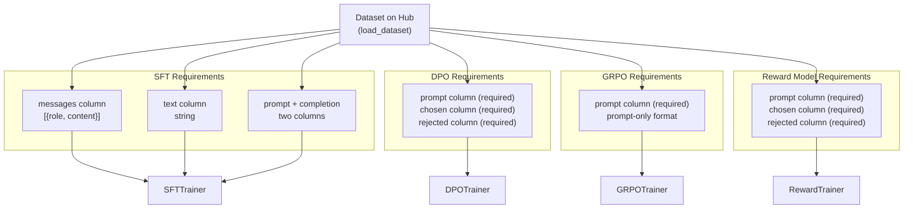
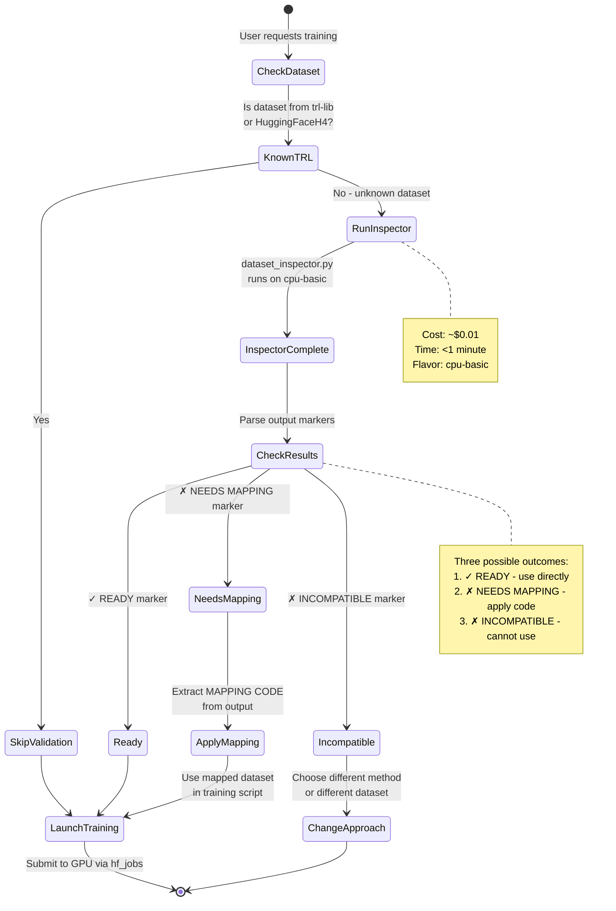
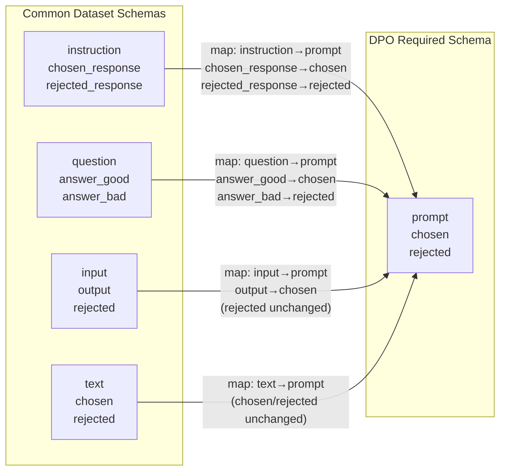

<!-- source: DeepWiki mcp.deepwiki.com · repo huggingface/skills · extra page Dataset Validation & Preparation · fetched 2026-10-30 -->

# Dataset Validation & Preparation

<details>
<summary>Relevant source files</summary>

The following files were used as context for generating this wiki page:

- [apps/quests/02_evaluate-hub-model.md](apps/quests/02_evaluate-hub-model.md)
- [apps/quests/03_publish-hub-dataset.md](apps/quests/03_publish-hub-dataset.md)
- [apps/quests/04_sft-finetune-hub.md](apps/quests/04_sft-finetune-hub.md)
- [apps/quests/README.md](apps/quests/README.md)
- [hf-llm-trainer/skills/model-trainer/SKILL.md](hf-llm-trainer/skills/model-trainer/SKILL.md)

</details>


This page covers dataset validation and preparation for training jobs in the Model Trainer skill. Dataset format mismatches are the leading cause of training failures (50%+), and validation prevents wasting GPU time and costs on incompatible data. This material applies specifically to preparing datasets for TRL training methods (SFT, DPO, GRPO) before submitting jobs to Hugging Face Jobs infrastructure.

For general information about the Model Trainer skill, see [#4.1](#4.1). For training method selection and detailed training workflows, see [#4.1.1](#4.1.1). For hardware selection and cost management, see [#4.1.2](#4.1.2).

## Purpose and Critical Importance

Dataset validation occurs **before** GPU training jobs to verify format compatibility with TRL trainers. Validation runs on CPU (`cpu-basic` flavor) and completes in under 1 minute at ~$0.01 cost. In contrast, discovering format issues during GPU training wastes 30-60 minutes and $1-10+ per failed job.

The primary goal is to detect format mismatches between dataset columns and TRL trainer requirements, particularly for DPO training where 90% of datasets require column name mapping.

Sources: [hf-llm-trainer/skills/model-trainer/SKILL.md:485-496]()

## Dataset Format Requirements by Training Method

Each TRL training method requires specific dataset column structures. Mismatches cause immediate training failures.



**Format Requirements Table:**

| Training Method | Required Columns | Format | Notes |
|----------------|------------------|--------|-------|
| **SFT** (SFTTrainer) | `messages` OR `text` OR `prompt`+`completion` | `messages`: list of dicts with `role` and `content`; `text`: string; `prompt`+`completion`: two strings | Most flexible - accepts multiple formats |
| **DPO** (DPOTrainer) | `prompt`, `chosen`, `rejected` | All must be strings or message lists | Strictest requirements - exact column names required |
| **GRPO** (GRPOTrainer) | `prompt` | String or message list | Prompt-only format for online RL |
| **Reward Modeling** (RewardTrainer) | `prompt`, `chosen`, `rejected` | Same as DPO | Used to train reward models for RLHF |

Sources: [hf-llm-trainer/skills/model-trainer/SKILL.md:70-75](), [hf-llm-trainer/skills/model-trainer/SKILL.md:485-562]()

## When to Validate

**ALWAYS validate for:**
- Unknown or custom datasets not from the TRL organization
- DPO training (critical - 90% of datasets need mapping)
- Any dataset not explicitly documented as TRL-compatible
- Datasets with non-standard column names

**Skip validation for known TRL datasets:**
- `trl-lib/ultrachat_200k`
- `trl-lib/Capybara`
- `HuggingFaceH4/ultrachat_200k`
- `HuggingFaceH4/no_robots`
- Other datasets in `trl-lib` or `HuggingFaceH4` organizations

Sources: [hf-llm-trainer/skills/model-trainer/SKILL.md:497-504]()

## Dataset Inspector Tool

The `dataset_inspector.py` script runs on Hugging Face Jobs to analyze dataset compatibility. It is hosted externally and invoked via the `hf_jobs()` MCP tool or CLI.

### Execution via hf_jobs() MCP Tool

```python
hf_jobs("uv", {
    "script": "https://huggingface.co/datasets/mcp-tools/skills/raw/main/dataset_inspector.py",
    "script_args": ["--dataset", "username/dataset-name", "--split", "train"]
})
```

### Execution via CLI

```bash
hf jobs uv run \
  --flavor cpu-basic \
  --timeout 5m \
  "https://huggingface.co/datasets/mcp-tools/skills/raw/main/dataset_inspector.py" \
  -- --dataset username/dataset-name --split train
```

The script typically completes synchronously (returns results immediately) due to fast execution on CPU.

Sources: [hf-llm-trainer/skills/model-trainer/SKILL.md:506-515](), [hf-llm-trainer/skills/model-trainer/SKILL.md:684]()

## Validation Workflow



**Complete Workflow Example:**

```python
# Step 1: Validate dataset (synchronous, returns immediately)
hf_jobs("uv", {
    "script": "https://huggingface.co/datasets/mcp-tools/skills/raw/main/dataset_inspector.py",
    "script_args": [
        "--dataset", "argilla/distilabel-math-preference-dpo",
        "--split", "train"
    ]
})

# Step 2: Read output - look for markers:
#   ✓ READY → proceed directly to training
#   ✗ NEEDS MAPPING → copy mapping code below
#   ✗ INCOMPATIBLE → choose different method/dataset

# Step 3: If NEEDS MAPPING, apply transformation
def format_for_dpo(example):
    return {
        'prompt': example['instruction'],
        'chosen': example['chosen_response'],
        'rejected': example['rejected_response'],
    }

# Step 4: Include mapping in training script
dataset = load_dataset("argilla/distilabel-math-preference-dpo", split="train")
dataset = dataset.map(format_for_dpo, remove_columns=dataset.column_names)

# Step 5: Launch training with confidence
trainer = DPOTrainer(
    model="model-name",
    train_dataset=dataset,
    # ... rest of config
)
```

Sources: [hf-llm-trainer/skills/model-trainer/SKILL.md:524-549]()

## Reading Validation Results

The dataset inspector outputs compatibility markers for each training method:

### Output Markers

| Marker | Meaning | Action Required |
|--------|---------|-----------------|
| **`✓ READY`** | Dataset is compatible with this method | Use dataset directly - no changes needed |
| **`✗ NEEDS MAPPING`** | Dataset has compatible data but wrong column names | Apply the mapping code provided in output |
| **`✗ INCOMPATIBLE`** | Dataset cannot be used with this method | Choose different training method or dataset |

### Output Structure

```
================================================================================
DATASET VALIDATION REPORT
Dataset: argilla/distilabel-math-preference-dpo
Split: train
================================================================================

COLUMN ANALYSIS:
- instruction (string)
- chosen_response (string)  
- rejected_response (string)

--------------------------------------------------------------------------------
COMPATIBILITY RESULTS:
--------------------------------------------------------------------------------

SFT (Supervised Fine-Tuning):
  ✗ NEEDS MAPPING
  Reason: No 'messages', 'text', or 'prompt'+'completion' columns found

DPO (Direct Preference Optimization):
  ✗ NEEDS MAPPING
  Reason: Has chosen/rejected data but columns named incorrectly
  
  MAPPING CODE:
  ```python
  def format_for_dpo(example):
      return {
          'prompt': example['instruction'],
          'chosen': example['chosen_response'],
          'rejected': example['rejected_response'],
      }
  dataset = dataset.map(format_for_dpo, remove_columns=dataset.column_names)
  ```

GRPO (Group Relative Policy Optimization):
  ✗ INCOMPATIBLE
  Reason: No 'prompt' column found

Reward Modeling:
  ✗ NEEDS MAPPING
  Reason: Same as DPO - use same mapping code
```

The **MAPPING CODE** section provides copy-paste ready Python code to fix format mismatches.

Sources: [hf-llm-trainer/skills/model-trainer/SKILL.md:517-523]()

## Common Format Mismatches



### DPO Format Mismatch (Most Common)

**Problem:** DPO requires exact column names (`prompt`, `chosen`, `rejected`), but most datasets use descriptive names like `instruction`, `chosen_response`, `rejected_response`.

**Detection:** Inspector output shows `✗ NEEDS MAPPING` for DPO with column name details.

**Fix Pattern:**

```python
# Generic mapping template
def format_for_dpo(example):
    return {
        'prompt': example['<original_prompt_column>'],
        'chosen': example['<original_chosen_column>'],
        'rejected': example['<original_rejected_column>'],
    }

dataset = dataset.map(format_for_dpo, remove_columns=dataset.column_names)
```

**Real Example:**

```python
# Dataset: argilla/distilabel-math-preference-dpo
# Has: instruction, chosen_response, rejected_response
# Needs: prompt, chosen, rejected

def format_for_dpo(example):
    return {
        'prompt': example['instruction'],
        'chosen': example['chosen_response'],
        'rejected': example['rejected_response'],
    }

dataset = load_dataset("argilla/distilabel-math-preference-dpo", split="train")
dataset = dataset.map(format_for_dpo, remove_columns=dataset.column_names)

# Now ready for DPOTrainer
trainer = DPOTrainer(
    model="Qwen/Qwen2.5-0.5B",
    train_dataset=dataset,
    # ...
)
```

Sources: [hf-llm-trainer/skills/model-trainer/SKILL.md:551-562]()

### SFT Format Options

SFT is the most flexible - it accepts multiple formats:

**Option 1: Messages Format (Recommended for Chat)**
```python
# Dataset with 'messages' column
# Each example: {"messages": [{"role": "user", "content": "..."}, {"role": "assistant", "content": "..."}]}
dataset = load_dataset("HuggingFaceH4/no_robots", split="train")
# Ready for SFTTrainer - no mapping needed
```

**Option 2: Text Format (Simple Completions)**
```python
# Dataset with 'text' column
# Each example: {"text": "User: ...\nAssistant: ..."}
dataset = load_dataset("trl-lib/Capybara", split="train")
# Ready for SFTTrainer - no mapping needed
```

**Option 3: Prompt-Completion Format**
```python
# Dataset with 'prompt' and 'completion' columns
# Each example: {"prompt": "User question", "completion": "Assistant response"}
# If dataset has these exact names, ready for SFTTrainer
# If different names, map them:
def format_for_sft(example):
    return {
        'prompt': example['input'],
        'completion': example['output'],
    }
dataset = dataset.map(format_for_sft)
```

Sources: [hf-llm-trainer/skills/model-trainer/SKILL.md:70-75]()

### GRPO Prompt-Only Format

GRPO only needs prompts (no completions):

```python
# Dataset must have 'prompt' column
# If dataset has different column name:
def format_for_grpo(example):
    return {'prompt': example['question']}

dataset = dataset.map(format_for_grpo, remove_columns=dataset.column_names)
```

Sources: [hf-llm-trainer/skills/model-trainer/SKILL.md:70-75]()

## Dataset Size Considerations

Dataset size must match hardware capabilities. Validation does not check size, but size mismatches cause OOM (Out of Memory) failures.

| Hardware Flavor | Recommended Dataset Size | Use Case |
|----------------|-------------------------|----------|
| `t4-small` | 50-100 examples | Quick demos only (no eval dataset) |
| `t4-medium` | 100-500 examples | Small experiments |
| `l4x1` | 500-1,000 examples | Development |
| `a10g-small` | 1,000-5,000 examples | Small production |
| `a10g-large` | 5,000-10,000+ examples | Production training |
| `a100-large` | 10,000+ examples | Large-scale training |

**Demo Tip:** For quick demos on `t4-small`, omit `eval_dataset` and `eval_strategy` parameters to save ~40% memory. Training will still show loss metrics and learning progress.

Sources: [hf-llm-trainer/skills/model-trainer/SKILL.md:70-75](), [hf-llm-trainer/skills/model-trainer/SKILL.md:120-122]()

## Dataset Preparation Integration in Training Scripts

Dataset validation and mapping code integrates directly into training scripts submitted to `hf_jobs()`:

```python
# Complete training script with dataset validation and mapping
hf_jobs("uv", {
    "script": """
# /// script
# dependencies = ["trl>=0.12.0", "peft>=0.7.0", "trackio", "datasets"]
# ///

from datasets import load_dataset
from peft import LoraConfig
from trl import DPOTrainer, DPOConfig
import trackio

# Load dataset
dataset = load_dataset("argilla/distilabel-math-preference-dpo", split="train")

# Apply mapping (from validation output)
def format_for_dpo(example):
    return {
        'prompt': example['instruction'],
        'chosen': example['chosen_response'],
        'rejected': example['rejected_response'],
    }

dataset = dataset.map(format_for_dpo, remove_columns=dataset.column_names)

# Split for training and evaluation
dataset_split = dataset.train_test_split(test_size=0.1, seed=42)

# Configure and train
trainer = DPOTrainer(
    model="Qwen/Qwen2.5-0.5B",
    train_dataset=dataset_split["train"],
    eval_dataset=dataset_split["test"],
    peft_config=LoraConfig(r=16, lora_alpha=32),
    args=DPOConfig(
        output_dir="my-dpo-model",
        push_to_hub=True,
        hub_model_id="username/my-dpo-model",
        num_train_epochs=3,
        eval_strategy="steps",
        eval_steps=50,
        report_to="trackio",
        project="dpo_training",
        run_name="dpo_math_dataset",
    )
)

trainer.train()
trainer.push_to_hub()
""",
    "flavor": "a10g-large",
    "timeout": "2h",
    "secrets": {"HF_TOKEN": "$HF_TOKEN"}
})
```

The mapping function is applied immediately after loading and before train/test splitting.

Sources: [hf-llm-trainer/skills/model-trainer/SKILL.md:524-549]()

## Troubleshooting Dataset Format Failures

If training fails despite validation, check these common issues:

### Dataset Not Found

**Error:** `FileNotFoundError` or `DatasetNotFoundError`

**Fix:**
- Verify dataset exists on Hub: visit `https://huggingface.co/datasets/username/dataset-name`
- Check spelling of `dataset_name` parameter
- Ensure dataset is public or HF_TOKEN has access to private datasets

### Column Name Typos in Mapping

**Error:** `KeyError: 'column_name'`

**Fix:**
- Verify exact column names from inspector output
- Check for case sensitivity (`Prompt` vs `prompt`)
- Ensure mapping function uses correct source column names

### Missing Columns After Mapping

**Error:** `ValueError: Dataset must contain columns: ['prompt', 'chosen', 'rejected']`

**Fix:**
- Ensure mapping function returns all required columns
- Verify no typos in target column names (must be exact: `prompt`, `chosen`, `rejected`)
- Check that `remove_columns` parameter preserves needed columns

### Dataset Too Large for Memory

**Error:** `OutOfMemoryError` during dataset loading

**Fix:**
- Use streaming mode: `load_dataset(..., streaming=True)`
- Select subset: `dataset.select(range(1000))` for testing
- Use larger hardware flavor (see Dataset Size Considerations table above)

Sources: [hf-llm-trainer/skills/model-trainer/SKILL.md:614-622](), [hf-llm-trainer/skills/model-trainer/SKILL.md:654-662]()

## Summary

Dataset validation prevents the majority of training failures by detecting format incompatibilities before GPU time is consumed. The workflow is:

1. **Validate** unknown datasets with `dataset_inspector.py` on CPU (~$0.01, <1 min)
2. **Read markers** in output: `✓ READY`, `✗ NEEDS MAPPING`, or `✗ INCOMPATIBLE`
3. **Apply mapping** code provided in inspector output if needed
4. **Integrate mapping** into training script before launching GPU job
5. **Launch training** with confidence in format compatibility

DPO training requires special attention as 90% of datasets need column name mapping. SFT is most flexible and accepts multiple format variations. GRPO and Reward Modeling have specific requirements similar to DPO.

Sources: [hf-llm-trainer/skills/model-trainer/SKILL.md:485-562]()

---

