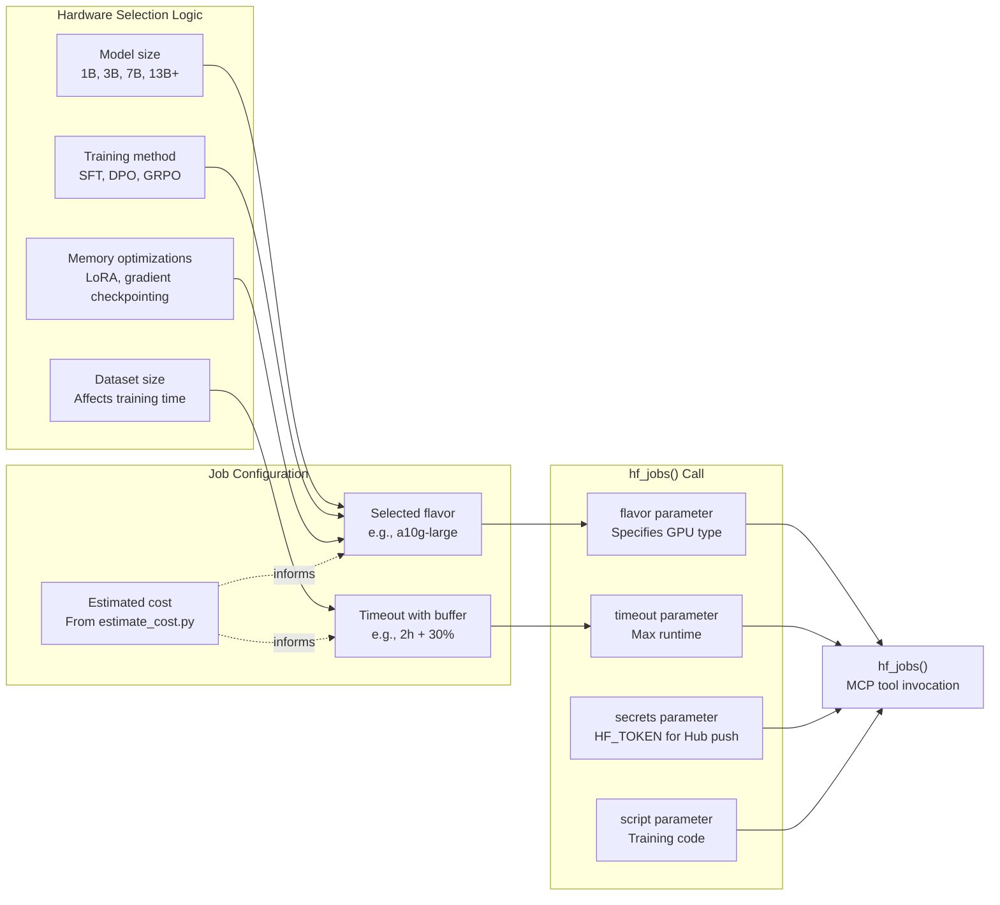
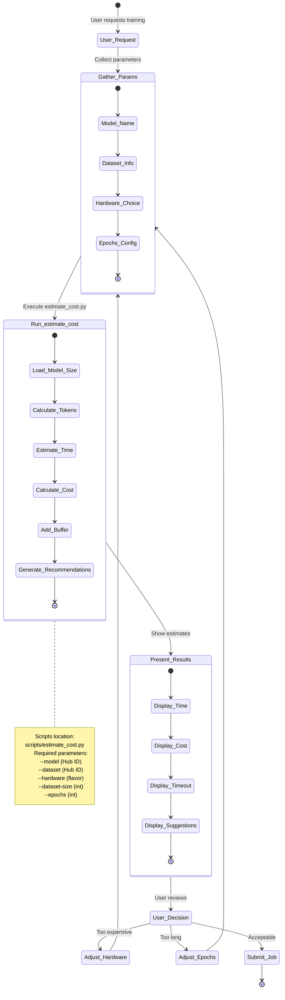
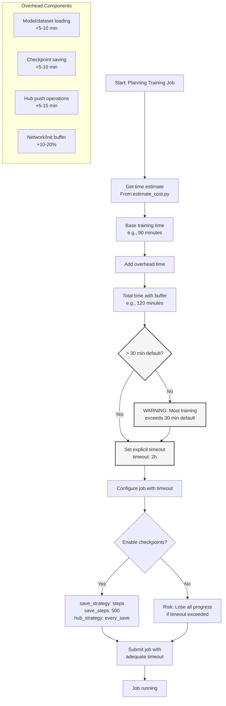
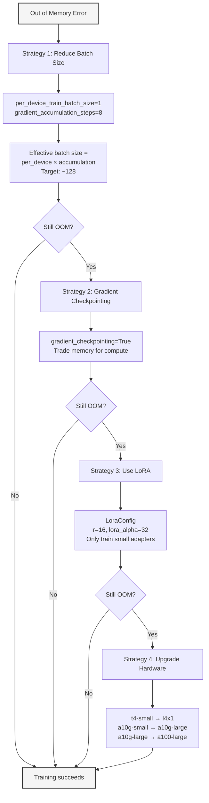
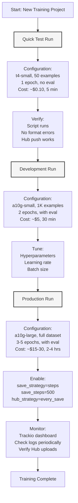
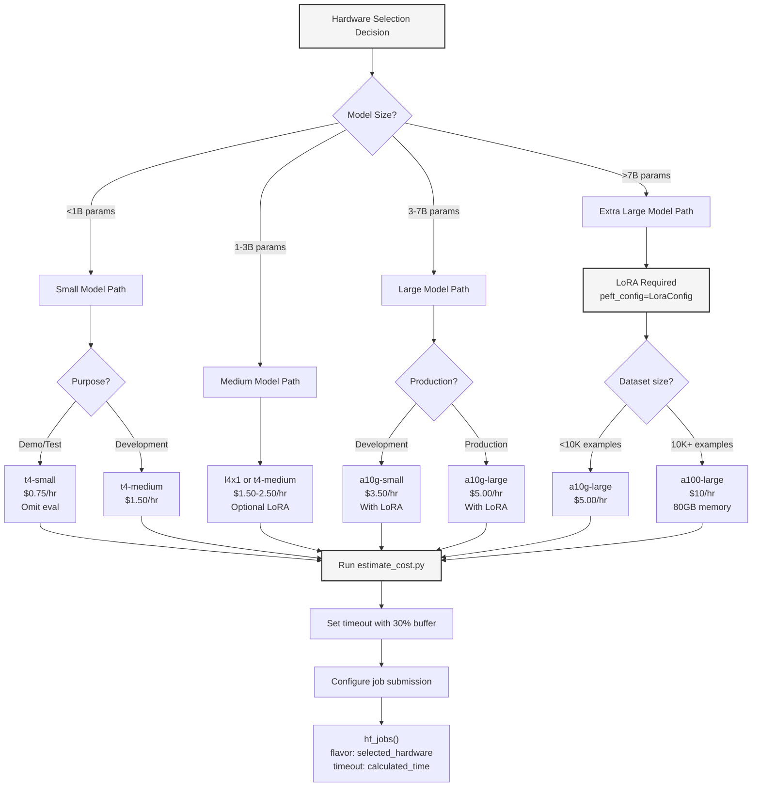

<!-- source: DeepWiki mcp.deepwiki.com · repo huggingface/skills · extra page Hardware Selection & Cost Management · fetched 2026-10-30 -->

# Hardware Selection & Cost Management

<details>
<summary>Relevant source files</summary>

The following files were used as context for generating this wiki page:

- [hf-llm-trainer/skills/model-trainer/SKILL.md](hf-llm-trainer/skills/model-trainer/SKILL.md)

</details>


This page explains how to select appropriate GPU hardware for training jobs on Hugging Face Jobs infrastructure, estimate costs, and manage resource allocation effectively. It covers GPU flavor selection, cost estimation tools, timeout configuration, and memory optimization strategies.

For information about training methods and when to use each, see [Training Methods](#4.1.1). For dataset format requirements, see [Dataset Validation & Preparation](#4.1.3).

## Purpose and Scope

Hardware selection and cost management are critical for efficient training on cloud GPU infrastructure. This guide covers:

- **GPU Flavor Selection**: Matching model size to appropriate hardware
- **Cost Estimation**: Using `estimate_cost.py` to predict job costs
- **Timeout Configuration**: Preventing premature job termination
- **Memory Optimization**: Strategies to reduce GPU memory usage
- **Cost Control**: Balancing performance and budget constraints

The Hugging Face Jobs infrastructure provides multiple GPU tiers with hourly pricing. Selecting the wrong hardware leads to failed jobs (out of memory) or unnecessary costs (oversized hardware).

Sources: [hf-llm-trainer/skills/model-trainer/SKILL.md:337-354]()

## GPU Hardware Flavors

The Jobs infrastructure provides multiple GPU flavors with different compute capabilities, memory sizes, and pricing tiers. Hardware selection depends primarily on model size and training method.

### Available GPU Flavors

```mermaid
graph TB
    subgraph CPU_Tier["CPU Tier"]
        CPU_BASIC["cpu-basic<br/>Low cost, testing only"]
        CPU_UPGRADE["cpu-upgrade<br/>Development tasks"]
        CPU_PERF["cpu-performance<br/>Data processing"]
        CPU_XL["cpu-xl<br/>Large dataset prep"]
    end
    
    subgraph Entry_GPU["Entry GPU Tier"]
        T4_SMALL["t4-small<br/>16GB, ~$0.75/hr<br/><1B params demos"]
        T4_MEDIUM["t4-medium<br/>16GB, ~$1.50/hr<br/>1-3B params dev"]
    end
    
    subgraph Mid_GPU["Mid-Tier GPU"]
        L4X1["l4x1<br/>24GB, ~$2.50/hr<br/>1-3B params"]
        A10G_SMALL["a10g-small<br/>24GB, ~$3.50/hr<br/>3-7B params"]
        A10G_LARGE["a10g-large<br/>24GB, ~$5.00/hr<br/>3-7B params production"]
    end
    
    subgraph High_GPU["High-Performance GPU"]
        A100_LARGE["a100-large<br/>80GB, ~$10/hr<br/>7-13B params with LoRA"]
        A10G_X2["a10g-largex2<br/>48GB, ~$10/hr<br/>Multi-GPU 7-13B"]
        A10G_X4["a10g-largex4<br/>96GB, ~$20/hr<br/>Multi-GPU 13B+"]
    end
    
    subgraph Premium_GPU["Premium GPU Tier"]
        H100["h100<br/>80GB, high cost<br/>Large scale training"]
        H100X8["h100x8<br/>640GB, very high cost<br/>Distributed training"]
        L4X4["l4x4<br/>96GB<br/>Multi-GPU workloads"]
    end
    
    CPU_Tier -.upgrade.-> Entry_GPU
    Entry_GPU -.more memory/speed.-> Mid_GPU
    Mid_GPU -.more memory/speed.-> High_GPU
    High_GPU -.maximum performance.-> Premium_GPU
    
    style T4_SMALL fill:#f5f5f5,stroke:#333,stroke-width:2px
    style A10G_LARGE fill:#f5f5f5,stroke:#333,stroke-width:2px
    style A100_LARGE fill:#f5f5f5,stroke:#333,stroke-width:2px
```



**Hardware Selection Decision Tree**

Sources: [hf-llm-trainer/skills/model-trainer/SKILL.md:337-348]()

### Model Size to Hardware Mapping

| Model Size | Recommended Hardware | Cost (approx/hr) | Use Case |
|------------|---------------------|------------------|----------|
| <1B params | `t4-small` | ~$0.75 | Demos, quick tests (omit eval) |
| 1-3B params | `t4-medium`, `l4x1` | ~$1.50-2.50 | Development |
| 3-7B params | `a10g-small`, `a10g-large` | ~$3.50-5.00 | Production training |
| 7-13B params | `a10g-large`, `a100-large` | ~$5-10 | Large models (use LoRA) |
| 13B+ params | `a100-large`, `a10g-largex2` | ~$10-20 | Very large (use LoRA) |

**Key Guidelines:**
- Use **LoRA/PEFT** for models >7B to reduce memory requirements
- Multi-GPU configurations (e.g., `a10g-largex2`, `l4x4`) automatically use distributed training via TRL/Accelerate
- Start with smaller hardware for testing, then scale up for production
- For demos on `t4-small`, omit `eval_dataset` and `eval_strategy` to save ~40% memory

Sources: [hf-llm-trainer/skills/model-trainer/SKILL.md:339-353]()

### Hardware Configuration in Job Submissions



**Job Submission Hardware Configuration Flow**

The `flavor` parameter in `hf_jobs()` determines GPU hardware. Example:

```python
hf_jobs("uv", {
    "script": "...",
    "flavor": "a10g-large",      # Hardware selection
    "timeout": "2h",              # Runtime limit
    "secrets": {"HF_TOKEN": "$HF_TOKEN"}
})
```

Sources: [hf-llm-trainer/skills/model-trainer/SKILL.md:149-191](), [hf-llm-trainer/skills/model-trainer/SKILL.md:187-190]()

## Cost Estimation

The `estimate_cost.py` script provides pre-training cost estimates based on model size, dataset size, hardware selection, and training epochs. This prevents budget surprises and helps select appropriate hardware.

### Using estimate_cost.py

```bash
python scripts/estimate_cost.py \
  --model meta-llama/Llama-2-7b-hf \
  --dataset trl-lib/Capybara \
  --hardware a10g-large \
  --dataset-size 16000 \
  --epochs 3
```

**Output includes:**
- Estimated training time
- Total cost estimate
- Recommended timeout (with 20-30% buffer)
- Optimization suggestions

**When to offer cost estimation:**
- User is planning a training job
- User explicitly asks about cost or time
- User is choosing hardware
- Job will run >1 hour or cost >$5

Sources: [hf-llm-trainer/skills/model-trainer/SKILL.md:416-430]()

### Cost Estimation Workflow



**Cost Estimation Process Flow**

Sources: [hf-llm-trainer/skills/model-trainer/SKILL.md:416-430]()

### Cost Components

Training costs on Hugging Face Jobs are calculated based on:

1. **GPU Time**: Hardware flavor hourly rate × actual runtime
2. **Storage**: Model checkpoints and logs (typically negligible)
3. **Network Transfer**: Hub uploads/downloads (included)

**Cost Factors:**

| Factor | Impact | Control |
|--------|--------|---------|
| Hardware flavor | Direct multiplier | Choose appropriate tier |
| Training time | Linear cost scaling | Reduce epochs, dataset size |
| Checkpoint frequency | Minor (storage) | Use `save_strategy` wisely |
| Timeout buffer | Safety margin | Add 20-30% to estimate |

**Example Cost Calculation:**

```
Model: Llama-2-7B (7B params)
Dataset: 16,000 examples
Hardware: a10g-large ($5/hr)
Epochs: 3
Estimated time: 2 hours
Buffer: 30% → 2.6 hours
Total cost: $5/hr × 2.6hr = $13.00
```

Sources: [hf-llm-trainer/skills/model-trainer/SKILL.md:339-345]()

## Timeout Management

Timeouts prevent runaway jobs but must be set appropriately to avoid losing training progress. The default 30-minute timeout is insufficient for most training workloads.

### Timeout Configuration

Timeouts are specified in the job submission:

```python
{
    "timeout": "2h"   # Formats: "90m", "2h", "1.5h", or integer seconds
}
```

**Default Warning:** The default timeout is 30 minutes, which is **too short** for real training. Always specify explicit timeouts.

Sources: [hf-llm-trainer/skills/model-trainer/SKILL.md:391-413]()

### Timeout Guidelines

| Scenario | Recommended Timeout | Notes |
|----------|-------------------|-------|
| Quick demo (50-100 examples) | 10-30 min | Verify setup only |
| Development training | 1-2 hours | Small datasets |
| Production (3-7B model) | 4-6 hours | Full datasets |
| Large model with LoRA | 3-6 hours | Depends on dataset size |

**Critical Rules:**

1. **Always add 20-30% buffer** to account for:
   - Model and dataset loading time
   - Checkpoint saving operations
   - Hub push operations
   - Network delays and initialization

2. **On timeout:** Job is killed immediately, all unsaved progress is lost, and training must restart from beginning

3. **Checkpoint strategy:** Use `save_strategy="steps"` with `save_steps=500` and `hub_strategy="every_save"` to recover from timeouts

Sources: [hf-llm-trainer/skills/model-trainer/SKILL.md:402-413]()

### Timeout Decision Flow



**Timeout Calculation and Configuration Process**

Sources: [hf-llm-trainer/skills/model-trainer/SKILL.md:391-413](), [hf-llm-trainer/skills/model-trainer/SKILL.md:630-632]()

## Memory Optimization Strategies

When training fails with Out of Memory (OOM) errors, several strategies can reduce GPU memory usage without changing hardware.

### OOM Mitigation Hierarchy



**Out of Memory Resolution Strategy Flow**

Sources: [hf-llm-trainer/skills/model-trainer/SKILL.md:607-613]()

### Strategy 1: Batch Size Reduction

Reduce `per_device_train_batch_size` and increase `gradient_accumulation_steps` to maintain effective batch size while reducing memory:

```python
SFTConfig(
    per_device_train_batch_size=1,      # Minimal batch per device
    gradient_accumulation_steps=8,       # Accumulate 8 steps
    # Effective batch = 1 × 8 = 8 per device
)
```

**Key Concept:** Effective batch size = `per_device_train_batch_size` × `gradient_accumulation_steps` × `num_devices`

**Target:** Keep effective batch size close to 128 for optimal performance

Sources: [hf-llm-trainer/skills/model-trainer/SKILL.md:610-611]()

### Strategy 2: Gradient Checkpointing

Trade computation time for memory by recomputing activations during backward pass:

```python
SFTConfig(
    gradient_checkpointing=True,    # Enable memory-compute tradeoff
)
```

**Impact:** Reduces memory by ~30-40% at cost of ~20% slower training

Sources: [hf-llm-trainer/skills/model-trainer/SKILL.md:612]()

### Strategy 3: LoRA/PEFT

Use Low-Rank Adaptation to train only small adapter layers instead of full model:

```python
from peft import LoraConfig

peft_config = LoraConfig(
    r=16,                    # Rank (lower = less memory)
    lora_alpha=32,          # Scaling factor
)

trainer = SFTTrainer(
    model="Qwen/Qwen2.5-7B",
    peft_config=peft_config,    # Only train adapters
    ...
)
```

**Impact:** Reduces memory by 50-70% for models >7B parameters

**Recommendation:** Always use LoRA for models >7B parameters

Sources: [hf-llm-trainer/skills/model-trainer/SKILL.md:170](), [hf-llm-trainer/skills/model-trainer/SKILL.md:349-350]()

### Strategy 4: Hardware Upgrade

When optimization strategies are exhausted, upgrade to larger GPU:

```
Upgrade Path:
t4-small (16GB) → l4x1 (24GB)
a10g-small (24GB) → a10g-large (24GB, faster)
a10g-large → a100-large (80GB)
a100-large → h100 (80GB, faster)
```

Sources: [hf-llm-trainer/skills/model-trainer/SKILL.md:613]()

## Cost Optimization Strategies

Beyond hardware selection, several strategies reduce training costs without sacrificing model quality.

### Optimization Techniques

| Technique | Cost Reduction | Quality Impact | When to Use |
|-----------|---------------|----------------|-------------|
| Start with smaller hardware | 50-70% | None (testing only) | Initial development |
| Use LoRA instead of full fine-tune | 30-50% | Minimal (0-2% accuracy) | Models >7B params |
| Reduce epochs | Linear scaling | Check eval metrics | If overfitting |
| Downsample dataset | Linear scaling | Depends on size | Large datasets |
| Omit eval during training | 40% memory saved | None (eval after) | Demos on small GPUs |
| Use checkpoint resumption | Avoid waste | None | Long training jobs |

Sources: [hf-llm-trainer/skills/model-trainer/SKILL.md:121](), [hf-llm-trainer/skills/model-trainer/SKILL.md:349-350]()

### Cost-Effective Development Workflow



**Iterative Development Approach to Minimize Costs**

**Rationale:** Catch errors early on cheap hardware before committing to expensive production runs.

Sources: [hf-llm-trainer/skills/model-trainer/SKILL.md:121](), [hf-llm-trainer/skills/model-trainer/SKILL.md:339-345]()

## Common Hardware Selection Scenarios

### Scenario 1: Demo/Testing

**Requirements:** Verify script runs, test Hub push, check format compatibility

**Configuration:**
- Hardware: `t4-small` (~$0.75/hr)
- Dataset: 50-100 examples
- Epochs: 1
- Special: Omit `eval_dataset` and `eval_strategy` to save ~40% memory
- Timeout: 10-30 minutes
- Cost: ~$0.10-0.40

Sources: [hf-llm-trainer/skills/model-trainer/SKILL.md:341](), [hf-llm-trainer/skills/model-trainer/SKILL.md:121]()

### Scenario 2: Development Training (1-3B Model)

**Requirements:** Hyperparameter tuning, method validation

**Configuration:**
- Hardware: `t4-medium` or `l4x1` (~$1.50-2.50/hr)
- Dataset: 1,000-5,000 examples
- Epochs: 2-3
- LoRA: Optional
- Timeout: 1-2 hours
- Cost: ~$2-5

Sources: [hf-llm-trainer/skills/model-trainer/SKILL.md:342](), [hf-llm-trainer/skills/model-trainer/SKILL.md:406]()

### Scenario 3: Production Training (3-7B Model)

**Requirements:** Full dataset, publication-ready results

**Configuration:**
- Hardware: `a10g-large` (~$5/hr)
- Dataset: 10,000-50,000 examples
- Epochs: 3-5
- LoRA: Recommended
- Timeout: 4-6 hours
- Checkpoints: Enabled
- Cost: ~$20-30

Sources: [hf-llm-trainer/skills/model-trainer/SKILL.md:343](), [hf-llm-trainer/skills/model-trainer/SKILL.md:407]()

### Scenario 4: Large Model Training (7-13B Model)

**Requirements:** Large model fine-tuning with LoRA

**Configuration:**
- Hardware: `a100-large` (~$10/hr)
- Dataset: 10,000-50,000 examples
- Epochs: 3-5
- LoRA: **Required** (use `LoraConfig(r=16, lora_alpha=32)`)
- Timeout: 3-6 hours
- Checkpoints: Enabled with `hub_strategy="every_save"`
- Cost: ~$30-60

Sources: [hf-llm-trainer/skills/model-trainer/SKILL.md:344](), [hf-llm-trainer/skills/model-trainer/SKILL.md:408]()

## Hardware Selection Decision Support



**Complete Hardware Selection Decision Tree**

Sources: [hf-llm-trainer/skills/model-trainer/SKILL.md:337-354]()

## Integration with Job Submission

Hardware and cost parameters integrate directly into the `hf_jobs()` MCP tool call:

```python
hf_jobs("uv", {
    "script": """
    # /// script
    # dependencies = ["trl>=0.12.0", "peft>=0.7.0", "trackio"]
    # ///
    
    from trl import SFTTrainer, SFTConfig
    from peft import LoraConfig
    
    trainer = SFTTrainer(
        model="Qwen/Qwen2.5-7B",
        peft_config=LoraConfig(r=16, lora_alpha=32),  # Memory optimization
        args=SFTConfig(
            per_device_train_batch_size=1,      # Memory optimization
            gradient_accumulation_steps=8,       # Maintain effective batch
            gradient_checkpointing=True,         # Memory optimization
            push_to_hub=True,                    # Required for ephemeral env
            hub_model_id="username/my-model",
        )
    )
    trainer.train()
    """,
    "flavor": "a10g-large",              # Hardware selection
    "timeout": "4h",                     # With 30% buffer
    "secrets": {"HF_TOKEN": "$HF_TOKEN"}
})
```

**Key Parameters:**
- `flavor`: GPU hardware tier (see Hardware Selection table)
- `timeout`: Runtime limit with buffer (see Timeout Guidelines)
- `secrets`: Required for Hub push in ephemeral environment

Sources: [hf-llm-trainer/skills/model-trainer/SKILL.md:149-191](), [hf-llm-trainer/skills/model-trainer/SKILL.md:187-190]()

## Troubleshooting Cost and Hardware Issues

### Job Timeout Exceeded

**Problem:** Job terminates before training completes, all progress lost

**Diagnosis:**
```python
hf_jobs("logs", {"job_id": "your-job-id"})  # Check actual runtime
```

**Solutions:**
1. Increase timeout with 30% buffer: `"timeout": "3h"`
2. Reduce training: lower `num_train_epochs`, smaller dataset, or use `max_steps`
3. Enable checkpoints: `save_strategy="steps"`, `save_steps=500`, `hub_strategy="every_save"`

Sources: [hf-llm-trainer/skills/model-trainer/SKILL.md:625-633]()

### Out of Memory (OOM)

**Problem:** GPU runs out of memory during training

**Diagnosis:** Check error logs for "CUDA out of memory" or "OOM"

**Solutions (apply in order):**
1. Reduce batch size: `per_device_train_batch_size=1`, increase `gradient_accumulation_steps=8`
2. Enable gradient checkpointing: `gradient_checkpointing=True`
3. Use LoRA: Add `peft_config=LoraConfig(r=16, lora_alpha=32)`
4. Upgrade hardware: See hardware upgrade path

Sources: [hf-llm-trainer/skills/model-trainer/SKILL.md:607-613]()

### Unexpected High Costs

**Problem:** Job costs more than estimated

**Diagnosis:** Compare estimated vs. actual time in logs

**Solutions:**
1. Run `estimate_cost.py` before job submission
2. Start with smaller hardware for testing
3. Use smaller dataset sample for development
4. Enable checkpoints to avoid restarting failed jobs

Sources: [hf-llm-trainer/skills/model-trainer/SKILL.md:416-430]()

## Summary

Hardware selection and cost management are critical for efficient training on Hugging Face Jobs:

**Key Principles:**
1. Match hardware to model size (use table in Hardware Selection section)
2. Always use LoRA for models >7B parameters
3. Set explicit timeouts with 20-30% buffer (default 30min is insufficient)
4. Run `estimate_cost.py` for jobs >$5 or >1 hour
5. Iterate from small→large hardware to catch errors early

**Cost Optimization:**
- Start with smaller hardware for testing
- Use LoRA to reduce memory requirements
- Enable checkpoints for long jobs to avoid restart costs
- Omit eval on small GPUs for demos

**Memory Optimization:**
- Reduce batch size with gradient accumulation
- Enable gradient checkpointing
- Use LoRA/PEFT for large models
- Upgrade hardware only when optimizations exhausted

**Required Configuration:**
- `flavor`: Select from hardware table based on model size
- `timeout`: Add 30% buffer to estimated time
- `secrets={"HF_TOKEN": "$HF_TOKEN"}`: Required for Hub push

Sources: [hf-llm-trainer/skills/model-trainer/SKILL.md:337-354](), [hf-llm-trainer/skills/model-trainer/SKILL.md:391-413](), [hf-llm-trainer/skills/model-trainer/SKILL.md:416-430](), [hf-llm-trainer/skills/model-trainer/SKILL.md:607-613]()

---

