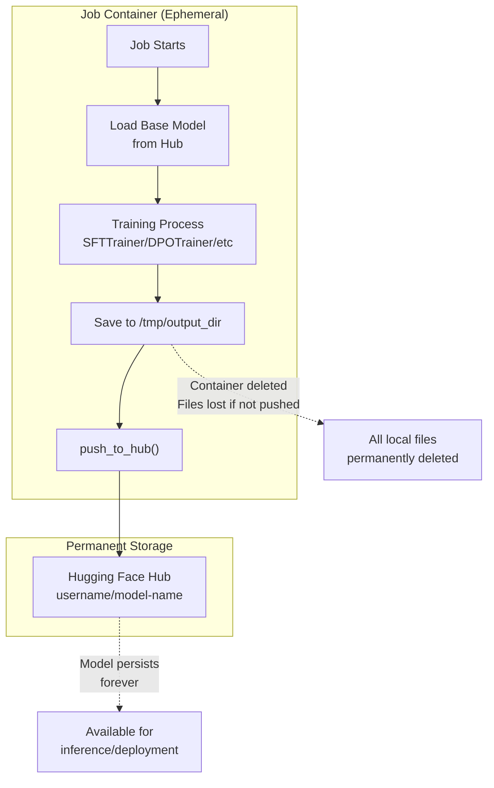
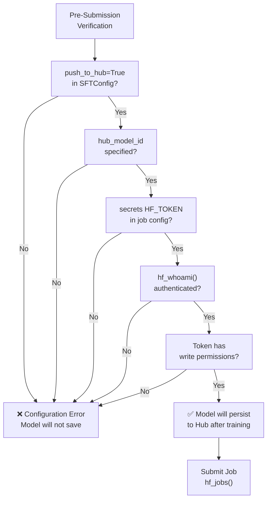
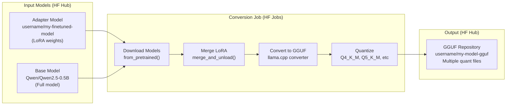
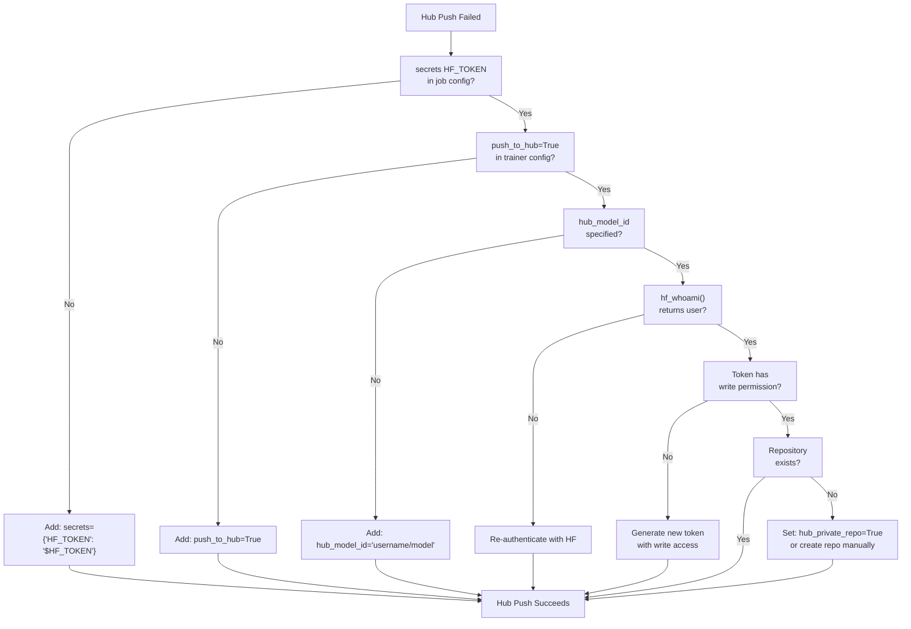

<!-- source: DeepWiki mcp.deepwiki.com · repo huggingface/skills · extra page Model Persistence & GGUF Conversion · fetched 2026-10-30 -->

# Model Persistence & GGUF Conversion

<details>
<summary>Relevant source files</summary>

The following files were used as context for generating this wiki page:

- [hf-llm-trainer/skills/model-trainer/SKILL.md](hf-llm-trainer/skills/model-trainer/SKILL.md)

</details>


## Purpose and Scope

This document covers two critical post-training operations in the Model Trainer skill: saving trained models to the Hugging Face Hub and converting them to GGUF format for local deployment. Model persistence is essential because Hugging Face Jobs runs in an ephemeral environment where all files are deleted when training completes. GGUF conversion enables deployment to local inference tools like Ollama, LM Studio, and llama.cpp.

For information about the training process itself, see [Training Methods](#4.1.1). For dataset preparation before training, see [Dataset Validation & Preparation](#4.1.3).

**Sources:** [hf-llm-trainer/skills/model-trainer/SKILL.md:1-4](), [hf-llm-trainer/skills/model-trainer/SKILL.md:356-388](), [hf-llm-trainer/skills/model-trainer/SKILL.md:563-594]()

---

## Model Persistence in Ephemeral Environments

### The Critical Problem

Hugging Face Jobs executes training in Docker containers that are **completely destroyed** after job completion. Any model weights, checkpoints, or training artifacts not pushed to the Hub are **permanently lost**. This is not a bug—it's the designed behavior of cloud training infrastructure.

**Sources:** [hf-llm-trainer/skills/model-trainer/SKILL.md:356-361]()

### Model Lifecycle in Jobs Environment



**Diagram: Model Training Lifecycle with Persistence Requirements**

The diagram shows that models saved locally in the container are destroyed unless `push_to_hub()` successfully uploads them to permanent Hub storage.

**Sources:** [hf-llm-trainer/skills/model-trainer/SKILL.md:356-361]()

---

## Required Configuration for Hub Persistence

### Trainer Configuration Parameters

All TRL trainer configuration classes (`SFTConfig`, `DPOConfig`, `GRPOConfig`, `RewardConfig`) require these parameters for Hub persistence:

| Parameter | Type | Required | Purpose |
|-----------|------|----------|---------|
| `push_to_hub` | `bool` | ✅ Yes | Enables automatic Hub upload |
| `hub_model_id` | `str` | ✅ Yes | Target repository (format: `"username/model-name"`) |
| `hub_strategy` | `str` | Optional | When to push (`"end"`, `"every_save"`, `"checkpoint"`) |
| `hub_private_repo` | `bool` | Optional | Create private repository if it doesn't exist |

**Example configuration:**

```python
from trl import SFTConfig, SFTTrainer

config = SFTConfig(
    output_dir="my-model",
    push_to_hub=True,
    hub_model_id="username/my-finetuned-llama",
    hub_strategy="every_save",  # Optional: push checkpoints during training
    save_strategy="steps",
    save_steps=500,
)

trainer = SFTTrainer(
    model="meta-llama/Llama-2-7b-hf",
    args=config,
    # ... other parameters
)

trainer.train()
trainer.push_to_hub()  # Final push after training
```

**Sources:** [hf-llm-trainer/skills/model-trainer/SKILL.md:364-371]()

### Job Submission Secrets

The training script requires write access to the Hub via an authentication token. This is configured in the job submission:

```python
hf_jobs("uv", {
    "script": "...",  # Training script content
    "flavor": "a10g-large",
    "secrets": {"HF_TOKEN": "$HF_TOKEN"}  # CRITICAL for Hub push
})
```

The `secrets` parameter makes the token available as an environment variable in the training container. The `$HF_TOKEN` syntax references the user's actual token value stored in their Hugging Face account.

**Sources:** [hf-llm-trainer/skills/model-trainer/SKILL.md:66-68](), [hf-llm-trainer/skills/model-trainer/SKILL.md:374-378]()

### Configuration Verification Flow



**Diagram: Pre-Submission Configuration Verification Checklist**

This verification flow prevents the most common failure mode: training completes successfully but the model is lost because Hub push wasn't properly configured.

**Sources:** [hf-llm-trainer/skills/model-trainer/SKILL.md:380-387]()

### Pre-Submission Checklist

Before submitting any training job, verify:

- [ ] `push_to_hub=True` is set in `SFTConfig`/`DPOConfig`/`GRPOConfig`
- [ ] `hub_model_id` includes both username and repository name (e.g., `"username/my-model"`)
- [ ] `secrets={"HF_TOKEN": "$HF_TOKEN"}` is included in job submission
- [ ] User is authenticated (check with `hf_whoami()` MCP tool)
- [ ] Token has write permissions to the target repository

**Sources:** [hf-llm-trainer/skills/model-trainer/SKILL.md:380-387]()

---

## GGUF Format and Local Deployment

### What is GGUF?

GGUF (GPT-Generated Unified Format) is a file format optimized for inference with llama.cpp and compatible tools. It provides:

- **CPU/GPU optimized inference** through llama.cpp engine
- **Quantization support** to reduce model size (4-bit, 5-bit, 8-bit, etc.)
- **Broad compatibility** with local deployment tools
- **Significant size reduction** (typically 2-8GB for 7B models vs 14GB unquantized)

**Compatible tools:**
- Ollama
- LM Studio  
- Jan
- GPT4All
- llama.cpp (command-line)

**Sources:** [hf-llm-trainer/skills/model-trainer/SKILL.md:563-572]()

### When to Convert to GGUF

GGUF conversion is appropriate for these deployment scenarios:

| Scenario | Why GGUF | Typical Quantization |
|----------|----------|---------------------|
| Local development | Run on laptop/workstation | Q4_K_M (4-bit) |
| Edge deployment | Deploy to resource-constrained devices | Q4_0 or Q5_0 |
| Ollama integration | Standard Ollama deployment format | Q4_K_M |
| LM Studio usage | Native format for LM Studio | Q4_K_M or Q5_K_M |
| Distribution to users | Smaller download size, easier setup | Q4_K_M |

**Not appropriate for:**
- Cloud API deployment (use original HuggingFace format)
- Training or fine-tuning (requires full precision)
- Production inference servers (use vLLM, TGI, or similar)

**Sources:** [hf-llm-trainer/skills/model-trainer/SKILL.md:573-578]()

### Quantization Options

Quantization reduces model size by using lower-precision numbers for weights:

| Quantization | Size (7B model) | Quality | Use Case |
|--------------|-----------------|---------|----------|
| `Q4_0` | ~3.5GB | Good | Maximum compression, acceptable quality |
| `Q4_K_M` | ~4.1GB | Better | **Recommended default** - best quality/size balance |
| `Q5_0` | ~4.3GB | Better | Slight quality improvement |
| `Q5_K_M` | ~4.8GB | Better | Higher quality, moderate size |
| `Q8_0` | ~7.2GB | Best | Near-original quality |
| `F16` | ~14GB | Perfect | Full half-precision (reference) |

**Common strategy:** Generate `Q4_K_M` by default, plus `Q5_K_M` for users wanting higher quality.

**Sources:** [hf-llm-trainer/skills/model-trainer/SKILL.md:563-580]() (quantization details are referenced in gguf_conversion.md)

---

## GGUF Conversion Process

### Conversion Pipeline Architecture



**Diagram: GGUF Conversion Pipeline from Trained Model to Quantized Files**

The conversion process handles LoRA adapter merging (if applicable), full-precision GGUF generation, and multiple quantization levels.

**Sources:** [hf-llm-trainer/skills/model-trainer/SKILL.md:581-594]()

### Conversion Script Execution

The skill provides a complete conversion script that runs on Hugging Face Jobs:

```python
hf_jobs("uv", {
    "script": "<see references/gguf_conversion.md for complete script>",
    "flavor": "a10g-large",
    "timeout": "45m",
    "secrets": {"HF_TOKEN": "$HF_TOKEN"},
    "env": {
        "ADAPTER_MODEL": "username/my-finetuned-model",  # Your trained model
        "BASE_MODEL": "Qwen/Qwen2.5-0.5B",              # Original base model
        "OUTPUT_REPO": "username/my-model-gguf",        # Where to save GGUF files
        "QUANTIZATIONS": "Q4_K_M,Q5_K_M,Q8_0"          # Optional: quant levels
    }
})
```

**Environment variables:**

| Variable | Purpose | Example |
|----------|---------|---------|
| `ADAPTER_MODEL` | Trained model with LoRA adapters | `"username/my-finetuned-llama"` |
| `BASE_MODEL` | Original base model before training | `"meta-llama/Llama-2-7b-hf"` |
| `OUTPUT_REPO` | Target repository for GGUF files | `"username/my-model-gguf"` |
| `QUANTIZATIONS` | Comma-separated quant types (optional) | `"Q4_K_M,Q5_K_M"` |

**Hardware requirements:**
- **Recommended:** `a10g-large` or `a100-large` (faster conversion)
- **Minimum:** `a10g-small` (slower but works)
- **Timeout:** 30-60 minutes depending on model size

**Sources:** [hf-llm-trainer/skills/model-trainer/SKILL.md:581-594]()

### Conversion Script Structure

The complete conversion script is available in the skill's references directory. Key operations:

1. **Load and merge models** (if using LoRA):
   ```python
   from peft import PeftModel
   from transformers import AutoModelForCausalLM
   
   base_model = AutoModelForCausalLM.from_pretrained(base_model_id)
   model = PeftModel.from_pretrained(base_model, adapter_model_id)
   merged = model.merge_and_unload()  # Merge LoRA weights
   ```

2. **Save merged model** to temporary directory:
   ```python
   merged.save_pretrained("./merged_model")
   tokenizer.save_pretrained("./merged_model")
   ```

3. **Convert to GGUF** using llama.cpp converter (bundled in script)

4. **Generate quantizations** for each specified level

5. **Upload to Hub** with proper naming convention

**Sources:** [hf-llm-trainer/skills/model-trainer/SKILL.md:581-594]() (script content referenced in references/gguf_conversion.md)

### Output Repository Structure

After conversion completes, the GGUF repository contains multiple quantized versions:

```
username/my-model-gguf/
├── README.md                          # Model card with usage instructions
├── my-model-Q4_K_M.gguf              # 4-bit quantization (~4GB for 7B)
├── my-model-Q5_K_M.gguf              # 5-bit quantization (~5GB for 7B)
├── my-model-Q8_0.gguf                # 8-bit quantization (~7GB for 7B)
└── my-model-F16.gguf                 # Full half-precision (~14GB for 7B)
```

Users can download the quantization level appropriate for their hardware and quality requirements.

**Sources:** [hf-llm-trainer/skills/model-trainer/SKILL.md:563-594]()

---

## Troubleshooting Hub Persistence

### Common Hub Push Failures



**Diagram: Hub Push Failure Diagnosis and Resolution Flow**

This diagnostic tree covers the most common causes of Hub push failures in order of likelihood.

**Sources:** [hf-llm-trainer/skills/model-trainer/SKILL.md:635-642]()

### Failure Mode Reference

| Symptom | Cause | Solution |
|---------|-------|----------|
| `Authentication failed` | Missing or invalid HF_TOKEN | Add `secrets={"HF_TOKEN": "$HF_TOKEN"}` to job config |
| `Repository not found` | `hub_model_id` doesn't exist | Set `hub_private_repo=True` or create repo manually |
| `Permission denied` | Token lacks write access | Generate new token with `write` permission |
| `No hub_model_id specified` | Missing configuration parameter | Add `hub_model_id="username/model-name"` to config |
| `push_to_hub disabled` | `push_to_hub=False` or unset | Set `push_to_hub=True` in `SFTConfig`/`DPOConfig`/etc |
| Job completes but no model | Hub push configuration entirely missing | Verify all requirements in checklist |

**Sources:** [hf-llm-trainer/skills/model-trainer/SKILL.md:635-642]()

### Verification Commands

Use these commands to diagnose Hub push issues:

```python
# Check authentication status
hf_whoami()

# Inspect job logs for Hub push errors
hf_jobs("logs", {"job_id": "your-job-id"})

# Check if model was successfully pushed
hub_repo_details(["username/model-name"], repo_type="model")
```

Look for these patterns in job logs:
- `✅ "Pushing model to hub..."` - Hub push initiated
- `✅ "Model successfully pushed"` - Upload completed
- `❌ "Authentication failed"` - Token issue
- `❌ "Repository not found"` - Model ID issue
- `❌ "Permission denied"` - Write access issue

**Sources:** [hf-llm-trainer/skills/model-trainer/SKILL.md:635-642]()

---

## Best Practices

### Model Persistence

1. **Always configure Hub push before training** - Verify checklist items before job submission
2. **Use checkpoint saving** - Set `save_strategy="steps"` and `hub_strategy="every_save"` for long-running jobs
3. **Test with short jobs first** - Verify Hub push works with a small dataset before full training
4. **Monitor push progress** - Check job logs to confirm successful upload

### GGUF Conversion

1. **Convert after training completes** - Ensure model is successfully pushed to Hub first
2. **Generate multiple quantizations** - Provide Q4_K_M (default) and Q5_K_M (higher quality) options
3. **Test locally before distributing** - Download and test GGUF files with Ollama/LM Studio
4. **Document quantization recommendations** - Include usage guidance in model card

**Sources:** [hf-llm-trainer/skills/model-trainer/SKILL.md:356-388](), [hf-llm-trainer/skills/model-trainer/SKILL.md:563-594]()

---

