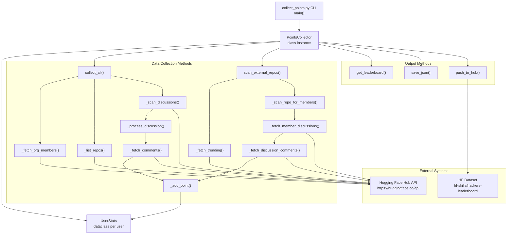
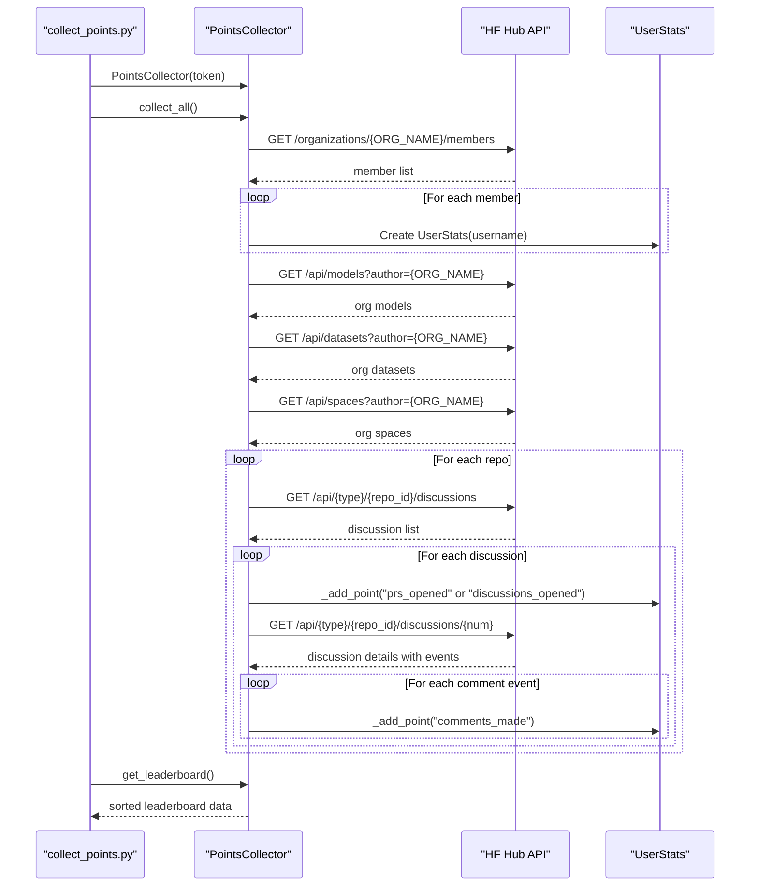
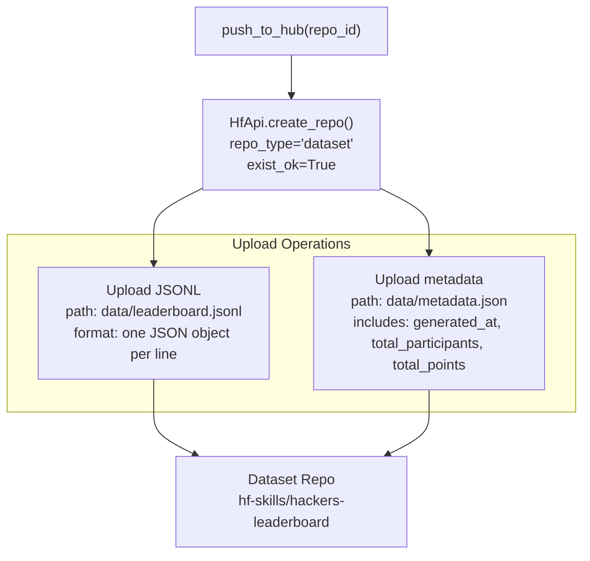

<!-- source: DeepWiki mcp.deepwiki.com · repo huggingface/skills · extra page Points Collection System · fetched 2026-10-30 -->

# Points Collection System

<details>
<summary>Relevant source files</summary>

The following files were used as context for generating this wiki page:

- [.github/workflows/push-evals-leaderboard.yml](.github/workflows/push-evals-leaderboard.yml)
- [.github/workflows/push-hackers-leaderboard.yml](.github/workflows/push-hackers-leaderboard.yml)
- [apps/hackers-leaderboard/README.md](apps/hackers-leaderboard/README.md)
- [apps/hackers-leaderboard/app.py](apps/hackers-leaderboard/app.py)
- [apps/hackers-leaderboard/collect_points.py](apps/hackers-leaderboard/collect_points.py)
- [apps/hackers-leaderboard/requirements.txt](apps/hackers-leaderboard/requirements.txt)

</details>


## Purpose and Scope

This document describes the points collection system that tracks engagement activity from members of the `hf-skills` organization on Hugging Face Hub. The system scans repositories, discussions, pull requests, and comments to calculate participation points for the Hackers Leaderboard.

For information about the Gradio web application that displays this data, see [Hackers Leaderboard](#5.2). For quest-specific point earning mechanics, see [Weekly Quests](#5.1).

## Overview

The points collection system is implemented in the `collect_points.py` script, which operates as a standalone command-line tool. It queries the Hugging Face Hub API to enumerate user activities across organization repositories and optionally scans trending external repositories for contributions by organization members.

**Sources:** [apps/hackers-leaderboard/collect_points.py:1-16](), [apps/hackers-leaderboard/README.md:14-26]()

## Core Architecture



**Sources:** [apps/hackers-leaderboard/collect_points.py:63-459]()

## Data Models

### UserStats Dataclass

The `UserStats` dataclass tracks all engagement metrics for a single user:

| Field | Type | Description |
|-------|------|-------------|
| `username` | `str` | Hugging Face username |
| `is_org_member` | `bool` | Whether user is in hf-skills org |
| `discussions_opened` | `int` | Count of discussions opened |
| `comments_made` | `int` | Count of comments posted |
| `prs_opened` | `int` | Count of pull requests opened |
| `repos_owned` | `int` | Count of repositories created |
| `activities` | `list[dict]` | Detailed activity log with timestamps |

The `total_points` property computes the sum of all point-earning activities.

**Sources:** [apps/hackers-leaderboard/collect_points.py:35-61]()

### Points Scoring

The system uses a simple, flat scoring model where **each activity earns exactly 1 point**:

| Activity Type | Points Awarded |
|--------------|----------------|
| Open a discussion | 1 |
| Post a comment | 1 |
| Open a pull request | 1 |
| Own/create a repository | 1 |

This scoring is implemented in the `total_points` property calculation and the `_add_point()` method.

**Sources:** [apps/hackers-leaderboard/README.md:18-26](), [apps/hackers-leaderboard/collect_points.py:47-49]()

## Collection Process Flow

### Organization Collection Mode



**Sources:** [apps/hackers-leaderboard/collect_points.py:106-141](), [apps/hackers-leaderboard/collect_points.py:300-362]()

### External Scanning Mode

When the `--scan-external` flag is provided, the collector performs additional scanning:

1. **Trending Repository Discovery**: Fetches trending repositories using `_fetch_trending()` for specified repo types (models, datasets, spaces)
2. **Member Activity Filtering**: For each trending repo, queries discussions filtered by author using the `author` query parameter
3. **Efficient API Usage**: Uses the author filter to avoid fetching all discussions and only retrieves those created by org members

```mermaid
graph LR
    Start["scan_external_repos()"] --> GetMembers["Get org_members set<br/>from user_stats keys"]
    GetMembers --> LoopTypes["Loop repo_types:<br/>models, datasets, spaces"]
    
    LoopTypes --> FetchTrending["_fetch_trending(repo_type)<br/>GET /api/{type}?sort=trendingScore"]
    FetchTrending --> FilterOrg["Filter out repos<br/>starting with hf-skills/"]
    
    FilterOrg --> LoopRepos["Loop trending repos"]
    LoopRepos --> LoopMembers["Loop org members"]
    
    LoopMembers --> FetchPRs["_fetch_member_discussions()<br/>type=pull_request, author=member"]
    LoopMembers --> FetchDisc["_fetch_member_discussions()<br/>type=discussion, author=member"]
    
    FetchPRs --> ProcessDiscussions["Process discussions<br/>_add_point() for each"]
    FetchDisc --> ProcessDiscussions
    
    ProcessDiscussions --> FetchComments["_fetch_discussion_comments()<br/>if numComments > 0"]
    FetchComments --> AddCommentPoints["_add_point('comments_made')<br/>for target_author"]
```



**Sources:** [apps/hackers-leaderboard/collect_points.py:143-214](), [apps/hackers-leaderboard/collect_points.py:215-286]()

## API Integration Details

### Endpoint Usage

The system interacts with several Hugging Face Hub API endpoints:

| Endpoint Pattern | Purpose | Method in Code |
|-----------------|---------|----------------|
| `/organizations/{org}/members` | Fetch org membership | `_fetch_org_members()` |
| `/api/models?author={org}` | List org models | `_list_repos("models")` |
| `/api/datasets?author={org}` | List org datasets | `_list_repos("datasets")` |
| `/api/spaces?author={org}` | List org spaces | `_list_repos("spaces")` |
| `/api/{type}/{repo_id}/discussions` | List discussions on repo | `_scan_discussions()` |
| `/api/{type}/{repo_id}/discussions/{num}` | Get discussion details | `_fetch_comments()` |
| `/api/{type}?sort=trendingScore` | Get trending repos | `_fetch_trending()` |
| `/api/{type}/{ns}/{repo}/discussions?author={user}&type={type}` | Filtered member discussions | `_fetch_member_discussions()` |

**Sources:** [apps/hackers-leaderboard/collect_points.py:80-105](), [apps/hackers-leaderboard/collect_points.py:177-189](), [apps/hackers-leaderboard/collect_points.py:215-286](), [apps/hackers-leaderboard/collect_points.py:287-362]()

### Configuration Constants

Key configuration values defined at module level:

```python
API_BASE = "https://huggingface.co/api"
ORG_NAME = "hf-skills"
USER_AGENT = "hf-skills-leaderboard/1.0"
DISCUSSION_LIMIT = 100  # Max discussions per repo
TRENDING_LIMIT = 50     # Trending repos to scan
```

**Sources:** [apps/hackers-leaderboard/collect_points.py:28-32]()

### Authentication

The collector uses an optional `HF_TOKEN` environment variable for authentication. When provided, the token is added to the session headers as `Authorization: Bearer {token}`. This increases rate limits and allows access to private resources.

**Sources:** [apps/hackers-leaderboard/collect_points.py:66-72](), [apps/hackers-leaderboard/collect_points.py:495-498]()

## Data Persistence

### Local JSON Output

The `save_json()` method writes leaderboard data to a local file with this structure:

```json
{
  "generated_at": "2025-01-15T10:30:00.000000+00:00",
  "organization": "hf-skills",
  "total_participants": 42,
  "leaderboard": [
    {
      "username": "user123",
      "is_org_member": true,
      "total_points": 15,
      "discussions_opened": 3,
      "comments_made": 8,
      "prs_opened": 2,
      "repos_owned": 2
    }
  ]
}
```

**Sources:** [apps/hackers-leaderboard/collect_points.py:398-409](), [apps/hackers-leaderboard/README.md:74-85]()

### Hugging Face Dataset Upload

The `push_to_hub()` method uploads leaderboard data to a Hugging Face dataset repository:



The JSONL format (one JSON object per line) is used for efficient dataset consumption by the Gradio app.

**Sources:** [apps/hackers-leaderboard/collect_points.py:411-459]()

## Command-Line Interface

### Basic Usage

```bash
# Collect org activity only
HF_TOKEN=$HF_TOKEN python collect_points.py

# Scan trending repos for member activity
HF_TOKEN=$HF_TOKEN python collect_points.py --scan-external

# Push results to Hub dataset
HF_TOKEN=$HF_TOKEN python collect_points.py --scan-external --push-to-hub
```

### Available Options

| Flag | Type | Default | Description |
|------|------|---------|-------------|
| `--push-to-hub` | flag | `False` | Upload results to HF dataset |
| `--output` | string | `leaderboard.json` | Local JSON output path |
| `--repo-id` | string | `hf-skills/hackers-leaderboard` | Target dataset repo ID |
| `--scan-external` | flag | `False` | Scan trending repos for member activity |
| `--repo-type` | list | all types | Filter external scan: `models`, `datasets`, `spaces` |

**Sources:** [apps/hackers-leaderboard/collect_points.py:461-493](), [apps/hackers-leaderboard/README.md:29-57]()

### Output Example

The script prints a formatted leaderboard to stdout:

```
==================================================
🏆 HACKERS LEADERBOARD
==================================================
 1. alice               -   42 points (💬5 📝20 🔀10 📦7)
 2. bob                 -   35 points (💬8 📝15 🔀8 📦4)
...
==================================================
Total participants: 87
Total points awarded: 1234
```

**Sources:** [apps/hackers-leaderboard/collect_points.py:506-525]()

## Dependencies

The collection system requires minimal dependencies:

- `requests` - HTTP client for Hub API calls
- `huggingface_hub` - Used for `HfApi` operations (org members, dataset upload)

The system gracefully degrades if `huggingface_hub` is not installed, using direct API calls as a fallback for organization member fetching.

**Sources:** [apps/hackers-leaderboard/requirements.txt:1-3](), [apps/hackers-leaderboard/collect_points.py:83-104]()

## Integration with Deployment Pipeline

The collection script is designed to run independently from the Gradio app deployment. A separate scheduled job (not shown in provided files) periodically runs `collect_points.py --push-to-hub` to update the dataset. The Gradio app then reads from this dataset.

The deployment workflow syncs the app code to Hugging Face Spaces when changes are detected:

**Sources:** [.github/workflows/push-hackers-leaderboard.yml:1-25]()

---

