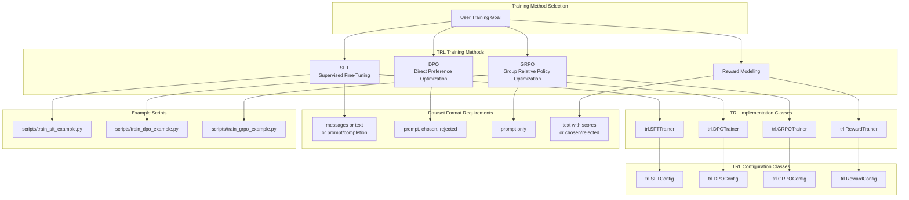
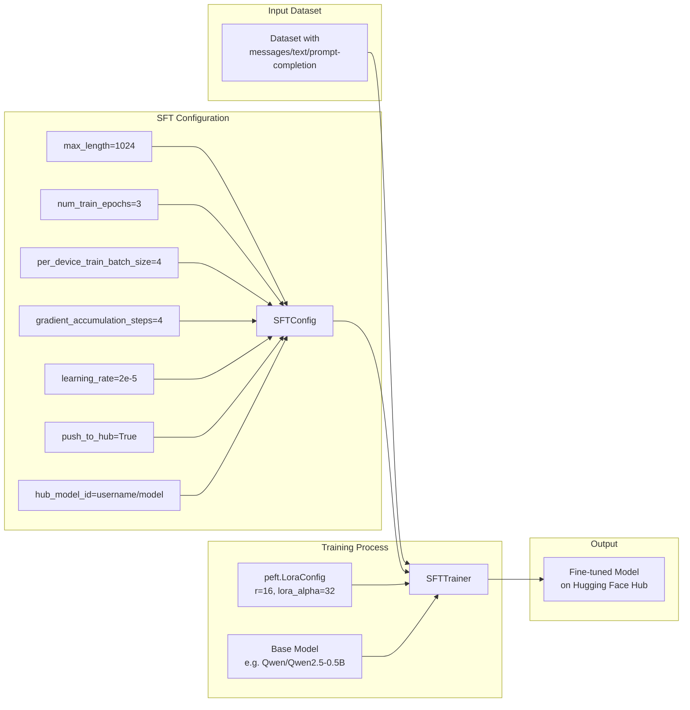
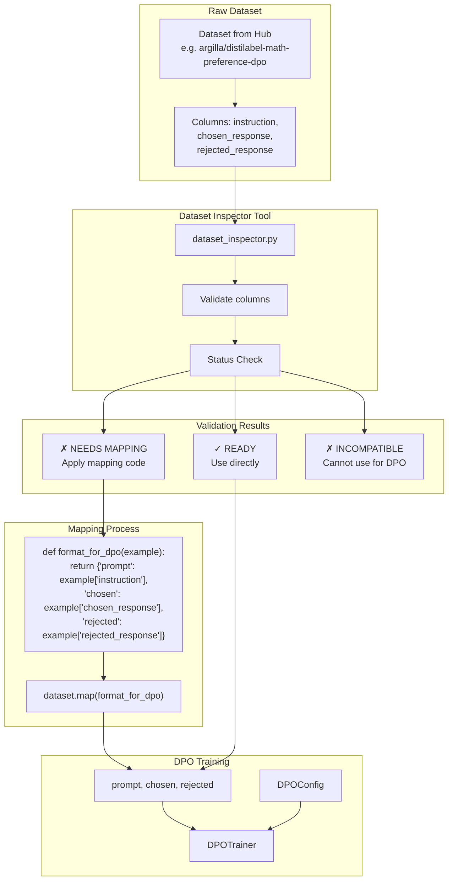
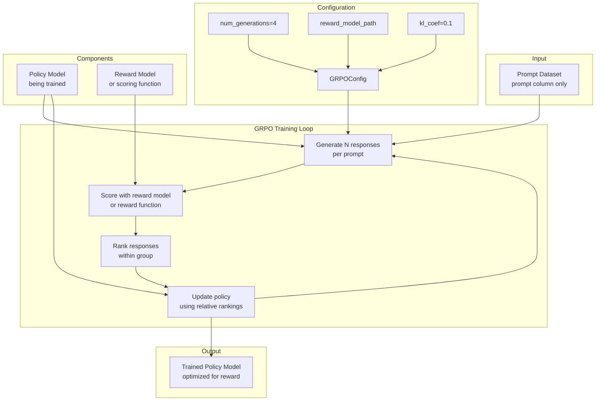
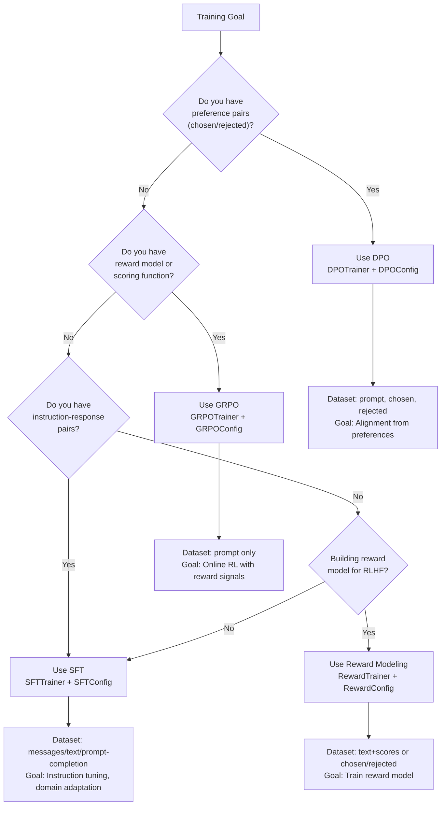

<!-- source: DeepWiki mcp.deepwiki.com · repo huggingface/skills · extra page Training Methods · fetched 2026-10-30 -->

# Training Methods

<details>
<summary>Relevant source files</summary>

The following files were used as context for generating this wiki page:

- [hf-llm-trainer/skills/model-trainer/SKILL.md](hf-llm-trainer/skills/model-trainer/SKILL.md)

</details>


## Purpose and Scope

This document provides detailed technical specifications for the four training methods supported by the model-trainer skill: Supervised Fine-Tuning (SFT), Direct Preference Optimization (DPO), Group Relative Policy Optimization (GRPO), and Reward Modeling. Each method serves different training objectives and requires specific dataset formats and configurations.

For overall guidance on using the model-trainer skill, see [Model Trainer Skill](#4.1). For hardware selection and cost management details, see [Hardware Selection & Cost Management](#4.1.2). For dataset validation procedures, see [Dataset Validation & Preparation](#4.1.3).

---

## TRL Training Methods Architecture

The model-trainer skill leverages the TRL (Transformer Reinforcement Learning) library to provide four distinct training approaches, each implemented through dedicated trainer classes and configuration objects.



**Sources:** [hf-llm-trainer/skills/model-trainer/SKILL.md:13-17](), [hf-llm-trainer/skills/model-trainer/SKILL.md:437-441]()

---

## Supervised Fine-Tuning (SFT)

### Overview

Supervised Fine-Tuning is the standard method for instruction tuning and adapting pre-trained language models to specific tasks or domains. SFT trains the model on input-output pairs using standard supervised learning with cross-entropy loss.

**Implementation:** Uses `trl.SFTTrainer` with `trl.SFTConfig` configuration class.

### When to Use SFT

- Standard instruction tuning (e.g., teaching the model to follow instructions)
- Domain adaptation (e.g., medical, legal, code generation)
- Task-specific fine-tuning (e.g., summarization, translation)
- Initial training before applying alignment methods (DPO, GRPO)
- Teaching the model specific formats or styles

### Dataset Format Requirements

SFT accepts three primary dataset formats:

| Format Type | Required Columns | Example Use Case |
|-------------|------------------|------------------|
| **Messages** (conversational) | `messages` (list of chat messages) | Instruction-following, chat models |
| **Text** (completion) | `text` (single string) | Document completion, code generation |
| **Prompt-Completion** | `prompt`, `completion` | Question answering, task pairs |

**Messages format structure:**
```python
{
    "messages": [
        {"role": "user", "content": "What is 2+2?"},
        {"role": "assistant", "content": "2+2 equals 4."}
    ]
}
```

**Text format structure:**
```python
{
    "text": "Full formatted text with instruction and response"
}
```

**Prompt-Completion format structure:**
```python
{
    "prompt": "Question or instruction",
    "completion": "Expected response"
}
```

### Configuration Parameters

Key `SFTConfig` parameters for SFT training:

| Parameter | Default | Purpose |
|-----------|---------|---------|
| `max_length` | 1024 | Maximum sequence length in tokens |
| `num_train_epochs` | 3 | Number of complete passes through dataset |
| `per_device_train_batch_size` | 4 | Batch size per GPU device |
| `gradient_accumulation_steps` | 4 | Steps to accumulate gradients before update |
| `learning_rate` | 2e-5 | Optimizer learning rate |
| `push_to_hub` | False | Enable automatic Hub upload |
| `hub_model_id` | None | Target repository for model uploads |
| `eval_strategy` | "no" | Evaluation frequency (steps/epoch/no) |
| `save_strategy` | "steps" | Checkpoint save frequency |

**Effective batch size** = `per_device_train_batch_size` × `gradient_accumulation_steps` × `num_gpus`

### SFT Training Configuration Diagram



**Sources:** [hf-llm-trainer/skills/model-trainer/SKILL.md:14](), [hf-llm-trainer/skills/model-trainer/SKILL.md:71-73](), [hf-llm-trainer/skills/model-trainer/SKILL.md:125-143](), [hf-llm-trainer/skills/model-trainer/SKILL.md:156-186]()

### Example Usage

Basic SFT training invocation using `hf_jobs()` MCP tool:

```python
hf_jobs("uv", {
    "script": """
# /// script
# dependencies = ["trl>=0.12.0", "peft>=0.7.0", "trackio"]
# ///

from datasets import load_dataset
from peft import LoraConfig
from trl import SFTTrainer, SFTConfig

dataset = load_dataset("trl-lib/Capybara", split="train")
dataset_split = dataset.train_test_split(test_size=0.1, seed=42)

trainer = SFTTrainer(
    model="Qwen/Qwen2.5-0.5B",
    train_dataset=dataset_split["train"],
    eval_dataset=dataset_split["test"],
    peft_config=LoraConfig(r=16, lora_alpha=32),
    args=SFTConfig(
        output_dir="my-model",
        push_to_hub=True,
        hub_model_id="username/my-model",
        num_train_epochs=3,
        eval_strategy="steps",
        eval_steps=50,
        report_to="trackio",
        run_name="sft-capybara",
    )
)

trainer.train()
trainer.push_to_hub()
""",
    "flavor": "a10g-large",
    "timeout": "2h",
    "secrets": {"HF_TOKEN": "$HF_TOKEN"}
})
```

**Sources:** [hf-llm-trainer/skills/model-trainer/SKILL.md:149-191](), [hf-llm-trainer/skills/model-trainer/SKILL.md:437]()

---

## Direct Preference Optimization (DPO)

### Overview

Direct Preference Optimization trains models to align with human preferences using paired comparison data (chosen vs. rejected responses). DPO optimizes the policy directly without requiring a separate reward model, making it more efficient than traditional RLHF.

**Implementation:** Uses `trl.DPOTrainer` with `trl.DPOConfig` configuration class.

### When to Use DPO

- Alignment from preference data (human or AI feedback)
- Teaching the model to prefer certain response styles
- Improving response quality after initial SFT
- Reducing harmful or undesired outputs
- Fine-tuning on preference datasets from RLHF pipelines

### Dataset Format Requirements

DPO has strict format requirements and is the most common source of dataset format errors.

**Required columns:**
- `prompt` (str): The input/instruction
- `chosen` (str): The preferred response
- `rejected` (str): The non-preferred response

**Example structure:**
```python
{
    "prompt": "Explain quantum computing",
    "chosen": "Quantum computing uses quantum mechanics principles...",
    "rejected": "It's complicated and uses qubits."
}
```

**Critical Note:** Most DPO datasets on the Hub use non-standard column names (e.g., `instruction`, `chosen_response`, `rejected_response`). The dataset inspector tool detects this and provides mapping code.

### DPO Dataset Format Validation



**Sources:** [hf-llm-trainer/skills/model-trainer/SKILL.md:15](), [hf-llm-trainer/skills/model-trainer/SKILL.md:486-562](), [hf-llm-trainer/skills/model-trainer/SKILL.md:438]()

### Configuration Parameters

Key `DPOConfig` parameters:

| Parameter | Default | Purpose |
|-----------|---------|---------|
| `beta` | 0.1 | KL divergence coefficient (controls how much model can deviate from reference) |
| `max_length` | 1024 | Maximum sequence length for prompt+response |
| `max_prompt_length` | 512 | Maximum length for prompt portion |
| `learning_rate` | 5e-7 | Lower than SFT (model already trained) |
| `num_train_epochs` | 3 | Complete passes through dataset |
| `loss_type` | "sigmoid" | Loss function (sigmoid, hinge, ipo, kto) |

### Example Usage

DPO training with dataset mapping:

```python
hf_jobs("uv", {
    "script": """
# /// script
# dependencies = ["trl>=0.12.0", "peft>=0.7.0", "trackio"]
# ///

from datasets import load_dataset
from peft import LoraConfig
from trl import DPOTrainer, DPOConfig

# Load and map dataset to required format
dataset = load_dataset("argilla/distilabel-math-preference-dpo", split="train")

def format_for_dpo(example):
    return {
        'prompt': example['instruction'],
        'chosen': example['chosen_response'],
        'rejected': example['rejected_response'],
    }

dataset = dataset.map(format_for_dpo, remove_columns=dataset.column_names)
dataset_split = dataset.train_test_split(test_size=0.1, seed=42)

trainer = DPOTrainer(
    model="username/my-sft-model",  # Use pre-trained SFT model
    train_dataset=dataset_split["train"],
    eval_dataset=dataset_split["test"],
    peft_config=LoraConfig(r=16, lora_alpha=32),
    args=DPOConfig(
        output_dir="my-dpo-model",
        push_to_hub=True,
        hub_model_id="username/my-dpo-model",
        beta=0.1,
        learning_rate=5e-7,
        num_train_epochs=3,
        report_to="trackio",
        run_name="dpo-alignment",
    )
)

trainer.train()
trainer.push_to_hub()
""",
    "flavor": "a10g-large",
    "timeout": "2h",
    "secrets": {"HF_TOKEN": "$HF_TOKEN"}
})
```

**Sources:** [hf-llm-trainer/skills/model-trainer/SKILL.md:438](), [hf-llm-trainer/skills/model-trainer/SKILL.md:541-548]()

---

## Group Relative Policy Optimization (GRPO)

### Overview

Group Relative Policy Optimization is an online reinforcement learning method that trains models using a reward model or reward function. GRPO generates multiple responses per prompt during training and uses relative rankings within groups to update the policy.

**Implementation:** Uses `trl.GRPOTrainer` with `trl.GRPOConfig` configuration class.

### When to Use GRPO

- Online reinforcement learning with reward signals
- Training with custom reward functions
- Optimizing for specific metrics (e.g., code correctness, factuality)
- When you have a reward model or scoring function
- Advanced alignment beyond preference pairs

### Dataset Format Requirements

GRPO requires only prompts, as responses are generated during training.

**Required columns:**
- `prompt` (str): The input/instruction

**Example structure:**
```python
{
    "prompt": "Write a Python function to calculate factorial"
}
```

**Optional columns:**
- `messages` (list): Conversational format with system/user messages

### Configuration Parameters

Key `GRPOConfig` parameters:

| Parameter | Default | Purpose |
|-----------|---------|---------|
| `num_generations` | 4 | Number of responses to generate per prompt |
| `temperature` | 0.9 | Sampling temperature for generation |
| `reward_model_path` | None | Path to reward model for scoring |
| `kl_coef` | 0.1 | KL divergence coefficient |
| `learning_rate` | 1e-6 | Policy learning rate |
| `max_length` | 1024 | Maximum sequence length |

### GRPO Training Flow



**Sources:** [hf-llm-trainer/skills/model-trainer/SKILL.md:16](), [hf-llm-trainer/skills/model-trainer/SKILL.md:72](), [hf-llm-trainer/skills/model-trainer/SKILL.md:439]()

### Example Usage

```python
hf_jobs("uv", {
    "script": """
# /// script
# dependencies = ["trl>=0.12.0", "peft>=0.7.0", "trackio"]
# ///

from datasets import load_dataset
from peft import LoraConfig
from trl import GRPOTrainer, GRPOConfig

# Dataset with only prompts
dataset = load_dataset("username/my-prompts", split="train")
dataset_split = dataset.train_test_split(test_size=0.1, seed=42)

trainer = GRPOTrainer(
    model="username/my-sft-model",
    reward_model="username/my-reward-model",  # Or pass reward function
    train_dataset=dataset_split["train"],
    eval_dataset=dataset_split["test"],
    peft_config=LoraConfig(r=16, lora_alpha=32),
    args=GRPOConfig(
        output_dir="my-grpo-model",
        push_to_hub=True,
        hub_model_id="username/my-grpo-model",
        num_generations=4,
        temperature=0.9,
        kl_coef=0.1,
        learning_rate=1e-6,
        num_train_epochs=1,
        report_to="trackio",
        run_name="grpo-reward-optimization",
    )
)

trainer.train()
trainer.push_to_hub()
""",
    "flavor": "a10g-large",
    "timeout": "3h",
    "secrets": {"HF_TOKEN": "$HF_TOKEN"}
})
```

**Sources:** [hf-llm-trainer/skills/model-trainer/SKILL.md:439]()

---

## Reward Modeling

### Overview

Reward Modeling trains a model to predict scalar reward scores for responses, typically used as a component in RLHF pipelines. The reward model learns to score responses based on quality, helpfulness, safety, or other criteria.

**Implementation:** Uses `trl.RewardTrainer` with `trl.RewardConfig` configuration class.

### When to Use Reward Modeling

- Building reward models for RLHF pipelines
- Training scorers for GRPO/PPO
- Creating quality assessment models
- Preference prediction tasks
- Building components for advanced alignment methods

### Dataset Format Requirements

Reward modeling can use two formats:

**Format 1: Text with scores**
- `text` (str): The response to score
- `score` (float): The reward score

**Format 2: Preference pairs**
- `prompt` (str): The input
- `chosen` (str): Preferred response (implicit higher score)
- `rejected` (str): Non-preferred response (implicit lower score)

### Configuration Parameters

Key `RewardConfig` parameters:

| Parameter | Default | Purpose |
|-----------|---------|---------|
| `num_train_epochs` | 3 | Training epochs |
| `learning_rate` | 1e-5 | Model learning rate |
| `max_length` | 1024 | Maximum sequence length |
| `center_rewards_coefficient` | 0.01 | Reward centering strength |

### Example Usage

```python
hf_jobs("uv", {
    "script": """
# /// script
# dependencies = ["trl>=0.12.0", "peft>=0.7.0", "trackio"]
# ///

from datasets import load_dataset
from peft import LoraConfig
from trl import RewardTrainer, RewardConfig

# Dataset with chosen/rejected pairs
dataset = load_dataset("Anthropic/hh-rlhf", split="train")
dataset_split = dataset.train_test_split(test_size=0.1, seed=42)

trainer = RewardTrainer(
    model="Qwen/Qwen2.5-0.5B",
    train_dataset=dataset_split["train"],
    eval_dataset=dataset_split["test"],
    peft_config=LoraConfig(r=16, lora_alpha=32),
    args=RewardConfig(
        output_dir="my-reward-model",
        push_to_hub=True,
        hub_model_id="username/my-reward-model",
        num_train_epochs=3,
        learning_rate=1e-5,
        report_to="trackio",
        run_name="reward-model-training",
    )
)

trainer.train()
trainer.push_to_hub()
""",
    "flavor": "a10g-large",
    "timeout": "2h",
    "secrets": {"HF_TOKEN": "$HF_TOKEN"}
})
```

**Sources:** [hf-llm-trainer/skills/model-trainer/SKILL.md:17](), [hf-llm-trainer/skills/model-trainer/SKILL.md:72]()

---

## Training Method Selection Decision Tree

The following diagram provides guidance for selecting the appropriate training method based on your data and objectives.



**Sources:** [hf-llm-trainer/skills/model-trainer/SKILL.md:13-17](), [hf-llm-trainer/skills/model-trainer/SKILL.md:27]()

---

## Training Method Comparison

| Aspect | SFT | DPO | GRPO | Reward Modeling |
|--------|-----|-----|------|-----------------|
| **Trainer Class** | `SFTTrainer` | `DPOTrainer` | `GRPOTrainer` | `RewardTrainer` |
| **Config Class** | `SFTConfig` | `DPOConfig` | `GRPOConfig` | `RewardConfig` |
| **Dataset Format** | messages/text/prompt-completion | prompt, chosen, rejected | prompt only | text+scores or chosen/rejected |
| **Training Type** | Supervised learning | Preference optimization | Online RL | Supervised reward prediction |
| **Typical Use Case** | Initial instruction tuning | Alignment from preferences | Custom reward optimization | RLHF component |
| **Requires Reward Model** | No | No | Yes | N/A (trains reward model) |
| **Typical Learning Rate** | 2e-5 | 5e-7 | 1e-6 | 1e-5 |
| **Common Sequence** | First | After SFT | After SFT/DPO | Before GRPO/PPO |
| **Example Script** | `train_sft_example.py` | `train_dpo_example.py` | `train_grpo_example.py` | N/A |
| **Dataset Validation Critical** | Moderate | High (90% need mapping) | Low | Moderate |
| **Memory Requirements** | Baseline | 1.2-1.5x SFT | 1.5-2x SFT | Baseline |

**Sources:** [hf-llm-trainer/skills/model-trainer/SKILL.md:13-17](), [hf-llm-trainer/skills/model-trainer/SKILL.md:437-441](), [hf-llm-trainer/skills/model-trainer/SKILL.md:498-500]()

---

## Common Configuration Patterns

### Sequence Length Configuration

All TRL config classes use the `max_length` parameter (not `max_seq_length`) to control tokenized sequence length:

```python
# ✅ CORRECT
SFTConfig(max_length=512)   # Truncate sequences to 512 tokens
DPOConfig(max_length=2048)  # Longer context
GRPOConfig(max_length=1024) # Default

# ❌ WRONG - Parameter doesn't exist
SFTConfig(max_seq_length=512)  # TypeError
```

**Default:** `max_length=1024` (truncates from right)

**When to override:**
- **Longer context:** Set higher (e.g., `max_length=2048`)
- **Memory constraints:** Set lower (e.g., `max_length=512`)
- **Vision models:** Set `max_length=None` (prevents cutting image tokens)

**Sources:** [hf-llm-trainer/skills/model-trainer/SKILL.md:123-143]()

### Hub Persistence Configuration

All training methods require identical Hub persistence configuration to save results:

```python
Config(
    push_to_hub=True,
    hub_model_id="username/model-name",
    hub_strategy="every_save",  # Optional: push checkpoints
)
```

Job submission must include token secret:
```python
{
    "secrets": {"HF_TOKEN": "$HF_TOKEN"}
}
```

**Critical:** The training environment is ephemeral. Without Hub push, all training results are permanently lost.

**Sources:** [hf-llm-trainer/skills/model-trainer/SKILL.md:356-388](), [hf-llm-trainer/skills/model-trainer/SKILL.md:635-642]()

### Evaluation Configuration

Enable evaluation monitoring during training:

```python
Config(
    eval_strategy="steps",       # Evaluate every N steps
    eval_steps=50,               # Evaluation frequency
    eval_dataset=eval_split,     # Evaluation split
)
```

**Note:** Omitting `eval_dataset` and `eval_strategy` saves ~40% memory on smaller GPUs (t4-small) for quick demos.

**Sources:** [hf-llm-trainer/skills/model-trainer/SKILL.md:121](), [hf-llm-trainer/skills/model-trainer/SKILL.md:176-177]()

### Trackio Monitoring Configuration

All methods support identical Trackio configuration for real-time monitoring:

```python
Config(
    report_to="trackio",
    project="project_name",     # Project grouping
    run_name="descriptive_name" # Specific run identifier
)
```

**Sources:** [hf-llm-trainer/skills/model-trainer/SKILL.md:178-180](), [hf-llm-trainer/skills/model-trainer/SKILL.md:445-467]()

---

## Method-Specific Best Practices

### SFT Best Practices

1. **Use train/eval split** for monitoring progress
2. **Start with LoRA** for models >3B parameters
3. **Test on small dataset first** (50-100 examples) on t4-small
4. **Standard learning rate:** 2e-5 works for most cases
5. **Include Trackio** for real-time loss visualization

### DPO Best Practices

1. **Always validate dataset format** - 90% of DPO datasets need column mapping
2. **Use pre-trained SFT model** as starting point, not base model
3. **Lower learning rate** than SFT (typically 5e-7)
4. **Adjust beta** to control deviation from reference model
5. **Monitor chosen/rejected rewards** to verify preference learning

### GRPO Best Practices

1. **Requires quality reward model** or scoring function
2. **Start with low KL coefficient** (0.05-0.1) to prevent over-optimization
3. **Use fewer epochs** than SFT/DPO (typically 1-2)
4. **Generate multiple responses** per prompt (4-8)
5. **Monitor KL divergence** to prevent mode collapse

### Reward Modeling Best Practices

1. **Large, diverse preference dataset** improves generalization
2. **Train longer than policy models** for stable predictions
3. **Validate on held-out preferences** to check calibration
4. **Consider multi-objective rewards** for complex preferences
5. **Test reward model predictions** before using in RL training

**Sources:** [hf-llm-trainer/skills/model-trainer/SKILL.md:486-562](), [hf-llm-trainer/skills/model-trainer/SKILL.md:608-633]()

---

