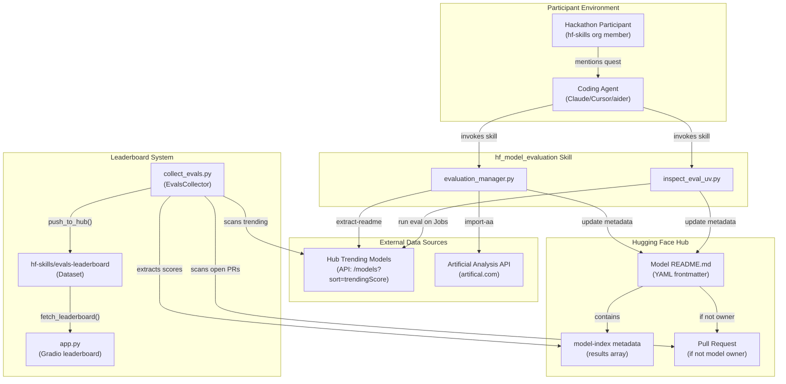
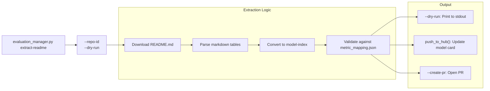
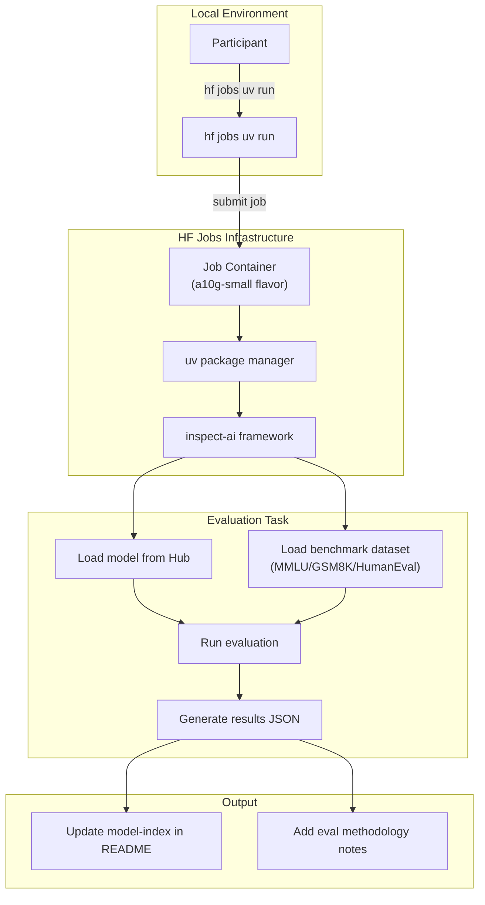
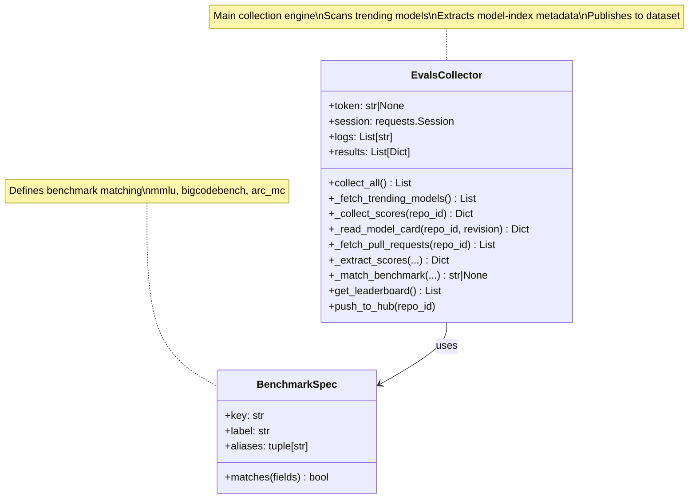
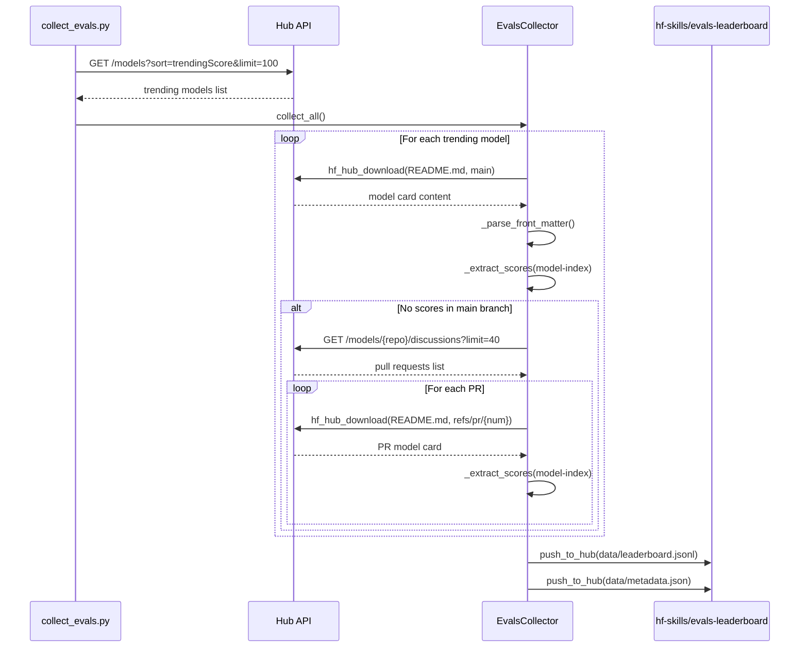
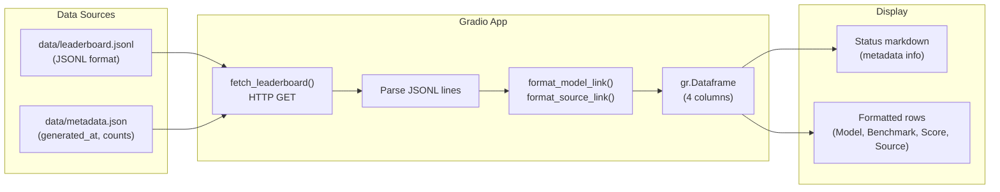

<!-- source: DeepWiki mcp.deepwiki.com · repo huggingface/skills · extra page Week 1: Model Evaluation Quest · fetched 2026-10-30 -->

# Week 1: Model Evaluation Quest

<details>
<summary>Relevant source files</summary>

The following files were used as context for generating this wiki page:

- [apps/evals-leaderboard/app.py](apps/evals-leaderboard/app.py)
- [apps/evals-leaderboard/collect_evals.py](apps/evals-leaderboard/collect_evals.py)
- [apps/evals-leaderboard/requirements.txt](apps/evals-leaderboard/requirements.txt)
- [apps/quests/02_evaluate-hub-model.md](apps/quests/02_evaluate-hub-model.md)
- [apps/quests/03_publish-hub-dataset.md](apps/quests/03_publish-hub-dataset.md)
- [apps/quests/04_sft-finetune-hub.md](apps/quests/04_sft-finetune-hub.md)
- [apps/quests/README.md](apps/quests/README.md)

</details>


## Purpose and Scope

This page documents the Week 1 quest of Humanity's Last Hackathon: adding structured evaluation results to model cards on Hugging Face Hub. Participants use the `hf_model_evaluation` skill to extract, import, or generate benchmark scores for trending models, contributing to a distributed leaderboard. The quest runs from December 2-8, 2025, and awards XP based on contribution quality and type.

For information about the overall hackathon system and other quests, see [Hackathon Ecosystem](#5). For details on Week 2 (dataset publishing) and Week 3 (model fine-tuning), see [Weekly Quests](#5.1). For the technical implementation of the evaluation skill itself, see [Evaluation Manager Skill](#4.3).

---

## Quest Overview

The Week 1 quest addresses a fundamental problem in the open source AI ecosystem: model cards often lack structured evaluation data, making it difficult to compare models systematically. Participants add benchmark scores to model-index metadata in model cards, enabling automated leaderboard generation and better model discoverability.

### Goals

| Goal | Description |
|------|-------------|
| **Target Models** | 100 trending text-generation models on Hub |
| **Target Benchmarks** | MMLU, ARC MC, BigCodeBench, plus optional benchmarks |
| **Output Format** | Structured model-index YAML metadata in README frontmatter |
| **Leaderboard** | Public display at `hf-skills/evals-leaderboard` Space |

**Sources:** [apps/quests/02_evaluate-hub-model.md:1-18]()

---

## Quest Execution Flow



**Diagram: Week 1 Quest Data Flow** - Shows how participants use coding agents to invoke evaluation skills, which update model cards on Hub, which are then scanned by the collection system to populate the public leaderboard.

**Sources:** [apps/quests/02_evaluate-hub-model.md:34-86](), [apps/evals-leaderboard/collect_evals.py:104-203](), [apps/evals-leaderboard/app.py:49-98]()

---

## XP Tier System

The quest uses a five-tier XP system that rewards both quantity and quality. Higher tiers require more technical skill and original contributions.

| Tier | Symbol | XP | Requirements | Validation Criteria |
|------|--------|-----|--------------|---------------------|
| **Contributor** | 🐢 | 1 | Extract evaluation results from one benchmark and update model card | Any PR with evaluation data |
| **Evaluator** | 🐕 | 5 | Import scores from third-party benchmarks like Artificial Analysis | Previously undefined benchmark scores + merged PR |
| **Advanced** | 🦁 | 20 | Run original evaluation with inspect-ai and publish results | Original eval run + merged PR |
| **Bonus** | 🐉 | 20 | Contribute to the leaderboard application itself | Merged PR on Hub Space or GitHub repo |
| **Slop** | 🤢 | -20 | Submit non-useful PRs | Duplicate PRs, incorrect scores, spam |

### Tier Details

**🐢 Contributor (1 XP):** Entry-level participation. Use `evaluation_manager.py extract-readme` to parse existing evaluation tables from model READMEs and convert them to structured model-index format. This is manual data cleanup work that makes models more discoverable.

**🐕 Evaluator (5 XP):** Intermediate contribution. Use `evaluation_manager.py import-aa` to fetch benchmark scores from external sources like Artificial Analysis API. Requires proper attribution and must add previously missing benchmark data.

**🦁 Advanced (20 XP):** Expert-level contribution. Use `inspect_eval_uv.py` to run actual evaluations on HF Jobs infrastructure. Requires understanding of evaluation frameworks, proper methodology documentation, and original benchmark runs.

**🐉 Bonus (20 XP):** Ecosystem improvement. Contribute code to the leaderboard application (`apps/evals-leaderboard/app.py`) or collection system (`apps/evals-leaderboard/collect_evals.py`). Examples include: adding new benchmarks to `BENCHMARKS` dict, improving score extraction logic, or enhancing the Gradio UI.

**🤢 Slop (-20 XP):** Quality control. Penalizes submissions that waste maintainer time: duplicate PRs for models that already have scores, incorrect benchmark values, or misattributed data sources.

**Sources:** [apps/quests/02_evaluate-hub-model.md:19-32]()

---

## Approach 1: Extract README Tables

The most common approach extracts evaluation tables that model authors have already published in their README markdown but haven't structured as model-index metadata.

### evaluation_manager.py extract-readme Command



**Diagram: extract-readme Command Flow** - Shows how the extraction command downloads model READMEs, parses markdown tables, converts them to model-index format, and optionally pushes updates or creates PRs.

### Usage Example

```bash
# Preview extraction without pushing
python hf_model_evaluation/scripts/evaluation_manager.py extract-readme \
  --repo-id "mistralai/Mistral-7B-v0.1" \
  --dry-run

# Push directly (requires model write access)
python hf_model_evaluation/scripts/evaluation_manager.py extract-readme \
  --repo-id "your-username/your-model"

# Create PR for external models
python hf_model_evaluation/scripts/evaluation_manager.py extract-readme \
  --repo-id "mistralai/Mistral-7B-v0.1" \
  --create-pr
```

### Technical Details

The `extract-readme` command uses regular expressions to identify markdown tables containing evaluation results. It searches for table headers matching known benchmark names (MMLU, ARC, BigBenchHard, etc.) and extracts score columns. The extraction logic handles:

- **Transposed tables** where models are rows and benchmarks are columns
- **Multiple score formats** including percentages, decimals, and fractions
- **Nested headers** in complex multi-row table structures
- **Metric normalization** using [hf_model_evaluation/examples/metric_mapping.json]()

The command always validates extracted scores against `metric_mapping.json` to ensure consistency with standard benchmark definitions.

**Sources:** [apps/quests/02_evaluate-hub-model.md:46-58]()

---

## Approach 2: Import Artificial Analysis Scores

For models with published scores on external benchmarking sites, the `import-aa` command fetches data from Artificial Analysis API and adds it to model cards with proper attribution.

### evaluation_manager.py import-aa Command

```bash
python hf_model_evaluation/scripts/evaluation_manager.py import-aa \
  --creator-slug "anthropic" \
  --model-name "claude-sonnet-4" \
  --repo-id "target/hub-model" \
  --create-pr
```

### Command Parameters

| Parameter | Purpose | Example |
|-----------|---------|---------|
| `--creator-slug` | Organization/creator on Artificial Analysis | `"anthropic"`, `"openai"` |
| `--model-name` | Model identifier on Artificial Analysis | `"claude-sonnet-4"`, `"gpt-4"` |
| `--repo-id` | Target Hub model to update | `"anthropic/claude-sonnet-4"` |
| `--create-pr` | Open PR instead of direct push | Flag, no value |

The command queries the Artificial Analysis API, extracts benchmark scores (MMLU, ARC, etc.), and adds them to the model's model-index metadata with source attribution pointing to `https://artificial.com/`.

**Sources:** [apps/quests/02_evaluate-hub-model.md:59-71]()

---

## Approach 3: Run Custom Evaluations

The most advanced approach runs actual evaluations using the `inspect-ai` framework on HF Jobs infrastructure.

### inspect_eval_uv.py Execution



**Diagram: inspect_eval_uv.py Execution Flow** - Shows how the evaluation script runs on HF Jobs, loads model and dataset, executes benchmarks, and updates the model card.

### Usage Example

```bash
# Run MMLU evaluation on a model
HF_TOKEN=$HF_TOKEN hf jobs uv run hf_model_evaluation/scripts/inspect_eval_uv.py \
  --flavor a10g-small \
  --secret HF_TOKEN=$HF_TOKEN \
  -- --model "meta-llama/Llama-2-7b-hf" --task "mmlu"

# Run with custom configuration
HF_TOKEN=$HF_TOKEN hf jobs uv run hf_model_evaluation/scripts/inspect_eval_uv.py \
  --flavor a100-large \
  --secret HF_TOKEN=$HF_TOKEN \
  -- --model "mistralai/Mistral-7B-v0.1" \
     --task "gsm8k" \
     --max-samples 500
```

### Available Tasks

The script supports standard evaluation tasks from the `inspect-ai` framework:

- **MMLU** - Massive Multitask Language Understanding (knowledge)
- **GSM8K** - Grade School Math problems (reasoning)
- **HumanEval** - Python code generation (coding)
- **ARC** - AI2 Reasoning Challenge (reasoning)
- **TruthfulQA** - Question answering truthfulness (safety)

Results are automatically formatted and added to the model's model-index metadata with methodology notes describing the evaluation setup.

**Sources:** [apps/quests/02_evaluate-hub-model.md:73-86]()

---

## Leaderboard System Architecture

The leaderboard system continuously scans trending models and aggregates evaluation scores into a public dataset and Gradio application.

### collect_evals.py Core Classes



**Diagram: collect_evals.py Class Structure** - Shows the main `EvalsCollector` class that orchestrates model scanning, score extraction, and dataset publishing.

### BENCHMARKS Configuration

The system tracks three primary benchmarks defined in [apps/evals-leaderboard/collect_evals.py:79-101]():

```python
BENCHMARKS: Dict[str, BenchmarkSpec] = {
    "mmlu": BenchmarkSpec(
        key="mmlu",
        label="MMLU",
        aliases=("mmlu", "massive multitask language understanding"),
    ),
    "bigcodebench": BenchmarkSpec(
        key="bigcodebench",
        label="BigCodeBench",
        aliases=("bigcodebench", "big code bench"),
    ),
    "arc_mc": BenchmarkSpec(
        key="arc_mc",
        label="ARC MC",
        aliases=(
            "arc mc", "arc-challenge", "arc challenge",
            "arc multiple choice", "arc c",
        ),
    ),
}
```

Each `BenchmarkSpec` includes aliases for fuzzy matching against model-index metadata field names, dataset names, and metric types.

**Sources:** [apps/evals-leaderboard/collect_evals.py:62-101]()

### Collection Workflow



**Diagram: collect_evals.py Execution Sequence** - Shows how the collector fetches trending models, extracts scores from main branch and PRs, and publishes aggregated data.

### Score Extraction Logic

The `_extract_scores` method at [apps/evals-leaderboard/collect_evals.py:265-322]() implements the core extraction logic:

1. **Parse model-index array** from YAML frontmatter
2. **Iterate through results** for each model entry
3. **Extract dataset and task metadata** (dataset name, type, task type)
4. **Match benchmarks** using `_match_benchmark()` against aliases
5. **Coerce scores** to float using `_coerce_score()` helper
6. **Track best score** per benchmark (if multiple metrics exist)
7. **Store attribution** (contributor, source type, source URL, revision)

The method handles both direct model card metadata and scores from open pull requests, prioritizing higher scores when duplicates exist.

**Sources:** [apps/evals-leaderboard/collect_evals.py:265-341]()

---

## Leaderboard Application

The Gradio application at [apps/evals-leaderboard/app.py]() provides a public interface to the collected scores.

### Data Flow



**Diagram: app.py Data Flow** - Shows how the Gradio app fetches leaderboard data, formats it, and displays it in a dataframe.

### Table Schema

The leaderboard displays four columns defined at [apps/evals-leaderboard/app.py:19-31]():

| Column | Data Type | Format | Example |
|--------|-----------|--------|---------|
| **Model** | `markdown` | `[model_id](https://huggingface.co/{model_id})` | `[mistralai/Mistral-7B-v0.1](...)` |
| **Benchmark** | `text` | Plain string | `MMLU`, `BigCodeBench`, `ARC MC` |
| **Score** | `number` | Float rounded to 2 decimals | `72.45`, `68.30` |
| **Source** | `markdown` | `{type} by [{contributor}]({url})` | `model-card by [mistralai](...)` |

The `format_model_link()` and `format_source_link()` functions at [apps/evals-leaderboard/app.py:39-46]() generate the markdown links for clickable navigation.

**Sources:** [apps/evals-leaderboard/app.py:19-46]()

### Refresh Handler

The `refresh_handler()` function at [apps/evals-leaderboard/app.py:64-98]() is the main data loading function:

1. **Fetch data** from `LEADERBOARD_URL` and `METADATA_URL` constants
2. **Parse JSONL** into list of entry dicts
3. **Build table rows** with formatted links
4. **Generate status** markdown with metadata stats
5. **Return tuple** of (status_markdown, rows_list) for Gradio display

The handler is connected to the Gradio `demo.load()` event at [apps/evals-leaderboard/app.py:119-122]() to refresh data when the page loads.

**Sources:** [apps/evals-leaderboard/app.py:64-122]()

---

## Tips and Best Practices

### Validation Workflow

Always use `--dry-run` before pushing changes to preview the extracted metadata:

```bash
# Step 1: Preview extraction
python hf_model_evaluation/scripts/evaluation_manager.py extract-readme \
  --repo-id "target-model" \
  --dry-run

# Step 2: Manually inspect output

# Step 3: Push if correct
python hf_model_evaluation/scripts/evaluation_manager.py extract-readme \
  --repo-id "target-model"
```

### Common Issues

| Issue | Cause | Solution |
|-------|-------|----------|
| **Transposed tables** | Models as rows, benchmarks as columns | Check README structure; may require manual model-index creation |
| **Duplicate PRs** | Model already has scores | Check existing model-index before creating PR; close duplicate |
| **Incorrect scores** | Parsing error or wrong benchmark | Validate against source; use `--dry-run` to inspect |
| **Missing attribution** | No source URL provided | Use `--create-pr` with proper commit message |

### PR Etiquette

When opening PRs on external models:

1. **Check existing metadata** - Don't duplicate scores that already exist
2. **Validate accuracy** - Manually verify extracted scores against source
3. **Provide context** - Explain extraction method in PR description
4. **Be responsive** - Close PRs promptly if maintainer prefers different format
5. **Attribution** - Always cite source URL for imported scores

**Sources:** [apps/quests/02_evaluate-hub-model.md:87-93]()

---

## Resources

- **Skill Documentation:** [hf_model_evaluation/SKILL.md]() - Complete skill reference
- **Usage Examples:** [hf_model_evaluation/examples/USAGE_EXAMPLES.md]() - Worked examples
- **Metric Mapping:** [hf_model_evaluation/examples/metric_mapping.json]() - Standard metric definitions
- **Quest Definition:** [apps/quests/02_evaluate-hub-model.md]() - Official quest specification
- **Leaderboard Dataset:** [hf-skills/evals-leaderboard](https://huggingface.co/datasets/hf-skills/evals-leaderboard) - Live data
- **Leaderboard App:** [hf-skills/evals-leaderboard](https://huggingface.co/spaces/hf-skills/evals-leaderboard) - Public display

**Sources:** [apps/quests/02_evaluate-hub-model.md:94-99]()

---

