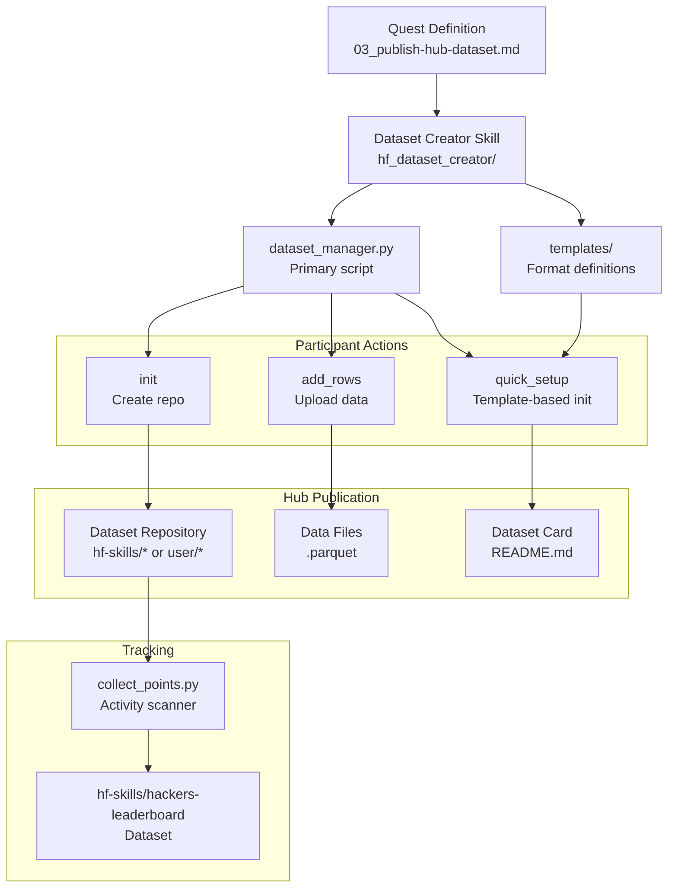
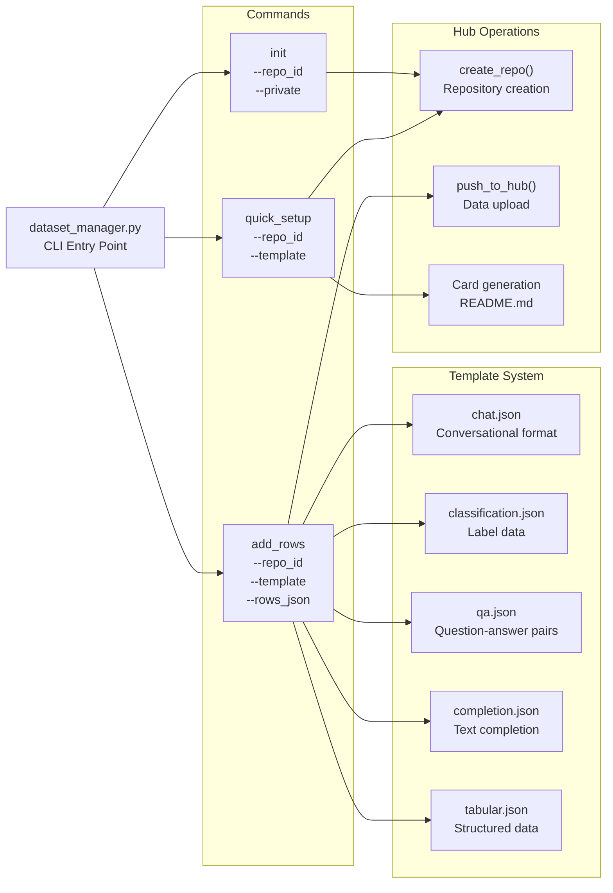
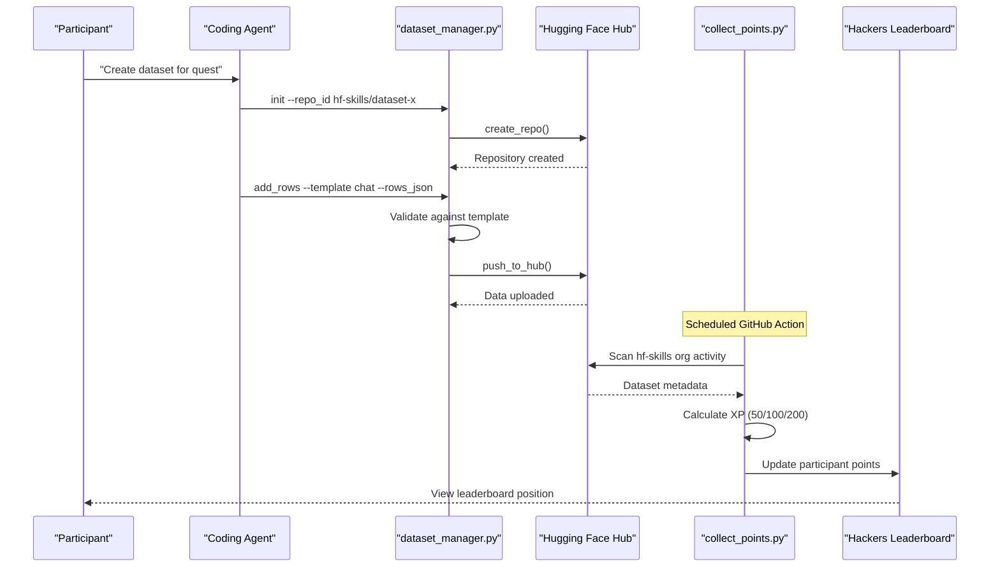
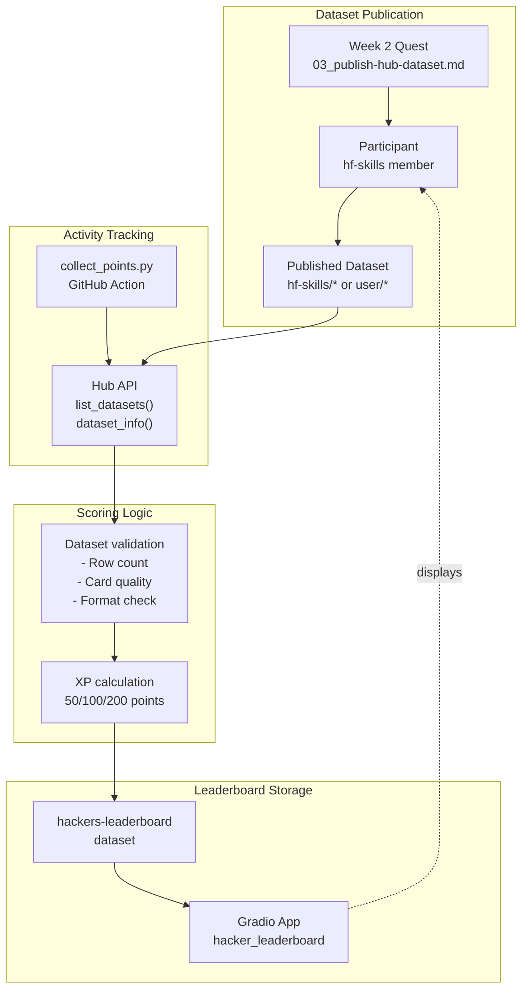
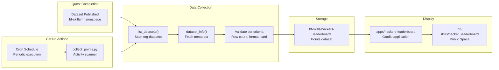

<!-- source: DeepWiki mcp.deepwiki.com · repo huggingface/skills · extra page Week 2: Dataset Publishing Quest · fetched 2026-10-30 -->

# Week 2: Dataset Publishing Quest

<details>
<summary>Relevant source files</summary>

The following files were used as context for generating this wiki page:

- [apps/quests/02_evaluate-hub-model.md](apps/quests/02_evaluate-hub-model.md)
- [apps/quests/03_publish-hub-dataset.md](apps/quests/03_publish-hub-dataset.md)
- [apps/quests/04_sft-finetune-hub.md](apps/quests/04_sft-finetune-hub.md)
- [apps/quests/README.md](apps/quests/README.md)

</details>


## Purpose and Scope

This document describes the Week 2 quest in the Humanity's Last Hackathon, which challenges participants to create and publish high-quality datasets on Hugging Face Hub using the `hf_dataset_creator` skill. The quest operates on a three-tier XP system (Starter, Standard, Advanced) and integrates with the hackathon's points tracking system.

For information about the overall hackathon structure and leaderboard systems, see [Hackathon Ecosystem](#5). For details about the other weekly quests, see [Week 1: Model Evaluation Quest](#5.1.1) and [Week 3: Model Fine-Tuning Quest](#5.1.3). For comprehensive documentation of the dataset creator skill itself, see [Dataset Creator Skill](#4.2).

## Quest Structure

### Quest Definition

The quest is defined in [apps/quests/03_publish-hub-dataset.md:1-75]() and focuses on creating properly structured, well-documented datasets that enable model development. The quest emphasizes quality over quantity, requiring complete dataset cards with proper licensing and data provenance documentation.



**Sources:** [apps/quests/03_publish-hub-dataset.md]()

### Key Objectives

The quest defines three primary objectives as stated in [apps/quests/03_publish-hub-dataset.md:5-7]():

1. **Foundation for open source models** — Create datasets that enable next-generation model development
2. **Proper documentation** — Include complete dataset cards with licensing, splits, and provenance
3. **Quality standards** — Focus on clean, properly structured data over raw quantity

## XP Tier System

The quest implements a three-tier reward structure with progressively increasing difficulty and XP awards.

| Tier | XP | Requirements | Validation Criteria |
|------|-----|--------------|---------------------|
| 🐢 Starter | 50 XP | ≤1,000 rows, complete dataset card, proper licensing | Clean data, clear documentation, valid license |
| 🐕 Standard | 100 XP | ≤1,000 rows, conversational format, complete card | Chat template compliance, documentation quality |
| 🦁 Advanced | 200 XP | Multi-language translation of existing dataset | Translation quality, multiple language support |

**Sources:** [apps/quests/03_publish-hub-dataset.md:24-65]()

### Tier 1: Starter (50 XP)

The starter tier focuses on basic dataset creation mechanics. Participants must create a small dataset with comprehensive documentation.

**Requirements from [apps/quests/03_publish-hub-dataset.md:27-34]():**
- Maximum 1,000 rows
- Dataset card covering license, splits, and data provenance
- Publication under `hf-skills/*` organization or personal account

**Example workflow:**

```bash
# Initialize repository
python hf_dataset_creator/scripts/dataset_manager.py init \
  --repo_id "hf-skills/your-dataset-name"

# Add data rows
python hf_dataset_creator/scripts/dataset_manager.py add_rows \
  --repo_id "hf-skills/your-dataset-name" \
  --template classification \
  --rows_json "$(cat your_data.json)"
```

**Sources:** [apps/quests/03_publish-hub-dataset.md:27-44]()

### Tier 2: Standard (100 XP)

The standard tier requires conversational data format, which is more complex than classification data.

**Requirements from [apps/quests/03_publish-hub-dataset.md:46-55]():**
- Maximum 1,000 rows
- Conversational/chat format
- Complete dataset card with license and splits
- Publication under `hf-skills/*` organization

**Quick setup with template:**

```bash
python hf_dataset_creator/scripts/dataset_manager.py quick_setup \
  --repo_id "your-username/dataset-name" --template chat
```

**Sources:** [apps/quests/03_publish-hub-dataset.md:46-55]()

### Tier 3: Advanced (200 XP)

The advanced tier requires dataset translation, demonstrating multilingual data engineering capabilities.

**Requirements from [apps/quests/03_publish-hub-dataset.md:57-64]():**
1. Select an existing Hub dataset
2. Translate into multiple languages
3. Publish translated versions under `hf-skills/*`
4. Maintain data quality across translations

**Sources:** [apps/quests/03_publish-hub-dataset.md:57-64]()

## Skill Integration: `hf_dataset_creator`

### dataset_manager.py Command Structure

The primary interface for quest completion is `dataset_manager.py`, which provides three main commands:



**Sources:** [apps/quests/03_publish-hub-dataset.md:18-44]()

### Template-Based Validation

The skill supports five data format templates located in `hf_dataset_creator/templates/`:

| Template | File | Use Case |
|----------|------|----------|
| `chat` | `chat.json` | Conversational data with multiple turns |
| `classification` | `classification.json` | Text classification with labels |
| `qa` | `qa.json` | Question-answer pairs |
| `completion` | `completion.json` | Text completion tasks |
| `tabular` | `tabular.json` | Structured/columnar data |

Each template defines the expected JSON schema for data validation before upload.

**Sources:** [apps/quests/03_publish-hub-dataset.md:14-16](), [apps/quests/03_publish-hub-dataset.md:69]()

## Quest Workflow and Data Flow

### Participant Workflow



**Sources:** [apps/quests/03_publish-hub-dataset.md:36-44](), [apps/quests/README.md:47-49]()

### Points Collection Integration

The quest integrates with the hackathon tracking system through the following data flow:



**Sources:** [apps/quests/README.md:101-112]()

### XP Calculation Logic

The points collection system evaluates datasets based on the tier requirements:

| Evaluation Criterion | Starter | Standard | Advanced |
|---------------------|---------|----------|----------|
| Row count validation | ≤1,000 | ≤1,000 | N/A (translation) |
| Format check | Any template | `chat` template | Multi-language |
| Card completeness | License + splits + provenance | License + splits | Full documentation |
| Organization scope | `hf-skills/*` preferred | `hf-skills/*` required | `hf-skills/*` required |

**Sources:** [apps/quests/03_publish-hub-dataset.md:27-64]()

## Command Reference

### Initialize New Dataset

```bash
python hf_dataset_creator/scripts/dataset_manager.py init \
  --repo_id "hf-skills/dataset-name" \
  [--private]
```

Creates a new dataset repository on the Hub with proper structure.

**Sources:** [apps/quests/03_publish-hub-dataset.md:36-38]()

### Add Data Rows

```bash
python hf_dataset_creator/scripts/dataset_manager.py add_rows \
  --repo_id "hf-skills/dataset-name" \
  --template classification \
  --rows_json "$(cat your_data.json)"
```

Validates data against template schema and uploads to Hub using streaming to avoid local downloads.

**Sources:** [apps/quests/03_publish-hub-dataset.md:40-44]()

### Quick Setup with Template

```bash
python hf_dataset_creator/scripts/dataset_manager.py quick_setup \
  --repo_id "your-username/dataset-name" \
  --template chat
```

Initializes repository with template-specific structure and pre-populated dataset card.

**Sources:** [apps/quests/03_publish-hub-dataset.md:18-22]()

## Validation and Quality Standards

### Dataset Card Requirements

All tiers require a complete dataset card. The card must include:

1. **License** — Clear specification of data licensing (required by [apps/quests/03_publish-hub-dataset.md:31]())
2. **Splits** — Definition of train/validation/test splits (required by [apps/quests/03_publish-hub-dataset.md:31]())
3. **Data Provenance** — Source and collection methodology (Starter tier requirement from [apps/quests/03_publish-hub-dataset.md:31]())

### Quality Criteria

From [apps/quests/03_publish-hub-dataset.md:34](), datasets must meet these standards:

- **Clean data** — No malformed or duplicate entries
- **Clear documentation** — Unambiguous descriptions of fields and use cases
- **Proper licensing** — Valid open source license appropriate for the data

**Sources:** [apps/quests/03_publish-hub-dataset.md:29-34]()

## Resources and Documentation

The quest references these supporting materials:

| Resource | Location | Purpose |
|----------|----------|---------|
| Full skill documentation | `hf_dataset_creator/SKILL.md` | Complete API reference |
| JSON templates | `hf_dataset_creator/templates/` | Format schemas for validation |
| Example datasets | `hf_dataset_creator/examples/` | Sample data and system prompts |

**Sources:** [apps/quests/03_publish-hub-dataset.md:67-70]()

## Integration with Leaderboard System

### Tracking Mechanism

The quest integrates with the hackathon leaderboard through automated activity tracking:



**Sources:** [apps/quests/README.md:92-100](), [apps/quests/README.md:101-112]()

### Leaderboard Display

Participant contributions are displayed on the public leaderboard at `hf-skills/hacker_leaderboard` Space, embedded in the quest documentation at [apps/quests/README.md:92-100](). The leaderboard updates automatically as `collect_points.py` processes new dataset publications.

**Sources:** [apps/quests/README.md:92-100]()

---

